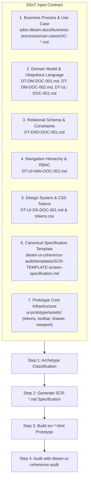

# DTEAM Screen & Prototype Scaffolder Skill

## 1. Purpose & Scope

This skill automates the end-to-end scaffolding of new user interface deliverables for the **Asset Performance Management (APM) and Digital Twin (DTEAM)** system.

When invoked with a target use case (e.g., `UC-INV-025`, `UC-MTTO-002`, `UC-INV-027`), the skill produces two tightly synchronized deliverables:
1. **Screen Specification Document (`SCR-[MOD]-[NUM].md`):** Written in English, formatted in strict compliance with the canonical 9-section standard (`SCR-TEMPLATE-screen-specification.md`), and audited against repository SSoTs.
2. **Interactive HTML Prototype (`scr-[mod]-[num].html`):** A functional, responsive, high-performance HMI prototype utilizing the shared framework (`tokens.css`, `canvas-viewport.*`, `asset-drawer.*`, `top-toolbar.*`, `mai-bar.js`) and registered in `dev-wrapper.html`.

---

## 2. Input Contract (Mandatory Sources of Truth)

Before drafting any line of code or documentation, the agent **MUST** read and cross-reference the following local documents:

1. **Use Case (`UC-*.md`):** Actors, pre-conditions, main transactional workflow, and alternate safety/error flows.
2. **Domain Models (`DT-DM-001.md`, `DT-DM-002.md`, `DT-UL-001.md`):** Entity definitions, method signatures, invariants, and exact Ubiquitous Language terms (no generic synonyms).
3. **Database Schema (`DT-ERD-DOC-001.md`):** Physical column names, nullability, unique keys, and referential cardinalities (`1:N`, `N:M`).
4. **Navigation Specification (`DT-UI-NAV-DOC-001.md`):** ANSI/ISA-101 level (`L1`, `L2`, `L3`, `L4`), authorized RBAC roles, transition triggers, and safety guards (Offline Guard, LOTO Interlock).
5. **Design System & Tokens (`DT-UI-DS-DOC-001.md`, `tokens.css`):** Semantic tokens (`--dt-color-*`, `--dt-space-*`, `--dt-radius-*`, `--dt-z-*`), HPHMI grayscale philosophy, and alarm semantics.
6. **Canonical Specification Template (`SCR-TEMPLATE-screen-specification.md`):** The exact 9-section structure.
7. **Prototype Shared Modules (`ui-prototype/assets/`):** Existing reusable controls (`top-toolbar.*`, `asset-drawer.*`, `canvas-viewport.*`, `svg-canvas-loader.js`, `popover-card.css`, `mai-bar.js`).

---

## 3. Step-by-Step Execution Workflow

### Step 1: Archetype & Layout Classification

Classify the target screen into one of the three established system archetypes:

*   **Archetype A: Supervisory / Spatial Workspace (Digital Twin - L1/L3):**
    *   *Examples:* `SCR-VIS-008` (Plant Map L1), `SCR-VIS-033` (Faceplate L3).
    *   *Pattern:* Coexists on the continuous *Single-Canvas Workspace* (`PlantViewportController`). Uses SVG vector layers, semantic zoom (`0.85x` to `4.5x`), lateral sliding drawer (`asset-drawer.js`), and floating HUD toolbar.
*   **Archetype B: Field Execution / Modal Task (APM Mobile - L4):**
    *   *Examples:* `SCR-VIS-011` (LOTO Lockout), `SCR-INV-025` (Asset Swap Pauli Modal), `SCR-MTTO-002` (WO Closing).
    *   *Pattern:* Contextual task container. On desktop/landscape: lateral drawer or modal overlay; on portrait/mobile: responsive bottom sheet (`height: 52vh` default, draggable to `85vh`). Heavy tactile buttons ($\ge 48\text{px}$), barcode/NFC scan triggers, and offline SQLCipher resilience.
*   **Archetype C: Supervisory Backlog & Governance (Web Portal - L2):**
    *   *Examples:* `SCR-MTTO-026` (RIME Backlog), `SCR-INV-027` (FL Tree), `SCR-ADM-013` (RBAC Matrix), `SCR-ADM-032` (SHA-256 Audit).
    *   *Pattern:* Desktop workstation layout ($1920\times 1080$), collapsible navigation sidebar, breadcrumb trail, dense multi-column data grids with sorting, filtering, and cryptographic audit indicators.

---

### Step 2: Screen Specification Generation (`SCR-[MOD]-[NUM].md`)

Generate the specification markdown in `adso-dteam-docs/ui-ux/screens/[module]/` adhering strictly to the **9 mandatory sections**:

1.  **Frontmatter:** `id`, `title`, `module`, `isa101_level`, `platform`, `target_device`, `roles`, `user_stories`, `use_cases`, `version: 1.0`, `date`, `status: Approved`.
2.  **§1 Purpose and Operational Context:** Operational objective, primary persona, secondary personas, physical environment (e.g., Class I Div 2 hazardous area), and mode of operation.
3.  **§2 Visual Artifact:** Obsidian transclusion link `![[SCR-[MOD]-[NUM]-wireframe.svg]]`.
4.  **§3 Functional Component Inventory:** Table of `CMP-01`..`CMP-NN`.
    *   *Rule:* Table cells must strictly act as a visual catalog (Role, Content, Semantic Tokens, pointer to §5). **Never** write interaction algorithms, clamping math, or state machines inside §3 table cells.
5.  **§4 Screen State Matrix:** Matrix of observable visual modifications in the DOM (`Normal`, `Loading`, `Selected`, `Alarm`, `Diagnostic/Offline`).
    *   *Rule:* Focus purely on visual rendering changes. Do not duplicate backend business logic.
6.  **§5 Interaction Rules and Data Flow (The Single Source of Truth - SSoT):**
    *   *§5.1 Initial Load & Lifecycle:* Default coordinates, zoom level, closed drawer state, initial subscriptions.
    *   *§5.2 Navigation & Mechanics:* Spatial interactions, touch thresholds ($4\text{px}$ pan), layout shift invariants, gesture physics.
    *   *§5.3 Domain Workflows & Data Mutation:* Method payloads, validation constraints, cryptographic hashing, and fail-safe handling.
7.  **§6 Industrial and Safety Considerations:**
    *   HPHMI compliance (90/10 grayscale rule, no green for "normal running").
    *   Diagnostic (Priority 4) vs Process Alarm segregation.
    *   Offline partition tolerance ([ASR-001](file:///home/novillus/Documents/vscode/SENA-Career/adso-dteam-docs/architecture/requirements/DT-ARQ-ASR-001.md)) and safety fail-safe locks ([ASR-002](file:///home/novillus/Documents/vscode/SENA-Career/adso-dteam-docs/architecture/requirements/DT-ARQ-ASR-001.md)).
8.  **§7 Frontend Component Contract (Blazor / Razor):**
    *   *§7.1 Component Hierarchy & File Mapping:* Tree structure of `.razor` files under `Pages/` or `Components/`.
    *   *§7.2 Physical Parameters & DTOs (.NET 10 / C# 14):* Strongly-typed C# records and component parameters.
    *   *§7.3 Client-Side DOM & Interop Bridge:* JSInterop boundaries, event throttling, and touch listener lifecycles.
9.  **§8 Layout and Responsive Adaptability:**
    *   Explicit 3-tier breakpoint table: Desktop ($\ge 1400\text{px}$), Tablet Landscape ($901\text{px}-1399\text{px}$), Tablet Portrait ($600\text{px}-900\text{px}$).
10. **§9 Traceability and Requirements Matrix:**
    *   Mapping table: Requirement ID (`FR-*`, `NFR-*`, `TR-*`) $\to$ Component ID (`CMP-*`) $\to$ Verification Mechanism.

---

### Step 3: Interactive HTML Prototype Creation (`scr-[mod]-[num].html`)

Create the standalone prototype in `sena-evidence/00-Overview/Protoyping/ui-prototype/`:

1.  **Architecture & Shared CSS:**
    *   Include `assets/tokens.css`, `assets/top-toolbar.css`, `assets/asset-drawer.css`, and custom screen styles.
    *   **Do NOT hardcode colors:** Use `var(--dt-color-*)` semantic tokens exclusively.
    *   **Do NOT use pure white (`#FFF`) or pure black (`#000`):** Use `--dt-color-surface-base`, `--dt-primitive-gray-10`, etc.
2.  **Shared Javascript Modules:**
    *   Include `assets/svg-canvas-loader.js`, `assets/canvas-viewport.js`, `assets/asset-drawer.js`, and `assets/top-toolbar.js` when building canvas/drawer views.
3.  **Moving Analog Indicators (MAI) Responsive Standard:**
    *   *Landscape / Compact mode:* Variable name on row 1 (`.mai-compact-label`), value on row 2 right-aligned (`.mai-compact-val`), bar on row 3 (`.mai-bar-wrap`), scale limits on row 4 (`.mai-compact-limits`).
    *   *Portrait mode:* Variable name and value share row 1 (`justify-content: space-between`), bar on row 2, scale limits on row 3.
4.  **Bottom Sheet Drawer Containment:**
    *   In portrait orientation, constrain initial height to `height: 52vh` (matching `VIS-033` and `VIS-008`), allowing smooth dragging up to `85vh` without blocking the spatial canvas.
5.  **Status Badges & Alarms:**
    *   Badges must have centered text (`justify-content: center; text-align: center;`), no decorative icons, and follow ISA-101 alarm color semantics (red only for critical alarm, amber for warning, blue for info/selection).
6.  **Wrapper Integration:**
    *   Register the new prototype in `sena-evidence/00-Overview/Protoyping/ui-prototype/dev-wrapper.html` inside the `<select id="screenSelect">` dropdown.

---

### Step 4: Coherence Self-Audit

Before presenting the deliverable to the user, the agent must execute the validation checklist defined in `dteam-ui-coherence-audit`:
*   [ ] 9 canonical sections present in exact order in the specification.
*   [ ] Zero hardcoded hex colors violating the Design System tokens.
*   [ ] Zero green indicators used for "normal running" status.
*   [ ] All continuous process telemetry represented as Moving Analog Indicators (MAI).
*   [ ] Database columns in `DT-ERD-DOC-001` match UI inputs with strict type parity.
*   [ ] No auto-scroll jumps disrupting the technician's focus during checklist operations.
*   [ ] Prototype loads and functions error-free in modern browsers without console warnings.
