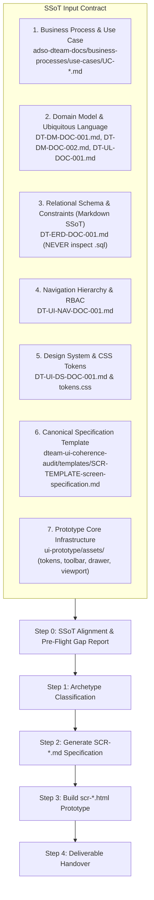

# DTEAM Screen & Prototype Scaffolder Skill

## 1. Purpose & Scope

This skill automates the end-to-end scaffolding of new user interface deliverables for the **Asset Performance Management (APM) and Digital Twin (DTEAM)** system.

When invoked with a target use case (e.g., `UC-INV-025`, `UC-MTTO-002`, `UC-INV-027`), the skill produces two tightly synchronized deliverables:
1. **Screen Specification Document (`SCR-[MOD]-[NUM].md`):** Written in English, formatted in strict compliance with the canonical 9-section standard (`SCR-TEMPLATE-screen-specification.md`), and audited against repository SSoTs.
2. **Interactive HTML Prototype (`scr-[mod]-[num].html`):** A functional, responsive, high-performance HMI prototype utilizing the shared framework (`tokens.css`, `canvas-viewport.*`, `asset-drawer.*`, `top-toolbar.*`, `mai-bar.js`) and registered in `dev-wrapper.html`.

---

## 2. Input Contract (Mandatory Sources of Truth)

Before drafting any line of code or documentation, the agent **MUST** read and cross-reference the following local documents:



1. **Use Case (`UC-*.md`):** Actors, pre-conditions, main transactional workflow, and alternate safety/error flows.
2. **Domain Models (`DT-DM-001.md`, `DT-DM-002.md`, `DT-UL-001.md`):** Entity definitions, method signatures, invariants, and exact Ubiquitous Language terms (no generic synonyms).
3. **Database Schema (`DT-ERD-DOC-001.md`):** Physical column names, nullability, unique keys, and referential cardinalities (`1:N`, `N:M`). **CRITICAL RULE:** `DT-ERD-DOC-001.md` (markdown) is the SOLE Source of Truth for the relational schema. Never inspect generated `.sql` files, as they are downstream build artifacts that may be stale or out of sync.
4. **Navigation Specification (`DT-UI-NAV-DOC-001.md`):** ANSI/ISA-101 level (`L1`, `L2`, `L3`, `L4`), authorized RBAC roles, transition triggers, and safety guards (Offline Guard, LOTO Interlock).
5. **Design System & Tokens (`DT-UI-DS-DOC-001.md`, `tokens.css`):** Semantic tokens (`--dt-color-*`, `--dt-space-*`, `--dt-radius-*`, `--dt-z-*`), HPHMI grayscale philosophy, and alarm semantics.
6. **Canonical Specification Template (`SCR-TEMPLATE-screen-specification.md`):** The exact 9-section structure.
7. **Prototype Shared Modules (`ui-prototype/assets/`):** Existing reusable controls (`top-toolbar.*`, `asset-drawer.*`, `canvas-viewport.*`, `svg-canvas-loader.js`, `popover-card.css`, `mai-bar.js`).

---

## 3. Step-by-Step Execution Workflow

### Step 0: SSoT Alignment & Presentation DTO Abstraction

Before scaffolding specifications or prototypes, the agent **MUST** perform an automated cross-check between the target use case / user story and the established repository SSoTs:

0. **Upstream Use Case Audit Verification:**
   * Verify that the target Use Case (`UC-*.md`) has been audited and approved against repository SSoTs via `dteam-usecase-audit`. If the Use Case contains stale pre-ERD assumptions or generic variable placeholders, run `dteam-usecase-audit` to reconcile it *before* proceeding with screen generation.

1. **Relational Contract Reconciliation & Presentation DTO Abstraction:**
   * Inspect `DT-ERD-DOC-001.md` to identify all necessary entity fields, nullability (`NOT NULL`), and invariants.
   * **CRITICAL ARCHITECTURAL BOUNDARY:** Translate relational columns, foreign keys, and DB check constraints into **frontend Presentation DTO records and C# enums** *before* drafting the specification.
   * **STRICT PROHIBITION:** Never leak PostgreSQL schema qualifiers (`mtto.`, `tax.`, `adm.`, `ops.`), physical table names, DDL check constraint names (`ck_*`), SQL types (`timestamptz`), or SQL functions (`clock_timestamp()`) into §5.3 or §7.2 of the specification.

2. **Domain Nomenclature & Anti-Meta-Text Translation Rule:**
   * The scaffolder must act as an **architectural compiler**, never a blind copy-paster.
   * **STRICT PROHIBITION:** Never copy generic drafting variable aliases (e.g., `Asset A / Asset B`, `Item 1 / Item 2`, `Entity X / Y`, `Record 1 / 2`) or technical architecture pipeline jargon (`Single-Commit`, `OUTBOX`, `Lease Local Activo`, `Command Payload`) into component titles, wireframes, card headers, or UI labels.
   * **MANDATORY TRANSLATION:** Translate narrative drafting placeholders into authentic operational domain terminology defined in `DT-UL-DOC-001.md` and ISO 14224 (e.g., translating `Asset A (Dismounting)` $\to$ `Dismounted Asset / Activo Desmontado`, and `Asset B (Installation)` $\to$ `Replacement Asset / Activo de Reemplazo`).

3. **Three-Tier Translation Rule for Enums and State Mutations:**
   * When an upstream Use Case or ERD table defines a canonical lifecycle enum (e.g., `tax.equipment_units.operational_status IN ('OPERATIONAL', 'IN_REPAIR', 'IN_STORAGE', 'DAMAGED')`), the scaffolder MUST compile it across three strictly segregated tiers:
     * **Tier 1 (Presentation Contract - §7.2.3):** Define strongly-typed C# enums in `PascalCase` (e.g., `public enum DismountDestinationStatus { InRepair, InStorage, Damaged }`).
     * **Tier 2 (Spec Interaction Workflow - §5.3 Prose):** Reference the C# enum strictly by type name (`mapped to enum DismountDestinationStatus (§7.2.3)`). Strictly prohibit writing exhaustive string literal sets or LaTeX equations in prose (`status \in \{IN\_REPAIR, ...\}`).
     * **Tier 3 (Prototype / HTML DOM):** Bind authentic, localized industrial Spanish labels in UI text (`En Almacén Operativo`, `Dañado / Para Baja`), preserving the canonical uppercase database key strictly inside the HTML `value="..."` attribute (e.g., `<option value="IN_STORAGE">En Almacén Operativo</option>`). Strictly prohibit raw database `SCREAMING_SNAKE_CASE` strings in user-facing badges, buttons, or titles.

4. **Sequential Boundary Verification:** Verify input parameters, upstream preconditions, and downstream postconditions against adjacent screens in `DT-UI-NAV-DOC-001.md` (e.g., ensuring transitions from `SCR-VIS-011` properly pass active LOTO and WO context).

5. **Output:** The agent outputs a concise **Gap & Reconciliation Report** in the planning/execution log and embeds the abstracted Presentation DTOs directly into **§5.3** (Domain Workflows) and **§7.2** (Component Parameters & DTOs) of the generated specification.

### Step 1: Archetype & Layout Classification

Classify the target screen into one of the three established system archetypes:

*   **Archetype A: Supervisory / Spatial Workspace (Digital Twin - L1/L3):**
    *   *Examples:* `SCR-VIS-008` (Plant Map L1), `SCR-VIS-033` (Faceplate L3).
    *   *Pattern:* Coexists on the continuous *Single-Canvas Workspace* (`PlantViewportController`). Uses SVG vector layers, semantic zoom (`0.85x` to `4.5x`), lateral sliding drawer (`asset-drawer.js`), and floating HUD toolbar.
*   **Archetype B: Field Execution / Modal Task (APM Mobile - L4):**
    *   *Examples:* `SCR-VIS-011` (LOTO Lockout), `SCR-INV-025` (Asset Swap Pauli Modal), `SCR-MTTO-002` (WO Closing).
    *   *Pattern:* Contextual task container. On desktop/landscape: lateral drawer or modal overlay; on portrait/mobile: responsive bottom sheet (`height: min(45vh, 440px)` default, draggable to `85vh`). Heavy tactile buttons ($\ge 48\text{px}$), barcode/NFC scan triggers, and offline SQLCipher resilience.
*   **Archetype C: Supervisory Backlog & Governance (Web Portal - L2):**
    *   *Examples:* `SCR-MTTO-026` (RIME Backlog), `SCR-INV-027` (FL Tree), `SCR-ADM-013` (RBAC Matrix), `SCR-ADM-032` (SHA-256 Audit).
    *   *Pattern:* Desktop workstation layout ($1920\times 1080$), collapsible navigation sidebar, breadcrumb trail, dense multi-column data grids with sorting, filtering, and cryptographic audit indicators.

---

### Step 2: Screen Specification Generation (`SCR-[MOD]-[NUM].md`)

Generate the specification markdown in `adso-dteam-docs/ui-ux/screens/[module]/` adhering strictly to the **9 mandatory sections**:

1.  **Frontmatter:** `id`, `title`, `module`, `isa101_level`, `platform`, `target_device`, `roles`, `user_stories`, `use_cases`, `version: 1.0`, `date`, `status: Approved`.
2.  **§1 Purpose and Operational Context:** Operational objective, primary persona, secondary personas, physical environment (e.g., Class I Div 2 hazardous area), and mode of operation.
    *   *Rule:* Qualitative operational environment and hardware context only. Strictly prohibit breakpoint tokens (`--dt-breakpoint-*`), container pixel/vh dimensions, and domain enum lists in §1.
3.  **§2 Visual Artifact:** Universal markdown image link `![SCR-[MOD]-[NUM] Wireframe](assets/SCR-[MOD]-[NUM]-wireframe.svg)`.
4.  **§3 Functional Component Inventory:** Table of `CMP-01`..`CMP-NN`.
    *   *Rule:* Table cells must strictly act as a visual catalog (Role, Content, Semantic Tokens, pointer to §5). **Never** write interaction algorithms, clamping math, state machines, hardware layout dimensions (e.g., `640px`, `45vh`), status strings, domain enum lists, or NFR citations in §3 table cells. Column 4 ("Semantic Token") must reference explicit Design System tokens (`--dt-*`). Component titles and roles must use authentic domain terms from `DT-UL-DOC-001.md`; generic narrative aliases (`Asset A / Asset B`, `Item 1 / 2`) are strictly prohibited.
5.  **§4 Screen State Matrix:** Matrix of observable visual modifications in the DOM (`Normal`, `Loading`, `Selected`, `Alarm`, `Diagnostic/Offline`).
    *   *Rule:* Focus purely on visual rendering changes. Do not duplicate backend business logic. Use authentic domain names for affected entities (e.g., `Dismounted asset` / `Replacement asset`).
6.  **§5 Interaction Rules and Data Flow (The Single Source of Truth - SSoT):**
    *   *§5.1 Initial Load & Lifecycle:* Default coordinates, zoom level, closed drawer state, initial subscriptions.
        *   **Presentation Layer Boundary Invariant:** UI sequence diagrams (Mermaid) must model interactions strictly between the User/Technician (`Tech`), the presentation component (`UI`), external client hardware/interop (`Scanner`/`Sensor`), and the boundary Application Service API (`API`). Private backend-to-backend hops (e.g., `API ->> Worker`, `API ->> DB`) and internal backend self-loops (`API ->> API`) are prohibited presentation leaks.
    *   *§5.2 Navigation & Mechanics:* Spatial interactions, touch thresholds ($4\text{px}$ pan), layout shift invariants, gesture physics. SSoT for gesture physics, drag hysteresis, natural drawer heights, and focal pan/zoom offsets. Delegate container widths, viewport breakpoint ranges, and column stacking strictly to Section 8.
    *   *§5.3 Domain Workflows & Data Mutation:* Method payloads, validation constraints, cryptographic hashing, and fail-safe handling. Bound exclusively to Presentation DTOs.
        *   **Controlled Vocabulary & Enum Hygiene:** Bind dropdowns directly to C# enum types in §7.2.3. Never write exhaustive LaTeX set equations or prose lists enumerating enum string literals. Prohibit parenthetical mock fixtures in prose (`*(e.g., WorkOrderId = "WO-...")*`) that risk type clashes.
        *   **Offline Protocol Pointer:** When §5.3.5 exists, §5.3.4 command dispatch error handling must point directly to it rather than duplicating outbox steps.
7.  **§6 Industrial and Safety Considerations:**
    *   HPHMI compliance (90/10 grayscale rule, no green for "normal running").
    *   Diagnostic (Priority 4) vs Process Alarm segregation.
    *   Offline partition tolerance ([ASR-001](file:///home/novillus/Documents/vscode/SENA-Career/adso-dteam-docs/architecture/requirements/DT-ARQ-ASR-001.md)) and safety fail-safe locks ([ASR-002](file:///home/novillus/Documents/vscode/SENA-Career/adso-dteam-docs/architecture/requirements/DT-ARQ-ASR-001.md)).
8.  **§7 Frontend Component Contract (Blazor / Razor):**
    *   *§7.1 Component Hierarchy & File Mapping:* Tree structure of `.razor` files under `Pages/` or `Components/`.
    *   *§7.2 Physical Parameters & DTOs (.NET 10 / C# 14):* Strongly-typed C# records, component `[Parameter]` contracts, and view enums.
        *   **STRICT PROHIBITION:** Never declare C# `namespace` statements, full `ComponentBase` class declarations (`class Foo : ComponentBase`), `[Inject]` services, private mutable state fields (`private bool _isLoading;`), or lifecycle overrides (`OnInitializedAsync`). Specifications define external parameter contracts, not internal code-behind implementations.
    *   *§7.3 Client-Side DOM & Interop Bridge:* JSInterop capability interfaces (`IPointerInterop`, `IOfflineStorage`), event throttling, and touch listener lifecycles. Prohibit direct browser globals (`window.`, `document.`, `AudioContext`).
    *   *Rule on Clean Deliverables:* Never copy-paste scaffolding rules, prohibition alert boxes (`[!IMPORTANT]`), or architectural boundary comments into the generated screen specification. Deliverables must contain purely normative technical specifications.
9.  **§8 Layout and Responsive Adaptability:**
    *   Explicit 3-tier breakpoint table: Desktop ($\ge 1920\text{px}$, `--dt-breakpoint-xl`), Tablet Landscape ($1280\text{px}-1919\text{px}$, `--dt-breakpoint-lg` / $1280\times 800\text{px}$), Tablet Portrait ($768\text{px}-1279\text{px}$, `--dt-breakpoint-md` / $800\times 1280\text{px}$). Bound to canonical tokens `--dt-layout-drawer-width-desktop` and `--dt-layout-drawer-width-tablet`.
    *   *Rule:* SSoT for responsive breakpoint ranges, container widths, and layout stacking. Reference §5.2 for gesture physics and offsets; prohibit repeating snap math or raw CSS `calc()` expressions.
10. **§9 Traceability and Requirements Matrix:**
    *   Mapping table: Requirement ID (`FR-*`, `NFR-*`, `TR-*`) $\to$ Component ID (`CMP-*`) $\to$ Verification Mechanism.

---

### Step 3: Interactive HTML Prototype Creation (`scr-[mod]-[num].html`)

Create the standalone prototype in `sena-evidence/00-Overview/Protoyping/ui-prototype/`:

1.  **Architecture & Shared CSS:**
    *   Include `assets/tokens.css`, `assets/top-toolbar.css`, `assets/asset-drawer.css`, and custom screen styles.
    *   **Do NOT hardcode colors:** Use `var(--dt-color-*)` semantic tokens exclusively.
    *   **Do NOT use pure white (`#FFF`) or pure black (`#000`):** Use `--dt-color-surface-base`, `--dt-primitive-gray-10`, etc.
2.  **Shared Javascript Modules:**
    *   Include `assets/svg-canvas-loader.js`, `assets/canvas-viewport.js`, `assets/asset-drawer.js`, and `assets/top-toolbar.js` when building canvas/drawer views.
3.  **Moving Analog Indicators (MAI) Responsive Standard:**
    *   *Landscape / Compact mode:* Variable name on row 1 (`.mai-compact-label`), value on row 2 right-aligned (`.mai-compact-val`, `.loto-mai-grid .mai-value`), bar on row 3 (`.mai-bar-wrap`), scale limits on row 4 (`.mai-compact-limits`). Ensure dynamic updates (e.g., `updateMaiIndicator`) do not wipe out `.mai-compact-val`.
    *   *Portrait mode:* Variable name and value share row 1 (`justify-content: space-between`), bar on row 2, scale limits on row 3.
4.  **Bottom Sheet Drawer Containment:**
    *   In portrait orientation, constrain initial height to `height: min(45vh, 440px)` (matching `VIS-033` and `VIS-008`), allowing smooth dragging up to `85vh` without blocking the spatial canvas.
5.  **Status Badges & Alarms:**
    *   Badges must have centered text (`justify-content: center; text-align: center;`), no decorative icons, and follow ISA-101 alarm color semantics (red only for critical alarm, amber for warning, blue for info/selection).
    *   **Domain Copy & Localized Enums:** Display authentic localized domain text to the user (`En Almacén Operativo`, `En Taller / Reparación`). Confine raw uppercase database keys strictly to HTML `value="..."` attributes. Generic variable aliases (`Activo A`, `Activo B`, `Item 1`) are prohibited from visible UI copy.
6.  **Wrapper Integration:**
    *   Register the new prototype in `sena-evidence/00-Overview/Protoyping/ui-prototype/dev-wrapper.html` inside the `<select id="screenSelect">` dropdown.

---

### Step 4: Quality Gate & Pre-Flight Deterministic Linting

Before deliverable handover, the agent **MUST** execute the deterministic linter gate:

```bash
uv run .agents/skills/dteam-ui-coherence-audit/scripts/audit.py lint --file ui-ux/screens/[module]/SCR-[MOD]-[NUM].md
```

*   **Zero-Blocker Requirement:** If any `[BLOCKER]` is reported (e.g., schema qualifiers, SQL types, C# class wrappers, [Inject], raw CSS rules), the deliverable MUST be remediated immediately prior to handover.
*   Independent compliance and deep heuristic audits against `dteam-ui-coherence-audit` must subsequently be executed in dedicated audit sessions.
