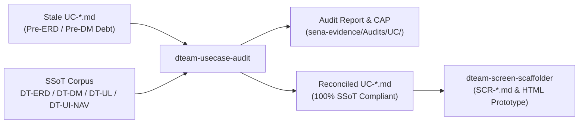

# Use Case Coherence & Domain Model Alignment Skill

## 1. Purpose & Architectural Role

This skill performs a rigorous **Coherence and Domain Model Alignment Audit** on business process Use Cases (`adso-dteam-docs/domain-models/use-cases/[module]/UC-[MOD]-[NUM].md`) within the hybrid **Asset Performance Management (APM) and Digital Twin (DTEAM)** system.

### The Upstream Quality Gate
Use Cases authored early in the project lifecycle frequently suffer from chronological debt: they predate the codification of the physical relational schema (`DT-ERD-DOC-001.md`), the formal domain class behaviors (`DT-DM-DOC-002.md`), and the Ubiquitous Language (`DT-UL-DOC-001.md`). 

If un-audited Use Cases are fed directly into the UI screen scaffolder (`dteam-screen-scaffolder`), their drafting placeholders (e.g., `Asset A / Asset B`), informal status strings, and missing relational fields cascade downstream into screen specifications and prototypes, necessitating costly remediation cycles.

This skill establishes the **Upstream Quality Gate**, auditing and reconciling Use Cases before screen scaffolding begins.



---

## 2. Input Contract (Mandatory Sources of Truth)

Before evaluating a Use Case, the agent **MUST** load and cross-reference the following canonical repository documents:

1. **Physical Relational Schema ([DT-ERD-DOC-001.md](../../domain-models/entity-relationship/DT-ERD-DOC-001.md)):**
   * Physical table columns, mandatory `NOT NULL` constraints, default values, and foreign keys across schemas (`tax`, `mtto`, `inv`, `vis`, `adm`).
   * *Strict Rule:* `DT-ERD-DOC-001.md` (Markdown) is the SOLE Source of Truth for the relational schema. Never inspect generated `.sql` files.
2. **Domain Model & Behaviors ([DT-DM-DOC-001.md](../../domain-models/class/DT-DM-DOC-001.md) & [DT-DM-DOC-002.md](../../domain-models/class/DT-DM-DOC-002.md)):**
   * Entity definitions, aggregate boundaries, strongly-typed method signatures, domain events, and state machines.
3. **Ubiquitous Language ([DT-UL-DOC-001.md](../../domain-models/ubiquitous-language/DT-UL-DOC-001.md)):**
   * Strict domain nomenclature (e.g., *Equipment Unit*, *Functional Location*, *Asset Swap*, *Try-Out Attestation*, *Negative Interlock*).
4. **Navigation & RBAC Hierarchy ([DT-UI-NAV-DOC-001.md](../../ui-ux/DT-UI-NAV-DOC-001.md)):**
   * Canonical user roles, ANSI/ISA-101 navigation levels (L1 to L4), and screen transition guards.
5. **Requirements Corpus ([requirements/data/](../../requirements/data/)):**
   * Master user stories (`user-stories.csv`), functional requirements (`srs.csv`), acceptance criteria (`gherkin.csv`), and technical constraints (`transversal-requirements.csv`).

---

## 3. The 5 Verification Axes

The agent must evaluate the candidate Use Case against five deterministic verification axes:

### Axis 1: Ubiquitous Language & Anti-Meta-Text Hygiene
* **[FAIL] Drafting Variable Placeholders:** Detects and flags algebraic or generic drafting aliases used in prose (e.g., `Asset A / Asset B`, `Unit 1 / Unit 2`, `Entity X / Y`, `Record A / B`).
  * *Correction:* Must be replaced with authentic operational terms from `DT-UL-DOC-001.md` and ISO 14224 (e.g., `Dismounted Asset` / `Replacement Asset`, `Physical Machine` / `Installed Unit`).
* **[FAIL] Developer / Pipeline Jargon in Business Flows:** Main flows and alternative flows must describe business domain events, not software plumbing. Flag technical buzzwords like *"writes to database table"*, *"executes single-commit SQL transaction"*, *"enqueues in outbox table"*, or *"sends HTTP POST command payload"*.
  * *Correction:* Rephrase as operational domain actions (e.g., *"atomically unlinks the dismounted asset and links the replacement unit"*, *"registers an immutable audit log with cryptographic hash signature"*).

### Axis 2: Relational Schema & Entity Lifecycle Parity
* **[FAIL] Missing Mandatory Columns:** Check physical ERD tables involved in the use case for `NOT NULL` columns that lack default values.
  * *Validation:* Does the Use Case capture or supply all mandatory fields in its preconditions, main flow steps, or system postconditions? (e.g., if `inv.inventory_transactions.total_cost` or `tax.equipment_units.warehouse_id` is mandatory, the use case must account for it).
* **[FAIL] Concept Drift in Entity Statuses:**
  * *Validation:* State transitions described in the Use Case must cite canonical domain enums defined in `DT-ERD-DOC-001.md` and `DT-DM-DOC-001.md` (e.g., `tax.equipment_units.operational_status IN ('OPERATIONAL', 'IN_REPAIR', 'IN_STORAGE', 'DAMAGED')`).
  * *Prohibition:* Flag vague, colloquial status phrases like *"places asset in safe holding"*, *"marks item ready"*, or unapproved synonyms like *"Under Review"*.
* **[FAIL] Referential Cardinality Conflicts:**
  * *Validation:* If an ERD relationship is `1 : 0..N` (e.g., multiple failure records per work order, or multiple media attachments), the Use Case flow must support multi-item recording rather than assuming a restrictive `1 : 1` interaction.

### Axis 3: Domain Model Behaviors & Transactional Boundaries
* **[FAIL] Domain Method Signature Incoherence:**
  * Cross-reference method signatures in `DT-DM-DOC-002.md` (e.g., `InstallEquipment(equipment: EquipmentUnit): void`, `UninstallEquipment(): EquipmentUnit`, `UpdateOperationalStatus(newStatus: Enum): void`, `ConfirmTryOut(...)`).
  * *Validation:* Does the Use Case flow provide the necessary typed inputs and observe the domain preconditions defined in the Domain Model?
* **[FAIL] Omission of Atomic Transactional Boundaries:**
  * When a business operation involves coupled mutations (e.g., unlinking Asset 1, linking Asset 2, and logging an installation timeline record), the Use Case must explicitly state the **atomic single-transaction invariant** (all succeed or all rollback) per ACID and ISO 14224 reliability requirements.

### Axis 4: Actors, Roles & Navigation Traceability
* **[FAIL] Non-Canonical Actors:**
  * Primary and secondary actors must correspond 1:1 with canonical RBAC roles defined in `DT-UI-NAV-DOC-001 §4` and `adm.roles` in `DT-ERD-DOC-001.md` (e.g., `Reliability Engineer`, `Maintenance Technician`, `Warehouse Manager`, `Maintenance Supervisor`, `Operations Coordinator`).
  * *Prohibition:* Generic actors like *"User"*, *"Admin"*, or *"Operator"* without domain qualification.
* **[FAIL] Upstream / Downstream Transition Orphanhood:**
  * Preconditions must specify how the actor arrives at the operational context (e.g., *"Authenticated technician executing Work Order on Functional Location TFA-CSS-P-0101A"*).
  * Postconditions must declare the resulting operational handoff (e.g., *"Returns to active Work Order form with updated mounted asset serial reference"*).

### Axis 5: Safety Interlocks & Alternate Flows (AF)
* **[FAIL] Omission of Codified Safety Invariants:**
  * Use Cases governing field operations, LOTO, electrical/mechanical isolation, or equipment substitution MUST declare explicit Alternate Flows for safety interlocks:
    * **Taxonomic / Physical Incompatibility (`AF-001`):** Rejection of mismatched equipment classes or un-commissioned spares.
    * **Incomplete Safety / Destination Data (`AF-002`):** Redundant coding enforcement preventing asset orphanhood or un-isolated execution.
    * **Unscheduled Re-Energization / Tamper Detection (`AF-003`):** Immediate evacuation beacon activation, acoustic alarm, and automatic work order suspension.
* **[FAIL] Missing Offline Fault Tolerance Constraints:**
  * If the operational environment includes disconnected field tablets, the Use Case must explicitly define behavior under network disruption, including local encrypted caching (`TR-007`) and offline lease limits (`ADR-006`).

---

## 4. Step-by-Step Audit Execution Workflow

### Step 1: Candidate Identification & SSoT Retrieval
1. Determine the target Use Case path: `adso-dteam-docs/domain-models/use-cases/[module]/UC-[MOD]-[NUM].md`.
2. Locate the corresponding User Story in `requirements/user-stories/[module]/[MOD]-[NUM].md` and related functional requirements (`FR-*`).
3. Load the corresponding entities from `DT-ERD-DOC-001.md` and domain methods from `DT-DM-DOC-002.md`.

### Step 2: Deterministic & Heuristic Cross-Evaluation
Evaluate the Use Case against all 5 verification axes, categorizing findings into:
* **`BLOCKER`:** Violations of relational schema constraints, missing mandatory fields, non-canonical roles, leaked drafting aliases (`Asset A/B`), or missing safety alternate flows.
* **`WARNING`:** Minor terminology drift, slightly ambiguous pre/postconditions, or imprecise domain event descriptions.
* **`INFO`:** Stylistic suggestions, markdown formatting refinements, or optimization notes.

### Step 3: Audit Report Generation & Persistence
Persist the formal audit report to the evidence repository at:
`/home/novillus/Documents/vscode/SENA-Career/sena-evidence/00-Overview/Audits/UC/AUD-UC-<UC_ID>-<YYYYMMDD-HHMMSS>.md`

### Step 4: Corrective Action Plan (CAP) & Direct Remediation
1. Formulate a structured Corrective Action Plan (CAP-1, CAP-2, etc.) addressing each identified Blocker and Warning.
2. If authorized by the user, update the Use Case file directly in `adso-dteam-docs/domain-models/use-cases/[module]/UC-[MOD]-[NUM].md` to achieve 100% SSoT compliance.

---

## 5. Audit Report Markdown Template

When generating the audit report, use the following standardized structure:

```markdown
# AUD-UC-<UC_ID>-<YYYYMMDD-HHMMSS>: Use Case Coherence & Domain Model Alignment Audit

## 1. Executive Summary

| Metric | Value |
| :--- | :--- |
| **Audited File** | `adso-dteam-docs/domain-models/use-cases/<module>/UC-<UC_ID>.md` |
| **Associated User Story** | `<MOD>-<NUM>` |
| **Associated Requirements** | `FR-...`, `NFR-...`, `TR-...` |
| **Audit Date** | `<YYYY-MM-DD HH:MM:SS>` |
| **Audit Verdict** | `PASSED` / `PASSED_WITH_OBSERVATIONS` / `BLOCKED` |
| **Total Blockers** | `<Count>` |
| **Total Warnings** | `<Count>` |
| **Total Infos** | `<Count>` |

---

## 2. Evaluation by Verification Axis

### Axis 1: Ubiquitous Language & Anti-Meta-Text Hygiene
* **Status:** `[PASS]` / `[FAIL]`
* **Findings:** ...

### Axis 2: Relational Schema & Entity Lifecycle Parity (DT-ERD-DOC-001)
* **Status:** `[PASS]` / `[FAIL]`
* **Findings:** ...

### Axis 3: Domain Model Behaviors & Transactional Boundaries (DT-DM-DOC-002)
* **Status:** `[PASS]` / `[FAIL]`
* **Findings:** ...

### Axis 4: Actors, Roles & Navigation Traceability (DT-UI-NAV-DOC-001)
* **Status:** `[PASS]` / `[FAIL]`
* **Findings:** ...

### Axis 5: Safety Interlocks & Alternate Flows
* **Status:** `[PASS]` / `[FAIL]`
* **Findings:** ...

---

## 3. Detailed Finding Inventory

| ID | Severity | Axis | Context / Location | Violation Description | Remediation Mandate |
| :--- | :--- | :--- | :--- | :--- | :--- |
| `F-01` | `BLOCKER` | Axis 1 | §Main Flow (Step 2) | Narrative drafting alias `Asset A` used. | Replace with `Dismounted Asset` (`Activo Desmontado`). |

---

## 4. Corrective Action Plan (CAP)

* **CAP-1:** ...
* **CAP-2:** ...
```
