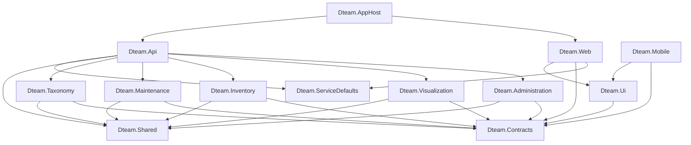

# Technology Stack Traceability Matrix

## Purpose

This document is the consolidated source for identifying the technology stack of DTEAM and linking it to the decisions, architecture views, and requirements that justify it. Active views must remain consistent with this matrix.

## Technology Stack

| Layer | Technology | Main Use | Traceability |
| :--- | :--- | :--- | :--- |
| Mobile Client | .NET MAUI Blazor Hybrid | Field Android/iOS operation and offline-first experience | [ADR-004](adr/ADR-004.md), [TR-002](../requirements/common/TR-002.md), [TR-007](../requirements/common/TR-007.md), [DT-ARQ-DEP-001](views/DT-ARQ-DEP-DOC-001.md) |
| Administrative Client | Blazor Web App | HSEQ supervision, planning, administration, and dashboards | [ADR-004](adr/ADR-004.md), [DT-ARQ-CMP-001](views/DT-ARQ-CMP-DOC-001.md), [DT-ARQ-DEP-001](views/DT-ARQ-DEP-DOC-001.md) |
| UI Components | Razor Components / Blazor (RCL) | HPHMI, forms, tables, shared states, and navigation | [ADR-004](adr/ADR-004.md), [TR-011](../requirements/common/TR-011.md) |
| Application Language | C# 14 | Client, shared services, domain, and backend | [ADR-004](adr/ADR-004.md) |
| Backend | .NET 10 / ASP.NET Core | API, DDD business rules, authentication, and processing | [DT-ARQ-DEP-001](views/DT-ARQ-DEP-DOC-001.md) |
| Real-Time | SignalR over WSS | LOTO Heartbeat (2s), KPIs, and authorized notifications | [TR-010](../requirements/common/TR-010.md), [DT-ARQ-DEP-001](views/DT-ARQ-DEP-DOC-001.md) |
| API | HTTPS/JSON | Synchronization and client-server operations | [TR-005](../requirements/common/TR-005.md), [TR-007](../requirements/common/TR-007.md), [DT-ARQ-DEP-001](views/DT-ARQ-DEP-DOC-001.md) |
| Mobile Persistence | `sqlite-net-pcl` + SQLCipher | Local state, offline queue (`TR-007`), and preventive block | [TR-002](../requirements/common/TR-002.md), [TR-007](../requirements/common/TR-007.md), [ADR-004](adr/ADR-004.md) |
| Distributed Cache | Redis 7.x | Fast-path idempotency caching for offline-sync retry storms | [ADR-007](adr/ADR-007.md), [TR-007](../requirements/common/TR-007.md), [DT-ARQ-DEP-001](views/DT-ARQ-DEP-DOC-001.md) |
| Central Database | PostgreSQL 18 + TimescaleDB | Assets, inventory, immutable audit, and time series | [ADR-003](adr/ADR-003.md), [DT-ARQ-DEP-001](views/DT-ARQ-DEP-DOC-001.md) |
| Object Storage | Azure Blob Storage | Valet Key offloading for ISO 14224 multimedia evidence | [ADR-008](adr/ADR-008.md), [DT-ARQ-DEP-001](views/DT-ARQ-DEP-DOC-001.md) |
| IoT Ingestion | Azure IoT Hub | Industrial telemetry (MQTT from SCADA / AMQP to Backend) | [DT-ARQ-DEP-001](views/DT-ARQ-DEP-DOC-001.md) |
| Infrastructure | Docker, Nginx, and Azure Cloud Services | Containers, reverse proxy, TLS 1.3, and deployment | [DT-ARQ-DEP-001](views/DT-ARQ-DEP-DOC-001.md) |
| Local Orchestration & Observability | .NET Aspire (`AppHost` + `ServiceDefaults`) | Local multi-service startup, OpenTelemetry tracing, and `Aspire.Hosting.Testing` | [ADR-011](adr/ADR-011.md), [DT-ARQ-DEP-001](views/DT-ARQ-DEP-DOC-001.md) |
| Visualization | 2D First model (SVG), 3D Evolutionary | Digital twin and operational context | [ADR-001](adr/ADR-001.md) |

## Physical Solution Structure (`Dteam.sln`)

`adso-dteam-code` implements a Modular Monolith with **one `internal`-encapsulated module assembly per PostgreSQL schema**, shared cross-cutting assemblies, client hosts, and test suites:

```text
adso-dteam-code/
├── Dteam.sln
├── src/
│   ├── Dteam.ServiceDefaults/               # OpenTelemetry, health checks, resilience
│   ├── Dteam.AppHost/                       # Local Aspire orchestration (ADR-011)
│   ├── Dteam.Contracts/                     # Shared DTOs, Commands, Enums (supersedes DT-UI-CTR-001)
│   ├── Dteam.Shared/                        # IEventBus, ITelemetryBus, AuditSaveChangesInterceptor, SharedDbConnection, IEndpointFilter
│   ├── Dteam.Ui/                            # Shared RCL (CanvasViewport2D, HUD, forms, tokens.css, icons.svg)
│   ├── Modules/
│   │   ├── Dteam.Taxonomy/                  # Schema tax.* (Domain/, Application/, Infrastructure/, Endpoints/; public ITaxonomyService)
│   │   ├── Dteam.Maintenance/               # Schema mtto.* (Domain/, Application/, Infrastructure/, Endpoints/; public IWorkOrderService)
│   │   ├── Dteam.Inventory/                 # Schema inv.* (Domain/, Application/, Infrastructure/, Endpoints/; public IInventoryService)
│   │   ├── Dteam.Visualization/             # Schema vis.* (Domain/, Application/, Infrastructure/, Endpoints/; public ILotoService, ISpatialIngestionService)
│   │   └── Dteam.Administration/            # Schema adm.* (Domain/, Application/, Infrastructure/, Endpoints/; public ISecurityService)
│   ├── Dteam.Api/                           # Minimal APIs + SignalR host and module composition root
│   ├── Dteam.Web/                           # Blazor Web App administrative portal
│   └── Dteam.Mobile/                        # MAUI Blazor Hybrid field client
└── tests/
    ├── Dteam.Domain.Tests/                  # Module subfolders (Taxonomy/, Maintenance/, Inventory/, Visualization/, Administration/) + Stryker.NET
    ├── Dteam.Architecture.Tests/            # NetArchTest.Rules (hexagonal layers, internal isolation, no EF Core in Mobile)
    ├── Dteam.Integration.Tests/             # Aspire.Hosting.Testing + TimescaleDB; module subfolders (Taxonomy/..Administration/)
    └── Dteam.Acceptance.Tests/              # Reqnroll Gherkin scenarios; module subfolders (Taxonomy/..Administration/)
```

### Package Dependency Diagram



## Consistency Rules

1. Active UI clients follow [ADR-004](adr/ADR-004.md), sharing components via `Dteam.Ui` (RCL), and `Dteam.Mobile` MUST NOT reference `Microsoft.EntityFrameworkCore` or module assemblies.
2. Module internals (`Domain`, `Infrastructure`, `DbContext`) remain `internal`; cross-module collaboration flows strictly through public port interfaces or `IEventBus` (with `SharedDbConnection` in `Dteam.Shared` per [DT-ARQ-DB-DOC-001 §3.9](DT-ARQ-DB-DOC-001.md#39-cross-dbcontext-atomic-transactions-idbcontexttransaction-sharing)).
3. Previous frontend technologies can only appear in historical records or superseded decisions, clearly identified as inactive.
4. Stack changes require a new ADR or an approved update to [ADR-004](adr/ADR-004.md).
5. Structurizr diagram labels (`DT-ARQ-CMP-001-component-model.dsl`, `DT-ARQ-DEP-001-deployment-model.dsl`) must match the Technology Stack table; diagram file names and view codes remain unchanged.
6. Authentication session TTLs follow [ADR-006](adr/ADR-006.md#canonical-offline-watchdog-session-constants) and [TR-006](../requirements/common/TR-006.md).

## Related Artifacts

- [ADR-004: Frontend Client with .NET MAUI Blazor Hybrid](adr/ADR-004.md)
- [ADR-011: .NET Aspire for Local Orchestration, Observability, and Integration Testing](adr/ADR-011.md)
- [Component Model](views/DT-ARQ-CMP-001-component-model.dsl)
- [Component Specification](views/DT-ARQ-CMP-DOC-001.md)
- [Deployment Model](views/DT-ARQ-DEP-001-deployment-model.dsl)
- [Deployment Specification](views/DT-ARQ-DEP-DOC-001.md)
