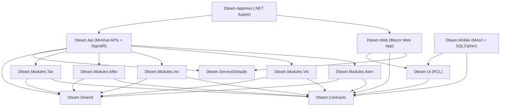

# Technology Stack Traceability Matrix

## Purpose

This document is the consolidated source for identifying the target technology stack of DTEAM and linking it to the decisions, architecture views, and requirements that justify it. Active views must remain consistent with this matrix.

## Target Stack

| Layer | Target Technology | Main Use | Traceability |
| :--- | :--- | :--- | :--- |
| Mobile Client | .NET MAUI Blazor Hybrid | Field Android/iOS operation and offline-first experience | ADR-004, `TR-002`, `TR-007`, DT-ARQ-DEP-001 |
| Administrative Client | Blazor Web App | HSEQ supervision, planning, administration, and dashboards | ADR-004, DT-ARQ-CMP-001, DT-ARQ-DEP-001 |
| UI Components | Razor Components / Blazor (RCL) | HPHMI, forms, tables, shared states, and navigation | ADR-004, `TR-011` |
| Application Language | C# 14 | Client, shared services, domain, and backend | ADR-004 |
| Backend | .NET 10 / ASP.NET Core | API, DDD business rules, authentication, and processing | DT-ARQ-DEP-001 |
| Real-Time | SignalR over WSS | LOTO Heartbeat (2s), KPIs, and authorized notifications | `TR-010`, DT-ARQ-DEP-001 |
| API | HTTPS/JSON | Synchronization and client-server operations | `TR-005`, `TR-007`, DT-ARQ-DEP-001 |
| Mobile Persistence | `sqlite-net-pcl` + SQLCipher | Local state, offline queue (`TR-007`), and preventive block | `TR-002`, `TR-007`, ADR-004 |
| Distributed Cache | Redis 7.x | Fast-path idempotency caching for offline-sync retry storms | ADR-007, `TR-007`, DT-ARQ-DEP-001 |
| Central Database | PostgreSQL 18 + TimescaleDB | Assets, inventory, immutable audit, and time series | ADR-003, DT-ARQ-DEP-001 |
| Object Storage | Azure Blob Storage | Valet Key offloading for ISO 14224 multimedia evidence | ADR-008, DT-ARQ-DEP-001 |
| IoT Ingestion | Azure IoT Hub | Industrial telemetry (MQTT from SCADA / AMQP to Backend) | DT-ARQ-DEP-001 |
| Infrastructure | Docker, Nginx, and Azure Cloud Services | Containers, reverse proxy, TLS 1.3, and deployment | DT-ARQ-DEP-001 |
| Local Orchestration & Observability | .NET Aspire (`AppHost` + `ServiceDefaults`) | Local multi-service startup, OpenTelemetry tracing, and `Aspire.Hosting.Testing` | ADR-011, DT-ARQ-DEP-001 |
| Visualization | 2D First model (SVG), 3D Evolutionary | Digital twin and operational context | ADR-001 |

## Physical Solution Structure (`Dteam.sln`)

The implementation repository (`adso-dteam-code`) organizes the **Modular Monolith + Hexagonal (Ports & Adapters)** architecture using **one `internal`-encapsulated module assembly per PostgreSQL schema** (`tax`, `mtto`, `inv`, `vis`, `adm`), shared cross-cutting/contract assemblies, client hosts, Aspire local orchestration, and automated test suites:

```text
adso-dteam-code/
├── Dteam.sln
├── src/
│   ├── Dteam.ServiceDefaults/               # OpenTelemetry, health checks, resilience (.NET Aspire)
│   ├── Dteam.AppHost/                       # Local orchestration: Api, Web, TimescaleDB, Redis, MQTT (ADR-011)
│   ├── Dteam.Contracts/                     # Shared DTOs, Commands, Enums (supersedes DT-UI-CTR-001)
│   ├── Dteam.Shared/                        # IEventBus, ITelemetryBus, AuditSaveChangesInterceptor, SharedDbConnection, IEndpointFilter
│   ├── Dteam.Ui/                            # Shared Razor Class Library (CanvasViewport2D, HUD, forms, tokens.css, icons.svg)
│   ├── Modules/
│   │   ├── Dteam.Modules.Tax/               # Schema tax.* (Domain/, Application/, Infrastructure/, Endpoints/; internal types + public ITaxonomyService)
│   │   ├── Dteam.Modules.Mtto/              # Schema mtto.* (Domain/, Application/, Infrastructure/, Endpoints/; internal types + public IWorkOrderService)
│   │   ├── Dteam.Modules.Inv/               # Schema inv.* (Domain/, Application/, Infrastructure/, Endpoints/; internal types + public IInventoryService)
│   │   ├── Dteam.Modules.Vis/               # Schema vis.* (Domain/, Application/, Infrastructure/, Endpoints/; internal types + public ILotoService, ISpatialIngestionService)
│   │   └── Dteam.Modules.Adm/               # Schema adm.* (Domain/, Application/, Infrastructure/, Endpoints/; internal types + public ISecurityService)
│   ├── Dteam.Api/                           # ASP.NET Core Minimal APIs host, SignalR Hubs, module composition root
│   ├── Dteam.Web/                           # Blazor Web App administrative portal (consumes Dteam.Ui + Dteam.Contracts)
│   └── Dteam.Mobile/                        # .NET 10 MAUI Blazor Hybrid + sqlite-net-pcl/SQLCipher (zero EF Core)
└── tests/
    ├── Dteam.Domain.Tests/                  # Unit & Stryker.NET mutation tests for module Domain invariants
    ├── Dteam.Architecture.Tests/            # NetArchTest.Rules enforcing hexagonal layers, internal module isolation, no EF Core in Mobile
    ├── Dteam.Integration.Tests/             # Aspire.Hosting.Testing + PostgreSQL 18 / TimescaleDB parity & CTEs
    └── Dteam.Acceptance.Tests/              # Reqnroll Gherkin acceptance scenarios mapped to srs.csv / UC-*
```

### Package Dependency Diagram



> **Boundary Invariants:** Module internals (`Domain`, `Infrastructure`, `DbContext`) remain `internal`; cross-module collaboration flows strictly through public port interfaces or `IEventBus` (with `SharedDbConnection` coordinated in `Dteam.Shared` for `INV-025`), and `Dteam.Mobile` MUST NEVER reference `Dteam.Infrastructure` or `Microsoft.EntityFrameworkCore`.

## Consistency Rules

1. Active artifacts must use .NET MAUI Blazor Hybrid for the mobile client and Blazor Web App for the administrative client, sharing components via Razor Class Library (RCL).
2. Previous frontend technologies can only appear in historical records or superseded decisions, clearly identified as inactive.
3. Mobile persistence is formalized under `sqlite-net-pcl` with SQLCipher encryption; the use of Entity Framework Core on the mobile client is not allowed.
4. Stack changes must be recorded via a new ADR or an approved new version of ADR-004.
5. Structurizr diagram labels (`DT-ARQ-CMP-001-component-model.dsl`, `DT-ARQ-DEP-001-deployment-model.dsl`) must match this matrix; diagram file names and view codes do not change due to the stack.
6. Authentication sessions implement a split-lifecycle token strategy (`TR-006`): short-lived stateless **Access JWTs (15-minute TTL)** minimize replay exposure while rotating **Session Refresh Tokens (8-hour maximum shift TTL)** stored in `adm.auth_tokens` (`purpose = 'SESSION_REFRESH'`) enforce industrial shift boundaries and support immediate revocation upon account deactivation or risk lockout (`SCR-ADM-014`).

## Related Artifacts

- [ADR-004: Frontend Client with .NET MAUI Blazor Hybrid](adr/ADR-004.md)
- [ADR-011: .NET Aspire for Local Orchestration, Observability, and Integration Testing](adr/ADR-011.md)
- [Component Model](views/DT-ARQ-CMP-001-component-model.dsl)
- [Component Specification](views/DT-ARQ-CMP-DOC-001.md)
- [Deployment Model](views/DT-ARQ-DEP-001-deployment-model.dsl)
- [Deployment Specification](views/DT-ARQ-DEP-DOC-001.md)
