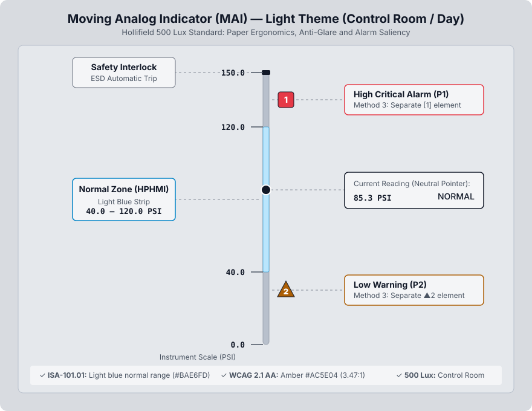
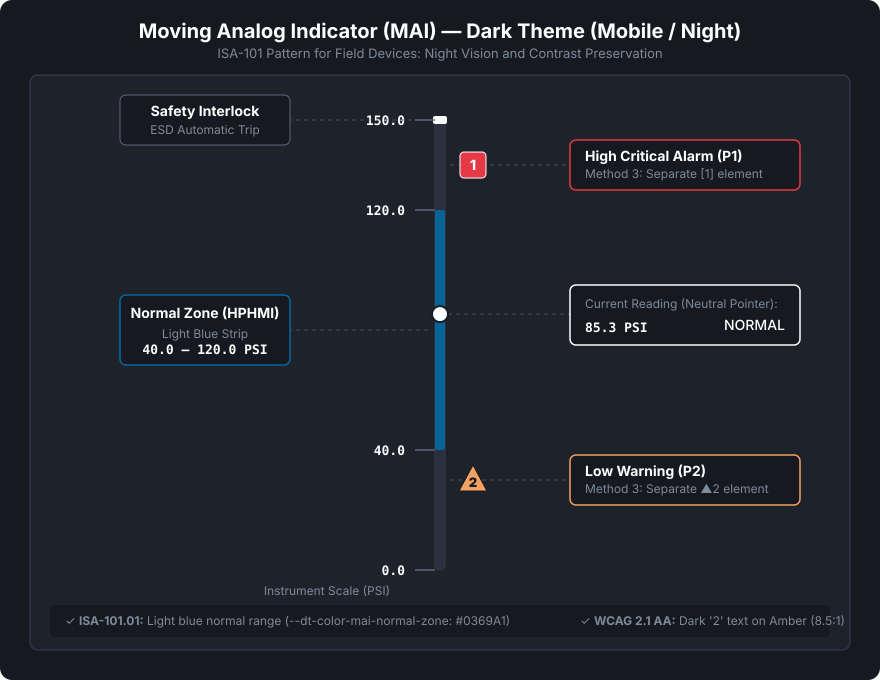

# Design Tokens Technical Specification

## 1. Scope
This document establishes the **Single Source of Truth** for all design tokens applied in prototype design and user interface implementation of the DTEAM platform, covering both mobile clients for field operations and web portals for supervision and administration.

### Mandatory Principles:
1. **90/10 HPHMI Rule:** 90% of the interface operates in neutral, low-contrast grayscale to minimize visual fatigue. The remaining 10% of saturated color is reserved exclusively for anomalies, alarms, and hazard conditions.
2. **Elimination of Green as "Normal" State:** Green is not used to indicate that a motor is running or in normal operation. Normal state is represented using neutral grays and canonical status text (`UP` / `STANDBY`). Documentary confirmations and connection status are restricted to **Teal / Pine** shades via `--dt-color-state-success` ([§3.3](#33-alarm-and-safety-semantics-10-reserved)), avoiding any confusion with industrial state green.
3. **Redundant Coding (WCAG 2.1 AA):** No critical safety or alarm state should be communicated solely by color. Every indicator must combine **Shape + Icon + Color + Text** per the canonical matrix in [§6.2](#62-redundant-coding-matrix-for-permits-and-loto).
4. **Industrial Tactile Ergonomics:** Interactive elements on mobile devices and field tablets must respect the minimum touch area governed by `--dt-touch-target-mobile` ([§2.2](#22-dimensions-of-controls-and-touch-areas)) to allow operation with safety gloves.

---

## 2. Spatial and Layout Tokens

Spacing and sizing are governed by an **8px** base grid system (with a 4px sub-frame for micro-adjustments).

> **Multiplier Scale of $4\text{px}$ / $0.25\text{rem}$:**  
> The `--dt-space-N` naming utilizes a **linear multiplier** convention where $N$ represents the factor by which the $4\text{px}$ base unit is multiplied ($N \times 4\text{px}$ or $N \times 0.25\text{rem}$), an industry standard (Tailwind CSS / W3C DTCG).  
> From $16\text{px}$ upward, the scale deliberately omits odd intermediate multipliers ($5\times 4\text{px} = 20\text{px}$ and $7\times 4\text{px} = 28\text{px}$) to ensure all larger spacings are **strictly multiples of 8px** ($24\text{px} = 3 \times 8$, $32\text{px} = 4 \times 8$, $48\text{px} = 6 \times 8$, $64\text{px} = 8 \times 8$), preserving visual harmonic alignment of the layout and preventing design decision paralysis.

### 2.1. Spacing Scale

| CSS Token | Value (px) | Value (rem) | Primary Use in Layout and Components                                                       |
| :------------ | :--------: | :---------: | :----------------------------------------------------------------------------------------- |
| --dt-space-0  |    0px     |    0rem     | Reset margins and paddings.                                                            |
| --dt-space-1  |    4px     |   0.25rem   | Micro-spacing: gap between icon and text in badges, internal padding of tags.        |
| --dt-space-2  |    8px     |   0.5rem    | Compact spacing: gap between narrow form fields, table cell padding.  |
| --dt-space-3  |    12px    |   0.75rem   | Medium spacing: gap in toolbars, internal padding of inputs.      |
| --dt-space-4  |    16px    |   1.0rem    | **Base spacing:** card padding, standard gap in Auto-Layout.              |
| --dt-space-6  |    24px    |   1.5rem    | Wide spacing: perimeter screen padding, separation between functional sections. |
| --dt-space-8  |    32px    |   2.0rem    | Separation of major blocks in desktop views (Dashboards).                        |
| --dt-space-12 |    48px    |   3.0rem    | Separation between macro-level containers or 2D viewer margins.                |
| --dt-space-16 |    64px    |   4.0rem    | Structural margins on high-resolution monitors (1920x1080).                        |

### 2.2. Dimensions of Controls and Touch Areas
| Control Token | Min Height (px) | Min Width (px) | Target Platform / Justification                                                                |
| :---------------------------------- | :----------------- | :---------------- | :------------------------------------------------------------------------------------------------- |
| --dt-touch-target-mobile            | 48px               | 48px              | **Mandatory minimum on Tablet/Mobile:** Action buttons, LOTO checkboxes, and field selectors. |
| --dt-control-height-sm              | 32px               | auto              | Desktop Web: Compact buttons in dense data tables and secondary filters.                    |
| --dt-control-height-md              | 40px               | auto              | Desktop Web: Standard text inputs, selectors, and form buttons.                       |
| --dt-control-height-lg              | 48px               | auto              | Mobile/Tablet: Standard height for all input fields (InputText, InputSelect).          |
| --dt-control-height-xl              | 56px               | 100%              | Mobile: Primary footer action button (e.g., "Complete Work Order").            |
| --dt-control-height-nav-step        | 44px               | 56px              | Industrial step navigation arrow button footprint ($56\times 44\text{px}$) for gloved hands; also binds `--dt-control-width-nav-step` ([SCR-MTTO-002](screens/mtto/SCR-MTTO-002.md)). |
| --dt-control-height-nav-step-mobile | 42px               | 52px              | Smartphone: Compact step navigation button footprint ($52\times 42\text{px}$); also binds `--dt-control-width-nav-step-mobile`. |
| --dt-control-size-checkbox          | 28px               | 28px              | Custom scope checklist tactile hit target for gloved field mechanics ([SCR-MTTO-002](screens/mtto/SCR-MTTO-002.md)). |
| --dt-control-size-hud               | 36px               | 36px              | Circular cartographic compass indicator in spatial HUD ([SCR-VIS-033](screens/vis/SCR-VIS-033.md)). |

### 2.3. Responsive Breakpoints and Reference Frames

The designs and responsive adaptation rules in CSS are calibrated against the following form factors and standard canvas resolutions:

| Breakpoint Token | Min Width (px) | Base Canvas Dimensions (W x H) | Aspect Ratio | Reference Device | Layout and Container Disposition |
| :------------------ | :---------------: | :-----------------------------: | :-----------------: | :--------------------------------------------------- | :--------------------------------------------- |
| --dt-breakpoint-sm  |       390px       |          390 x 844 px           |      $9:19.5$       | Vertical Smartphone (iOS / Android)                  | 1 column; bottom bar navigation.      |
| --dt-breakpoint-md  |       768px       |          800 x 1280 px          |       $10:16$       | **Industrial Tablet Portrait (Zebra ET51 / Honeywell RT10A)** | 1 to 2 columns; collapsible drawer / bottom sheet. |
| --dt-breakpoint-lg  |      1280px       |          1280 x 800 px          |       $16:10$       | **Industrial Tablet (Zebra ET51 / Honeywell RT10A)** | 2 columns (SVG Canvas + Contextual panel).    |
| --dt-breakpoint-xl  |      1920px       |         1920 x 1080 px          |       $16:9$        | Desktop Workstation (Full HD)                | 3 columns (Sidebar + Central Panel + Drawer). |

### 2.4. Structural Layout and Dimensional Tokens

To guarantee predictability in responsive split-screen viewports, transactional modal tasks, and sliding containers across industrial field tablets and desktop workstations, spatial containers adhere to normative dimensional constraints:

| Layout Token | Value | Target Breakpoint / Context | Functional Justification |
| :--------------------------------------- | :------------------------------------: | :----------------------------------------------------------- | :---------------------------------------------------------------------------------------------------------------------------------------------------------------------- |
| --dt-layout-sidebar-width-expanded       | 240px                                  | --dt-breakpoint-xl ($\ge 1920\text{px}$)                     | Fixed navigation sidebar width in expanded desktop workstation layout ([DT-UI-NAV-DOC-001](DT-UI-NAV-DOC-001.md), [SCR-MTTO-026](screens/mtto/SCR-MTTO-026.md)). |
| --dt-layout-sidebar-width-collapsed      | 64px                                   | --dt-breakpoint-lg ($1280\text{px} - 1919\text{px}$)         | Collapsed icon-only navigation rail width on compact desktop and tablet landscape viewports ([DT-UI-NAV-DOC-001](DT-UI-NAV-DOC-001.md), [SCR-MTTO-026](screens/mtto/SCR-MTTO-026.md)). |
| --dt-layout-table-row-height             | 44px                                   | Shared Component                                             | Ergonomic dense table row height for enterprise workstation grids ([SCR-MTTO-026](screens/mtto/SCR-MTTO-026.md)). |
| --dt-layout-drawer-width-desktop         | 440px                                  | --dt-breakpoint-xl ($\ge 1920\text{px}$)                     | Fixed lateral inspection drawer on high-resolution monitors; preserves multi-column tabular visibility and backlog split views. |
| --dt-layout-drawer-width-tablet          | 380px                                  | --dt-breakpoint-lg ($1280\text{px} - 1919\text{px}$)         | Fixed contextual side panel on tablet landscape; preserves $\ge 70\%$ viewport allocation ($900\text{px}$) for the 2D spatial Digital Twin canvas. |
| --dt-layout-drawer-width                 | --dt-layout-drawer-width-tablet        | Responsive Semantic Base                                     | Semantic drawer width variable; defaults to tablet dimension and dynamically resolves to `--dt-layout-drawer-width-desktop` on desktop displays ($\ge 1920\text{px}$). |
| --dt-layout-modal-width-desktop          | 640px                                  | --dt-breakpoint-xl ($\ge 1920\text{px}$)                     | Centered transactional modal dialog width on desktop workstations ([SCR-INV-025](screens/inv/SCR-INV-025.md), [SCR-MTTO-026](screens/mtto/SCR-MTTO-026.md)). |
| --dt-layout-modal-width-tablet           | 580px                                  | --dt-breakpoint-lg ($1280\text{px} - 1919\text{px}$)         | Centered modal dialog width on industrial tablet landscape viewports. |
| --dt-layout-modal-width                  | --dt-layout-modal-width-tablet         | Responsive Semantic Base                                     | Semantic modal width variable; dynamically resolves to `--dt-layout-modal-width-desktop` on desktop workstations ($\ge 1920\text{px}$). |
| --dt-layout-bottom-sheet-height-initial  | 45vh                                   | --dt-breakpoint-md ($768\text{px} - 1279\text{px}$)         | Natural initial resting height for tactile sliding bottom sheets on industrial tablet portrait viewports ([§6.3](#63-sliding-containers-pattern-bottom-sheets-and-drawers)). |
| --dt-layout-bottom-sheet-height-expanded | 85vh                                   | --dt-breakpoint-md ($768\text{px} - 1279\text{px}$)         | Maximum expanded height ceiling for bottom sheets on discrete tap or upward drag. |
| --dt-layout-bottom-sheet-peek-height     | 36px                                   | --dt-breakpoint-md ($768\text{px} - 1279\text{px}$)         | Minimized docked tab / peek trigger height when bottom sheet is collapsed. |
| --dt-layout-form-max-width               | 1000px                                 | Global Form Container                                        | Maximum ergonomic reading measure and layout containment for maintenance execution forms ([SCR-MTTO-002](screens/mtto/SCR-MTTO-002.md)). |
| --dt-layout-footer-height                | 72px                                   | Sticky Action Footers                                        | Pinned bottom finalization bar height on mobile/tablet execution forms. |
| --dt-layout-footer-clearance             | 96px                                   | Sticky Action Footers                                        | Bottom scroll container clearance preventing sticky footer from occluding inputs at maximum scroll extents. |
| --dt-layout-modal-max-height             | 80vh                                   | --dt-breakpoint-xl ($\ge 1920\text{px}$)                     | Centered transactional modal maximum vertical height ceiling ([SCR-INV-025](screens/inv/SCR-INV-025.md)). |
| --dt-layout-toolbar-badge-width          | 144px                                  | Global Viewport Toolbar                                      | Rigid fixed width invariant for hierarchical level badge indicator ([SCR-VIS-008](screens/vis/SCR-VIS-008.md), [SCR-VIS-011](screens/vis/SCR-VIS-011.md), [SCR-VIS-033](screens/vis/SCR-VIS-033.md)). |
| --dt-layout-banner-diagnostic-height     | 28px                                   | Shared Component                                             | Fixed slot height for Priority 4 diagnostic telemetry and stale-data banners ([SCR-VIS-033](screens/vis/SCR-VIS-033.md)). |
| --dt-layout-toast-max-height             | 40px                                   | Global Viewport                                              | Maximum vertical ceiling for non-modal top alert toast notifications ([SCR-VIS-008](screens/vis/SCR-VIS-008.md)). |
| --dt-layout-popover-top-clearance        | 70px                                   | Global Viewport                                              | Vertical top clearance clamping boundary preserving floating toolbar visibility ([SCR-VIS-008](screens/vis/SCR-VIS-008.md)). |
| --dt-layout-thumbnail-size               | 120px                                  | Shared Component                                             | Bounding dimension ($120\times 120\text{px}$) for photographic evidence preview thumbnails ([SCR-MTTO-002](screens/mtto/SCR-MTTO-002.md)). |

### 2.5. Spatial Navigation and Semantic Zoom Tokens (ANSI/ISA-101.01 Viewports)

To eliminate fragile magic numbers and enforce deterministic progressive disclosure across 2D Digital Twin viewports ([SCR-VIS-008](screens/vis/SCR-VIS-008.md), [SCR-VIS-011](screens/vis/SCR-VIS-011.md), [SCR-VIS-033](screens/vis/SCR-VIS-033.md)), spatial scale multipliers normalize camera zoom to the facility plot plan (`1.0` = nominal operating `viewBox` width, `65%` of the site-fit `viewBox` width, dynamically calibrated against the SVG `CALIBRATION-VECTOR` and facility footprint):

| Zoom Token | Value | Target Viewport Scale Tier | Functional Justification |
| :------------------------- | :---: | :--------------------------------- | :--------------------------------------------------------------------------------------------------------------------------------------------- |
| --dt-zoom-scale-fit        | 0.65  | Level 1 Full-Site Overview Fit     | Default opening camera framing showing the entire legal property boundary (`L-CIVL-PROP`) centered inside the viewport.                        |
| --dt-zoom-ramp-l2-start    | 0.95  | L2 Additive Ramp Entry             | Lower normalized zoom edge where additive L2 CAD layers (`pipe-sec`, `steel`, sub-corridors) initiate smoothstep opacity interpolation.        |
| --dt-zoom-scale-l1-max     | 1.05  | Level 1 ↔ Level 2 Hard Swap Cut    | Hysteresis swap boundary transitioning L1 summary pills (`CMP-09`) into discrete L2 asset layers and PTW/LOTO overlays ([DT-UI-SVG-DOC-001 §10.2](DT-UI-SVG-DOC-001.md#102-pure-viewbox-camera-site-boundary-clamping-transition-rules)). |
| --dt-zoom-ramp-l2-end      | 1.25  | L2 Additive Ramp Full Opacity      | Upper normalized edge where additive L2 CAD geometry reaches full operational opacity (`1.0`).                                                 |
| --dt-zoom-scale-tactical   | 1.45  | Level 2 Tactical & ISA-5.1 Threshold | Default focal scale for automated equipment locating and progressive disclosure of primary ANSI/ISA-5.1 field instrument plates.               |
| --dt-zoom-scale-l2-max     | 1.85  | Level 2 ↔ Level 3 Detail Threshold | Threshold disclosing Level 3 micro-equipment details, mechanical nozzles, check/bleed valves, underground fire ring, and ISA-5.1 loop tags.    |
| --dt-zoom-ramp-l3-start    | 1.85  | L3 Additive Ramp Entry             | Lower normalized edge for additive L3 micro-CAD geometry and minor coordinate grid subdivisions.                                               |
| --dt-zoom-ramp-l3-end      | 2.45  | L3 Additive Ramp Full Opacity      | Upper normalized edge where Level 3 micro-piping, flange stubs, and MCC feeder traces reach full operational opacity.                           |
| --dt-cad-stroke-floor      | 0.42  | ISO 128 CAD Adaptive Stroke Floor  | Minimum stroke-width attenuation floor preventing sub-pixel vector collapse when zoomed out to site fit ([DT-UI-SVG-DOC-001 §9.2](DT-UI-SVG-DOC-001.md#92-iso-128-hierarchical-lineweights-zoom-adaptive-scaling)). |

---

## 3. Color Tokens and Surfaces
The palette is structured in two layers: **Primitive Tokens** (absolute palette values, **where the only declaration of HEX codes resides in the design document**) and **Semantic Tokens** dynamically assigned based on the operational lighting context (Dark Theme and Light Theme), which reference the primitive variables.

### 3.1. Primitive Palette Tokens
| Primitive Token | Hex Value | Family / Base Use |
| ------------------------ | --------- | -------------------------------------------------------------------- |
| --dt-primitive-gray-980  | #111827   | Near-black cool gray |
| --dt-primitive-gray-950  | #11141A   | Deepest charcoal gray |
| --dt-primitive-gray-900  | #16191F   | Very dark neutral gray |
| --dt-primitive-gray-850  | #1F2937   | Dark charcoal gray |
| --dt-primitive-gray-800  | #1E222B   | Dark slate-neutral gray |
| --dt-primitive-gray-700  | #2A2F3D   | Deep muted gray |
| --dt-primitive-gray-650  | #3A4154   | Medium-dark cool gray |
| --dt-primitive-gray-620  | #4B5563   | Medium charcoal gray |
| --dt-primitive-gray-600  | #353B4D   | Elevated dark cool gray |
| --dt-primitive-gray-580  | #4A5263   | Muted dark gray |
| --dt-primitive-gray-550  | #6B7280   | Mid neutral gray |
| --dt-primitive-gray-500  | #5C667A   | Balanced mid-slate gray |
| --dt-primitive-gray-450  | #6E7A92   | Cool mid-light gray |
| --dt-primitive-gray-420  | #8A98AA   | Soft muted blue-gray |
| --dt-primitive-gray-400  | #7E8B9B   | Medium-light cool gray |
| --dt-primitive-gray-380  | #9CA3AF   | Light neutral gray |
| --dt-primitive-gray-350  | #AAB1BD   | Soft silver-gray |
| --dt-primitive-gray-300  | #B8C0CC   | Light cool border gray |
| --dt-primitive-gray-280  | #C2CBD6   | Pale cool gray |
| --dt-primitive-gray-200  | #D8DBE0   | Munsell N7.5 neutral light gray |
| --dt-primitive-gray-100  | #E5E8EC   | Very light neutral gray |
| --dt-primitive-gray-50   | #F4F5F7   | Off-white soft gray |
| --dt-primitive-gray-30   | #FAFBFC   | Ultra-light neutral white |
| --dt-primitive-gray-20   | #FCFDFD   | Near-white cool neutral |
| --dt-primitive-gray-10   | #FDFEFE   | Brightest off-white neutral |
| --dt-primitive-slate-975 | #0A0E15   | Deepest midnight slate |
| --dt-primitive-slate-950 | #0D1117   | Deep obsidian slate |
| --dt-primitive-slate-925 | #131923   | Very dark basin slate |
| --dt-primitive-slate-920 | #0F172A   | Deep ink slate |
| --dt-primitive-slate-900 | #18202C   | Dark cool slate |
| --dt-primitive-slate-875 | #1E2736   | Dark elevated slate |
| --dt-primitive-slate-800 | #222B3A   | Medium-dark structural slate |
| --dt-primitive-slate-750 | #2B3648   | Muted dark slate |
| --dt-primitive-slate-700 | #475569   | Mid-dark slate |
| --dt-primitive-slate-620 | #526075   | Medium cool slate |
| --dt-primitive-slate-600 | #607089   | Balanced cool slate |
| --dt-primitive-slate-550 | #64748B   | Mid slate |
| --dt-primitive-slate-430 | #8B9BB2   | Medium-light cool slate |
| --dt-primitive-slate-400 | #94A3B8   | Soft cool slate |
| --dt-primitive-slate-300 | #BCC5D1   | Light structural slate |
| --dt-primitive-slate-250 | #CBD5E1   | Pale grid slate |
| --dt-primitive-slate-200 | #CFD6DF   | Light concrete slate |
| --dt-primitive-slate-140 | #E1E6EC   | Very light cool slate |
| --dt-primitive-slate-100 | #F1F5F9   | Off-white cool slate |
| --dt-primitive-slate-80  | #ECEFF3   | Soft off-white slate |
| --dt-primitive-slate-60  | #F0F3F7   | Pale mist slate |
| --dt-primitive-slate-30  | #F7F9FB   | Ultra-light cool slate |
| --dt-primitive-red-600   | #E63946   | High-salience industrial red |
| --dt-primitive-amber-700 | #B45309   | Deep industrial amber |
| --dt-primitive-amber-600 | #AC5E04   | Dark warning amber |
| --dt-primitive-amber-500 | #D97706   | Mid warning amber |
| --dt-primitive-amber-400 | #F4A261   | Light warm amber |
| --dt-primitive-blue-700  | #0369A1   | Deep process blue |
| --dt-primitive-blue-600  | #2563EB   | Vivid informational blue |
| --dt-primitive-blue-450  | #4881A4   | Muted steel blue |
| --dt-primitive-blue-400  | #457B9D   | Medium informational blue |
| --dt-primitive-blue-380  | #60A5FA   | Bright sky blue |
| --dt-primitive-blue-200  | #BAE6FD   | Pale process blue |
| --dt-primitive-teal-700  | #0B857A   | Deep pine teal |
| --dt-primitive-teal-600  | #0D9488   | Medium pine teal |
| --dt-primitive-teal-400  | #2A9D8F   | Light pine teal |

> **Zero Pure White/Black Invariant:** Pure `#FFFFFF` and `#000000` are strictly prohibited across all primitive, UI, and CAD spatial surfaces.

### 3.2. Semantic Tokens for Light and Dark Themes
*Application of the 90% neutral surfaces HPHMI rule using direct references to primitive tokens*

| Semantic Token                   | Dark Theme (Mobile / Night) | Light Theme (Desktop / Day) | Interface Application                                                 |
| -------------------------------- | --------------------------- | --------------------------- | --------------------------------------------------------------------- |
| --dt-color-bg-canvas             | --dt-primitive-slate-950    | --dt-primitive-slate-80     | 2D plot plan canvas ground                                            |
| --dt-color-surface-base          | --dt-primitive-gray-800     | --dt-primitive-gray-100     | App background / Sidebar navigation / Modal backdrop                  |
| --dt-color-surface-card          | --dt-primitive-gray-700     | --dt-primitive-gray-50      | Asset cards / Table rows                                              |
| --dt-color-surface-drawer        | --dt-primitive-gray-650     | --dt-primitive-gray-30      | Lateral panels / Bottom sheets                                        |
| --dt-color-surface-raised        | --dt-primitive-gray-600     | --dt-primitive-gray-20      | Modals / Floating pills / Toolbars                                    |
| --dt-color-surface-overlay       | --dt-primitive-gray-500     | --dt-primitive-gray-10      | Tooltips / Context menus / Highest elevation                          |
| --dt-color-surface-btn-secondary | --dt-primitive-gray-700     | --dt-primitive-gray-100     | Subtle neutral surface fill for borderless secondary buttons          |
| --dt-color-border-hairline       | --dt-primitive-gray-700     | --dt-primitive-gray-100     | Non-intrusive structural dividing lines / Split rails / Card dividers |
| --dt-color-border-subtle         | --dt-primitive-gray-650     | --dt-primitive-gray-300     | Dividing lines / Separators                                           |
| --dt-color-border-panel          | --dt-primitive-gray-500     | --dt-primitive-gray-350     | Structural panel / drawer perimeter borders                           |
| --dt-color-border-focus          | --dt-primitive-gray-450     | --dt-primitive-gray-550     | Focused input border                                                  |
| --dt-color-text-muted            | --dt-primitive-slate-430    | --dt-primitive-slate-620    | Units of measurement / Timestamps / CAD dimensions                    |
| --dt-color-text-body             | --dt-primitive-gray-280     | --dt-primitive-gray-850     | Main text / Table values                                              |
| --dt-color-text-primary          | --dt-primitive-gray-10      | --dt-primitive-gray-980     | Titles / Critical values                                              |

> **Note:** Semantic color tokens for Moving Analog Indicators (`--dt-color-mai-*`) are defined exclusively in [§6.1.1 Dual-Theme Semantic Token Table for MAI](#611-dual-theme-semantic-token-table-for-mai) to preserve single-source-of-truth generation with zero duplicate CSS declarations.

### 3.3. Alarm and Safety Semantics (10% Reserved)

| State / Severity                 | Color Token               | Value (Dark Theme)       | Value (Light Theme)      | Mandatory Symbol           |
| -------------------------------- | ------------------------- | ------------------------ | ------------------------ | -------------------------- |
| **Critical Alarm / LOTO Danger** | --dt-color-alarm-critical | --dt-primitive-red-600   | --dt-primitive-red-600   | Square / Octagon           |
| **Warning / Approaching Limit**  | --dt-color-alarm-warning  | --dt-primitive-amber-400 | --dt-primitive-amber-600 | Triangle                   |
| **Informational / Selection**    | --dt-color-state-info     | --dt-primitive-blue-450  | --dt-primitive-blue-600  | Circle / Rhombus           |
| **Documentary Confirmation**     | --dt-color-state-success  | --dt-primitive-teal-400  | --dt-primitive-teal-700  | Checkmark ( $\checkmark$ ) |
| **Disabled Element**             | --dt-color-state-disabled | --dt-primitive-gray-580  | --dt-primitive-gray-380  | Dotted border              |

### 3.4. Spatial and Physical Material Tokens (Digital Twin Canvas)

These tokens model the neutral HPHMI physical site engineering materials, monotonic Dark Theme depth ladder, cartographic HUD surfaces, and two-tone spatial marker channels for 2D Digital Twin viewports ([DT-UI-SVG-DOC-001](DT-UI-SVG-DOC-001.md)). Base `--dt-color-bg-canvas` and `--dt-color-text-muted` reside in §3.2 to guarantee zero duplicate token generation.

| Spatial Material Token         | Dark Theme (Mobile / Night)                                        | Light Theme (Desktop / Day)                                        | Physical Infrastructure / Canvas HUD Application                          |
| :----------------------------- | :----------------------------------------------------------------- | :----------------------------------------------------------------- | :------------------------------------------------------------------------ |
| --dt-color-canvas-bund-floor   | --dt-primitive-slate-925                                           | --dt-primitive-slate-140                                           | Interior retention dike floor / secondary containment gravel bed          |
| --dt-color-canvas-asphalt      | --dt-primitive-slate-900                                           | --dt-primitive-slate-300                                           | Internal asphalt roads, vehicle queue yards, and loading bay aprons       |
| --dt-color-canvas-concrete     | --dt-primitive-slate-800                                           | --dt-primitive-slate-200                                           | Reinforced concrete bund walls, pump foundation slabs, and manifold bases |
| --dt-color-canvas-equip-shell  | --dt-primitive-slate-750                                           | --dt-primitive-slate-30                                            | API 650 storage tank shells, pump casings, and opaque equipment bodies    |
| --dt-color-canvas-steel        | --dt-primitive-slate-600                                           | --dt-primitive-slate-550                                           | Pipe sleeperway bents, gantry canopy structural columns, and trusses      |
| --dt-color-canvas-pipe-sec     | --dt-primitive-slate-400                                           | --dt-primitive-slate-700                                           | Secondary process pipes, vapor recovery headers, and pump bleed spurs     |
| --dt-color-canvas-pipe-proc    | --dt-primitive-slate-100                                           | --dt-primitive-slate-920                                           | Primary hydrocarbon process headers, collectors, and equipment outlines   |
| --dt-color-canvas-pipe-fire    | --dt-primitive-slate-600                                           | --dt-primitive-slate-550                                           | Dedicated fire-water ring mains, hydrant branches, and monitor spurs      |
| --dt-color-canvas-grid         | --dt-primitive-gray-850                                            | --dt-primitive-slate-250                                           | Adaptive multi-scale coordinate grid inside legal site property           |
| --dt-color-label-halo          | --dt-primitive-slate-950                                           | --dt-primitive-slate-80                                            | Dynamic vector text halo knock-out matching canvas ground                 |
| --dt-color-site-veil           | --dt-primitive-slate-975                                           | --dt-primitive-slate-60                                            | Outside-property boundary fade target beyond `L-CIVL-PROP`                |
| --dt-color-loto-isolated-path  | --dt-primitive-gray-450                                            | --dt-primitive-slate-550                                           | Confirmed isolated dashed LOTO boundary path                              |
| --dt-color-marker-surface      | --dt-primitive-slate-875                                           | --dt-primitive-slate-30                                            | Opaque surface plate behind ISA-5.1 bubbles, SIMOPS cards, and L1 pills   |
| --dt-color-marker-border       | --dt-primitive-slate-600                                           | --dt-primitive-slate-550                                           | Hairline neutral border framing floating spatial marker plates            |
| --dt-color-icon-outline        | --dt-primitive-slate-100                                           | --dt-primitive-slate-920                                           | Two-tone spatial symbol perimeter outline (`--icon-outline`)              |
| --dt-color-icon-fill-critical  | --dt-primitive-red-600                                             | --dt-primitive-red-600                                             | Two-tone critical / Hot Work / SIMOPS conflict interior (`--icon-fill`)   |
| --dt-color-icon-fill-success   | --dt-primitive-teal-700                                            | --dt-primitive-teal-400                                            | Two-tone LOTO isolated / verified interior (`--icon-fill`)                |
| --dt-color-icon-fill-warning   | --dt-primitive-amber-700                                           | --dt-primitive-amber-400                                           | Two-tone warning / Confined Space interior (`--icon-fill`)                |
| --dt-color-icon-fill-info      | --dt-primitive-blue-600                                            | --dt-primitive-blue-380                                            | Two-tone informational / Cold Work / Heights interior (`--icon-fill`)     |
| --dt-color-loto-disc           | --dt-primitive-slate-900 @ 85% | --dt-primitive-slate-30 @ 85%  | Translucent circular LOTO isolation disc fill                             |
| --dt-color-state-info-fill     | --dt-primitive-blue-450 @ 16%  | --dt-primitive-blue-600 @ 10%  | Translucent informational / Cold Work envelope fill                       |
| --dt-color-state-success-fill  | --dt-primitive-teal-400 @ 17%  | --dt-primitive-teal-700 @ 12%  | Translucent LOTO verified zone tint                                       |
| --dt-color-alarm-critical-fill | --dt-primitive-red-600 @ 15%   | --dt-primitive-red-600 @ 11%   | Flat translucent Hot Work / critical hazard envelope fill                 |
| --dt-color-alarm-warning-fill  | --dt-primitive-amber-400 @ 16% | --dt-primitive-amber-600 @ 12% | Flat translucent Confined Space hazard envelope fill                      |
| --dt-color-conflict-fill       | --dt-primitive-red-600 @ 25%   | --dt-primitive-red-600 @ 22%   | Base tint beneath `A ∩ B` SIMOPS diagonal conflict hatch                  |
| --dt-color-ruler-bg            | --dt-primitive-slate-950 @ 46% | --dt-primitive-slate-30 @ 42%  | Frosted cartographic coordinate ruler gutter background                   |
| --dt-color-ruler-border        | --dt-primitive-slate-600 @ 34% | --dt-primitive-slate-550 @ 28% | Coordinate ruler tick and gutter hairline                                 |
| --dt-color-scale-bg            | --dt-primitive-gray-980 @ 42%  | --dt-primitive-slate-30 @ 38%  | Frosted bottom-left metric scale bar pill background                      |
| --dt-color-float-bg            | --dt-primitive-gray-980 @ 40%  | --dt-primitive-slate-30 @ 36%  | Frosted viewport HUD capsule background (toolbar, compass, zoom pill)     |
| --dt-color-float-bg-strong     | --dt-primitive-gray-980 @ 52%  | --dt-primitive-slate-30 @ 46%  | Frosted elevated popover, command palette, and fan-out tray fill          |
| --dt-color-float-border        | --dt-primitive-slate-400 @ 28% | --dt-primitive-slate-550 @ 32% | Frosted HUD capsule border                                                |
| --dt-color-float-border-strong | --dt-primitive-slate-400 @ 42% | --dt-primitive-slate-700 @ 44% | Frosted popover and focused HUD border                                    |
| --dt-color-float-text          | --dt-primitive-slate-100                                           | --dt-primitive-slate-920                                           | Primary text inside frosted spatial HUD capsules                          |
| --dt-color-float-muted         | --dt-primitive-slate-400                                           | --dt-primitive-slate-700                                           | Secondary label text inside frosted spatial HUD capsules                  |
| --dt-color-float-hover         | --dt-primitive-slate-100 @ 11% | --dt-primitive-slate-920 @ 8%  | Subtle hover tint on frosted HUD buttons                                  |
| --dt-color-float-kbd-bg        | --dt-primitive-slate-800 @ 72% | --dt-primitive-slate-200 @ 62% | Keyboard shortcut hint chip fill (`Space` / `Ctrl+K`)                     |

---

## 4. Typographic Tokens
Typography is defined under a dual model: high-availability native fonts in the design engine (Google Fonts in Penpot) and comprehensive fallback stacks (*System Fallbacks*) for production web stylesheets.

### 4.1. Typographic Families
| Typographic Role | Base Font (Penpot / Design) | Fallback Stack (CSS / Web) | Application Use |
| :------------------ | :---------------------------- | :------------------------------------------------- | :------------------------------------------------ |
| Primary Sans-Serif | Inter                         | Segoe UI, Inter, Roboto, -apple-system, sans-serif | Titles, labels, descriptions, and controls     |
| Monospaced       | Roboto Mono                   | Cascadia Code, SF Mono, Consolas, monospace        | Equipment tags (P-101), hashes, IPs and timestamps |

### 4.2. Typographic Scale
| Typographic Token | Size (px) | Size (rem) | Line Height (px) | Weight (Font-Weight) | Standard Application Use |
| :------------------ | :---------- | :----------- | :------------------- | :----------------- | :-------------------------------------------------------------- |
| --dt-font-display   | 28px        | 1.75rem      | 36px                 | Bold (700)         | Executive-level macro KPIs on Dashboard L1                  |
| --dt-font-h1        | 22px        | 1.375rem     | 28px                 | SemiBold (600)     | Main screen title / Asset name on L3 Card |
| --dt-font-h2        | 18px        | 1.125rem     | 24px                 | SemiBold (600)     | Card headers, modal titles, and side panels |
| --dt-font-body-lg   | 16px        | 1.0rem       | 24px                 | Regular (400)      | Text for input fields on mobile, main reading of WOs   |
| --dt-font-body-md   | 14px        | 0.875rem     | 20px                 | Regular (400)      | Text for table cells, technical descriptions and menus        |
| --dt-font-caption   | 12px        | 0.75rem      | 16px                 | Medium (500)       | Floating form labels, metadata, log authorship  |
| --dt-font-mono-data | 13px        | 0.8125rem    | 16px                 | Medium (500)       | Industrial tags (P-101), cryptographic hashes, IPs, and times    |

> **Ergonomic Typography Discipline (Anti-Visual-Shouting Principle):**  
> Form field labels and technical key-value labels strictly utilize `--dt-font-caption` (Medium `500`) with subtle uppercase tracking ($0.04\text{em}$) and muted neutral tone (`--dt-color-text-muted`). High-contrast bolding (`font-weight: 700` or `font-weight: 600`) on static labels is prohibited to minimize visual clutter and cognitive fatigue. Data values inherit `--dt-font-body-md` Regular (`400`), while section headers inside modular cards adhere to `--dt-font-h2` SemiBold (`600`) with proportional inline icons.

---

## 5. Elevation, Borders and Depth Tokens

### 5.1. HPHMI Shadow Discipline: Canvas vs. HUD Chrome Separation
To comply with the High-Performance HMI (ANSI/ISA-101.01 / Hollifield) philosophy and ISO 9241-110 ergonomic principles:
1. **Process Graphics Canvas ($Z = 0$):** Strictly prohibited. Mimic elements (equipment, tanks, pipes, civil slabs, roads, and static CAD vector geometry) and SVG `<text>` nodes must remain 100% flat 2D. Decorative drop-shadows, gradients, or 3D skeuomorphic bevels on process geometry are forbidden to prevent visual clutter and protect alarm salience.
2. **Floating Spatial Markers ($50 \le Z < 100$):** Addressable cartographic markers that float above dense CAD corridors (ANSI/ISA-5.1 plates, translucent LOTO cutoff discs, SIMOPS pins, and L1 zone summary pills) may project calibrated micro-elevation (`--dt-shadow-marker`) strictly bounded to the marker plate silhouette geometry—never on `<text>` glyphs—to preserve Gestalt figure-ground separation over crossing process lines.
3. **Floating Viewport Chrome & Overlays ($Z \ge 100$):** Soft ambient elevation shadows (`--dt-shadow-hud`, `--dt-shadow-glass`, `--dt-shadow-panel`) are normative. Floating frosted toolbars, docked lateral panels, and cartographic HUD instruments project subtle elevation shadows to cleanly decouple interactive controls from underlying CAD lines without harsh heavy borders.

### 5.2. Elevation Shadows
| Token | Light Theme Value | Dark Theme Value | Component Application |
| :------------------ | :------------------------------------------------------------------ | :------------------------------------------------------------------ | :------------------------------------------------------------------------------------------------- |
| `--dt-shadow-marker` | `0 1px 2px --dt-primitive-slate-920 @ 22%, 0 1px 1px --dt-primitive-slate-920 @ 10%` | `0 2px 3px --dt-primitive-slate-975 @ 50%, 0 1px 2px --dt-primitive-slate-975 @ 34%` | Floating SVG marker silhouettes ($Z \ge 50$): ISA-5.1 plates, LOTO discs, SIMOPS pins, L1 summary pills (prohibited on `<text>`). |
| `--dt-shadow-hud`   | `0 1px 4px --dt-primitive-slate-920 @ 18%, 0 1px 2px --dt-primitive-slate-920 @ 8%`     | `0 2px 6px --dt-primitive-slate-975 @ 45%, 0 1px 2px --dt-primitive-slate-975 @ 35%`    | Floating top toolbar (`ViewportToolbar`), user profile button (`UserProfileButton`), compass and scale HUD (`CartographicHud`). |
| `--dt-shadow-glass` | `0 1px 4px --dt-primitive-slate-920 @ 18%, 0 1px 2px --dt-primitive-slate-920 @ 8%, inset 0 1px 0 --dt-primitive-slate-30 @ 72%` | `0 2px 6px --dt-primitive-slate-975 @ 45%, 0 1px 2px --dt-primitive-slate-975 @ 35%, inset 0 1px 0 --dt-primitive-slate-100 @ 9%` | Frosted spatial HUD capsules, fan-out concurrency trays, and `Space` / `Ctrl+K` quick-search bar. |
| `--dt-shadow-panel` | `-2px 0 8px --dt-primitive-slate-920 @ 12%, -1px 0 2px --dt-primitive-slate-920 @ 6%`  | `-3px 0 10px --dt-primitive-slate-975 @ 50%, -1px 0 3px --dt-primitive-slate-975 @ 30%` | Docked lateral inspection faceplate (`CMP-05`) separating cleanly from canvas without border lines. |

### 5.3. Border Radii
| Token | Value (px) | Component Application |
| ---------------- | ---------- | -------------------------------------------------------------- |
| --dt-radius-none | 0px        | 2D map canvas, full-bleed mobile containers. |
| --dt-radius-sm   | 4px        | Status badges, equipment class tags, checkboxes. |
| --dt-radius-md   | 6px        | Text fields (InputText), selectors, standard buttons. |
| --dt-radius-lg   | 8px        | Information cards (Cards), side panels, dropdowns. |
| --dt-radius-xl   | 12px       | Modal windows, LOTO lockout dialogs. |
| --dt-radius-2xl  | 20px       | Bottom sheet sliding containers, tactile drawer headers. |
| --dt-radius-full | 9999px     | Pill-shaped controls, floating toolbars, search bars. |

### 5.4. Layers and Stacking Levels (Z-Index Hierarchy)
| Z-Index Token          | Value | Assigned Elements |
| ---------------------- | ----- | -------------------------------------------------------------------- |
| --dt-z-canvas          | 0     | SVG vector base layer (Floor plan). |
| --dt-z-layer-ptw       | 10    | Work Permits overlapping graphic layer [VIS-008](../requirements/user-stories/vis/VIS-008.md). |
| --dt-z-layer-loto      | 20    | LOTO Traceability graphic layer [VIS-011](../requirements/user-stories/vis/VIS-011.md). |
| --dt-z-layer-markers   | 50    | Floating cartographic markers (ISA-5.1 plates, LOTO discs, SIMOPS pins, L1 summary pills). |
| --dt-z-overlay-card    | 100   | Asset pop-up card (Asset Quick-Card L3 / VIS-033). |
| --dt-z-header-sticky   | 500   | Fixed top navigation bar and network status. |
| --dt-z-drawer-sidebar  | 800   | Collapsible navigation side panel. |
| --dt-z-modal           | 1000  | Standard modal windows (WO Creation, Asset Swap). |
| --dt-z-modal-fail-safe | 1500  | **Critical LOTO Danger / Active lockout modal (Non-dismissible).** |
| --dt-z-toast-alert     | 2000  | Disconnection alerts and SignalR toast notifications. |

---

## 6. Industrial Visual Patterns and Redundant Coding

### 6.1. Moving Analog Indicator (MAI) Specification
In compliance with ISA-101.01 and *The High Performance HMI Handbook* (Hollifield et al., Ch. 7), continuous process variables (pressure, temperature, flow, vibration) must not be presented solely as numeric digits. They must use the Moving Analog Indicator (MAI) pattern to allow rapid condition evaluation in under 2 seconds.

#### Light Theme (Control Room / Desktop - 500 Lux)

#### Dark Theme (Field Operation / Tablet / Night)

#### 6.1.1. Dual-Theme Semantic Token Table for MAI
To avoid direct coupling of hexadecimal codes and ensure compatibility between the Control Room (Light Theme) and Field Operation (Dark Theme), frontend interface components must consume the following token matrix:

| MAI Graphic Element | Semantic CSS / C# Token | Light Theme (Desktop / Day) | Dark Theme (Mobile / Night) | HPHMI / ISA-101 Ergonomic Function                                                       |
| ----------------------------------------------- | --------------------------------- | -------------------------- | --------------------------- | --------------------------------------------------------------------------------------- |
| **Base Track**                          | --dt-color-mai-track              | --dt-primitive-gray-300    | --dt-primitive-gray-700     | Indicator perimeter background (Height $8\text{px}$, Radius $4\text{px}$).                 |
| **Base Track Border**                         | --dt-color-mai-track-border       | --dt-primitive-gray-350    | --dt-primitive-gray-650     | Subtle outline (`1px`) to define the absolute limits of the instrument scale. |
| **Normal Operating Zone**                    | --dt-color-mai-normal-zone        | --dt-primitive-blue-200    | --dt-primitive-blue-700     | **Light blue strip** for pre-attentive recognition of the safe range.                |
| **Normal Zone Border**                        | --dt-color-mai-normal-zone-border | --dt-primitive-blue-400    | --dt-primitive-blue-450     | Outline (`0.5px` or `1px`) to improve the contrast of the safe blue block.            |
| **Current Value Pointer**                     | --dt-color-mai-pointer            | --dt-primitive-gray-980    | --dt-primitive-gray-10      | Moving circular pointer. **Maintains shape and neutral color.** Border `2px`.                 |
| **Pointer Border**                           | --dt-color-mai-pointer-border     | --dt-primitive-gray-10       | --dt-primitive-gray-980     | High-contrast outline for visibility over the normal zone.                       |
| **High Alarm Indicator (P1)**               | --dt-color-alarm-critical         | --dt-primitive-red-600     | --dt-primitive-red-600      | **Separate element (Method 3):** Red square + '1' appearing next to the limit.      |
| **Text on Critical Alarm**                  | --dt-color-alarm-text-critical    | --dt-primitive-gray-10       | --dt-primitive-gray-10        | High contrast text on red square ($4.6:1$ WCAG AA).                          |
| **Low Alarm / Warning Indicator (P2)** | --dt-color-alarm-warning          | --dt-primitive-amber-600   | --dt-primitive-amber-400    | **Separate element (Method 3):** Amber triangle + '2' (Adjusted WCAG AA $3.47:1$).    |
| **Text on Amber Warning**               | --dt-color-alarm-text-warning     | --dt-primitive-gray-10       | --dt-primitive-gray-900     | High contrast text on Amber ($5.36:1$ on light, $8.5:1$ on dark).             |
| **Stale / Disabled Operating Zone**     | --dt-color-mai-stale-zone         | --dt-primitive-gray-280    | --dt-primitive-gray-600     | Muted slate grayish-blue zone indicating stale/inactive telemetry during signal loss. |
| **Stale Zone Border**                   | --dt-color-mai-stale-zone-border  | --dt-primitive-gray-420    | --dt-primitive-gray-450     | Subtle boundary outline for disabled instrument zone.                   |
| **Interlock Limit**          | --dt-color-mai-interlock          | --dt-primitive-gray-980    | --dt-primitive-gray-10      | Solid block at the end indicating automatic safety trip.                 |

#### 6.1.2. Dynamic Behavior and Alarm Rules
1. **Background Track and Normal Zone:** The track covers $100\%$ of the instrument's calibrated scale. The Normal Operation Zone is rendered as a highlighted inner segment in light blue (`--dt-color-mai-normal-zone`).
2. **Pointer Invariance:** The current value pointer does not alter its shape or neutral color when crossing alarm thresholds. This preserves the spatial reference point and avoids cognitive distortions.
3. **Alarm Presentation (Hollifield Method 3):**
    * **High Deviation (High / High-High):** When crossing the upper threshold, a **separate alarm element** appears adjacent to the scale at the point of infraction. A red square (`--dt-color-alarm-critical`) with priority number 1 for Critical Alarm is presented.
    * **Low Deviation (Low / Low-Low):** When crossing the lower threshold, an **amber triangle** (`--dt-color-alarm-warning`) appears adjacent with priority number 2 for Warning.
4. **Safety and Interlock Limits (Safety Interlock):** The ends of the scale that trigger automatic shutdowns (ESD) are marked with a solid rectangle (`--dt-color-mai-interlock`) at the corresponding end.
5. **Stale Telemetry and Instrument Deactivation:** Upon loss of telemetry signal or device heartbeat timeout (Fail-Safe), the normal operating zone transmutates from vibrant light blue to a deactivated slate grayish-blue (`--dt-color-mai-stale-zone` / `--dt-color-mai-stale-zone-border`), visually conveying that the instrument is inactive/stale per ISO 11064 and [TR-011](../requirements/common/TR-011.md).

### 6.2. Redundant Coding Matrix for Permits and LOTO

| Safety Concept | Main Color / Token | Geometric Shape | Associated UI / Spatial Icons | Mandatory Text |
| ------------------------------------- | ------------------------- | ------------------------------------- | -------------------------- | ------------------- |
| **Hot Work Permit**    | `--dt-color-alarm-critical` | Beveled Square / Octagon Badge | `#icon-hot-work` / `#sym-icon-ptw-hot` | HOT WORK |
| **Electrical Permit**  | `--dt-color-alarm-critical` | Octagon | `#icon-electrical` / `#sym-icon-ptw-electrical` | ELECTRICAL |
| **Heights Permit**      | `--dt-color-state-info`     | Triangle | `#icon-heights` / `#sym-icon-ptw-heights` | HEIGHTS |
| **Cold Work Permit**   | `--dt-color-state-info`     | Hexagon | `#icon-cold-work` / `#sym-icon-ptw-cold` | COLD WORK |
| **Confined Space**      | `--dt-color-alarm-warning`  | Rhombus (Diamond) | `#icon-confined-space` / `#sym-icon-ptw-confined` | CONFINED |
| **Chemical Permit**    | `--dt-color-alarm-warning`  | Rhombus / Flask Badge | `#icon-chemical` / `#sym-icon-ptw-chemical` | CHEMICAL |
| **Excavation Permit**  | `--dt-color-alarm-warning`  | Triangle | `#icon-warning` | EXCAVATION |
| **SIMOPS Conflict (`A ∩ B`)** | `--dt-color-alarm-critical` | Octagon Alert + `45°` Hatch Lens | `#icon-warning` / `#sym-icon-alarm-critical` | SIMOPS CONFLICT |
| **LOTO Point Locked (Safe)** | `--dt-color-state-success` | Double Slate Rim + Closed Padlock Disc | `#icon-loto-locked` / `#sym-icon-loto-isolated` | ISOLATED - 0 ENERGY |
| **LOTO Point Energized (Danger)** | `--dt-color-alarm-critical` | Crimson Halo + Open Breaker / Closed Valve Disc | `#icon-loto-energized` / `#sym-icon-eloto-energized` / `#sym-icon-mloto-energized` | DANGER - ENERGIZED |
| **Telemetry Loss (Fail-Safe)** | `--dt-color-alarm-warning` | Rhombus | `#icon-wifi-off` / `#icon-signal-lost` | SIGNAL LOST - STALE |

### 6.3. Sliding Containers Pattern (*Bottom Sheets* and *Drawers*)
In compliance with the principle of **Controllability** (ISO 9241-110:2020, Clause 5.5) and to mitigate the low precision of capacitive sensors when operating with industrial gloves or in wet conditions, mobile sliding containers must follow these guidelines:

1. **Exclusive Gesture Prohibition:** It is forbidden to condition the deployment, collapse, or closure of a container exclusively to continuous drag or swipe gestures (*swipe/drag*).
2. **Dedicated Physical Trigger:** Every container must integrate an explicit interactive element (handle or touch header) whose touch area dimensions inherit the `--dt-touch-target-mobile` token.
3. **Discrete Switching:** A simple press (*tap*) on this element must sequentially toggle between the defined states for the component (Collapsed, Partial View, Expanded), guaranteeing operation without requiring fine motor skills.
4. **Responsive Orientation Transition:** In tablet landscape (`--dt-breakpoint-lg`), sliding bottom sheets transition to fixed right-hand drawers sized by `--dt-layout-drawer-width`, preserving $\ge 70\%$ viewport allocation for the 2D spatial canvas.

### 6.4. Iconography and Redundant Symbology Standards

To ensure compliance with WCAG 2.1 AA Redundant Coding and [ASR-001](../architecture/asr/DT-ARQ-ASR-001.md#1-offline-first-operation-and-partition-tolerance), application iconography is governed by a dual-profile vector standard:

#### 6.4.1. Profile A — Monochromatic UI Control Icons (`24 × 24`)
* **Base ViewBox:** Strictly $24 \times 24\text{ px}$ (`viewBox="0 0 24 24"`) for toolbar buttons, cards, lists, and form controls (`#icon-*`).
* **Safe Drawing Area (Live Area):** $20 \times 20\text{ px}$ centered within the frame ($X=2\text{px}, Y=2\text{px}$ offset; mandatory $2\text{ px}$ perimeter padding).
* **Stroke & Fill Geometry:** Base stroke width $2\text{ px}$ (`stroke-width="2"`), `stroke-linecap="round"`, `stroke-linejoin="round"`; `fill="none"` for outline controls or `fill="currentColor"` for solid UI glyphs.
* **Theme Decoupling (`currentColor`):** Pure black or pure white hexes are prohibited; shapes bind `currentColor` to inherit CSS semantic tokens.

#### 6.4.2. Profile B — Two-Tone Spatial Canvas Markers (`48 × 48`)
* **Base ViewBox:** Strictly $48 \times 48\text{ px}$ (`viewBox="0 0 48 48"`, `fill-rule="evenodd"`, `clip-rule="evenodd"`) for cartographic PTW pins, LOTO isolation discs, criticality pills (`#sym-icon-crit-a`, `#sym-icon-crit-b`, `#sym-icon-crit-c`), isolation equipment glyphs (`#sym-icon-iso-valve`, `#sym-icon-iso-breaker`), and conflict alerts (`#sym-icon-alarm-critical`) rendered directly over the SVG plot plan (`17` canonical `#sym-icon-*` symbols).
* **Dual Semantic Channels:** Every `#sym-icon-*` symbol separates its high-contrast perimeter contour (`--icon-outline`, resolving to `--dt-color-icon-outline`) from its interior domain fill (`--icon-fill`, resolving to `--dt-color-icon-fill-*` or `--dt-color-canvas-equip-shell`), guaranteeing crisp figure-ground contrast across both Light and Dark CAD themes with zero pure white or pure black fills.

#### 6.4.3. Geometric Shape Calibration for Redundant Coding
When symbols are encapsulated in the mandatory geometric containers defined in the Redundant Coding Matrix (§6.2), containers align across both UI badges ($20 \times 20\text{ px}$) and spatial canvas markers ($48 \times 48\text{ px}$ artboard):
* **Beveled Square / Octagon (Hot Work / Electrical / SIMOPS Critical):** Distinct cornered hazard containers enclosing flame, lightning, or exclamation silhouettes.
* **Triangle (Heights / Excavation):** Upright equilateral container inscribed inside the safe live frame.
* **Hexagon (Cold Work):** Regular 6-sided container enclosing maintenance tool silhouette.
* **Rhombus (Confined Space / Chemical / Signal Lost):** $45^\circ$-rotated diamond container enclosing vessel-entry or flask silhouettes.
* **Double-Rim Disc (LOTO Cutoff Node):** Circular disc (`--dt-color-loto-disc`) framed by neutral double slate boundary (`--dt-color-marker-border`) enclosing `#sym-icon-loto-isolated`, `#sym-icon-eloto-energized`, or `#sym-icon-mloto-energized`.

#### 6.4.4. Icon Sprite Distribution Contract
* **Single Compiled Sprite:** All UI control icons (`24 × 24`, `currentColor`) and spatial canvas markers (`48 × 48`, `--icon-outline` / `--icon-fill`) are compiled into a single zero-dependency SVG `<symbol>` sprite sheet with authoring tool metadata stripped.
* **Runtime Delivery:** Interfaces reference compiled symbols declaratively via SVG `<use href="..."/>` without duplicating inline `<path>` payloads across components.

### 6.5. Status Badge & Counter Discipline (Anti-Badge-Inflation Principle)

In accordance with ANSI/ISA-101.01 §6.2 (Abnormal Situation Management and Salience) and ISO 9241-110 (Information Presentation), the use of visual badges, tags, and status pills is governed by strict functional scoping:

1. **Permitted Use Cases for Badges (`--dt-radius-sm`, `--dt-radius-full`):**
   * **Dynamic Operational Lifecycles:** Transient or critical execution states (e.g., `[IN_PROGRESS]`, `[COMPLETE]`, `[OFFLINE · LOCALLY QUEUED]`).
   * **Quantifiable Interactive Counters:** Real-time progress counters and list metrics (e.g., `5/7`, `3 items`, `1 PENDING SYNC`).
   * **Taxonomic / Safety Redundant Shapes:** Safety permit indicators explicitly governed by Section 6.2.

2. **Prohibited Anti-Pattern (Badge Inflation):**
   * It is strictly prohibited to encapsulate static metadata, technical attributes, or invariant text inside high-contrast badge or pill containers (e.g., encasing `Immutable Record`, `Required`, `Central Warehouse`, `ISO Tier`, or `Class Name` in badge borders/backgrounds).
   * Invariant technical attributes must be presented as subdued metadata text using muted caption typography (`--dt-font-caption`, `--dt-color-text-muted`) paired with standard body values (`--dt-font-body-md`).

3. **Ergonomic Rationale:**
   * Excessive, decorative use of badge containers ("badge inflation") desensitizes operators, increases visual clutter (*visual noise*), and diminishes the cognitive salience of legitimate alarms and critical operational status changes.

#### 6.5.1. Morphological Differentiation: Status Badges vs. Interactive Buttons

To prevent peripheral ambiguity between non-interactive status indicators and clickable action triggers in dense tabular grids and control headers, status badges and interactive buttons must maintain strictly distinct geometric and behavioral signifiers:

| Visual Signifier | **Non-Interactive Status Badge / Pill** | **Interactive Row / Toolbar Action Button** |
| :--- | :--- | :--- |
| **Corner Geometry** | **Full Capsule / Pill (`--dt-radius-full`, $9999\text{px}$)** or borderless flat indicator. Rectangular button corner radii (`--dt-radius-sm`, `--dt-radius-md`) are prohibited on row status badges. | **Structured Rectangular (`--dt-radius-sm` or `--dt-radius-md`, $4\text{px}-6\text{px}$)**. |
| **Vertical Profile & Padding** | Compact, tight-fitting profile (`--dt-font-caption`, `--dt-space-1` vertical padding, `--dt-space-2` horizontal padding). | Ergonomic click target profile (`--dt-control-height-sm` minimum desktop height, `--dt-touch-target-mobile` on tablet/mobile, `--dt-font-body-md`). |
| **Border & Surface Treatment** | Subtle translucent tint ($10\%-14\%$ opacity) on critical/warning bands; borderless or hairline muted outline on normal bands. | **3-Tier Action Hierarchy:** 1. *Primary Action Button:* Solid accent (`--dt-color-state-info`), high-contrast light text (`--dt-color-alarm-text-critical`), borderless. Strictly 1 primary trigger per view/modal. 2. *Secondary / Toolbar Button:* Borderless, soft low-contrast neutral surface (`--dt-color-surface-btn-secondary`), `--dt-color-text-primary`. 3. *Tertiary / Ghost Button:* Transparent surface, borderless, text/icon only. |
| **Pointer & Hover Affordance** | `cursor: default`; `user-select: none`; zero hover elevation or border highlight. | `cursor: pointer`; explicit `:hover` surface elevation or subtle brightness shift, with tactile `:active` micro-scale ($0.98$). |

---

### 6.6. Tactile Field Controls & High-Velocity Touch Primitives

In compliance with ISO 9241-110 (Controllability) and ANSI/ISA-101.01 ergonomics for field operations, mobile/tablet execution interfaces (such as `SCR-MTTO-002` and `SCR-VIS-011`) employ a specialized class of **Tactile Field Controls**. While desktop data-entry grids (`SCR-INV-005`, `SCR-INV-025`) utilize dense rectangular controls (`--dt-radius-md`, `--dt-control-height-md` baseline) optimized for mouse precision and keyboard navigation, field execution screens introduce dedicated touch primitives designed for rapid single-handed or gloved operation:

#### 6.6.1. Circular Stepper Operators
* **Geometry:** Perfectly circular ($r = 50\%$, `--dt-radius-full`), dimensioned at `--dt-control-height-md` on tablet landscape viewports and expanding to `--dt-touch-target-mobile` on mobile viewports ($\le \text{tablet breakpoint}$).
* **Usage:** Incremental counters and step adjustments (`−` / `+`). The circular bounding box provides radial thumb clearance, mitigating capacitive edge misfires during glove use.
* **Surface Styling:** Neutral secondary surface (`--dt-color-surface-btn-secondary`, hairline border `--dt-color-border-subtle`) flanking a recessed input or readout display.

#### 6.6.2. Tactile Pill Actions & Presets
* **Geometry:** Full capsule curvature (`--dt-radius-full`), `--dt-control-height-md` standard height (compact presets scale with `--dt-space-4`).
* **Usage:**
  1. **Operational State Toggles:** Main timer triggers (`[Pause]` / `[Resume]`).
  2. **Discrete Bumpers:** Quick interval adders (`[+15 min]`).
  3. **Segmented Quick Access Presets:** Rapid budget selection pills (`2.0h`, `2.5h`, `3.0h`, `3.5h (Planned)`).
  4. **Primary Execution CTAs:** Full-width bottom action bars (`[Log Time to Record]`).
* **Active Selection Discipline:** Active quick-access presets MUST use monochromatic high-contrast tokens (`--dt-color-text-primary` background with inverted surface text), strictly reserving `--dt-color-state-info` for primary execution actions (`[Log Time to Record]`, `[Finalize Work Order]`).

---

### 6.7. Relational Entity Lookup Modal Pattern (LOV / List of Values)

In enterprise CMMS/EAM systems, high-cardinality relational foreign keys (master assets, functional locations, spare parts catalogs, personnel directories, or transactional records) exceed the cognitive and performance limits of native HTML `<select>` controls when catalogs scale beyond $15$–$20$ items. To maintain rapid operator selection without full-catalog DOM bloat, DTEAM classifies relational pickers into **Tier A (Searchable L4 Lookup Modal)** and **Tier B (Parent-Scoped Cascading Selector)**.

#### 6.7.1. Trigger Control & L4 Modal Anatomy
1. **Read-Only Reference Picker Trigger:** Hosts a single-line recessed display field (`--dt-control-height-lg` desktop / `--dt-touch-target-mobile` tablet) showing the bound natural identifier in `--dt-font-mono-data` paired with the entity description in `--dt-font-body-md`, plus an explicit lookup trigger button (`#icon-search`) and optional clear button (`#icon-close`) when the foreign key is nullable.
2. **Level 4 Lookup Modal Container:** Uses centered L4 transactional modal chrome (`--dt-color-surface-card` body, `--dt-color-surface-overlay` / `--dt-color-surface-base` scrim at `--dt-z-modal`, `--dt-radius-xl`, `--dt-layout-modal-max-height` vertical ceiling) with a fixed search/filter header, internally scrolling tabular viewport, and fixed footer.
3. **Debounced Multi-Criteria Search & Filter Bar:** Auto-focuses the search input inside the modal header ($300\text{ ms}$ debounce on server queries), querying by natural code (`TagNumber`, `Sku`, `PermitIdentifier`, `Username`) and human-readable attributes alongside contextual entity filters (location, class, criticality, stock availability, or governance readiness).
4. **Dense Enterprise Result Grid & Zero-CLS Feedback:** Renders rows sized by `--dt-layout-table-row-height` with monospaced natural codes (`--dt-font-mono-data`), single-click/tap selection (`Enter` confirms highlighted row; `Esc` dismisses without mutation), and inline empty-state messaging with a one-click *"Clear Filters"* reset.
5. **Governance & Safety Tag Visibility:** Blocking or hazardous master-data preconditions (e.g., missing physical battery limits on `EquipmentUnit`, zero stock on `SparePart`, `LOCKED`/`INACTIVE` state on `User`, `EXPIRED`/`REVOKED` state on `WorkPermit`) must remain explicitly tagged inside the lookup table using compliant semantic pills (`§6.5`) so planners can inspect or intentionally select an incomplete record to invoke remediation workflows.

#### 6.7.2. Tier A Relational Lookup Catalog & Filter Criteria Matrix
All Tier A entity pickers must bind server-side paginated search queries (`PageSize`, `SearchTerm`, plus the mandatory filter criteria below) instead of eagerly loading unconstrained entity lists:

| Tier A Entity | Canonical Persistence Table | Mandatory Filter Criteria & Search Attributes | Target Screens |
| :--- | :--- | :--- | :--- |
| **`EquipmentUnit`** (Principal Equipment, ISO L6) | `tax.equipment_units` | Text search (`TagNumber`, `SerialNumber`, `Model`, name); Filters: `FunctionalLocation` (Plant Area / L1–L5), `EquipmentClass`, `Criticality` tier ($1..10$), Operational/Lifecycle Status, Physical Battery Limits Readiness (`HasBoundaries`) | [SCR-MTTO-023](screens/mtto/SCR-MTTO-023.md) (Reference Spec), [SCR-MTTO-001](screens/mtto/SCR-MTTO-001.md), [SCR-MTTO-026](screens/mtto/SCR-MTTO-026.md), [SCR-MTTO-029](screens/mtto/SCR-MTTO-029.md), [SCR-VIS-008](screens/vis/SCR-VIS-008.md), [SCR-VIS-011](screens/vis/SCR-VIS-011.md), [SCR-VIS-033](screens/vis/SCR-VIS-033.md), [SCR-INV-025](screens/inv/SCR-INV-025.md) |
| **`FunctionalLocation`** (ISO L1–L5 Slot) | `tax.functional_locations` | Text search (`TagNumber`, `Name`); Filters: `HierarchyLevel` (L1–L5), Parent Branch, `Criticality` band ($1..10$), Slot Occupancy Status (Vacant vs. Occupied) | [SCR-INV-005](screens/inv/SCR-INV-005.md), [SCR-INV-025](screens/inv/SCR-INV-025.md), [SCR-VIS-008](screens/vis/SCR-VIS-008.md), [SCR-MTTO-026](screens/mtto/SCR-MTTO-026.md) |
| **`SparePart`** (Stock & MRO Item) | `inv.spare_parts` | Text search (`Sku`, `Description`, `Manufacturer`, `CommodityCode`); Filters: Compatible `EquipmentClass`, `Warehouse`, Stock Availability (`OnHand - Reserved > 0`), `StockPolicy`, `Status = ACTIVE` | [SCR-INV-006](screens/inv/SCR-INV-006.md), [SCR-INV-031](screens/inv/SCR-INV-031.md), [SCR-MTTO-001](screens/mtto/SCR-MTTO-001.md), [SCR-MTTO-023](screens/mtto/SCR-MTTO-023.md), [SCR-MTTO-002](screens/mtto/SCR-MTTO-002.md) |
| **`Locator`** (Warehouse Storage Bin) | `inv.locators` | Text search (`Aisle`, `Rack`, `Shelf`, `Barcode`); Filters: Parent `Warehouse`, `IsActive = true`, Current Part Stock Allocation | [SCR-INV-006](screens/inv/SCR-INV-006.md), [SCR-INV-031](screens/inv/SCR-INV-031.md) |
| **`WorkOrder` / `WorkRequest` / `WorkPermit`** | `mtto.work_orders`, `mtto.work_requests`, `vis.work_permits` | Text search (`PermitIdentifier`, Folio / Description); Filters: Target `EquipmentUnit`, Lifecycle Status, `MaintenanceMethod` / `PermitType`, Validity Window, `Criticality` | [SCR-VIS-011](screens/vis/SCR-VIS-011.md), [SCR-MTTO-002](screens/mtto/SCR-MTTO-002.md), [SCR-INV-006](screens/inv/SCR-INV-006.md) |
| **`User`** (Personnel / Assignee / Issuer) | `adm.users` | Text search (`FullName`, `Username`, `Email`); Filters: Assigned RBAC `Role` (`TECHNICIAN`, `PLANNER`, `SUPERVISOR`, `SAFETY_AUTHORITY`), Account Status (`ACTIVE` only) | [SCR-MTTO-026](screens/mtto/SCR-MTTO-026.md), [SCR-VIS-011](screens/vis/SCR-VIS-011.md), [SCR-ADM-013](screens/adm/SCR-ADM-013.md), [SCR-ADM-014](screens/adm/SCR-ADM-014.md) |
| **`IsolationPoint`** (LOTO Lockout Point) | `vis.isolation_points` | Text search (`IsolationTag`); Filters: Parent `EquipmentUnit`, `IsolationType` (Electrical, Mechanical, Chemical, Thermal, etc.), `IsVerified` attestation state | [SCR-VIS-011](screens/vis/SCR-VIS-011.md), [SCR-MTTO-029](screens/mtto/SCR-MTTO-029.md) |
| **`Supplier` & `EquipmentClass`** | `inv.suppliers`, `tax.equipment_classes` | Text search (`Name`, `ClassName`, `ManufacturerStandard`); Filters: Manufacturing Standard (`API 610`, `API 617`, `IEC 60034`) | [SCR-INV-005](screens/inv/SCR-INV-005.md), [SCR-INV-031](screens/inv/SCR-INV-031.md), [MTTO-030](../requirements/user-stories/mtto/MTTO-030.md) |

#### 6.7.3. Tier B Exemption Rule (Parent-Scoped & Bounded Cascading Selectors)
Entities with naturally low cardinality scoped under a resolved Tier A parent aggregate ($\le 15$ candidate items in context) are explicitly exempted from L4 Lookup Modals and MUST remain fast inline cascading selectors or capsule toggles to avoid unnecessary modal fatigue:
1. **`Subunit` (ISO L7) & `MaintainableItem` (ISO L8):** Scoped directly to the selected parent `EquipmentUnit` and `Subunit`.
2. **`TelemetrySignal`:** Sensor variables mapped exclusively to the selected parent `EquipmentUnit`.
3. **`Warehouse`:** Bounded organizational warehouse sites within the facility.
4. **`Role` & Controlled Domain Vocabularies:** Fixed enumerators (`MaintenanceCraft`, `MaintenanceMethod`, `PermitType`, `IsolationType`, `OperationalStatus`, etc.) governed by [DT-DM-DOC-001](../domain-models/class/DT-DM-DOC-001.md).

---

## 7. Design System CSS Variables File

For physical implementation in web style sheets or decoupled components, consult the canonical file:
`ui-ux/assets/tokens.css`