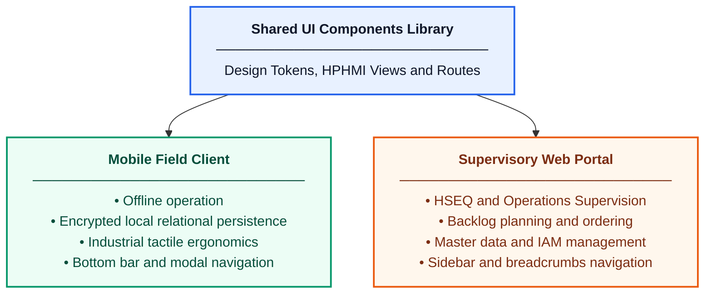
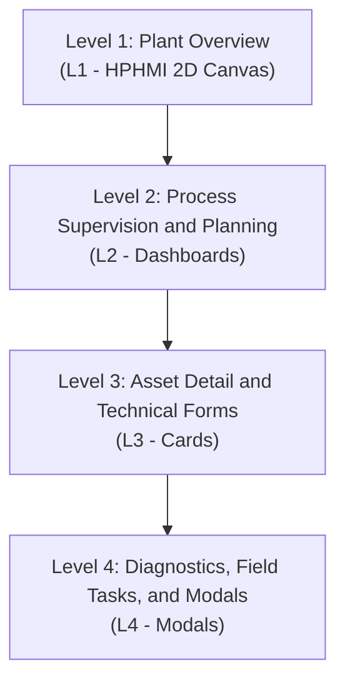
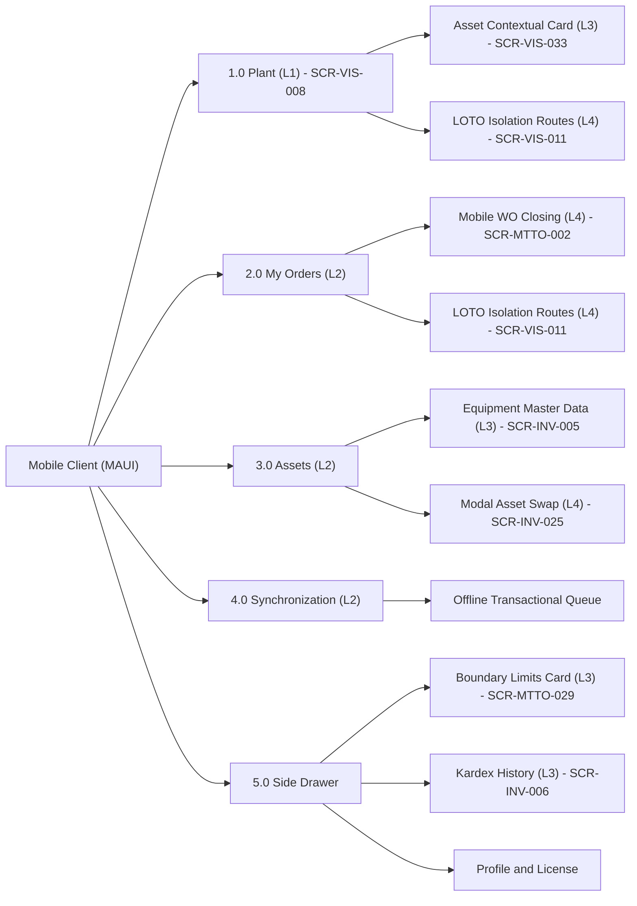
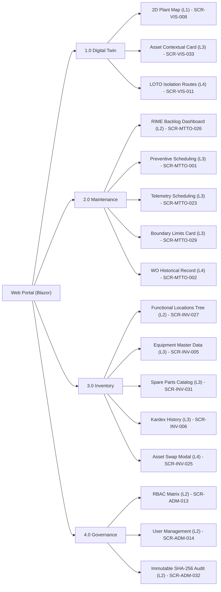
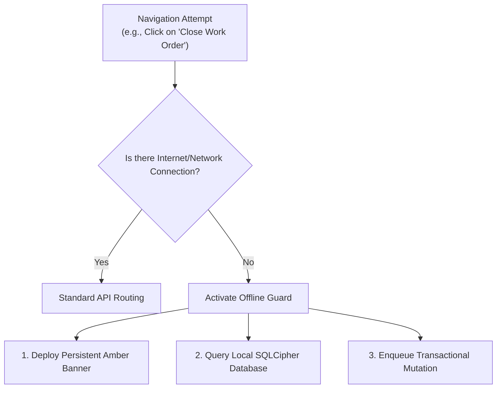
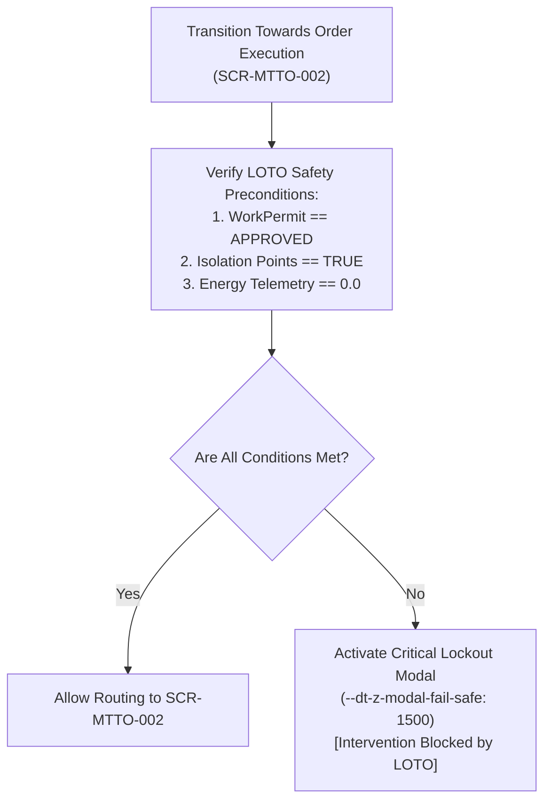

# Information Architecture and Global Navigation Specification

## 1. Scope

This document establishes the information architecture and the global navigation model for the EAM Digital Twin (DTEAM). It defines the hierarchical screen structure conforming to the **ANSI/ISA-101.01-2015** standard, functional distribution across platforms, role-based access control (RBAC) rules, and critical navigation guards for industrial safety and offline field operation.

The scope is limited to the 16 screens comprising the initial version of the product, ensuring traceability with approved use cases and domain models.

---

## 2. Client Topology 

According to architecture decision record [ADR-004](../architecture/adr/ADR-004.md), the user interface is distributed across two executable environments consuming a shared library of visual components, presentation logic, and design contracts:

### 2.1. Mobile Field Client
* **Operational Objective:** Work order execution, physical inspection of plant assets, component rotation, and validation of LOTO safety isolation routes.
* **Navigation Pattern:** Flat structure optimized for industrial portable devices (tablets and data collectors). Uses a bottom navigation bar with 4 main accesses, collapsible side panel for secondary tools, and full-screen modal dialog flows for high-risk tasks.
* **Device Orientation Adaptation:** Upon detecting a physical orientation change from portrait (`--dt-breakpoint-md`) to landscape (`--dt-breakpoint-lg`), bottom contextual containers (*Bottom Sheets*) automatically transition to fixed right-side panels according to the `--dt-layout-drawer-width` dimensional token, preventing vertical overlap over spatial diagrams and dense forms.

### 2.2. Web Portal Client 
* **Operational Objective:** Executive HSEQ supervision, ISO 14224 taxonomic catalog administration, maintenance backlog prioritization via RIME methodology, inventory management, and immutable audit inspection.
* **Navigation Pattern:** Deep hierarchical structure for high-resolution desktop screens (1920x1080). Uses a collapsible left sidebar with multilevel menus, top bar with breadcrumbs, network status, and contextual panels divided into columns.

---

## 3. Navigation Hierarchy

The **ANSI/ISA-101.01** standard requires industrial interfaces to be organized into four hierarchical display levels to prevent cognitive fatigue and ensure situational awareness.

### 3.1. Level 1: Plant Overview (L1 - Area / Overview)
Macro screens providing a holistic, uninterrupted view of the industrial plant. They apply the 90% neutral grays HPHMI rule to highlight only alarm conditions.

* **[SCR-VIS-008](screens/vis/SCR-VIS-008.md) — 2D Plant Map:** Scalable vector graphic canvas (SVG) adopting the *Simplified Plot Plan / Process Overview* format in a neutral HPHMI spatial palette, representing the spatial distribution of the plant (`L-CIVL-PROP`), programmatic L1 functional-zone summary pills, operating states, and active work permit layers. Traceable with **[UC-VIS-008](../domain-models/use-cases/vis/UC-VIS-008.md)** and **[UC-VIS-033](../domain-models/use-cases/vis/UC-VIS-033.md)**. Transitions across Level 1 (`--dt-zoom-scale-fit`), Level 2 (`--dt-zoom-scale-l1-max` / `--dt-zoom-scale-tactical`), and Level 3 (`--dt-zoom-scale-l2-max`) within the unified single-canvas viewport occur via continuous focal `viewBox` zoom, interactive ISO 14224 spatial breadcrumb (`Terminal > Zone > Asset`), or intent-based `Space` / `Ctrl + K` fuzzy search framing governed by [DT-UI-DS-DOC-001 §2.5](DT-UI-DS-DOC-001.md#25-spatial-navigation-and-semantic-zoom-tokens-ansiisa-10101-viewports).

### 3.2. Level 2: Process Supervision and Planning (L2 - Unit / Process)
Intermediate control screens for supervisors, planners, and auditors. They consolidate aggregated information, hierarchy trees, and performance metrics.

* **[SCR-MTTO-026](screens/mtto/SCR-MTTO-026.md) — RIME Backlog Dashboard:** Objective prioritization view of requests and work orders based on the product of Asset Criticality by Work Class. Traceable with **[UC-MTTO-026](../domain-models/use-cases/mtto/UC-MTTO-026.md)**.
* **[SCR-INV-027](screens/inv/SCR-INV-027.md) — Functional Locations Tree:** Hierarchical structure of ISO 14224 levels 1 to 5 for spatial process navigation. Traceable with **[UC-INV-027](../domain-models/use-cases/inv/UC-INV-027.md)**.
* **[SCR-ADM-013](screens/adm/SCR-ADM-013.md) — Roles and Permissions Matrix (RBAC):** Security configuration panel for assigning access privileges and segregation of duties. Traceable with **[UC-ADM-013](../domain-models/use-cases/adm/UC-ADM-013.md)**.
* **[SCR-ADM-014](screens/adm/SCR-ADM-014.md) — User Management:** Administration view for user account lifecycle, operational status, and security lockout. Traceable with **[UC-ADM-014](../domain-models/use-cases/adm/UC-ADM-014.md)**.
* **[SCR-ADM-032](screens/adm/SCR-ADM-032.md) — Immutable Audit Log Viewer:** Historical records query interface with chained cryptographic hash verification (SHA-256). Traceable with **[UC-ADM-032](../domain-models/use-cases/adm/UC-ADM-032.md)**.

### 3.3. Level 3: Asset Detail and Technical Forms (L3 - Equipment Detail)
Screens dedicated to detailed inspection of a specific equipment unit (ISO 14224 Level 6) or the formal preparation of maintenance interventions.

* **[SCR-VIS-033](screens/vis/SCR-VIS-033.md) — Asset Inspection Card:** Detailed contextual view of the selected equipment with telemetry data, structural breakdown, and recent history. Traceable with **[UC-VIS-033](../domain-models/use-cases/vis/UC-VIS-033.md)**.
* **[SCR-MTTO-001](screens/mtto/SCR-MTTO-001.md) — Preventive Scheduling Form:** Configuration interface for cyclic maintenance plans by calendar, operating hours, or starts. Traceable with **[UC-MTTO-001](../domain-models/use-cases/mtto/UC-MTTO-001.md)**.
* **[SCR-MTTO-023](screens/mtto/SCR-MTTO-023.md) — Telemetry Scheduling Form:** Configuration of condition-based maintenance (CBM) rules driven by IoT sensors. Traceable with **[UC-MTTO-023](../domain-models/use-cases/mtto/UC-MTTO-023.md)**.
* **[SCR-MTTO-029](screens/mtto/SCR-MTTO-029.md) — Asset Boundary Limits Card:** Technical definition of the physical limits of the equipment (battery limits) for cost control. Traceable with **[UC-MTTO-029](../domain-models/use-cases/mtto/UC-MTTO-029.md)**.
* **[SCR-INV-005](screens/inv/SCR-INV-005.md) — Equipment Master Data Card & Commissioning Gate:** Master record of the physical asset with manufacturer specifications, purchase date, operational status, and embedded Commissioning Gate validation queue (`?mode=commissioning`). Traceable with **[UC-INV-005](../domain-models/use-cases/inv/UC-INV-005.md)** and **[UC-INV-007](../domain-models/use-cases/inv/UC-INV-007.md)**.
* **[SCR-INV-006](screens/inv/SCR-INV-006.md) — Movements and Kardex History:** Transactional record of receipts, issues, and returns of materials and spare parts associated with the asset. Traceable with **[UC-INV-006](../domain-models/use-cases/inv/UC-INV-006.md)**.
* **[SCR-INV-031](screens/inv/SCR-INV-031.md) — Spare Parts Master Catalog:** Centralized management of spare parts and supplies with definition of inventory policies. Traceable with **[UC-INV-031](../domain-models/use-cases/inv/UC-INV-031.md)**.

### 3.4. Level 4: Diagnostics, Field Tasks, and Modal Dialogs (L4 - Diagnostics / Tasks)
Specialized interfaces for atomic execution, safety verification at the point of work, and interruptive modal dialogs.

* **[SCR-VIS-011](screens/vis/SCR-VIS-011.md) — LOTO Isolation and Lockout Routes Viewer:** Graphical interface for verifying energy isolation points before intervening on equipment. Traceable with **[UC-VIS-011](../domain-models/use-cases/vis/UC-VIS-011.md)**.
* **[SCR-MTTO-002](screens/mtto/SCR-MTTO-002.md) — Mobile Work Order Closing:** Field technical capture form for logging working hours, consumed spare parts, and ISO 14224 failure codes. Traceable with **[UC-MTTO-002](../domain-models/use-cases/mtto/UC-MTTO-002.md)**.
* **[SCR-INV-025](screens/inv/SCR-INV-025.md) — Asset Rotation Modal (Asset Swap):** Transactional dialog for the physical dismounting of equipment and mounting of a replacement unit at the functional location. Traceable with **[UC-INV-025](../domain-models/use-cases/inv/UC-INV-025.md)**.

---

## 4. Information Architecture Tree

### 4.1. Navigation Structure — Mobile Client

### 4.2. Navigation Structure — Web Portal Client

---

## 5. Transition Matrix and Access Control (RBAC)

The following table defines the transition rules between screens, triggering events, canonical query parameters, and authorized user roles synchronized 1:1 with each destination screen's frontmatter and `SCR-ADM-013` RBAC matrix:

| Origin Screen | Triggering Event / UI Action & Query Parameters | Destination Screen | ISA-101 Level | Authorized Roles |
| :-------------------- | :------------------------------------------------------- | :------------------------- | :-----------: | :-------------------------------------------- |
| [SCR-VIS-008](screens/vis/SCR-VIS-008.md)       | Asset Selection on 2D Canvas (`?tag={TagNumber}&level=L3`) | [SCR-VIS-033](screens/vis/SCR-VIS-033.md)            |  L1 $\to$ L3  | Maintenance Technician, Maintenance Supervisor, HSEQ Inspector, Reliability Engineer |
| [SCR-VIS-008](screens/vis/SCR-VIS-008.md)       | LOTO Layer Selection on 2D Canvas (`?workOrderId={WorkOrderId}&equipId={EquipmentUnitId}`) | [SCR-VIS-011](screens/vis/SCR-VIS-011.md)            |  L1 $\to$ L4  | Maintenance Technician, Maintenance Supervisor, HSEQ Inspector |
| `Any (Global)` | Press `Ctrl + K`, `/` or Tap on tactile search button | `Fuzzy Search Modal` |      L2       | All Roles                               |
| [SCR-VIS-033](screens/vis/SCR-VIS-033.md)       | Click on "Verify LOTO Isolation" (`?workOrderId={WorkOrderId}&equipId={EquipmentUnitId}`) | [SCR-VIS-011](screens/vis/SCR-VIS-011.md)            |  L3 $\to$ L4  | Maintenance Technician, Maintenance Supervisor, HSEQ Inspector |
| [SCR-VIS-033](screens/vis/SCR-VIS-033.md)       | Click on "View Data Sheet" (`?equipId={EquipmentUnitId}&returnUrl={CurrentRoute}`) | [SCR-INV-005](screens/inv/SCR-INV-005.md)            |  L3 $\to$ L3  | Project Engineer, Reliability Engineer, Maintenance Planner, Maintenance Supervisor, Maintenance Technician, Warehouse Manager, Auditor |
| [SCR-VIS-033](screens/vis/SCR-VIS-033.md)       | Click on "Start WO Execution" (`?workOrderId={WorkOrderId}`) | [SCR-MTTO-002](screens/mtto/SCR-MTTO-002.md)           |  L3 $\to$ L4  | Maintenance Technician, Maintenance Supervisor, Reliability Engineer |
| [SCR-MTTO-026](screens/mtto/SCR-MTTO-026.md)      | Row Selection in RIME Backlog (`?equipId={EquipmentUnitId}&band={RimeBand}`) | [SCR-MTTO-001](screens/mtto/SCR-MTTO-001.md)           |  L2 $\to$ L3  | Maintenance Planner, Maintenance Supervisor, Reliability Engineer |
| [SCR-MTTO-026](screens/mtto/SCR-MTTO-026.md)      | Click on "Schedule by Sensor" (`?equipId={EquipmentUnitId}`) | [SCR-MTTO-023](screens/mtto/SCR-MTTO-023.md)           |  L2 $\to$ L3  | Maintenance Planner, Reliability Engineer |
| [SCR-MTTO-001](screens/mtto/SCR-MTTO-001.md)      | Click on "Verify Spare Parts" (`?classId={EquipmentClassId}&sku={Sku}`) | [SCR-INV-031](screens/inv/SCR-INV-031.md)            |  L3 $\to$ L3  | Warehouse Manager, Maintenance Planner, Reliability Engineer, Auditor |
| [SCR-MTTO-002](screens/mtto/SCR-MTTO-002.md)      | Click on "Rotate Dismounted Equipment" (`?locId={FunctionalLocationId}&equipId={EquipmentUnitId}`) | [SCR-INV-025](screens/inv/SCR-INV-025.md)            |  L4 $\to$ L4  | Reliability Engineer, Maintenance Technician, Maintenance Supervisor, Warehouse Manager |
| [SCR-MTTO-002](screens/mtto/SCR-MTTO-002.md)      | Technical Closing Confirmation (`?returnUrl={BacklogRoute}`) | [SCR-MTTO-026](screens/mtto/SCR-MTTO-026.md)           |  L4 $\to$ L2  | Maintenance Planner, Maintenance Supervisor, Reliability Engineer |
| [SCR-INV-027](screens/inv/SCR-INV-027.md)       | Location Node Selection (`?locId={FunctionalLocationId}&equipId={EquipmentUnitId}`) | [SCR-INV-005](screens/inv/SCR-INV-005.md)            |  L2 $\to$ L3  | Project Engineer, Reliability Engineer, Maintenance Planner, Maintenance Supervisor, Maintenance Technician, Warehouse Manager, Auditor |
| [SCR-INV-005](screens/inv/SCR-INV-005.md)       | Switch to Embedded Commissioning Gate Queue (`?mode=commissioning&status=COMMISSIONING`) | [SCR-INV-005](screens/inv/SCR-INV-005.md)            |  L3 $\to$ L3  | Reliability Engineer, Project Engineer |
| [SCR-INV-005](screens/inv/SCR-INV-005.md)       | Click on "Check Kardex" (`?equipId={EquipmentUnitId}&sn={SerialNumber}&partId={SparePartId}`) | [SCR-INV-006](screens/inv/SCR-INV-006.md)            |  L3 $\to$ L3  | Warehouse Manager, Maintenance Planner, Auditor, Maintenance Supervisor, Reliability Engineer |
| [SCR-INV-005](screens/inv/SCR-INV-005.md)       | Click on "Define Boundaries" (`?equipId={EquipmentUnitId}&loc={FunctionalLocationTag}`) | [SCR-MTTO-029](screens/mtto/SCR-MTTO-029.md)           |  L3 $\to$ L3  | Reliability Engineer, Maintenance Planner, Maintenance Technician, Maintenance Supervisor, Auditor |
| [SCR-INV-005](screens/inv/SCR-INV-005.md)       | Click on "Physical Replacement" (`?locId={FunctionalLocationId}&equipId={EquipmentUnitId}`) | [SCR-INV-025](screens/inv/SCR-INV-025.md)            |  L3 $\to$ L4  | Reliability Engineer, Maintenance Technician, Maintenance Supervisor, Warehouse Manager |
| [SCR-ADM-014](screens/adm/SCR-ADM-014.md)       | Click on "Edit Privileges" (`?roleId={RoleId}`) | [SCR-ADM-013](screens/adm/SCR-ADM-013.md)            |  L2 $\to$ L2  | System Administrator, Auditor (Read-Only) |
| [SCR-ADM-013](screens/adm/SCR-ADM-013.md)       | Click on "Manage Users" (`?roleId={RoleId}&status={AccountStatus}`) | [SCR-ADM-014](screens/adm/SCR-ADM-014.md)            |  L2 $\to$ L2  | System Administrator, Auditor (Read-Only) |
| [SCR-ADM-013](screens/adm/SCR-ADM-013.md)       | Click on "Audit Modification" (`?entityType=Role&entityId={RoleId}`) | [SCR-ADM-032](screens/adm/SCR-ADM-032.md)            |  L2 $\to$ L2  | System Administrator, Auditor, Plant Manager |
| [SCR-ADM-014](screens/adm/SCR-ADM-014.md)       | Click on "Forensic Audit" (`?entityType=User&entityId={UserId}`) | [SCR-ADM-032](screens/adm/SCR-ADM-032.md)            |  L2 $\to$ L2  | System Administrator, Auditor, Plant Manager |
| [SCR-ADM-032](screens/adm/SCR-ADM-032.md)       | Click on "Roles Matrix" (`CMP-13`) | [SCR-ADM-013](screens/adm/SCR-ADM-013.md)            |  L2 $\to$ L2  | System Administrator, Auditor (Read-Only) |
| [SCR-ADM-032](screens/adm/SCR-ADM-032.md)       | Click on "Users" (`CMP-13`) | [SCR-ADM-014](screens/adm/SCR-ADM-014.md)            |  L2 $\to$ L2  | System Administrator, Auditor (Read-Only) |
| [SCR-INV-005](screens/inv/SCR-INV-005.md)       | Click on "Inspect Audit Trail" (`?entityType=EquipmentUnit&entityId={EquipmentUnitId}`) | [SCR-ADM-032](screens/adm/SCR-ADM-032.md)         |  L3 $\to$ L2  | System Administrator, Auditor, Plant Manager |
| [SCR-MTTO-026](screens/mtto/SCR-MTTO-026.md)    | Click on "View RIME Calibration Audit" (`?actionType=ADJUST&entityType=BacklogItem`) | [SCR-ADM-032](screens/adm/SCR-ADM-032.md)            |  L2 $\to$ L2  | System Administrator, Auditor, Plant Manager |

> **Screen Entry Role Scope Note:** Entry to `SCR-VIS-008` is restricted to `HSEQ Inspector` and `Maintenance Supervisor` per its frontmatter RBAC guard (`SCR-VIS-008.md`), while `SCR-VIS-033` is additionally reachable by `Maintenance Technician` and `Reliability Engineer` via direct tag search or Work Order inspection links.

---

## 6. Interruption Flows and Safety Guards

To ensure compliance with the Architecturally Significant Requirements ([ASR-001](../architecture/asr/DT-ARQ-ASR-001.md#1-offline-first-operation-and-partition-tolerance) and [ASR-002](../architecture/asr/DT-ARQ-ASR-001.md#2-real-time-loto-security-and-fail-safe)), the frontend client routing module implements two interruptive navigation guards that invalidate standard transitions when anomalous conditions are detected in the field.

### 6.1. Offline Operation Guard 

On the mobile client, the loss of wireless network signal does not stop the navigation of field functions.

* **Visual Behavior:** A persistent upper amber banner (`--dt-color-alarm-warning`) is immediately activated, accompanied by the WCAG disconnection icon.
* **Routing Restriction:** Access to centralized master data administration screens is blocked ([SCR-ADM-013](screens/adm/SCR-ADM-013.md), [SCR-ADM-014](screens/adm/SCR-ADM-014.md), [SCR-ADM-032](screens/adm/SCR-ADM-032.md)). 
* **Operational Permissiveness:** Full navigation and editing are allowed on field execution screens ([SCR-MTTO-002](screens/mtto/SCR-MTTO-002.md), [SCR-VIS-011](screens/vis/SCR-VIS-011.md), [SCR-INV-025](screens/inv/SCR-INV-025.md)), performing reads and writes on the encrypted local database ([TR-002](../requirements/common/TR-002.md)). Generated mutations are logged in a transactional synchronization queue for subsequent dispatch upon network restoration.

### 6.2. LOTO Lockout and Fail-Safe Guard 

In compliance with the **ISO 45001 (Clause 8.1)** standard and the **[ASR-002](../architecture/asr/DT-ARQ-ASR-001.md#2-real-time-loto-security-and-fail-safe)** requirement, the system programmatically prevents a technician from starting the execution of a work order if residual energy risks exist in the equipment.

* **Activation Trigger:** Executed automatically before transitioning to the closing/execution screen ([SCR-MTTO-002](screens/mtto/SCR-MTTO-002.md)) or when attempting to change the order status to `IN_PROGRESS`.
* **Lockout Conditions:**
  1. Associated Work Permit status other than `APPROVED`.
  2. Presence of unverified isolation cutoff points in the active LOTO Isolation Plan.
  3. Real-time telemetry reading above zero or expiration of the **30-second Grace Window** without receiving a 2-second heartbeat acknowledgment (`LotoHeartbeatAck` over `/hubs/telemetry`, per [DT-ARQ-DEP-DOC-001 §4](../architecture/views/DT-ARQ-DEP-DOC-001.md#4-perimeter-security-mechanism-loto-watchdog-fail-safe)) in the absence of a validated Cryptographic Offline LOTO Lease ([ADR-006](../architecture/adr/ADR-006.md)).
* **Screen Behavior:** Interrupts navigation and deploys a red blocking modal overlay (`--dt-color-alarm-critical`) at the maximum stacking level (`--dt-z-modal-fail-safe` = `1500`). This window is **non-dismissible**; it cannot be closed or bypassed via gestures or keyboard until the field safety conditions are physically rectified and verified by the system.
