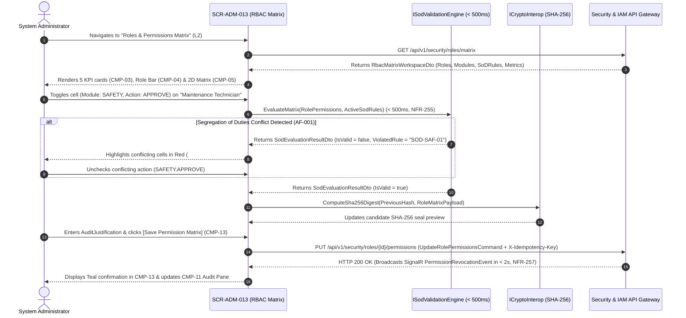

# SCR-ADM-013: Industrial RBAC Roles and Segregation of Duties (SoD) Permissions Matrix

## 1. Purpose and Operational Context

* **View Objective:** Centralized Level 2 security governance workspace for defining custom and operational roles (`adm.roles`), configuring the 2D module-by-action permissions matrix (`adm.role_permissions`), enforcing automated Segregation of Duties (SoD) interlocks (`Role.ValidateSoD()` per [DT-DM-DOC-002 §6.2](../../../domain-models/class/DT-DM-DOC-002.md#62-role-aggregate-root)), simulating multi-role Least-Privilege Unions (`FR-251`), and broadcasting real-time permission revocations to active sessions in $< 2\text{s}$ (`NFR-257`).
* **Primary Target Persona:** System Administrator creating custom roles, configuring domain privileges across `ASSETS`, `MAINTENANCE`, `INVENTORY`, `SAFETY`, and `SYSTEM`, resolving SoD conflicts (`AF-001`), and logically deactivating obsolete roles (`FR-254`).
* **Secondary Personas:**
  * **Auditor:** Inspects the global RBAC matrix in read-only mode, verifies Segregation of Duties enforcement under ISO/IEC 27001:2022 Annex A.5.3 and ISO 55001 Clause 5.3, exports compliance reports (`FR-252`), and drills down to the Immutable Audit Log Viewer ([SCR-ADM-032](SCR-ADM-032.md)).
* **Operational Context:** Deployed in IT/OT security governance and compliance offices on desktop workstations and supervisory tablets. Per [DT-UI-NAV-DOC-001 §6.1](../../DT-UI-NAV-DOC-001.md#61-offline-operation-guard), access to centralized IAM administration screens requires live network connectivity and is blocked when the Offline Operation Guard is active.
* **Mode of Operation:** Security Governance & Compliance Audit mode. Direct DCS/SCADA process control manipulation is strictly excluded. The Root Administrator role (`ROOT_ADMINISTRATOR`) is hardware/software-locked against deletion or privilege reduction (`FR-250`, `AF-002`).
* **Upstream & Downstream Navigation Invariants ([DT-UI-NAV-DOC-001 §5](../../DT-UI-NAV-DOC-001.md#5-transition-matrix-and-access-control-rbac)):**
  * **Upstream Continuity:** Launched from the Web Portal Governance sidebar or via `"Edit Privileges"` (`L2` $\to$ `L2`) in User Management ([SCR-ADM-014](SCR-ADM-014.md)).
  * **Downstream Transitions:** Routes to the Immutable SHA-256 Audit Log Viewer ([SCR-ADM-032](SCR-ADM-032.md)) via `"Audit Modification"` (`L2` $\to$ `L2`) or returns to [SCR-ADM-014](SCR-ADM-014.md) to assign roles to user accounts.

---

## 2. Visual Artifact


> *Note: Production UI prototype capture illustrating the Industrial RBAC Roles and Permissions Matrix desktop workstation layout, collapsible navigation sidebar, 5-card security posture KPI strip, role selector bar, 2D module-by-action matrix grid with Segregation of Duties conflict highlighting, persistent right dock with Least-Privilege Union simulator, SoD rule breakdown card, and sticky governance footer.*

---

## 3. Functional Component Inventory

> The base grid, typography, neutral palettes, and minimal tactile contact areas are inherited from [DT-UI-DS-DOC-001](../../DT-UI-DS-DOC-001.md). This inventory defines the canonical components present on the screen, their design tokens, and their architectural scope. Interaction rules and geometric algorithms are specified in Section 5; responsive container adaptations are governed by Section 8.

1. **`CMP-01`: Web Portal Shell & Sidebar**
   - **Visual Role:** Collapsible navigation sidebar hosting global modules, module hierarchy, and route markers.
   - **Design Tokens:**
     - Surface: `--dt-color-surface-base`
     - Border: `--dt-color-border-subtle`
     - Width: `--dt-layout-sidebar-width-expanded` (Desktop) / `--dt-layout-sidebar-width-collapsed` (Tablet Landscape)
   - **Architectural Scope:** Hosts global module navigation per [DT-UI-NAV-DOC-001](../../DT-UI-NAV-DOC-001.md), highlighting "Roles & Permissions (RBAC)" under Governance & Security. Responsive widths in Section 8.

2. **`CMP-02`: RBAC Governance Header & Action Bar**
   - **Visual Role:** Sticky top header hosting breadcrumbs, live session propagation status chip (`NFR-257`), `[+ Create Custom Role]` primary CTA (`FR-247`), `[Export Compliance Matrix]` dropdown (`FR-252`), and operator session badge.
   - **Design Tokens:**
     - Surface: `--dt-color-surface-card`
     - Border: `--dt-color-border-subtle`
     - Elevation: `--dt-z-header-sticky`
     - Primary Button: `--dt-color-state-info`
   - **Architectural Scope:** Manages custom role creation modal invocation (`CMP-09`), ISO 27001 matrix export (`CSV` / `JSON`), and real-time SignalR broadcast telemetry. Detailed in §5.1 and §5.3.4.

3. **`CMP-03`: Security Posture & SoD Compliance KPI Strip**
   - **Visual Role:** 5-card interactive summary strip displaying `Total Roles`, `Protected System Roles`, `Custom Roles`, `Active SoD Rules Enforced`, and `PoLP Advisory Warnings` (`FR-253`).
   - **Design Tokens:**
     - Surface: `--dt-color-surface-card`
     - Border: `--dt-color-border-subtle`
     - Radius: `--dt-radius-md`
     - Active Filter Ring: `--dt-color-state-info`
     - Warning Accent: `--dt-color-alarm-warning`
   - **Architectural Scope:** Provides one-click role category filtering and immediate visibility into Principle of Least Privilege advisories. Detailed in §5.1.

4. **`CMP-04`: Role Directory & Module Filter Toolbar**
   - **Visual Role:** Horizontal role selector strip paired with a `RbacModule` filter (`ASSETS`, `MAINTENANCE`, `INVENTORY`, `SAFETY`, `SYSTEM`), role lifecycle status filter (`ACTIVE` / `INACTIVE`), and debounced search input.
   - **Design Tokens:**
     - Surface: `--dt-color-surface-base`
     - Active Role Pill: `--dt-primitive-gray-980` (Light) / `--dt-primitive-gray-10` (Dark)
     - Border: `--dt-color-border-subtle`
     - Control Height: `--dt-control-height-md`
     - Radius: `--dt-radius-full` (Role Pills), `--dt-radius-sm` (Dropdowns)
   - **Architectural Scope:** Switches the active role inspected in `CMP-05` and `CMP-07` in $< 50\text{ms}$ without page reload ([DT-UI-DS-DOC-001 §6.6.2](../../DT-UI-DS-DOC-001.md#662-tactile-pill-actions-presets)). Detailed in §5.2.

5. **`CMP-05`: Interactive 2D Module-by-Action Permissions Matrix Grid**
   - **Visual Role:** Structured 2D matrix table crossing the 5 canonical `RbacModule` domains (rows, expandable to sub-resources) against the 7 atomic `RbacAction` columns (`CREATE`, `READ`, `EDIT`, `DELETE`, `APPROVE`, `AUDIT`, `EXECUTE` per `FR-248`), plus a row-level grant count summary.
   - **Design Tokens:**
     - Header Surface: `--dt-color-surface-base`
     - Row Surface: `--dt-color-surface-card`
     - Border: `--dt-color-border-subtle`
     - Row Height: `--dt-layout-table-row-height`
     - Typography: `--dt-font-body-md`, `--dt-font-mono-data`
   - **Architectural Scope:** Core RBAC matrix editor binding `Role.AddPermission(module, action)` and `Role.RemovePermission(module, action)` ([DT-DM-DOC-002 §6.2](../../../domain-models/class/DT-DM-DOC-002.md#62-role-aggregate-root)). Detailed in §5.2 and §5.3.1.

6. **`CMP-06`: Permission Matrix Checkbox Cell & SoD Interlock Indicator**
   - **Visual Role:** Tactile matrix cell (`--dt-control-size-checkbox`) rendering a monochromatic high-contrast checkmark when granted, a critical red outline + `#icon-ban` badge when part of an active Segregation of Duties violation (`AF-001`), an amber `#icon-warning` indicator on PoLP advisories (`AF-003`), or a disabled padlock `#icon-loto-locked` on the immutable Root Administrator role (`AF-002`).
   - **Design Tokens:**
     - Checkbox Footprint: `--dt-control-size-checkbox`
     - Touch Hit Area: `--dt-touch-target-mobile`
     - Granted Fill: `--dt-color-text-primary`
     - SoD Conflict (`AF-001`): `--dt-color-alarm-critical`
     - PoLP Advisory (`AF-003`): `--dt-color-alarm-warning`
     - Root Immutable Lock (`AF-002`): `--dt-color-state-disabled`
   - **Architectural Scope:** Enforces 4-channel WCAG 2.1 AA redundant coding on toxic permission pairs in $< 500\text{ms}$ (`NFR-255`) while avoiding green checkbox clutter on normal grants ([DT-UI-DS-DOC-001 §1](../../DT-UI-DS-DOC-001.md#1-scope)). Detailed in §5.3.1.

7. **`CMP-07`: Role Inspector, Least-Privilege Union Simulator & Lifecycle Rail**
   - **Visual Role:** Master-detail inspector hosted inside dock `CMP-12` displaying the selected role's metadata (`Name`, `Description`, `AssignedUsersCount`, `IsSystemRootRole`), the interactive Multi-Role Least-Privilege Union Simulator (`FR-251`), the SoD Rule Breakdown Card (`CMP-08`), and the `[Deactivate Custom Role]` trigger (`FR-254`).
   - **Design Tokens:**
     - Surface: `--dt-color-surface-card`
     - Simulator Box: `--dt-color-surface-base`
     - Border: `--dt-color-border-subtle`
     - Typography: `--dt-font-caption`, `--dt-font-body-md`, `--dt-font-mono-data`
   - **Architectural Scope:** Allows the Administrator to select $2..N$ roles to preview their combined effective permission union ($P_{\text{effective}} = \bigcup_{r \in R} P_r$) and verify that combining roles on a single user does not introduce cross-role SoD violations (`FR-251`). Detailed in §5.3.2.

8. **`CMP-08`: Segregation of Duties (SoD) Rule Breakdown Card**
   - **Visual Role:** Nested governance card inside `CMP-07` listing the active ISO/IEC 27001 Annex A.5.3 and ISO 55001 SoD rules evaluated against the current matrix, highlighting any violated rule in `--dt-color-alarm-critical`.
   - **Design Tokens:**
     - Surface: `--dt-color-surface-base`
     - Border: `--dt-color-border-subtle`, `--dt-color-alarm-critical` (Violated)
     - Radius: `--dt-radius-md`
   - **Architectural Scope:** Explains the exact conflicting `(Module, Action A) <-> (Module, Action B)` pair blocking save in `AF-001`. Detailed in §5.3.1.

9. **`CMP-09`: Create Custom Role Modal (`FR-247`)**
   - **Visual Role:** Centered transactional modal dialog (`--dt-layout-modal-width`, `--dt-layout-modal-max-height`) for creating a new custom role, capturing `RoleName`, `Description`, optional base role template to clone, and authorized `RbacModule` scope.
   - **Design Tokens:**
     - Surface: `--dt-color-surface-card`
     - Backdrop: `--dt-color-surface-overlay`
     - Width & Max-Height: `--dt-layout-modal-width`, `--dt-layout-modal-max-height`
     - Radius: `--dt-radius-xl`
     - Elevation: `--dt-z-modal`
     - Primary CTA: `--dt-color-state-info`
   - **Architectural Scope:** Validates role name uniqueness and initializes the custom role in the matrix editor. Detailed in §5.1.

10. **`CMP-10`: Logical Role Deactivation & Session Revocation Modal (`FR-254`)**
    - **Visual Role:** Centered confirmation modal displaying the count of active assigned users who will immediately lose privileges (`< 2s`, `NFR-257`) upon deactivating the custom role, requiring a mandatory security justification.
    - **Design Tokens:**
      - Surface: `--dt-color-surface-card`
      - Width: `--dt-layout-modal-width`
      - Radius: `--dt-radius-xl`
      - Elevation: `--dt-z-modal`
      - Warning Accent: `--dt-color-alarm-warning`
    - **Architectural Scope:** Executes logical role deactivation while preserving historical `adm.audit_logs` and `adm.work_order_assignments` integrity (`FR-254`, `AF-004`). Detailed in §5.3.4.

11. **`CMP-11`: Chained Cryptographic RBAC Audit Pane**
    - **Visual Role:** Append-only cryptographic audit tab hosted in dock `CMP-12` displaying chronological role creations, permission mutations, `SECURITY_ALERT` SoD block events, and SHA-256 integrity hashes.
    - **Design Tokens:**
      - Surface: `--dt-color-surface-card`
      - Border: `--dt-color-border-subtle`
      - Hash Typography: `--dt-font-mono-data`
    - **Architectural Scope:** Satisfies [TR-001](../../../requirements/common/TR-001.md) and [ADR-003](../../../architecture/adr/ADR-003.md). Detailed in §5.3.3.

12. **`CMP-12`: Persistent Workspace Dock & Vertical Tab Strip**
    - **Visual Role:** Right-hand workspace dock with vertical spine tabs (`ROLE INSPECTOR` / `SHA-256 AUDIT`) hosting `CMP-07`/`CMP-08` and `CMP-11`.
    - **Design Tokens:**
      - Track Surface: `--dt-color-surface-base`
      - Panel Surface: `--dt-color-surface-card`
      - Active Tab: `--dt-color-surface-raised`
      - Width: `--dt-layout-drawer-width-desktop` / `--dt-layout-drawer-width-tablet`
      - Elevation: `--dt-shadow-panel`
      - Active Indicator: `--dt-color-state-info`
    - **Architectural Scope:** Preserves matrix scroll and cell focus across inspector and audit tab switches (`CLS = 0`). Detailed in §5.2 and Section 8.

13. **`CMP-13`: Sticky RBAC Governance & Handoff Footer**
    - **Visual Role:** Permanent sticky bottom bar hosting the `CLS = 0` SoD/PoLP validation status slot, L2 navigation handoffs (`[Manage Users]`, `[Audit Modification]`), mandatory `AuditJustification` input, `[Discard Changes]`, and `[Save Permission Matrix]`.
    - **Design Tokens:**
      - Surface: `--dt-color-surface-card`
      - Border: `--dt-color-border-hairline`
      - Height: `--dt-layout-footer-height`
      - Elevation: `--dt-z-header-sticky`
      - Primary CTA: `--dt-color-state-info`
      - Secondary Button: `--dt-color-surface-btn-secondary`
    - **Architectural Scope:** Hard-gated by `Role.ValidateSoD() == true`; commits atomic matrix changes and routes to [SCR-ADM-014](SCR-ADM-014.md) or [SCR-ADM-032](SCR-ADM-032.md) ([DT-UI-NAV-DOC-001 §5](../../DT-UI-NAV-DOC-001.md#5-transition-matrix-and-access-control-rbac)). Detailed in §5.3.3.

---

## 4. Screen State Catalog

1. **Matrix Inspection & Configuration Mode (Default)**
   - **Activation Condition:** System Administrator or Auditor navigates to `SCR-ADM-013`.
   - **Visual Modification:** Neutral grayscale surfaces (`--dt-color-surface-card`). Active operational role (e.g., `Maintenance Planner`) is selected in `CMP-04`. Granted cells in `CMP-05` render with monochromatic high-contrast checkmarks (`--dt-color-text-primary`) without green fills. Right dock `CMP-12` displays `CMP-07` role details and `CMP-08` SoD compliance status (`0 Conflicts`).

2. **Loading / Evaluating Matrix**
   - **Activation Condition:** Initial RBAC catalog load or role switching.
   - **Visual Modification:** Skeleton shimmer (`--dt-color-surface-raised`) across `CMP-03` KPI cards and `CMP-05` matrix rows; commit controls locked.

3. **Segregation of Duties (SoD) Conflict Blocked (`AF-001` / `FR-249` / `NFR-255`)**
   - **Activation Condition:** Administrator checks a permission cell in `CMP-05` (or simulates a multi-role union in `CMP-07`) that conflicts with an existing privilege under ISO/IEC 27001 Annex A.5.3 (evaluated in $< 500\text{ms}$).
   - **Visual Modification:** Both conflicting cells in `CMP-05` highlight with a critical red outline (`--dt-color-alarm-critical`) and `#icon-ban` badge. `CMP-08` highlights the violated SoD rule. Footer status slot in `CMP-13` renders a critical block alert (`#icon-ban`): *"Segregation of Duties Block (ISO 27001 A.5.3): SAFETY.CREATE and SAFETY.APPROVE cannot coexist on the same role."* `[Save Permission Matrix]` is hard-disabled (`CLS = 0`).

4. **Root Administrator Role Immutable Lock (`AF-002` / `FR-250`)**
   - **Activation Condition:** Administrator selects the `Root Administrator` role in `CMP-04`.
   - **Visual Modification:** All matrix cells in `CMP-05` render locked with `#icon-loto-locked` (`--dt-color-state-disabled`) and `[Deactivate Custom Role]` in `CMP-07` is hidden. Footer `CMP-13` displays: *"Protected System Role: Root Administrator privileges are immutable and cannot be restricted or deleted."*

5. **Principle of Least Privilege (PoLP) Advisory Warning (`AF-003` / `FR-253`)**
   - **Activation Condition:** Administrator grants broad destructive privileges (such as `DELETE` on `ASSETS` or `INVENTORY` to a non-administrative role) that do not violate a hard SoD rule but exceed least-privilege baselines.
   - **Visual Modification:** Affected cell in `CMP-05` displays an amber caution border (`--dt-color-alarm-warning`) and `#icon-warning` glyph. Footer status slot in `CMP-13` prompts for mandatory `AuditJustification` ($\ge 15$ characters) before enabling `[Save Permission Matrix]`.

6. **Multi-Role Least-Privilege Union Simulation Active (`FR-251`)**
   - **Activation Condition:** Administrator selects secondary roles in the `CMP-07` Union Simulator to preview effective permissions for a multi-role user.
   - **Visual Modification:** Matrix `CMP-05` overlays inherited permissions from secondary roles with a distinct dotted focus ring (`--dt-color-border-focus`), immediately flagging if the combined union triggers a cross-role SoD violation.

7. **Creating Custom Role (`FR-247`) or Deactivating Role (`AF-004` / `FR-254`)**
   - **Activation Condition:** Administrator clicks `[+ Create Custom Role]` (`CMP-09`) or `[Deactivate Custom Role]` (`CMP-10`).
   - **Visual Modification:** Centered modal deploys over `--dt-color-surface-overlay` backdrop with keyboard focus trapping.

8. **Documentary Confirmation & Live Session Broadcast (`NFR-257`)**
   - **Activation Condition:** Atomic permission matrix save or role deactivation commits and broadcasts via SignalR.
   - **Visual Modification:** Footer slot in `CMP-13` renders a Teal confirmation pill (`--dt-color-state-success`, `#icon-check`) with the SHA-256 hash, while header chip in `CMP-02` confirms: *"Permissions Propagated to Active Sessions (< 2s)"*.

---

## 5. Interaction Rules and Data Flow

### 5.1. Initial Load & Sub-500ms SoD Validation Pipeline



1. **Canonical Domain Module & Action Matrix (`FR-248`, [DT-DM-DOC-001 §4.39](../../../domain-models/class/DT-DM-DOC-001.md#439-rolepermissionmodule)):**
   * The matrix rows bind strictly to the 5 canonical `RbacModule` enum values (`ASSETS`, `MAINTENANCE`, `INVENTORY`, `SAFETY`, `SYSTEM`), and the columns bind to the 7 canonical `RbacAction` enum values (`CREATE`, `READ`, `EDIT`, `DELETE`, `APPROVE`, `AUDIT`, `EXECUTE`).
2. **Imperceptible Authorization Cache Architecture (`NFR-256`, `NFR-257`, `TR-010`):**
   * Committed matrix changes invalidate distributed memory/JWT permission claims and push a real-time SignalR `PermissionsUpdatedEvent` to connected clients in $< 2\text{s}$ (`NFR-257`, `TR-010-NFR-432`), enabling runtime endpoint authorization checks to execute in $< 5\text{ms}$–$10\text{ms}$ (`NFR-256`, `TR-006-NFR-401`).

---

### 5.2. Matrix Ergonomics & Keyboard Accessibility

1. **Grid Navigation & Gloved/Pointer Ergonomics (`CMP-05`, `CMP-06`):**
   * Supports 2D arrow-key navigation (`ArrowUp`, `ArrowDown`, `ArrowLeft`, `ArrowRight`) across matrix cells and `Space` / `Enter` to toggle permission checkboxes.
   * Each matrix cell hit area expands to `--dt-touch-target-mobile` on tablet viewports while rendering the inner visual checkbox at `--dt-control-size-checkbox`.
2. **Cross-Screen Governance Handoffs ([DT-UI-NAV-DOC-001 §5](../../DT-UI-NAV-DOC-001.md#5-transition-matrix-and-access-control-rbac)):**
   * Clicking `[Manage Users]` in `CMP-13` routes to User Management ([SCR-ADM-014](SCR-ADM-014.md)).
   * Clicking `[Audit Modification]` in `CMP-13` routes to the Immutable SHA-256 Audit Log Viewer ([SCR-ADM-032](SCR-ADM-032.md)) pre-filtered by `EntityType = "Role"`.

---

### 5.3. Domain Workflows & Security Interlock Rules

#### 5.3.1. Segregation of Duties (SoD) Matrix Evaluation (`FR-249`, `NFR-255`, `AF-001`)
1. **Deterministic SoD Rule Set (`Role.ValidateSoD()`):** Let $P_r \subseteq \text{RbacModule} \times \text{RbacAction}$ be the permission set assigned to role $r$, and let $\mathcal{C}_{\text{SoD}}$ be the set of prohibited toxic pairs $((m_1, a_1), (m_2, a_2))$:
   * **Rule `SOD-SAF-01` (LOTO & Permit Self-Approval):** $(\text{SAFETY}, \text{CREATE/EXECUTE}) \land (\text{SAFETY}, \text{APPROVE})$ — prevents a technician or contractor from autonomously approving their own high-risk Work Permit or LOTO override.
   * **Rule `SOD-INV-01` (Inventory Fraud Prevention):** $(\text{INVENTORY}, \text{CREATE/EXECUTE}) \land (\text{INVENTORY}, \text{APPROVE/AUDIT})$ — prevents a warehouse operator from both executing and auditing/approving physical stock write-offs.
   * **Rule `SOD-MTTO-01` (Work Order Closure Governance):** $(\text{MAINTENANCE}, \text{EXECUTE}) \land (\text{MAINTENANCE}, \text{APPROVE})$ — enforces separation between field technical completion (`COMPLETE`) and supervisory administrative closure (`CLOSED`).
   * **Rule `SOD-SYS-01` (Audit Trail Independence):** $(\text{SYSTEM}, \text{CREATE/EDIT/DELETE}) \land (\text{SYSTEM}, \text{AUDIT})$ on non-root roles — separates IAM administration from independent compliance auditing.
2. **Sub-500ms Veto Execution (`NFR-255`, `AF-001`):** Whenever $\exists (p_1, p_2) \in \mathcal{C}_{\text{SoD}}$ such that $p_1 \in P_r \land p_2 \in P_r$, client-side `Role.ValidateSoD()` trips in $< 50\text{ms}$ (well within the $500\text{ms}$ ceiling), highlighting both cells in `--dt-color-alarm-critical` (`#icon-ban`) and hard-disabling `[Save Permission Matrix]`. Any attempt to bypass the UI is rejected by the backend domain aggregate, which logs a `SECURITY_ALERT` entry in `adm.audit_logs` (`DT-DM-DOC-001 §4.36`).

#### 5.3.2. Multi-Role Least-Privilege Union Consolidation (`FR-251`, `FR-253`, `AF-003`)
1. **Least-Privilege Union Formula (`FR-251`):** When a user is assigned a set of roles $R_u = \{r_1, r_2, \dots, r_k\}$ (`adm.user_roles`), effective authorization is computed as the union:
   $$P_{\text{effective}}(u) = \bigcup_{r \in R_u} P_r$$
   The `CMP-07` Union Simulator evaluates $\text{ValidateSoD}(P_{\text{effective}}(u))$ across combined roles so administrators can detect cross-role SoD conflicts before assigning multiple roles in [SCR-ADM-014](SCR-ADM-014.md).

#### 5.3.3. Root Administrator Immutability & Chained SHA-256 Audit (`FR-250`, `AF-002`, `TR-001`, `ADR-003`)
1. **Root Role Guard (`FR-250`, `AF-002`):** When `SelectedRole.IsSystemRootRole == true`, all checkbox inputs in `CMP-05` and `Role.RemovePermission` calls are hard-blocked on both client and server.
2. **Chained SHA-256 Digest (`TR-001`, `ADR-003`):** Every role creation, permission matrix update, or logical deactivation requires a mandatory `AuditJustification` ($\ge 15$ characters) and appends a tamper-evident record to `CMP-11`:
   $$\text{IntegrityHash} = \text{SHA-256}(\text{PreviousHash} \parallel \text{AdminUserId} \parallel \text{RoleId} \parallel \text{PreviousPermissionsJson} \parallel \text{NewPermissionsJson} \parallel \text{AuditJustification} \parallel \text{TimestampUtc})$$

#### 5.3.4. Logical Role Deactivation & Immediate Session Revocation (`FR-254`, `NFR-257`, `AF-004`)
1. Confirming logical deactivation in `CMP-10` sets `IsActive = false` on the custom role, revokes active bearer/refresh tokens (`AuthToken.Revoke()` per `DT-DM-DOC-002 §6.4`) or pushes a SignalR permission refresh to affected sessions within $< 2\text{s}$ (`NFR-257`), and retains all historical `adm.user_roles` and `adm.audit_logs` links.

---

## 6. Industrial and Safety Considerations

* **Life-Safety Segregation of Duties (ISO 45001 §8.1 / ISO 55001 §5.3 / ISO 27001 A.5.3):** In industrial environments, allowing the same role to both execute field work and approve LOTO/Work Permit authorizations creates a catastrophic single-point human-factor failure mode. `CMP-05` and `CMP-08` elevate Segregation of Duties from a passive policy document to an un-bypassable software interlock (`AF-001`).
* **Root Account Anti-Lockout Protection (`FR-250`):** Preventing deletion or privilege stripping of the `Root Administrator` role guarantees that the plant platform can never enter an unrecoverable administrative lockout state during emergency governance interventions.
* **HPHMI Grayscale & Anti-Badge-Inflation Governance ([TR-011](../../../requirements/common/TR-011.md)):** In accordance with [DT-UI-DS-DOC-001 §1](../../DT-UI-DS-DOC-001.md#1-scope) and [§6.5](../../DT-UI-DS-DOC-001.md#65-status-badge-counter-discipline-anti-badge-inflation-principle), granted permission checkboxes render in neutral high-contrast monochromatic fill (`--dt-color-text-primary`) rather than decorative green, reserving `--dt-color-alarm-critical` (`AF-001` SoD blocks) and `--dt-color-alarm-warning` (`AF-003` PoLP advisories) strictly for security exceptions.

---

## 7. Frontend Component Contract (Blazor / Razor)

### 7.1. Component Hierarchy & File Mapping

```text
Pages/Governance/
└── RolesAndPermissionsMatrixPage.razor                # Root View (SCR-ADM-013)
    ├── PortalSidebarNav.razor                         # CMP-01: Collapsible desktop navigation sidebar
    ├── RbacHeaderBar.razor                            # CMP-02: Breadcrumbs, [+ Create Role], export & sync chip
    ├── RbacSummaryCards.razor                         # CMP-03: 5-card security posture & SoD KPI strip
    ├── RbacFilterToolbar.razor                        # CMP-04: Monochromatic role selector pills & module filter
    ├── PermissionsMatrixGrid.razor                    # CMP-05: 2D Module-by-Action permissions matrix table
    │   └── PermissionMatrixCell.razor                 # CMP-06: Tactile checkbox cell with SoD/PoLP/Root states
    ├── RbacWorkspaceDock.razor                        # CMP-12: Persistent right dock with vertical tab spine
    │   ├── RoleInspectionRail.razor                   # CMP-07: Role metadata, Union Simulator & deactivation trigger
    │   │   └── SodConflictBreakdownCard.razor         # CMP-08: ISO 27001 A.5.3 SoD rule evaluation card
    │   └── RbacAuditLogPane.razor                     # CMP-11: Chained SHA-256 RBAC audit trail pane
    ├── CreateCustomRoleModal.razor                    # CMP-09: Custom role creation modal (FR-247)
    ├── DeactivateRoleModal.razor                      # CMP-10: Logical role deactivation & session revocation modal (FR-254)
    └── RbacActionFooter.razor                         # CMP-13: Sticky governance footer, SoD alert slot & L2 handoffs
```

---

### 7.2. Physical Component Parameters & DTO Contracts (.NET 10 / C# 14)

#### 7.2.1. `RolesAndPermissionsMatrixPage.razor` (Root View)

```csharp
[Parameter, SupplyParameterFromQuery(Name = "roleId")]
public Guid? InitialRoleId { get; set; }
```

#### 7.2.2. Subcomponent Parameter Contracts (`CMP-01` to `CMP-13`)

```csharp
// CMP-01: PortalSidebarNav.razor
[Parameter]
public bool IsCollapsed { get; set; }

[Parameter]
public bool IsMobileDrawerOpen { get; set; }

[Parameter]
public string ActiveRouteCode { get; set; } = "SCR-ADM-013";

[Parameter]
public EventCallback<bool> OnCollapseToggled { get; set; }

// CMP-02: RbacHeaderBar.razor
[Parameter]
public required string OperatorBadgeCode { get; set; }

[Parameter]
public required string OperatorDisplayName { get; set; }

[Parameter]
public bool CanEditRbac { get; set; }

[Parameter]
public DateTimeOffset? LastSessionBroadcastAtUtc { get; set; }

[Parameter]
public EventCallback OnOpenCreateRoleModal { get; set; }

[Parameter]
public EventCallback<RbacMatrixExportFormat> OnExportMatrixRequested { get; set; }

[Parameter]
public EventCallback OnToggleMobileNavigation { get; set; }

// CMP-03: RbacSummaryCards.razor
[Parameter]
public required RbacSummaryMetricsDto Metrics { get; set; }

[Parameter]
public RbacRoleFilterCategory? ActiveCategoryFilter { get; set; }

[Parameter]
public EventCallback<RbacRoleFilterCategory?> OnCategoryFilterSelected { get; set; }

// CMP-04: RbacFilterToolbar.razor
[Parameter]
public required IReadOnlyList<RoleSummaryDto> Roles { get; set; }

[Parameter]
public required Guid SelectedRoleId { get; set; }

[Parameter]
public RbacModule? SelectedModuleFilter { get; set; }

[Parameter]
public string? SearchQuery { get; set; }

[Parameter]
public EventCallback<Guid> OnRoleSelected { get; set; }

[Parameter]
public EventCallback<RbacModule?> OnModuleFilterChanged { get; set; }

[Parameter]
public EventCallback<string?> OnSearchQueryChanged { get; set; }

// CMP-05: PermissionsMatrixGrid.razor
[Parameter]
public required RoleMatrixDetailDto ActiveRoleMatrix { get; set; }

[Parameter]
public IReadOnlySet<PermissionGrantKeyDto> SimulatedUnionPermissions { get; set; } = new HashSet<PermissionGrantKeyDto>();

[Parameter]
public required SodEvaluationResultDto SodEvaluation { get; set; }

[Parameter]
public bool IsReadOnly { get; set; }

[Parameter]
public EventCallback<PermissionToggleRequestDto> OnPermissionCellToggled { get; set; }

// CMP-06: PermissionMatrixCell.razor
[Parameter]
public required RbacModule Module { get; set; }

[Parameter]
public required RbacAction Action { get; set; }

[Parameter]
public bool IsGranted { get; set; }

[Parameter]
public bool IsSimulatedFromUnion { get; set; }

[Parameter]
public bool IsRootLocked { get; set; }

[Parameter]
public bool HasSodConflict { get; set; }

[Parameter]
public bool HasPolpAdvisory { get; set; }

[Parameter]
public EventCallback<PermissionToggleRequestDto> OnCellToggled { get; set; }

// CMP-12: RbacWorkspaceDock.razor
[Parameter]
public bool IsOpen { get; set; }

[Parameter]
public RbacDockTab ActiveTab { get; set; } = RbacDockTab.ROLE_INSPECTOR;

[Parameter]
public EventCallback<RbacDockTab> OnTabChanged { get; set; }

[Parameter]
public EventCallback OnClosed { get; set; }

// CMP-07: RoleInspectionRail.razor
[Parameter]
public required RoleMatrixDetailDto ActiveRole { get; set; }

[Parameter]
public required IReadOnlyList<RoleSummaryDto> AllRoles { get; set; }

[Parameter]
public IReadOnlySet<Guid> SimulatedSecondaryRoleIds { get; set; } = new HashSet<Guid>();

[Parameter]
public required SodEvaluationResultDto SodEvaluation { get; set; }

[Parameter]
public bool CanEditRbac { get; set; }

[Parameter]
public EventCallback<Guid> OnToggleSimulatedSecondaryRole { get; set; }

[Parameter]
public EventCallback<Guid> OnOpenDeactivateRoleModal { get; set; }

// CMP-08: SodConflictBreakdownCard.razor
[Parameter]
public required IReadOnlyList<SodRuleEvaluationItemDto> EvaluatedRules { get; set; }

// CMP-09: CreateCustomRoleModal.razor (FR-247)
[Parameter]
public bool IsVisible { get; set; }

[Parameter]
public required IReadOnlyList<RoleSummaryDto> TemplateRoles { get; set; }

[Parameter]
public bool IsRoleNameUnique { get; set; } = true;

[Parameter]
public EventCallback<CreateCustomRoleCommand> OnRoleCreated { get; set; }

[Parameter]
public EventCallback OnCloseRequested { get; set; }

// CMP-10: DeactivateRoleModal.razor (FR-254)
[Parameter]
public bool IsVisible { get; set; }

[Parameter]
public RoleSummaryDto? TargetRole { get; set; }

[Parameter]
public EventCallback<DeactivateCustomRoleCommand> OnDeactivateConfirmed { get; set; }

[Parameter]
public EventCallback OnCloseRequested { get; set; }

// CMP-11: RbacAuditLogPane.razor
[Parameter]
public required IReadOnlyList<RbacAuditEntryDto> AuditEntries { get; set; }

// CMP-13: RbacActionFooter.razor
[Parameter]
public required RoleMatrixDetailDto ActiveRole { get; set; }

[Parameter]
public required SodEvaluationResultDto SodEvaluation { get; set; }

[Parameter]
public bool HasUnsavedChanges { get; set; }

[Parameter]
public bool CanCommit { get; set; }

[Parameter]
public bool IsSubmitting { get; set; }

[Parameter]
public string AuditJustification { get; set; } = string.Empty;

[Parameter]
public EventCallback<string> AuditJustificationChanged { get; set; }

[Parameter]
public EventCallback OnNavigateToUserManagement { get; set; }

[Parameter]
public EventCallback<Guid> OnNavigateToAuditViewer { get; set; }

[Parameter]
public EventCallback OnDiscardChangesClicked { get; set; }

[Parameter]
public EventCallback OnSaveMatrixClicked { get; set; }
```

#### 7.2.3. Data Transfer Objects (DTOs) and Enums

```csharp
/// <summary>
/// Controlled application subdomain module vocabulary per DT-DM-DOC-001 §4.39.
/// </summary>
public enum RbacModule
{
    ASSETS,
    MAINTENANCE,
    INVENTORY,
    SAFETY,
    SYSTEM
}

/// <summary>
/// Controlled granular RBAC action vocabulary per FR-248 & DT-ERD-DOC-001 §3.5.3.
/// </summary>
public enum RbacAction
{
    CREATE,
    READ,
    EDIT,
    DELETE,
    APPROVE,
    AUDIT,
    EXECUTE
}

public enum RbacRoleFilterCategory
{
    ALL_ROLES,
    SYSTEM_PROTECTED,
    CUSTOM_OPERATIONAL,
    SOD_RULES_ACTIVE,
    POLP_ADVISORIES
}

public enum RbacDockTab
{
    ROLE_INSPECTOR,
    SHA256_AUDIT
}

public enum RbacMatrixExportFormat
{
    GLOBAL_MATRIX_CSV,
    GLOBAL_MATRIX_JSON
}

public readonly record struct PermissionGrantKeyDto(
    RbacModule Module,
    RbacAction Action
);

public record PermissionToggleRequestDto
{
    public required RbacModule Module { get; init; }
    public required RbacAction Action { get; init; }
    public required bool NewGrantedState { get; init; }
}

public record RbacSummaryMetricsDto
{
    public required int TotalRolesCount { get; init; }
    public required int SystemProtectedRolesCount { get; init; }
    public required int CustomRolesCount { get; init; }
    public required int ActiveSodRulesCount { get; init; }
    public required int PolpAdvisoryWarningsCount { get; init; }
}

public record RoleSummaryDto
{
    public required Guid RoleId { get; init; }
    public required string Name { get; init; }
    public string? Description { get; init; }
    public required bool IsSystemRootRole { get; init; }
    public required bool IsCustomRole { get; init; }
    public required bool IsActive { get; init; }
    public required int AssignedUsersCount { get; init; }
}

public record RoleMatrixDetailDto
{
    public required Guid RoleId { get; init; }
    public required string Name { get; init; }
    public string? Description { get; init; }
    public required bool IsSystemRootRole { get; init; }
    public required bool IsCustomRole { get; init; }
    public required bool IsActive { get; init; }
    public required int AssignedUsersCount { get; init; }
    public required IReadOnlySet<PermissionGrantKeyDto> GrantedPermissions { get; init; }
    public required string LatestIntegrityHash { get; init; }
}

public record SodEvaluationResultDto
{
    public required bool IsCompliant { get; init; }
    public required int SodViolationCount { get; init; }
    public required int PolpAdvisoryCount { get; init; }
    public IReadOnlySet<PermissionGrantKeyDto> ConflictingCells { get; init; } = new HashSet<PermissionGrantKeyDto>();
    public IReadOnlySet<PermissionGrantKeyDto> PolpAdvisoryCells { get; init; } = new HashSet<PermissionGrantKeyDto>();
    public IReadOnlyList<SodRuleEvaluationItemDto> RuleEvaluations { get; init; } = [];
    public string? PrimaryDiagnosticMessage { get; init; }
}

public record SodRuleEvaluationItemDto
{
    public required string RuleCode { get; init; }
    public required string RuleTitle { get; init; }
    public required string IsoStandardReference { get; init; }
    public required PermissionGrantKeyDto LeftPrivilege { get; init; }
    public required PermissionGrantKeyDto RightPrivilege { get; init; }
    public required bool IsViolated { get; init; }
}

public record CreateCustomRoleCommand
{
    public required string Name { get; init; }
    public required string Description { get; init; }
    public Guid? CloneFromRoleId { get; init; }
    public required IReadOnlySet<RbacModule> AuthorizedModules { get; init; }
    public required string AuditJustification { get; init; }
    public required Guid AdminUserId { get; init; }
    public required string PreviousHash { get; init; }
}

public record UpdateRolePermissionsCommand
{
    public required Guid RoleId { get; init; }
    public required IReadOnlySet<PermissionGrantKeyDto> GrantedPermissions { get; init; }
    public required string AuditJustification { get; init; }
    public required Guid AdminUserId { get; init; }
    public required string PreviousHash { get; init; }
}

public record DeactivateCustomRoleCommand
{
    public required Guid RoleId { get; init; }
    public required string AuditJustification { get; init; }
    public required Guid AdminUserId { get; init; }
    public required string PreviousHash { get; init; }
}

public record RbacAuditEntryDto
{
    public required Guid AuditLogId { get; init; }
    public required DateTimeOffset TimestampUtc { get; init; }
    public required string OperatorBadgeCode { get; init; }
    public required string EventType { get; init; }
    public required string RoleName { get; init; }
    public required string ChangeSummary { get; init; }
    public required string AuditJustification { get; init; }
    public required string PreviousHash { get; init; }
    public required string IntegrityHash { get; init; }
}
```

---

### 7.3. Client-Side DOM & Interop Bridge

1. **In-Memory Segregation of Duties & PoLP Validator (`ISodValidationEngine`):**
   * Evaluates `Role.ValidateSoD()` and Principle of Least Privilege advisories synchronously in WebAssembly on every checkbox toggle (completing in $< 10\text{ms}$, well below the $500\text{ms}$ `NFR-255` ceiling), including multi-role Least-Privilege Union simulations (`FR-251`).
2. **Real-Time Session Permission Revocation Hub (`IPermissionBroadcastHub` / `TR-010`):**
   * Subscribes to and dispatches SignalR permission invalidation events upon role matrix commits or custom role deactivations, propagating privilege changes to active client sessions in $< 2\text{s}$ (`NFR-257`, `TR-010-NFR-432`).
3. **Web Cryptography SHA-256 Digest Bridge (`ICryptoInterop`):**
   * Computes candidate `IntegrityHash` digests asynchronously in a Web Worker across canonicalized role permission sets (`TR-001`, `ADR-003`).

---

## 8. Layout and Responsive Adaptability

### 8.1. Desktop Workstation (`--dt-breakpoint-xl`)
* **Layout Organization:** Asymmetric 3-column workstation split ([DT-UI-DS-DOC-001 §2.3](../../DT-UI-DS-DOC-001.md#23-responsive-breakpoints-and-reference-frames)): left navigation sidebar `CMP-01` expanded at `--dt-layout-sidebar-width-expanded`, central RBAC workspace hosting the 5 summary KPI cards `CMP-03`, role selector toolbar `CMP-04`, and 2D permissions matrix grid `CMP-05`, paired with the persistent right workspace dock `CMP-12` sized by `--dt-layout-drawer-width-desktop` (`--dt-shadow-panel`). Modals `CMP-09` and `CMP-10` center at `--dt-layout-modal-width-desktop` bounded by `--dt-layout-modal-max-height`. Sticky footer `CMP-13` (`--dt-layout-footer-height`) spans the bottom workspace.
* **Ergonomic Rules:** Optimized for mouse and 2D keyboard arrow navigation; matrix row height governed by `--dt-layout-table-row-height`; custom checkbox cells sized by `--dt-control-size-checkbox`; zero horizontal layout shift (`CLS = 0`).

### 8.2. Industrial Tablet Landscape (`--dt-breakpoint-lg`)
* **Layout Organization:** Navigation sidebar `CMP-01` collapses to an icon-only rail sized by `--dt-layout-sidebar-width-collapsed`; workspace dock `CMP-12` operates as a slide-over lateral panel sized by `--dt-layout-drawer-width-tablet`; role selector pills in `CMP-04` scroll horizontally via touch swipe; modals `CMP-09` and `CMP-10` size to `--dt-layout-modal-width-tablet`.
* **Ergonomic Rules:** Matrix cell hit areas expand to `--dt-touch-target-mobile`; sticky footer `CMP-13` (`--dt-layout-footer-height`) remains permanently pinned.

### 8.3. Industrial Tablet Portrait (`--dt-breakpoint-md`)
* **Layout Organization:** Navigation sidebar `CMP-01` transitions to an off-canvas drawer; KPI summary cards `CMP-03` wrap into a multi-row grid; workspace dock `CMP-12` transitions to an adaptive **Bottom Sheet** initializing at `--dt-layout-bottom-sheet-height-initial` and expanding up to `--dt-layout-bottom-sheet-height-expanded` (`--dt-radius-2xl` upper curvature); matrix grid `CMP-05` pins the left `RbacModule` column while allowing smooth horizontal scroll across the 7 action columns.
* **Ergonomic Rules:** Touch targets governed by `--dt-touch-target-mobile` with `--dt-space-2` separation; discrete single-tap toggling on the bottom-sheet handle ([DT-UI-DS-DOC-001 §6.3](../../DT-UI-DS-DOC-001.md#63-sliding-containers-pattern-bottom-sheets-and-drawers)).

---

## 9. Traceability and Requirements Matrix

| Requirement                                                                                  | Addressed in Component                 | Verification & Implementation Mechanism                                                                                                         |
| :------------------------------------------------------------------------------------------- | :------------------------------------- | :---------------------------------------------------------------------------------------------------------------------------------------------- |
| [FR-247](../../../requirements/user-stories/adm/ADM-013.md#functional-requirements-fr)       | `CMP-02`, `CMP-04`, `CMP-09`           | Creates custom roles defining unique `Name`, `Description`, and authorized `RbacModule` scope.                                                  |
| [FR-248](../../../requirements/user-stories/adm/ADM-013.md#functional-requirements-fr)       | `CMP-05`, `CMP-06`                     | Displays 2D permissions matrix configuring `CREATE`, `READ`, `EDIT`, `DELETE`, `APPROVE`, `AUDIT`, and `EXECUTE` across the 5 platform modules. |
| [FR-249](../../../requirements/user-stories/adm/ADM-013.md#functional-requirements-fr)       | `CMP-05`, `CMP-06`, `CMP-08`, `CMP-13` | Enforces Segregation of Duties (`Role.ValidateSoD()`) blocking conflicting safety, inventory, and maintenance privilege pairs (`AF-001`).       |
| [FR-250](../../../requirements/user-stories/adm/ADM-013.md#functional-requirements-fr)       | `CMP-05`, `CMP-06`, `CMP-07`           | Hard-locks the `Root Administrator` role (`IsSystemRootRole`) against deletion or privilege reduction (`AF-002`).                               |
| [FR-251](../../../requirements/user-stories/adm/ADM-013.md#functional-requirements-fr)       | `CMP-05`, `CMP-07`                     | Simulates and consolidates multi-role assignments under the Principle of Least Privilege union ($P_{\text{effective}} = \bigcup P_r$).          |
| [FR-252](../../../requirements/user-stories/adm/ADM-013.md#functional-requirements-fr)       | `CMP-02`                               | Exports the global permissions matrix and SoD compliance posture in structured formats (`CSV` and `JSON`) for ISO 27001 audits.                 |
| [FR-253](../../../requirements/user-stories/adm/ADM-013.md#functional-requirements-fr)       | `CMP-03`, `CMP-06`, `CMP-13`           | Issues Principle of Least Privilege (PoLP) advisory warnings (`AF-003`) when destructive privileges are granted to non-supervisory roles.       |
| [FR-254](../../../requirements/user-stories/adm/ADM-013.md#functional-requirements-fr)       | `CMP-07`, `CMP-10`                     | Logically deactivates custom roles (`AF-004`), revoking active user access immediately while preserving historical audit records.               |
| [NFR-255](../../../requirements/user-stories/adm/ADM-013.md#non-functional-requirements-nfr) | `CMP-05`, `CMP-06`, `CMP-08`           | In-memory `ISodValidationEngine` evaluates structural SoD conflicts in $< 500\text{ms}$ on every checkbox toggle.                               |
| [NFR-256](../../../requirements/user-stories/adm/ADM-013.md#non-functional-requirements-nfr) | `CMP-05`                               | Pre-compiled claim sets and distributed authorization caches guarantee runtime permission checks execute in $< 10\text{ms}$.                    |
| [NFR-257](../../../requirements/user-stories/adm/ADM-013.md#non-functional-requirements-nfr) | `CMP-02`, `CMP-10`, `CMP-13`           | SignalR permission invalidation broadcast propagates matrix updates and role deactivations to active sessions within $< 2\text{s}$.             |
| [TR-001](../../../requirements/common/TR-001.md)                                             | `CMP-11`, `CMP-13`                     | Immutable append-only audit trail logging with SHA-256 hash chaining for all RBAC mutations and SoD security alerts.                            |
| [TR-002](../../../requirements/common/TR-002.md)                                             | `CMP-05`, `CMP-11`                     | Encrypts persisted RBAC role matrices, token hashes, and audit logs at rest.                                                                    |
| [TR-005](../../../requirements/common/TR-005.md)                                             | `CMP-02`, `CMP-05`, `CMP-13`           | Enforces TLS/HTTPS and WSS encryption in transit across all RBAC configuration requests and session revocation broadcasts.                      |
| [TR-006](../../../requirements/common/TR-006.md)                                             | `CMP-01` to `CMP-13`                   | Implements the core RBAC permissions matrix, ownership controls, and `< 5ms`–`10ms` authorization verification.                                 |
| [TR-010](../../../requirements/common/TR-010.md)                                             | `CMP-02`, `CMP-13`                     | Real-time SignalR synchronization propagating permission revocations to active user sessions (`TR-010-NFR-432`).                                |
| [TR-011](../../../requirements/common/TR-011.md)                                             | `CMP-01` to `CMP-13`                   | ANSI/ISA-101 HPHMI 90/10 neutral grayscale matrix, monochromatic granted checkmarks, and WCAG 2.1 AA redundant coding on SoD alerts.            |
| [ADR-003](../../../architecture/adr/ADR-003.md)                                              | `CMP-11`, `CMP-13`                     | Tamper-evident cryptographic SHA-256 hash chaining (`PreviousHash` $\to$ `IntegrityHash`) on RBAC audit records.                                |
| [ADR-005](../../../architecture/adr/ADR-005.md)                                              | `CMP-09`                               | Time-sequential UUIDv7 identifier generation for newly created `Role` entities.                                                                 |