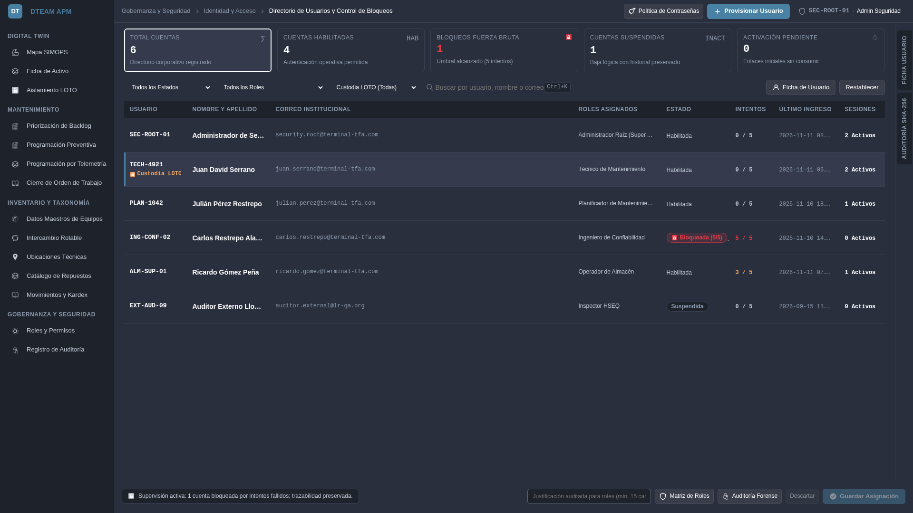
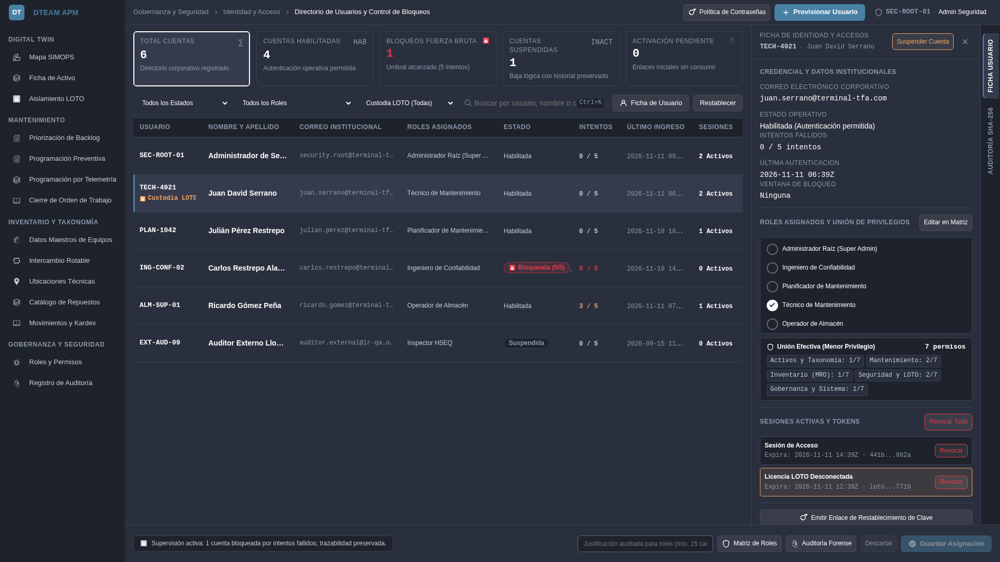
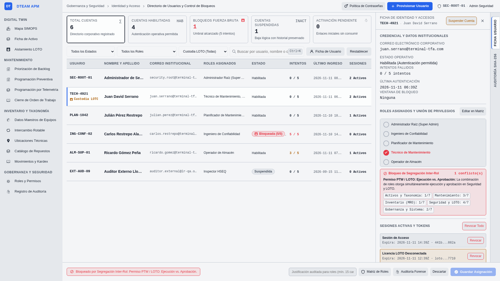
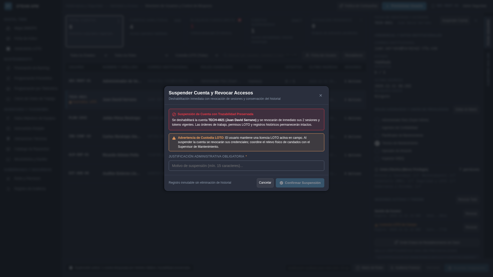
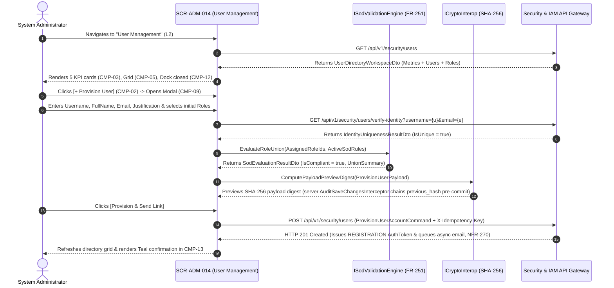

# SCR-ADM-014: User Lifecycle Management, Brute-Force Lockout Control, and Identity Governance

## 1. Purpose and Operational Context

* **View Objective:** Centralized Level 2 identity and access management (IAM) console governing the complete corporate user lifecycle (`UserDirectoryRowDto`, `UserDetailProfileDto`, `ActiveAuthTokenSummaryDto`): onboarding provisioning with single-use registration tokens (`FR-258`), multi-role RBAC assignment under Least-Privilege Union consolidation and cross-role Segregation of Duties validation (`FR-251`, `User.AssignRole` / `User.RemoveRole`), automated brute-force lockout monitoring (`User.RecordFailedLogin`, `FR-260`), immediate session and token revocation (`User.Deactivate`, `AuthToken.Revoke`, `FR-262`), audited account rehabilitation (`User.Activate`, `FR-263`), logical soft-deletion preserving historical attribution (`FR-264`), and NIST SP 800-63B password policy governance (`FR-259`, `FR-261`, `FR-266`, `NFR-272`).
* **Primary Target Persona:** System Administrator provisioning personnel accounts, assigning multi-role profiles, investigating brute-force lockouts (`LOCKED`), issuing single-use password reset tokens (`PASSWORD_RESET`), suspending separated employees (`INACTIVE`), and configuring password complexity and lockout parameters.
* **Secondary Personas:**
  * **Auditor:** Inspects user account statuses, effective multi-role unions, login attempt telemetry (`NFR-268`), active token purposes (`OFFLINE_LOTO_LEASE`, `ACCESS`), and SHA-256 hash-chained identity audit records (`FR-265`, `TR-001`).
* **Operational Context:** Deployed exclusively on high-resolution Desktop Workstations inside IT/OT security administration offices ([DT-UI-NAV-DOC-001 §4.2](../../DT-UI-NAV-DOC-001.md#42-navigation-structure-web-portal-client)). Per [DT-UI-NAV-DOC-001 §4.1](../../DT-UI-NAV-DOC-001.md#41-navigation-structure-mobile-client) and [§6.1](../../DT-UI-NAV-DOC-001.md#61-offline-operation-guard), mobile/tablet field clients and offline execution are strictly out of scope. Compact desktop workstation adaptations are governed in Section 8.
* **Mode of Operation:** Identity Lifecycle & Forensic Supervision mode. Direct DCS/SCADA process control manipulation is strictly excluded. Physical account removal is strictly prohibited (`FR-264`, referential integrity protection on Work Permit authorization chains per [DT-ERD-DOC-001 §4](../../../domain-models/entity-relationship/DT-ERD-DOC-001.md#4-referential-relationships-and-cascading-fks)); account retirement executes exclusively via logical soft-deletion (`IsActive = false` $\to$ `UserStatus.INACTIVE`). The built-in Root Administrator account (`SEC-ROOT-01`) is protected against administrative suspension or role stripping (`FR-250`).
* **Web Portal Workspace Invariant:** Operates within the unified Blazor Web Portal shell alongside an **on-demand, closed-by-default** right-hand workspace dock (`CMP-12` hosting `CMP-07`/`CMP-08` and `UserAuditLogPane.razor`) using the vertical tab spine pattern (`CLS = 0`). The dock opens on directory row selection, vertical spine tab selection, or via `[User Sheet]` (`CMP-04`), and closes cleanly on outside click, close trigger, or `Escape`.
* **Upstream & Downstream Navigation Invariants ([DT-UI-NAV-DOC-001 §5](../../DT-UI-NAV-DOC-001.md#5-transition-matrix-and-access-control-rbac)):**
  * **Upstream Continuity:** Accessed from the Web Portal Governance sidebar or via `[Manage Users]` (`L2` $\to$ `L2`) in [SCR-ADM-013](SCR-ADM-013.md).
  * **Downstream Transitions:** Routes to the Roles and Permissions Matrix ([SCR-ADM-013](SCR-ADM-013.md)) via `[Edit Privileges]` / `[Roles Matrix]` (`L2` $\to$ `L2`) or to the Immutable SHA-256 Audit Log Viewer ([SCR-ADM-032](SCR-ADM-032.md)) via `[Forensic Audit]` (`L2` $\to$ `L2`, pre-filtered by `EntityType = "User"`).

---

## 2. Visual Artifact



> *Figure 2.1 — Desktop Workstation (Dark Theme, Closed Dock by Default): Illustrates the collapsible navigation sidebar (`CMP-01`), consolidated header with `[Password Policy]` secondary trigger and sole primary `[+ Provision User]` CTA (`CMP-02`), 5-card identity lifecycle and brute-force lockout KPI strip (`CMP-03`), multi-criteria filter bar with `[User Sheet]` trigger (`CMP-04`), dense user directory grid showing plain neutral text on healthy enabled accounts and critical red lockout escalation on `ING-CONF-02` (`CMP-05`, `CMP-06`), closed-by-default right dock spine (`CMP-12`), and consolidated sticky governance footer (`CMP-13`).*



> *Figure 2.2 — Desktop Workstation (Dark Theme, User Inspector Dock Open for `TECH-4921`): Illustrates activating `[User Sheet]` or selecting row `TECH-4921` to expand `CMP-12`, displaying `CMP-07` corporate identity metadata, interactive multi-role assignment checkboxes paired with the `FR-251` Least-Privilege Union summary box, contextual `[Suspend Account]` trigger, `CMP-08` active token telemetry highlighting an active `OFFLINE_LOTO_LEASE`, and candidate SHA-256 integrity seal preview.*



> *Figure 2.3 — Desktop Workstation (Light Theme, `FR-251` Cross-Role Least-Privilege Union SoD Conflict): Illustrates assigning both `Maintenance Technician` and `HSEQ Inspector` to `TECH-4921`, triggering cross-role `SOD-SAF-01` detection in the Role Union Evaluator (`CMP-07`), highlighting both conflicting role checkboxes in critical red, and hard-disabling `[Save Assignment]` in the sticky footer (`CMP-13`) with a critical block notice (`#icon-ban`).*



> *Figure 2.4 — Desktop Workstation (Dark Theme, Account Suspension & Soft-Delete Modal `CMP-10` — `AF-001`): Illustrates the centered confirmation modal for suspending `TECH-4921`, surfacing the explicit safety warning for the user's active field `OFFLINE_LOTO_LEASE` custody (`ADR-006`), summarizing immediate session revocation impact (`FR-262`), guaranteeing zero physical row deletion (`FR-264`), and requiring a mandatory `AuditJustification` ($\ge 15$ characters).*

---

## 3. Functional Component Inventory

> The base grid, typography (`--dt-font-caption` minimum floor), neutral HPHMI palettes, and tactile contact areas are inherited from [DT-UI-DS-DOC-001](../../DT-UI-DS-DOC-001.md). This inventory defines the canonical components present on the screen, their design tokens, and their architectural scope. Interaction rules and geometric algorithms are specified in Section 5; responsive container adaptations are governed by Section 8.

1. **`CMP-01`: Web Portal Shell & Sidebar**
   - **Visual Role:** Collapsible desktop navigation sidebar hosting global modules, module hierarchy, and route markers.
   - **Design Tokens:**
     - Surface: `--dt-color-surface-base`
     - Border: `--dt-color-border-subtle`
     - Width: `--dt-layout-sidebar-width-expanded` (Desktop) / `--dt-layout-sidebar-width-collapsed` (Compact Desktop Rail)
   - **Architectural Scope:** Hosts global module navigation per [DT-UI-NAV-DOC-001 §4](../../DT-UI-NAV-DOC-001.md#4-information-architecture-tree), highlighting "User Management" under Governance & Security. Responsive rules in Section 8.

2. **`CMP-02`: User Governance Header & Action Bar**
   - **Visual Role:** Sticky top header hosting breadcrumbs, a transient live session revocation chip (hidden at rest; renders only post-commit when `LastSessionBroadcastAtUtc != null` inside a reserved fixed slot so `CLS = 0`, `TR-010`), secondary `[Password Policy]` trigger (`NFR-272`), sole primary CTA `[+ Provision User]` (`FR-258`), and operator session badge.
   - **Design Tokens:**
     - Surface: `--dt-color-surface-card`
     - Border: `--dt-color-border-subtle`
     - Elevation: `--dt-z-header-sticky`
     - Primary Button: `--dt-color-state-info`
   - **Architectural Scope:** Enforces single primary CTA discipline, launches account provisioning (`CMP-09`) and NIST SP 800-63B policy configuration (`CMP-11`), and displays real-time SignalR session termination confirmations (`< 2s`). Detailed in §5.1 and §5.3.

3. **`CMP-03`: Identity Lifecycle & Security Lockout KPI Strip**
   - **Visual Role:** 5-card interactive summary strip (`FR-265`) displaying `Total Accounts`, `Enabled Accounts`, `Brute-Force Lockouts` (`#icon-loto-locked`, `FR-260`), `Suspended Accounts` (`FR-262`, `FR-264`), and `Pending Activation` (`#icon-stopwatch`, `FR-258`). Lockout and pending activation cards remain strictly neutral grayscale at `0`, escalating to critical red (`--dt-color-alarm-critical`) or amber (`--dt-color-alarm-warning`) accents only when active anomalies exist (`> 0`).
   - **Design Tokens:**
     - Surface: `--dt-color-surface-card`
     - Border: `--dt-color-border-subtle`
     - Radius: `--dt-radius-md`
     - Active Filter Ring: `--dt-color-state-info`
     - Critical Lockout Escalation: `--dt-color-alarm-critical`
     - Pending Warning Escalation: `--dt-color-alarm-warning`
   - **Architectural Scope:** Acts as a one-click status filter for the user directory grid without duplicate filter chips ([DT-UI-DS-DOC-001 §6.5](../../DT-UI-DS-DOC-001.md#65-status-badge-counter-discipline-anti-badge-inflation-principle)). Distinguishes suspended/deactivated accounts (`SuspendedInactiveCount`: `IsActive == false` with `!HasPendingRegistrationToken`) from awaiting-activation accounts (`PendingOnboardingCount`: `IsActive == false` with `HasPendingRegistrationToken == true`). Detailed in §5.1.

4. **`CMP-04`: Multi-Criteria User Directory Filter Toolbar**
   - **Visual Role:** Flat toolbar hosting `UserStatus` selector (`ACTIVE`, `LOCKED`, `INACTIVE`), assigned `Role` filter, active `OFFLINE_LOTO_LEASE` holder filter, debounced search input across `Username`, `FullName`, and `Email` (`Ctrl+K`, `FR-265`), `[User Sheet]` dock toggle, and `[Reset]` action.
   - **Design Tokens:**
     - Surface: `--dt-color-surface-base`
     - Controls: `--dt-color-surface-card`
     - Border: `--dt-color-border-subtle`
     - Control Height: `--dt-control-height-sm`
     - Radius: `--dt-radius-sm`
   - **Architectural Scope:** Filters the virtualized user directory in $< 200\text{ms}$ with zero vertical layout shift (`CLS = 0`). Detailed in §5.2.

5. **`CMP-05`: Dense Virtualized User Directory Data Grid**
   - **Visual Role:** Single virtualized multi-column table rendering `Username` (monospace badge code + inline `LOTO Custody` tag when holding an active offline lease) & `FullName`, institutional `Email`, assigned `Role` labels, `UserStatus` indicator (`CMP-06`), `FailedLoginAttempts` counter (`0 / 5`..`5 / 5`), `LastLoginAtUtc`, and active token count (`FR-265`, `NFR-268`).
   - **Design Tokens:**
     - Header Surface: `--dt-color-surface-base`
     - Row Surface: `--dt-color-surface-card`
     - Border: `--dt-color-border-subtle`
     - Row Height: `--dt-layout-table-row-height`
     - Selected Row Indicator: `--dt-color-state-info`
     - Monospace Data: `--dt-font-mono-data`
   - **Architectural Scope:** Core identity supervision grid backed by `UserDirectoryRowDto`. Clicking any row inspects the account in `CMP-07` inside `CMP-12`. Detailed in §5.2.

6. **`CMP-06`: User Lifecycle & Lockout Status Badges**
   - **Visual Role:** Morphological capsule pills (`--dt-radius-full`) encoding account anomalies (`LOCKED`, `PENDING ACTIVATION`, `INACTIVE`).
   - **Design Tokens:**
     - Normal (`ACTIVE` with `0` pending activation tokens): plain neutral text (`--dt-color-text-body`)
     - Critical (`LOCKED` brute-force block): `--dt-color-alarm-critical` (text-only `Blocked` capsule; attempt count displayed in the `Attempts` column)
     - Warning (`PENDING ACTIVATION` or `3..4` failed attempts counter): `--dt-color-alarm-warning` (`#icon-warning`)
     - Deactivated (`INACTIVE` soft-deleted): `--dt-color-surface-base`, `--dt-color-text-muted`
     - Radius: `--dt-radius-full`
   - **Architectural Scope:** Enforces 90/10 HPHMI and Anti-Badge-Inflation rules ([DT-UI-DS-DOC-001 §6.5.1](../../DT-UI-DS-DOC-001.md#651-morphological-differentiation-status-badges-vs-interactive-buttons)): healthy `ACTIVE` accounts render without green status pills, ensuring brute-force `LOCKED` accounts command pre-attentive salience. Detailed in §5.1.

7. **`CMP-07`: User Account Inspector, Role Union Evaluator & Lifecycle Rail**
   - **Visual Role:** Master-detail inspector hosted inside dock `CMP-12` displaying user identity metadata, transparent circular multi-role assignment checkboxes (`User.AssignRole` / `User.RemoveRole`) with a flat hairline-divided `FR-251` Least-Privilege Union summary row (escalating to bordered exception framing only on cross-role SoD violation or destructive PoLP advisory), `[Edit in Matrix]` handoff link to [SCR-ADM-013](SCR-ADM-013.md), `[Issue Password Reset Link]` (`FR-261`), contextual `[Suspend Account]` (`FR-262`, `FR-264`) or `[Restore Account]` (`FR-263`) using standard secondary button styling, and candidate SHA-256 seal preview. When inspecting the protected built-in Root Administrator (`SEC-ROOT-01`, `IsProtectedRootAccount == true`), the root-role checkbox displays `#icon-loto-locked` (disabled) and `[Suspend Account]` is hard-disabled (`FR-250`); when `HasPendingRegistrationToken == true`, `[Restore Account]` is disabled until onboarding password setup completes (`FR-259`).
   - **Design Tokens:**
     - Surface: `--dt-color-surface-card`
     - Border: `--dt-color-border-subtle`
     - Typography: `--dt-font-caption`, `--dt-font-body-md`, `--dt-font-mono-data`
     - Action Buttons: `--dt-color-surface-btn-secondary`, `--dt-color-border-subtle`, `--dt-color-text-primary`
   - **Architectural Scope:** Centralizes all single-user lifecycle triggers, root-account protection (`FR-250`), pre-activation guard (`FR-259`), and `FR-251` multi-role privilege union inspection ([DT-DM-DOC-002 §6.1](../../../domain-models/class/DT-DM-DOC-002.md#61-user-aggregate-root)). Renders checkboxes and compliant summaries directly on the dock surface without nested card boxes (`SCR-ADM-013` parity); role commit controls reside exclusively in sticky footer `CMP-13`. Detailed in §5.3.

8. **`CMP-08`: Forensic Authentication & Active Token Telemetry Card**
   - **Visual Role:** Nested section inside `CMP-07` displaying `FailedLoginAttempts`, `LockoutUntilUtc`, `LastLoginAtUtc`, and active `AuthToken` leases (`ACCESS`, `SESSION_REFRESH`, `REGISTRATION`, `PASSWORD_RESET`, `OFFLINE_LOTO_LEASE` per [DT-DM-DOC-001 §4.37](../../../domain-models/class/DT-DM-DOC-001.md#437-authtokenpurpose)) as flat transparent rows with subtle hairline dividers (zero nested card boxes) and standard secondary `[Revoke]` and bulk `[Revoke All]` triggers (`AuthToken.Revoke()`).
   - **Design Tokens:**
     - Surface: transparent over `--dt-color-surface-card`
     - Divider Border: `--dt-color-border-subtle`
     - LOTO Lease Accent: `--dt-color-alarm-warning`
     - Action Buttons: `--dt-color-surface-btn-secondary`, `--dt-color-border-subtle`
     - Typography: `--dt-font-mono-data`
   - **Architectural Scope:** Enables immediate session termination and visibility into active field `OFFLINE_LOTO_LEASE` holders (`NFR-268`, `NFR-269`) via uniform secondary buttons consistent with header and footer actions. Detailed in §5.3.2.

9. **`CMP-09`: Provision New User Account Modal (`FR-258`)**
   - **Visual Role:** Centered transactional modal dialog (`--dt-layout-modal-width`, `--dt-layout-modal-max-height`) capturing `Username`, `FullName`, institutional `Email`, transparent 2-column initial `RoleIds` checkboxes with live `FR-251` cross-role Least-Privilege Union & SoD validation summary, mandatory onboarding `AuditJustification` ($\ge 15$ characters), and single-use `REGISTRATION` token email dispatch (`NFR-270`).
   - **Design Tokens:**
     - Surface: `--dt-color-surface-card`
     - Backdrop: `--dt-color-surface-overlay`
     - Width & Max-Height: `--dt-layout-modal-width`, `--dt-layout-modal-max-height`
     - Radius: `--dt-radius-xl`
     - Elevation: `--dt-z-modal`
     - Primary CTA: `--dt-color-state-info`
   - **Architectural Scope:** Validates `Username` and `Email` global uniqueness (`IdentityUniquenessResultDto`), enforces cross-role SoD compliance (`SodEvaluationResultDto.IsCompliant`), and dispatches the single-use onboarding link. Detailed in §5.3.1.

10. **`CMP-10`: Account Suspension, Soft-Delete & Restoration Modal (`FR-262`, `FR-263`, `FR-264`)**
    - **Visual Role:** Safety confirmation modal for executing `User.Deactivate(reason)` (`AF-001`) or `User.Activate()` (`AF-004`), displaying active session revocation count, rendering any active field `OFFLINE_LOTO_LEASE` handover alert as a sibling warning block (never nested box-on-box), and requiring a mandatory `AuditJustification` ($\ge 15$ characters).
    - **Design Tokens:**
      - Surface: `--dt-color-surface-card`
      - Width: `--dt-layout-modal-width`
      - Radius: `--dt-radius-xl`
      - Elevation: `--dt-z-modal`
      - Critical Box Accent: `--dt-color-alarm-critical`
      - LOTO Warning Box: `--dt-color-alarm-warning`
    - **Architectural Scope:** Guarantees zero physical deletion (`FR-264`) while immediately revoking all `AuthTokens` upon suspension (`FR-262`). Detailed in §5.3.2.

11. **`CMP-11`: Password Complexity & Lockout Policy Modal (`FR-259`, `FR-266`, `NFR-272`, `NFR-273`)**
    - **Visual Role:** Centered configuration modal allowing the System Administrator to calibrate NIST SP 800-63B password parameters (`MinimumLength >= 12`, character class rules, `PasswordHistoryNonReuseCount` `FR-266`, brute-force failure threshold `5`, and lockout duration `15 min`), paired with a mandatory `AuditJustification` ($\ge 15$ characters).
    - **Design Tokens:**
      - Surface: `--dt-color-surface-card`
      - Width: `--dt-layout-modal-width`
      - Radius: `--dt-radius-xl`
      - Elevation: `--dt-z-modal`
    - **Architectural Scope:** Satisfies [FR-259](../../../requirements/user-stories/adm/ADM-014.md#functional-requirements-fr), [FR-266](../../../requirements/user-stories/adm/ADM-014.md#functional-requirements-fr), and [NFR-272](../../../requirements/user-stories/adm/ADM-014.md#non-functional-requirements-nfr), emitting `UpdatePasswordSecurityPolicyCommand` sealed under `TR-001` / `ADR-003`. Detailed in §5.3.3.

12. **`CMP-12`: On-Demand Workspace Dock & Vertical Tab Strip (`CLS = 0`)**
    - **Visual Role:** Closed-by-default right-hand desktop workspace dock with vertical spine tabs (`User Sheet` | `SHA-256 Audit`) hosting `CMP-07`/`CMP-08` inside the profile tab and `UserAuditLogPane.razor` inside the `SHA-256 Audit` tab pane.
    - **Design Tokens:**
      - Track Surface: `--dt-color-surface-base`
      - Panel Surface: `--dt-color-surface-card`
      - Active Tab: `--dt-color-surface-raised`
      - Elevation: `--dt-shadow-panel`
      - Active Indicator: `--dt-color-state-info`
    - **Architectural Scope:** Initializes closed on initial load (`IsOpen = false`) to maximize user directory visibility (`CLS = 0`), opens via row click, `[User Sheet]` (`CMP-04`), or vertical spine tabs, embeds `UserAuditLogPane.razor` to render immutable SHA-256 `UserAuditEntryDto` events without leaving the workspace, and dismisses cleanly on outside click, close trigger, or `Escape`. Detailed in §5.2 and Section 8.

13. **`CMP-13`: Sticky Identity Governance, Justification & Handoff Footer**
    - **Visual Role:** Permanent consolidated sticky bottom bar hosting the `CLS = 0` validation/security alert slot (strictly neutral grayscale or amber/critical pre-commit; `--dt-color-state-success` teal reserved strictly for post-commit documentary confirmations), L2 navigation handoffs (`[Roles Matrix]`, `[Forensic Audit]`), mandatory `AuditJustification` input ($\ge 15$ characters), `[Discard]`, and `[Save Assignment]`.
    - **Design Tokens:**
      - Surface: `--dt-color-surface-card`
      - Border: `--dt-color-border-hairline`
      - Height: `--dt-layout-footer-height`
      - Elevation: `--dt-z-header-sticky`
      - Primary CTA: `--dt-color-state-info`
      - Secondary Button: `--dt-color-surface-btn-secondary`
      - Post-Commit Success Slot: `--dt-color-state-success`
    - **Architectural Scope:** Single authoritative role-assignment commit gateway hard-gated by `HasUnsavedRoleChanges && SodEvaluation.IsCompliant && AuditJustification.Length >= 15`; routes directly to [SCR-ADM-013](SCR-ADM-013.md) or [SCR-ADM-032](SCR-ADM-032.md) ([DT-UI-NAV-DOC-001 §5](../../DT-UI-NAV-DOC-001.md#5-transition-matrix-and-access-control-rbac)). Detailed in §5.2 and §5.3.4.

---

## 4. Screen State Catalog

1. **Directory Supervision Mode (Default — `FR-265`)**
   - **Activation Condition:** System Administrator or Auditor navigates to `SCR-ADM-014`.
   - **Visual Modification:** Neutral grayscale 90/10 baseline (`--dt-color-surface-card`) with `CMP-12` workspace dock closed by default (`IsOpen = false`, `CLS = 0`). Directory grid `CMP-05` lists user accounts with plain neutral text (`Enabled`) for healthy `ACTIVE` users. Sticky footer `CMP-13` renders strictly neutral grayscale status summary and disables `[Save Assignment]` until a role change is staged.

2. **Loading / Querying Directory**
   - **Activation Condition:** Initial directory load or filter/search execution.
   - **Visual Modification:** Skeleton shimmer (`--dt-color-surface-raised`) across `CMP-03` KPI cards and `CMP-05` rows; mutation actions disabled.

3. **Brute-Force Account Lockout Alert (`AF-002` / `FR-260`)**
   - **Activation Condition:** One or more accounts reach `FailedLoginAttempts >= 5`, setting `LockoutUntilUtc` (`UserStatus.LOCKED`).
   - **Visual Modification:** KPI card 3 in `CMP-03` escalates to `--dt-color-alarm-critical` and the affected user row (`ING-CONF-02`) in `CMP-05` renders a critical red capsule badge (`[Blocked]`, `--dt-color-alarm-critical`) paired with `5 / 5` in the attempts column. Opening `CMP-07` displays the lockout expiration window and standard secondary `[Restore Account]` (`FR-263`).

4. **Cross-Role Least-Privilege Union SoD Conflict Blocked (`FR-251`)**
   - **Activation Condition:** Administrator selects a multi-role combination for a user (inside `CMP-07` or `CMP-09`) whose effective permission union $P_{\text{effective}}(u) = \bigcup P_r$ creates a prohibited toxic pair (`SOD-SAF-01`, `SOD-INV-01`, `SOD-MTTO-01`, or `SOD-SYS-01`).
   - **Visual Modification:** Conflicting role checkboxes highlight in critical red (`--dt-color-alarm-critical`); the Role Union Evaluation panel (`CMP-07` / `CMP-09`) switches to critical block framing (`#icon-ban`) explaining the exact violated cross-role rule; sticky footer `CMP-13` displays the critical SoD block message and hard-disables `[Save Assignment]` / `[Provision & Send Link]` (`CLS = 0`).

5. **Provisioning New User Account (`FR-258`)**
   - **Activation Condition:** Administrator clicks `[+ Provision User]` in `CMP-02`.
   - **Visual Modification:** Modal `CMP-09` deploys centered over `--dt-color-surface-overlay`, validating `Username` and `Email` uniqueness in real time, evaluating initial role union (`FR-251`), and capturing mandatory onboarding justification ($\ge 15$ characters).

6. **Duplicate Username or Email Conflict (`CMP-09`)**
   - **Activation Condition:** Debounced uniqueness check detects that the entered `Username` or `Email` already exists in the identity directory.
   - **Visual Modification:** Conflicting input highlights with a critical red border (`--dt-color-alarm-critical`) and inline `#icon-ban` diagnostic message, hard-disabling `[Provision & Send Link]` (`CLS = 0`).

7. **Suspending / Soft-Deleting or Restoring Account (`AF-001`, `AF-004`, `FR-262`–`FR-264`)**
   - **Activation Condition:** Administrator clicks `[Suspend Account]` or `[Restore Account]` in `CMP-07`.
   - **Visual Modification:** Modal `CMP-10` opens displaying active token revocation impact (including an amber field `OFFLINE_LOTO_LEASE` custody handover alert when `HasActiveOfflineLotoLease == true`) and requiring a mandatory `AuditJustification` ($\ge 15$ characters).

8. **Documentary Confirmation & Password Reset / Session Revocation (`AF-003` / `FR-261` / `TR-010`)**
   - **Activation Condition:** Single-use password reset token dispatch, multi-role assignment commit, user suspension/restoration, session revocation, or NIST policy update commits cleanly.
   - **Visual Modification:** Sticky footer slot in `CMP-13` renders a Teal documentary confirmation (`--dt-color-state-success`, `#icon-check`), while token-invalidating actions reveal the transient header chip in `CMP-02` (`SESIONES REVOCADAS`, fulfilling `< 2s` SignalR propagation under `NFR-257`).

9. **Unauthorized Route Blocked (`403 Forbidden` / `TR-006`)**
   - **Activation Condition:** An authenticated user lacking identity governance authorization (e.g., `Technician`) attempts direct URL navigation to `SCR-ADM-014`.
   - **Visual Modification:** Portal route guard rejects rendering prior to loading directory records, displays `403 Forbidden`, and logs `AuditActionType.SECURITY_ALERT`.

10. **Root Administrator Account Protection (`FR-250`)**
    - **Activation Condition:** Administrator inspects the built-in system root account (`SEC-ROOT-01`, `IsProtectedRootAccount == true`) in `CMP-07`.
    - **Visual Modification:** `[Suspend Account]` renders disabled (`--dt-color-state-disabled`) and the Root Administrator role assignment checkbox locks with `#icon-loto-locked`, preventing administrative suspension or root privilege stripping.

---

## 5. Interaction Rules and Data Flow

### 5.1. Initial Load, Onboarding & Multi-Role SoD Pipeline



1. **Computed 3-State User Lifecycle ([DT-DM-DOC-001 §4.40](../../../domain-models/class/DT-DM-DOC-001.md#440-userstatus) & [DT-ERD-DOC-001 §3.5.6](../../../domain-models/entity-relationship/DT-ERD-DOC-001.md#356-users)):**
   * The domain model derives `UserStatus` deterministically from persisted `User` lifecycle attributes (`IsActive`, `FailedLoginAttempts`, `LockoutUntilUtc`) and onboarding token presence (`HasPendingRegistrationToken`):
     * **`UserStatus.INACTIVE`:** `IsActive == false` — partitioned in `CMP-03` between **`PendingOnboardingCount`** (`IsActive == false && HasPendingRegistrationToken == true`, awaiting initial `REGISTRATION` activation) and **`SuspendedInactiveCount`** (`IsActive == false && !HasPendingRegistrationToken`, suspended or soft-deleted via `User.Deactivate(reason)`).
     * **`UserStatus.LOCKED`:** `IsActive == true` $\land$ `LockoutUntilUtc > DateTimeOffset.UtcNow` (brute-force lockout via `User.RecordFailedLogin()`).
     * **`UserStatus.ACTIVE`:** `IsActive == true` $\land$ (`LockoutUntilUtc == null` $\lor$ `LockoutUntilUtc <= DateTimeOffset.UtcNow`).

---

### 5.2. Directory Ergonomics, Closed Dock Lifecycle, Handoffs & Route Guard

1. **Virtualized Directory & Closed-by-Default Dock (`CMP-05`, `CMP-12`):**
   * Uses `Virtualize<UserDirectoryRowDto>` with fixed row height (`--dt-layout-table-row-height`). On initial render, `UserWorkspaceDock.IsOpen == false` (`CLS = 0`). Clicking any user row, `[User Sheet]` (`CMP-04`), or either vertical spine tab (`User Sheet` | `SHA-256 Audit`) opens the right dock at `--dt-layout-drawer-width-desktop` (`--dt-layout-drawer-width-tablet` on compact desktops); pressing `Escape` or clicking outside interactive directory/toolbar regions closes the dock cleanly.
   * `Ctrl + K` (or `Cmd + K`) focuses the search input in `CMP-04`.
2. **Cross-Screen Governance Handoffs ([DT-UI-NAV-DOC-001 §5](../../DT-UI-NAV-DOC-001.md#5-transition-matrix-and-access-control-rbac)):**
   * Clicking `[Edit in Matrix]` (`CMP-07`) or `[Roles Matrix]` (`CMP-13`) routes directly to [SCR-ADM-013](SCR-ADM-013.md) (`L2` $\to$ `L2`) pre-selecting the user's primary `RoleId`.
   * Clicking `[Forensic Audit]` (`CMP-13`) routes to [SCR-ADM-032](SCR-ADM-032.md) pre-filtered by `EntityType = "User"`.
3. **Route Guard Enforcement (`TR-006`, State 9):**
   * Upon navigation to `SCR-ADM-014`, the portal route guard validates identity governance claims prior to requesting `UserDirectoryWorkspaceDto`. Unauthorized callers are blocked with `403 Forbidden` and trigger an immutable `AuditActionType.SECURITY_ALERT` entry (`TR-001`).

---

### 5.3. Domain Workflows & Identity Security Invariants

#### 5.3.1. Account Onboarding & Single-Use Registration Token (`FR-258`, `FR-259`, `NFR-267`, `NFR-270`, `NFR-273`)
1. **Provisioning & Token Issuance (`FR-258`, `NFR-269`, `NFR-270`):** `ProvisionUserAccountCommand` creates the `User` aggregate in `INACTIVE` pre-activation state, enforces unique `Username` and `Email` constraints, validates the assigned roles under `FR-251`, generates a cryptographically random single-use token with `AuthTokenPurpose.REGISTRATION` ([DT-DM-DOC-001 §4.37](../../../domain-models/class/DT-DM-DOC-001.md#437-authtokenpurpose)), persists only its salted cryptographic `TokenHash` (`NFR-267`), and dispatches the activation email via an asynchronous background queue (`NFR-270`).
2. **First-Access Password Establishment (`FR-259`, `NFR-273`):** Consuming the link invokes `User.UpdatePassword(newPasswordHash)` and `AuthToken.MarkAsUsed()` ([DT-DM-DOC-002 §6.1–§6.4](../../../domain-models/class/DT-DM-DOC-002.md#6-layer-5-safety-and-governance-adm)), enforcing WCAG 2.1 AA live announcements (`aria-live="polite"`) on every password complexity rule (`NFR-273`).

#### 5.3.2. Brute-Force Lockout, Soft-Delete & Immediate Token Revocation (`FR-250`, `FR-260`, `FR-262`–`FR-264`, `NFR-268`, `NFR-271`)
1. **Brute-Force Defense & Login Telemetry (`FR-260`, `AC-ADM-014-77`, `NFR-268`, `NFR-271`):** Each failed login invokes `User.RecordFailedLogin()`. When `FailedLoginAttempts` reaches the configured threshold (`5`), `LockoutUntilUtc` advances by `15 min`, an `AuditActionType.SECURITY_ALERT` entry appends to the immutable audit trail, and an immediate alert email is dispatched asynchronously (`NFR-270`, `NFR-271`). Conversely, successful authentication invokes `User.RegisterSuccessfulLogin()`, updating `LastLoginAtUtc` and resetting `FailedLoginAttempts = 0` (`AC-ADM-014-77`) reflected in `CMP-05` and `CMP-08`.
2. **Suspension, Soft-Delete & Token Revocation (`FR-262`, `FR-264`, `AF-001`):** Invoking `User.Deactivate(reason)` (`POST /api/v1/security/users/{id}/lifecycle` carrying `ExecuteUserLifecycleTransitionCommand`, `X-Idempotency-Key: {uuidv7}`, `If-Match: "{ConcurrencyToken}"`, and mandatory `AuditJustification`) sets `IsActive = false` and calls `AuthToken.Revoke()` across all active tokens belonging to that user (`ACCESS`, `SESSION_REFRESH`, `OFFLINE_LOTO_LEASE`), pushing `/hubs/security` `SessionRevoked(SessionRevocationEvent)` ([DT-ARQ-CMP-DOC-001 §5](../../../architecture/views/DT-ARQ-CMP-DOC-001.md#5-signalr-hub-and-real-time-event-contract-registry-tr-010)) to terminate active client sessions within $< 2\text{s}$ (`TR-006-NFR-402`, `TR-010`) while preserving historical operational foreign keys across Work Permits, Work Order Assignments, and Audit Logs. Selective or bulk revocations from `CMP-08` execute via `POST /api/v1/security/users/{id}/tokens/revoke` (`RevokeUserTokensCommand`) carrying `X-Idempotency-Key: {uuidv7}` ([ADR-007](../../../architecture/adr/ADR-007.md)), `If-Match: "{ConcurrencyToken}"` ([DT-ARQ-DB-DOC-001 §3.12](../../../architecture/DT-ARQ-DB-DOC-001.md#312-optimistic-concurrency-control-via-postgresql-xmin-system-column-inv-027-nfr-169)), and mandatory `AuditJustification`, while `AuditSaveChangesInterceptor` computes `audit_logs.previous_hash` and seals the hash chain server-side pre-commit (`TR-001`, `ADR-003`).
3. **Audited Account Restoration & Pre-Activation Onboarding Guard (`FR-259`, `FR-263`, `AF-004`):** `[Restore Account]` (`User.Activate()`) is hard-disabled whenever `HasPendingRegistrationToken == true` so newly provisioned accounts cannot bypass first-access password setup via administrative activation (`FR-259`). For previously active suspended or locked accounts (`!HasPendingRegistrationToken`), invoking `User.Activate()` with a mandatory `AuditJustification`, `X-Idempotency-Key`, and `If-Match: "{ConcurrencyToken}"` sets `IsActive = true`, resets `FailedLoginAttempts = 0`, clears `LockoutUntilUtc = null`, and seals the justification inside the immutable `AuditLog` JSONB envelope governed by [DT-ERD-DOC-001 §6.7](../../../domain-models/entity-relationship/DT-ERD-DOC-001.md#67-admaudit_logsprevious_state-and-new_state).
4. **Root Administrator Account Guard (`FR-250`):** When inspecting or mutating the built-in `SEC-ROOT-01` account (`IsProtectedRootAccount == true`), administrative suspension (`User.Deactivate()`) and root-role unassignment (`User.RemoveRole()`) are strictly blocked in both `CMP-07` controls and server-side command validation.

#### 5.3.3. Single-Use Password Reset & Credential Rotation Policy (`FR-261`, `FR-266`, `NFR-267`, `NFR-272`)
1. **Single-Use Recovery (`FR-261`):** Triggering `[Issue Password Reset Link]` in `CMP-07` dispatches `POST /api/v1/security/users/{id}/password-reset` (`IssuePasswordResetCommand` with `X-Idempotency-Key`, `If-Match: "{ConcurrencyToken}"`, and deterministic `AuditJustification`; `audit_logs.previous_hash` is resolved server-side pre-commit by `AuditSaveChangesInterceptor`), generating an `AuthToken` with `AuthTokenPurpose.PASSWORD_RESET` and strict temporal expiration (`NFR-269`). Replay attempts after `AuthToken.MarkAsUsed()` are rejected (`DT-DM-DOC-002 §6.4`).
2. **Non-Reuse & Complexity Governance (`FR-266`, `NFR-272`):** `CMP-11` submits `PUT /api/v1/security/password-policy` (`UpdatePasswordSecurityPolicyCommand` carrying `X-Idempotency-Key`, `If-Match: "{ConcurrencyToken}"`, and `AuditJustification` $\ge 15$ characters; SHA-256 `audit_logs.previous_hash` chaining executes server-side pre-commit via `AuditSaveChangesInterceptor` under `TR-001` / `ADR-003`) to govern `User.UpdatePassword(newPasswordHash)` complexity thresholds and `PasswordHistoryNonReuseCount` non-reuse verification (`FR-266`).

#### 5.3.4. Multi-Role Least-Privilege Union Consolidation & Cross-Role SoD (`FR-251`)
1. **Effective Permission Union Formula:** When a non-root user $u$ is assigned a set of roles $R_u \neq \emptyset$, `ISodValidationEngine` computes the effective permission set deterministically in $< 50\text{ms}$:
   $$P_{\text{effective}}(u) = \bigcup_{r \in R_u} P_r$$
2. **Cross-Role SoD Interlock (`FR-249`, `FR-251`):** Even when individual roles are internally compliant in [SCR-ADM-013](SCR-ADM-013.md), combining two otherwise valid roles on the same user (for example, `Maintenance Technician` granting `SAFETY:EXECUTE` paired with `HSEQ Inspector` granting `SAFETY:APPROVE`) can violate a toxic pair in $\mathcal{C}_{\text{SoD}}$ (`SOD-SAF-01`, `SOD-INV-01`, `SOD-MTTO-01`, `SOD-SYS-01`). Whenever $P_{\text{effective}}(u)$ contains both privileges of any SoD rule (or $R_u = \emptyset$), both `CMP-07`/`CMP-13` and `CMP-09` highlight the contributing roles in `--dt-color-alarm-critical` and hard-block save/provisioning.
3. **Destructive PoLP Advisory & Audit Sealing:** If the union introduces destructive privileges (`DELETE`) on non-root accounts without a hard SoD conflict, the Role Union Evaluation panel (`CMP-07`) displays an amber Principle of Least Privilege notice requiring explicit justification ($\ge 15$ chars) in `CMP-13`. Clicking `[Discard]` reverts staged role toggles cleanly; clicking `[Save Assignment]` commits `PUT /api/v1/security/users/{id}/roles` (`AssignUserRolesCommand` with `X-Idempotency-Key` and `If-Match: "{ConcurrencyToken}"`), chains the SHA-256 `IntegrityHash` (`ADR-003`), and broadcasts SignalR `/hubs/security` `PermissionsUpdated(RolePermissionsUpdatedEvent)` in $< 2\text{s}$ (`TR-010`).

---

## 6. Industrial and Safety Considerations

* **Active LOTO Lease & Work Permit Safety Check on Suspension (`FR-262`, [ADR-006](../../../architecture/adr/ADR-006.md)):** If an administrator suspends a technician holding an active `OFFLINE_LOTO_LEASE` token (`HasActiveOfflineLotoLease == true` linked to an active `WorkOrderIsolation`), `CMP-10` surfaces an explicit field LOTO handover warning so the Maintenance Supervisor coordinates physical padlock custody transfer before access revocation takes effect.
* **Cross-Role Toxic Combination Prevention (`FR-251` / ISO 45001 / ISO 27001 A.5.3):** Evaluating $P_{\text{effective}}(u) = \bigcup_{r \in R_u} P_r$ inside `SCR-ADM-014` closes the privilege-escalation loophole where an employee accumulates incompatible operational roles (`Execute` + `Approve` LOTO or `Execute` + `Audit` Inventory) across distinct appointments.
* **Prohibition of Physical User Deletion (`FR-264` / ISO 55001 / ISO 9001):** Deleting a user entity would orphan historical Work Permit authorization references (`WorkPermit` issuer foreign key `ON DELETE RESTRICT` per [DT-ERD-DOC-001 §4](../../../domain-models/entity-relationship/DT-ERD-DOC-001.md#4-referential-relationships-and-cascading-fks)) and break 7-year audit retention (`TR-001-FR-367`). Logical soft-deletion (`User.Deactivate`) is strictly enforced.
* **HPHMI Grayscale & Anti-Badge-Inflation Governance ([TR-011](../../../requirements/common/TR-011.md)):** Per [DT-UI-DS-DOC-001 §1](../../DT-UI-DS-DOC-001.md#1-scope) and [§6.5](../../DT-UI-DS-DOC-001.md#65-status-badge-counter-discipline-anti-badge-inflation-principle), normal `ACTIVE` accounts render as plain neutral text (`Enabled`), rail and token triggers (`[Suspend Account]`, `[Restore Account]`, `[Revoke]`, `[Revoke All]`) use uniform standard secondary button styling (`--dt-color-surface-btn-secondary`, zero custom colored button outlines and never green pre-commit), `--dt-color-state-success` teal is reserved strictly for post-commit documentary confirmations in `CMP-13` and `CMP-02`, and `--dt-color-alarm-critical` / `--dt-color-alarm-warning` are reserved strictly for brute-force lockouts, SoD blocks, and safety custody advisories.

---

## 7. Frontend Component Contract (Blazor / Razor)

### 7.1. Component Hierarchy & File Mapping

```text
Pages/Governance/
└── UserManagementPage.razor                           # Root View (SCR-ADM-014)
    ├── PortalSidebarNav.razor                         # CMP-01: Collapsible desktop navigation sidebar
    ├── UserManagementHeaderBar.razor                  # CMP-02: Breadcrumbs, session sync chip, policy & [+ Provision User]
    ├── UserSummaryCards.razor                         # CMP-03: 5-card identity lifecycle & lockout KPI strip
    ├── UserFilterToolbar.razor                        # CMP-04: Status, role, LOTO lease, search & [User Sheet] trigger
    ├── UserDirectoryGrid.razor                        # CMP-05: Virtualized multi-column user directory table
    │   └── UserStatusBadge.razor                      # CMP-06: Redundant LOCKED/INACTIVE/PENDING/neutral ACTIVE indicator
    ├── UserWorkspaceDock.razor                        # CMP-12: Closed-by-default desktop workspace dock
    │   ├── UserInspectionRail.razor                   # CMP-07: Identity details, FR-251 role union & lifecycle actions
    │   │   └── UserAuthActivityCard.razor             # CMP-08: Login telemetry & active AuthToken revocation card
    │   └── UserAuditLogPane.razor                     # Chained SHA-256 identity audit trail tab pane
    ├── ProvisionUserModal.razor                       # CMP-09: New user onboarding, FR-251 union & REGISTRATION token modal
    ├── UserLifecycleTransitionModal.razor             # CMP-10: Suspend/Soft-Delete & Restore/Unlock modal (FR-262..264)
    ├── PasswordPolicyConfigModal.razor                # CMP-11: NIST SP 800-63B password & lockout policy modal (NFR-272)
    └── UserActionFooter.razor                         # CMP-13: Sticky governance footer, justification, Discard/Save & handoffs
```

---

### 7.2. Physical Component Parameters & DTO Contracts (.NET 10 / C# 14)

#### 7.2.1. `UserManagementPage.razor` (Root View)

```csharp
[Parameter, SupplyParameterFromQuery(Name = "status")]
public UserStatus? InitialStatusFilter { get; set; }

[Parameter, SupplyParameterFromQuery(Name = "userId")]
public Guid? InitialSelectedUserId { get; set; }

[Parameter, SupplyParameterFromQuery(Name = "roleId")]
public Guid? RoleId { get; set; }
```

#### 7.2.2. Subcomponent Parameter Contracts (`CMP-01` to `CMP-13`)

```csharp
// CMP-01: PortalSidebarNav.razor
[Parameter]
public bool IsCollapsed { get; set; }

[Parameter]
public bool IsMobileDrawerOpen { get; set; }

[Parameter]
public string? ActiveRouteCode { get; set; } = "SCR-ADM-014";

[Parameter]
public EventCallback<bool> OnCollapseToggled { get; set; }

[Parameter]
public EventCallback<bool> OnMobileDrawerToggled { get; set; }

// CMP-02: UserManagementHeaderBar.razor
[Parameter]
public required string OperatorBadgeCode { get; set; }

[Parameter]
public required string OperatorDisplayName { get; set; }

[Parameter]
public bool CanManageUsers { get; set; }

[Parameter]
public DateTimeOffset? LastSessionBroadcastAtUtc { get; set; }

[Parameter]
public EventCallback OnOpenProvisionUserModal { get; set; }

[Parameter]
public EventCallback OnOpenPasswordPolicyModal { get; set; }

// CMP-03: UserSummaryCards.razor
[Parameter]
public required UserDirectoryMetricsDto Metrics { get; set; }

[Parameter]
public UserKpiFilterCategory? ActiveCategoryFilter { get; set; }

[Parameter]
public EventCallback<UserKpiFilterCategory?> OnCategoryFilterSelected { get; set; }

// CMP-04: UserFilterToolbar.razor
[Parameter]
public required IReadOnlyList<RoleLookupItemDto> Roles { get; set; }

[Parameter]
public UserStatus? SelectedStatusFilter { get; set; }

[Parameter]
public Guid? SelectedRoleFilter { get; set; }

[Parameter]
public bool? HasActiveOfflineLeaseFilter { get; set; }

[Parameter]
public string? SearchQuery { get; set; }

[Parameter]
public EventCallback<UserStatus?> OnStatusFilterChanged { get; set; }

[Parameter]
public EventCallback<Guid?> OnRoleFilterChanged { get; set; }

[Parameter]
public EventCallback<bool?> OnOfflineLeaseFilterChanged { get; set; }

[Parameter]
public EventCallback<string?> OnSearchQueryChanged { get; set; }

[Parameter]
public EventCallback OnInspectUserRequested { get; set; }

[Parameter]
public EventCallback OnResetFiltersClicked { get; set; }

// CMP-05: UserDirectoryGrid.razor
[Parameter]
public required IReadOnlyList<UserDirectoryRowDto> Users { get; set; }

[Parameter]
public Guid? SelectedUserId { get; set; }

[Parameter]
public EventCallback<UserDirectoryRowDto> OnUserSelected { get; set; }

// CMP-06: UserStatusBadge.razor
[Parameter]
public required UserStatus Status { get; set; }

[Parameter]
public int FailedLoginAttempts { get; set; }

[Parameter]
public bool HasPendingRegistrationToken { get; set; }

[Parameter]
public DateTimeOffset? LockoutUntilUtc { get; set; }

// CMP-12: UserWorkspaceDock.razor (Closed by default: IsOpen = false)
[Parameter]
public bool IsOpen { get; set; } = false;

[Parameter]
public UserDockTab ActiveTab { get; set; } = UserDockTab.USER_PROFILE;

[Parameter]
public EventCallback<UserDockTab> OnTabChanged { get; set; }

[Parameter]
public EventCallback OnClosed { get; set; }

// CMP-07: UserInspectionRail.razor
[Parameter]
public UserDetailProfileDto? SelectedUser { get; set; }

[Parameter]
public required IReadOnlyList<RoleLookupItemDto> AvailableRoles { get; set; }

[Parameter]
public required RoleUnionEvaluationDto RoleUnionEvaluation { get; set; }

[Parameter]
public required string CandidateIntegrityHashPreview { get; set; }

[Parameter]
public bool CanManageUsers { get; set; }

[Parameter]
public EventCallback<Guid> OnRoleAssignmentToggled { get; set; }

[Parameter]
public EventCallback<Guid> OnEditRolePrivilegesRequested { get; set; }

[Parameter]
public EventCallback<Guid> OnDispatchPasswordResetRequested { get; set; }

[Parameter]
public EventCallback<UserLifecycleActionType> OnLifecycleActionRequested { get; set; }

// CMP-08: UserAuthActivityCard.razor
[Parameter]
public required UserDetailProfileDto UserProfile { get; set; }

[Parameter]
public bool CanManageUsers { get; set; }

[Parameter]
public EventCallback<Guid> OnRevokeTokenRequested { get; set; }

[Parameter]
public EventCallback<Guid> OnRevokeAllSessionsRequested { get; set; }

// UserAuditLogPane.razor
[Parameter]
public required IReadOnlyList<UserAuditEntryDto> AuditEntries { get; set; }

// CMP-09: ProvisionUserModal.razor (FR-258, FR-251)
[Parameter]
public bool IsVisible { get; set; }

[Parameter]
public required IReadOnlyList<RoleLookupItemDto> AvailableRoles { get; set; }

[Parameter]
public RoleUnionEvaluationDto? InitialRoleUnionEvaluation { get; set; }

[Parameter]
public bool IsUsernameUnique { get; set; } = true;

[Parameter]
public bool IsEmailUnique { get; set; } = true;

[Parameter]
public EventCallback<string> OnUsernameChanged { get; set; }

[Parameter]
public EventCallback<string> OnEmailChanged { get; set; }

[Parameter]
public EventCallback<IReadOnlySet<Guid>> OnInitialRolesChanged { get; set; }

[Parameter]
public EventCallback<ProvisionUserAccountCommand> OnUserProvisioned { get; set; }

[Parameter]
public EventCallback OnCloseRequested { get; set; }

// CMP-10: UserLifecycleTransitionModal.razor (FR-262, FR-263, FR-264)
[Parameter]
public bool IsVisible { get; set; }

[Parameter]
public UserDetailProfileDto? TargetUser { get; set; }

[Parameter]
public UserLifecycleActionType ActionType { get; set; }

[Parameter]
public EventCallback<ExecuteUserLifecycleTransitionCommand> OnTransitionConfirmed { get; set; }

[Parameter]
public EventCallback OnCloseRequested { get; set; }

// CMP-11: PasswordPolicyConfigModal.razor (FR-259, FR-266, NFR-272)
[Parameter]
public bool IsVisible { get; set; }

[Parameter]
public required PasswordSecurityPolicyDto Policy { get; set; }

[Parameter]
public EventCallback<UpdatePasswordSecurityPolicyCommand> OnPolicySaved { get; set; }

[Parameter]
public EventCallback OnCloseRequested { get; set; }

// CMP-13: UserActionFooter.razor
[Parameter]
public UserDetailProfileDto? SelectedUser { get; set; }

[Parameter]
public required RoleUnionEvaluationDto RoleUnionEvaluation { get; set; }

[Parameter]
public bool HasUnsavedRoleChanges { get; set; }

[Parameter]
public bool CanCommit { get; set; }

[Parameter]
public bool IsSubmitting { get; set; }

[Parameter]
public string? PostCommitStatusMessage { get; set; }

[Parameter]
public string AuditJustification { get; set; } = string.Empty;

[Parameter]
public EventCallback<string> AuditJustificationChanged { get; set; }

[Parameter]
public EventCallback OnNavigateToRbacMatrix { get; set; }

[Parameter]
public EventCallback<Guid?> OnNavigateToAuditLogViewer { get; set; }

[Parameter]
public EventCallback OnDiscardRoleChangesClicked { get; set; }

[Parameter]
public EventCallback OnSaveRoleAssignmentsClicked { get; set; }
```

#### 7.2.3. Data Transfer Objects (DTOs) and Enums

```csharp
/// <summary>
/// Controlled user account lifecycle status vocabulary per DT-DM-DOC-001 §4.40.
/// </summary>
public enum UserStatus
{
    ACTIVE,
    INACTIVE,
    LOCKED
}

/// <summary>
/// Controlled cryptographic authentication token purpose vocabulary per DT-DM-DOC-001 §4.37.
/// </summary>
public enum AuthTokenPurpose
{
    ACCESS,
    SESSION_REFRESH,
    REGISTRATION,
    PASSWORD_RESET,
    OFFLINE_LOTO_LEASE
}

/// <summary>
/// Controlled application subdomain module vocabulary per DT-DM-DOC-001 §4.39.
/// </summary>
public enum RbacModule
{
    ASSETS,
    MAINTENANCE,
    INVENTORY,
    SAFETY,
    SYSTEM
}

/// <summary>
/// Controlled granular RBAC action vocabulary per DT-DM-DOC-001 §4.42.
/// </summary>
public enum RbacAction
{
    CREATE,
    READ,
    EDIT,
    DELETE,
    APPROVE,
    AUDIT,
    EXECUTE
}

/// <summary>
/// Controlled audit operation vocabulary per DT-DM-DOC-001 §4.36.
/// </summary>
public enum AuditActionType
{
    CREATE,
    UPDATE,
    DELETE,
    QUERY,
    ADJUST,
    SECURITY_ALERT
}

public enum UserLifecycleActionType
{
    SUSPEND_OR_DEACTIVATE,
    RESTORE_AND_UNLOCK
}

public enum UserKpiFilterCategory
{
    ALL_USERS,
    ACTIVE_USERS,
    LOCKED_BRUTE_FORCE,
    SUSPENDED_INACTIVE,
    PENDING_ONBOARDING
}

public enum UserDockTab
{
    USER_PROFILE,
    SHA256_AUDIT
}

public readonly record struct PermissionGrantKeyDto(
    RbacModule Module,
    RbacAction Action
);

public record UserDirectoryMetricsDto
{
    public required int TotalUsersCount { get; init; }
    public required int ActiveUsersCount { get; init; }
    public required int LockedAccountsCount { get; init; }
    public required int SuspendedInactiveCount { get; init; }
    public required int PendingOnboardingCount { get; init; }
}

public record RoleLookupItemDto
{
    public required Guid RoleId { get; init; }
    public required string RoleName { get; init; }
    public required bool IsSystemRootRole { get; init; }
    public required IReadOnlySet<PermissionGrantKeyDto> GrantedPermissions { get; init; }
}

/// <summary>
/// Cross-role Least-Privilege Union and Segregation of Duties evaluation payload (FR-251).
/// </summary>
public record RoleUnionEvaluationDto
{
    public required bool IsCompliant { get; init; }
    public required bool HasAtLeastOneRole { get; init; }
    public required bool HasPolpDestructiveAdvisory { get; init; }
    public required int EffectivePermissionsCount { get; init; }
    public required IReadOnlyDictionary<RbacModule, int> GrantedCountByModule { get; init; }
    public IReadOnlySet<Guid> ConflictingRoleIds { get; init; } = new HashSet<Guid>();
    public IReadOnlyList<CrossRoleSodConflictDto> SodConflicts { get; init; } = [];
}

public record CrossRoleSodConflictDto
{
    public required string RuleCode { get; init; }
    public required string RuleTitle { get; init; }
    public required string ConflictDescription { get; init; }
    public required IReadOnlyList<string> ContributingRoleNames { get; init; }
}

public record UserDirectoryRowDto
{
    public required Guid UserId { get; init; }
    public required string Username { get; init; }
    public required string FullName { get; init; }
    public required string Email { get; init; }
    public required UserStatus Status { get; init; }
    public required bool IsActive { get; init; }
    public required bool IsProtectedRootAccount { get; init; }
    public required int FailedLoginAttempts { get; init; }
    public DateTimeOffset? LockoutUntilUtc { get; init; }
    public DateTimeOffset? LastLoginAtUtc { get; init; }
    public required bool HasPendingRegistrationToken { get; init; }
    public required bool HasActiveOfflineLotoLease { get; init; }
    public IReadOnlyList<string> AssignedRoleNames { get; init; } = [];
    public required string LatestIntegrityHash { get; init; }
    public required uint ConcurrencyToken { get; init; }
}

public record UserDetailProfileDto
{
    public required Guid UserId { get; init; }
    public required string Username { get; init; }
    public required string FullName { get; init; }
    public required string Email { get; init; }
    public required UserStatus Status { get; init; }
    public required bool IsActive { get; init; }
    public required bool IsProtectedRootAccount { get; init; }
    public required int FailedLoginAttempts { get; init; }
    public DateTimeOffset? LockoutUntilUtc { get; init; }
    public DateTimeOffset? LastLoginAtUtc { get; init; }
    public required bool HasPendingRegistrationToken { get; init; }
    public required bool HasActiveOfflineLotoLease { get; init; }
    public required IReadOnlySet<Guid> AssignedRoleIds { get; init; }
    public IReadOnlyList<ActiveAuthTokenSummaryDto> ActiveTokens { get; init; } = [];
    public required string LatestIntegrityHash { get; init; }
    public required uint ConcurrencyToken { get; init; }
}

public record ActiveAuthTokenSummaryDto
{
    public required Guid TokenId { get; init; }
    public required AuthTokenPurpose Purpose { get; init; }
    public required DateTimeOffset ExpiresAtUtc { get; init; }
    public required bool IsRevoked { get; init; }
    public required string TokenFingerprintShort { get; init; }
}

public record PasswordSecurityPolicyDto
{
    public required int MinimumLength { get; init; } = 12;
    public required bool RequireUppercase { get; init; } = true;
    public required bool RequireDigit { get; init; } = true;
    public required bool RequireSpecialCharacter { get; init; } = true;
    public required int PasswordHistoryNonReuseCount { get; init; } = 5;
    public required int MaxFailedLoginAttempts { get; init; } = 5;
    public required int LockoutDurationMinutes { get; init; } = 15;
    public required int AccessTokenExpirationHours { get; init; } = 8;
}

/// <summary>
/// User onboarding mutation payload; AuditJustification persists inside the AuditLog NewState JSONB envelope per DT-ERD-DOC-001 §6.7.
/// audit_logs.previous_hash is computed server-side pre-commit by AuditSaveChangesInterceptor (never client-supplied).
/// </summary>
public record ProvisionUserAccountCommand
{
    public required string Username { get; init; }
    public required string FullName { get; init; }
    public required string Email { get; init; }
    public required IReadOnlySet<Guid> AssignedRoleIds { get; init; }
    public required string AuditJustification { get; init; }
    public required Guid AdminUserId { get; init; }
}

/// <summary>
/// Multi-role assignment mutation payload validated against FR-251 Least-Privilege Union; AuditJustification persists inside AuditLog NewState JSONB per DT-ERD-DOC-001 §6.7.
/// audit_logs.previous_hash is computed server-side pre-commit by AuditSaveChangesInterceptor.
/// </summary>
public record AssignUserRolesCommand
{
    public required Guid TargetUserId { get; init; }
    public required IReadOnlySet<Guid> AssignedRoleIds { get; init; }
    public required string AuditJustification { get; init; }
    public required Guid AdminUserId { get; init; }
    public required uint ConcurrencyToken { get; init; }
}

/// <summary>
/// User lifecycle transition payload; AuditJustification persists inside the AuditLog NewState JSONB envelope per DT-ERD-DOC-001 §6.7.
/// audit_logs.previous_hash is computed server-side pre-commit by AuditSaveChangesInterceptor.
/// </summary>
public record ExecuteUserLifecycleTransitionCommand
{
    public required Guid TargetUserId { get; init; }
    public required UserLifecycleActionType ActionType { get; init; }
    public required string AuditJustification { get; init; }
    public required Guid AdminUserId { get; init; }
    public required uint ConcurrencyToken { get; init; }
}

/// <summary>
/// Token revocation payload sealed into the immutable audit chain; deterministic AuditJustification is composed cleanly when invoked from CMP-08 single/bulk actions.
/// audit_logs.previous_hash is computed server-side pre-commit by AuditSaveChangesInterceptor.
/// </summary>
public record RevokeUserTokensCommand
{
    public required Guid TargetUserId { get; init; }
    public Guid? TokenId { get; init; }
    public required string AuditJustification { get; init; }
    public required Guid AdminUserId { get; init; }
    public required uint ConcurrencyToken { get; init; }
}

/// <summary>
/// Single-use PASSWORD_RESET dispatch payload sealed into the immutable audit chain; deterministic AuditJustification is composed cleanly when invoked from CMP-07.
/// audit_logs.previous_hash is computed server-side pre-commit by AuditSaveChangesInterceptor.
/// </summary>
public record IssuePasswordResetCommand
{
    public required Guid TargetUserId { get; init; }
    public required string AuditJustification { get; init; }
    public required Guid AdminUserId { get; init; }
    public required uint ConcurrencyToken { get; init; }
}

/// <summary>
/// NIST SP 800-63B password and brute-force lockout policy mutation payload; AuditJustification persists inside AuditLog NewState JSONB per DT-ERD-DOC-001 §6.7.
/// audit_logs.previous_hash is computed server-side pre-commit by AuditSaveChangesInterceptor.
/// </summary>
public record UpdatePasswordSecurityPolicyCommand
{
    public required PasswordSecurityPolicyDto Policy { get; init; }
    public required string AuditJustification { get; init; }
    public required Guid AdminUserId { get; init; }
    public required uint ConcurrencyToken { get; init; }
}

/// <summary>
/// Audited user identity timeline row hydrated from the immutable AuditLog ledger per DT-ERD-DOC-001 §3.5.1 and §6.7.
/// </summary>
public record UserAuditEntryDto
{
    public required Guid AuditLogId { get; init; }
    public required DateTimeOffset TimestampUtc { get; init; }
    public required string OperatorBadgeCode { get; init; }
    public required AuditActionType EventType { get; init; }
    public required string TargetUsername { get; init; }
    public required string ChangeSummary { get; init; }
    public required string AuditJustification { get; init; }
    public required string PreviousHash { get; init; }
    public required string IntegrityHash { get; init; }
}
```

---

### 7.3. Client-Side DOM & Interop Bridge

1. **Debounced Identity Uniqueness & `FR-251` Role Union Validator (`IIdentityValidationInterop`):**
   * Throttles `Username` and `Email` uniqueness queries ($250\text{ms}$ debounce) and evaluates multi-role Least-Privilege Union consolidation ($P_{\text{effective}}(u) = \bigcup P_r$) against active cross-role Segregation of Duties rules in $< 50\text{ms}$ (`FR-251`, `NFR-255`).
2. **Real-Time Session Termination & Lockout Hub (`/hubs/security` — `ISecuritySessionClient` / `TR-010`):**
   * Subscribes to and processes canonical SignalR `/hubs/security` events (`SessionRevoked(SessionRevocationEvent)` and `PermissionsUpdated(RolePermissionsUpdatedEvent)` per [DT-ARQ-CMP-DOC-001 §5](../../../architecture/views/DT-ARQ-CMP-DOC-001.md#5-signalr-hub-and-real-time-event-contract-registry-tr-010)) so suspended or re-scoped sessions terminate or refresh within $< 2\text{s}$ (`FR-262`, `TR-006-NFR-402`, `TR-010-NFR-432`) and streams live brute-force lockout alerts (`FR-260`, `NFR-271`) to the administrator console.
3. **Web Cryptography SHA-256 Digest Bridge (`ICryptoInterop`):**
   * Computes candidate `IntegrityHash` digests asynchronously in a Web Worker for user provisioning, multi-role assignment updates, suspensions, password resets, and restorations (`TR-001`, `ADR-003`).

---

## 8. Layout and Responsive Adaptability

### 8.1. Desktop Workstation (`--dt-breakpoint-xl`, Primary Scope)
* **Layout Organization:** Asymmetric Desktop Web Portal workstation split ([DT-UI-DS-DOC-001 §2.3](../../DT-UI-DS-DOC-001.md#23-responsive-breakpoints-and-reference-frames), [DT-UI-NAV-DOC-001 §4.2](../../DT-UI-NAV-DOC-001.md#42-navigation-structure-web-portal-client)): left navigation sidebar `CMP-01` expanded at `--dt-layout-sidebar-width-expanded`, central User Directory workspace hosting the 5 summary KPI cards `CMP-03`, multi-criteria filter toolbar `CMP-04`, and virtualized directory grid `CMP-05`, paired with the on-demand closed-by-default right workspace dock `CMP-12` sized by `--dt-layout-drawer-width-desktop` (`--dt-shadow-panel`). Modals `CMP-09`, `CMP-10`, and `CMP-11` center at `--dt-layout-modal-width-desktop` bounded by `--dt-layout-modal-max-height`. Consolidated sticky footer `CMP-13` (`--dt-layout-footer-height`) spans the bottom workspace.
* **Ergonomic Rules:** Enforces strict `--dt-font-caption` minimum font size and Medium static label weighting per [DT-UI-DS-DOC-001 §4.2](../../DT-UI-DS-DOC-001.md#42-typographic-scale); optimized for mouse and keyboard navigation (`Ctrl + K` search focus, `Escape` modal/dock dismissal); dense table row height governed by `--dt-layout-table-row-height`; WCAG 2.1 AA screen-reader compatibility across all activation, credential, and recovery flows (`NFR-273`); zero horizontal layout shift (`CLS = 0`).

### 8.2. Compact Desktop Workstation (`--dt-breakpoint-lg`)
* **Layout Organization:** On compact desktop and laptop monitors (`--dt-breakpoint-lg`), navigation sidebar `CMP-01` collapses to `--dt-layout-sidebar-width-collapsed`, KPI cards `CMP-03` adopt an orphan-free 3-column grid (`Total Accounts` spanning 2 columns on row 1), filter controls in `CMP-04` wrap cleanly across lines to prevent selector truncation when `CMP-12` is open, workspace dock `CMP-12` operates at `--dt-layout-drawer-width-tablet`, and modals `CMP-09`–`CMP-11` size to `--dt-layout-modal-width-tablet`. Per [DT-UI-NAV-DOC-001 §4.1–§4.2](../../DT-UI-NAV-DOC-001.md#42-navigation-structure-web-portal-client), Tablet Landscape and Tablet Portrait field client breakpoints are outside the operational scope of centralized identity administration.
* **Ergonomic Rules:** Directory table rows preserve `--dt-layout-table-row-height`; consolidated sticky footer `CMP-13` (`--dt-layout-footer-height`) remains permanently pinned with L2 governance handoffs (`CLS = 0`).

---

## 9. Traceability and Requirements Matrix

| Requirement                                                                                  | Addressed in Component                 | Verification & Implementation Mechanism                                                                                                                               |
| :------------------------------------------------------------------------------------------- | :------------------------------------- | :-------------------------------------------------------------------------------------------------------------------------------------------------------------------- |
| [FR-250](../../../requirements/user-stories/adm/ADM-013.md#functional-requirements-fr)       | `CMP-07`, `CMP-10`, `CMP-13`                     | Protects the built-in Root Administrator (`SEC-ROOT-01`, `IsProtectedRootAccount == true`) against suspension or root privilege stripping.                            |
| [FR-251](../../../requirements/user-stories/adm/ADM-013.md#functional-requirements-fr)       | `CMP-07`, `CMP-09`, `CMP-13`                     | Evaluates multi-role Least-Privilege Union ($P_{\text{effective}}(u) = \bigcup P_r$) and blocks cross-role SoD toxic pairs upon user provisioning and role assignment. |
| [FR-258](../../../requirements/user-stories/adm/ADM-014.md#functional-requirements-fr)       | `CMP-02`, `CMP-09`                               | Provisions new user accounts and automatically dispatches a single-use `REGISTRATION` activation link to institutional email.                                         |
| [FR-259](../../../requirements/user-stories/adm/ADM-014.md#functional-requirements-fr)       | `CMP-07`, `CMP-09`, `CMP-11`                     | Enforces NIST SP 800-63B password complexity policies prior to first account activation and blocks skipping `REGISTRATION` activation via restore.                    |
| [FR-260](../../../requirements/user-stories/adm/ADM-014.md#functional-requirements-fr)       | `CMP-03`, `CMP-05`, `CMP-06`, `CMP-08`           | Brute-force protection (`User.RecordFailedLogin()`) transitions accounts to `LOCKED` status (`LockoutUntilUtc`) upon reaching 5 failed attempts (`AF-002`).           |
| [FR-261](../../../requirements/user-stories/adm/ADM-014.md#functional-requirements-fr)       | `CMP-07`, `CMP-08`                               | Issues single-use `PASSWORD_RESET` tokens (`IssuePasswordResetCommand`, `AuthToken.MarkAsUsed()`) with strict temporal validity (`AF-003`).                           |
| [FR-262](../../../requirements/user-stories/adm/ADM-014.md#functional-requirements-fr)       | `CMP-07`, `CMP-08`, `CMP-10`                     | Temporarily suspends users (`User.Deactivate()`), immediately revoking all active `AuthTokens` while preserving historical records (`AF-001`).                        |
| [FR-263](../../../requirements/user-stories/adm/ADM-014.md#functional-requirements-fr)       | `CMP-07`, `CMP-10`                               | Restores suspended or locked accounts (`User.Activate()`) with mandatory reactivation justification (`AF-004`).                                                       |
| [FR-264](../../../requirements/user-stories/adm/ADM-014.md#functional-requirements-fr)       | `CMP-05`, `CMP-07`, `CMP-10`                     | Enforces logical soft-deletion (`IsActive = false` $\to$ `INACTIVE`), strictly prohibiting physical row deletion to preserve audit history.                           |
| [FR-265](../../../requirements/user-stories/adm/ADM-014.md#functional-requirements-fr)       | `CMP-03`, `CMP-04`, `CMP-05`, `CMP-08`           | Administrative control dashboard visualizing user status, assigned roles, failed login counters, and recent authentication activity.                                  |
| [FR-266](../../../requirements/user-stories/adm/ADM-014.md#functional-requirements-fr)       | `CMP-11`                                         | Supports periodic credential rotation while enforcing non-reuse of previous password hashes (`PasswordHistoryNonReuseCount`).                                         |
| [NFR-267](../../../requirements/user-stories/adm/ADM-014.md#non-functional-requirements-nfr) | `CMP-08`, `CMP-09`, `CMP-11`                     | Stores `PasswordHash` and `TokenHash` digests exclusively using high-resistance salted cryptographic standards (`Argon2id` / `SHA-256`).                               |
| [NFR-268](../../../requirements/user-stories/adm/ADM-014.md#non-functional-requirements-nfr) | `CMP-05`, `CMP-08`, `CMP-12`                     | Maintains forensic logs of all login attempts (`LastLoginAtUtc`, `FailedLoginAttempts`) and `SECURITY_ALERT` audit records.                                           |
| [NFR-269](../../../requirements/user-stories/adm/ADM-014.md#non-functional-requirements-nfr) | `CMP-08`, `CMP-11`                               | Enforces strict `ExpiresAtUtc` temporal expiration across all `AuthTokenPurpose` categories (`TR-006-NFR-399`).                                                      |
| [NFR-270](../../../requirements/user-stories/adm/ADM-014.md#non-functional-requirements-nfr) | `CMP-07`, `CMP-09`                               | Dispatches onboarding activation, password reset, and lockout security emails asynchronously without blocking UI transactions.                                        |
| [NFR-271](../../../requirements/user-stories/adm/ADM-014.md#non-functional-requirements-nfr) | `CMP-03`, `CMP-08`                               | Immediately notifies the affected user and administrator upon brute-force lockout or credential change events.                                                        |
| [NFR-272](../../../requirements/user-stories/adm/ADM-014.md#non-functional-requirements-nfr) | `CMP-02`, `CMP-11`                               | Exposes administrator-configurable password complexity, history non-reuse, and lockout threshold parameters (`UpdatePasswordSecurityPolicyCommand`).                  |
| [NFR-273](../../../requirements/user-stories/adm/ADM-014.md#non-functional-requirements-nfr) | `CMP-09`, `CMP-11`                               | Enforces WCAG 2.1 AA ARIA live regions, semantic labels, and keyboard navigation across activation and recovery flows.                                                |
| [TR-001](../../../requirements/common/TR-001.md)                                             | `CMP-09`, `CMP-10`, `CMP-11`, `CMP-12`, `CMP-13` | Immutable append-only audit trail logging with SHA-256 hash chaining for all user lifecycle, policy, reset, and revocation mutations.                                 |
| [TR-002](../../../requirements/common/TR-002.md)                                             | `CMP-08`, `CMP-09`                               | Encrypts sensitive identity attributes, password hashes, and token digests at rest.                                                                                   |
| [TR-005](../../../requirements/common/TR-005.md)                                             | `CMP-05`, `CMP-09`, `CMP-10`                     | Enforces TLS/HTTPS encryption in transit across all identity provisioning, authentication, and token revocation requests.                                             |
| [TR-006](../../../requirements/common/TR-006.md)                                             | `CMP-01` to `CMP-13`                             | Enforces RBAC role authorization, 8-hour token expiration (`TR-006-NFR-399`), and active user state verification (`TR-006-NFR-402`).                                  |
| [TR-010](../../../requirements/common/TR-010.md)                                             | `CMP-02`, `CMP-07`, `CMP-08`, `CMP-10`           | Real-time SignalR synchronization on `/hubs/security` (`ISecuritySessionClient`: `SessionRevoked`, `PermissionsUpdated`) upon user suspension, token revocation, or multi-role assignment update (`< 2s`). |
| [TR-011](../../../requirements/common/TR-011.md)                                             | `CMP-01` to `CMP-13`                             | ANSI/ISA-101 HPHMI 90/10 neutral grayscale directory, zero badge inflation on active users, and WCAG 2.1 AA redundant coding on `LOCKED` and SoD conflict states.       |
| [ADR-003](../../../architecture/adr/ADR-003.md)                                              | `CMP-11`, `CMP-12`, `CMP-13`                     | Tamper-evident cryptographic SHA-256 hash chaining (`PreviousHash` $\to$ `IntegrityHash`) on user lifecycle and policy audit records.                                 |
| [ADR-005](../../../architecture/adr/ADR-005.md)                                              | `CMP-08`, `CMP-09`                               | Time-sequential UUIDv7 identifier generation for `User` and `AuthToken` primary keys.                                                                                 |
| [ADR-007](../../../architecture/adr/ADR-007.md)                                              | `CMP-07`, `CMP-08`, `CMP-09`, `CMP-10`, `CMP-11`, `CMP-13` | Idempotency contract (`X-Idempotency-Key: {uuidv7}`) paired with PostgreSQL `xmin` optimistic concurrency (`If-Match`) across user provisioning, role assignment, lifecycle transitions, token revocation, password reset, and policy updates. |