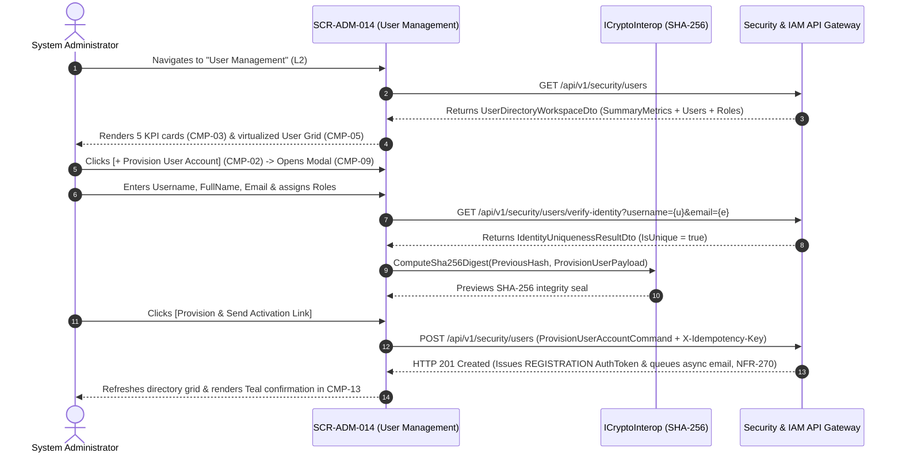

# SCR-ADM-014: User Lifecycle Management, Brute-Force Lockout Control, and Identity Governance

## 1. Purpose and Operational Context

* **View Objective:** Centralized Level 2 identity and access management (IAM) console (`adm.users`, `adm.user_roles`, `adm.auth_tokens`) governing the complete corporate user lifecycle: onboarding provisioning with single-use registration tokens (`FR-258`), multi-role RBAC assignment (`User.AssignRole` / `User.RemoveRole`), automated brute-force lockout monitoring (`User.RecordFailedLogin`, `FR-260`), immediate session/token revocation and account suspension (`User.Deactivate`, `AuthToken.Revoke`, `FR-262`), audited account rehabilitation (`User.Activate`, `FR-263`), soft-delete historical preservation (`FR-264`), and NIST SP 800-63B password policy governance (`FR-259`, `FR-261`, `FR-266`, `NFR-272`).
* **Primary Target Persona:** System Administrator provisioning personnel accounts, assigning RBAC roles, investigating brute-force lockouts (`LOCKED`), issuing single-use password reset tokens (`PASSWORD_RESET`), suspending separated employees (`INACTIVE`), and configuring password complexity rules.
* **Secondary Personas:**
  * **Auditor:** Inspects user account statuses, role assignments, login attempt telemetry (`NFR-268`), active token purposes (`OFFLINE_LOTO_LEASE`, `ACCESS`), and SHA-256 hash-chained identity audit records (`FR-265`, `TR-001`).
* **Operational Context:** Deployed in IT/OT security administration offices on desktop workstations and supervisory tablets. Per [DT-UI-NAV-DOC-001 §6.1](../../DT-UI-NAV-DOC-001.md#61-offline-operation-guard), centralized user administration requires active server connectivity and is blocked when the Offline Operation Guard is active.
* **Mode of Operation:** Identity Lifecycle & Forensic Supervision mode. Direct DCS/SCADA process control manipulation is strictly excluded. Physical row deletion (`DELETE FROM adm.users`) is strictly prohibited (`FR-264`, `ON DELETE RESTRICT` on `vis.work_permits` per [DT-ERD-DOC-001 §4](../../../domain-models/entity-relationship/DT-ERD-DOC-001.md#4-referential-relationships-and-cascading-fks)); account retirement executes exclusively via logical soft-deletion (`is_active = FALSE` $\to$ `UserStatus.INACTIVE`).
* **Upstream & Downstream Navigation Invariants ([DT-UI-NAV-DOC-001 §5](../../DT-UI-NAV-DOC-001.md#5-transition-matrix-and-access-control-rbac)):**
  * **Upstream Continuity:** Accessed from the Web Portal Governance sidebar or from [SCR-ADM-013](SCR-ADM-013.md) (`[Manage Users]`).
  * **Downstream Transitions:** Routes to the Roles and Permissions Matrix ([SCR-ADM-013](SCR-ADM-013.md)) via `"Edit Privileges"` (`L2` $\to$ `L2`) or to the Immutable SHA-256 Audit Log Viewer ([SCR-ADM-032](SCR-ADM-032.md)) to inspect forensic security events.

---

## 2. Visual Artifact


> *Note: Production UI prototype capture illustrating the User Management desktop workstation layout, collapsible navigation sidebar, 5-card identity lifecycle and brute-force lockout KPI strip, multi-criteria filter bar, virtualized user directory grid, persistent right dock with user profile inspector, role assignment chips, active token/session telemetry card, and sticky governance footer.*

---

## 3. Functional Component Inventory

> The base grid, typography, neutral palettes, and minimal tactile contact areas are inherited from [DT-UI-DS-DOC-001](../../DT-UI-DS-DOC-001.md). This inventory defines the canonical components present on the screen, their design tokens, and their architectural scope. Interaction rules and geometric algorithms are specified in Section 5; responsive container adaptations are governed by Section 8.

1. **`CMP-01`: Web Portal Shell & Sidebar**
   - **Visual Role:** Collapsible navigation sidebar hosting global modules, module hierarchy, and route markers.
   - **Design Tokens:**
     - Surface: `--dt-color-surface-base`
     - Border: `--dt-color-border-subtle`
     - Width: `--dt-layout-sidebar-width-expanded` (Desktop) / `--dt-layout-sidebar-width-collapsed` (Tablet Landscape)
   - **Architectural Scope:** Hosts global module navigation per [DT-UI-NAV-DOC-001](../../DT-UI-NAV-DOC-001.md), highlighting "User Management" under Governance & Security. Responsive widths in Section 8.

2. **`CMP-02`: User Governance Header & Action Bar**
   - **Visual Role:** Sticky top header hosting breadcrumbs, `[+ Provision User Account]` primary CTA (`FR-258`), `[Password & Lockout Policy]` settings trigger (`NFR-272`), and operator session badge.
   - **Design Tokens:**
     - Surface: `--dt-color-surface-card`
     - Border: `--dt-color-border-subtle`
     - Elevation: `--dt-z-header-sticky`
     - Primary Button: `--dt-color-state-info`
   - **Architectural Scope:** Launches the account provisioning modal (`CMP-09`) and NIST SP 800-63B policy configuration modal (`CMP-11`). Detailed in §5.1 and §5.3.

3. **`CMP-03`: Identity Lifecycle & Security Lockout KPI Strip**
   - **Visual Role:** 5-card interactive summary strip (`FR-265`) displaying `Total Registered Users`, `Active Accounts`, `Brute-Force Locked Accounts` (`FR-260`), `Suspended / Inactive Accounts` (`FR-262`, `FR-264`), and `Pending Onboarding Tokens` (`FR-258`).
   - **Design Tokens:**
     - Surface: `--dt-color-surface-card`
     - Border: `--dt-color-border-subtle`
     - Radius: `--dt-radius-md`
     - Active Filter Ring: `--dt-color-state-info`
     - Lockout Alert Accent: `--dt-color-alarm-critical`
   - **Architectural Scope:** Acts as a one-click status filter for the user directory grid without duplicate filter chips ([DT-UI-DS-DOC-001 §6.5](../../DT-UI-DS-DOC-001.md#65-status-badge-counter-discipline-anti-badge-inflation-principle)). Detailed in §5.1.

4. **`CMP-04`: Multi-Criteria User Directory Filter Toolbar**
   - **Visual Role:** Flat toolbar hosting `UserStatus` selector (`ACTIVE`, `LOCKED`, `INACTIVE`), assigned `Role` filter, active `OFFLINE_LOTO_LEASE` holder filter, and debounced search input across `Username`, `FullName`, and `Email` (`FR-265`).
   - **Design Tokens:**
     - Surface: `--dt-color-surface-base`
     - Controls: `--dt-color-surface-card`
     - Border: `--dt-color-border-subtle`
     - Control Height: `--dt-control-height-sm` (Desktop) / `--dt-touch-target-mobile` (Tablet)
     - Radius: `--dt-radius-sm`
   - **Architectural Scope:** Filters the virtualized user directory in $< 200\text{ms}$ with zero vertical layout shift (`CLS = 0`). Detailed in §5.2.

5. **`CMP-05`: Dense Virtualized User Directory Data Grid**
   - **Visual Role:** Virtualized multi-column table rendering `Username` (monospace badge code) & `FullName`, institutional `Email`, assigned `Role` labels, `UserStatus` indicator (`CMP-06`), `FailedLoginAttempts` counter (`0/5`..`5/5`), `LockoutUntilUtc` timer, `LastLoginAtUtc`, and active token count (`FR-265`, `NFR-268`).
   - **Design Tokens:**
     - Header Surface: `--dt-color-surface-base`
     - Row Surface: `--dt-color-surface-card`
     - Border: `--dt-color-border-subtle`
     - Row Height: `--dt-layout-table-row-height`
     - Selected Row Indicator: `--dt-color-state-info`
     - Monospace Data: `--dt-font-mono-data`
   - **Architectural Scope:** Core identity supervision grid (`adm.users`). Clicking any row inspects the account in `CMP-07`. Detailed in §5.2.

6. **`CMP-06`: User Lifecycle & Lockout Status Badges**
   - **Visual Role:** Morphological capsule pills (`--dt-radius-full`) encoding account anomalies (`LOCKED`, `PENDING ACTIVATION`, `INACTIVE`).
   - **Design Tokens:**
     - Normal (`ACTIVE` with `0` failed attempts): plain neutral text (`--dt-color-text-body`)
     - Critical (`LOCKED` brute-force block): `--dt-color-alarm-critical` (`#icon-loto-locked`)
     - Warning (`PENDING ACTIVATION` or `3..4` failed attempts): `--dt-color-alarm-warning` (`#icon-warning`)
     - Deactivated (`INACTIVE` soft-deleted): `--dt-color-surface-base`, `--dt-color-text-muted`
     - Radius: `--dt-radius-full`
   - **Architectural Scope:** Enforces 90/10 HPHMI and Anti-Badge-Inflation rules ([DT-UI-DS-DOC-001 §6.5.1](../../DT-UI-DS-DOC-001.md#651-morphological-differentiation-status-badges-vs-interactive-buttons)): healthy `ACTIVE` accounts render without green status pills, ensuring brute-force `LOCKED` accounts command pre-attentive salience. Detailed in §5.1.

7. **`CMP-07`: User Account Inspector, Role Assignment & Lifecycle Rail**
   - **Visual Role:** Master-detail inspector hosted inside dock `CMP-12` displaying user identity metadata, multi-role assignment toggles (`User.AssignRole` / `User.RemoveRole`) with SoD pre-check, `[Edit Privileges]` handoff button to [SCR-ADM-013](SCR-ADM-013.md), `[Send Password Reset Token]` (`FR-261`), `[Suspend / Deactivate Account]` (`FR-262`, `FR-264`), and `[Restore / Unlock Account]` (`FR-263`).
   - **Design Tokens:**
     - Surface: `--dt-color-surface-card`
     - Border: `--dt-color-border-subtle`
     - Typography: `--dt-font-caption`, `--dt-font-body-md`, `--dt-font-mono-data`
   - **Architectural Scope:** Centralizes all single-user lifecycle mutations and role bindings ([DT-DM-DOC-002 §6.1](../../../domain-models/class/DT-DM-DOC-002.md#61-user-aggregate-root)). Detailed in §5.3.

8. **`CMP-08`: Forensic Authentication & Active Token Telemetry Card**
   - **Visual Role:** Nested card inside `CMP-07` displaying `FailedLoginAttempts`, `LockoutUntilUtc`, `LastLoginAtUtc`, recent authentication events (`NFR-268`), and active `AuthToken` leases (`ACCESS`, `SESSION_REFRESH`, `REGISTRATION`, `PASSWORD_RESET`, `OFFLINE_LOTO_LEASE` per [DT-DM-DOC-001 §4.37](../../../domain-models/class/DT-DM-DOC-001.md#437-authtokenpurpose)) with individual `[Revoke Token]` triggers (`AuthToken.Revoke()`).
   - **Design Tokens:**
     - Surface: `--dt-color-surface-base`
     - Border: `--dt-color-border-subtle`
     - Radius: `--dt-radius-md`
     - Typography: `--dt-font-mono-data`
   - **Architectural Scope:** Enables immediate session termination and visibility into active field `OFFLINE_LOTO_LEASE` holders (`NFR-268`, `NFR-269`). Detailed in §5.3.2.

9. **`CMP-09`: Provision New User Account Modal (`FR-258`)**
   - **Visual Role:** Centered transactional modal dialog (`--dt-layout-modal-width`, `--dt-layout-modal-max-height`) capturing `Username`, `FullName`, institutional `Email`, initial `RoleIds`, and single-use `REGISTRATION` token email dispatch (`NFR-270`).
   - **Design Tokens:**
     - Surface: `--dt-color-surface-card`
     - Backdrop: `--dt-color-surface-overlay`
     - Width & Max-Height: `--dt-layout-modal-width`, `--dt-layout-modal-max-height`
     - Radius: `--dt-radius-xl`
     - Elevation: `--dt-z-modal`
     - Primary CTA: `--dt-color-state-info`
   - **Architectural Scope:** Validates `Username` and `Email` uniqueness (`adm.users` UNIQUE constraints) and dispatches the onboarding link. Detailed in §5.3.1.

10. **`CMP-10`: Account Suspension, Soft-Delete & Restoration Modal (`FR-262`, `FR-263`, `FR-264`)**
    - **Visual Role:** Safety confirmation modal for executing `User.Deactivate(reason)` (`AF-001`) or `User.Activate()` (`AF-004`), displaying active session/token revocation impact and requiring a mandatory `AuditJustification` ($\ge 15$ characters).
    - **Design Tokens:**
      - Surface: `--dt-color-surface-card`
      - Width: `--dt-layout-modal-width`
      - Radius: `--dt-radius-xl`
      - Elevation: `--dt-z-modal`
      - Warning Accent: `--dt-color-alarm-warning`
    - **Architectural Scope:** Guarantees zero physical deletion (`FR-264`) while immediately revoking all `AuthTokens` upon suspension (`FR-262`). Detailed in §5.3.2.

11. **`CMP-11`: Password Complexity & Lockout Policy Modal (`FR-259`, `FR-266`, `NFR-272`, `NFR-273`)**
    - **Visual Role:** Centered configuration modal allowing the System Administrator to calibrate NIST SP 800-63B password parameters (minimum length $\ge 12$, character class rules, credential rotation cadence, non-reuse history count `FR-266`, brute-force failure threshold `5`, and lockout duration `15 min`).
    - **Design Tokens:**
      - Surface: `--dt-color-surface-card`
      - Width: `--dt-layout-modal-width`
      - Radius: `--dt-radius-xl`
      - Elevation: `--dt-z-modal`
    - **Architectural Scope:** Satisfies [FR-259](../../../requirements/user-stories/adm/ADM-014.md#functional-requirements-fr), [FR-266](../../../requirements/user-stories/adm/ADM-014.md#functional-requirements-fr), and [NFR-272](../../../requirements/user-stories/adm/ADM-014.md#non-functional-requirements-nfr). Detailed in §5.3.3.

12. **`CMP-12`: Persistent Workspace Dock & Vertical Tab Strip**
    - **Visual Role:** Right-hand workspace dock with vertical spine tabs (`USER PROFILE` / `SHA-256 AUDIT`) hosting `CMP-07`/`CMP-08` and `UserAuditLogPane.razor`.
    - **Design Tokens:**
      - Track Surface: `--dt-color-surface-base`
      - Panel Surface: `--dt-color-surface-card`
      - Active Tab: `--dt-color-surface-raised`
      - Width: `--dt-layout-drawer-width-desktop` / `--dt-layout-drawer-width-tablet`
      - Elevation: `--dt-shadow-panel`
      - Active Indicator: `--dt-color-state-info`
    - **Architectural Scope:** Preserves directory scroll and row selection across profile inspection and SHA-256 audit tab switches (`CLS = 0`). Detailed in §5.2 and Section 8.

13. **`CMP-13`: Sticky Identity Governance & Handoff Footer**
    - **Visual Role:** Permanent sticky bottom bar hosting the `CLS = 0` validation/security alert slot, L2 navigation handoffs (`[Edit Privileges (RBAC)]`, `[Inspect Security Audit Log]`), mandatory `AuditJustification` input, and `[Save Role & Account Changes]`.
    - **Design Tokens:**
      - Surface: `--dt-color-surface-card`
      - Border: `--dt-color-border-hairline`
      - Height: `--dt-layout-footer-height`
      - Elevation: `--dt-z-header-sticky`
      - Primary CTA: `--dt-color-state-info`
      - Secondary Button: `--dt-color-surface-btn-secondary`
    - **Architectural Scope:** Commits audited role assignment mutations and routes to [SCR-ADM-013](SCR-ADM-013.md) or [SCR-ADM-032](SCR-ADM-032.md) ([DT-UI-NAV-DOC-001 §5](../../DT-UI-NAV-DOC-001.md#5-transition-matrix-and-access-control-rbac)). Detailed in §5.2.

---

## 4. Screen State Catalog

1. **Directory Supervision Mode (Default — `FR-265`)**
   - **Activation Condition:** System Administrator or Auditor navigates to `SCR-ADM-014`.
   - **Visual Modification:** Neutral grayscale surfaces (`--dt-color-surface-card`). Directory grid `CMP-05` lists user accounts with plain neutral text for healthy `ACTIVE` users. Right dock `CMP-12` displays the selected user's profile, assigned roles, and active `AuthToken` telemetry (`CMP-07`, `CMP-08`).

2. **Loading / Querying Directory**
   - **Activation Condition:** Initial directory load or filter/search execution.
   - **Visual Modification:** Skeleton shimmer (`--dt-color-surface-raised`) across `CMP-03` KPI cards and `CMP-05` rows; mutation actions disabled.

3. **Brute-Force Account Lockout Alert (`AF-002` / `FR-260`)**
   - **Activation Condition:** One or more accounts reach `FailedLoginAttempts >= 5`, setting `LockoutUntilUtc` (`UserStatus.LOCKED`).
   - **Visual Modification:** KPI card 3 in `CMP-03` and the affected user row in `CMP-05` display a critical red capsule badge (`[LOCKED · 5/5]`, `--dt-color-alarm-critical`, `#icon-loto-locked`) with remaining lockout countdown. `CMP-07` exposes `[Restore & Unlock Account]` (`FR-263`).

4. **Provisioning New User Account (`FR-258`)**
   - **Activation Condition:** Administrator clicks `[+ Provision User Account]` in `CMP-02`.
   - **Visual Modification:** Modal `CMP-09` deploys centered over `--dt-color-surface-overlay`, validating `Username` and `Email` uniqueness in real time and checking multi-role assignments against SoD rules.

5. **Duplicate Username or Email Conflict**
   - **Activation Condition:** Debounced uniqueness check in `CMP-09` detects that the entered `Username` or `Email` already exists in `adm.users`.
   - **Visual Modification:** Conflicting input highlights with a critical red border (`--dt-color-alarm-critical`) and `#icon-ban` glyph, hard-disabling `[Provision & Send Activation Link]` (`CLS = 0`).

6. **Suspending / Soft-Deleting or Restoring Account (`AF-001`, `AF-004`, `FR-262`–`FR-264`)**
   - **Activation Condition:** Administrator clicks `[Suspend / Deactivate Account]` or `[Restore & Unlock Account]` in `CMP-07`.
   - **Visual Modification:** Modal `CMP-10` opens displaying active token revocation impact (including any active `OFFLINE_LOTO_LEASE` warning) and requiring a mandatory `AuditJustification` ($\ge 15$ characters).

7. **Single-Use Password Reset Dispatched (`AF-003` / `FR-261`)**
   - **Activation Condition:** Administrator clicks `[Send Password Reset Token]` in `CMP-07`.
   - **Visual Modification:** System generates a single-use `PASSWORD_RESET` token (`adm.auth_tokens`), dispatches the recovery email asynchronously (`NFR-270`), and renders a Teal confirmation pill (`--dt-color-state-success`, `#icon-check`) in `CMP-13`: *"Single-use password recovery token dispatched asynchronously to user email."*

---

## 5. Interaction Rules and Data Flow

### 5.1. Initial Load & Lifecycle



1. **Computed 3-State User Lifecycle ([DT-DM-DOC-001 §4.40](../../../domain-models/class/DT-DM-DOC-001.md#440-userstatus) & [DT-ERD-DOC-001 §3.5.6](../../../domain-models/entity-relationship/DT-ERD-DOC-001.md#356-users)):**
   * The domain model derives `UserStatus` deterministically from the physical `adm.users` columns (`is_active`, `failed_login_attempts`, `lockout_until`):
     * **`UserStatus.INACTIVE`:** `is_active == false` (suspended or soft-deleted via `User.Deactivate(reason)`).
     * **`UserStatus.LOCKED`:** `is_active == true` $\land$ `lockout_until > utc_now()` (brute-force lockout via `User.RecordFailedLogin()`).
     * **`UserStatus.ACTIVE`:** `is_active == true` $\land$ (`lockout_until == null` $\lor$ `lockout_until <= utc_now()`).

---

### 5.2. Directory Ergonomics & Cross-Screen Handoffs

1. **Virtualized Directory & Forensic Inspection (`CMP-05`, `CMP-07`, `CMP-08`):**
   * Uses `Virtualize<UserDirectoryRowDto>` with fixed row height (`--dt-layout-table-row-height`). Clicking any user row populates `CMP-07` and `CMP-08` inside persistent right dock `CMP-12` (`CLS = 0`).
2. **RBAC Privilege Editing Handoff ([DT-UI-NAV-DOC-001 §5](../../DT-UI-NAV-DOC-001.md#5-transition-matrix-and-access-control-rbac)):**
   * Clicking `[Edit Privileges]` on any assigned role in `CMP-07` or `CMP-13` routes directly to [SCR-ADM-013](SCR-ADM-013.md) (`L2` $\to$ `L2`) pre-selecting that `RoleId`.

---

### 5.3. Domain Workflows & Identity Security Invariants

#### 5.3.1. Account Onboarding & Single-Use Registration Token (`FR-258`, `FR-259`, `NFR-267`, `NFR-270`, `NFR-273`)
1. **Provisioning & Token Issuance (`FR-258`, `NFR-269`, `NFR-270`):** `ProvisionUserAccountCommand` creates the `User` record, generates a cryptographically random single-use token with `AuthTokenPurpose.REGISTRATION` (`DT-DM-DOC-001 §4.37`), persists only its salted SHA-256/Argon2id `token_hash` in `adm.auth_tokens` (`NFR-267`), and dispatches the activation email via an asynchronous background queue (`NFR-270`).
2. **First-Access Password Establishment (`FR-259`, `NFR-273`):** Consuming the link invokes `User.UpdatePassword(newPasswordHash)` and `AuthToken.MarkAsUsed()` ([DT-DM-DOC-002 §6.1–§6.4](../../../domain-models/class/DT-DM-DOC-002.md#6-layer-5-safety-and-governance-adm)), enforcing WCAG 2.1 AA screen-reader announcements (`aria-live="polite"`) on each password complexity checklist criterion (`NFR-273`).

#### 5.3.2. Brute-Force Lockout, Soft-Delete & Immediate Token Revocation (`FR-260`, `FR-262`–`FR-264`, `NFR-268`, `NFR-271`)
1. **Brute-Force Defense (`FR-260`, `NFR-268`, `NFR-271`):** Each failed login invokes `User.RecordFailedLogin()`. When `failed_login_attempts` reaches the configured threshold (`5`), `lockout_until` is set to $\text{now}() + 15\text{ min}$, a `SECURITY_ALERT` entry is appended to `adm.audit_logs`, and an immediate security alert email is dispatched asynchronously (`NFR-270`, `NFR-271`).
2. **Suspension & Soft-Delete (`FR-262`, `FR-264`, `AF-001`):** Invoking `User.Deactivate(reason)` sets `is_active = false` and calls `AuthToken.Revoke()` across all non-expired tokens for that `user_id` (including `ACCESS`, `SESSION_REFRESH`, and `OFFLINE_LOTO_LEASE` tokens), terminating active sessions within $< 2\text{s}$ (`TR-006-NFR-402`, `TR-010`) while preserving historical FKs in `vis.work_permits`, `adm.work_order_assignments`, and `adm.audit_logs`.
3. **Audited Account Restoration (`FR-263`, `AF-004`):** Invoking `User.Activate()` with a mandatory `AuditJustification` sets `is_active = true`, resets `failed_login_attempts = 0`, clears `lockout_until = null` (`User.RegisterSuccessfulLogin` / `Activate` per `DT-DM-DOC-002 §6.1`), and seals the rehabilitation in `adm.audit_logs`.

#### 5.3.3. Single-Use Password Reset & Credential Rotation Policy (`FR-261`, `FR-266`, `NFR-267`, `NFR-272`)
1. **Single-Use Recovery (`FR-261`):** Issuing a password reset generates an `AuthToken` with `AuthTokenPurpose.PASSWORD_RESET` and strict temporal expiration (`NFR-269`). Once consumed via `AuthToken.MarkAsUsed()`, replay attempts are rejected (`DT-DM-DOC-002 §6.4`).
2. **Non-Reuse & Complexity Governance (`FR-266`, `NFR-272`):** `User.UpdatePassword(newPasswordHash)` verifies that the new credential meets the administrator-configured complexity rules (`CMP-11`) and does not match the user's previous password hashes (`FR-266`).

---

## 6. Industrial and Safety Considerations

* **Active LOTO Lease & Work Permit Safety Check on User Suspension (`FR-262`, [ADR-006](../../../architecture/adr/ADR-006.md)):** If an administrator suspends a technician who currently holds an active `OFFLINE_LOTO_LEASE` (`vis.work_order_isolations.lease_holder_user_id`), `CMP-10` surfaces an explicit safety warning so the Maintenance Supervisor can coordinate physical LOTO custody handover in the field.
* **Prohibition of Physical User Deletion (`FR-264` / ISO 55001 / ISO 9001):** Deleting a user row would orphan historical Work Permit authorizations (`vis.work_permits.issuer_user_id` enforces `ON DELETE RESTRICT`) and break 7-year audit retention (`TR-001-FR-367`). Logical soft-deletion (`User.Deactivate`) is strictly enforced.
* **HPHMI Grayscale & Anti-Badge-Inflation Governance ([TR-011](../../../requirements/common/TR-011.md)):** Per [DT-UI-DS-DOC-001 §1](../../DT-UI-DS-DOC-001.md#1-scope) and [§6.5](../../DT-UI-DS-DOC-001.md#65-status-badge-counter-discipline-anti-badge-inflation-principle), normal `ACTIVE` accounts and role names render in neutral grayscale without green badges, reserving `--dt-color-alarm-critical` strictly for brute-force `LOCKED` accounts (`AF-002`) and `--dt-color-alarm-warning` for pre-lockout warning counts (`3..4` failed attempts).

---

## 7. Frontend Component Contract (Blazor / Razor)

### 7.1. Component Hierarchy & File Mapping

```text
Pages/Governance/
└── UserManagementPage.razor                           # Root View (SCR-ADM-014)
    ├── PortalSidebarNav.razor                         # CMP-01: Collapsible desktop navigation sidebar
    ├── UserManagementHeaderBar.razor                  # CMP-02: Breadcrumbs, [+ Provision User] & policy trigger
    ├── UserSummaryCards.razor                         # CMP-03: 5-card identity lifecycle & lockout KPI strip
    ├── UserFilterToolbar.razor                        # CMP-04: Status, role, LOTO lease & search filter bar
    ├── UserDirectoryGrid.razor                        # CMP-05: Virtualized multi-column user directory table
    │   └── UserStatusBadge.razor                      # CMP-06: Redundant LOCKED/INACTIVE/ACTIVE status indicator
    ├── UserWorkspaceDock.razor                        # CMP-12: Persistent right dock with vertical tab spine
    │   ├── UserInspectionRail.razor                   # CMP-07: Identity details, role assignment & lifecycle actions
    │   │   └── UserAuthActivityCard.razor             # CMP-08: Login telemetry & active AuthToken revocation card
    │   └── UserAuditLogPane.razor                     # Chained SHA-256 identity audit trail tab pane
    ├── ProvisionUserModal.razor                       # CMP-09: New user onboarding & REGISTRATION token modal (FR-258)
    ├── UserLifecycleTransitionModal.razor             # CMP-10: Suspend/Soft-Delete & Restore/Unlock modal (FR-262..264)
    ├── PasswordPolicyConfigModal.razor                # CMP-11: NIST SP 800-63B password & lockout policy modal (NFR-272)
    └── UserActionFooter.razor                         # CMP-13: Sticky governance footer, alert slot & L2 handoffs
```

---

### 7.2. Physical Component Parameters & DTO Contracts (.NET 10 / C# 14)

#### 7.2.1. `UserManagementPage.razor` (Root View)

```csharp
[Parameter, SupplyParameterFromQuery(Name = "status")]
public UserStatus? InitialStatusFilter { get; set; }

[Parameter, SupplyParameterFromQuery(Name = "userId")]
public Guid? InitialSelectedUserId { get; set; }
```

#### 7.2.2. Subcomponent Parameter Contracts (`CMP-01` to `CMP-13`)

```csharp
// CMP-01: PortalSidebarNav.razor
[Parameter]
public bool IsCollapsed { get; set; }

[Parameter]
public bool IsMobileDrawerOpen { get; set; }

[Parameter]
public string ActiveRouteCode { get; set; } = "SCR-ADM-014";

[Parameter]
public EventCallback<bool> OnCollapseToggled { get; set; }

// CMP-02: UserManagementHeaderBar.razor
[Parameter]
public required string OperatorBadgeCode { get; set; }

[Parameter]
public required string OperatorDisplayName { get; set; }

[Parameter]
public bool CanManageUsers { get; set; }

[Parameter]
public EventCallback OnOpenProvisionUserModal { get; set; }

[Parameter]
public EventCallback OnOpenPasswordPolicyModal { get; set; }

[Parameter]
public EventCallback OnToggleMobileNavigation { get; set; }

// CMP-03: UserSummaryCards.razor
[Parameter]
public required UserDirectoryMetricsDto Metrics { get; set; }

[Parameter]
public UserKpiFilterCategory? ActiveCategoryFilter { get; set; }

[Parameter]
public EventCallback<UserKpiFilterCategory?> OnCategoryFilterSelected { get; set; }

// CMP-04: UserFilterToolbar.razor
[Parameter]
public required IReadOnlyList<RoleLookupItemDto> Roles { get; set; }

[Parameter]
public UserStatus? SelectedStatusFilter { get; set; }

[Parameter]
public Guid? SelectedRoleFilter { get; set; }

[Parameter]
public bool? HasActiveOfflineLeaseFilter { get; set; }

[Parameter]
public string? SearchQuery { get; set; }

[Parameter]
public EventCallback<UserStatus?> OnStatusFilterChanged { get; set; }

[Parameter]
public EventCallback<Guid?> OnRoleFilterChanged { get; set; }

[Parameter]
public EventCallback<bool?> OnOfflineLeaseFilterChanged { get; set; }

[Parameter]
public EventCallback<string?> OnSearchQueryChanged { get; set; }

[Parameter]
public EventCallback OnResetFiltersClicked { get; set; }

// CMP-05: UserDirectoryGrid.razor
[Parameter]
public required IReadOnlyList<UserDirectoryRowDto> Users { get; set; }

[Parameter]
public Guid? SelectedUserId { get; set; }

[Parameter]
public EventCallback<UserDirectoryRowDto> OnUserSelected { get; set; }

// CMP-06: UserStatusBadge.razor
[Parameter]
public required UserStatus Status { get; set; }

[Parameter]
public int FailedLoginAttempts { get; set; }

[Parameter]
public bool HasPendingOnboardingToken { get; set; }

[Parameter]
public DateTimeOffset? LockoutUntilUtc { get; set; }

// CMP-12: UserWorkspaceDock.razor
[Parameter]
public bool IsOpen { get; set; }

[Parameter]
public UserDockTab ActiveTab { get; set; } = UserDockTab.USER_PROFILE;

[Parameter]
public EventCallback<UserDockTab> OnTabChanged { get; set; }

[Parameter]
public EventCallback OnClosed { get; set; }

// CMP-07: UserInspectionRail.razor
[Parameter]
public UserDetailProfileDto? SelectedUser { get; set; }

[Parameter]
public required IReadOnlyList<RoleLookupItemDto> AvailableRoles { get; set; }

[Parameter]
public bool CanManageUsers { get; set; }

[Parameter]
public EventCallback<Guid> OnRoleAssignmentToggled { get; set; }

[Parameter]
public EventCallback<Guid> OnEditRolePrivilegesRequested { get; set; }

[Parameter]
public EventCallback<Guid> OnDispatchPasswordResetRequested { get; set; }

[Parameter]
public EventCallback<UserLifecycleActionType> OnLifecycleActionRequested { get; set; }

// CMP-08: UserAuthActivityCard.razor
[Parameter]
public required UserDetailProfileDto UserProfile { get; set; }

[Parameter]
public bool CanManageUsers { get; set; }

[Parameter]
public EventCallback<Guid> OnRevokeTokenRequested { get; set; }

[Parameter]
public EventCallback<Guid> OnRevokeAllSessionsRequested { get; set; }

// UserAuditLogPane.razor
[Parameter]
public required IReadOnlyList<UserAuditEntryDto> AuditEntries { get; set; }

// CMP-09: ProvisionUserModal.razor (FR-258)
[Parameter]
public bool IsVisible { get; set; }

[Parameter]
public required IReadOnlyList<RoleLookupItemDto> AvailableRoles { get; set; }

[Parameter]
public bool IsUsernameUnique { get; set; } = true;

[Parameter]
public bool IsEmailUnique { get; set; } = true;

[Parameter]
public EventCallback<ProvisionUserAccountCommand> OnUserProvisioned { get; set; }

[Parameter]
public EventCallback OnCloseRequested { get; set; }

// CMP-10: UserLifecycleTransitionModal.razor (FR-262, FR-263, FR-264)
[Parameter]
public bool IsVisible { get; set; }

[Parameter]
public UserDetailProfileDto? TargetUser { get; set; }

[Parameter]
public UserLifecycleActionType ActionType { get; set; }

[Parameter]
public EventCallback<ExecuteUserLifecycleTransitionCommand> OnTransitionConfirmed { get; set; }

[Parameter]
public EventCallback OnCloseRequested { get; set; }

// CMP-11: PasswordPolicyConfigModal.razor (FR-259, FR-266, NFR-272)
[Parameter]
public bool IsVisible { get; set; }

[Parameter]
public required PasswordSecurityPolicyDto Policy { get; set; }

[Parameter]
public EventCallback<PasswordSecurityPolicyDto> OnPolicySaved { get; set; }

[Parameter]
public EventCallback OnCloseRequested { get; set; }

// CMP-13: UserActionFooter.razor
[Parameter]
public UserDetailProfileDto? SelectedUser { get; set; }

[Parameter]
public bool HasUnsavedRoleChanges { get; set; }

[Parameter]
public bool CanCommit { get; set; }

[Parameter]
public bool IsSubmitting { get; set; }

[Parameter]
public string? StatusMessage { get; set; }

[Parameter]
public string AuditJustification { get; set; } = string.Empty;

[Parameter]
public EventCallback<string> AuditJustificationChanged { get; set; }

[Parameter]
public EventCallback OnNavigateToRbacMatrix { get; set; }

[Parameter]
public EventCallback<Guid?> OnNavigateToAuditLogViewer { get; set; }

[Parameter]
public EventCallback OnDiscardRoleChangesClicked { get; set; }

[Parameter]
public EventCallback OnSaveRoleAssignmentsClicked { get; set; }
```

#### 7.2.3. Data Transfer Objects (DTOs) and Enums

```csharp
/// <summary>
/// Controlled user account lifecycle status vocabulary per DT-DM-DOC-001 §4.40.
/// </summary>
public enum UserStatus
{
    ACTIVE,
    INACTIVE,
    LOCKED
}

/// <summary>
/// Controlled cryptographic authentication token purpose vocabulary per DT-DM-DOC-001 §4.37.
/// </summary>
public enum AuthTokenPurpose
{
    ACCESS,
    SESSION_REFRESH,
    REGISTRATION,
    PASSWORD_RESET,
    OFFLINE_LOTO_LEASE
}

public enum UserLifecycleActionType
{
    SUSPEND_OR_DEACTIVATE,
    RESTORE_AND_UNLOCK
}

public enum UserKpiFilterCategory
{
    ALL_USERS,
    ACTIVE_USERS,
    LOCKED_BRUTE_FORCE,
    SUSPENDED_INACTIVE,
    PENDING_ONBOARDING
}

public enum UserDockTab
{
    USER_PROFILE,
    SHA256_AUDIT
}

public record UserDirectoryMetricsDto
{
    public required int TotalUsersCount { get; init; }
    public required int ActiveUsersCount { get; init; }
    public required int LockedAccountsCount { get; init; }
    public required int SuspendedInactiveCount { get; init; }
    public required int PendingOnboardingCount { get; init; }
}

public record RoleLookupItemDto
{
    public required Guid RoleId { get; init; }
    public required string RoleName { get; init; }
    public required bool IsSystemRootRole { get; init; }
}

public record UserDirectoryRowDto
{
    public required Guid UserId { get; init; }
    public required string Username { get; init; }
    public required string FullName { get; init; }
    public required string Email { get; init; }
    public required UserStatus Status { get; init; }
    public required bool IsActive { get; init; }
    public required int FailedLoginAttempts { get; init; }
    public DateTimeOffset? LockoutUntilUtc { get; init; }
    public DateTimeOffset? LastLoginAtUtc { get; init; }
    public required bool HasPendingRegistrationToken { get; init; }
    public required bool HasActiveOfflineLotoLease { get; init; }
    public IReadOnlyList<string> AssignedRoleNames { get; init; } = [];
    public required string LatestIntegrityHash { get; init; }
}

public record UserDetailProfileDto
{
    public required Guid UserId { get; init; }
    public required string Username { get; init; }
    public required string FullName { get; init; }
    public required string Email { get; init; }
    public required UserStatus Status { get; init; }
    public required bool IsActive { get; init; }
    public required int FailedLoginAttempts { get; init; }
    public DateTimeOffset? LockoutUntilUtc { get; init; }
    public DateTimeOffset? LastLoginAtUtc { get; init; }
    public required IReadOnlySet<Guid> AssignedRoleIds { get; init; }
    public IReadOnlyList<ActiveAuthTokenSummaryDto> ActiveTokens { get; init; } = [];
    public required string LatestIntegrityHash { get; init; }
}

public record ActiveAuthTokenSummaryDto
{
    public required Guid TokenId { get; init; }
    public required AuthTokenPurpose Purpose { get; init; }
    public required DateTimeOffset ExpiresAtUtc { get; init; }
    public required bool IsRevoked { get; init; }
    public required string TokenFingerprintShort { get; init; }
}

public record PasswordSecurityPolicyDto
{
    public required int MinimumLength { get; init; } = 12;
    public required bool RequireUppercase { get; init; } = true;
    public required bool RequireDigit { get; init; } = true;
    public required bool RequireSpecialCharacter { get; init; } = true;
    public required int PasswordHistoryNonReuseCount { get; init; } = 5;
    public required int MaxFailedLoginAttempts { get; init; } = 5;
    public required int LockoutDurationMinutes { get; init; } = 15;
    public required int AccessTokenExpirationHours { get; init; } = 8;
}

public record ProvisionUserAccountCommand
{
    public required string Username { get; init; }
    public required string FullName { get; init; }
    public required string Email { get; init; }
    public required IReadOnlySet<Guid> AssignedRoleIds { get; init; }
    public required string AuditJustification { get; init; }
    public required Guid AdminUserId { get; init; }
    public required string PreviousHash { get; init; }
}

public record ExecuteUserLifecycleTransitionCommand
{
    public required Guid TargetUserId { get; init; }
    public required UserLifecycleActionType ActionType { get; init; }
    public required string AuditJustification { get; init; }
    public required Guid AdminUserId { get; init; }
    public required string PreviousHash { get; init; }
}

public record UserAuditEntryDto
{
    public required Guid AuditLogId { get; init; }
    public required DateTimeOffset TimestampUtc { get; init; }
    public required string OperatorBadgeCode { get; init; }
    public required string EventType { get; init; }
    public required string TargetUsername { get; init; }
    public required string ChangeSummary { get; init; }
    public required string AuditJustification { get; init; }
    public required string PreviousHash { get; init; }
    public required string IntegrityHash { get; init; }
}
```

---

### 7.3. Client-Side DOM & Interop Bridge

1. **Debounced Identity Uniqueness & SoD Union Validator (`IIdentityValidationInterop`):**
   * Throttles `Username` and `Email` uniqueness queries ($250\text{ms}$ debounce) and evaluates cross-role Segregation of Duties rules when assigning multiple roles to a user (`FR-251`).
2. **Real-Time Session Termination & Lockout Hub (`ISecuritySessionHub` / `TR-010`):**
   * Broadcasts `AuthToken.Revoke()` and `User.Deactivate()` events to connected clients so suspended users are terminated immediately (`FR-262`, `TR-006-NFR-402`) and streams live brute-force lockout alerts (`FR-260`, `NFR-271`) to the administrator console.
3. **Web Cryptography SHA-256 Digest Bridge (`ICryptoInterop`):**
   * Computes candidate `IntegrityHash` digests asynchronously in a Web Worker for user provisioning, role updates, suspensions, and restorations (`TR-001`, `ADR-003`).

---

## 8. Layout and Responsive Adaptability

### 8.1. Desktop Workstation (`--dt-breakpoint-xl`)
* **Layout Organization:** Asymmetric 3-column workstation split ([DT-UI-DS-DOC-001 §2.3](../../DT-UI-DS-DOC-001.md#23-responsive-breakpoints-and-reference-frames)): left navigation sidebar `CMP-01` expanded at `--dt-layout-sidebar-width-expanded`, central User Directory workspace hosting the 5 summary KPI cards `CMP-03`, filter toolbar `CMP-04`, and virtualized directory grid `CMP-05`, paired with the persistent right workspace dock `CMP-12` sized by `--dt-layout-drawer-width-desktop` (`--dt-shadow-panel`). Modals `CMP-09`, `CMP-10`, and `CMP-11` center at `--dt-layout-modal-width-desktop` bounded by `--dt-layout-modal-max-height`. Sticky footer `CMP-13` (`--dt-layout-footer-height`) spans the bottom workspace.
* **Ergonomic Rules:** Optimized for mouse and keyboard navigation; dense table row height governed by `--dt-layout-table-row-height`; WCAG 2.1 AA screen-reader compatibility across all credential and recovery forms (`NFR-273`); zero horizontal layout shift (`CLS = 0`).

### 8.2. Industrial Tablet Landscape (`--dt-breakpoint-lg`)
* **Layout Organization:** Navigation sidebar `CMP-01` collapses to an icon-only rail sized by `--dt-layout-sidebar-width-collapsed`; workspace dock `CMP-12` operates as a slide-over lateral panel sized by `--dt-layout-drawer-width-tablet`; modals `CMP-09`–`CMP-11` size to `--dt-layout-modal-width-tablet`.
* **Ergonomic Rules:** Interactive controls enforce `--dt-touch-target-mobile` hit areas; sticky footer `CMP-13` (`--dt-layout-footer-height`) remains permanently pinned.

### 8.3. Industrial Tablet Portrait (`--dt-breakpoint-md`)
* **Layout Organization:** Navigation sidebar `CMP-01` transitions to an off-canvas drawer; KPI summary cards `CMP-03` wrap into a multi-row grid; workspace dock `CMP-12` transitions to an adaptive **Bottom Sheet** initializing at `--dt-layout-bottom-sheet-height-initial` and expanding up to `--dt-layout-bottom-sheet-height-expanded` (`--dt-radius-2xl` upper curvature); directory grid `CMP-05` prioritizes Username, FullName, Status, Roles, and Failed Attempts columns.
* **Ergonomic Rules:** Touch targets governed by `--dt-touch-target-mobile` with `--dt-space-2` separation; discrete single-tap toggling on the bottom-sheet handle ([DT-UI-DS-DOC-001 §6.3](../../DT-UI-DS-DOC-001.md#63-sliding-containers-pattern-bottom-sheets-and-drawers)).

---

## 9. Traceability and Requirements Matrix

| Requirement                                                                                  | Addressed in Component                 | Verification & Implementation Mechanism                                                                                                                     |
| :------------------------------------------------------------------------------------------- | :------------------------------------- | :---------------------------------------------------------------------------------------------------------------------------------------------------------- |
| [FR-258](../../../requirements/user-stories/adm/ADM-014.md#functional-requirements-fr)       | `CMP-02`, `CMP-09`                     | Provisions new user accounts and automatically dispatches a single-use `REGISTRATION` activation link to institutional email.                               |
| [FR-259](../../../requirements/user-stories/adm/ADM-014.md#functional-requirements-fr)       | `CMP-09`, `CMP-11`                     | Enforces NIST SP 800-63B password complexity policies prior to first account activation.                                                                    |
| [FR-260](../../../requirements/user-stories/adm/ADM-014.md#functional-requirements-fr)       | `CMP-03`, `CMP-05`, `CMP-06`, `CMP-08` | Brute-force protection (`User.RecordFailedLogin()`) transitions accounts to `LOCKED` status (`LockoutUntilUtc`) upon reaching 5 failed attempts (`AF-002`). |
| [FR-261](../../../requirements/user-stories/adm/ADM-014.md#functional-requirements-fr)       | `CMP-07`, `CMP-08`                     | Issues single-use `PASSWORD_RESET` tokens (`AuthToken.MarkAsUsed()`) with strict temporal validity (`AF-003`).                                              |
| [FR-262](../../../requirements/user-stories/adm/ADM-014.md#functional-requirements-fr)       | `CMP-07`, `CMP-08`, `CMP-10`           | Temporarily suspends users (`User.Deactivate()`), immediately revoking all active `AuthTokens` while preserving historical records (`AF-001`).              |
| [FR-263](../../../requirements/user-stories/adm/ADM-014.md#functional-requirements-fr)       | `CMP-07`, `CMP-10`                     | Restores suspended or locked accounts (`User.Activate()`) with mandatory reactivation justification (`AF-004`).                                             |
| [FR-264](../../../requirements/user-stories/adm/ADM-014.md#functional-requirements-fr)       | `CMP-05`, `CMP-07`, `CMP-10`           | Enforces logical soft-deletion (`is_active = FALSE` $\to$ `INACTIVE`), strictly prohibiting physical row deletion to preserve audit history.                |
| [FR-265](../../../requirements/user-stories/adm/ADM-014.md#functional-requirements-fr)       | `CMP-03`, `CMP-04`, `CMP-05`, `CMP-08` | Administrative control dashboard visualizing user status, assigned roles, failed login counters, and recent authentication activity.                        |
| [FR-266](../../../requirements/user-stories/adm/ADM-014.md#functional-requirements-fr)       | `CMP-11`                               | Supports periodic credential rotation while enforcing non-reuse of previous password hashes (`PasswordHistoryNonReuseCount`).                               |
| [NFR-267](../../../requirements/user-stories/adm/ADM-014.md#non-functional-requirements-nfr) | `CMP-08`, `CMP-09`, `CMP-11`           | Stores `password_hash` and `token_hash` exclusively using high-resistance salted cryptographic hashes (`adm.users`, `adm.auth_tokens`).                     |
| [NFR-268](../../../requirements/user-stories/adm/ADM-014.md#non-functional-requirements-nfr) | `CMP-05`, `CMP-08`, `CMP-12`           | Maintains forensic logs of all login attempts (`last_login_at`, `failed_login_attempts`) and `SECURITY_ALERT` audit records.                                |
| [NFR-269](../../../requirements/user-stories/adm/ADM-014.md#non-functional-requirements-nfr) | `CMP-08`, `CMP-11`                     | Enforces strict `expires_at` temporal expiration across all `AuthTokenPurpose` categories (`TR-006-NFR-399`).                                               |
| [NFR-270](../../../requirements/user-stories/adm/ADM-014.md#non-functional-requirements-nfr) | `CMP-07`, `CMP-09`                     | Dispatches onboarding activation, password reset, and lockout security emails asynchronously without blocking UI transactions.                              |
| [NFR-271](../../../requirements/user-stories/adm/ADM-014.md#non-functional-requirements-nfr) | `CMP-03`, `CMP-08`                     | Immediately notifies the affected user and administrator upon brute-force lockout or credential change events.                                              |
| [NFR-272](../../../requirements/user-stories/adm/ADM-014.md#non-functional-requirements-nfr) | `CMP-02`, `CMP-11`                     | Exposes administrator-configurable password complexity, history non-reuse, and lockout threshold parameters (`PasswordSecurityPolicyDto`).                  |
| [NFR-273](../../../requirements/user-stories/adm/ADM-014.md#non-functional-requirements-nfr) | `CMP-09`, `CMP-11`                     | Enforces WCAG 2.1 AA ARIA live regions, semantic labels, and keyboard navigation across activation and recovery flows.                                      |
| [TR-001](../../../requirements/common/TR-001.md)                                             | `CMP-09`, `CMP-10`, `CMP-12`, `CMP-13` | Immutable append-only audit trail logging with SHA-256 hash chaining for all user lifecycle mutations and lockouts.                                         |
| [TR-002](../../../requirements/common/TR-002.md)                                             | `CMP-08`, `CMP-09`                     | Encrypts sensitive identity attributes, password hashes, and token digests at rest.                                                                         |
| [TR-005](../../../requirements/common/TR-005.md)                                             | `CMP-05`, `CMP-09`, `CMP-10`           | Enforces TLS/HTTPS encryption in transit across all identity provisioning, authentication, and token revocation requests.                                   |
| [TR-006](../../../requirements/common/TR-006.md)                                             | `CMP-01` to `CMP-13`                   | Enforces RBAC role authorization, 8-hour token expiration (`TR-006-NFR-399`), and active user state verification (`TR-006-NFR-402`).                        |
| [TR-010](../../../requirements/common/TR-010.md)                                             | `CMP-07`, `CMP-08`, `CMP-10`           | Real-time SignalR session termination and permission synchronization upon user suspension or role modification.                                             |
| [TR-011](../../../requirements/common/TR-011.md)                                             | `CMP-01` to `CMP-13`                   | ANSI/ISA-101 HPHMI 90/10 neutral grayscale directory, zero badge inflation on active users, and WCAG 2.1 AA redundant coding on `LOCKED` states.            |
| [ADR-003](../../../architecture/adr/ADR-003.md)                                              | `CMP-12`, `CMP-13`                     | Tamper-evident cryptographic SHA-256 hash chaining (`PreviousHash` $\to$ `IntegrityHash`) on user lifecycle audit records.                                  |
| [ADR-005](../../../architecture/adr/ADR-005.md)                                              | `CMP-08`, `CMP-09`                     | Time-sequential UUIDv7 identifier generation for `User` and `AuthToken` primary keys.                                                                       |