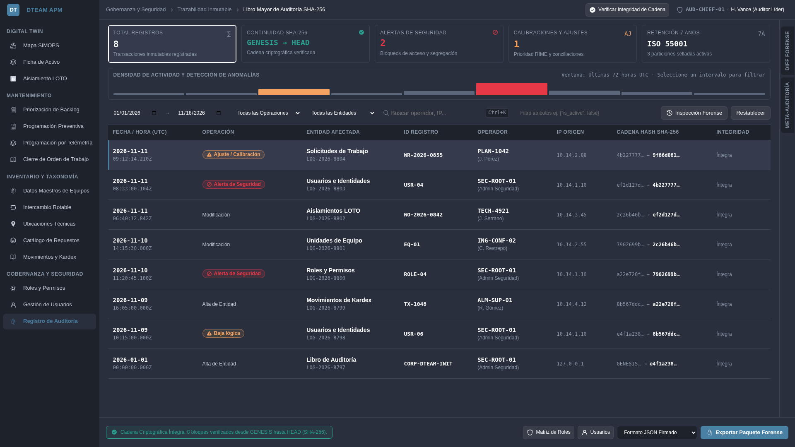
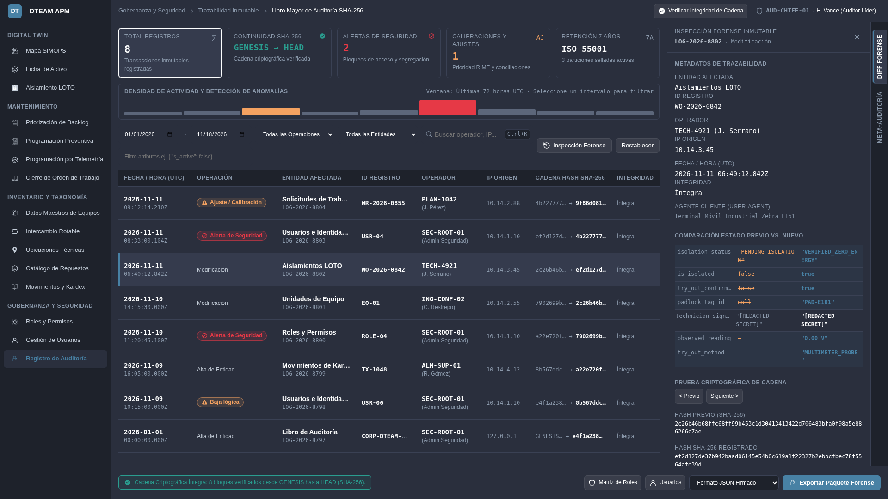
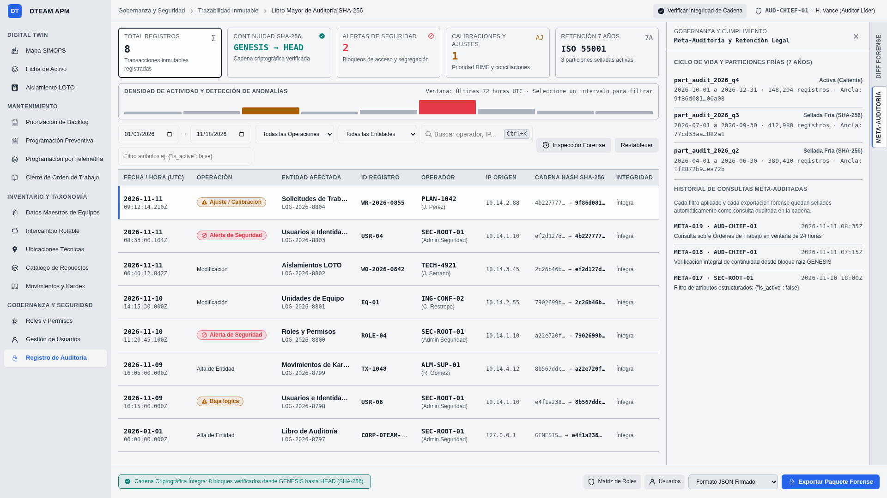
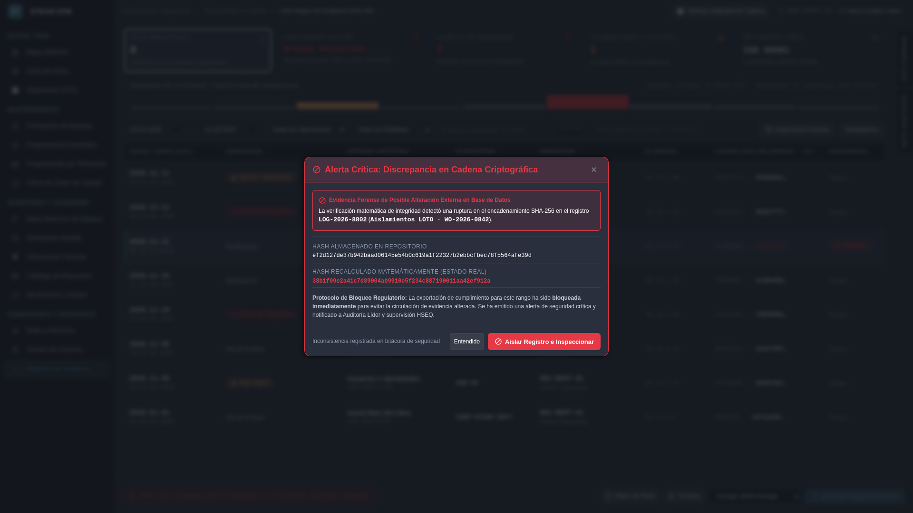

# SCR-ADM-032: Immutable SHA-256 Audit Log Viewer, Forensic Diff Inspector, and Chain Integrity Verifier

## 1. Purpose and Operational Context

* **View Objective:** Centralized Level 2 forensic query, state-diff inspection, and cryptographic hash-chain verification console over the immutable audit trail (`AuditLog`, `AuditLogWorkspaceDto`, `AuditLogEntryDto`, `AuditLogDetailDto`). Enforces strict Write-Once-Read-Many (WORM) append-only immutability (`FR-347`), executes high-speed GIN containment queries over structured state snapshots ([DT-ARQ-DB-DOC-001 §3.8](../../../architecture/DT-ARQ-DB-DOC-001.md#38-gin-indexing-for-jsonb-immutable-audit-adm-032)), visualizes temporal activity trends and security anomalies (`FR-352`), renders secret-masked `PreviousState` vs. `NewState` diffs (`FR-349`), mathematically verifies sequential SHA-256 hash continuity (`AuditLog.VerifyIntegrity()` per [DT-DM-DOC-002 §6.3](../../../domain-models/class/DT-DM-DOC-002.md#63-auditlog-entity) and [ADR-003](../../../architecture/adr/ADR-003.md)), logs all audit consultations via self-referential Meta-Auditing (`NFR-360`), and governs 7-year regulatory retention archival (`FR-350`, `FR-358`, `TR-001-FR-367`).
* **Primary Target Persona:** Auditor (Lead Auditor) conducting forensic incident reconstructions, Root Cause Analysis (RCA), LOTO/SIMOPS safety compliance audits, 7-year cold-archive verification (`FR-350`), signed forensic exports (`FR-353`, `NFR-359`), and ISO 55001 / ISO 27001 / ISO 9001 regulatory reviews.
* **Secondary Personas:**
  * **Plant Manager:** Reviews operational compliance audits, `SECURITY_ALERT` governance exceptions, and facility-wide change history alongside the Auditor (`SOD-SYS-01` explicitly excludes `System Administrator` from `AUDIT` access to separate IAM administration in [SCR-ADM-013](SCR-ADM-013.md)/[SCR-ADM-014](SCR-ADM-014.md) from independent forensic auditing).
* **Operational Context:** Deployed exclusively on high-resolution Desktop Workstations inside corporate audit, HSEQ, and security operations offices ([DT-UI-NAV-DOC-001 §4.2](../../DT-UI-NAV-DOC-001.md#42-navigation-structure-web-portal-client)). Per [DT-UI-NAV-DOC-001 §4.1](../../DT-UI-NAV-DOC-001.md#41-navigation-structure-mobile-client) and [§6.1](../../DT-UI-NAV-DOC-001.md#61-offline-operation-guard), mobile/tablet field clients and offline query execution against the central audit repository are strictly out of scope, while exported forensic packages support standalone offline verification (`NFR-359`). Compact desktop workstation adaptations are governed in Section 8.
* **Mode of Operation:** Strictly Read-Only Forensic Supervision & Cryptographic Verification mode (`FR-347`). Direct DCS/SCADA process control manipulation is excluded, and zero mutation, update, or deletion controls exist for `AuditLog` entries (`TR-001-NFR-362`, `TR-001-NFR-365`).
* **Web Portal Workspace Invariant:** Operates within the unified Blazor Web Portal shell alongside an **on-demand, closed-by-default** right-hand workspace dock (`CMP-12` hosting `CMP-08`/`CMP-09` and `CMP-11`) using the vertical tab spine pattern (`CLS = 0`). The dock initializes closed (`IsOpen = false`), opens on ledger row selection, vertical spine tab selection, or via `[Forensic Inspection]` (`CMP-04`), and closes cleanly on outside click, close trigger, or `Escape`.
* **Upstream & Downstream Navigation Invariants ([DT-UI-NAV-DOC-001 §5](../../DT-UI-NAV-DOC-001.md#5-transition-matrix-and-access-control-rbac)):**
  * **Upstream Continuity:** Accessed from the Web Portal Governance sidebar, from the RBAC Matrix ([SCR-ADM-013](SCR-ADM-013.md)) via `"Audit Modification"` (`L2` $\to$ `L2`), or from User Management ([SCR-ADM-014](SCR-ADM-014.md)) via `"Forensic Audit"` (`L2` $\to$ `L2`).
  * **Downstream Transitions:** Routes back to the RBAC Matrix ([SCR-ADM-013](SCR-ADM-013.md)) and User Management ([SCR-ADM-014](SCR-ADM-014.md)) via sticky footer handoffs (`CMP-13`), supports URL query pre-filtering (`EntityType`, `EntityId`, `ActionType`) for deep-linked entity investigations (such as `EquipmentUnit` records from [SCR-INV-005](../inv/SCR-INV-005.md) or RIME `ADJUST` calibrations from [SCR-MTTO-026](../mtto/SCR-MTTO-026.md)), and exports standalone signed `CSV` / `JSON` audit packages (`FR-353`).

---

## 2. Visual Artifact



> *Figure 2.1 — Desktop Workstation (Dark Theme, Closed Dock by Default): Illustrates the collapsible navigation sidebar (`CMP-01`), forensic header with secondary `[Verify Chain Integrity]` trigger and auditor badge (`CMP-02`), 5-card cryptographic chain integrity and retention KPI strip (`CMP-03`), 72-hour temporal activity trend strip (`CMP-05`), multi-criteria and structured attribute filter bar with `[Forensic Inspection]` dock trigger (`CMP-04`), virtualized append-only audit ledger showing neutral text on routine events and intact rows while reserving critical red and amber pills for `SECURITY_ALERT` and `ADJUST`/`DELETE` (`CMP-06`, `CMP-07`), closed-by-default right dock spine (`CMP-12`), and sticky verification/export footer (`CMP-13`).*



> *Figure 2.2 — Desktop Workstation (Dark Theme, Forensic Inspection Dock Open for `LOG-2026-8802`): Illustrates selecting a `WorkOrderIsolation` LOTO attestation row or clicking `[Forensic Inspection]` to expand `CMP-12`, displaying `CMP-08` network traceability metadata and flat hairline-divided secret-masked `PreviousState` vs. `NewState` diff rows (`[REDACTED SECRET]`), paired with `CMP-09` 64-character SHA-256 chain proof rows, `[< Prev]` / `[Next >]` chain traversal controls, and Teal verification banner.*



> *Figure 2.3 — Desktop Workstation (Light Theme, `META-AUDIT` & 7-Year Retention Tab Open): Illustrates activating the vertical `Meta-Audit` dock tab (`CMP-12`) to display `CMP-11` time-partitioned hot and cold-sealed 7-year archival partitions (`ISO 55001`) alongside the self-referential `QUERY` Meta-Audit history (`NFR-360`), rendered over crisp flat hairline dividers.*



> *Figure 2.4 — Desktop Workstation (Dark Theme, Critical Tamper-Evident Chain Breach Alert Modal `CMP-10` — `AF-001`): Illustrates the automated quarantine modal triggered when `AuditLog.VerifyIntegrity()` detects a SHA-256 mismatch at `LOG-2026-8802`, comparing stored vs. mathematically recalculated digests, escalating the chain KPI card and ledger row to critical red, hard-blocking signed compliance exports in `CMP-13`, and offering `[Isolate Record & Inspect]` (`TR-003`).*

---

## 3. Functional Component Inventory

> The base grid, typography (`--dt-font-caption` minimum floor), neutral HPHMI palettes, and tactile contact areas are inherited from [DT-UI-DS-DOC-001](../../DT-UI-DS-DOC-001.md). This inventory defines the canonical components present on the screen, their design tokens, and their architectural scope. Interaction rules and geometric algorithms are specified in Section 5; responsive container adaptations are governed by Section 8.

1. **`CMP-01`: Web Portal Shell & Sidebar**
   - **Visual Role:** Collapsible desktop navigation sidebar hosting global modules, module hierarchy, and route markers.
   - **Design Tokens:**
     - Surface: `--dt-color-surface-base`
     - Border: `--dt-color-border-subtle`
     - Width: `--dt-layout-sidebar-width-expanded` (Desktop) / `--dt-layout-sidebar-width-collapsed` (Compact Desktop Rail)
   - **Architectural Scope:** Hosts global module navigation per [DT-UI-NAV-DOC-001 §4](../../DT-UI-NAV-DOC-001.md#4-information-architecture-tree), highlighting "Audit Trail" (`SCR-ADM-032`) under Governance & Security alongside active links to `SCR-ADM-013` and `SCR-ADM-014`. Responsive rules in Section 8.

2. **`CMP-02`: Forensic Audit Header & Chain Verifier Bar**
   - **Visual Role:** Sticky top header hosting breadcrumbs, a transient Meta-Audit confirmation chip (hidden at rest; renders only post-query when `LastMetaAuditAtUtc != null` inside a reserved `CLS = 0` slot, `NFR-360`), secondary `[Verify Chain Integrity]` trigger (`FR-351`), and auditor session badge (`AUD-CHIEF-01`). Signed compliance export resides exclusively in sticky footer `CMP-13` to enforce single primary CTA discipline.
   - **Design Tokens:**
     - Surface: `--dt-color-surface-card`
     - Border: `--dt-color-border-subtle`
     - Elevation: `--dt-z-header-sticky`
     - Secondary Trigger: `--dt-color-surface-btn-secondary`
     - Meta-Audit Chip: `--dt-color-state-success`
   - **Architectural Scope:** Triggers on-demand cryptographic hash-chain verification (`AuditLog.VerifyIntegrity()`) across the ledger from `GENESIS` to `HEAD` and confirms Meta-Audit logging. Detailed in §5.1 and §5.3.

3. **`CMP-03`: Chain Integrity, Security Alert & Retention KPI Strip**
   - **Visual Role:** 5-card interactive summary strip displaying `Total Records`, `SHA-256 Continuity` (`GENESIS -> HEAD` verified or `Tamper Breach`), `Security Alerts` (`SECURITY_ALERT`), `Calibrations & Adjustments` (`ADJUST`), and `7-Year Retention` (`ISO 55001` partition summary, `FR-350`, `FR-358`).
   - **Design Tokens:**
     - Surface: `--dt-color-surface-card`
     - Border: `--dt-color-border-subtle`
     - Radius: `--dt-radius-md`
     - Active Filter Ring: `--dt-color-state-info`
     - Verified Seal Accent: `--dt-color-state-success`
     - Breach Alert Accent: `--dt-color-alarm-critical`
     - Calibration Warning Accent: `--dt-color-alarm-warning`
   - **Architectural Scope:** Acts as a one-click category filter over the ledger grid and surfaces immediate tamper-evident chain health (`FR-351`, `TR-001-FR-367`). Detailed in §5.1.

4. **`CMP-04`: Multi-Criteria & JSONB Containment Filter Toolbar (`FR-348`)**
   - **Visual Role:** Flat toolbar hosting UTC `DateFrom` / `DateTo` pickers, `AuditActionType` selector (`CREATE`, `UPDATE`, `DELETE`, `QUERY`, `ADJUST`, `SECURITY_ALERT`), `EntityType` selector (`WorkRequest`, `WorkOrder`, `WorkOrderIsolation`, `EquipmentUnit`, `Role`, `User`, `InventoryTransaction`, `AuditLog`), debounced search input across `Operator`, `IpAddress`, `EntityId`, and `IntegrityHash` (`Ctrl+K`), structured `JSONB` key-value containment query input (`{"is_active": false}`), `[Forensic Inspection]` dock toggle, and `[Reset]` action.
   - **Design Tokens:**
     - Surface: `--dt-color-surface-base`
     - Controls: `--dt-color-surface-card`
     - Border: `--dt-color-border-subtle`
     - Control Height: `--dt-control-height-sm`
     - Monospace Query Input: `--dt-font-mono-data`
     - Radius: `--dt-radius-sm`
   - **Architectural Scope:** Executes sub-second GIN-indexed containment (`@>`) and chronological UUIDv7 range queries ([DT-ARQ-DB-DOC-001 §3.8](../../../architecture/DT-ARQ-DB-DOC-001.md#38-gin-indexing-for-jsonb-immutable-audit-adm-032), `NFR-355`, `NFR-356`). Detailed in §5.1 and §5.2.

5. **`CMP-05`: Activity Trend & Anomaly Detection Strip (`FR-352`)**
   - **Visual Role:** Compact HPHMI monochrome histogram strip positioned above the ledger grid visualizing audit event density over time and highlighting anomalous adjustment spikes or `SECURITY_ALERT` bursts.
   - **Design Tokens:**
     - Surface: `--dt-color-surface-card`
     - Border: `--dt-color-border-subtle`
     - Normal Bar Fill: `--dt-color-border-panel`
     - Selected Bucket Fill: `--dt-color-state-info`
     - Anomaly Spike Fill: `--dt-color-alarm-warning` / `--dt-color-alarm-critical`
   - **Architectural Scope:** Satisfies [FR-352](../../../requirements/user-stories/adm/ADM-032.md#functional-requirements-fr); clicking any time bucket narrows `CMP-04` and `CMP-06` to that exact interval. Detailed in §5.2.

6. **`CMP-06`: Virtualized Chronological Audit Ledger Grid**
   - **Visual Role:** Virtualized WORM append-only table rendering `TimestampUtc` (monospace UTC), `AuditActionType` indicator (`CMP-07`), `EntityType` & `AuditLog` reference, `EntityId`, `OperatorBadgeCode`, `IpAddress`, chained hash link (`PreviousHash` $\to$ `IntegrityHash`), and `ChainIntegrityStatus` text.
   - **Design Tokens:**
     - Header Surface: `--dt-color-surface-base`
     - Row Surface: `--dt-color-surface-card`
     - Border: `--dt-color-border-subtle`
     - Row Height: `--dt-layout-table-row-height`
     - Selected Row Indicator: `--dt-color-state-info`
     - Tampered Row Indicator: `--dt-color-alarm-critical`
     - Monospace Data: `--dt-font-mono-data`
   - **Architectural Scope:** Core immutable ledger table (`AuditLogEntryDto`). Strictly omits edit or delete row actions (`FR-347`). Clicking any row opens and populates `CMP-08` inside `CMP-12`. Detailed in §5.2.

7. **`CMP-07`: Audit Event Type & Chain Integrity Indicators**
   - **Visual Role:** Morphological capsule pills (`--dt-radius-full`) encoding elevated `AuditActionType` severity and tamper breaches, paired with neutral text for routine operations and intact hash-chain status.
   - **Design Tokens:**
     - Routine (`CREATE`, `UPDATE`, `QUERY`) & Verified Integrity (`VERIFIED_INTACT`): plain neutral text (`--dt-color-text-body`, `--dt-color-text-muted`) with zero chromatic pills
     - Elevated (`ADJUST`, `DELETE`): `--dt-color-alarm-warning` (`#icon-warning`)
     - Critical (`SECURITY_ALERT`, `TAMPER_BREACH_DETECTED`): `--dt-color-alarm-critical` (`#icon-ban`)
     - Radius: `--dt-radius-full`
   - **Architectural Scope:** Enforces 90/10 HPHMI and Anti-Badge-Inflation rules ([DT-UI-DS-DOC-001 §6.5.1](../../DT-UI-DS-DOC-001.md#651-morphological-differentiation-status-badges-vs-interactive-buttons)): routine events and verified integrity rows remain neutral grayscale without green per-row pills so `SECURITY_ALERT`, `ADJUST`, and tamper breaches command immediate pre-attentive salience. Detailed in §5.1.

8. **`CMP-08`: Forensic Transaction Inspector & Secret-Masked JSONB Diff Rail (`FR-349`)**
   - **Visual Role:** Master-detail inspector hosted inside dock `CMP-12` displaying full network traceability (`IpAddress`, `UserAgent`), a structured flat hairline-divided key-by-key `PreviousState` vs. `NewState` diff list rendered directly over the card surface (`SCR-ADM-013`/`014` parity, zero nested card boxes) with changed attributes highlighted and sensitive credential keys masked (`[REDACTED SECRET]`), and the Cryptographic Hash-Chain Proof section (`CMP-09`).
   - **Design Tokens:**
     - Surface: transparent over `--dt-color-surface-card`
     - Divider Border: `--dt-color-border-subtle`
     - Changed Value Highlights: `--dt-color-alarm-warning` (previous strikethrough), `--dt-color-state-info` (new value)
     - Typography: `--dt-font-caption`, `--dt-font-mono-data`
   - **Architectural Scope:** Satisfies [FR-349](../../../requirements/user-stories/adm/ADM-032.md#functional-requirements-fr) and [NFR-357](../../../requirements/user-stories/adm/ADM-032.md#non-functional-requirements-nfr) without exposing raw `password_hash` or `token_hash` values. Detailed in §5.3.1.

9. **`CMP-09`: Cryptographic Hash-Chain Proof & Continuity Rows (`FR-351`, `ADR-003`)**
   - **Visual Role:** Hairline-divided forensic proof block inside `CMP-08` displaying the full 64-character `PreviousHash` (`GENESIS` on entry #1), stored 64-character SHA-256 `IntegrityHash`, live recalculated SHA-256 digest, verification status banner (`--dt-color-state-success` when intact or `--dt-color-alarm-critical` on tamper breach), and standard secondary `[< Prev]` / `[Next >]` chain traversal buttons.
   - **Design Tokens:**
     - Surface: transparent over `--dt-color-surface-card`
     - Divider Border: `--dt-color-border-subtle`
     - Status Banner Accents: `--dt-color-state-success` (Verified), `--dt-color-alarm-critical` (Breach)
     - Hash Typography: `--dt-font-mono-data`
     - Radius: `--dt-radius-md`
   - **Architectural Scope:** Visualizes `AuditLog.VerifyIntegrity()` ([DT-DM-DOC-002 §6.3](../../../domain-models/class/DT-DM-DOC-002.md#63-auditlog-entity)). Detailed in §5.3.2.

10. **`CMP-10`: Tamper-Evident Chain Breach Alert Modal (`AF-001` / `FR-346` / `FR-351`)**
    - **Visual Role:** Centered ISA-101 restrained security alert modal deployed automatically if `VerifyIntegrity()` detects a hash mismatch or missing chronological link (`AF-001`), keeping a neutral modal frame paired with a critical left-accent forensic callout, flat hairline-divided registered vs. recalculated SHA-256 digests, and immediate export quarantine protocol.
    - **Design Tokens:**
      - Surface & Neutral Frame: `--dt-color-surface-card`, `--dt-color-border-subtle`
      - Callout Left Accent & Mismatch Value: `--dt-color-alarm-critical`
      - Hash Compare Divider: `--dt-color-border-subtle`
      - Radius: `--dt-radius-xl`
      - Elevation: `--dt-z-modal-fail-safe`
    - **Architectural Scope:** Identifies the exact compromised `AuditLog` record and stored vs. recalculated SHA-256 digests, locks standard compliance exports for the corrupted window, and dispatches an automated `SECURITY_ALERT` notification (`TR-003-NFR-380`). Responsive modal sizing in Section 8; detailed in §5.3.2.

11. **`CMP-11`: Meta-Audit & 7-Year Retention Lifecycle Pane (`FR-350`, `FR-358`, `NFR-360`)**
    - **Visual Role:** Second vertical tab pane hosted in dock `CMP-12` displaying self-referential `QUERY` Meta-Audit logs (`NFR-360`) alongside the 7-year regulatory retention and cold-archive partition ledger (`FR-350`, `FR-358`, `TR-001-FR-367`) as flat hairline-divided rows over `--dt-color-surface-card`.
    - **Design Tokens:**
      - Surface: transparent over `--dt-color-surface-card`
      - Divider Border: `--dt-color-border-subtle`
      - Typography: `--dt-font-caption`, `--dt-font-mono-data`
    - **Architectural Scope:** Proves that auditor queries are themselves audited and that historical partitions remain cryptographically sealed across the 7-year ISO 55001 retention window. Detailed in §5.3.3.

12. **`CMP-12`: On-Demand Workspace Dock & Vertical Tab Strip (`CLS = 0`)**
    - **Visual Role:** Closed-by-default right-hand desktop workspace dock with vertical spine tabs (`Forensic Diff` | `Meta-Audit`) hosting `CMP-08`/`CMP-09` and `CMP-11`.
    - **Design Tokens:**
      - Track Surface: `--dt-color-surface-base`
      - Panel Surface: `--dt-color-surface-card`
      - Active Tab: `--dt-color-surface-raised`
      - Elevation: `--dt-shadow-panel`
      - Active Indicator: `--dt-color-state-info`
    - **Architectural Scope:** Initializes closed on page load (`IsOpen = false`) to maximize audit ledger column visibility (`CLS = 0`), opens via row selection, `[Forensic Inspection]` (`CMP-04`), or vertical spine tabs, preserves ledger scroll context across tab switches, and closes cleanly on outside click, close trigger, or `Escape`. Responsive widths governed in Section 8; detailed in §5.2.

13. **`CMP-13`: Sticky Forensic Verification & Signed Export Footer**
    - **Visual Role:** Permanent consolidated sticky bottom bar displaying the `CLS = 0` chain integrity range summary (`GENESIS .. HEAD`), L2 navigation handoffs (`[Roles Matrix]`, `[Users]`), signed export format selector (`SIGNED_FORENSIC_JSON` / `SIGNED_FORENSIC_CSV`), and sole primary CTA `[Export Forensic Package]` (`FR-353`, `NFR-359`).
    - **Design Tokens:**
      - Surface: `--dt-color-surface-card`
      - Border: `--dt-color-border-hairline`
      - Height: `--dt-layout-footer-height`
      - Elevation: `--dt-z-header-sticky`
      - Primary CTA: `--dt-color-state-info`
      - Secondary Button: `--dt-color-surface-btn-secondary`
      - Verification Slot: `--dt-color-state-success` (intact) / `--dt-color-alarm-critical` (breach lock)
    - **Architectural Scope:** Anchors chain verification status, governs export blocking during tamper breaches (`AF-001`), and provides L2 navigation back to [SCR-ADM-013](SCR-ADM-013.md) and [SCR-ADM-014](SCR-ADM-014.md). Detailed in §5.3.3.

---

## 4. Screen State Catalog

1. **Forensic Ledger Inspection Mode (Default — Verified Chain)**
   - **Activation Condition:** Auditor or Plant Manager navigates to `SCR-ADM-032`.
   - **Visual Modification:** Neutral grayscale 90/10 surfaces (`--dt-color-surface-card`) with `CMP-12` workspace dock closed by default (`IsOpen = false`, `CLS = 0`). Ledger grid `CMP-06` displays chronological records sorted descending by `TimestampUtc` (`UUIDv7` time-ordered) using plain neutral text (`Verified`) for intact entries and routine operations, reserving elevated amber/red capsules strictly for `ADJUST`/`DELETE` and `SECURITY_ALERT`. KPI card 2 in `CMP-03` and footer slot in `CMP-13` display cryptographic continuity confirmation (`--dt-color-state-success`, `#icon-check`).

2. **Executing Indexed Query & Recording Meta-Audit (`NFR-355`, `NFR-360`)**
   - **Activation Condition:** User applies multi-criteria or structured attribute containment (`@>`) filters in `CMP-04`.
   - **Visual Modification:** Skeleton shimmer (`--dt-color-surface-raised`) across `CMP-06` rows while the backend executes the GIN-indexed query and appends a self-referential `QUERY` Meta-Audit record; `CMP-02` reveals the transient Meta-Audit indicator chip (`META-AUDIT LOGGED`, `CLS = 0`).

3. **Inspecting Elevated Calibration or Security Alert (`ADJUST` / `SECURITY_ALERT`)**
   - **Activation Condition:** Auditor selects an `ADJUST` (RIME priority calibration or reconciliation) or `SECURITY_ALERT` (SoD block or brute-force lockout) row in `CMP-06`, or toggles `CMP-04` `[Forensic Inspection]`.
   - **Visual Modification:** `CMP-12` expands cleanly (`CLS = 0`), rendering `CMP-08` flat hairline-divided comparison rows highlighting modified attributes in the `PreviousState` $\to$ `NewState` diff and surfacing operator justification plus client network metadata.

4. **Verifying Cryptographic Hash-Chain Window (`FR-351`)**
   - **Activation Condition:** Auditor clicks `[Verify Chain Integrity]` in `CMP-02` or traverses predecessor/successor links in `CMP-09`.
   - **Visual Modification:** `CMP-09` displays the live SHA-256 recalculation across `PreviousHash` and current payload, rendering `[#icon-check CRYPTOGRAPHIC INTEGRITY VERIFIED: UNALTERED RECORD]` in `--dt-color-state-success`.

5. **Tamper-Evident Chain Breach Detected (`AF-001` / `FR-346` / `FR-351`)**
   - **Activation Condition:** `AuditLog.VerifyIntegrity()` detects a SHA-256 mismatch (`RecalculatedHash != IntegrityHash`) or a broken `PreviousHash` link indicating unauthorized external modification or row deletion.
   - **Visual Modification:** Compromised row in `CMP-06`, chain KPI card in `CMP-03`, footer pill in `CMP-13`, and proof banner in `CMP-09` escalate to critical red (`--dt-color-alarm-critical`, `#icon-ban`). Modal `CMP-10` deploys at `--dt-z-modal-fail-safe`, hard-disabling `[Export Forensic Package]` in `CMP-13` and displaying stored vs. recalculated hashes.

6. **Empty Query Result (`AF-003`)**
   - **Activation Condition:** No audit entries match the filter criteria in `CMP-04`.
   - **Visual Modification:** `CMP-06` renders a centered neutral empty state: *"No audit transactions found in the selected filter range"*, while still recording the `QUERY` Meta-Audit entry (`NFR-360`).

7. **Unauthorized Route Blocked (`403 Forbidden` / `TR-006`)**
   - **Activation Condition:** An authenticated user lacking audit inspection privileges (e.g., `Maintenance Technician` or `Warehouse Operator`) attempts direct URL navigation to `SCR-ADM-032`.
   - **Visual Modification:** Portal route guard rejects rendering prior to loading ledger records, displays `403 Forbidden`, and logs `AuditActionType.SECURITY_ALERT` in the immutable audit trail.

---

## 5. Interaction Rules and Data Flow

### 5.1. Initial Load, GIN `@>` Querying & Meta-Audit Lifecycle

```mermaid
sequenceDiagram
    autonumber
    actor Aud as Auditor / Plant Manager
    participant UI as SCR-ADM-032 (Audit Viewer)
    participant Crypto as ICryptoInterop (SHA-256)
    participant API as Security & Audit API Gateway

    Aud->>UI: Navigates to "Audit Trail" (L2)
    UI->>API: GET /api/v1/security/audit-logs (Default window; records QUERY Meta-Audit)
    API-->>UI: Returns AuditLogWorkspaceDto (Metrics, TrendBuckets, Entries, Partitions)
    UI-->>Aud: Renders KPI Strip (CMP-03), Trend Strip (CMP-05) & Ledger Grid (CMP-06)
    Aud->>UI: Enters JSONB containment filter '{"is_active": false}' & EntityType="WorkOrder"
    UI->>API: POST /api/v1/security/audit-logs/query (GIN @> query & appends QUERY Meta-Audit)
    API-->>UI: Returns matching AuditLogEntryDto list
    Aud->>UI: Selects event row in CMP-06 (Opens CMP-12 Dock)
    UI->>Crypto: VerifyRecordIntegrity(SelectedEntry, PredecessorHash)
    alt Hash Matches (Chain Intact)
        Crypto-->>UI: Returns IntegrityVerificationResultDto (IsIntact = true)
        UI-->>Aud: Renders masked JSONB diff (CMP-08) & Teal Verified Seal (CMP-09)
    else Hash Mismatch or Missing Link (AF-001)
        Crypto-->>UI: Returns IntegrityVerificationResultDto (IsIntact = false)
        UI->>API: POST /api/v1/security/audit-logs/report-tamper-breach (X-Idempotency-Key + Logs SECURITY_ALERT)
        UI-->>Aud: Deploys Tamper Breach Modal (CMP-10) & blocks compliance export
    end
```

1. **Controlled Audit Event Vocabulary (`FR-345`, [DT-DM-DOC-001 §4.36](../../../domain-models/class/DT-DM-DOC-001.md#436-auditlogactiontype)):**
   * Every row returned by `AuditLogEntryDto` is classified using the strongly-typed `AuditActionType` enum defined in §7.2.3.
2. **GIN `jsonb_path_ops` Containment Queries (`FR-348`, `NFR-355`, `NFR-356`, [DT-ARQ-DB-DOC-001 §3.8](../../../architecture/DT-ARQ-DB-DOC-001.md#38-gin-indexing-for-jsonb-immutable-audit-adm-032), [DT-ERD-DOC-001 §6.7](../../../domain-models/entity-relationship/DT-ERD-DOC-001.md#67-admaudit_logsprevious_state-and-new_state)):**
   * Filter predicates over `PreviousState` and `NewState` (`JSONB`) are dispatched via `AuditLogQueryFilterDto` to execute indexed containment queries (`@>`) paired with chronologically ordered `UUIDv7` keys ([ADR-005](../../../architecture/adr/ADR-005.md)) and the polymorphic state snapshot contracts defined in [DT-ERD-DOC-001 §6.7](../../../domain-models/entity-relationship/DT-ERD-DOC-001.md#67-admaudit_logsprevious_state-and-new_state) to sustain sub-second response times across multi-year ledgers.

---

### 5.2. Forensic Ergonomics & Secret Masking

1. **Virtualized WORM Grid & On-Demand Dock Lifecycle (`CMP-06`, `CMP-09`, `CMP-12`):**
   * Uses `Virtualize<AuditLogEntryDto>` with fixed row height (`--dt-layout-table-row-height`).
   * `CMP-12` initializes closed (`IsOpen = false`, `CLS = 0`), expanding to `--dt-layout-drawer-width-desktop` (or `--dt-layout-drawer-width-tablet` on compact desktop displays) when a row is clicked, a vertical spine tab is activated, or `[Forensic Inspection]` is triggered; clicking outside, pressing `Escape`, or clicking the close icon collapses the dock cleanly.
   * In `CMP-09`, clicking `[< Prev]` or `[Next >]` walks backward or forward along the `PreviousHash` $\leftrightarrow$ `IntegrityHash` chain to trace incidents chronologically.
2. **Automatic Secret Redaction in JSONB Diffs (`CMP-08`, `FR-349`, `NFR-357`):**
   * Before rendering `PreviousState` and `NewState` payloads, the presentation parser masks sensitive credential keys designated for mandatory redaction in [DT-ERD-DOC-001 §6.7](../../../domain-models/entity-relationship/DT-ERD-DOC-001.md#67-admaudit_logsprevious_state-and-new_state) to `[REDACTED SECRET]`, preventing credential exposure during screen sharing or audit exports.

---

### 5.3. Domain Workflows & Cryptographic Chain Invariants

#### 5.3.1. Asynchronous Non-Blocking Capture & Strict WORM Immutability (`FR-347`, `NFR-354`, `TR-001`)
1. **Sub-50ms Non-Blocking Ingestion (`NFR-354`, `TR-001-NFR-366`):** Operational audit records are committed within the shared persistence transaction ([DT-ARQ-DB-DOC-001 §3.9](../../../architecture/DT-ARQ-DB-DOC-001.md#39-cross-dbcontext-atomic-transactions-idbcontexttransaction-sharing-tr-001-tr-005-inv-025)) in $< 50\text{ms}$ (95th percentile) without degrading plant workflows.
2. **Append-Only WORM Enforcement (`FR-347`, `AF-002`, `TR-001-NFR-362`, `TR-001-NFR-365`):** Application roles strictly lack modification or deletion privileges over `AuditLog` persistence ([DT-DM-DOC-001 §2.6](../../../domain-models/class/DT-DM-DOC-001.md#26-module-isolation-via-database-schemas)). Any attempt to mutate or remove an audit row is rejected and recorded as `AuditActionType.SECURITY_ALERT`.

#### 5.3.2. Chained SHA-256 Verification & Tamper-Evident Breach Protocol (`FR-346`, `FR-351`, `AF-001`, `ADR-003`)
1. **Hash-Chain Mathematical Contract (`AuditLog.VerifyIntegrity()`, [DT-DM-DOC-002 §6.3](../../../domain-models/class/DT-DM-DOC-002.md#63-auditlog-entity)):**
   For chronological record $k$ ($k \ge 1$, where $H_0 = \text{"GENESIS"}$ per [DT-ERD-DOC-001 §3.5.1](../../../domain-models/entity-relationship/DT-ERD-DOC-001.md#351-audit_logs)):
   $$H_k = \text{SHA-256}\left(H_{k-1} \parallel \text{Id}_k \parallel \text{UserId}_k \parallel \text{ActionType}_k \parallel \text{EntityType}_k \parallel \text{EntityId}_k \parallel \text{TimestampUtc}_k \parallel \text{CanonicalJson}(\text{PrevState}_k) \parallel \text{CanonicalJson}(\text{NewState}_k)\right)$$
2. **Tamper Breach Quarantine (`AF-001`, `ADR-007`):** If $H_k^{\text{recalculated}} \ne H_k^{\text{stored}}$ or $H_{k-1}^{\text{linked}} \ne H_{k-1}^{\text{stored}}$, `CMP-10` immediately blocks `[Export Forensic Package]` in `CMP-13`, highlights the exact broken link, and dispatches `POST /api/v1/security/audit-logs/report-tamper-breach` carrying `X-Idempotency-Key: {uuidv7}` ([ADR-007](../../../architecture/adr/ADR-007.md)) to record a deduplicated `SECURITY_ALERT` notification (`TR-003-NFR-380`).

#### 5.3.3. Self-Referential Meta-Auditing & 7-Year Regulatory Retention (`FR-350`, `FR-353`, `FR-358`, `NFR-359`, `NFR-360`)
1. **Meta-Audit Logging (`NFR-360`, `TR-001-FR-361`):** Every query executed in `CMP-04` and every forensic export triggered in `CMP-13` automatically appends an `AuditActionType.QUERY` record to the immutable `AuditLog` ledger capturing Auditor identity, network metadata, and query parameters under the Meta-Audit profile defined in [DT-ERD-DOC-001 §6.7](../../../domain-models/entity-relationship/DT-ERD-DOC-001.md#67-admaudit_logsprevious_state-and-new_state).
2. **7-Year Retention & Cold-Archive Lifecycle (`FR-350`, `FR-358`, `TR-001-FR-367`):** `CMP-11` projects quarterly retention segments from `AuditRetentionPartition` persistence metadata ([DT-ERD-DOC-001 §3.5.9](../../../domain-models/entity-relationship/DT-ERD-DOC-001.md#359-audit_retention_partitions), [DT-ARQ-DB-DOC-001 §3.11](../../../architecture/DT-ARQ-DB-DOC-001.md#311-7-year-declarative-range-partitioning-and-cold-archive-anchoring-adm-032-fr-350-fr-358)) retained for a minimum of **7 years** (ISO 55001 Clause 7.5), verifying partition anchor hashes (`PartitionAnchorHash`) across cold-archived segments so chain continuity remains unbroken across archived boundaries.
3. **Portable Forensic Extraction (`FR-353`, `NFR-359`):** Clicking `[Export Forensic Package]` in `CMP-13` generates a self-contained `AuditExportFormat` bundle (`SIGNED_FORENSIC_JSON` or `SIGNED_FORENSIC_CSV`) accompanied by a detached SHA-256 manifest so external auditors can independently verify chain continuity offline (`NFR-359`).

---

## 6. Industrial and Safety Considerations

* **Forensic Reconstruction of Safety & LOTO Incidents (ISO 45001 / OSHA 1910.147 / ISO 55001):** In the event of an industrial incident, regulatory investigators require mathematical proof that LOTO Try-Out attestations ([SCR-VIS-011](../vis/SCR-VIS-011.md)), SIMOPS permit approvals ([SCR-VIS-008](../vis/SCR-VIS-008.md)), and Work Order closures ([SCR-MTTO-002](../mtto/SCR-MTTO-002.md)) were not retroactively altered. The `GENESIS` $\to$ `HEAD` SHA-256 hash chain (`CMP-09`) provides tamper-evident non-repudiation.
* **Separation of Forensic Audit from Operational Telemetry ([UC-ADM-032 §1](../../../domain-models/use-cases/adm/UC-ADM-032.md#1-description)):** High-frequency SCADA telemetry sensor streams (`TelemetrySignal`) and routine stock balances are excluded from `AuditLog` persistence to prevent log saturation and preserve sub-second forensic query clarity (`NFR-355`).
* **HPHMI Grayscale & Anti-Badge-Inflation Governance ([TR-011](../../../requirements/common/TR-011.md)):** Per [DT-UI-DS-DOC-001 §1](../../DT-UI-DS-DOC-001.md#1-scope) and [§6.5](../../DT-UI-DS-DOC-001.md#65-status-badge-counter-discipline-anti-badge-inflation-principle), routine operations (`CREATE`, `UPDATE`, `QUERY`) and intact row integrity statuses render as plain neutral text without chromatic pills, reserving `--dt-color-alarm-critical` (`SECURITY_ALERT`, `AF-001` tamper breach), `--dt-color-alarm-warning` (`ADJUST` overrides, `DELETE` soft-delete events), and `--dt-color-state-success` (verified SHA-256 chain seals) strictly for high-salience governance states.

---

## 7. Frontend Component Contract (Blazor / Razor)

### 7.1. Component Hierarchy & File Mapping

```text
Pages/Governance/
└── ImmutableAuditLogViewerPage.razor                  # Root View (SCR-ADM-032)
    ├── PortalSidebarNav.razor                         # CMP-01: Collapsible desktop navigation sidebar
    ├── AuditLogHeaderBar.razor                        # CMP-02: Breadcrumbs, [Verify Chain Integrity] & Meta-Audit chip
    ├── AuditSummaryCards.razor                        # CMP-03: 5-card chain integrity, alerts & 7-yr retention KPI strip
    ├── AuditFilterToolbar.razor                       # CMP-04: Date range, event type, entity, JSONB @> & dock trigger
    ├── AuditActivityTrendStrip.razor                  # CMP-05: Temporal activity histogram & anomaly spike bar (FR-352)
    ├── AuditLogLedgerGrid.razor                       # CMP-06: Virtualized WORM chronological audit ledger table
    │   └── AuditEventBadge.razor                      # CMP-07: Event severity capsule & neutral integrity indicator
    ├── AuditWorkspaceDock.razor                       # CMP-12: Closed-by-default right dock with vertical tab spine
    │   ├── AuditRecordInspectionRail.razor            # CMP-08: Network metadata & flat hairline masked diff viewer
    │   │   └── HashChainProofCard.razor               # CMP-09: 64-char SHA-256 proof & chain traversal controls
    │   └── MetaAuditAndRetentionPane.razor            # CMP-11: QUERY Meta-Audit history & 7-yr retention partition list
    ├── ChainTamperBreachModal.razor                   # CMP-10: AF-001 Critical hash-chain tamper alert modal
    └── AuditActionFooter.razor                        # CMP-13: Sticky chain status, L2 handoffs, format selector & export CTA
```

---

### 7.2. Physical Component Parameters & DTO Contracts (.NET 10 / C# 14)

#### 7.2.1. `ImmutableAuditLogViewerPage.razor` (Root View)

```csharp
[Parameter, SupplyParameterFromQuery(Name = "entityType")]
public string? InitialEntityTypeFilter { get; set; }

[Parameter, SupplyParameterFromQuery(Name = "entityId")]
public Guid? InitialEntityIdFilter { get; set; }

[Parameter, SupplyParameterFromQuery(Name = "actionType")]
public AuditActionType? InitialActionTypeFilter { get; set; }
```

#### 7.2.2. Subcomponent Parameter Contracts (`CMP-01` to `CMP-13`)

```csharp
// CMP-01: PortalSidebarNav.razor
[Parameter]
public bool IsCollapsed { get; set; }

[Parameter]
public bool IsMobileDrawerOpen { get; set; }

[Parameter]
public string? ActiveRouteCode { get; set; } = "SCR-ADM-032";

[Parameter]
public EventCallback<bool> OnCollapseToggled { get; set; }

[Parameter]
public EventCallback<bool> OnMobileDrawerToggled { get; set; }

// CMP-02: AuditLogHeaderBar.razor
[Parameter]
public required string OperatorBadgeCode { get; set; }

[Parameter]
public required string OperatorDisplayName { get; set; }

[Parameter]
public bool IsVerifyingChain { get; set; }

[Parameter]
public DateTimeOffset? LastMetaAuditAtUtc { get; set; }

[Parameter]
public EventCallback OnVerifyFullChainRequested { get; set; }

// CMP-03: AuditSummaryCards.razor
[Parameter]
public required AuditLogSummaryMetricsDto Metrics { get; set; }

[Parameter]
public AuditKpiFilterCategory? ActiveCategoryFilter { get; set; }

[Parameter]
public EventCallback<AuditKpiFilterCategory?> OnCategoryFilterSelected { get; set; }

// CMP-04: AuditFilterToolbar.razor
[Parameter]
public required AuditLogQueryFilterDto Filter { get; set; }

[Parameter]
public EventCallback<AuditLogQueryFilterDto> OnFilterExecuted { get; set; }

[Parameter]
public EventCallback OnOpenForensicDockClicked { get; set; }

[Parameter]
public EventCallback OnResetFiltersClicked { get; set; }

// CMP-05: AuditActivityTrendStrip.razor (FR-352)
[Parameter]
public required IReadOnlyList<AuditActivityBucketDto> TrendBuckets { get; set; }

[Parameter]
public EventCallback<(DateTimeOffset StartUtc, DateTimeOffset EndUtc)> OnTimeBucketSelected { get; set; }

// CMP-06: AuditLogLedgerGrid.razor
[Parameter]
public required IReadOnlyList<AuditLogEntryDto> Entries { get; set; }

[Parameter]
public Guid? SelectedAuditLogId { get; set; }

[Parameter]
public EventCallback<AuditLogEntryDto> OnEntrySelected { get; set; }

// CMP-07: AuditEventBadge.razor
[Parameter]
public required AuditActionType ActionType { get; set; }

[Parameter]
public required ChainIntegrityStatus IntegrityStatus { get; set; }

// CMP-12: AuditWorkspaceDock.razor
[Parameter]
public bool IsOpen { get; set; } = false;

[Parameter]
public AuditDockTab ActiveTab { get; set; } = AuditDockTab.FORENSIC_DIFF;

[Parameter]
public EventCallback<AuditDockTab> OnTabChanged { get; set; }

[Parameter]
public EventCallback OnClosed { get; set; }

// CMP-08: AuditRecordInspectionRail.razor (FR-349)
[Parameter]
public AuditLogDetailDto? SelectedRecord { get; set; }

[Parameter]
public EventCallback<Guid> OnNavigateToPredecessor { get; set; }

[Parameter]
public EventCallback<Guid> OnNavigateToSuccessor { get; set; }

// CMP-09: HashChainProofCard.razor (FR-351, ADR-003)
[Parameter]
public required AuditLogDetailDto Record { get; set; }

[Parameter]
public EventCallback<Guid> OnInspectPredecessorClicked { get; set; }

[Parameter]
public EventCallback<Guid> OnInspectSuccessorClicked { get; set; }

// CMP-10: ChainTamperBreachModal.razor (AF-001)
[Parameter]
public bool IsVisible { get; set; }

[Parameter]
public ChainTamperBreachDetailsDto? BreachDetails { get; set; }

[Parameter]
public EventCallback<Guid> OnInspectCompromisedRecord { get; set; }

[Parameter]
public EventCallback OnCloseRequested { get; set; }

// CMP-11: MetaAuditAndRetentionPane.razor (FR-350, FR-358, NFR-360)
[Parameter]
public required IReadOnlyList<MetaAuditQueryEntryDto> RecentMetaAuditQueries { get; set; }

[Parameter]
public required IReadOnlyList<AuditRetentionPartitionDto> RetentionPartitions { get; set; }

// CMP-13: AuditActionFooter.razor
[Parameter]
public required ChainIntegrityStatus OverallChainStatus { get; set; }

[Parameter]
public required long VerifiedRecordsCount { get; set; }

[Parameter]
public required string HeadIntegrityHash { get; set; }

[Parameter]
public AuditExportFormat SelectedExportFormat { get; set; } = AuditExportFormat.SIGNED_FORENSIC_JSON;

[Parameter]
public bool IsExportBlockedByTamper { get; set; }

[Parameter]
public EventCallback<AuditExportFormat> SelectedExportFormatChanged { get; set; }

[Parameter]
public EventCallback OnNavigateToRbacMatrix { get; set; }

[Parameter]
public EventCallback OnNavigateToUserManagement { get; set; }

[Parameter]
public EventCallback<AuditExportFormat> OnExportVerifiedTrailClicked { get; set; }
```

#### 7.2.3. Data Transfer Objects (DTOs) and Enums

```csharp
/// <summary>
/// Controlled audit operation type vocabulary per DT-DM-DOC-001 §4.36 & DT-ERD-DOC-001 §3.5.1.
/// </summary>
public enum AuditActionType
{
    CREATE,
    UPDATE,
    DELETE,
    QUERY,
    ADJUST,
    SECURITY_ALERT
}

public enum ChainIntegrityStatus
{
    VERIFIED_INTACT,
    VERIFYING_IN_PROGRESS,
    TAMPER_BREACH_DETECTED
}

public enum AuditKpiFilterCategory
{
    ALL_RECORDS,
    CHAIN_VERIFIED,
    SECURITY_ALERTS,
    CRITICAL_ADJUSTMENTS,
    RETENTION_ARCHIVES
}

public enum AuditDockTab
{
    FORENSIC_DIFF,
    META_AUDIT_RETENTION
}

public enum AuditExportFormat
{
    SIGNED_FORENSIC_JSON,
    SIGNED_FORENSIC_CSV
}

public record AuditLogWorkspaceDto
{
    public required AuditLogSummaryMetricsDto Metrics { get; init; }
    public required IReadOnlyList<AuditActivityBucketDto> TrendBuckets { get; init; }
    public required IReadOnlyList<AuditLogEntryDto> Entries { get; init; }
    public required IReadOnlyList<AuditRetentionPartitionDto> RetentionPartitions { get; init; }
    public required IReadOnlyList<MetaAuditQueryEntryDto> RecentMetaAuditQueries { get; init; }
    public required string HeadIntegrityHash { get; init; }
}

public record AuditLogSummaryMetricsDto
{
    public required long TotalChainedRecordsCount { get; init; }
    public required ChainIntegrityStatus OverallChainStatus { get; init; }
    public required int SecurityAlertsCount { get; init; }
    public required int CriticalAdjustmentsCount { get; init; }
    public required int ActiveRetentionYears { get; init; } = 7;
    public required int SealedArchivePartitionsCount { get; init; }
}

public record AuditLogQueryFilterDto
{
    public DateTimeOffset? DateFromUtc { get; init; }
    public DateTimeOffset? DateToUtc { get; init; }
    public AuditActionType? ActionType { get; init; }
    public string? EntityType { get; init; }
    public Guid? EntityId { get; init; }
    public string? SearchQuery { get; init; }
    public string? OperatorUsername { get; init; }
    public string? IpAddress { get; init; }
    public string? JsonbContainmentExpression { get; init; }
}

public record AuditActivityBucketDto
{
    public required DateTimeOffset BucketStartUtc { get; init; }
    public required DateTimeOffset BucketEndUtc { get; init; }
    public required int TotalEventsCount { get; init; }
    public required int SecurityAlertsCount { get; init; }
    public required bool IsAnomalySpike { get; init; }
}

public record AuditLogEntryDto
{
    public required Guid Id { get; init; }
    public required string AuditReferenceCode { get; init; }
    public Guid? UserId { get; init; }
    public required string OperatorBadgeCode { get; init; }
    public required string OperatorFullName { get; init; }
    public required AuditActionType ActionType { get; init; }
    public required string EntityType { get; init; }
    public required Guid EntityId { get; init; }
    public required string EntityDisplayCode { get; init; }
    public required DateTimeOffset TimestampUtc { get; init; }
    public string? IpAddress { get; init; }
    public required string PreviousHash { get; init; }
    public required string IntegrityHash { get; init; }
    public required ChainIntegrityStatus IntegrityStatus { get; init; }
}

public record AuditStatePropertyDiffDto
{
    public required string PropertyPath { get; init; }
    public string? PreviousValueMasked { get; init; }
    public string? NewValueMasked { get; init; }
    public required bool IsModified { get; init; }
    public required bool IsRedactedSecret { get; init; }
}

/// <summary>
/// Full forensic inspection DTO projecting masked JSONB diffs per DT-ERD-DOC-001 §6.7.
/// </summary>
public record AuditLogDetailDto
{
    public required Guid Id { get; init; }
    public required string AuditReferenceCode { get; init; }
    public Guid? UserId { get; init; }
    public required string OperatorBadgeCode { get; init; }
    public required string OperatorFullName { get; init; }
    public required AuditActionType ActionType { get; init; }
    public required string EntityType { get; init; }
    public required Guid EntityId { get; init; }
    public required string EntityDisplayCode { get; init; }
    public required DateTimeOffset TimestampUtc { get; init; }
    public string? IpAddress { get; init; }
    public string? UserAgent { get; init; }
    public IReadOnlyList<AuditStatePropertyDiffDto> StateDiffs { get; init; } = [];
    public required string PreviousHash { get; init; }
    public required string IntegrityHash { get; init; }
    public required string RecalculatedHash { get; init; }
    public required ChainIntegrityStatus IntegrityStatus { get; init; }
    public Guid? PredecessorAuditLogId { get; init; }
    public Guid? SuccessorAuditLogId { get; init; }
}

public record IntegrityVerificationResultDto
{
    public required Guid AuditLogId { get; init; }
    public required bool IsIntact { get; init; }
    public required string StoredIntegrityHash { get; init; }
    public required string RecalculatedIntegrityHash { get; init; }
    public required ChainIntegrityStatus IntegrityStatus { get; init; }
    public ChainTamperBreachDetailsDto? BreachDetails { get; init; }
}

public record ChainTamperBreachDetailsDto
{
    public required Guid CompromisedAuditLogId { get; init; }
    public required DateTimeOffset DetectedAtUtc { get; init; }
    public required string EntityType { get; init; }
    public required Guid EntityId { get; init; }
    public required string StoredIntegrityHash { get; init; }
    public required string RecalculatedIntegrityHash { get; init; }
    public required string ExpectedPreviousHash { get; init; }
    public required string DiagnosticSummary { get; init; }
}

public record AuditRetentionPartitionDto
{
    public required string PartitionName { get; init; }
    public required DateOnly PeriodStart { get; init; }
    public required DateOnly PeriodEnd { get; init; }
    public required long RecordCount { get; init; }
    public required string PartitionAnchorHash { get; init; }
    public required bool IsColdArchived { get; init; }
    public required ChainIntegrityStatus IntegrityStatus { get; init; }
}

public record MetaAuditQueryEntryDto
{
    public required string MetaReferenceCode { get; init; }
    public required string OperatorBadgeCode { get; init; }
    public required DateTimeOffset ExecutedAtUtc { get; init; }
    public required string QueryDescription { get; init; }
}
```

---

### 7.3. Client-Side DOM & Interop Bridge

1. **Web Worker SHA-256 Chain Verifier (`ICryptoInterop`):**
   * Executes client-side `AuditLog.VerifyIntegrity()` verification in a dedicated Web Worker across inspected audit records and exported forensic bundles (`FR-351`, `NFR-359`, `ADR-003`), preventing main-thread UI blocking during multi-record hash recalculations.
2. **Virtualized WORM Ledger Grid Interop (`IVirtualizationInterop`):**
   * Lazily renders visible rows in `CMP-06`, sustaining sub-second scroll responsiveness across large historical windows (`NFR-355`).

---

## 8. Layout and Responsive Adaptability

### 8.1. Desktop Workstation (`--dt-breakpoint-xl`, Primary Scope)
* **Layout Organization:** Asymmetric Desktop Web Portal workstation split ([DT-UI-DS-DOC-001 §2.3](../../DT-UI-DS-DOC-001.md#23-responsive-breakpoints-and-reference-frames), [DT-UI-NAV-DOC-001 §4.2](../../DT-UI-NAV-DOC-001.md#42-navigation-structure-web-portal-client)): left navigation sidebar `CMP-01` expanded at `--dt-layout-sidebar-width-expanded`, central forensic workspace hosting the 5 summary KPI cards `CMP-03`, activity trend strip `CMP-05`, multi-criteria & `JSONB` containment filter bar `CMP-04`, and virtualized ledger grid `CMP-06`, paired with the on-demand closed-by-default right workspace dock `CMP-12` sized by `--dt-layout-drawer-width-desktop` (`--dt-shadow-panel`). Breach modal `CMP-10` centers at `--dt-layout-modal-width-desktop` bounded by `--dt-layout-modal-max-height`. Consolidated sticky footer `CMP-13` (`--dt-layout-footer-height`) spans the bottom workspace with L2 governance handoffs, format selector, and primary export CTA.
* **Ergonomic Rules:** Enforces strict `--dt-font-caption` minimum font size and Medium static label weighting per [DT-UI-DS-DOC-001 §4.2](../../DT-UI-DS-DOC-001.md#42-typographic-scale); optimized for mouse and keyboard navigation (`Ctrl + K` search focus, `Escape` modal/dock dismissal); dense ledger row height governed by `--dt-layout-table-row-height`; full 64-character monospace hash wrapping in `CMP-09`; zero horizontal layout shift (`CLS = 0`).

### 8.2. Compact Desktop Workstation (`--dt-breakpoint-lg`)
* **Layout Organization:** On compact desktop and laptop monitors (`--dt-breakpoint-lg`), navigation sidebar `CMP-01` collapses to `--dt-layout-sidebar-width-collapsed`, KPI cards `CMP-03` adopt an orphan-free 3-column grid (`Total Records` spanning 2 columns on row 1), filter controls in `CMP-04` wrap cleanly across lines to prevent input/selector truncation when `CMP-12` is open, workspace dock `CMP-12` operates at `--dt-layout-drawer-width-tablet`, and breach modal `CMP-10` sizes to `--dt-layout-modal-width-tablet`. Per [DT-UI-NAV-DOC-001 §4.1–§4.2](../../DT-UI-NAV-DOC-001.md#42-navigation-structure-web-portal-client), Tablet Landscape and Tablet Portrait field client breakpoints are outside the operational scope of centralized forensic audit supervision.
* **Ergonomic Rules:** Ledger table rows preserve `--dt-layout-table-row-height`; consolidated sticky footer `CMP-13` (`--dt-layout-footer-height`) remains permanently pinned with no-wrap controls and L2 governance handoffs (`CLS = 0`).

---

## 9. Traceability and Requirements Matrix

| Requirement | Addressed in Component | Verification & Implementation Mechanism |
| :--- | :--- | :--- |
| [FR-345](../../../requirements/user-stories/adm/ADM-032.md#functional-requirements-fr) | `CMP-06`, `CMP-08` | Displays all critical operations (`CREATE`, `UPDATE`, `DELETE`, `QUERY`, `ADJUST`, `SECURITY_ALERT`) with UTC timestamp, operator identity, and before/after states. |
| [FR-346](../../../requirements/user-stories/adm/ADM-032.md#functional-requirements-fr) | `CMP-03`, `CMP-09`, `CMP-10` | Integrates `AuditLog.VerifyIntegrity()` hash-chain monitoring to detect and quarantine unauthorized alterations (`AF-001`). |
| [FR-347](../../../requirements/user-stories/adm/ADM-032.md#functional-requirements-fr) | `CMP-06`, `CMP-08` | Enforces strict WORM append-only immutability; zero edit or delete controls exist for any profile (`AF-002`). |
| [FR-348](../../../requirements/user-stories/adm/ADM-032.md#functional-requirements-fr) | `CMP-04`, `CMP-05` | Multi-criteria filtering by UTC date range, operator, IP address, `AuditActionType`, `EntityType`, `EntityId`, and `JSONB` `@>` containment. |
| [FR-349](../../../requirements/user-stories/adm/ADM-032.md#functional-requirements-fr) | `CMP-08`, `CMP-13` | Structured side-by-side `PreviousState` vs. `NewState` diff viewer with secret masking and signed `CSV`/`JSON` export. |
| [FR-350](../../../requirements/user-stories/adm/ADM-032.md#functional-requirements-fr) | `CMP-03`, `CMP-11` | Manages and visualizes time-partitioned cold archival of historical audit records while preserving anchor hash continuity. |
| [FR-351](../../../requirements/user-stories/adm/ADM-032.md#functional-requirements-fr) | `CMP-02`, `CMP-09`, `CMP-10` | Executes periodic and on-demand SHA-256 hash-chain validations, deploying `CMP-10` immediately upon any anomaly (`AF-001`). |
| [FR-352](../../../requirements/user-stories/adm/ADM-032.md#functional-requirements-fr) | `CMP-03`, `CMP-05` | Activity trend histogram strip visualizing temporal event volume and highlighting unusual operational or security spikes. |
| [FR-353](../../../requirements/user-stories/adm/ADM-032.md#functional-requirements-fr) | `CMP-13` | Exports verified audit trails in structured `CSV` and `JSON` formats with detached SHA-256 manifests for external compliance reviews. |
| [FR-358](../../../requirements/user-stories/adm/ADM-032.md#functional-requirements-fr) | `CMP-03`, `CMP-11` | Enforces the statutory 7-year regulatory retention window (`TR-001-FR-367`, ISO 55001 Clause 7.5) across active and archived partitions. |
| [NFR-354](../../../requirements/user-stories/adm/ADM-032.md#non-functional-requirements-nfr) | `CMP-06` | Audit ingestion executes in $< 50\text{ms}$ (`TR-001-NFR-366`) without blocking operational plant transactions. |
| [NFR-355](../../../requirements/user-stories/adm/ADM-032.md#non-functional-requirements-nfr) | `CMP-04`, `CMP-06` | GIN `jsonb_path_ops` indexing (`@>`) and UI row virtualization guarantee sub-second query response across massive historical datasets. |
| [NFR-356](../../../requirements/user-stories/adm/ADM-032.md#non-functional-requirements-nfr) | `CMP-04`, `CMP-06` | Chronologically ordered `UUIDv7` keys and GIN JSONB indexes maximize storage integrity and retrieval speed ([DT-ARQ-DB-DOC-001 §3.8](../../../architecture/DT-ARQ-DB-DOC-001.md#38-gin-indexing-for-jsonb-immutable-audit-adm-032)). |
| [NFR-357](../../../requirements/user-stories/adm/ADM-032.md#non-functional-requirements-nfr) | `CMP-08` | Volume encryption at rest (`TR-002`) and automatic UI secret redaction (`[REDACTED SECRET]`) protect sensitive data in change logs. |
| [NFR-359](../../../requirements/user-stories/adm/ADM-032.md#non-functional-requirements-nfr) | `CMP-13` | Portable signed forensic export packages allow standalone offline verification in external audit environments. |
| [NFR-360](../../../requirements/user-stories/adm/ADM-032.md#non-functional-requirements-nfr) | `CMP-02`, `CMP-11` | Self-referential Meta-Auditing automatically logs every audit query and export as an immutable `QUERY` record. |
| [TR-001](../../../requirements/common/TR-001.md) | `CMP-01` to `CMP-13` | Primary governance interface for the 7-year immutable SHA-256 hash-chained audit trail. |
| [TR-002](../../../requirements/common/TR-002.md) | `CMP-06`, `CMP-11` | Encrypts active and archived audit log storage volumes at rest. |
| [TR-003](../../../requirements/common/TR-003.md) | `CMP-09`, `CMP-10` | Verifies cryptographic SHA-256 payload digests and triggers immediate critical security alerts on mismatch (`AF-001`). |
| [TR-005](../../../requirements/common/TR-005.md) | `CMP-04`, `CMP-06`, `CMP-13` | Enforces TLS/HTTPS encryption in transit across all forensic queries and compliance exports. |
| [TR-006](../../../requirements/common/TR-006.md) | `CMP-01`, `CMP-02` | Restricts audit log query and export access strictly to authorized `Auditor` and `Plant Manager` roles, excluding `System Administrator` per `SOD-SYS-01`. |
| [TR-011](../../../requirements/common/TR-011.md) | `CMP-01` to `CMP-13` | ANSI/ISA-101 HPHMI 90/10 neutral grayscale ledger, zero badge inflation on routine events, and WCAG 2.1 AA redundant coding on tamper alerts. |
| [ADR-003](../../../architecture/adr/ADR-003.md) | `CMP-08`, `CMP-09`, `CMP-10` | Chained SHA-256 hash verification (`GENESIS` sentinel $\to$ `PreviousHash` $\to$ `IntegrityHash`). |
| [ADR-005](../../../architecture/adr/ADR-005.md) | `CMP-06` | Time-sequential `UUIDv7` primary keys preventing B-Tree page fragmentation in high-velocity audit tables. |
| [ADR-007](../../../architecture/adr/ADR-007.md) | `CMP-10` | Mandatory `X-Idempotency-Key: {uuidv7}` header on `POST /api/v1/security/audit-logs/report-tamper-breach` preventing duplicate `SECURITY_ALERT` emissions under transient network retries. |