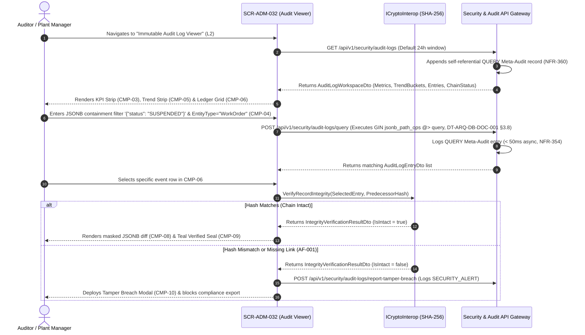

# SCR-ADM-032: Immutable SHA-256 Audit Log Viewer, Forensic Diff Inspector, and Chain Integrity Verifier

## 1. Purpose and Operational Context

* **View Objective:** Centralized Level 2 forensic query, state-diff inspection, and cryptographic hash-chain verification console over the immutable audit trail (`adm.audit_logs`). Enforces strict Write-Once-Read-Many (WORM) append-only immutability (`FR-347`), executes high-speed PostgreSQL `jsonb_path_ops` GIN containment queries (`@>` per [DT-ARQ-DB-DOC-001 §3.8](../../../architecture/DT-ARQ-DB-DOC-001.md#38-gin-indexing-for-jsonb-immutable-audit-adm-032)), visualizes activity trends and security anomalies (`FR-352`), renders secret-masked `PreviousState` vs. `NewState` JSON diffs (`FR-349`), mathematically verifies sequential SHA-256 hash continuity (`AuditLog.VerifyIntegrity()` per [DT-DM-DOC-002 §6.3](../../../domain-models/class/DT-DM-DOC-002.md#63-auditlog-entity) and [ADR-003](../../../architecture/adr/ADR-003.md)), logs all audit consultations via self-referential Meta-Auditing (`NFR-360`), and governs 7-year regulatory retention archival (`FR-350`, `FR-358`, `TR-001-FR-367`).
* **Primary Target Persona:** Lead Auditor and Plant Manager conducting forensic incident reconstructions, Root Cause Analysis (RCA), LOTO/SIMOPS safety compliance audits, and ISO 55001 / ISO 27001 / ISO 9001 regulatory reviews.
* **Secondary Personas:**
  * **System Administrator:** Monitors `SECURITY_ALERT` events (failed integrity checks, brute-force lockouts, RBAC Segregation of Duties blocks), verifies 7-year cold-archive partitions (`FR-350`), and exports signed forensic bundles for external analysis (`FR-353`, `NFR-359`).
* **Operational Context:** Deployed in corporate audit, HSEQ, and security operations offices on high-resolution desktop workstations and supervisory tablets. Per [DT-UI-NAV-DOC-001 §6.1](../../DT-UI-NAV-DOC-001.md#61-offline-operation-guard), live queries against the central audit repository require network connectivity, while exported forensic packages support standalone offline verification (`NFR-359`).
* **Mode of Operation:** Strictly Read-Only Forensic Supervision & Cryptographic Verification mode (`FR-347`). Direct DCS/SCADA process control manipulation is excluded, and zero mutation, update, or deletion controls exist for `adm.audit_logs` records (`TR-001-NFR-362`, `TR-001-NFR-365`).
* **Upstream & Downstream Navigation Invariants ([DT-UI-NAV-DOC-001 §5](../../DT-UI-NAV-DOC-001.md#5-transition-matrix-and-access-control-rbac)):**
  * **Upstream Continuity:** Accessed from the Web Portal Governance sidebar, from the RBAC Matrix ([SCR-ADM-013](SCR-ADM-013.md)) via `"Audit Modification"` (`L2` $\to$ `L2`), or from User Management ([SCR-ADM-014](SCR-ADM-014.md)).
  * **Downstream Transitions:** Provides deep-link entity inspection handoffs to the audited target record (such as [SCR-INV-005](../inv/SCR-INV-005.md) for `EquipmentUnit` mutations or [SCR-MTTO-026](../mtto/SCR-MTTO-026.md) for RIME `ADJUST` calibrations) and exports standalone signed `CSV` / `JSON` audit packages (`FR-353`).

---

## 2. Visual Artifact


> *Note: Production UI prototype capture illustrating the Immutable SHA-256 Audit Log Viewer desktop workstation layout, collapsible navigation sidebar, 5-card cryptographic chain integrity and retention KPI strip, temporal activity trend histogram, multi-criteria and JSONB containment filter bar, virtualized append-only audit ledger grid, persistent right dock with side-by-side secret-masked JSON diff inspector, SHA-256 hash-chain proof card, and sticky verification footer.*

---

## 3. Functional Component Inventory

> The base grid, typography, neutral palettes, and minimal tactile contact areas are inherited from [DT-UI-DS-DOC-001](../../DT-UI-DS-DOC-001.md). This inventory defines the canonical components present on the screen, their design tokens, and their architectural scope. Interaction rules and geometric algorithms are specified in Section 5; responsive container adaptations are governed by Section 8.

1. **`CMP-01`: Web Portal Shell & Sidebar**
   - **Visual Role:** Collapsible navigation sidebar hosting global modules, module hierarchy, and route markers.
   - **Design Tokens:**
     - Surface: `--dt-color-surface-base`
     - Border: `--dt-color-border-subtle`
     - Width: `--dt-layout-sidebar-width-expanded` (Desktop) / `--dt-layout-sidebar-width-collapsed` (Tablet Landscape)
   - **Architectural Scope:** Hosts global module navigation per [DT-UI-NAV-DOC-001](../../DT-UI-NAV-DOC-001.md), highlighting "Immutable SHA-256 Audit" under Governance & Security. Responsive widths in Section 8.

2. **`CMP-02`: Forensic Audit Header, Chain Verifier & Export Bar**
   - **Visual Role:** Sticky top header hosting breadcrumbs, Meta-Audit active recording pill (`NFR-360`), `[Verify Chain Integrity]` primary trigger (`FR-351`), `[Export Forensic Package]` dropdown (`FR-353`, `NFR-359`), and operator session badge.
   - **Design Tokens:**
     - Surface: `--dt-color-surface-card`
     - Border: `--dt-color-border-subtle`
     - Elevation: `--dt-z-header-sticky`
     - Primary Button: `--dt-color-state-info`
   - **Architectural Scope:** Triggers on-demand cryptographic hash-chain verification (`AuditLog.VerifyIntegrity()`) across the filtered range and exports signed compliance packages (`CSV` / `JSON`). Detailed in §5.1 and §5.3.

3. **`CMP-03`: Chain Integrity, Security Alert & Retention KPI Strip**
   - **Visual Role:** 5-card interactive summary strip displaying `Total Chained Entries`, `Hash-Chain Continuity Status` (`GENESIS -> HEAD VERIFIED` or `TAMPER BREACH`), `Security Alerts` (`SECURITY_ALERT`), `Critical Overrides & Adjustments` (`ADJUST`), and `7-Year Retention & Archive Status` (`FR-350`, `FR-358`).
   - **Design Tokens:**
     - Surface: `--dt-color-surface-card`
     - Border: `--dt-color-border-subtle`
     - Radius: `--dt-radius-md`
     - Active Filter Ring: `--dt-color-state-info`
     - Verified Seal Accent: `--dt-color-state-success`
     - Breach Alert Accent: `--dt-color-alarm-critical`
   - **Architectural Scope:** Acts as a one-click category filter and surfaces immediate tamper-evident chain health (`FR-351`, `TR-001-FR-367`). Detailed in §5.1.

4. **`CMP-04`: Multi-Criteria & JSONB Containment Filter Toolbar (`FR-348`)**
   - **Visual Role:** Flat toolbar hosting UTC `DateFrom` / `DateTo` pickers, `AuditActionType` selector (`CREATE`, `UPDATE`, `DELETE`, `QUERY`, `ADJUST`, `SECURITY_ALERT`), `EntityType` & `EntityId` input, `Operator` / `IpAddress` filter, and structured `JSONB` key-value containment query input (`e.g., {"status": "SUSPENDED"}`).
   - **Design Tokens:**
     - Surface: `--dt-color-surface-base`
     - Controls: `--dt-color-surface-card`
     - Border: `--dt-color-border-subtle`
     - Control Height: `--dt-control-height-sm` (Desktop) / `--dt-touch-target-mobile` (Tablet)
     - Monospace Query Input: `--dt-font-mono-data`
     - Radius: `--dt-radius-sm`
   - **Architectural Scope:** Executes sub-second GIN-indexed `jsonb_path_ops` containment (`@>`) and B-Tree UUIDv7 range queries ([DT-ARQ-DB-DOC-001 §3.8](../../../architecture/DT-ARQ-DB-DOC-001.md#38-gin-indexing-for-jsonb-immutable-audit-adm-032), `NFR-355`, `NFR-356`). Detailed in §5.1 and §5.2.

5. **`CMP-05`: Activity Trend & Anomaly Detection Strip (`FR-352`)**
   - **Visual Role:** Compact HPHMI monochrome histogram strip positioned above the ledger grid visualizing audit event density over time and highlighting anomalous spike intervals or `SECURITY_ALERT` bursts.
   - **Design Tokens:**
     - Surface: `--dt-color-surface-card`
     - Border: `--dt-color-border-subtle`
     - Normal Bar Fill: `--dt-color-border-panel`
     - Anomaly Spike Fill: `--dt-color-alarm-warning` / `--dt-color-alarm-critical`
   - **Architectural Scope:** Satisfies [FR-352](../../../requirements/user-stories/adm/ADM-032.md#functional-requirements-fr); clicking any time bucket narrows `CMP-04` and `CMP-06` to that exact interval. Detailed in §5.2.

6. **`CMP-06`: Virtualized Chronological Audit Ledger Grid**
   - **Visual Role:** Virtualized WORM append-only table rendering `TimestampUtc` (monospace UTC), `AuditActionType` badge (`CMP-07`), `EntityType` & `EntityId`, `OperatorBadgeCode`, `IpAddress`, chained hash link (`PreviousHash[0..8] -> IntegrityHash[0..8]`), and chain verification glyph.
   - **Design Tokens:**
     - Header Surface: `--dt-color-surface-base`
     - Row Surface: `--dt-color-surface-card`
     - Border: `--dt-color-border-subtle`
     - Row Height: `--dt-layout-table-row-height`
     - Selected Row Indicator: `--dt-color-state-info`
     - Monospace Data: `--dt-font-mono-data`
   - **Architectural Scope:** Core immutable ledger table (`adm.audit_logs`). Strictly omits edit/delete row actions (`FR-347`). Clicking any row inspects the transaction in `CMP-08`. Detailed in §5.2.

7. **`CMP-07`: Audit Event Type & Chain Integrity Badges**
   - **Visual Role:** Morphological capsule pills (`--dt-radius-full`) encoding `AuditActionType` severity and cryptographic chain verification state.
   - **Design Tokens:**
     - Routine (`CREATE`, `UPDATE`, `QUERY`): neutral monospace text (`--dt-color-text-body`, `--dt-color-text-muted`)
     - Elevated (`ADJUST`, `DELETE`): `--dt-color-alarm-warning` (`#icon-warning`)
     - Critical (`SECURITY_ALERT`, `CHAIN_BROKEN`): `--dt-color-alarm-critical` (`#icon-ban`)
     - Verified Seal (`CHAIN_VERIFIED`): `--dt-color-state-success` (`#icon-check`)
     - Radius: `--dt-radius-full`
   - **Architectural Scope:** Enforces 90/10 HPHMI and Anti-Badge-Inflation rules ([DT-UI-DS-DOC-001 §6.5.1](../../DT-UI-DS-DOC-001.md#651-morphological-differentiation-status-badges-vs-interactive-buttons)): routine `CREATE`, `UPDATE`, and `QUERY` rows remain neutral grayscale so `SECURITY_ALERT` and `ADJUST` overrides stand out pre-attentively. Detailed in §5.1.

8. **`CMP-08`: Forensic Transaction Inspector & Secret-Masked JSONB Diff Rail (`FR-349`)**
   - **Visual Role:** Master-detail inspector hosted inside dock `CMP-12` displaying full network traceability (`IpAddress`, `UserAgent`), a structured key-by-key `PreviousState` vs. `NewState` diff table with changed values highlighted and sensitive fields masked (`[REDACTED SECRET]`), and the Cryptographic Hash-Chain Proof Card (`CMP-09`).
   - **Design Tokens:**
     - Surface: `--dt-color-surface-card`
     - Diff Box Surface: `--dt-color-surface-base`
     - Border: `--dt-color-border-subtle`
     - Changed Field Highlight: `--dt-color-surface-raised`, `--dt-color-state-info`
     - Typography: `--dt-font-caption`, `--dt-font-mono-data`
   - **Architectural Scope:** Satisfies [FR-349](../../../requirements/user-stories/adm/ADM-032.md#functional-requirements-fr) and [NFR-357](../../../requirements/user-stories/adm/ADM-032.md#non-functional-requirements-nfr) without exposing raw `password_hash` or `token_hash` values. Detailed in §5.3.1.

9. **`CMP-09`: Cryptographic Hash-Chain Proof & Continuity Card (`FR-351`, `ADR-003`)**
   - **Visual Role:** Nested card inside `CMP-08` displaying the full 64-character `PreviousHash` (`GENESIS` on entry #1), the canonicalized payload input string, the recalculated 64-character SHA-256 `IntegrityHash`, the verification status pill (`VERIFIED` in Teal `--dt-color-state-success` or `TAMPER DETECTED` in Red `--dt-color-alarm-critical`), and `[< Inspect Predecessor]` / `[Inspect Successor >]` chain traversal buttons.
   - **Design Tokens:**
     - Surface: `--dt-color-surface-base`
     - Border: `--dt-color-border-subtle`, `--dt-color-state-success` (Verified), `--dt-color-alarm-critical` (Breach)
     - Hash Typography: `--dt-font-mono-data`
     - Radius: `--dt-radius-md`
   - **Architectural Scope:** Visualizes `AuditLog.VerifyIntegrity()` ([DT-DM-DOC-002 §6.3](../../../domain-models/class/DT-DM-DOC-002.md#63-auditlog-entity)). Detailed in §5.3.2.

10. **`CMP-10`: Tamper-Evident Chain Breach Alert Modal (`AF-001` / `FR-346` / `FR-351`)**
    - **Visual Role:** Centered high-salience security alert modal (`--dt-layout-modal-width`) deployed automatically if `VerifyIntegrity()` detects a hash mismatch or missing chronological link (`AF-001`).
    - **Design Tokens:**
      - Surface: `--dt-color-surface-card`
      - Header & Border: `--dt-color-alarm-critical`
      - Width & Max-Height: `--dt-layout-modal-width`, `--dt-layout-modal-max-height`
      - Radius: `--dt-radius-xl`
      - Elevation: `--dt-z-modal-fail-safe`
    - **Architectural Scope:** Identifies the exact compromised `AuditLogId` and expected vs. actual SHA-256 digests, locks standard compliance exports for the corrupted window, and dispatches an automated `SECURITY_ALERT` notification (`TR-003-NFR-380`). Detailed in §5.3.2.

11. **`CMP-11`: Meta-Audit & 7-Year Retention Lifecycle Pane (`FR-350`, `FR-358`, `NFR-360`)**
    - **Visual Role:** Second vertical tab pane hosted in dock `CMP-12` displaying self-referential `QUERY` Meta-Audit logs (`NFR-360`) alongside the 7-year regulatory retention and cold-archive partition ledger (`FR-350`, `FR-358`, `TR-001-FR-367`).
    - **Design Tokens:**
      - Surface: `--dt-color-surface-card`
      - Border: `--dt-color-border-subtle`
      - Typography: `--dt-font-mono-data`
    - **Architectural Scope:** Proves that auditor queries are themselves audited and that historical partitions remain cryptographically sealed across the 7-year ISO 55001 retention window. Detailed in §5.3.3.

12. **`CMP-12`: Persistent Workspace Dock & Vertical Tab Strip**
    - **Visual Role:** Right-hand workspace dock with vertical spine tabs (`FORENSIC DIFF` / `META-AUDIT & RETENTION`) hosting `CMP-08`/`CMP-09` and `CMP-11`.
    - **Design Tokens:**
      - Track Surface: `--dt-color-surface-base`
      - Panel Surface: `--dt-color-surface-card`
      - Active Tab: `--dt-color-surface-raised`
      - Width: `--dt-layout-drawer-width-desktop` / `--dt-layout-drawer-width-tablet`
      - Elevation: `--dt-shadow-panel`
      - Active Indicator: `--dt-color-state-info`
    - **Architectural Scope:** Preserves ledger scroll and selected row context across forensic diff and meta-audit tab switches (`CLS = 0`). Detailed in §5.2 and Section 8.

13. **`CMP-13`: Sticky Forensic Verification & Export Footer**
    - **Visual Role:** Permanent sticky bottom bar displaying the verified hash-chain range summary (`GENESIS .. HEAD`), `CLS = 0` chain integrity status slot, L2 navigation handoffs (`[< Back to RBAC Matrix]`, `[< Back to User Management]`), and `[Export Signed Audit Trail]` (`FR-353`, `NFR-359`).
    - **Design Tokens:**
      - Surface: `--dt-color-surface-card`
      - Border: `--dt-color-border-hairline`
      - Height: `--dt-layout-footer-height`
      - Elevation: `--dt-z-header-sticky`
      - Primary CTA: `--dt-color-state-info`
      - Secondary Button: `--dt-color-surface-btn-secondary`
    - **Architectural Scope:** Anchors chain verification status and govered compliance exports. Detailed in §5.3.3.

---

## 4. Screen State Catalog

1. **Forensic Ledger Inspection Mode (Default — Verified Chain)**
   - **Activation Condition:** Auditor, Plant Manager, or Administrator navigates to `SCR-ADM-032`.
   - **Visual Modification:** Neutral grayscale surfaces (`--dt-color-surface-card`). Ledger grid `CMP-06` displays chronological records sorted descending by `TimestampUtc` (`UUIDv7` time-ordered). KPI card 2 in `CMP-03` and footer slot in `CMP-13` display a Teal documentary confirmation badge (`[CHAIN INTEGRITY VERIFIED]`, `--dt-color-state-success`, `#icon-check`). Right dock `CMP-12` displays the selected record's secret-masked `JSONB` diff (`CMP-08`) and hash proof (`CMP-09`).

2. **Executing Indexed Query & Recording Meta-Audit (`NFR-355`, `NFR-360`)**
   - **Activation Condition:** User applies multi-criteria or `JSONB` containment (`@>`) filters in `CMP-04`.
   - **Visual Modification:** Skeleton shimmer (`--dt-color-surface-raised`) across `CMP-06` rows while the backend executes the GIN-indexed query and appends a self-referential `QUERY` Meta-Audit record (`CMP-02` indicator pulses briefly: `Meta-Audit Logged`).

3. **Inspecting Elevated Calibration or Security Alert (`ADJUST` / `SECURITY_ALERT`)**
   - **Activation Condition:** Auditor selects an `ADJUST` (RIME priority calibration, inventory reconciliation, or LOTO override) or `SECURITY_ALERT` (SoD block, brute-force lockout, or file hash mismatch) row in `CMP-06`.
   - **Visual Modification:** `CMP-08` highlights modified fields in the `PreviousState` $\to$ `NewState` diff table and surfaces the associated operator justification and client IP/User-Agent metadata.

4. **Verifying Cryptographic Hash-Chain Window (`FR-351`)**
   - **Activation Condition:** Auditor clicks `[Verify Chain Integrity]` in `CMP-02` or inspects a record in `CMP-09`.
   - **Visual Modification:** `CMP-09` displays the live SHA-256 recalculation across `PreviousHash` and current payload, rendering `[#icon-check CRYPTOGRAPHIC INTEGRITY VERIFIED: UNALTERED RECORD]` in `--dt-color-state-success`.

5. **Tamper-Evident Chain Breach Detected (`AF-001` / `FR-346` / `FR-351`)**
   - **Activation Condition:** `AuditLog.VerifyIntegrity()` detects a SHA-256 mismatch (`RecalculatedHash != IntegrityHash`) or a broken `PreviousHash` link indicating unauthorized external database modification or row deletion.
   - **Visual Modification:** Compromised row in `CMP-06` and proof card `CMP-09` highlight in critical red (`--dt-color-alarm-critical`, `#icon-ban`). Modal `CMP-10` deploys at `--dt-z-modal-fail-safe`, locking standard compliance exports (`[Export Signed Audit Trail]` disabled) and displaying: *"CRITICAL SECURITY ALERT: Inconsistency detected in the cryptographic audit chain at Record ID {id}. Possible external data tampering."*

6. **Empty Query Result (`AF-003`)**
   - **Activation Condition:** No audit entries match the filter criteria in `CMP-04`.
   - **Visual Modification:** `CMP-06` renders a centered neutral empty state: *"No audit transactions found in the selected filter range"*, while still recording the `QUERY` Meta-Audit entry (`NFR-360`).

---

## 5. Interaction Rules and Data Flow

### 5.1. Initial Load, GIN `@>` Querying & Meta-Audit Lifecycle



1. **Controlled Audit Event Vocabulary (`FR-345`, [DT-DM-DOC-001 §4.36](../../../domain-models/class/DT-DM-DOC-001.md#436-auditlogactiontype)):**
   * Every row in `adm.audit_logs` is classified under one of the 6 canonical `AuditActionType` enum literals: `CREATE`, `UPDATE`, `DELETE`, `QUERY`, `ADJUST`, and `SECURITY_ALERT`.
2. **PostgreSQL GIN `jsonb_path_ops` Containment Queries (`FR-348`, `NFR-355`, `NFR-356`, [DT-ARQ-DB-DOC-001 §3.8](../../../architecture/DT-ARQ-DB-DOC-001.md#38-gin-indexing-for-jsonb-immutable-audit-adm-032)):**
   * Searches over `previous_state` and `new_state` (`JSONB`) execute using the native PostgreSQL containment operator (`@>`) against `jsonb_path_ops` GIN indexes, combined with chronologically ordered `UUIDv7` primary keys ([ADR-005](../../../architecture/adr/ADR-005.md)) to guarantee sub-second query performance across multi-year, multi-million-row ledgers.

---

### 5.2. Forensic Ergonomics & Secret Masking

1. **Virtualized WORM Grid & Predecessor/Successor Traversal (`CMP-06`, `CMP-09`):**
   * Uses `Virtualize<AuditLogEntryDto>` with fixed row height (`--dt-layout-table-row-height`).
   * In `CMP-09`, clicking `[< Inspect Predecessor]` or `[Inspect Successor >]` walks backward or forward along the `PreviousHash` $\leftrightarrow$ `IntegrityHash` chain, allowing the Auditor to trace an incident chronologically step-by-step.
2. **Automatic Secret Redaction in JSONB Diffs (`CMP-08`, `FR-349`, `NFR-357`):**
   * Before rendering `PreviousState` and `NewState` payloads, the presentation parser redacts any sensitive key matching `(password_hash|token_hash|secret|private_key|signature_key)` to `[REDACTED SECRET]`, preventing credential hash exposure during screen sharing or audit exports.

---

### 5.3. Domain Workflows & Cryptographic Chain Invariants

#### 5.3.1. Asynchronous Non-Blocking Capture & Strict WORM Immutability (`FR-347`, `NFR-354`, `TR-001`)
1. **Sub-50ms Non-Blocking Ingestion (`NFR-354`, `TR-001-NFR-366`):** Operational audit records are committed within the shared `NpgsqlConnection` transaction (`DT-ARQ-DB-DOC-001 §3.9`) in $< 50\text{ms}$ (95th percentile) without degrading plant workflows.
2. **Database & Application WORM Enforcement (`FR-347`, `AF-002`, `TR-001-NFR-362`, `TR-001-NFR-365`):** `adm.audit_logs` revokes SQL `UPDATE` and `DELETE` privileges from all application database roles (`DT-DM-DOC-001 §2.6`). Any API attempt to mutate or delete an audit row is rejected and recorded as a `SECURITY_ALERT`.

#### 5.3.2. Chained SHA-256 Verification & Tamper-Evident Breach Protocol (`FR-346`, `FR-351`, `AF-001`, `ADR-003`)
1. **Hash-Chain Mathematical Contract (`AuditLog.VerifyIntegrity()`, [DT-DM-DOC-002 §6.3](../../../domain-models/class/DT-DM-DOC-002.md#63-auditlog-entity)):**
   For chronological record $k$ ($k \ge 1$, where $H_0 = \text{"GENESIS"}$ per `DT-ERD-DOC-001 §3.5.1`):
   $$H_k = \text{SHA-256}\left(H_{k-1} \parallel \text{Id}_k \parallel \text{UserId}_k \parallel \text{EventType}_k \parallel \text{EntityType}_k \parallel \text{EntityId}_k \parallel \text{TimestampUtc}_k \parallel \text{CanonicalJson}(\text{PrevState}_k) \parallel \text{CanonicalJson}(\text{NewState}_k)\right)$$
2. **Tamper Breach Quarantine (`AF-001`):** If $H_k^{\text{recalculated}} \ne H_k^{\text{stored}}$ or $H_{k-1}^{\text{linked}} \ne H_{k-1}^{\text{stored}}$, `CMP-10` immediately blocks export of the affected range, highlights the exact broken link, and dispatches a `SECURITY_ALERT` notification (`TR-003-NFR-380`).

#### 5.3.3. Self-Referential Meta-Auditing & 7-Year Regulatory Retention (`FR-350`, `FR-353`, `FR-358`, `NFR-359`, `NFR-360`)
1. **Meta-Audit Logging (`NFR-360`, `TR-001-FR-361`):** Every query executed in `CMP-04` and every forensic export triggered in `CMP-02`/`CMP-13` automatically appends an `AuditActionType.QUERY` record to `adm.audit_logs` capturing the querying Auditor's `UserId`, `IpAddress`, `UserAgent`, and filter parameters in `new_state`.
2. **7-Year Retention & Cold-Archive Lifecycle (`FR-350`, `FR-358`, `TR-001-FR-367`):** `CMP-11` displays the status of time-partitioned audit tables retained for a minimum of **7 years** (ISO 55000 requirement for critical industrial assets), verifying the anchor hashes of cold-archived partitions so chain continuity remains unbroken across archived boundaries.
3. **Portable Forensic Extraction (`FR-353`, `NFR-359`):** Clicking `[Export Signed Audit Trail]` generates a self-contained `JSON` or `CSV` bundle accompanied by a detached SHA-256 manifest so external auditors can independently verify chain continuity offline (`NFR-359`).

---

## 6. Industrial and Safety Considerations

* **Forensic Reconstruction of Safety & LOTO Incidents (ISO 45001 / OSHA 1910.147 / ISO 55001):** In the event of an industrial incident, regulatory investigators require mathematical proof that LOTO Try-Out attestations ([SCR-VIS-011](../vis/SCR-VIS-011.md)), SIMOPS permit approvals ([SCR-VIS-008](../vis/SCR-VIS-008.md)), and Work Order closures ([SCR-MTTO-002](../mtto/SCR-MTTO-002.md)) were not retroactively altered. The `GENESIS` $\to$ `HEAD` SHA-256 hash chain (`CMP-09`) provides tamper-evident non-repudiation.
* **Separation of Forensic Audit from Operational Telemetry (`UC-ADM-032 §1`):** High-frequency SCADA sensor streams (`vis.telemetry_signals`) and routine stock balances are excluded from `adm.audit_logs` to prevent log saturation and preserve sub-second forensic query clarity (`NFR-355`).
* **HPHMI Grayscale & Anti-Badge-Inflation Governance ([TR-011](../../../requirements/common/TR-011.md)):** Per [DT-UI-DS-DOC-001 §1](../../DT-UI-DS-DOC-001.md#1-scope) and [§6.5](../../DT-UI-DS-DOC-001.md#65-status-badge-counter-discipline-anti-badge-inflation-principle), routine `CREATE`, `UPDATE`, and `QUERY` rows render in neutral grayscale without chromatic pills, reserving `--dt-color-alarm-critical` (`SECURITY_ALERT`, `AF-001` chain tamper breach), `--dt-color-alarm-warning` (`ADJUST` overrides, `DELETE` soft-delete events), and `--dt-color-state-success` (verified SHA-256 chain seals) strictly for high-salience governance states.

---

## 7. Frontend Component Contract (Blazor / Razor)

### 7.1. Component Hierarchy & File Mapping

```text
Pages/Governance/
└── ImmutableAuditLogViewerPage.razor                  # Root View (SCR-ADM-032)
    ├── PortalSidebarNav.razor                         # CMP-01: Collapsible desktop navigation sidebar
    ├── AuditLogHeaderBar.razor                        # CMP-02: Breadcrumbs, [Verify Chain], export & Meta-Audit pill
    ├── AuditSummaryCards.razor                        # CMP-03: 5-card chain integrity, alerts & 7-yr retention KPI strip
    ├── AuditFilterToolbar.razor                       # CMP-04: Date range, event type, entity & JSONB @> filter bar
    ├── AuditActivityTrendStrip.razor                  # CMP-05: Temporal activity histogram & anomaly spike bar (FR-352)
    ├── AuditLogLedgerGrid.razor                       # CMP-06: Virtualized WORM chronological audit ledger table
    │   └── AuditEventBadge.razor                      # CMP-07: Redundant event type & hash verification status pill
    ├── AuditWorkspaceDock.razor                       # CMP-12: Persistent right dock with vertical tab spine
    │   ├── AuditRecordInspectionRail.razor            # CMP-08: Network metadata & secret-masked JSONB diff viewer
    │   │   └── HashChainProofCard.razor               # CMP-09: 64-char SHA-256 proof & chain traversal card
    │   └── MetaAuditAndRetentionPane.razor            # CMP-11: QUERY Meta-Audit log & 7-yr archive status pane
    ├── ChainTamperBreachModal.razor                   # CMP-10: AF-001 Critical hash-chain tamper alert modal
    └── AuditActionFooter.razor                        # CMP-13: Sticky verification summary, status slot & L2 handoffs
```

---

### 7.2. Physical Component Parameters & DTO Contracts (.NET 10 / C# 14)

#### 7.2.1. `ImmutableAuditLogViewerPage.razor` (Root View)

```csharp
[Parameter, SupplyParameterFromQuery(Name = "entityType")]
public string? InitialEntityTypeFilter { get; set; }

[Parameter, SupplyParameterFromQuery(Name = "entityId")]
public Guid? InitialEntityIdFilter { get; set; }

[Parameter, SupplyParameterFromQuery(Name = "eventType")]
public AuditActionType? InitialEventTypeFilter { get; set; }
```

#### 7.2.2. Subcomponent Parameter Contracts (`CMP-01` to `CMP-13`)

```csharp
// CMP-01: PortalSidebarNav.razor
[Parameter]
public bool IsCollapsed { get; set; }

[Parameter]
public bool IsMobileDrawerOpen { get; set; }

[Parameter]
public string ActiveRouteCode { get; set; } = "SCR-ADM-032";

[Parameter]
public EventCallback<bool> OnCollapseToggled { get; set; }

// CMP-02: AuditLogHeaderBar.razor
[Parameter]
public required string OperatorBadgeCode { get; set; }

[Parameter]
public required string OperatorDisplayName { get; set; }

[Parameter]
public bool IsVerifyingChain { get; set; }

[Parameter]
public bool IsExportBlockedByTamper { get; set; }

[Parameter]
public EventCallback OnVerifyFullChainRequested { get; set; }

[Parameter]
public EventCallback<AuditExportFormat> OnExportRequested { get; set; }

[Parameter]
public EventCallback OnToggleMobileNavigation { get; set; }

// CMP-03: AuditSummaryCards.razor
[Parameter]
public required AuditLogSummaryMetricsDto Metrics { get; set; }

[Parameter]
public AuditKpiFilterCategory? ActiveCategoryFilter { get; set; }

[Parameter]
public EventCallback<AuditKpiFilterCategory?> OnCategoryFilterSelected { get; set; }

// CMP-04: AuditFilterToolbar.razor
[Parameter]
public required AuditLogQueryFilterDto Filter { get; set; }

[Parameter]
public EventCallback<AuditLogQueryFilterDto> OnFilterExecuted { get; set; }

[Parameter]
public EventCallback OnResetFiltersClicked { get; set; }

// CMP-05: AuditActivityTrendStrip.razor (FR-352)
[Parameter]
public required IReadOnlyList<AuditActivityBucketDto> TrendBuckets { get; set; }

[Parameter]
public EventCallback<(DateTimeOffset StartUtc, DateTimeOffset EndUtc)> OnTimeBucketSelected { get; set; }

// CMP-06: AuditLogLedgerGrid.razor
[Parameter]
public required IReadOnlyList<AuditLogEntryDto> Entries { get; set; }

[Parameter]
public Guid? SelectedAuditLogId { get; set; }

[Parameter]
public EventCallback<AuditLogEntryDto> OnEntrySelected { get; set; }

// CMP-07: AuditEventBadge.razor
[Parameter]
public required AuditActionType EventType { get; set; }

[Parameter]
public required ChainIntegrityStatus IntegrityStatus { get; set; }

// CMP-12: AuditWorkspaceDock.razor
[Parameter]
public bool IsOpen { get; set; }

[Parameter]
public AuditDockTab ActiveTab { get; set; } = AuditDockTab.FORENSIC_DIFF;

[Parameter]
public EventCallback<AuditDockTab> OnTabChanged { get; set; }

[Parameter]
public EventCallback OnClosed { get; set; }

// CMP-08: AuditRecordInspectionRail.razor (FR-349)
[Parameter]
public AuditLogDetailDto? SelectedRecord { get; set; }

[Parameter]
public EventCallback<Guid> OnNavigateToPredecessor { get; set; }

[Parameter]
public EventCallback<Guid> OnNavigateToSuccessor { get; set; }

// CMP-09: HashChainProofCard.razor (FR-351, ADR-003)
[Parameter]
public required AuditLogDetailDto Record { get; set; }

[Parameter]
public EventCallback<Guid> OnInspectPredecessorClicked { get; set; }

[Parameter]
public EventCallback<Guid> OnInspectSuccessorClicked { get; set; }

// CMP-10: ChainTamperBreachModal.razor (AF-001)
[Parameter]
public bool IsVisible { get; set; }

[Parameter]
public ChainTamperBreachDetailsDto? BreachDetails { get; set; }

[Parameter]
public EventCallback<Guid> OnInspectCompromisedRecord { get; set; }

[Parameter]
public EventCallback OnCloseRequested { get; set; }

// CMP-11: MetaAuditAndRetentionPane.razor (FR-350, FR-358, NFR-360)
[Parameter]
public required IReadOnlyList<AuditLogEntryDto> RecentMetaAuditQueries { get; set; }

[Parameter]
public required IReadOnlyList<AuditRetentionPartitionDto> RetentionPartitions { get; set; }

// CMP-13: AuditActionFooter.razor
[Parameter]
public required ChainIntegrityStatus OverallChainStatus { get; set; }

[Parameter]
public required int VerifiedRecordsCount { get; set; }

[Parameter]
public required string HeadIntegrityHash { get; set; }

[Parameter]
public bool IsExportBlockedByTamper { get; set; }

[Parameter]
public EventCallback OnNavigateToRbacMatrix { get; set; }

[Parameter]
public EventCallback OnNavigateToUserManagement { get; set; }

[Parameter]
public EventCallback<AuditExportFormat> OnExportVerifiedTrailClicked { get; set; }
```

#### 7.2.3. Data Transfer Objects (DTOs) and Enums

```csharp
/// <summary>
/// Controlled audit operation type vocabulary per DT-DM-DOC-001 §4.36 & DT-ERD-DOC-001 §3.5.1.
/// </summary>
public enum AuditActionType
{
    CREATE,
    UPDATE,
    DELETE,
    QUERY,
    ADJUST,
    SECURITY_ALERT
}

public enum ChainIntegrityStatus
{
    VERIFIED_INTACT,
    VERIFYING_IN_PROGRESS,
    TAMPER_BREACH_DETECTED
}

public enum AuditKpiFilterCategory
{
    ALL_RECORDS,
    CHAIN_VERIFIED,
    SECURITY_ALERTS,
    CRITICAL_ADJUSTMENTS,
    RETENTION_ARCHIVES
}

public enum AuditDockTab
{
    FORENSIC_DIFF,
    META_AUDIT_RETENTION
}

public enum AuditExportFormat
{
    SIGNED_FORENSIC_JSON,
    SIGNED_FORENSIC_CSV
}

public record AuditLogSummaryMetricsDto
{
    public required long TotalChainedRecordsCount { get; init; }
    public required ChainIntegrityStatus OverallChainStatus { get; init; }
    public required int SecurityAlertsCount { get; init; }
    public required int CriticalAdjustmentsCount { get; init; }
    public required int ActiveRetentionYears { get; init; } = 7;
    public required int SealedArchivePartitionsCount { get; init; }
}

public record AuditLogQueryFilterDto
{
    public DateTimeOffset? DateFromUtc { get; init; }
    public DateTimeOffset? DateToUtc { get; init; }
    public AuditActionType? EventType { get; init; }
    public string? EntityType { get; init; }
    public Guid? EntityId { get; init; }
    public string? OperatorUsername { get; init; }
    public string? IpAddress { get; init; }
    public string? JsonbContainmentExpression { get; init; }
}

public record AuditActivityBucketDto
{
    public required DateTimeOffset BucketStartUtc { get; init; }
    public required DateTimeOffset BucketEndUtc { get; init; }
    public required int TotalEventsCount { get; init; }
    public required int SecurityAlertsCount { get; init; }
    public required bool IsAnomalySpike { get; init; }
}

public record AuditLogEntryDto
{
    public required Guid Id { get; init; }
    public Guid? UserId { get; init; }
    public required string OperatorBadgeCode { get; init; }
    public required AuditActionType EventType { get; init; }
    public required string EntityType { get; init; }
    public required Guid EntityId { get; init; }
    public required DateTimeOffset TimestampUtc { get; init; }
    public string? IpAddress { get; init; }
    public required string PreviousHash { get; init; }
    public required string IntegrityHash { get; init; }
    public required ChainIntegrityStatus IntegrityStatus { get; init; }
}

public record AuditStatePropertyDiffDto
{
    public required string PropertyPath { get; init; }
    public string? PreviousValueMasked { get; init; }
    public string? NewValueMasked { get; init; }
    public required bool IsModified { get; init; }
    public required bool IsRedactedSecret { get; init; }
}

public record AuditLogDetailDto
{
    public required Guid Id { get; init; }
    public Guid? UserId { get; init; }
    public required string OperatorBadgeCode { get; init; }
    public required string OperatorFullName { get; init; }
    public required AuditActionType EventType { get; init; }
    public required string EntityType { get; init; }
    public required Guid EntityId { get; init; }
    public required DateTimeOffset TimestampUtc { get; init; }
    public string? IpAddress { get; init; }
    public string? UserAgent { get; init; }
    public IReadOnlyList<AuditStatePropertyDiffDto> StateDiffs { get; init; } = [];
    public required string PreviousHash { get; init; }
    public required string IntegrityHash { get; init; }
    public required string RecalculatedHash { get; init; }
    public required ChainIntegrityStatus IntegrityStatus { get; init; }
    public Guid? PredecessorAuditLogId { get; init; }
    public Guid? SuccessorAuditLogId { get; init; }
}

public record ChainTamperBreachDetailsDto
{
    public required Guid CompromisedAuditLogId { get; init; }
    public required DateTimeOffset DetectedAtUtc { get; init; }
    public required string EntityType { get; init; }
    public required Guid EntityId { get; init; }
    public required string StoredIntegrityHash { get; init; }
    public required string RecalculatedIntegrityHash { get; init; }
    public required string ExpectedPreviousHash { get; init; }
    public required string DiagnosticSummary { get; init; }
}

public record AuditRetentionPartitionDto
{
    public required string PartitionName { get; init; }
    public required DateOnly PeriodStart { get; init; }
    public required DateOnly PeriodEnd { get; init; }
    public required long RecordCount { get; init; }
    public required string PartitionAnchorHash { get; init; }
    public required bool IsColdArchived { get; init; }
    public required ChainIntegrityStatus IntegrityStatus { get; init; }
}
```

---

### 7.3. Client-Side DOM & Interop Bridge

1. **Web Worker SHA-256 Chain Verifier (`ICryptoInterop`):**
   * Executes client-side `AuditLog.VerifyIntegrity()` verification in a dedicated Web Worker across inspected audit records and exported forensic bundles (`FR-351`, `NFR-359`, `ADR-003`), preventing main-thread UI blocking during multi-record hash recalculations.
2. **Virtualized WORM Ledger Grid Interop (`IVirtualizationInterop`):**
   * Lazily renders visible rows in `CMP-06`, sustaining sub-second scroll responsiveness across large historical windows (`NFR-355`).

---

## 8. Layout and Responsive Adaptability

### 8.1. Desktop Workstation (`--dt-breakpoint-xl`)
* **Layout Organization:** Asymmetric 3-column workstation split ([DT-UI-DS-DOC-001 §2.3](../../DT-UI-DS-DOC-001.md#23-responsive-breakpoints-and-reference-frames)): left navigation sidebar `CMP-01` expanded at `--dt-layout-sidebar-width-expanded`, central forensic workspace hosting the 5 summary KPI cards `CMP-03`, multi-criteria & `JSONB` containment filter bar `CMP-04`, activity trend histogram `CMP-05`, and virtualized ledger grid `CMP-06`, paired with the persistent right workspace dock `CMP-12` sized by `--dt-layout-drawer-width-desktop` (`--dt-shadow-panel`). Breach modal `CMP-10` centers at `--dt-layout-modal-width-desktop` bounded by `--dt-layout-modal-max-height`. Sticky footer `CMP-13` (`--dt-layout-footer-height`) spans the bottom workspace.
* **Ergonomic Rules:** Optimized for mouse and keyboard navigation; dense ledger row height governed by `--dt-layout-table-row-height`; full 64-character monospace hash wrapping in `CMP-09`; zero horizontal layout shift (`CLS = 0`).

### 8.2. Industrial Tablet Landscape (`--dt-breakpoint-lg`)
* **Layout Organization:** Navigation sidebar `CMP-01` collapses to an icon-only rail sized by `--dt-layout-sidebar-width-collapsed`; workspace dock `CMP-12` operates as a slide-over lateral panel sized by `--dt-layout-drawer-width-tablet`; modal `CMP-10` sizes to `--dt-layout-modal-width-tablet`.
* **Ergonomic Rules:** Filter inputs and chain traversal buttons enforce `--dt-touch-target-mobile` hit areas; sticky footer `CMP-13` (`--dt-layout-footer-height`) remains permanently pinned.

### 8.3. Industrial Tablet Portrait (`--dt-breakpoint-md`)
* **Layout Organization:** Navigation sidebar `CMP-01` transitions to an off-canvas drawer; KPI summary cards `CMP-03` wrap into a multi-row grid; workspace dock `CMP-12` transitions to an adaptive **Bottom Sheet** initializing at `--dt-layout-bottom-sheet-height-initial` and expanding up to `--dt-layout-bottom-sheet-height-expanded` (`--dt-radius-2xl` upper curvature); ledger grid `CMP-06` prioritizes Timestamp, Event Type, Entity, Operator, and Integrity Status columns.
* **Ergonomic Rules:** Touch targets governed by `--dt-touch-target-mobile` with `--dt-space-2` separation; discrete single-tap toggling on the bottom-sheet handle ([DT-UI-DS-DOC-001 §6.3](../../DT-UI-DS-DOC-001.md#63-sliding-containers-pattern-bottom-sheets-and-drawers)).

---

## 9. Traceability and Requirements Matrix

| Requirement                                                                                  | Addressed in Component       | Verification & Implementation Mechanism                                                                                                                              |
| :------------------------------------------------------------------------------------------- | :--------------------------- | :------------------------------------------------------------------------------------------------------------------------------------------------------------------- |
| [FR-345](../../../requirements/user-stories/adm/ADM-032.md#functional-requirements-fr)       | `CMP-06`, `CMP-08`           | Displays all critical operations (`CREATE`, `UPDATE`, `DELETE`, `QUERY`, `ADJUST`, `SECURITY_ALERT`) with UTC timestamp, operator identity, and before/after states. |
| [FR-346](../../../requirements/user-stories/adm/ADM-032.md#functional-requirements-fr)       | `CMP-03`, `CMP-09`, `CMP-10` | Integrates `AuditLog.VerifyIntegrity()` hash-chain monitoring to detect and quarantine unauthorized alterations (`AF-001`).                                          |
| [FR-347](../../../requirements/user-stories/adm/ADM-032.md#functional-requirements-fr)       | `CMP-06`, `CMP-08`           | Enforces strict WORM append-only immutability; zero edit or delete controls exist for any profile (`AF-002`).                                                        |
| [FR-348](../../../requirements/user-stories/adm/ADM-032.md#functional-requirements-fr)       | `CMP-04`, `CMP-05`           | Multi-criteria filtering by UTC date range, operator, IP address, `AuditActionType`, `EntityType`, `EntityId`, and `JSONB` `@>` containment.                         |
| [FR-349](../../../requirements/user-stories/adm/ADM-032.md#functional-requirements-fr)       | `CMP-02`, `CMP-08`, `CMP-13` | Structured side-by-side `PreviousState` vs. `NewState` diff viewer with secret masking and signed `CSV`/`JSON` export.                                               |
| [FR-350](../../../requirements/user-stories/adm/ADM-032.md#functional-requirements-fr)       | `CMP-03`, `CMP-11`           | Manages and visualizes time-partitioned cold archival of historical audit records while preserving anchor hash continuity.                                           |
| [FR-351](../../../requirements/user-stories/adm/ADM-032.md#functional-requirements-fr)       | `CMP-02`, `CMP-09`, `CMP-10` | Executes periodic and on-demand SHA-256 hash-chain validations, deploying `CMP-10` immediately upon any anomaly (`AF-001`).                                          |
| [FR-352](../../../requirements/user-stories/adm/ADM-032.md#functional-requirements-fr)       | `CMP-03`, `CMP-05`           | Activity trend histogram strip visualizing temporal event volume and highlighting unusual operational or security spikes.                                            |
| [FR-353](../../../requirements/user-stories/adm/ADM-032.md#functional-requirements-fr)       | `CMP-02`, `CMP-13`           | Exports verified audit trails in structured `CSV` and `JSON` formats with detached SHA-256 manifests for external compliance reviews.                                |
| [FR-358](../../../requirements/user-stories/adm/ADM-032.md#functional-requirements-fr)       | `CMP-03`, `CMP-11`           | Enforces the statutory 7-year regulatory retention window (`TR-001-FR-367`, ISO 55001 Clause 7.5) across active and archived partitions.                             |
| [NFR-354](../../../requirements/user-stories/adm/ADM-032.md#non-functional-requirements-nfr) | `CMP-06`                     | Audit ingestion executes in $< 50\text{ms}$ (`TR-001-NFR-366`) without blocking operational plant transactions.                                                      |
| [NFR-355](../../../requirements/user-stories/adm/ADM-032.md#non-functional-requirements-nfr) | `CMP-04`, `CMP-06`           | GIN `jsonb_path_ops` indexing (`@>`) and UI row virtualization guarantee sub-second query response across massive historical datasets.                               |
| [NFR-356](../../../requirements/user-stories/adm/ADM-032.md#non-functional-requirements-nfr) | `CMP-04`, `CMP-06`           | Chronologically ordered `UUIDv7` B-Tree keys and GIN JSONB indexes maximize storage integrity and retrieval speed (`DT-ARQ-DB-DOC-001 §3.8`).                        |
| [NFR-357](../../../requirements/user-stories/adm/ADM-032.md#non-functional-requirements-nfr) | `CMP-08`                     | Volume encryption at rest (`TR-002`) and automatic UI secret redaction (`[REDACTED SECRET]`) protect sensitive data in change logs.                                  |
| [NFR-359](../../../requirements/user-stories/adm/ADM-032.md#non-functional-requirements-nfr) | `CMP-02`, `CMP-13`           | Portable signed forensic export packages allow standalone offline verification in external audit environments.                                                       |
| [NFR-360](../../../requirements/user-stories/adm/ADM-032.md#non-functional-requirements-nfr) | `CMP-02`, `CMP-11`           | Self-referential Meta-Auditing automatically logs every audit query and export as an immutable `QUERY` record.                                                       |
| [TR-001](../../../requirements/common/TR-001.md)                                             | `CMP-01` to `CMP-13`         | Primary governance interface for the 7-year immutable SHA-256 hash-chained audit trail.                                                                              |
| [TR-002](../../../requirements/common/TR-002.md)                                             | `CMP-06`, `CMP-11`           | Encrypts active and archived audit log storage volumes at rest.                                                                                                      |
| [TR-003](../../../requirements/common/TR-003.md)                                             | `CMP-09`, `CMP-10`           | Verifies cryptographic SHA-256 payload digests and triggers immediate critical security alerts on mismatch (`AF-001`).                                               |
| [TR-005](../../../requirements/common/TR-005.md)                                             | `CMP-04`, `CMP-06`, `CMP-13` | Enforces TLS/HTTPS encryption in transit across all forensic queries and compliance exports.                                                                         |
| [TR-006](../../../requirements/common/TR-006.md)                                             | `CMP-01`, `CMP-02`           | Restricts audit log query and export access strictly to authorized `Auditor`, `Plant Manager`, and `System Administrator` roles.                                     |
| [TR-011](../../../requirements/common/TR-011.md)                                             | `CMP-01` to `CMP-13`         | ANSI/ISA-101 HPHMI 90/10 neutral grayscale ledger, zero badge inflation on routine events, and WCAG 2.1 AA redundant coding on tamper alerts.                        |
| [ADR-003](../../../architecture/adr/ADR-003.md)                                              | `CMP-08`, `CMP-09`, `CMP-10` | Chained SHA-256 hash verification (`GENESIS` sentinel $\to$ `PreviousHash` $\to$ `IntegrityHash`).                                                                   |
| [ADR-005](../../../architecture/adr/ADR-005.md)                                              | `CMP-06`                     | Time-sequential UUIDv7 primary keys preventing B-Tree page fragmentation in high-velocity audit tables.                                                              |