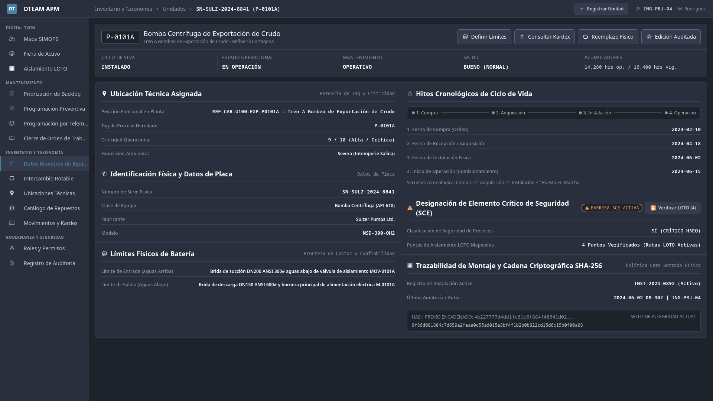
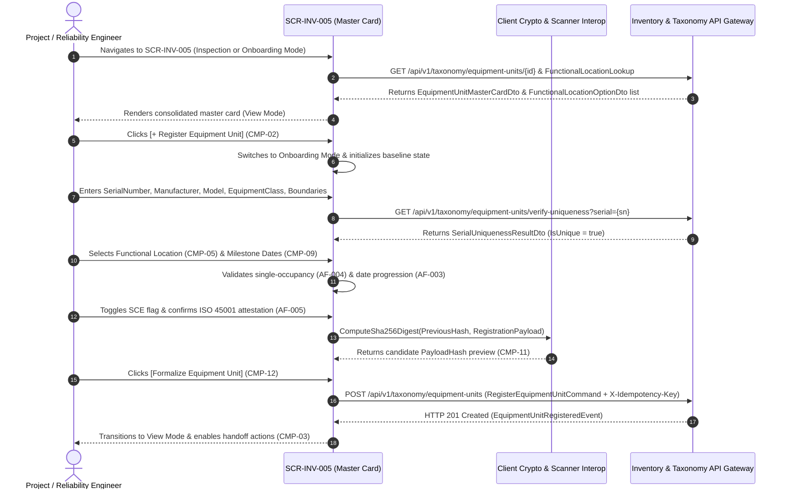

# SCR-INV-005: Equipment Master Data Card

## 1. Purpose and Operational Context

* **View Objective:** Consolidated ISO 14224 Level 6 Equipment Unit technical master card and digital onboarding interface. Supports two operational modalities within a unified view architecture:
  1. **Inspection & Audited Governance Mode (View Mode):** Presents the authoritative technical record of an existing physical machine, including nameplate identification, inherited Level 5 Functional Location tag and operational criticality (or warehouse custody when in storage), four-dimensional status indicators, Safety Critical Element (SCE) designation, physical battery limits, lifecycle chronological milestones, active installation timeline, and cryptographic audit history. Exposes contextual navigation handoffs for boundary definition ([SCR-MTTO-029](../mtto/SCR-MTTO-029.md)), spare parts Kardex ledger inspection ([SCR-INV-006](SCR-INV-006.md)), and rotable physical replacement ([SCR-INV-025](SCR-INV-025.md)).
  2. **Master Record Registration Mode (Onboarding Mode):** Enables formal onboarding of a new serialized Equipment Unit into the master catalog, enforcing global Serial Number uniqueness, hierarchical Level 5 Functional Location linkage with single-equipment occupancy verification, physical battery limit capture, ISO 45001 Safety Critical Element attestation, and four-milestone chronological progression validation within an atomic, cryptographically audited transaction.
* **Primary Target Persona:** Project Engineer and Reliability Engineer formalizing new machinery acquisitions, auditing nameplate parameters, verifying physical battery limits, and governing reliability master data in compliance with ISO 14224 and ISO 55001.
* **Secondary Personas:**
  * **Maintenance Planner:** Consults nameplate specifications, inherited criticality, and operating hour accumulators when structuring preventive plans.
  * **Maintenance Technician & Supervisor:** Inspects physical equipment specifications and battery limits on rugged field tablets via drill-down from the Asset Contextual Card ([SCR-VIS-033](../vis/SCR-VIS-033.md)) or initiates rotable equipment swaps ([SCR-INV-025](SCR-INV-025.md)).
  * **Warehouse Manager & Auditor:** Verifies rotable custody, acquisition dates, and cryptographic SHA-256 lifecycle hashes.
* **Operational Context:** Deployed in reliability engineering and project control offices on desktop workstations, and in industrial plant areas on rugged field tablets. Responsive layout adaptations across workstation and tablet viewports are governed in Section 8.
* **Mode of Operation:** Master Data Governance and Technical Inspection mode. Direct DCS/SCADA process control manipulation is strictly excluded. In View Mode, all static technical attributes remain locked against accidental mutation, permitting updates to non-critical attributes only through explicit audited workflows ([FR-120](../../../requirements/user-stories/inv/INV-005.md#functional-requirements-fr)).

---

## 2. Visual Artifact



> *Note: Production UI prototype capture illustrating the Equipment Master Data Card layout, collapsible navigation sidebar, contextual Level 3 handoff toolbar, four-dimensional status strip, inherited Functional Location linkage, nameplate and physical boundary cards, chronological milestone timeline validator, SCE safety governance card, and chained SHA-256 cryptographic audit strip.*

---

## 3. Functional Component Inventory

> The base grid, typography, neutral palettes, and minimal tactile contact areas are inherited from [DT-UI-DS-DOC-001](../../DT-UI-DS-DOC-001.md). This table defines the present components, their semantic tokens, and their architectural roles. Detailed interaction rules, layout constraints, and validation workflows are strictly specified in Section 5 and Section 8.

| ID | Control / Component | Visual Role / Content | Semantic Token | Architectural Role & Reference |
| :--- | :--- | :--- | :--- | :--- |
| `CMP-01` | Portal Shell & Navigation Sidebar | Collapsible module navigation sidebar and mobile off-canvas navigation drawer | Surface: `--dt-color-surface-card`<br>Border: `--dt-color-border-subtle` | Hosts global module navigation per [DT-UI-NAV-DOC-001](../../DT-UI-NAV-DOC-001.md), highlighting "Equipment Master Data" under the Inventory domain. Responsive behavior in §8. |
| `CMP-02` | Master Card Header & Mode Switcher | Integrated breadcrumb dropdown selector, mobile menu trigger, user session badge, and workstation action button | Surface: `--dt-color-surface-card`<br>Border: `--dt-color-border-subtle`<br>Typography: `--dt-font-h1` | Integrates the catalog unit selector directly into the active breadcrumb segment using a text-link popover menu pattern on the left, and hosts the onboarding mode switcher and operator session badge on the right. Detailed in §5.1, §5.2, and §8. |
| `CMP-03` | Contextual Handoff Action Toolbar | Level 3 cross-screen navigation action bar | Surface: `--dt-color-surface-card`<br>Border: `--dt-color-border-subtle`<br>Radius: `--dt-radius-md` | Exposes normative transitions defined in [DT-UI-NAV-DOC-001 §5](../../DT-UI-NAV-DOC-001.md#5-transition-matrix-and-access-control-rbac): `Define Boundaries` ([SCR-MTTO-029](../mtto/SCR-MTTO-029.md)), `Check Kardex` ([SCR-INV-006](SCR-INV-006.md)), `Physical Replacement` ([SCR-INV-025](SCR-INV-025.md)), and `Audited Edit`. Fused with `CMP-04` into a single unified top header sheet separated by a subtle internal divider. Detailed in §5.2. |
| `CMP-04` | Four-Dimensional Status Strip | Dynamic operational, lifecycle, maintenance, and health status indicators | Surface: `--dt-color-surface-card`<br>Typography: `--dt-font-caption`, `--dt-font-mono-data` | Renders the four orthogonal state dimensions defined in [DT-DM-DOC-001 §2.1](../../../domain-models/class/DT-DM-DOC-001.md#21-state-division-in-equipmentunit) (Lifecycle, Operational, Maintenance, and Health) alongside operating and surveillance hour accumulators inside the unified top header sheet. Detailed in §5.1 and §6. |
| `CMP-05` | Functional Location Linkage Card | Hierarchical Level 5 location selector, storage custody, and inherited process metadata | Surface: `--dt-color-surface-card`<br>Border: `--dt-color-border-subtle`<br>Typography: `--dt-font-mono-data` | Links the Level 6 Equipment Unit to an ISO 14224 Level 5 Functional Location or displays active warehouse custody when in storage. Displays inherited process Tag Number, operational criticality, environmental exposure, and single-occupancy validation state within the continuous datasheet layout. Detailed in §5.3.3. |
| `CMP-06` | Nameplate & Taxonomic Identity Card | Physical identification and ISO 14224 class specification fields | Surface: `--dt-color-surface-card`<br>Border: `--dt-color-border-subtle`<br>Text: `--dt-color-text-primary`, `--dt-color-text-muted` | Captures and displays Serial Number (with optical barcode scan trigger on tablet), Manufacturer, Model, and Equipment Class within the continuous engineering datasheet. Detailed in §5.3.1. |
| `CMP-07` | Physical Battery Limits Card | Upstream and downstream mechanical/electrical boundary definitions | Surface: `--dt-color-surface-card`<br>Border: `--dt-color-border-subtle`<br>Typography: `--dt-font-body-md` | Captures `BoundaryStart` (inlet/suction/supply interface) and `BoundaryEnd` (outlet/discharge/load interface) per ISO 14224 Section 6. Links to detailed sub-tree decomposition in [SCR-MTTO-029](../mtto/SCR-MTTO-029.md). Detailed in §5.3.1. |
| `CMP-08` | Safety Critical Element (SCE) Governance Card | ISO 45001 safety barrier badge and attestation banner | Surface: `--dt-color-surface-card`<br>Border: `--dt-color-border-subtle` | Controls the `IsSce` safety designation, LOTO isolation route verification handoff ([SCR-VIS-011](../vis/SCR-VIS-011.md)), and the ISO 45001 safety barrier attestation guard during registration and audited edits. Detailed in §4 and §5.3.4. |
| `CMP-09` | Chronological Milestones & Sequence Validator | Four-stage lifecycle date inputs, decommissioning metadata, and progression timeline | Surface: `--dt-color-surface-card`<br>Border: `--dt-color-border-subtle`<br>Timeline: `--dt-color-text-muted`, `--dt-color-border-panel` | Captures and visualizes `PurchaseDate`, `AcquisitionDate`, `InstallationDate`, and `OperationStartDate` along a four-stage lifecycle progression bar. Detailed in §5.3.2. |
| `CMP-10` | Validation & Conflict Alert Banner | Redundant Shape + Color inline diagnostic and confirmation notification banner | Warning: `--dt-color-alarm-warning`<br>Critical: `--dt-color-alarm-critical`<br>Success: `--dt-color-state-success`<br>Radius: `--dt-radius-md` | Displays WCAG 2.1 AA redundant notifications (`#icon-warning`, `#icon-ban`, `#icon-check` + border + text) for missing mandatory fields, duplicate Serial Number conflicts, chronological violations, occupied Functional Location conflicts, or documentary confirmations. Detailed in §5.3. |
| `CMP-11` | Installation History & Chained Audit Strip | Active mounting timeline and SHA-256 cryptographic seal | Surface: `--dt-color-surface-raised`<br>Border: `--dt-color-border-subtle`<br>Font: `--dt-font-mono-data` | Displays the active installation record (`InstallationId`, `InstalledAtUtc`) and the append-only SHA-256 cryptographic integrity hash chain. Detailed in §5.3.5. |
| `CMP-12` | Transactional Commit & Governance Footer | Sticky bottom submission bar for registration and audited updates | Surface: `--dt-color-surface-card`<br>Border: `--dt-color-border-panel`<br>Primary Action: `--dt-color-state-info` | Hosts `[Cancel]`, mandatory audit justification input (when updating non-critical attributes in Audited Edit mode), and `[Formalize Equipment Unit]` primary commit button. Detailed in §5.3.6. |

---

## 4. Screen State Matrix

| State | Visual Modification in the Interface | Activation Condition |
| :--- | :--- | :--- |
| **Inspection Mode (Default View)** | Neutral grayscale cards (`--dt-color-surface-card`) displaying consolidated master attributes as tabular Key-Left / Value-Right rows (`.meta-row`, matching [SCR-INV-025](SCR-INV-025.md)) in clean structured read-only text (`--dt-color-text-primary`, `--dt-color-text-muted`) without input-box borders or underline hairlines. Mandatory asterisks (`*`) are suppressed. Four-dimensional status rendered as structured bold text in `CMP-04`. SCE card (`CMP-08`) renders with neutral border and hides attestation checkboxes. Historical milestone timeline (`CMP-09`) renders in neutral steel gray. Contextual handoff toolbar (`CMP-03`) active. Footer `CMP-12` hidden. | User navigates to `SCR-INV-005` from [SCR-INV-027](SCR-INV-027.md), [SCR-VIS-033](../vis/SCR-VIS-033.md), or selects an existing equipment unit from the catalog selector. |
| **Onboarding Mode (Empty Form)** | Form inputs in `CMP-05`..`CMP-09` transition to editable controls (`--dt-color-surface-base`). Status preview in `CMP-04` displays baseline initial states mapped to `EquipmentLifecycleStatus.Commissioning`, `EquipmentOperationalStatus.Standby`, `EquipmentMaintenanceStatus.Operational`, and `EquipmentHealthStatus.Undetermined` (§7.2.3). Handoff toolbar `CMP-03` hidden. Footer `CMP-12` visible. | Project Engineer or Reliability Engineer clicks `[+ Register Equipment Unit]` (`CMP-02`). |
| **Audited Edit Mode (FR-120)** | Non-critical fields (`BoundaryStart`, `BoundaryEnd`, `OperationStartDate`, `IsSce`) unlock for editing while immutable identity fields (`SerialNumber`, `PurchaseDate`, `AcquisitionDate`) remain locked. Footer `CMP-12` displays mandatory audit justification input. | Authorized Engineer clicks `[Audited Edit]` in `CMP-03` during Inspection Mode. |
| **Incomplete Mandatory Data (AF-001)** | Omitted mandatory inputs highlight with amber border (`--dt-color-alarm-warning`) and `#icon-warning` glyph. `CMP-10` renders warning banner: *"ISO 14224 Validation Error: Mandatory technical identification and physical boundary attributes are required to formalize the equipment unit."* | Engineer attempts to submit registration or triggers validation with empty Serial Number, Manufacturer, Model, Equipment Class, or Battery Limits (`AF-001`). |
| **Duplicate Serial Number Conflict (AF-002)** | `SerialNumber` input highlights with critical red outline (`--dt-color-alarm-critical`) and `#icon-ban` glyph. `CMP-10` displays critical conflict alert (`#icon-ban`): *"Duplicate Equipment Conflict: An equipment unit with this Serial Number is already registered in the master catalog."* Commit button hard-disabled. | Debounced uniqueness check (`NFR-121`) or submission detects that the entered Serial Number already exists in the catalog (`AF-002`). |
| **Chronological Sequence Violation (AF-003)** | Out-of-order milestone date inputs highlight with amber outline (`--dt-color-alarm-warning`) and `#icon-warning` glyph. Timeline connector segment turns amber. `CMP-10` displays alert: *"Chronological Sequence Inconsistency: Milestone dates must follow the logical progression (Purchase <= Acquisition <= Installation <= Operation Start)."* | Any entered milestone date violates the monotonic progression invariant (`AF-003`, `FR-119`). |
| **Occupied Functional Location (AF-004)** | Functional Location selector (`CMP-05`) highlights with critical red border (`--dt-color-alarm-critical`) and `#icon-ban` glyph. `CMP-10` displays allocation conflict banner (`#icon-ban`) with direct action link to [SCR-INV-025](SCR-INV-025.md) (*"Dismount via Rotable Asset Swap"*). Commit button hard-disabled. | Engineer selects a Level 5 Functional Location that currently hosts an active mounted Equipment Unit (`AF-004`). |
| **SCE Safety Attestation Required (AF-005)** | Enabling the `IsSce` switch expands the ISO 45001 safety attestation panel inside `CMP-08` with amber caution border (`--dt-color-alarm-warning`) and mandatory acknowledgment checkbox. Commit button remains disabled until attested. | Engineer designates the equipment unit as a Safety Critical Element (`AF-005`). |
| **Documentary Confirmation (Success)** | `CMP-10` renders confirmation banner with Teal border (`--dt-color-state-success`) and checkmark glyph (`#icon-check`), displaying the committed Serial Number, linked Functional Location tag, and verified SHA-256 integrity hash. View transitions to Inspection Mode. | Atomic registration (`RegisterEquipmentUnitCommand`) or audited update (`UpdateEquipmentMasterRecordCommand`) commits in $< 2\text{s}$ (`NFR-124`). |
| **Diagnostic / Offline Read-Only** | Top diagnostic strip (`--dt-layout-banner-diagnostic-height`) renders Priority 4 muted slate banner (`--dt-color-surface-raised`, `--dt-color-text-muted`, `#icon-wifi-off`): *"Offline Mode — Inspecting Local Encrypted Master Catalog"*. Onboarding and mutation actions disabled. | Field tablet loses network connectivity while inspecting equipment master sheets ([DT-UI-NAV-DOC-001 §6.1](../../DT-UI-NAV-DOC-001.md#61-offline-operation-guard)). |

---

## 5. Interaction Rules and Data Flow

### 5.1. Initial Load & Lifecycle



1. **Dual-Context Initialization:**
   * When invoked with an existing `EquipmentUnitId` or `FunctionalLocationId` (from [SCR-INV-027](SCR-INV-027.md) or [SCR-VIS-033](../vis/SCR-VIS-033.md)), the view initializes in **Inspection Mode**, loading `EquipmentUnitMasterCardDto` (§7.2.3) alongside its active installation timeline and latest SHA-256 audit entry.
   * When invoked with `InitialMode = MasterCardMode.Create` (or when clicking `[+ Register Equipment Unit]`), the view transitions to **Onboarding Mode**, binding an empty `RegisterEquipmentUnitCommand` form context and previewing the initial four-dimensional commissioning states (`EquipmentLifecycleStatus`, `EquipmentOperationalStatus`, `EquipmentMaintenanceStatus`, `EquipmentHealthStatus` defined in §7.2.3).
2. **Four-Dimensional Status Split ([DT-DM-DOC-001 §2.1](../../../domain-models/class/DT-DM-DOC-001.md#21-state-division-in-equipmentunit)):**
   * Rather than overloading a single status field, `CMP-04` renders four orthogonal status indicators with single-line uppercase category headers (`CICLO DE VIDA`, `ESTADO OPERACIONAL`, `MANTENIMIENTO`, `SALUD`, `ACUMULADORES`).
   * To enforce Anti-Badge-Inflation (`BADGE-001`), normal baseline states (`EquipmentLifecycleStatus.Installed`, `EquipmentLifecycleStatus.InStorage`, `EquipmentLifecycleStatus.Decommissioned`, `EquipmentOperationalStatus.Up`, `EquipmentOperationalStatus.Standby`, `EquipmentMaintenanceStatus.Operational`, `EquipmentHealthStatus.Good`, and `EquipmentHealthStatus.Undetermined`) render as structured bold monospace text (`--dt-font-mono-data`, `--dt-color-text-primary`) without capsule borders.
   * Capsule pills with redundant glyphs and borders are reserved exclusively for anomalous, transitional, or degraded states (`EquipmentLifecycleStatus.Commissioning`, `EquipmentMaintenanceStatus.UnderMaintenance`, `EquipmentMaintenanceStatus.UnderTest`, `EquipmentHealthStatus.Fair`, `EquipmentHealthStatus.SeriousButStable`, and `EquipmentHealthStatus.Serious` binding to `--dt-color-alarm-warning`; `EquipmentOperationalStatus.Down`, `EquipmentHealthStatus.CriticalButStable`, and `EquipmentHealthStatus.Critical` binding to `--dt-color-alarm-critical`).

---

### 5.2. Spatial Navigation & Tactile Mechanics

1. **Desktop vs. Tablet Interaction Modality:**
   * **Desktop Workstation:** Supports rapid keyboard form traversal (`Tab` / `Shift + Tab`), `Ctrl + K` global search invocation, and single-click switching between catalog records.
   * **Industrial Tablet:** Enforces gloved touch target minimums (`--dt-touch-target-mobile`, $\ge 48 \times 48\text{px}$) across all interactive buttons, catalog selectors, date pickers, location selectors, SCE attestation checkboxes, the off-canvas navigation drawer trigger in `CMP-02`, and the optical barcode scanner trigger in `CMP-06`.
2. **Layout Shift Invariants:**
   * Status pills in `CMP-04` and inherited location metadata slots in `CMP-05` enforce fixed minimum container heights (`--dt-control-height-md` on desktop, `--dt-control-height-lg` on tablet) and reserved validation message slots so that real-time uniqueness checks (`AF-002`) and chronological validation indicators (`AF-003`) never induce vertical layout jitter across adjacent cards.
3. **Contextual Level 3 Handoff Transitions ([DT-UI-NAV-DOC-001 §5](../../DT-UI-NAV-DOC-001.md#5-transition-matrix-and-access-control-rbac)):**
   * **Define Boundaries (`CMP-03`):** Navigates to [SCR-MTTO-029](../mtto/SCR-MTTO-029.md) (`L3` $\to$ `L3`) passing `EquipmentUnitId` to configure ISO 14224 Level 7 Subunits and Level 8 Maintainable Items within the physical battery limits.
   * **Check Kardex (`CMP-03`):** Navigates to [SCR-INV-006](SCR-INV-006.md) (`L3` $\to$ `L3`) passing `EquipmentUnitId` and `SerialNumber` to inspect chronological spare part movements and rotable custody transactions.
   * **Physical Replacement (`CMP-03`):** Opens [SCR-INV-025](SCR-INV-025.md) (`L3` $\to$ `L4` modal) passing `FunctionalLocationId` and `FunctionalLocationTag` to execute an atomic rotable asset swap.
4. **Header Space Ergonomics, Unified Top Sheet & Continuous Datasheet Layout (`CMP-02` to `CMP-11`):**
   * The catalog unit selector is embedded directly as an active breadcrumb segment (`CMP-02`) using a seamless text-link pattern (pure text with color transition on hover and underline when selected/open, opening a flat `box-shadow: none` popover menu without container boxes or chevron glyphs), removing redundant header dropdowns and reserving header controls strictly for primary navigation (`[+ Register Equipment Unit]` or `[< Back to Card]`) and user identity.
   * To prevent "Card Overload" (*Bento-Box Fatigue*), `CMP-03` and `CMP-04` are fused into a single unified top header sheet (`--dt-color-surface-card`, outer border `1px solid --dt-color-border-subtle`) separated internally only by a subtle `1px` horizontal hairline, eliminating redundant "Back" buttons inside the card header.
   * Beneath the header sheet, `CMP-05` through `CMP-11` (excluding the top alert banner `CMP-10`) are integrated into a single continuous 2-column Engineering Datasheet surface (`--dt-color-surface-card`) divided by `1px solid --dt-color-border-subtle` vertical and horizontal hairlines rather than isolated floating cards.

---

### 5.3. Domain Workflows & Validation Rules

#### 5.3.1. Mandatory ISO 14224 Attributes & Real-Time Serial Uniqueness (FR-117, FR-118, NFR-121, AF-001, AF-002)
1. **Mandatory Technical Completeness (`FR-118`, `AF-001`):** Formalizing an Equipment Unit requires non-empty values for `SerialNumber`, `Manufacturer`, `Model`, `EquipmentClassId` (mapped to catalog items in `EquipmentClassLookupDto`, §7.2.3), `BoundaryStart`, `BoundaryEnd`, `PurchaseDate`, `AcquisitionDate`, `InstallationDate`, and `OperationStartDate`. Attempting to submit with any omitted required field blocks finalization, highlights each missing input with redundant coding (`#icon-warning` + `--dt-color-alarm-warning` outline + inline diagnostic label), and deploys the `AF-001` alert banner in `CMP-10`.
2. **Debounced Global Uniqueness Verification (`FR-117`, `NFR-121`, `AF-002`):** As the Engineer enters or scans the `SerialNumber` in `CMP-06`, the client debounces input ($300\text{ms}$) and queries `GET /api/v1/taxonomy/equipment-units/verify-uniqueness?serial={serialNumber}` without blocking the UI thread. If a collision is detected in the master catalog, `CMP-06` and `CMP-10` immediately render the `AF-002` duplicate conflict state (`#icon-ban` + `--dt-color-alarm-critical`) and lock the commit button.

#### 5.3.2. Chronological Milestone Sequence Invariant (FR-119, AF-003)
1. During onboarding (`RegisterEquipmentUnitCommand`, §7.2.3), all four lifecycle milestone dates (`PurchaseDate`, `AcquisitionDate`, `InstallationDate`, and planned `OperationStartDate`) are required `DateOnly` values. The client evaluates them against the deterministic chronological progression rule:
   $$\text{PurchaseDate} \le \text{AcquisitionDate} \le \text{InstallationDate} \le \text{OperationStartDate}$$
2. Evaluation executes instantaneously ($< 50\text{ms}$) on every date change via client-side validation logic (`EquipmentUnit.ValidateChronology()`).
3. In Inspection Mode, completed historical milestones render in neutral steel gray (`--dt-color-text-muted`, `--dt-color-border-panel`) in adherence to ANSI/ISA-101 Rule 90/10, prohibiting teal/green on historical states. If any date precedes its predecessor in the lifecycle chain during active form entry or editing, the offending date inputs highlight with `--dt-color-alarm-warning`, the timeline connector marks the broken link with `#icon-warning`, and submission is blocked (`AF-003`).

#### 5.3.3. Hierarchical Functional Location Linkage & Single-Occupancy Rule (FR-116, AF-004)
1. In `CMP-05`, the Engineer selects a target Level 5 Functional Location from the hierarchical plant taxonomy (`FunctionalLocationOptionDto`, §7.2.3). In Inspection Mode, if the unit is unmounted in warehouse custody (`EquipmentLifecycleStatus.InStorage`), `CMP-05` displays the assigned `WarehouseName` (`WarehouseId`).
2. Upon selecting a Functional Location, the UI automatically previews the **inherited** process `TagNumber`, `Criticality` classification, and `EnvironmentalExposure` (mapped to enum `EnvironmentalExposureLevel`, §7.2.3) governed by that Functional Location.
3. **Single-Occupancy Invariant (`AF-004`):** If the selected Functional Location has `IsCurrentlyOccupied == true` (hosting an active mounted Equipment Unit where `RemovedAtUtc == null`), the system blocks direct mounting, displays the `AF-004` allocation alert (`#icon-ban` + `--dt-color-alarm-critical`) in `CMP-10`, and offers a direct trigger to execute a regulated Rotable Asset Swap ([SCR-INV-025](SCR-INV-025.md)) or select an unoccupied Functional Location.

#### 5.3.4. Safety Critical Element (SCE) Attestation Guard (AF-005)
1. In **Inspection Mode (View Mode)**, the SCE Governance Card (`CMP-08`) renders with neutral border (`--dt-color-border-subtle`), displaying the static `▲ BARRERA SCE ACTIVA` badge (`--dt-color-alarm-warning`) and navigation trigger `[🔒 Verificar Puntos LOTO (4)]` ([SCR-VIS-011](../vis/SCR-VIS-011.md)), while completely hiding the attestation checkbox to prevent static alarm fatigue. When `IsSce == false`, the classification renders as neutral plain text (`--dt-color-text-muted`) without a pill badge.
2. In **Onboarding Mode** or **Audited Edit Mode**, toggling `IsSce = true` expands the ISO 45001 safety attestation panel with an amber caution border (`--dt-color-alarm-warning`) and requires explicit checkbox confirmation (`IsSceAttested = true`) that the equipment unit governs critical barrier protection under ISO 45001.

#### 5.3.5. Cryptographic Audit Trail Chaining & Historical Preservation (TR-001, NFR-123, ADR-005)
1. **No Hard-Delete Invariant (`NFR-123`):** Physical deletion of Equipment Unit master records is strictly prohibited by the presentation and domain layers to preserve historical MTBF and reliability records. Retirement is handled exclusively via controlled decommissioning state transitions (`DisposalDate`, `DisposalReason`).
2. **Chained SHA-256 Digest (`TR-001`, `ADR-005`):** Before dispatching creation or audited update commands, the client computes and previews the candidate cryptographic audit hash in `CMP-11`:
   $$\text{IntegrityHash} = \text{SHA-256}(\text{PreviousHash} \parallel \text{EngineerUserId} \parallel \text{SerialNumber} \parallel \text{InheritedTagNumber} \parallel \text{EquipmentClassId} \parallel \text{IsSce} \parallel \text{FunctionalLocationId} \parallel \text{TimestampUtc})$$

#### 5.3.6. Atomic Registration & Audited Update Command Dispatch (CMP-12, NFR-122, NFR-124, ADR-007)
1. **Master Record Creation Dispatch:** Clicking `[Formalize Equipment Unit]` in Onboarding Mode dispatches:
   `POST /api/v1/taxonomy/equipment-units`
   * **Headers:** `X-Idempotency-Key: {uuidv7}` ([ADR-007](../../../architecture/adr/ADR-007.md)).
   * **Payload:** Serializes `RegisterEquipmentUnitCommand` (§7.2.3).
   * **Atomic Persistence Guarantee (`NFR-122`, `NFR-124`):** The backend executes a single-commit atomic transaction completing in $< 2\text{s}$: creating the Equipment Unit in commissioning baseline states, instantiating the active installation timeline record at the target Functional Location, and appending the SHA-256 chained audit log entry. Upon HTTP 201 confirmation, `CMP-10` renders a documentary confirmation banner (`--dt-color-state-success`, `#icon-check`) and transitions the view to Inspection Mode.
2. **Audited Non-Critical Attribute Update (`FR-120`):** In Audited Edit Mode, clicking `[Commit Audited Update]` dispatches `PUT /api/v1/taxonomy/equipment-units/{id}` with `UpdateEquipmentMasterRecordCommand` (§7.2.3), requiring a mandatory `TechnicalJustification` ($\ge 15$ characters) sealed into the cryptographic audit trail.

---

## 6. Industrial and Safety Considerations

* **ANSI/ISA-101 HPHMI 90/10 Grayscale Philosophy ([TR-011](../../../requirements/common/TR-011.md)):** The interface uses neutral grayscale surfaces (`--dt-color-surface-base`, `--dt-color-surface-card`, `--dt-color-surface-raised`) across 90% of the viewport. Saturated colors are reserved strictly for operational anomalies and documentary confirmations:
  * **Critical Red (`--dt-color-alarm-critical`):** Reserved for duplicate Serial Number conflicts (`AF-002`), occupied Functional Location collisions (`AF-004`), and `EquipmentOperationalStatus.Down` or `EquipmentHealthStatus.Critical` states (§7.2.3).
  * **Warning Amber (`--dt-color-alarm-warning`):** Reserved for incomplete mandatory ISO 14224 fields (`AF-001`), chronological sequence violations (`AF-003`), active SCE safety barrier alerts (`AF-005`), and transitional states (`EquipmentLifecycleStatus.Commissioning`, `EquipmentMaintenanceStatus.UnderMaintenance` per §7.2.3).
  * **Documentary Confirmation Teal (`--dt-color-state-success`):** Reserved strictly for the top documentary confirmation banner (`CMP-10`, `#icon-check`) upon successful atomic transaction commit (`RegisterEquipmentUnitCommand` / `UpdateEquipmentMasterRecordCommand`). During active Onboarding or Audited Edit entry (`AF-001` to `AF-005`), valid or completed fields remain in silent neutral state (`--dt-color-border-panel`, `--dt-color-text-muted`) without green borders, green checkmarks, or green pills (`VACANTE DISPONIBLE`, `SECUENCIA COHERENTE`), and the SHA-256 digest (`CMP-11`) renders in neutral monospace body text (`--dt-color-text-body`), ensuring that active validation conflicts (`--dt-color-alarm-warning`, `--dt-color-alarm-critical`) never compete against decorative green noise.
  * **Prohibition of Green/Teal on Historical Milestones (`CMP-09`):** Completed historical milestones (Purchase, Acquisition, Installation, Operation) represent past baseline facts, not real-time success transactions. Rendered in neutral steel gray (`--dt-color-text-muted`, `--dt-color-border-panel`), reserving amber/red exclusively for chronological inversions (`AF-003`).
  * **SCE Static Classification De-escalation (`CMP-08`):** Safety Critical Element designation is a permanent design characteristic, not an active process alarm. In Inspection Mode, the card border remains neutral (`--dt-color-border-subtle`), preventing alarm fatigue. Attestation checkboxes are strictly restricted to mutation workflows (Onboarding / Audited Edit).
  * **Read-Only Visual Hygiene (`CMP-05` to `CMP-09`):** In Inspection Mode, all mandatory asterisks (`*`) and field underline borders (`border-bottom`) are suppressed, preventing cognitive confusion with active form inputs.
* **Anti-Badge-Inflation Discipline ([DT-UI-DS-DOC-001 §6.5](../../DT-UI-DS-DOC-001.md#65-status-badge-counter-discipline-anti-badge-inflation-principle)):** Capsule status pills (`--dt-radius-full`) are restricted to the four dynamic status dimensions in `CMP-04`, active SCE safety barrier alerts in `CMP-08`, and live chronological validation feedback during form editing in `CMP-09`. In read-only Inspection Mode, static technical metadata (`SerialNumber`, `Manufacturer`, `Model`, `EquipmentClassName`, `BoundaryStart`, `BoundaryEnd`, `PurchaseDate`, `AcquisitionDate`, `TagNumber`, `Criticality`, non-SCE status, and historical chronology) render strictly as clean Key-Left / Value-Right tabular pairs (`.meta-row`, matching [SCR-INV-025](SCR-INV-025.md)) using `--dt-color-text-primary` and `--dt-color-text-muted` without input-box borders or decorative pills, eliminating visual competition with interactive buttons (`--dt-radius-md`) and conserving vertical screen estate.
* **Typography Hierarchy:** Equipment tags, serial numbers, operating hours, and SHA-256 integrity hashes bind strictly to monospace data and primary text tokens (`--dt-font-mono-data`, `--dt-color-text-primary`). Section headers bind to `--dt-font-h2`, technical descriptions bind to `--dt-font-body-md`, and field labels bind to `--dt-font-caption` in muted slate (`--dt-color-text-muted`).
* **Interactive Control Neutrality:** Focus rings, active sidebar indicators, and form input borders in dark and light themes bind strictly to neutral tokens (`--dt-color-border-focus`, `--dt-color-text-muted`), avoiding uncodified chromatic accents.
* **Offline Field Inspection Integrity ([ASR-001](../../../architecture/asr/DT-ARQ-ASR-001.md#1-offline-first-operation-and-partition-tolerance)):** When accessed from a field tablet during wireless dead-zone conditions, the screen transitions cleanly to Diagnostic / Offline Read-Only state (Priority 4 diagnostic banner), serving cached equipment specifications and boundary limits from local encrypted storage (`IOfflineStorage`) while preventing master catalog onboarding conflicts per [DT-UI-NAV-DOC-001 §6.1](../../DT-UI-NAV-DOC-001.md#61-offline-operation-guard).

---

## 7. Frontend Component Contract (Blazor / Razor)

### 7.1. Component Hierarchy & File Mapping

```text
Pages/Inventory/
└── EquipmentMasterDataCardPage.razor                  # Root View (SCR-INV-005)
    ├── PortalSidebarNav.razor                         # CMP-01: Collapsible navigation sidebar
    ├── EquipmentMasterHeaderBar.razor                 # CMP-02: Breadcrumbs, catalog switcher & mode toggle
    ├── EquipmentHandoffToolbar.razor                  # CMP-03: L3 transitions (Boundaries, Kardex, Swap)
    ├── EquipmentFourDimensionStatusStrip.razor        # CMP-04: 4D status pills & hour accumulators
    ├── FunctionalLocationLinkageCard.razor            # CMP-05: L5 location picker & inherited Tag/Criticality
    ├── EquipmentNameplateIdentityCard.razor           # CMP-06: Serial Number, Class, Manufacturer, Model
    ├── PhysicalBatteryLimitsCard.razor                # CMP-07: BoundaryStart & BoundaryEnd specification
    ├── SafetyCriticalElementCard.razor                # CMP-08: SCE flag & ISO 45001 attestation guard
    ├── ChronologicalMilestonesCard.razor              # CMP-09: 4-date progression inputs & validator
    ├── MasterValidationAlertBanner.razor              # CMP-10: Redundant Shape + Color conflict banner
    ├── InstallationAndAuditChainStrip.razor           # CMP-11: Active mounting timeline & SHA-256 seal
    └── MasterRecordActionFooter.razor                 # CMP-12: Atomic commit & audited update footer
```

---

### 7.2. Physical Component Parameters & DTO Contracts (.NET 10 / C# 14)

#### 7.2.1. `EquipmentMasterDataCardPage.razor` (Root View)

```csharp
[Parameter]
public Guid? EquipmentUnitId { get; set; }

[Parameter, SupplyParameterFromQuery(Name = "locId")]
public Guid? PreselectedFunctionalLocationId { get; set; }

[Parameter, SupplyParameterFromQuery(Name = "mode")]
public MasterCardMode InitialMode { get; set; } = MasterCardMode.Inspect;
```

#### 7.2.2. Subcomponent Parameters (`CMP-01` to `CMP-12`)

```csharp
// CMP-01: PortalSidebarNav.razor
[Parameter] public bool IsCollapsed { get; set; }
[Parameter] public bool IsMobileDrawerOpen { get; set; }
[Parameter] public string ActiveRouteId { get; set; } = "SCR-INV-005";
[Parameter] public EventCallback<bool> OnCollapseToggled { get; set; }

// CMP-02: EquipmentMasterHeaderBar.razor
[Parameter, EditorRequired] public required MasterCardMode ActiveMode { get; set; }
[Parameter] public EquipmentUnitMasterCardDto? CurrentEquipment { get; set; }
[Parameter, EditorRequired] public required IReadOnlyList<EquipmentCatalogLookupItemDto> CatalogUnits { get; set; }
[Parameter] public EventCallback<Guid> OnEquipmentSelected { get; set; }
[Parameter] public EventCallback<MasterCardMode> OnModeChanged { get; set; }
[Parameter] public EventCallback OnToggleMobileNavigation { get; set; }

// CMP-03: EquipmentHandoffToolbar.razor
[Parameter, EditorRequired] public required Guid EquipmentUnitId { get; set; }
[Parameter] public Guid? FunctionalLocationId { get; set; }
[Parameter] public bool CanEditMasterRecord { get; set; }
[Parameter] public EventCallback OnNavigateDefineBoundaries { get; set; }
[Parameter] public EventCallback OnNavigateCheckKardex { get; set; }
[Parameter] public EventCallback OnOpenPhysicalReplacementModal { get; set; }
[Parameter] public EventCallback OnEnterAuditedEditMode { get; set; }

// CMP-04: EquipmentFourDimensionStatusStrip.razor
[Parameter, EditorRequired] public required EquipmentLifecycleStatus LifecycleStatus { get; set; }
[Parameter, EditorRequired] public required EquipmentOperationalStatus OperationalStatus { get; set; }
[Parameter, EditorRequired] public required EquipmentMaintenanceStatus MaintenanceStatus { get; set; }
[Parameter, EditorRequired] public required EquipmentHealthStatus HealthStatus { get; set; }
[Parameter] public long OperatingHours { get; set; }
[Parameter] public long SurveillanceHours { get; set; }

// CMP-05: FunctionalLocationLinkageCard.razor
[Parameter, EditorRequired] public required IReadOnlyList<FunctionalLocationOptionDto> AvailableLocations { get; set; }
[Parameter] public Guid? SelectedLocationId { get; set; }
[Parameter] public EventCallback<Guid?> SelectedLocationIdChanged { get; set; }
[Parameter] public Guid? WarehouseId { get; set; }
[Parameter] public string? WarehouseName { get; set; }
[Parameter] public bool IsReadOnly { get; set; }
[Parameter] public bool HasOccupancyConflict { get; set; }
[Parameter] public EventCallback OnTriggerAssetSwapFromConflict { get; set; }

// CMP-06: EquipmentNameplateIdentityCard.razor
[Parameter, EditorRequired] public required IReadOnlyList<EquipmentClassLookupDto> EquipmentClasses { get; set; }
[Parameter] public string SerialNumber { get; set; } = string.Empty;
[Parameter] public EventCallback<string> SerialNumberChanged { get; set; }
[Parameter] public string Manufacturer { get; set; } = string.Empty;
[Parameter] public EventCallback<string> ManufacturerChanged { get; set; }
[Parameter] public string Model { get; set; } = string.Empty;
[Parameter] public EventCallback<string> ModelChanged { get; set; }
[Parameter] public Guid? EquipmentClassId { get; set; }
[Parameter] public EventCallback<Guid?> EquipmentClassIdChanged { get; set; }
[Parameter] public bool IsReadOnly { get; set; }
[Parameter] public bool? IsSerialUnique { get; set; }
[Parameter] public EventCallback OnScanSerialBarcodeTriggered { get; set; }

// CMP-07: PhysicalBatteryLimitsCard.razor
[Parameter] public string BoundaryStart { get; set; } = string.Empty;
[Parameter] public EventCallback<string> BoundaryStartChanged { get; set; }
[Parameter] public string BoundaryEnd { get; set; } = string.Empty;
[Parameter] public EventCallback<string> BoundaryEndChanged { get; set; }
[Parameter] public bool IsReadOnly { get; set; }
[Parameter] public bool HasBoundaryError { get; set; }

// CMP-08: SafetyCriticalElementCard.razor
[Parameter] public bool IsSce { get; set; }
[Parameter] public EventCallback<bool> IsSceChanged { get; set; }
[Parameter] public bool IsSceAttested { get; set; }
[Parameter] public EventCallback<bool> IsSceAttestedChanged { get; set; }
[Parameter] public int ConfiguredIsolationPointCount { get; set; }
[Parameter] public bool IsReadOnly { get; set; }
[Parameter] public EventCallback OnInspectLotoRoutes { get; set; }

// CMP-09: ChronologicalMilestonesCard.razor
[Parameter] public DateOnly? PurchaseDate { get; set; }
[Parameter] public EventCallback<DateOnly?> PurchaseDateChanged { get; set; }
[Parameter] public DateOnly? AcquisitionDate { get; set; }
[Parameter] public EventCallback<DateOnly?> AcquisitionDateChanged { get; set; }
[Parameter] public DateOnly? InstallationDate { get; set; }
[Parameter] public EventCallback<DateOnly?> InstallationDateChanged { get; set; }
[Parameter] public DateOnly? OperationStartDate { get; set; }
[Parameter] public EventCallback<DateOnly?> OperationStartDateChanged { get; set; }
[Parameter] public DateOnly? DisposalDate { get; set; }
[Parameter] public string? DisposalReason { get; set; }
[Parameter] public string? RejectionReason { get; set; }
[Parameter] public bool IsReadOnly { get; set; }
[Parameter] public bool HasChronologyError { get; set; }
[Parameter] public string? ChronologyErrorDetail { get; set; }

// CMP-10: MasterValidationAlertBanner.razor
[Parameter] public ValidationConflictType? ActiveConflict { get; set; }
[Parameter] public string? ConflictMessage { get; set; }
[Parameter] public EventCallback OnResolveOccupancyViaSwap { get; set; }

// CMP-11: InstallationAndAuditChainStrip.razor
[Parameter] public ActiveInstallationSummaryDto? ActiveInstallation { get; set; }
[Parameter, EditorRequired] public required string CandidateOrLatestIntegrityHash { get; set; }
[Parameter, EditorRequired] public required string PreviousIntegrityHash { get; set; }
[Parameter] public DateTimeOffset? LastAuditedTimestampUtc { get; set; }
[Parameter] public string? LastAuditedOperatorBadge { get; set; }

// CMP-12: MasterRecordActionFooter.razor
[Parameter, EditorRequired] public required MasterCardMode ActiveMode { get; set; }
[Parameter] public bool CanSubmit { get; set; }
[Parameter] public bool IsSubmitting { get; set; }
[Parameter] public string AuditJustification { get; set; } = string.Empty;
[Parameter] public EventCallback<string> AuditJustificationChanged { get; set; }
[Parameter] public EventCallback OnConfirmSubmitted { get; set; }
[Parameter] public EventCallback OnCancelClicked { get; set; }
```

#### 7.2.3. Data Transfer Objects (DTOs) and Enums

```csharp
public enum MasterCardMode
{
    Inspect,
    Create,
    AuditedEdit
}

public enum EquipmentLifecycleStatus
{
    InStorage,
    Installed,
    Commissioning,
    Decommissioned
}

public enum EquipmentOperationalStatus
{
    Up,
    Down,
    Standby
}

public enum EquipmentMaintenanceStatus
{
    Operational,
    UnderMaintenance,
    UnderTest
}

public enum EquipmentHealthStatus
{
    Undetermined,
    Good,
    Fair,
    SeriousButStable,
    Serious,
    CriticalButStable,
    Critical
}

public enum EnvironmentalExposureLevel
{
    Severe,
    Moderate,
    Low,
    Unknown
}

public enum ValidationConflictType
{
    IncompleteMandatoryData,
    DuplicateSerialNumber,
    ChronologicalSequenceViolation,
    OccupiedFunctionalLocation,
    SceAttestationPending,
    RegistrationConfirmed
}

public record EquipmentClassLookupDto(
    Guid EquipmentClassId,
    string ClassName,
    string? Description,
    string? ManufacturerStandard
);

public record FunctionalLocationOptionDto(
    Guid FunctionalLocationId,
    string TagNumber,
    string Name,
    string Criticality,
    EnvironmentalExposureLevel EnvironmentalExposure,
    short HierarchyLevel,
    bool IsCurrentlyOccupied,
    string? MountedEquipmentSerialNumber
);

public record ActiveInstallationSummaryDto(
    Guid InstallationId,
    Guid FunctionalLocationId,
    string FunctionalLocationTag,
    DateTimeOffset InstalledAtUtc,
    DateTimeOffset? RemovedAtUtc
);

public record EquipmentCatalogLookupItemDto(
    Guid EquipmentUnitId,
    string SerialNumber,
    string? FunctionalLocationTag,
    string Manufacturer,
    string Model,
    string EquipmentClassName,
    EquipmentLifecycleStatus LifecycleStatus
);

public record EquipmentUnitMasterCardDto(
    Guid EquipmentUnitId,
    string SerialNumber,
    string Manufacturer,
    string Model,
    Guid EquipmentClassId,
    string EquipmentClassName,
    string? ManufacturerStandard,
    string BoundaryStart,
    string BoundaryEnd,
    DateOnly PurchaseDate,
    DateOnly AcquisitionDate,
    DateOnly? InstallationDate,
    DateOnly? OperationStartDate,
    DateOnly? DisposalDate,
    string? DisposalReason,
    string? RejectionReason,
    long OperatingHours,
    long SurveillanceHours,
    EquipmentOperationalStatus OperationalStatus,
    EquipmentLifecycleStatus LifecycleStatus,
    EquipmentMaintenanceStatus MaintenanceStatus,
    EquipmentHealthStatus HealthStatus,
    bool IsSce,
    int ConfiguredIsolationPointCount,
    Guid? FunctionalLocationId,
    string? InheritedTagNumber,
    string? InheritedLocationName,
    string? InheritedCriticality,
    EnvironmentalExposureLevel? InheritedEnvironmentalExposure,
    Guid? WarehouseId,
    string? WarehouseName,
    ActiveInstallationSummaryDto? ActiveInstallation,
    string LatestIntegrityHash,
    string PreviousIntegrityHash,
    DateTimeOffset LastAuditedAtUtc,
    string LastAuditedByBadge
);

public record SerialUniquenessResultDto(
    string SerialNumber,
    bool IsUnique,
    Guid? ConflictingEquipmentUnitId,
    string? ConflictingLocationTag
);

public record RegisterEquipmentUnitCommand(
    string SerialNumber,
    string Manufacturer,
    string Model,
    Guid EquipmentClassId,
    string BoundaryStart,
    string BoundaryEnd,
    DateOnly PurchaseDate,
    DateOnly AcquisitionDate,
    DateOnly InstallationDate,
    DateOnly OperationStartDate,
    bool IsSce,
    bool IsSceAttested,
    Guid FunctionalLocationId,
    string EngineerUserId,
    string PreviousHash
);

public record UpdateEquipmentMasterRecordCommand(
    Guid EquipmentUnitId,
    string BoundaryStart,
    string BoundaryEnd,
    DateOnly? OperationStartDate,
    bool IsSce,
    bool IsSceAttested,
    string TechnicalJustification,
    string EngineerUserId,
    string PreviousHash
);

public record EquipmentUnitRegisteredEvent(
    Guid EquipmentUnitId,
    Guid InstallationId,
    string SerialNumber,
    string InheritedTagNumber,
    EquipmentLifecycleStatus LifecycleStatus,
    string CryptographicHash,
    DateTimeOffset RegisteredAtUtc
);
```

---

### 7.3. Client-Side DOM & Interop Bridge

1. **Optical Barcode & NFC Nameplate Scanner Interop (`IBarcodeScannerInterop`):**
   * On industrial tablets, enables scanning physical machinery nameplate barcodes (Code 128 / DataMatrix) directly into the `SerialNumber` field in `CMP-06`, immediately triggering debounced uniqueness verification.
2. **Debounced Uniqueness & Chronology Validator (`IValidationDebounceInterop`):**
   * Throttles asynchronous `SerialNumber` catalog uniqueness lookups ($300\text{ms}$ debounce) and evaluates the four-milestone date inequality invariant synchronously on the client thread ($< 50\text{ms}$), satisfying [NFR-121](../../../requirements/user-stories/inv/INV-005.md#non-functional-requirements-nfr) without UI blocking.
3. **Web Cryptography SHA-256 Digest Bridge (`ICryptoInterop`):**
   * Computes the candidate `IntegrityHash` asynchronously as registration or audited update fields are populated, providing live tamper-evident hash preview in `CMP-11`.
4. **Encrypted Offline Read Cache (`IOfflineStorage`):**
   * Caches equipment master sheets and physical boundary definitions in local encrypted SQLCipher storage so field technicians can inspect `SCR-INV-005` offline from [SCR-VIS-033](../vis/SCR-VIS-033.md).

---

## 8. Layout and Responsive Adaptability

| Viewport / Breakpoint | Layout Organization | Ergonomic Rules |
| :--- | :--- | :--- |
| **Desktop Workstation**<br>($\ge 1920\text{px}$, `--dt-breakpoint-xl`) | Full Web Portal shell with expanded navigation sidebar; central workspace displays 4-dimensional status strip (`CMP-04`) above a balanced 2-column master grid: Left column hosts Functional Location Linkage (`CMP-05`), Nameplate Identity (`CMP-06`), and Physical Battery Limits (`CMP-07`); Right column hosts Chronological Milestones (`CMP-09`), SCE Governance (`CMP-08`), and Installation & SHA-256 Audit Strip (`CMP-11`). Lateral inspection drawers use `--dt-layout-drawer-width-desktop`. | Optimized for mouse and keyboard navigation; input height `--dt-control-height-md` ($40\text{px}$); dense technical typography (`--dt-font-body-md`, `--dt-font-mono-data`); zero horizontal scroll. |
| **Industrial Tablet Landscape**<br>($1280\text{px} - 1919\text{px}$, `--dt-breakpoint-lg` / $1280\times 800\text{px}$) | Navigation sidebar collapses to icon rail; 4-dimensional status strip (`CMP-04`) maintains 5-column single-row alignment identical to desktop; 2-column master card grid adapts fluidly; contextual handoff toolbar (`CMP-03`) wraps compactly; lateral drawers use `--dt-layout-drawer-width-tablet`. | Touch targets enforce `--dt-touch-target-mobile` ($\ge 48\times 48\text{px}$); barcode scan button prominently accessible in `CMP-06`; sticky action footer (`--dt-layout-footer-height`). |
| **Industrial Tablet Portrait**<br>($768\text{px} - 1279\text{px}$, `--dt-breakpoint-md` / $800\times 1280\text{px}$) | Single-column vertical card stack (`CMP-04` $\to$ `CMP-05` $\to$ `CMP-06` $\to$ `CMP-07` $\to$ `CMP-09` $\to$ `CMP-08` $\to$ `CMP-11`) with bottom scroll clearance (`--dt-layout-footer-clearance`); off-canvas navigation drawer triggered via the `[DT]` brand mark button in `CMP-02` and bottom sheet auxiliary panels (`--dt-layout-bottom-sheet-height-initial`). In `CMP-02`, breadcrumbs collapse ancestor root text to display `Unidades › [ Dropdown Selector ▾ ]`, preventing horizontal overflow and accommodating the action button and session badge. | Gloved operation ergonomics with $\ge 48\times 48\text{px}$ touch targets and `--dt-space-2` separation; sticky bottom commit bar (`CMP-12`) remains permanently reachable. |

---

## 9. Traceability and Requirements Matrix

| Requirement | Addressed in Component | Verification & Implementation Mechanism |
| :--- | :--- | :--- |
| [FR-116](../../../requirements/user-stories/inv/INV-005.md#functional-requirements-fr) | `CMP-05` | Hierarchical Level 5 Functional Location selector linking the Level 6 Equipment Unit, inheriting process `TagNumber` and `Criticality`, and enforcing single-occupancy (`AF-004`). |
| [FR-117](../../../requirements/user-stories/inv/INV-005.md#functional-requirements-fr) | `CMP-06`, `CMP-10` | Validates global uniqueness of the physical `SerialNumber` across the equipment catalog and prevents duplicate mounting on occupied Functional Locations (`AF-002`, `AF-004`). |
| [FR-118](../../../requirements/user-stories/inv/INV-005.md#functional-requirements-fr) | `CMP-06`, `CMP-07`, `CMP-10`, `CMP-12` | Enforces mandatory ISO 14224 Level 6 technical data completeness (`SerialNumber`, `Manufacturer`, `Model`, `EquipmentClassId`, `BoundaryStart`, `BoundaryEnd`, and lifecycle dates) prior to saving (`AF-001`). |
| [FR-119](../../../requirements/user-stories/inv/INV-005.md#functional-requirements-fr) | `CMP-09`, `CMP-10` | Enforces chronological sequence coherence ($\text{PurchaseDate} \le \text{AcquisitionDate} \le \text{InstallationDate} \le \text{OperationStartDate}$) and blocks paradoxical dates (`AF-003`). |
| [FR-120](../../../requirements/user-stories/inv/INV-005.md#functional-requirements-fr) | `CMP-03`, `CMP-04`..`CMP-12` | Presents consolidated technical master record in View Mode and supports audited updates of non-critical attributes with mandatory technical justification. |
| [NFR-121](../../../requirements/user-stories/inv/INV-005.md#non-functional-requirements-nfr) | `CMP-05`, `CMP-06`, `CMP-09` | Near real-time debounced uniqueness ($300\text{ms}$) and client-side chronological validation ($< 50\text{ms}$) without blocking the operational UI. |
| [NFR-122](../../../requirements/user-stories/inv/INV-005.md#non-functional-requirements-nfr) | `CMP-11`, `CMP-12` | Multi-aggregate single-commit ACID transaction atomically persisting Equipment Unit, active Installation record, and SHA-256 Audit Log entry. |
| [NFR-123](../../../requirements/user-stories/inv/INV-005.md#non-functional-requirements-nfr) | `CMP-03`, `CMP-04`, `CMP-11` | Prohibits hard-deletes of equipment master records; preserves full installation history and reliability traceability across lifecycle transitions. |
| [NFR-124](../../../requirements/user-stories/inv/INV-005.md#non-functional-requirements-nfr) | `CMP-12` | Atomic registration and master record persistence completes in $< 2\text{ seconds}$ under standard industrial connectivity. |
| [TR-001](../../../requirements/common/TR-001.md) | `CMP-11`, `CMP-12` | Immutable append-only audit trail with SHA-256 cryptographic hash chaining ([ADR-005](../../../architecture/adr/ADR-005.md)). |
| [TR-005](../../../requirements/common/TR-005.md) | `CMP-05`, `CMP-06`, `CMP-11` | Enforces relational referential integrity and DDD Bounded Context boundaries via typed presentation DTOs. |
| [TR-006](../../../requirements/common/TR-006.md) | `CMP-02`, `CMP-03`, `CMP-12` | Enforces RBAC role authorization (`Project Engineer` and `Reliability Engineer` for onboarding/edits; read/handoff access per transition matrix). |
| [TR-008](../../../requirements/common/TR-008.md) | `CMP-04`..`CMP-09` | Enforces ISO 14224 taxonomic hierarchy (Level 5 Functional Location $\to$ Level 6 Equipment Unit) and governance traceability. |
| [TR-011](../../../requirements/common/TR-011.md) | `CMP-04`, `CMP-08`, `CMP-10` | ANSI/ISA-101 HPHMI 90/10 grayscale compliance and WCAG 2.1 AA redundant coding (Shape + Icon + Color + Text). |
| [ADR-005](../../../architecture/adr/ADR-005.md) | `CMP-11`, `CMP-12` | Cryptographic audit trail hash chaining for equipment onboarding and master record mutations. |
