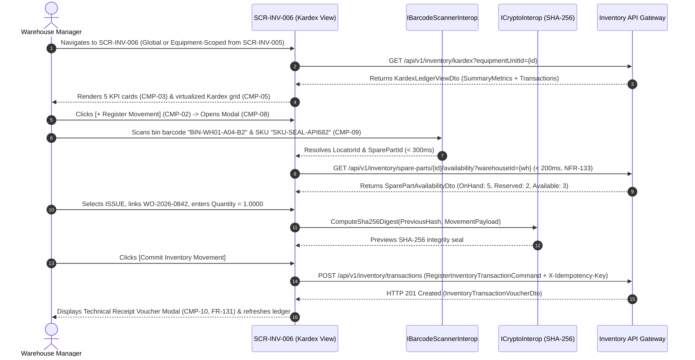

# SCR-INV-006: Inventory Movements and Chronological Kardex Ledger

## 1. Purpose and Operational Context

* **View Objective:** Chronological Kardex ledger and transactional execution workspace for MRO spare parts and rotable equipment movements (`RECEIPT`, `ISSUE`, Unused Material Return, and Physical Count `ADJUSTMENT`). Enforces real-time available stock calculation ($\text{Available} = \text{QuantityOnHand} - \text{ReservedQuantity}$ per `FR-126`), exact `DECIMAL(12,2)` Work Order cost attribution (`FR-127`, `FR-128`, `NFR-134`), automated reorder-point and capacity alerts (`FR-129`), technical receipt voucher generation (`FR-131`), and SHA-256 cryptographic audit chaining (`TR-001`).
* **Primary Target Persona:** Warehouse Manager recording inbound supplier receipts, issuing reserved or ad-hoc spare parts to active Work Orders, processing unused material returns, executing physical cycle-count adjustments, and generating technical dispatch vouchers.
* **Secondary Personas:**
  * **Maintenance Planner:** Verifies physical vs. reserved stock balances (`FR-126`) and inspects historical spare part consumption rates across Equipment Units.
  * **Auditor:** Audits financial cost attribution, unit price variance alerts, physical count adjustments, and SHA-256 hash-chained ledger entries (`FR-130`, `TR-001`).
  * **Maintenance Supervisor & Reliability Engineer:** Drills down from the Equipment Master Data Card ([SCR-INV-005](SCR-INV-005.md)) to review all spare parts and rotable serial numbers consumed by a specific Level 6 Equipment Unit.
* **Operational Context:** Deployed on desktop workstations in central warehouse offices and on rugged industrial tablets (equipped with optical/laser barcode scanners) in warehouse aisles and field staging zones. Responsive layout rules are governed in Section 8.
* **Mode of Operation:** Transactional Inventory Ledger & Audit Inspection mode. Direct DCS/SCADA process control manipulation is strictly excluded. Ledger records in `inv.inventory_transactions` are strictly append-only (`DT-DM-DOC-002` Architectural Notes); corrections are executed exclusively via compensating return or adjustment transactions (`FR-128`, `AF-003`).
* **Upstream & Downstream Navigation Invariants:**
  * **Upstream Continuity:** Accessible from the Equipment Master Data Card ([SCR-INV-005](SCR-INV-005.md)) via `[Check Kardex]` (`L3` $\to$ `L3`, pre-filtering the ledger by `EquipmentUnitId` / `SerialNumber`) or directly from the Web Portal Inventory menu and Mobile Field Client side drawer ([DT-UI-NAV-DOC-001 §4](../../DT-UI-NAV-DOC-001.md#4-information-architecture-tree)).
  * **Downstream Transitions:** Links directly to the Spare Parts Master Catalog ([SCR-INV-031](SCR-INV-031.md)) to inspect or calibrate replenishment policies (`REORDER_POINT`, `MIN_MAX`, `JUST_IN_TIME`), and returns to [SCR-INV-005](SCR-INV-005.md) when invoked in equipment-scoped mode.

---

## 2. Visual Artifact


> *Note: Production UI prototype capture illustrating the Movements and Kardex History desktop workstation layout, collapsible navigation sidebar, 5-card consolidated movement and replenishment KPI strip, multi-criteria filter toolbar, virtualized chronological Kardex ledger grid, persistent right dock with movement detail inspector, available-vs-reserved stock breakdown card, technical receipt voucher trigger, and sticky valuation footer.*

---

## 3. Functional Component Inventory

> The base grid, typography, neutral palettes, and minimal tactile contact areas are inherited from [DT-UI-DS-DOC-001](../../DT-UI-DS-DOC-001.md). This inventory defines the canonical components present on the screen, their design tokens, and their architectural scope. Interaction rules and geometric algorithms are specified in Section 5; responsive container adaptations are governed by Section 8.

1. **`CMP-01`: Portal Shell & Navigation Sidebar**
   - **Visual Role:** Collapsible navigation sidebar hosting global modules, module hierarchy, and route markers.
   - **Design Tokens:**
     - Surface: `--dt-color-surface-base`
     - Border: `--dt-color-border-subtle`
     - Width: `--dt-layout-sidebar-width-expanded` (Desktop) / `--dt-layout-sidebar-width-collapsed` (Tablet Landscape)
   - **Architectural Scope:** Hosts global module navigation per [DT-UI-NAV-DOC-001](../../DT-UI-NAV-DOC-001.md), highlighting "Movements & Kardex" under Inventory & Taxonomy. Responsive widths in Section 8.

2. **`CMP-02`: Kardex Header & Transaction Action Bar**
   - **Visual Role:** Sticky top header hosting breadcrumbs, equipment context filter pill (when drilled down from `SCR-INV-005`), background retry sync chip (`NFR-136`), `[+ Register Movement]` primary CTA, `[Export Kardex]` menu, and operator session badge.
   - **Design Tokens:**
     - Surface: `--dt-color-surface-card`
     - Border: `--dt-color-border-subtle`
     - Elevation: `--dt-z-header-sticky`
     - Primary Button: `--dt-color-state-info`
   - **Architectural Scope:** Manages movement modal invocation, offline retry queue visibility (`AF-004`), and structured ledger exports. Detailed in §5.1 and §5.3.4.

3. **`CMP-03`: Consolidated Movement & Replenishment KPI Strip**
   - **Visual Role:** 5-card interactive summary bar displaying aggregate period metrics (`Total Movements`, `Inbound Receipts`, `Work Order Issues`, `Returns & Adjustments`, and `Active Stock Policy Alerts`).
   - **Design Tokens:**
     - Surface: `--dt-color-surface-card`
     - Border: `--dt-color-border-subtle`
     - Radius: `--dt-radius-md`
     - Active Filter Ring: `--dt-color-state-info`
     - Alert Count Accent: `--dt-color-alarm-warning`
   - **Architectural Scope:** Populated via single-pass PostgreSQL `FILTER (WHERE ...)` aggregations ([DT-ARQ-DB-DOC-001 §3.2](../../../architecture/DT-ARQ-DB-DOC-001.md#32-conditional-aggregations-with-filter-clause-mtto-026-inv-006)). Acts as a one-click movement category filter (`FR-129`, `FR-130`). Detailed in §5.1.

4. **`CMP-04`: Multi-Criteria Kardex Filter Toolbar**
   - **Visual Role:** Flat toolbar hosting `Warehouse` selector, physical `Locator` bin filter, `DateOnly` range pickers (`From` / `To`), `WorkOrder` / `EquipmentTag` filter, and debounced `SKU` / `SerialNumber` search input (`FR-130`).
   - **Design Tokens:**
     - Surface: `--dt-color-surface-base`
     - Controls: `--dt-color-surface-card`
     - Border: `--dt-color-border-subtle`
     - Control Height: `--dt-control-height-sm` (Desktop) / `--dt-touch-target-mobile` (Tablet)
     - Radius: `--dt-radius-sm`
   - **Architectural Scope:** Filters the virtualized Kardex ledger without vertical layout shift (`CLS = 0`). Detailed in §5.2.

5. **`CMP-05`: Chronological Kardex Ledger Data Grid**
   - **Visual Role:** Virtualized multi-column immutable ledger table rendering `TimestampUtc`, `TransactionType` pill (`CMP-06`), `Sku` & `SparePartDescription`, `WarehouseName` & `LocatorCode` (`Aisle-Rack-Shelf`), signed `Quantity` & `UnitOfMeasure`, `UnitCost` & `TotalCost`, linked `WorkOrderNumber` / `EquipmentTag` / `SerialNumber`, and `Reason`.
   - **Design Tokens:**
     - Header Surface: `--dt-color-surface-base`
     - Row Surface: `--dt-color-surface-card`
     - Border: `--dt-color-border-subtle`
     - Row Height: `--dt-layout-table-row-height`
     - Selected Row Indicator: `--dt-color-state-info`
     - Numeric Typography: `--dt-font-mono-data`
   - **Architectural Scope:** Append-only financial and physical movement grid (`inv.inventory_transactions`) virtualized for high-volume warehouse activity (`NFR-135`). Clicking any row inspects the movement in `CMP-07`. Detailed in §5.2.

6. **`CMP-06`: Movement Type & Stock Alert Badges**
   - **Visual Role:** Morphological capsule pills (`--dt-radius-full`) encoding movement classification and stock policy alerts (`BELOW REORDER POINT`, `PRICE VARIANCE`, `STOCKOUT`).
   - **Design Tokens:**
     - Normal Movement (`RECEIPT`, `ISSUE`): `--dt-color-surface-base`, `--dt-color-border-subtle`, `--dt-color-text-body`
     - Warning (`ADJUSTMENT`, `BELOW REORDER POINT`, `PRICE VARIANCE`): `--dt-color-alarm-warning`
     - Critical (`STOCKOUT`): `--dt-color-alarm-critical`
     - Radius: `--dt-radius-full`
   - **Architectural Scope:** Enforces 90/10 HPHMI and Anti-Badge-Inflation rules ([DT-UI-DS-DOC-001 §6.5.1](../../DT-UI-DS-DOC-001.md#651-morphological-differentiation-status-badges-vs-interactive-buttons)): routine `RECEIPT` and `ISSUE` rows remain neutral grayscale, reserving saturated amber/red strictly for reconciliation adjustments and stock/cost anomalies (`FR-129`). Detailed in §5.1.

7. **`CMP-07`: Movement Inspection & Stock Availability Rail**
   - **Visual Role:** Master-detail inspector hosted inside dock `CMP-12` displaying the selected movement's metadata, the Spare Part's live 3-tier stock breakdown (`QuantityOnHand`, `ReservedQuantity`, and net `AvailableQuantity` per `FR-126`), Work Order cost allocation, and the `[Generate Technical Receipt Voucher]` button (`FR-131`).
   - **Design Tokens:**
     - Surface: `--dt-color-surface-card`
     - Stock Breakdown Box: `--dt-color-surface-base`
     - Border: `--dt-color-border-subtle`
     - Typography: `--dt-font-caption`, `--dt-font-body-md`, `--dt-font-mono-data`
   - **Architectural Scope:** Provides instant reconciliation context and launches the printable voucher modal (`CMP-10`). Detailed in §5.2 and §5.3.1.

8. **`CMP-08`: Register Inventory Movement Modal**
   - **Visual Role:** Centered transactional modal dialog (`--dt-layout-modal-width`, `--dt-layout-modal-max-height`) for executing `RECEIPT` (`FR-125`), `ISSUE` to Work Order (`FR-127`), Unused Material Return (`FR-128`), and Physical Count `ADJUSTMENT` (`AF-003`), featuring real-time available stock validation and cost preview.
   - **Design Tokens:**
     - Surface: `--dt-color-surface-card`
     - Backdrop: `--dt-color-surface-overlay`
     - Width & Max-Height: `--dt-layout-modal-width`, `--dt-layout-modal-max-height`
     - Radius: `--dt-radius-xl`
     - Elevation: `--dt-z-modal`
     - Primary CTA: `--dt-color-state-info`
   - **Architectural Scope:** Orchestrates `SparePart.ReceiveStock`, `SparePart.IssueStock`, and `MaterialRequirement.RecordConsumption` ([DT-DM-DOC-002 §4.1–§4.2](../../../domain-models/class/DT-DM-DOC-002.md#4-layer-3-resource-control-inv)) within an atomic ACID transaction (`NFR-132`). Detailed in §5.3.

9. **`CMP-09`: Optical Barcode & Bin Locator Scanner Trigger**
   - **Visual Role:** Tactile scan button docked inside `CMP-08` next to the `SparePart` SKU and `Locator` bin selectors.
   - **Design Tokens:**
     - Surface: `--dt-color-surface-btn-secondary`
     - Border: `--dt-color-border-subtle`
     - Touch Target: `--dt-touch-target-mobile`
     - Radius: `--dt-radius-md`
   - **Architectural Scope:** Invokes `IBarcodeScannerInterop` to scan physical rack/bin barcodes (`inv.locators.barcode` per [DT-DM-DOC-002 §4.5](../../../domain-models/class/DT-DM-DOC-002.md#45-locator-entity)) and part SKUs on warehouse tablets. Detailed in §5.2 and §7.3.

10. **`CMP-10`: Technical Receipt Voucher Modal (`FR-131`)**
    - **Visual Role:** Centered documentary voucher modal displaying the formal transaction receipt (Folio ID, UTC timestamp, movement type, SKU, Warehouse & Locator bin `Aisle-Rack-Shelf`, quantity, unit/total cost, linked Work Order and Equipment Unit tag, operator badge, and SHA-256 digital seal) with `[Print / Export PDF]` and `[Close]` triggers.
    - **Design Tokens:**
      - Surface: `--dt-color-surface-card`
      - Header Seal: `--dt-color-state-success`
      - Width: `--dt-layout-modal-width`
      - Radius: `--dt-radius-xl`
      - Elevation: `--dt-z-modal`
      - Typography: `--dt-font-mono-data`
    - **Architectural Scope:** Satisfies [FR-131](../../../requirements/user-stories/inv/INV-006.md#functional-requirements-fr) upon completing material issues, receipts, or returns. Detailed in §5.3.3.

11. **`CMP-11`: Chained Cryptographic Kardex Audit Pane**
    - **Visual Role:** Append-only cryptographic audit tab hosted in dock `CMP-12` displaying SHA-256 hash-chained records for stock adjustments, returns, and unit cost variance alerts.
    - **Design Tokens:**
      - Surface: `--dt-color-surface-card`
      - Border: `--dt-color-border-subtle`
      - Hash Typography: `--dt-font-mono-data`
    - **Architectural Scope:** Enforces [TR-001](../../../requirements/common/TR-001.md) and [ADR-003](../../../architecture/adr/ADR-003.md). Detailed in §5.3.3.

12. **`CMP-12`: Persistent Workspace Dock & Vertical Tab Strip**
    - **Visual Role:** Right-hand workspace dock with vertical spine tabs (`MOVEMENT DETAIL` / `SHA-256 AUDIT`) hosting `CMP-07` and `CMP-11`.
    - **Design Tokens:**
      - Track Surface: `--dt-color-surface-base`
      - Panel Surface: `--dt-color-surface-card`
      - Active Tab: `--dt-color-surface-raised`
      - Width: `--dt-layout-drawer-width-desktop` / `--dt-layout-drawer-width-tablet`
      - Elevation: `--dt-shadow-panel`
      - Active Indicator: `--dt-color-state-info`
    - **Architectural Scope:** Preserves ledger scroll position and row selection across tab switches without horizontal layout shift. Detailed in §5.2 and Section 8.

13. **`CMP-13`: Sticky Kardex Valuation & Handoff Footer**
    - **Visual Role:** Permanent sticky bottom bar displaying filtered period net receipt/issue valuation totals, `CLS = 0` replenishment alert status slot (`FR-129`), and Level 3 navigation handoffs (`[< Back to Equipment Master Card]`, `[Open Spare Parts Catalog]`).
    - **Design Tokens:**
      - Surface: `--dt-color-surface-card`
      - Border: `--dt-color-border-hairline`
      - Height: `--dt-layout-footer-height`
      - Elevation: `--dt-z-header-sticky`
      - Secondary Button: `--dt-color-surface-btn-secondary`
    - **Architectural Scope:** Anchors financial reconciliation totals and cross-screen L3 transitions ([DT-UI-NAV-DOC-001 §5](../../DT-UI-NAV-DOC-001.md#5-transition-matrix-and-access-control-rbac)). Detailed in §5.2.

---

## 4. Screen State Catalog

1. **Ledger Inspection Mode (Default)**
   - **Activation Condition:** User navigates to `SCR-INV-006` from the Inventory menu or via `[Check Kardex]` in [SCR-INV-005](SCR-INV-005.md).
   - **Visual Modification:** Neutral grayscale surfaces (`--dt-color-surface-card`). Chronological ledger `CMP-05` renders sorted descending by `TimestampUtc`. Routine `RECEIPT` and `ISSUE` pills render in neutral grayscale without saturated fills. Right dock `CMP-12` displays the selected movement's details and live Spare Part stock breakdown in `CMP-07`.

2. **Loading / Querying Ledger (`NFR-135`)**
   - **Activation Condition:** Initial ledger load or multi-criteria filter execution.
   - **Visual Modification:** Skeleton shimmer (`--dt-color-surface-raised`) across `CMP-03` KPI cards and `CMP-05` rows; export and mutation triggers disabled.

3. **Registering Movement (`RECEIPT` / `ISSUE` / `RETURN` / `ADJUSTMENT`)**
   - **Activation Condition:** Warehouse Manager clicks `[+ Register Movement]` in `CMP-02`.
   - **Visual Modification:** Modal `CMP-08` deploys centered over `--dt-color-surface-overlay`. Selecting a Spare Part immediately displays its live `QuantityOnHand`, `ReservedQuantity`, and net `AvailableQuantity` ($< 200\text{ms}$ per `NFR-133`) alongside the computed `TotalCost` preview (`Quantity * UnitCost`).

4. **Insufficient Available Stock (`AF-001` / `FR-126`)**
   - **Activation Condition:** Manager enters an `ISSUE` quantity in `CMP-08` that exceeds the Spare Part's net `AvailableQuantity` (or exceeds the target Work Order's reserved allocation) in the selected Warehouse Locator.
   - **Visual Modification:** Quantity input in `CMP-08` highlights with a critical red border (`--dt-color-alarm-critical`) and `#icon-ban` glyph. Modal validation slot displays: *"Insufficient Available Stock: Requested quantity (4.0000 EA) exceeds net available stock (2.0000 EA after deducting 3.0000 EA reserved for scheduled Work Orders)."* Submit button is hard-disabled (`CLS = 0`).

5. **Inbound Unit Price Discrepancy Warning**
   - **Activation Condition:** Manager registers an inbound `RECEIPT` in `CMP-08` whose purchase order unit price deviates from the master `SparePart.UnitCost` reference (`INV-006` Acceptance Criteria 2).
   - **Visual Modification:** Unit cost field highlights with an amber caution border (`--dt-color-alarm-warning`) and `#icon-warning` glyph, displaying the variance percentage and logging an administrative cost evaluation flag while permitting physical receipt completion.

6. **Replenishment Threshold or Capacity Alert Active (`AF-002` / `FR-129`)**
   - **Activation Condition:** An `ISSUE` movement reduces `QuantityOnHand <= ReorderPoint`, or a `RECEIPT` movement causes `QuantityOnHand > MaxCapacity` (`inv.spare_parts.reorder_point` / `max_capacity`).
   - **Visual Modification:** KPI card 5 in `CMP-03` and the footer alert slot in `CMP-13` highlight with an amber warning badge (`--dt-color-alarm-warning`, `#icon-warning`): *"Replenishment Policy Triggered: SKU-SEAL-API682 reached Reorder Point (2.0000 <= 2.0000 EA)."*

7. **Technical Receipt Voucher Generated (`FR-131`)**
   - **Activation Condition:** Atomic movement transaction commits in `CMP-08`, or user clicks `[Generate Technical Receipt Voucher]` in `CMP-07`.
   - **Visual Modification:** Modal `CMP-10` opens displaying the formatted technical voucher with Teal documentary confirmation header (`--dt-color-state-success`, `#icon-check`), Folio ID, bin locator path, Work Order cost charge, and 64-character SHA-256 integrity hash.

8. **Offline Queued / Background Retry Active (`AF-004` / `NFR-136`)**
   - **Activation Condition:** Warehouse tablet loses wireless connectivity while submitting a movement in `CMP-08`.
   - **Visual Modification:** Movement is encrypted and saved to the local retry outbox (`IOfflineStorage`). Header `CMP-02` illuminates the amber sync chip (`[1 PENDING RETRY]`, `--dt-color-alarm-warning`, `#icon-wifi-off`) with zero layout shift (`CLS = 0`), automatically draining upon reconnection.

---

## 5. Interaction Rules and Data Flow

### 5.1. Initial Load & Single-Pass KPI Aggregation



1. **Single-Pass Conditional Aggregation ([DT-ARQ-DB-DOC-001 §3.2](../../../architecture/DT-ARQ-DB-DOC-001.md#32-conditional-aggregations-with-filter-clause-mtto-026-inv-006)):**
   * Summary metrics in `CMP-03` (`TotalMovementsCount`, `InboundReceiptsCount`, `WorkOrderIssuesCount`, `AdjustmentsAndReturnsCount`, `ActivePolicyAlertsCount`) are computed in a single SQL table scan using standard PostgreSQL `COUNT(*) FILTER (WHERE ...)` and `SUM(total_cost) FILTER (WHERE ...)` clauses, prohibiting multi-pass queries or `SUM(CASE ...)`.
2. **Numerical Precision Invariant ([DT-ARQ-DB-DOC-001 §2](../../../architecture/DT-ARQ-DB-DOC-001.md#2-physical-integrity-invariants-and-constraints)):**
   * All stock quantities bind strictly to `decimal` (`DECIMAL(12,4)` in `inv.inventory_transactions.quantity`, `inv.spare_parts.quantity_on_hand`, `reserved_quantity`, `reorder_point`, `max_capacity`), and all monetary unit and total costs bind strictly to `decimal` (`DECIMAL(12,2)` in `inv.spare_parts.unit_cost` and `inv.inventory_transactions.total_cost`), guaranteeing zero IEEE 754 floating-point discrepancy (`NFR-134`).

---

### 5.2. Ledger Ergonomics & Tactile Barcode Mechanics

1. **Virtualized Ledger Grid & Row Inspection (`CMP-05`, `CMP-07`):**
   * Uses `Virtualize<KardexTransactionRowDto>` with fixed row height (`--dt-layout-table-row-height`) to sustain 60 FPS scrolling during peak warehouse activity (`NFR-135`).
   * Clicking any row inspects the transaction in right dock `CMP-07` without modal interruption or horizontal layout shift.
2. **Optical Barcode & Bin Locator Scanning (`CMP-09`, `NFR-133`):**
   * On industrial warehouse tablets, tapping `CMP-09` scans physical storage bin tags (`inv.locators.barcode` formatted as `Aisle-Rack-Shelf`) and spare part SKU labels, resolving stock balances in $< 200\text{ms}$ (`NFR-133`). All interactive controls in `CMP-08` and `CMP-09` enforce `--dt-touch-target-mobile` minimums with `--dt-space-2` separation.

---

### 5.3. Domain Workflows & Financial Reconciliation Rules

#### 5.3.1. Dynamic Available Stock & Reservation Protection (`FR-126`, `FR-127`, `AF-001`)
1. **Available Stock Formula (`FR-126`):** For any Spare Part in a Warehouse, net available stock for unreserved issues is evaluated deterministically as:
   $$\text{AvailableQuantity} = \text{QuantityOnHand} - \text{ReservedQuantity}$$
2. **Reservation-Aware Issue Validation (`FR-127`, `AF-001`):**
   * If an `ISSUE` movement references a `WorkOrderId` that holds an active reservation (`inv.material_requirements.is_reserved == true` per [DT-DM-DOC-002 §4.2](../../../domain-models/class/DT-DM-DOC-002.md#42-materialrequirement-entity)), `SparePart.IssueStock(quantity)` deducts from both `QuantityOnHand` and `ReservedQuantity` up to `PlannedQuantity`.
   * If the `ISSUE` is unreserved (or exceeds `PlannedQuantity`), the excess quantity is validated strictly against $\text{AvailableQuantity}$. If $\text{RequestedUnreservedQty} > \text{AvailableQuantity}$, the client triggers State 4 (`AF-001`) and blocks submission.

#### 5.3.2. Unused Material Return & Cost Reversal (`FR-128`, `AF-003`)
1. **Return & Cost Reversal (`FR-128`):** When unused spare parts previously issued to a Work Order are returned to the warehouse, the transaction is recorded as a positive `RECEIPT` linked to the originating `WorkOrderId` and `LocatorId`. The backend atomically increments `QuantityOnHand`, decrements `inv.material_requirements.actual_quantity`, and credits `TotalCost` (`-Quantity * UnitCost`) back to the Work Order's material cost accumulator (`NFR-134`).
2. **Physical Count Reconciliation (`ADJUSTMENT`, `AF-003`):** Selecting `InventoryTransactionType.ADJUSTMENT` requires entering the verified physical count and a mandatory reconciliation `Reason` ($\ge 15$ characters). The system computes $\Delta Q = Q_{\text{counted}} - Q_{\text{system}}$, updates `QuantityOnHand`, logs the financial variance (`\Delta Q \times \text{UnitCost}`), and appends an `ADJUST` event to `adm.audit_logs` (`DT-DM-DOC-001 §4.36`).

#### 5.3.3. Replenishment Policy Evaluation & Technical Receipt Voucher (`FR-129`, `FR-131`, `AF-002`)
1. **Automated Stock Policy Alerts (`FR-129`, `AF-002`):** Following every atomic stock mutation, the domain service evaluates the Spare Part's configured `StockPolicy` ([DT-DM-DOC-001 §4.27](../../../domain-models/class/DT-DM-DOC-001.md#427-sparepartstockpolicy): `REORDER_POINT`, `MIN_MAX`, `JUST_IN_TIME`):
   * If $\text{QuantityOnHand} \le \text{ReorderPoint}$, emits a `LOW_STOCK_REORDER` alert.
   * If $\text{QuantityOnHand} > \text{MaxCapacity}$ (or exceeds warehouse capacity in `inv.warehouses.capacity`), emits an `EXCESS_INVENTORY` alert.
2. **Technical Receipt Voucher (`FR-131`):** Every committed transaction returns an `InventoryTransactionVoucherDto` (§7.2.3) containing the sequential transaction folio, UTC timestamp, locator bin path, cost breakdown, and SHA-256 integrity hash, rendered immediately in `CMP-10`.

#### 5.3.4. Background Retry Queue on Connectivity Drop (`NFR-136`, `AF-004`, `TR-007`, `ADR-007`)
1. If a warehouse tablet experiences a wireless dropout during `RegisterInventoryTransactionCommand` submission, the client encrypts the payload in local SQLCipher storage (`TR-002`) with `X-Idempotency-Key: {uuidv7}` (`ADR-005`, `ADR-007`) and automatically retries via `INSERT ... ON CONFLICT (id) DO UPDATE` idempotent ingestion upon reconnection ([DT-ARQ-DB-DOC-001 §3.6](../../../architecture/DT-ARQ-DB-DOC-001.md#36-idempotent-ingestion-for-offline-queues-tr-007)).

---

## 6. Industrial and Safety Considerations

* **Immutable Ledger & Financial Integrity (`NFR-132`, `NFR-134`, [DT-DM-DOC-002](../../../domain-models/class/DT-DM-DOC-002.md#architectural-notes)):** `InventoryTransaction` records act as an immutable financial and physical ledger; rows in `inv.inventory_transactions` are never updated or deleted post-commit. Reversals and cycle-count corrections must be executed via explicit compensating transactions (`FR-128`, `AF-003`) sealed into the SHA-256 audit chain (`TR-001`).
* **Protection of Reserved Safety-Critical Spares (`FR-126`):** Deducting `ReservedQuantity` from `QuantityOnHand` prevents spare parts staged for scheduled safety-critical (SCE) maintenance plans from being accidentally consumed by routine non-critical work orders.
* **HPHMI Grayscale & Anti-Badge-Inflation Governance ([TR-011](../../../requirements/common/TR-011.md)):** Per [DT-UI-DS-DOC-001 §1](../../DT-UI-DS-DOC-001.md#1-scope) and [§6.5](../../DT-UI-DS-DOC-001.md#65-status-badge-counter-discipline-anti-badge-inflation-principle), normal `RECEIPT` and `ISSUE` rows render in neutral grayscale without green/blue row fills, reserving `--dt-color-alarm-warning` (`ADJUSTMENT`, `BELOW_REORDER_POINT`, `PRICE_VARIANCE`) and `--dt-color-alarm-critical` (`STOCKOUT`) strictly for actionable supply-chain exceptions.

---

## 7. Frontend Component Contract (Blazor / Razor)

### 7.1. Component Hierarchy & File Mapping

```text
Pages/Inventory/
└── InventoryKardexHistoryPage.razor                   # Root View (SCR-INV-006)
    ├── PortalSidebarNav.razor                         # CMP-01: Collapsible navigation sidebar
    ├── KardexHeaderBar.razor                          # CMP-02: Breadcrumbs, context pill, [+ Movement] & retry badge
    ├── KardexSummaryCards.razor                       # CMP-03: 5-card single-pass FILTER KPI summary strip
    ├── KardexFilterToolbar.razor                      # CMP-04: Warehouse, bin, date range, WO & SKU filters
    ├── KardexTransactionsGrid.razor                   # CMP-05: Virtualized chronological Kardex ledger table
    │   └── KardexMovementBadge.razor                  # CMP-06: Redundant movement type & stock alert pill
    ├── KardexWorkspaceDock.razor                      # CMP-12: Persistent right dock with vertical tab spine
    │   ├── TransactionInspectionRail.razor            # CMP-07: Movement details, 3-tier stock box & voucher CTA
    │   └── KardexAuditLogPane.razor                   # CMP-11: Chained SHA-256 inventory audit ledger pane
    ├── RegisterInventoryMovementModal.razor           # CMP-08: Transactional RECEIPT/ISSUE/RETURN/ADJUSTMENT modal
    │   └── LocatorBarcodeScanButton.razor             # CMP-09: Tactile bin & SKU barcode scanner trigger
    ├── TechnicalReceiptVoucherModal.razor             # CMP-10: Printable/exportable transaction voucher (FR-131)
    └── KardexActionFooter.razor                       # CMP-13: Sticky valuation summary, alert slot & L3 handoffs
```

---

### 7.2. Physical Component Parameters & DTO Contracts (.NET 10 / C# 14)

#### 7.2.1. `InventoryKardexHistoryPage.razor` (Root View)

```csharp
[Parameter, SupplyParameterFromQuery(Name = "equipId")]
public Guid? FilterEquipmentUnitId { get; set; }

[Parameter, SupplyParameterFromQuery(Name = "sn")]
public string? FilterSerialNumber { get; set; }

[Parameter, SupplyParameterFromQuery(Name = "partId")]
public Guid? FilterSparePartId { get; set; }
```

#### 7.2.2. Subcomponent Parameter Contracts (`CMP-01` to `CMP-13`)

```csharp
// CMP-01: PortalSidebarNav.razor
[Parameter]
public bool IsCollapsed { get; set; }

[Parameter]
public bool IsMobileDrawerOpen { get; set; }

[Parameter]
public string ActiveRouteCode { get; set; } = "SCR-INV-006";

[Parameter]
public EventCallback<bool> OnCollapseToggled { get; set; }

// CMP-02: KardexHeaderBar.razor
[Parameter]
public required string OperatorBadgeCode { get; set; }

[Parameter]
public required string OperatorDisplayName { get; set; }

[Parameter]
public string? ScopedEquipmentTag { get; set; }

[Parameter]
public string? ScopedSerialNumber { get; set; }

[Parameter]
public int PendingRetryQueueCount { get; set; }

[Parameter]
public bool CanRegisterMovement { get; set; }

[Parameter]
public EventCallback OnClearEquipmentScope { get; set; }

[Parameter]
public EventCallback OnOpenRegisterMovementModal { get; set; }

[Parameter]
public EventCallback<KardexExportFormat> OnExportRequested { get; set; }

[Parameter]
public EventCallback OnToggleMobileNavigation { get; set; }

// CMP-03: KardexSummaryCards.razor
[Parameter]
public required KardexSummaryMetricsDto Metrics { get; set; }

[Parameter]
public KardexKpiFilterCategory? ActiveCategoryFilter { get; set; }

[Parameter]
public EventCallback<KardexKpiFilterCategory?> OnCategoryFilterSelected { get; set; }

// CMP-04: KardexFilterToolbar.razor
[Parameter]
public required IReadOnlyList<WarehouseBinLookupDto> Warehouses { get; set; }

[Parameter]
public Guid? SelectedWarehouseId { get; set; }

[Parameter]
public Guid? SelectedLocatorId { get; set; }

[Parameter]
public InventoryTransactionType? SelectedTransactionType { get; set; }

[Parameter]
public DateOnly? DateFrom { get; set; }

[Parameter]
public DateOnly? DateTo { get; set; }

[Parameter]
public string? SearchQuery { get; set; }

[Parameter]
public EventCallback<Guid?> OnWarehouseFilterChanged { get; set; }

[Parameter]
public EventCallback<Guid?> OnLocatorFilterChanged { get; set; }

[Parameter]
public EventCallback<InventoryTransactionType?> OnTransactionTypeFilterChanged { get; set; }

[Parameter]
public EventCallback<(DateOnly? From, DateOnly? To)> OnDateRangeChanged { get; set; }

[Parameter]
public EventCallback<string?> OnSearchQueryChanged { get; set; }

[Parameter]
public EventCallback OnResetFiltersClicked { get; set; }

// CMP-05: KardexTransactionsGrid.razor
[Parameter]
public required IReadOnlyList<KardexTransactionRowDto> Transactions { get; set; }

[Parameter]
public Guid? SelectedTransactionId { get; set; }

[Parameter]
public EventCallback<KardexTransactionRowDto> OnTransactionSelected { get; set; }

// CMP-06: KardexMovementBadge.razor
[Parameter]
public required InventoryTransactionType TransactionType { get; set; }

[Parameter]
public bool IsWorkOrderReturn { get; set; }

[Parameter]
public StockPolicyAlertType? PolicyAlert { get; set; }

// CMP-12: KardexWorkspaceDock.razor
[Parameter]
public bool IsOpen { get; set; }

[Parameter]
public KardexDockTab ActiveTab { get; set; } = KardexDockTab.MOVEMENT_DETAIL;

[Parameter]
public EventCallback<KardexDockTab> OnTabChanged { get; set; }

[Parameter]
public EventCallback OnClosed { get; set; }

// CMP-07: TransactionInspectionRail.razor
[Parameter]
public KardexTransactionRowDto? SelectedTransaction { get; set; }

[Parameter]
public SparePartAvailabilityDto? CurrentPartAvailability { get; set; }

[Parameter]
public EventCallback<Guid> OnOpenVoucherModalRequested { get; set; }

[Parameter]
public EventCallback<Guid> OnInspectSparePartCatalogRequested { get; set; }

// CMP-08: RegisterInventoryMovementModal.razor
[Parameter]
public bool IsVisible { get; set; }

[Parameter]
public required IReadOnlyList<WarehouseBinLookupDto> Warehouses { get; set; }

[Parameter]
public required IReadOnlyList<SparePartAvailabilityDto> SparePartsCatalog { get; set; }

[Parameter]
public SparePartAvailabilityDto? SelectedPartAvailability { get; set; }

[Parameter]
public bool HasInsufficientStockError { get; set; }

[Parameter]
public bool HasUnitCostVarianceWarning { get; set; }

[Parameter]
public EventCallback<RegisterInventoryTransactionCommand> OnMovementSubmitted { get; set; }

[Parameter]
public EventCallback OnCloseRequested { get; set; }

// CMP-09: LocatorBarcodeScanButton.razor
[Parameter]
public bool IsScanning { get; set; }

[Parameter]
public EventCallback OnScanTriggered { get; set; }

// CMP-10: TechnicalReceiptVoucherModal.razor (FR-131)
[Parameter]
public bool IsVisible { get; set; }

[Parameter]
public InventoryTransactionVoucherDto? Voucher { get; set; }

[Parameter]
public EventCallback<Guid> OnPrintOrExportVoucher { get; set; }

[Parameter]
public EventCallback OnCloseRequested { get; set; }

// CMP-11: KardexAuditLogPane.razor
[Parameter]
public required IReadOnlyList<KardexAuditEntryDto> AuditEntries { get; set; }

// CMP-13: KardexActionFooter.razor
[Parameter]
public required decimal PeriodReceiptsTotalCost { get; set; }

[Parameter]
public required decimal PeriodIssuesTotalCost { get; set; }

[Parameter]
public StockPolicyAlertType? ActiveReplenishmentAlert { get; set; }

[Parameter]
public string? ReplenishmentAlertMessage { get; set; }

[Parameter]
public Guid? ScopedEquipmentUnitId { get; set; }

[Parameter]
public EventCallback<Guid> OnBackToEquipmentMasterCard { get; set; }

[Parameter]
public EventCallback OnNavigateToSparePartsCatalog { get; set; }
```

#### 7.2.3. Data Transfer Objects (DTOs) and Enums

```csharp
/// <summary>
/// Controlled inventory movement type vocabulary per DT-DM-DOC-001 §4.25.
/// </summary>
public enum InventoryTransactionType
{
    RECEIPT,
    ISSUE,
    ADJUSTMENT
}

/// <summary>
/// Controlled spare part replenishment policy vocabulary per DT-DM-DOC-001 §4.27.
/// </summary>
public enum StockPolicyType
{
    REORDER_POINT,
    MIN_MAX,
    JUST_IN_TIME
}

public enum StockPolicyAlertType
{
    NONE,
    BELOW_REORDER_POINT,
    STOCKOUT_CRITICAL,
    EXCEEDS_MAX_CAPACITY,
    UNIT_PRICE_VARIANCE
}

public enum KardexKpiFilterCategory
{
    ALL_MOVEMENTS,
    RECEIPTS_INBOUND,
    ISSUES_CONSUMPTION,
    RETURNS_AND_ADJUSTMENTS,
    POLICY_ALERTS
}

public enum KardexDockTab
{
    MOVEMENT_DETAIL,
    SHA256_AUDIT
}

public enum KardexExportFormat
{
    LEDGER_CSV,
    LEDGER_JSON
}

public record KardexSummaryMetricsDto
{
    public required int TotalMovementsCount { get; init; }
    public required int InboundReceiptsCount { get; init; }
    public required int WorkOrderIssuesCount { get; init; }
    public required int AdjustmentsAndReturnsCount { get; init; }
    public required int ActivePolicyAlertsCount { get; init; }
    public required decimal PeriodReceiptsValuation { get; init; }
    public required decimal PeriodIssuesValuation { get; init; }
}

public record WarehouseBinLookupDto
{
    public required Guid WarehouseId { get; init; }
    public required string WarehouseName { get; init; }
    public required decimal MaxCapacity { get; init; }
    public IReadOnlyList<LocatorBinDto> Locators { get; init; } = [];
}

public record LocatorBinDto
{
    public required Guid LocatorId { get; init; }
    public required Guid WarehouseId { get; init; }
    public required string Aisle { get; init; }
    public string? Rack { get; init; }
    public string? Shelf { get; init; }
    public string? Barcode { get; init; }
    public bool IsActive { get; init; } = true;
}

public record SparePartAvailabilityDto
{
    public required Guid SparePartId { get; init; }
    public required string Sku { get; init; }
    public required string Description { get; init; }
    public required string UnitOfMeasure { get; init; }
    public required StockPolicyType StockPolicy { get; init; }
    public required decimal QuantityOnHand { get; init; }
    public required decimal ReservedQuantity { get; init; }
    public decimal AvailableQuantity => QuantityOnHand - ReservedQuantity;
    public required decimal ReorderPoint { get; init; }
    public required decimal MaxCapacity { get; init; }
    public required decimal StandardUnitCost { get; init; }
}

public record KardexTransactionRowDto
{
    public required Guid TransactionId { get; init; }
    public required string FolioNumber { get; init; }
    public required DateTimeOffset TimestampUtc { get; init; }
    public required InventoryTransactionType TransactionType { get; init; }
    public bool IsWorkOrderReturn { get; init; }
    public required Guid SparePartId { get; init; }
    public required string Sku { get; init; }
    public required string SparePartDescription { get; init; }
    public required string UnitOfMeasure { get; init; }
    public required Guid WarehouseId { get; init; }
    public required string WarehouseName { get; init; }
    public Guid? LocatorId { get; init; }
    public string? LocatorCode { get; init; }
    public required decimal Quantity { get; init; }
    public required decimal UnitCost { get; init; }
    public required decimal TotalCost { get; init; }
    public required decimal RunningBalanceAfter { get; init; }
    public Guid? WorkOrderId { get; init; }
    public string? WorkOrderNumber { get; init; }
    public string? EquipmentTag { get; init; }
    public string? SerialNumber { get; init; }
    public required string Reason { get; init; }
    public required string OperatorBadgeCode { get; init; }
    public StockPolicyAlertType PolicyAlert { get; init; } = StockPolicyAlertType.NONE;
    public required string IntegrityHash { get; init; }
}

public record RegisterInventoryTransactionCommand
{
    public required InventoryTransactionType TransactionType { get; init; }
    public bool IsUnusedMaterialReturn { get; init; }
    public required Guid SparePartId { get; init; }
    public required Guid WarehouseId { get; init; }
    public required Guid LocatorId { get; init; }
    public Guid? WorkOrderId { get; init; }
    public string? SerialNumber { get; init; }
    public required decimal Quantity { get; init; }
    public required decimal TransactionUnitCost { get; init; }
    public required string Reason { get; init; }
    public required Guid OperatorUserId { get; init; }
    public required string PreviousHash { get; init; }
}

public record InventoryTransactionVoucherDto
{
    public required Guid TransactionId { get; init; }
    public required string FolioNumber { get; init; }
    public required DateTimeOffset IssuedAtUtc { get; init; }
    public required InventoryTransactionType TransactionType { get; init; }
    public required string Sku { get; init; }
    public required string SparePartDescription { get; init; }
    public required string WarehouseName { get; init; }
    public required string LocatorCode { get; init; }
    public required decimal Quantity { get; init; }
    public required string UnitOfMeasure { get; init; }
    public required decimal UnitCost { get; init; }
    public required decimal TotalCost { get; init; }
    public string? WorkOrderNumber { get; init; }
    public string? EquipmentTag { get; init; }
    public required string OperatorBadgeCode { get; init; }
    public required string IntegrityHash { get; init; }
}

public record KardexAuditEntryDto
{
    public required Guid AuditLogId { get; init; }
    public required DateTimeOffset TimestampUtc { get; init; }
    public required string OperatorBadgeCode { get; init; }
    public required string EventType { get; init; }
    public required string Sku { get; init; }
    public required decimal QuantityDelta { get; init; }
    public required decimal CostDelta { get; init; }
    public required string Reason { get; init; }
    public required string PreviousHash { get; init; }
    public required string IntegrityHash { get; init; }
}
```

---

### 7.3. Client-Side DOM & Interop Bridge

1. **Optical Barcode & Bin Locator Scanner Interop (`IBarcodeScannerInterop`):**
   * Parses Code 128 / QR / DataMatrix bin tags (`inv.locators.barcode`) and spare part SKUs on warehouse tablets, resolving `LocatorId` and `SparePartId` in $< 300\text{ms}$ (`NFR-133`).
2. **Virtualized Ledger Scroll Interop (`IVirtualizationInterop`):**
   * Lazily renders visible Kardex rows within the scroll container to guarantee sub-second filter updates and 60 FPS scrolling across high-volume historical ledgers (`NFR-135`).
3. **Encrypted Offline Retry Outbox & SHA-256 Bridge (`IOfflineStorage` / `ICryptoInterop`):**
   * Computes SHA-256 digests asynchronously in a Web Worker (`TR-001`, `ADR-003`) and queues movements in encrypted local SQLCipher storage (`TR-002`, `TR-007`) with automatic exponential-backoff retry on connectivity restoration (`NFR-136`).

---

## 8. Layout and Responsive Adaptability

### 8.1. Desktop Workstation (`--dt-breakpoint-xl`)
* **Layout Organization:** Asymmetric 3-column workstation split ([DT-UI-DS-DOC-001 §2.3](../../DT-UI-DS-DOC-001.md#23-responsive-breakpoints-and-reference-frames)): left navigation sidebar `CMP-01` expanded at `--dt-layout-sidebar-width-expanded`, central Kardex workspace hosting the 5 summary KPI cards `CMP-03`, filter toolbar `CMP-04`, and virtualized ledger table `CMP-05`, paired with the persistent right workspace dock `CMP-12` sized by `--dt-layout-drawer-width-desktop` (`--dt-shadow-panel`). Transactional modal `CMP-08` and voucher modal `CMP-10` center at `--dt-layout-modal-width-desktop` bounded by `--dt-layout-modal-max-height`. Sticky footer `CMP-13` (`--dt-layout-footer-height`) spans the bottom workspace.
* **Ergonomic Rules:** Optimized for mouse and keyboard navigation; dense ledger row height governed by `--dt-layout-table-row-height`; zero horizontal layout shift (`CLS = 0`).

### 8.2. Industrial Tablet Landscape (`--dt-breakpoint-lg`)
* **Layout Organization:** Navigation sidebar `CMP-01` collapses to an icon-only rail sized by `--dt-layout-sidebar-width-collapsed`; workspace dock `CMP-12` operates as a slide-over lateral panel sized by `--dt-layout-drawer-width-tablet`; modals `CMP-08` and `CMP-10` size to `--dt-layout-modal-width-tablet`.
* **Ergonomic Rules:** Barcode scanner button `CMP-09` and all modal/toolbar controls enforce `--dt-touch-target-mobile` hit areas; sticky footer `CMP-13` (`--dt-layout-footer-height`) remains permanently pinned.

### 8.3. Industrial Tablet Portrait (`--dt-breakpoint-md`)
* **Layout Organization:** Navigation sidebar `CMP-01` transitions to an off-canvas drawer; KPI summary cards `CMP-03` wrap into a multi-row grid; workspace dock `CMP-12` transitions to an adaptive **Bottom Sheet** initializing at `--dt-layout-bottom-sheet-height-initial` and expanding up to `--dt-layout-bottom-sheet-height-expanded` (`--dt-radius-2xl` upper curvature); ledger grid `CMP-05` prioritizes Folio, Type, SKU, Signed Quantity, and Total Cost columns.
* **Ergonomic Rules:** Gloved warehouse operation ergonomics (`--dt-touch-target-mobile` with `--dt-space-2` separation); discrete single-tap toggling on the bottom-sheet handle ([DT-UI-DS-DOC-001 §6.3](../../DT-UI-DS-DOC-001.md#63-sliding-containers-pattern-bottom-sheets-and-drawers)).

---

## 9. Traceability and Requirements Matrix

| Requirement | Addressed in Component | Verification & Implementation Mechanism |
| :--- | :--- | :--- |
| [FR-125](../../../requirements/user-stories/inv/INV-006.md#functional-requirements-fr) | `CMP-05`, `CMP-08`, `CMP-09` | Registers inbound material receipts (`RECEIPT`), capturing `SparePartId`, `Quantity`, `WarehouseId`, `LocatorId`, and SHA-256 audit link. |
| [FR-126](../../../requirements/user-stories/inv/INV-006.md#functional-requirements-fr) | `CMP-07`, `CMP-08` | Dynamically calculates net `AvailableQuantity` ($\text{QuantityOnHand} - \text{ReservedQuantity}$) and blocks over-issues (`AF-001`). |
| [FR-127](../../../requirements/user-stories/inv/INV-006.md#functional-requirements-fr) | `CMP-05`, `CMP-07`, `CMP-08` | Manages `ISSUE` movements linked to `WorkOrderId`, tracing spare part consumption and costs directly to the intervened `EquipmentUnit`. |
| [FR-128](../../../requirements/user-stories/inv/INV-006.md#functional-requirements-fr) | `CMP-05`, `CMP-08` | Processes unused material returns to warehouse stock and executes automatic cost reversal on the originating Work Order (`AF-003`). |
| [FR-129](../../../requirements/user-stories/inv/INV-006.md#functional-requirements-fr) | `CMP-03`, `CMP-06`, `CMP-13` | Evaluates `ReorderPoint` and `MaxCapacity` thresholds upon every movement, illuminating replenishment alerts (`AF-002`). |
| [FR-130](../../../requirements/user-stories/inv/INV-006.md#functional-requirements-fr) | `CMP-03`, `CMP-04`, `CMP-05` | Multi-criteria querying and filtering across movement types, warehouses, bin locators, date ranges, Work Orders, and SKUs. |
| [FR-131](../../../requirements/user-stories/inv/INV-006.md#functional-requirements-fr) | `CMP-07`, `CMP-10` | Generates a structured, printable/exportable technical receipt voucher (`InventoryTransactionVoucherDto`) upon movement completion. |
| [NFR-132](../../../requirements/user-stories/inv/INV-006.md#non-functional-requirements-nfr) | `CMP-08` | Single-commit ACID transaction updates Spare Part stock, Work Order costs, Kardex row, and SHA-256 audit log atomically. |
| [NFR-133](../../../requirements/user-stories/inv/INV-006.md#non-functional-requirements-nfr) | `CMP-08`, `CMP-09` | Indexed stock availability lookup and optical barcode resolution execute in $< 200\text{ms}$ to prevent dispatch delays. |
| [NFR-134](../../../requirements/user-stories/inv/INV-006.md#non-functional-requirements-nfr) | `CMP-05`, `CMP-07`, `CMP-08`, `CMP-13` | Enforces `decimal` (`DECIMAL(12,4)` quantities and `DECIMAL(12,2)` costs) across all DTOs and SQL columns (`DT-ARQ-DB-DOC-001 §2`). |
| [NFR-135](../../../requirements/user-stories/inv/INV-006.md#non-functional-requirements-nfr) | `CMP-03`, `CMP-05` | Single-pass PostgreSQL `FILTER (WHERE ...)` aggregations and UI row virtualization sustain $< 1\text{s}$ response under high activity. |
| [NFR-136](../../../requirements/user-stories/inv/INV-006.md#non-functional-requirements-nfr) | `CMP-02`, `CMP-08` | Encrypted local outbox with exponential-backoff background retry prevents loss of movements during connectivity drops (`AF-004`). |
| [TR-001](../../../requirements/common/TR-001.md) | `CMP-08`, `CMP-10`, `CMP-11` | Immutable append-only audit trail logging with SHA-256 cryptographic hash chaining on all inventory mutations. |
| [TR-002](../../../requirements/common/TR-002.md) | `CMP-02`, `CMP-08` | AES-256 / SQLCipher encryption at rest for locally queued warehouse movements during temporary wireless dropouts. |
| [TR-005](../../../requirements/common/TR-005.md) | `CMP-05`, `CMP-08`, `CMP-10` | Enforces TLS/HTTPS encryption in transit across all Kardex queries, stock checks, and transaction commits. |
| [TR-006](../../../requirements/common/TR-006.md) | `CMP-02`, `CMP-08` | Enforces RBAC permissions (`Warehouse Manager` for movement mutations; read/audit access for `Planner` and `Auditor`). |
| [TR-007](../../../requirements/common/TR-007.md) | `CMP-02`, `CMP-08` | Offline-first synchronization queue draining pending warehouse movements via idempotent upserts (`DT-ARQ-DB-DOC-001 §3.6`). |
| [TR-011](../../../requirements/common/TR-011.md) | `CMP-01` to `CMP-13` | ANSI/ISA-101 HPHMI 90/10 neutral grayscale ledger, zero badge inflation on routine movements, and WCAG 2.1 AA redundant coding. |
| [ADR-003](../../../architecture/adr/ADR-003.md) | `CMP-10`, `CMP-11` | Tamper-evident cryptographic SHA-256 hash chaining (`PreviousHash` $\to$ `IntegrityHash`) on Kardex audit records. |
| [ADR-005](../../../architecture/adr/ADR-005.md) | `CMP-08` | Time-sequential UUIDv7 identifier generation for `InventoryTransaction` primary keys. |
| [ADR-007](../../../architecture/adr/ADR-007.md) | `CMP-08` | Idempotent transaction processing via `X-Idempotency-Key` header during background retry reconciliation. |