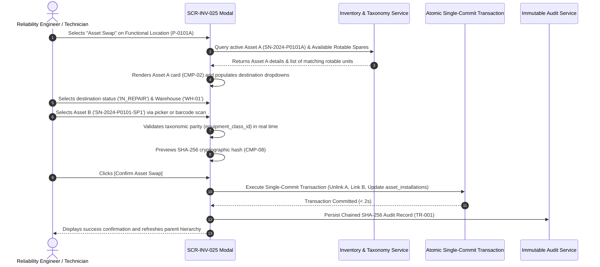

# SCR-INV-025: Rotable Asset Rotation and Replacement Modal (Asset Swap)

## 1. Purpose and Operational Context

* **View Objective:** Atomic, transactional substitution of an active physical Level 6 Equipment Unit (Asset A) mounted at a Level 5 Functional Location by an identical replacement rotable unit from warehouse inventory (Asset B) without altering the Functional Location master identity. Enforces ISO 14224 (Section 6) taxonomy by preserving historical MTBF reliability tracking on the individual physical machine while keeping the functional tag continuously active.
* **Primary Target Persona:** Reliability Engineer evaluating equipment reliability trends, recording rotable machine swaps, and commissioning overhauled units into operational positions.
* **Secondary Personas:**
  * **Maintenance Technician:** Performs physical field swap, scans replacement serial barcodes, and confirms dismantling destination.
  * **Warehouse Manager:** Reconciles rotable inventory movements and receives dismantled units into the repair workshop.
  * **Maintenance Supervisor:** Approves equipment substitutions associated with high-priority corrective work orders.
* **Operational Context:** Accessible both in the field via rugged industrial tablets (`--dt-breakpoint-md`, `--dt-breakpoint-lg`) during physical dismounting, and in engineering control offices on desktop workstations (`--dt-breakpoint-xl`).
* **Mode of Operation:** Contextual Transactional Modal Task. Operates as an interruptive modal overlay on desktop workstations ($640\text{px}$ dialog) and as a responsive bottom sheet on industrial mobile/portrait viewports (initial height: `min(45vh, var(--dt-layout-drawer-width-desktop))`, expandable up to $85\text{vh}$). Excludes continuous process telemetry manipulation, focusing strictly on asset lifecycle state transitions, barcode scanning, and cryptographic audit persistence.

---

## 2. Visual Artifact


> *Note: Conceptual wireframe illustrating the Asset Swap container, dual equipment inspection cards (Asset A Dismounting vs. Asset B Installation), barcode scan trigger, taxonomic compatibility validation pill, and cryptographic audit summary.*

---

## 3. Functional Component Inventory

> The base layout, typography, and design tokens are inherited from [DT-UI-DS-DOC-001](../../DT-UI-DS-DOC-001.md). This table defines the present components, semantic tokens, and architectural roles. Detailed interaction rules, layout constraints, and geometric algorithms are strictly specified in Section 5.
>
> *Rule:* Table cells must strictly serve as a visual catalog of roles, semantic tokens, and pointers to Section 5. Never embed interaction algorithms, clamping math, state machine logic, or raw CSS styles in table cells.

| ID | Control / Component | Visual Role / Content | Semantic Token | Architectural Role & Reference |
| :--- | :--- | :--- | :--- | :--- |
| `CMP-01` | Modal Container & Header | Modal shell / Bottom sheet header | Surface: `--dt-color-surface-card`<br>Border: `--dt-color-border-panel`<br>Elevation: `--dt-z-modal` | Hosts title ("Rotable Asset Swap"), Functional Location tag (`P-0101A`), Equipment Class badge, and close button. Adapts from desktop centered dialog ($640\text{px}$) to tactile bottom sheet on mobile portrait. |
| `CMP-02` | Asset A Dismounting Card | Currently installed machine card | Surface: `--dt-color-surface-base`<br>Border: `--dt-color-border-subtle`<br>Radius: `--dt-radius-md` | Displays active asset details: Serial Number (`SN-2024-P0101A`), Model, Current Running Hours, and Installation Date. Hosts mandatory destination controls (`CMP-03`). |
| `CMP-03` | Destination Status & Warehouse Controls | Status selector and warehouse picker | Surface: `--dt-color-surface-base`<br>Border: `--dt-color-border-subtle` | Dropdown pair requiring destination operational status (`IN_REPAIR`, `IN_STORAGE`, `DAMAGED`) and holding warehouse (`WH-01`, `WH-02`). Hard-blocks submission if left unassigned (`AF-002`). |
| `CMP-04` | Asset B Selection Card | Replacement rotable picker card | Surface: `--dt-color-surface-base`<br>Border: `--dt-color-border-subtle`<br>Radius: `--dt-radius-md` | Hosts replacement equipment selector, serial number display, optical scan trigger (`CMP-05`), and live taxonomic compatibility badge (`CMP-06`). |
| `CMP-05` | Barcode / NFC Scan Trigger | Tactile camera/scanner button | Surface: `--dt-color-surface-raised`<br>Border: `--dt-color-border-subtle`<br>Height: $\ge 48\text{px}$ | Activates camera-based barcode scanning or Web NFC reader to instantly select Asset B by physical asset barcode tag (`FR-592`). Touch target complies with `--dt-touch-target-mobile`. |
| `CMP-06` | Taxonomic Compatibility Indicator | Real-time validation badge | Dynamic Surface: `--dt-color-state-success` or `--dt-color-alarm-critical` | Validates that Asset B matches the exact `equipment_class_id` of the Functional Location and is currently in `IN_STORAGE`/`AVAILABLE` status (`AF-001`, `FR-593`). |
| `CMP-07` | Work Order Linkage Field | Optional justifying WO input | Surface: `--dt-color-surface-base`<br>Border: `--dt-color-border-subtle` | Searchable input linking the equipment swap transaction to a justifying work order (e.g. `WO-2026-0841`). |
| `CMP-08` | Cryptographic Audit Hash Strip | Chained SHA-256 preview strip | Surface: `--dt-color-surface-raised`<br>Font: `--dt-font-family-mono` | Displays real-time generated SHA-256 hash chaining payload (`TR-001`), visualizing the immutable cryptographic audit record dispatched with the transaction. |
| `CMP-09` | Atomic Commit Action Button | Primary transactional confirm button | Surface: Dynamic (`--dt-color-state-info` or disabled opacity 0.45) | Primary action `[Confirm Asset Swap]`. Enforces single-commit atomic execution (`NFR-596`); disabled until all taxonomic and destination constraints are satisfied. |
| `CMP-10` | Cancellation & Dismiss Button | Secondary cancellation control | Surface: `--dt-color-surface-raised`<br>Border: `--dt-color-border-subtle` | Safely dismisses the modal without altering database configuration or location links. |

---

## 4. Screen State Matrix

| State | Visual Modification in the Interface | Activation Condition |
| :--- | :--- | :--- |
| **Normal / Default** | Modal open over backdrop. Asset A details populated. Destination dropdowns unselected. Asset B selector empty. `CMP-09` is disabled (`opacity: 0.45`). | User triggers "Asset Swap" from Functional Location detail or Work Order panel. |
| **Scanning Barcode / NFC** | Modal displays camera viewfinder overlay with scanning reticle and cancel button. Status text: *"Align barcode within reticle..."* | Technician taps `CMP-05` on mobile tablet or workstation with barcode reader. |
| **Taxonomic Incompatibility (AF-001)** | Asset B card highlights with red border (`--dt-color-alarm-critical`). `CMP-06` displays critical badge: *"Taxonomic Incompatibility: Asset belongs to Class B-PMP-REC, expected B-PMP-CENT"*. `CMP-09` is hard-disabled. | Selected replacement equipment does not share identical `equipment_class_id` or is not available in warehouse (`AF-001`). |
| **Incomplete Destination (AF-002)** | Destination fields in `CMP-03` highlight with amber focus outline (`--dt-color-alarm-warning`, $2\text{px}$) and warning icon `#icon-warning`. Error banner indicates: *"Mandatory dismantling destination required"*. | User attempts to confirm swap without selecting destination status or warehouse (`AF-002`). |
| **Ready for Execution** | All fields valid. `CMP-06` displays Teal badge: *"Taxonomic Compatibility Confirmed (Sulzer OH2 API 610)"*. Hash strip `CMP-08` displays valid SHA-256 preview. `CMP-09` becomes active. | Valid Asset B selected + Asset A destination selected + WO linked. |
| **Executing Atomic Commit** | `CMP-09` renders loading spinner shimmer (`--dt-color-surface-raised`). All form inputs disabled to prevent duplicate submissions. | User taps `[Confirm Asset Swap]`. |
| **Swap Completed (Success)** | Modal transitions to success checkmark animation (`--dt-color-state-success`), displays transaction summary and new installation ID, then automatically closes after $1.5\text{s}$. | Atomic database transaction commits successfully in $< 2\text{s}$ (`NFR-597`). |

---

## 5. Interaction Rules and Data Flow

### 5.1. Initial Load & Lifecycle



1. **Initial Context Binding:** The modal initializes with the context of the active Functional Location (`functional_location_id`). It queries the active mounted equipment unit details (`InstalledAssetDetailsDto`) currently mapped to the target location tag.
2. **Rotable Spares Filtering:** The system queries available rotable spare units (`RotableSpareSummaryDto`) satisfying taxonomic compatibility:
   $$\text{equipment\_class\_id} = \text{FL.equipment\_class\_id} \quad \land \quad \text{operational\_status} = \text{'IN\_STORAGE'} \quad \land \quad \text{functional\_location\_id IS NULL}$$
3. **Atomic Single-Commit Invariant (`NFR-596`):** The swap operation executes via the `ExecuteAssetSwapCommand` payload dispatched to `POST /api/v1/inventory/rotable-swaps`:
   * **Step A:** Disassociates Asset A from the location, updating its operational status to the selected destination status (`IN_REPAIR`, `IN_STORAGE`, or `DAMAGED`) and assigning it to the designated holding warehouse.
   * **Step B:** Terminates the active mounting interval for Asset A with the current UTC timestamp.
   * **Step C:** Mounts replacement Asset B to the target functional location, transitioning its operational status to `OPERATIONAL` with current operational commencement date.
   * **Step D:** Establishes the new active mounting record associating Asset B, the functional location tag, justifying work order reference, and technician credentials.
   * **Step E:** Appends a cryptographically chained audit record with SHA-256 hash verification (`TR-001`).

---

### 5.2. Modal Mechanics & Tactile Ergonomics

1. **Desktop vs. Mobile Viewport Adaptation:**
   * **Desktop Workstation ($\ge 1400\text{px}$, `--dt-breakpoint-xl`):** Centered modal window ($640\text{px}$ width, max-height $80\text{vh}$) with dark backdrop dimming (`rgba(0,0,0,0.65)`). Keyboard navigation: `Escape` cancels, `Enter` confirms when form is valid.
   * **Industrial Tablet Portrait ($600\text{px} - 900\text{px}$, `--dt-breakpoint-md`):** Renders as a **Bottom Sheet**, docking at the bottom edge with initial height `min(45vh, var(--dt-layout-drawer-width-desktop))` expandable via drag handle to $85\text{vh}$.
2. **Tactile Targets:** All interactive controls (status dropdowns, barcode scan button, confirm action) enforce touch targets $\ge 48\times 48\text{px}$ with $\ge 8\text{px}$ margin separation to ensure comfortable operation with industrial gloves (`TR-010`).
3. **Barcode Scanning Mechanics:** Tapping `CMP-05` triggers the Web MediaDevices camera API or industrial laser scan event listener. Scanning an asset barcode immediately resolves the serial number against the inventory catalog, populating Asset B in $< 300\text{ms}$.

---

### 5.3. Domain Workflows & Validation Rules

#### 5.3.1. Taxonomic Compatibility Validation (AF-001)
When Asset B is selected:
1. The client verifies:
   $$\text{AssetB.EquipmentClassId} == \text{AssetA.EquipmentClassId}$$
2. If classes mismatch, the modal interrupts the flow, displays the critical compatibility banner `CMP-06`, and disables `CMP-09`.
3. If Asset B is flagged in any status other than `IN_STORAGE` (e.g. `DAMAGED` or `DECOMMISSIONED`), the selection is rejected with alert: *"Selected equipment is not available in warehouse inventory"*.

#### 5.3.2. Dismantling Destination Enforcement (AF-002)
To eliminate logical asset orphanhood:
1. Destination status `CMP-03` requires an explicit selection from `{IN_REPAIR, IN_STORAGE, DAMAGED}`.
2. Holding warehouse `CMP-03` requires an explicit selection from active storage warehouses.
3. If either field is omitted, clicking `[Confirm Asset Swap]` applies WCAG 2.1 AA redundant coding (amber focus ring + warning icon `#icon-warning` + inline text label), blocking submission.

#### 5.3.3. Cryptographic Audit Trail Chaining (TR-001)
Upon confirmation, the client computes the candidate payload hash:
$$\text{payload\_hash} = \text{SHA-256}(\text{prev\_hash} \parallel \text{user\_id} \parallel \text{fl\_tag} \parallel \text{serial\_a} \parallel \text{serial\_b} \parallel \text{wo\_id} \parallel \text{timestamp})$$
The resulting cryptographic hash is bound to the transaction payload, chained to `previous_hash` to guarantee unalterable lifecycle traceability.

---

## 6. Industrial and Safety Considerations

* **ANSI/ISA-101 HPHMI Compliance ([TR-011](../../../requirements/common/TR-011.md)):** The modal maintains a subdued grayscale palette (`--dt-color-surface-card`, `--dt-color-surface-base`). Saturated colors are restricted to:
  * Green (`--dt-color-state-success`) for verified taxonomic compatibility.
  * Amber (`--dt-color-alarm-warning`) for missing mandatory fields (`AF-002`).
  * Red (`--dt-color-alarm-critical`) for taxonomic class mismatches (`AF-001`).
* **Taxonomic Safety Interlock:** Physical equipment rotation must never violate process engineering boundaries (e.g., mounting a low-pressure pump on a high-pressure crude export manifold). Hardware and taxonomic validation prevents operator error.
* **Offline Fault Resilience ([TR-007](../../../requirements/common/TR-007.md)):** When executed on disconnected mobile tablets, the atomic swap payload is committed to local encrypted storage (`IOfflineStorage` / SQLCipher) and queued in the Outbox with an offline lease token, synchronizing automatically upon reconnecting to plant Wi-Fi.

---

## 7. Frontend Component Contract (Blazor / Razor)

### 7.1. Component Hierarchy & File Mapping

```text
Components/Inventory/
└── AssetSwapModal.razor                               # Root Modal Container (SCR-INV-025)
    ├── DismountedAssetCard.razor                      # CMP-02 & CMP-03: Asset A details & destination
    ├── ReplacementAssetCard.razor                     # CMP-04: Asset B selection & specs
    │   ├── BarcodeScannerButton.razor                 # CMP-05: Tactile scan trigger
    │   └── TaxonomicCompatibilityBadge.razor          # CMP-06: Parity validation badge
    ├── WorkOrderReferenceInput.razor                  # CMP-07: WO justification linkage
    └── ChainedAuditPreviewStrip.razor                 # CMP-08: Cryptographic hash strip
```

---

### 7.2. Physical Component Parameters & DTO Contracts (.NET 10 / C# 14)

#### 7.2.1. `AssetSwapModal.razor` (Root View)

```csharp
[Parameter, EditorRequired]
public required string FunctionalLocationId { get; set; }

[Parameter, EditorRequired]
public required string FunctionalLocationTag { get; set; }

[Parameter]
public string? PreselectedWorkOrderId { get; set; }

[Parameter]
public bool IsVisible { get; set; }

[Parameter]
public EventCallback<AssetSwapCompletedEvent> OnSwapCompleted { get; set; }

[Parameter]
public EventCallback OnCancelled { get; set; }
```

#### 7.2.2. DTOs and Transaction Commands

```csharp
public record InstalledAssetDetailsDto(
    Guid EquipmentUnitId,
    string SerialNumber,
    string Manufacturer,
    string Model,
    Guid EquipmentClassId,
    string EquipmentClassName,
    long OperatingHours,
    DateTimeOffset InstallationDate
);

public record RotableSpareSummaryDto(
    Guid EquipmentUnitId,
    string SerialNumber,
    string Manufacturer,
    string Model,
    Guid EquipmentClassId,
    string EquipmentClassName,
    string OperationalStatus,
    Guid WarehouseId,
    string WarehouseName,
    bool IsCompatible
);

public record ExecuteAssetSwapCommand(
    Guid FunctionalLocationId,
    Guid DismountedAssetId,
    string DestinationStatus,
    Guid HoldingWarehouseId,
    Guid ReplacementAssetId,
    Guid? JustifyingWorkOrderId,
    string TechnicianUserId,
    string PreviousHash
);

public record AssetSwapCompletedEvent(
    Guid InstallationId,
    string FunctionalLocationTag,
    string DismountedSerialNumber,
    string InstalledSerialNumber,
    string CryptographicHash,
    DateTimeOffset Timestamp
);
```

---

### 7.3. Client-Side DOM & Interop Bridge

1. **Barcode / NFC Scanner Interop (`barcodeScannerInterop.js`):** Client-side bridge interfacing with Barcode Detection API or industrial camera stream, parsing Code 128 / QR / DataMatrix labels and triggering Blazor event callbacks without latency.
2. **Tactile Drag Handle Interop (`bottomSheetGesture.js`):** Shared gesture physics engine enabling smooth touch dragging on industrial tablets between $45\text{vh}$ and $85\text{vh}$ with hysteresis snapping.
3. **Web Cryptography SHA-256 Bridge:** Computes candidate `payload_hash` in client memory (`crypto.subtle.digest`) for immediate display in `CMP-08`.

---

## 8. Layout and Responsive Adaptability

| Viewport / Breakpoint | Layout Organization | Ergonomic Rules |
| :--- | :--- | :--- |
| **Desktop Workstation**<br>($\ge 1920\text{px}$, `--dt-breakpoint-xl`) | Centered modal dialog ($640\text{px}$ width, max-height $80\text{vh}$); dual-card horizontal layout comparing Asset A vs. Asset B. | Mouse click interaction; `Tab` key focus cycling; `Enter` to commit; `Escape` to cancel. |
| **Industrial Tablet Landscape**<br>($1280\text{px} - 1919\text{px}$, `--dt-breakpoint-lg` / $1280\times 800\text{px}$) | Centered modal container ($580\text{px}$ width); vertically stacked Asset A and Asset B cards. | Touch targets $\ge 48\text{px}$; large barcode scan button; clear contrast borders. |
| **Industrial Tablet Portrait**<br>($768\text{px} - 1279\text{px}$, `--dt-breakpoint-md` / $800\times 1280\text{px}$) | **Bottom Sheet Container** docking at bottom; initial compact height `min(45vh, var(--dt-layout-drawer-width-desktop))`, expandable via touch drag handle to $85\text{vh}$. | Drag handle gesture support; gloved touch targets $\ge 48\times 48\text{px}$ with $\ge 8\text{px}$ margin; sticky footer button `[Confirm Asset Swap]` always visible. |

---

## 9. Traceability and Requirements Matrix

| Requirement | Addressed in Component | Verification & Implementation Mechanism |
| :--- | :--- | :--- |
| [FR-591](../../../requirements/user-stories/inv/INV-025.md#functional-requirements-fr) | `CMP-01`, `CMP-02`, `CMP-04` | Interface executes functional replacement of physical Level 6 equipment at Level 5 location. |
| [FR-592](../../../requirements/user-stories/inv/INV-025.md#functional-requirements-fr) | `CMP-03`, `CMP-09` | Atomically updates uninstalled asset status to "In Repair", "In Storage", or "Damaged". |
| [FR-593](../../../requirements/user-stories/inv/INV-025.md#functional-requirements-fr) | `CMP-04`, `CMP-06` | Validates replacement unit is "Available" / "In Storage" and matches `equipment_class_id` (`AF-001`). |
| [FR-594](../../../requirements/user-stories/inv/INV-025.md#functional-requirements-fr) | `CMP-04`, `CMP-09` | Associates new unit to location, immediately switching status to "Operational" with current date. |
| [FR-595](../../../requirements/user-stories/inv/INV-025.md#functional-requirements-fr) | `CMP-08`, `CMP-09` | Records rotation details in audit log: location tag, uninstalled serial, installed serial, user, WO reference. |
| [NFR-596](../../../requirements/user-stories/inv/INV-025.md#non-functional-requirements-nfr) | `CMP-09` | Single-commit database transaction ensuring atomic execution or complete rollback. |
| [NFR-597](../../../requirements/user-stories/inv/INV-025.md#non-functional-requirements-nfr) | `CMP-09` | Hierarchical update and status changes complete in $< 2\text{s}$ on server. |
| [TR-001](../../../requirements/common/TR-001.md) | `CMP-08`, `CMP-09` | Immutable append-only audit trail logging with SHA-256 hash chaining. |
| [TR-005](../../../requirements/common/TR-005.md) | `CMP-01` | Adheres to DDD Bounded Contexts (`tax`, `inv`, `adm`) without cross-boundary bleeding. |
| [TR-006](../../../requirements/common/TR-006.md) | `CMP-01` | Enforces RBAC permissions (`Reliability Engineer`, `Technician`, `Supervisor`). |
| [TR-008](../../../requirements/common/TR-008.md) | `CMP-06` | Enforces ISO 14224 taxonomic constraints and class parity in domain rules. |
| [TR-010](../../../requirements/common/TR-010.md) | `CMP-03`, `CMP-05`, `CMP-09`| Tactile touch targets comply with $\ge 48\times 48\text{px}$ for gloved field operation. |
| [TR-011](../../../requirements/common/TR-011.md) | `CMP-01`..`CMP-10` | ANSI/ISA-101 HPHMI: 90/10 grayscale palette, saturated color reserved for status and alerts. |
