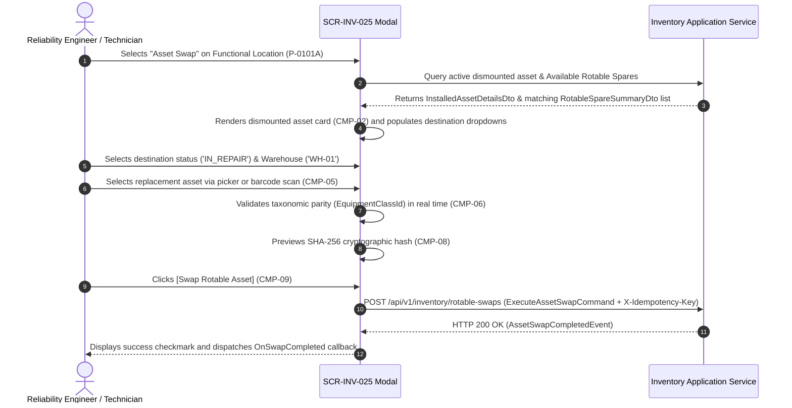

# SCR-INV-025: Rotable Asset Rotation and Replacement Modal (Asset Swap)

## 1. Purpose and Operational Context

* **View Objective:** Atomic, transactional substitution of an active physical Level 6 Equipment Unit (dismounted asset) mounted at a Level 5 Functional Location by an identical replacement rotable unit from warehouse inventory without altering the Functional Location master identity. Enforces ISO 14224 (Section 6) taxonomy by preserving historical MTBF reliability tracking on the individual physical machine while keeping the functional tag continuously active.
* **Primary Target Persona:** Reliability Engineer evaluating equipment reliability trends, recording rotable machine swaps, and commissioning overhauled units into operational positions.
* **Secondary Personas:**
  * **Maintenance Technician:** Performs physical field swap, scans replacement serial barcodes, and confirms dismantling destination.
  * **Warehouse Manager:** Reconciles rotable inventory movements and receives dismantled units into the repair workshop.
  * **Maintenance Supervisor:** Approves equipment substitutions associated with high-priority corrective work orders.
* **Operational Context:** Accessible in field environments on rugged industrial tablets during physical equipment dismounting, and in control offices on desktop workstations. Detailed responsive profiles and breakpoints are specified in Section 8.
* **Mode of Operation:** Contextual Transactional Modal Task. Deploys as a centered modal dialog across workstation and tablet viewports. Excludes continuous process telemetry manipulation, focusing strictly on asset lifecycle state transitions, barcode scanning, and cryptographic audit persistence. Detailed interaction rules and dimensions are specified in §5.2 and §8.

---

## 2. Visual Artifact

### 2.1. Rotable Asset Swap Modal (Dark Theme)


> *Note: Production UI prototype capture illustrating the centered rotable asset swap modal at 1280×800 in Dark Theme. Exhibits the sequential single-column vertical stack (Dismounted Asset CMP-02 stacked above Replacement Asset CMP-04 with Key-Top / Value-Bottom metadata grids), auxiliary stack with Work Order linkage (CMP-07) and SHA-256 digital integrity seal (CMP-08), and grounded commit trigger (CMP-09) paired with capsule validation pill (CMP-06).*

### 2.2. Rotable Asset Swap Modal (Light Theme)


> *Note: Production UI prototype capture illustrating the centered rotable asset swap modal at 1280×800 in Light Theme.*

---

## 3. Functional Component Inventory

> The base grid, typography, neutral palettes, and minimal tactile contact areas are inherited from [DT-UI-DS-DOC-001](../../DT-UI-DS-DOC-001.md). This inventory defines the canonical components present on the screen, their design tokens, and their architectural scope. Interaction rules and geometric algorithms are specified in Section 5; responsive container adaptations are governed by Section 8.

1. **`CMP-01`: Modal Container & Header**
   - **Visual Role:** Centered transactional modal shell and header hosting the monospace Functional Location tag badge (`P-0101A`), modal title (*"Rotable Asset Swap"*), technical subtitle (*"Functional Location: TFA-CSS-P-0101A · Required Class: B-PMP-CENT"*), and dismiss control (`CMP-10`).
   - **Design Tokens:**
     - Surface: `--dt-color-surface-card`
     - Backdrop: `--dt-color-surface-overlay`
     - Border: `--dt-color-border-subtle`
     - Width & Max-Height: `--dt-layout-modal-width` (`--dt-layout-modal-width-desktop` / `--dt-layout-modal-width-tablet`), `--dt-layout-modal-max-height`
     - Radius: `--dt-radius-xl`
     - Elevation: `--dt-z-modal`
   - **Architectural Scope:** Root transactional modal container enforcing keyboard focus trapping and single-column sequential layout across workstation and tablet viewports ([DT-UI-DS-DOC-001 §2.4](../../DT-UI-DS-DOC-001.md#24-structural-layout-and-dimensional-tokens)). Detailed in §5.2 and §8.

2. **`CMP-02`: Dismounted Asset Card**
   - **Visual Role:** Upper section displaying the currently mounted Equipment Unit metadata (`SerialNumber`, `EquipmentClassName`, `Manufacturer` / `Model`, `OperatingHours`, and `InstallationDate`) in a 2-column stacked key-value grid alongside mandatory destination selectors (`CMP-03`).
   - **Design Tokens:**
     - Surface: `--dt-color-surface-card`
     - Divider: `--dt-color-border-subtle`
     - Typography: `--dt-font-caption`, `--dt-font-body-md`, `--dt-font-mono-data`
   - **Architectural Scope:** Presents the active equipment unit to be dismounted via `FunctionalLocation.UninstallEquipment()` ([DT-DM-DOC-002 §2.1](../../../domain-models/class/DT-DM-DOC-002.md#2-layer-1-asset-taxonomy-iso-14224)). Stacked sequentially above `CMP-04`. Detailed in §5.1.

3. **`CMP-03`: Destination Status & Warehouse Controls**
   - **Visual Role:** Two-column dropdown pair capturing the post-dismount destination status (`IN_REPAIR`, `IN_STORAGE`, `DAMAGED`) and receiving storage warehouse or workshop (`HoldingWarehouseId`).
   - **Design Tokens:**
     - Surface: `--dt-color-surface-card`
     - Border: `--dt-color-border-subtle`, `--dt-color-alarm-warning` (Validation Error)
     - Control Height: `--dt-control-height-lg`
     - Radius: `--dt-radius-md`
   - **Architectural Scope:** Prevents logical equipment orphanhood by mandating custody and 4-dimensional lifecycle transition targets prior to dismounting (`FR-592`, `AF-002`). Detailed in §5.3.2 and §7.2.3.

4. **`CMP-04`: Replacement Asset Card**
   - **Visual Role:** Middle section hosting the full-width rotable spare selector and optical scan trigger (`CMP-05`) above a 2-column stacked key-value grid displaying replacement unit specifications (`SerialNumber`, `EquipmentClassName`, `Manufacturer` / `Model`, `OperatingHours`, and `WarehouseName`).
   - **Design Tokens:**
     - Surface: `--dt-color-surface-card`
     - Border: `--dt-color-border-subtle`, `--dt-color-alarm-critical` (Class Mismatch)
     - Typography: `--dt-font-caption`, `--dt-font-body-md`, `--dt-font-mono-data`
   - **Architectural Scope:** Governs candidate replacement unit selection and mounting via `FunctionalLocation.InstallEquipment()` (`FR-593`, `FR-594`). Detailed in §5.1 and §5.3.1.

5. **`CMP-05`: Barcode / NFC Scan Trigger**
   - **Visual Role:** Tactile scan button docked as a unified right addon to the replacement rotable selector dropdown, opening the camera/laser barcode reticle overlay with a simulation trigger (`[Simulate Barcode Scan]`).
   - **Design Tokens:**
     - Surface: `--dt-color-surface-btn-secondary`
     - Border: `--dt-color-border-subtle`
     - Touch Target: `--dt-touch-target-mobile`
     - Radius: `--dt-radius-md`
   - **Architectural Scope:** Invokes `IBarcodeScannerInterop` to resolve physical nameplate barcodes against warehouse rotable inventory in $< 300\text{ms}$. Detailed in §5.2 and §7.3.

6. **`CMP-06`: Taxonomic Compatibility Indicator**
   - **Visual Role:** Capsule validation pill grounded on the left side of the modal footer, displaying 4-channel redundant feedback (`#icon-check` + Teal `--dt-color-state-success` when compatible: *"Compatible Class (B-PMP-CENT) · Ready to Confirm"*; `#icon-warning` Amber or `#icon-ban` Red on validation conflicts).
   - **Design Tokens:**
     - Radius: `--dt-radius-full`
     - Compatible State: `--dt-color-state-success`
     - Incomplete State: `--dt-color-alarm-warning`
     - Incompatible State: `--dt-color-alarm-critical`
   - **Architectural Scope:** Immediate visual gatekeeper for taxonomic `EquipmentClassId` parity and destination completeness ([DT-UI-DS-DOC-001 §6.5.1](../../DT-UI-DS-DOC-001.md#651-morphological-differentiation-status-badges-vs-interactive-buttons)). Hidden in default unselected state (`CLS = 0`). Detailed in §5.3.1.

7. **`CMP-07`: Work Order Linkage Field**
   - **Visual Role:** Searchable reference input linking the rotable swap transaction to a justifying maintenance Work Order (e.g., `WO-2026-0842`), captioned `Optional`.
   - **Design Tokens:**
     - Surface: `--dt-color-surface-card`
     - Border: `--dt-color-border-subtle`
     - Control Height: `--dt-control-height-lg`
     - Radius: `--dt-radius-md`
   - **Architectural Scope:** Associates the inventory transaction (`InventoryTransaction.WorkOrderId`) with the originating maintenance intervention (`FR-595`). Detailed in §5.1.

8. **`CMP-08`: Cryptographic Audit Hash Readout**
   - **Visual Role:** Borderless single-line monospace readout displaying the real-time candidate SHA-256 integrity seal (`—` when incomplete).
   - **Design Tokens:**
     - Surface: transparent (on `--dt-color-surface-card`)
     - Typography: `--dt-font-mono-data`
     - Text: `--dt-color-text-muted`
   - **Architectural Scope:** Previews the tamper-evident SHA-256 hash chain payload ([TR-001](../../../requirements/common/TR-001.md), [ADR-003](../../../architecture/adr/ADR-003.md)) prior to atomic commit. Detailed in §5.3.3.

9. **`CMP-09`: Atomic Commit Action Button**
   - **Visual Role:** Primary rectangular action button (`[Swap Rotable Asset]`) anchored on the right side of the modal footer.
   - **Design Tokens:**
     - Enabled Surface: `--dt-color-state-info` (Text: `--dt-primitive-gray-10`)
     - Disabled Surface: `--dt-color-state-disabled`
     - Touch Target: `--dt-touch-target-mobile`
     - Radius: `--dt-radius-md`
   - **Architectural Scope:** Dispatches `ExecuteAssetSwapCommand` within a single-commit ACID boundary (`NFR-596`); hard-disabled until all taxonomic and destination invariants are satisfied. Detailed in §5.3.4.

10. **`CMP-10`: Modal Close & Dismiss Action**
    - **Visual Role:** Top-right header close icon button (`×`) and `Escape` key handler.
    - **Design Tokens:**
      - Surface: transparent
      - Text: `--dt-color-text-muted`
      - Touch Target: `--dt-touch-target-mobile`
    - **Architectural Scope:** Safely aborts the modal workflow without mutating functional location occupancy or warehouse custody. Detailed in §5.2.

---

## 4. Screen State Catalog

1. **Normal / Default**
   - **Activation Condition:** User triggers "Asset Swap" from the Equipment Master Data Card ([SCR-INV-005](SCR-INV-005.md)) or Mobile Work Order Execution ([SCR-MTTO-002](../mtto/SCR-MTTO-002.md)).
   - **Visual Modification:** Modal opens centered over a dimmed backdrop (`--dt-color-surface-overlay`). Dismounted asset details populate with active installation metadata. Destination dropdowns start unselected and replacement asset selector starts empty. Cryptographic hash readout `CMP-08` displays `—`. Footer validation slot `CMP-06` remains hidden (`CLS = 0`), and `CMP-09` (`[Swap Rotable Asset]`) is disabled (`--dt-color-state-disabled`).

2. **Scanning Barcode / NFC**
   - **Activation Condition:** Technician taps `CMP-05` on a mobile tablet or workstation equipped with a camera or barcode reader.
   - **Visual Modification:** Modal displays the camera viewfinder overlay with scanning reticle, status prompt (*"Align the rotable asset barcode label within the reticle..."*), and simulation trigger (`[Simulate Barcode Scan]`).

3. **Taxonomic Incompatibility (`AF-001`)**
   - **Activation Condition:** Selected replacement equipment does not share an identical `EquipmentClassId` or is not available in warehouse storage (`AF-001`).
   - **Visual Modification:** Replacement asset card (`CMP-04`) highlights with a critical red border (`--dt-color-alarm-critical`). Footer validation badge `CMP-06` displays a critical alert (`#icon-ban`): *"Incompatible: Class B-PMP-REC (requires B-PMP-CENT)"* or *"Incompatible: Unit currently under maintenance"*. `CMP-09` remains hard-disabled.

4. **Incomplete Destination (`AF-002`)**
   - **Activation Condition:** User attempts to confirm the swap without selecting a destination status or receiving warehouse (`AF-002`).
   - **Visual Modification:** Unselected destination controls in `CMP-03` highlight with an amber outline (`--dt-color-alarm-warning`) and `#icon-warning` glyph. Footer validation badge `CMP-06` displays: *"Select destination status and receiving warehouse"*.

5. **Ready for Execution**
   - **Activation Condition:** Valid compatible replacement asset selected + dismounted asset destination status and receiving warehouse selected + optional Work Order linked.
   - **Visual Modification:** `CMP-06` renders a Teal confirmation pill (`--dt-color-state-success`, `#icon-check`): *"Compatible Class (B-PMP-CENT) · Ready to Confirm"*. Hash readout `CMP-08` displays the live 64-character SHA-256 preview. Primary CTA `CMP-09` (`[Swap Rotable Asset]`) unlocks in `--dt-color-state-info`.

6. **Executing Atomic Commit**
   - **Activation Condition:** User activates `[Swap Rotable Asset]` (`CMP-09`).
   - **Visual Modification:** `CMP-09` renders a loading state (`--dt-color-surface-raised`) with label *"Processing asset swap..."*. All form inputs lock to prevent duplicate submissions.

7. **Swap Completed (Success)**
   - **Activation Condition:** Single-commit atomic database transaction succeeds in $< 2\text{s}$ (`NFR-597`).
   - **Visual Modification:** Modal transitions to documentary confirmation state (`--dt-color-state-success`, `#icon-check`), displaying *"Rotable Asset Swap Completed Successfully"* with the new `InstallationId`, and automatically dismisses after $1.5\text{s}$.

8. **Offline Queued / Disconnected Execution**
   - **Activation Condition:** User confirms the swap while the industrial tablet is disconnected from the network ([TR-007](../../../requirements/common/TR-007.md)).
   - **Visual Modification:** Modal renders an amber offline strip (`--dt-color-alarm-warning`, `#icon-wifi-off`) in the header: *"OFFLINE MODE — ASSET SWAP WILL BE QUEUED ON DEVICE"*. Confirmation state displays `#icon-sync-pending` with *"Offline Mode — Asset Swap Saved Locally"*, dismissing after $1.5\text{s}$ and incrementing the caller view's pending sync counter.

---

## 5. Interaction Rules and Data Flow

### 5.1. Initial Load & Lifecycle



1. **Initial Context Binding:** The modal initializes with the context of the active Functional Location (`FunctionalLocationId`). It queries active mounted equipment details (`InstalledAssetDetailsDto`) currently mapped to the target location tag.
2. **Rotable Spares Filtering:** The system queries available rotable spare units (`RotableSpareSummaryDto`) satisfying taxonomic parity and warehouse availability:
   $$\text{EquipmentClassId} = \text{FL.EquipmentClassId} \quad \land \quad \text{LifecycleStatus} = \text{IN\_STORAGE} \quad \land \quad \text{MaintenanceStatus} = \text{OPERATIONAL} \quad \land \quad \text{IsMounted} = \text{false}$$
3. **Atomic Single-Commit Invariant (`NFR-596`, `NFR-597`):** The substitution executes as a single-commit atomic command (`ExecuteAssetSwapCommand`). Upon confirmation, the application transitions dismounted equipment to the designated storage warehouse, mounts the replacement rotable unit to the functional location, and appends a SHA-256 chained audit record in $< 2\text{s}$. Detailed command dispatch protocol in §5.3.4.

---

### 5.2. Modal Mechanics & Tactile Ergonomics

1. **Interaction Modality & Container Physics:**
   * **Desktop & Tablet Landscape (Modal Modality):** Operates as a centered modal dialog over a dimmed backdrop (`--dt-color-surface-overlay`). Enforces keyboard focus trapping: `Escape` cancels interaction, and `Enter` confirms when form is valid. Layout bounds and card configurations are detailed in Section 8.
   * **Tablet Portrait (Modal Modality):** Operates as a centered modal container with responsive safety margins, preserving rounded container bounds and focus isolation over the caller screen. Dimensions are detailed in Section 8.
2. **Tactile Targets:** All interactive controls (status dropdowns, barcode scan button, confirm action) enforce touch targets governed by `--dt-touch-target-mobile` with `--dt-space-2` separation to ensure comfortable operation with industrial gloves (`ISO 9241-110 Clause 5.3`).
3. **Barcode Scanning Mechanics:** Tapping `CMP-05` invokes `IBarcodeScannerInterop` optical camera stream or hardware laser scanner listener. Scanning an asset barcode immediately resolves the serial number against the inventory catalog, populating the replacement unit in $< 300\text{ms}$.

---

### 5.3. Domain Workflows & Validation Rules

#### 5.3.1. Taxonomic Compatibility Validation (AF-001)
When the replacement unit is selected:
1. The client verifies:
   $$\text{ReplacementUnit.EquipmentClassId} == \text{DismountedUnit.EquipmentClassId}$$
2. If classes mismatch, the modal interrupts the flow, displays the critical compatibility banner `CMP-06`, and disables `CMP-09`.
3. If the replacement unit is flagged in any lifecycle status other than `IN_STORAGE` or maintenance status other than `OPERATIONAL` (e.g., `DECOMMISSIONED` or `UNDER_MAINTENANCE`), the selection is rejected with alert: *"Selected equipment is not available in warehouse inventory"*.

#### 5.3.2. Dismantling Destination Enforcement (AF-002)
To eliminate logical asset orphanhood, dismounting an equipment unit requires explicit destination mapping onto the 4 orthogonal status dimensions defined in [DT-DM-DOC-001 §4.1–4.4](../../../domain-models/class/DT-DM-DOC-001.md#4-controlled-vocabulary):
1. **Destination Status Mapping (`DismountDestinationStatus`, §7.2.3):**
   * **`DismountDestinationStatus.IN_STORAGE` (Warehouse Ready Stock):** Sets dismounted unit to `LifecycleStatus = IN_STORAGE`, `OperationalStatus = STANDBY`, `MaintenanceStatus = OPERATIONAL` (preserving existing `HealthStatus`), and links custody `WarehouseId = HoldingWarehouseId`.
   * **`DismountDestinationStatus.IN_REPAIR` (Technical Workshop Overhaul):** Sets dismounted unit to `LifecycleStatus = IN_STORAGE`, `OperationalStatus = DOWN`, `MaintenanceStatus = UNDER_MAINTENANCE`, `HealthStatus = SERIOUS`, and links custody `WarehouseId = HoldingWarehouseId`.
   * **`DismountDestinationStatus.DAMAGED` (Quarantine / Unserviceable):** Sets dismounted unit to `LifecycleStatus = IN_STORAGE`, `OperationalStatus = DOWN`, `MaintenanceStatus = UNDER_MAINTENANCE`, `HealthStatus = CRITICAL`, and links custody `WarehouseId = HoldingWarehouseId`.
2. **Replacement Unit Installation Invariant (`FR-594`):**
   * The mounted replacement unit transitions from warehouse custody (`WarehouseId = null`) to `LifecycleStatus = INSTALLED`, `OperationalStatus = STANDBY`, `MaintenanceStatus = OPERATIONAL`, and opens a new active `AssetInstallation` record (`InstalledAtUtc = TimestampUtc`, `RemovedAtUtc = null`).
3. **Holding Warehouse Selection:** Holding warehouse `CMP-03` requires an explicit selection from active storage warehouses.
4. **Validation Guard:** If either destination status or holding warehouse is omitted, clicking `[Swap Rotable Asset]` applies WCAG 2.1 AA redundant coding (amber focus ring + warning icon `#icon-warning` + inline text label), blocking submission.

#### 5.3.3. Cryptographic Audit Trail Chaining (TR-001)
Upon confirmation, the client computes the candidate payload hash matching `ExecuteAssetSwapCommand` (§7.2.3):
$$\text{PayloadHash} = \text{SHA-256}(\text{PreviousHash} \parallel \text{TechnicianUserId} \parallel \text{FunctionalLocationId} \parallel \text{DismountedAssetId} \parallel \text{DestinationStatus} \parallel \text{HoldingWarehouseId} \parallel \text{ReplacementAssetId} \parallel \text{JustifyingWorkOrderId} \parallel \text{TimestampUtc})$$
The resulting cryptographic hash is bound to the transaction command payload, chained to `PreviousHash` to guarantee unalterable lifecycle traceability ([TR-001](../../../requirements/common/TR-001.md)).

#### 5.3.4. Atomic Asset Swap Command Dispatch (`CMP-09`, TR-001, TR-007, ADR-005, ADR-007)
Upon pressing `[Swap Rotable Asset]`, the client dispatches an atomic substitution command against the backend API endpoint:
`POST /api/v1/inventory/rotable-swaps`

* **Client Request Headers:** Includes `X-Idempotency-Key: {uuidv7}` ([ADR-007](../../../architecture/adr/ADR-007.md)) guaranteeing exactly-once transaction processing during network reconnection retries.
* **Command Payload:** Serializes `ExecuteAssetSwapCommand` (§7.2.3) binding functional location, dismounted equipment ID, destination status enum, holding warehouse ID, replacement equipment ID, optional justifying work order reference, technician user ID, and previous cryptographic hash.
* **Backend Persistence Invariant:** The backend orchestrates `ExecuteAssetSwapCommand` within a single-commit atomic transaction ([ADR-005](../../../architecture/adr/ADR-005.md), `NFR-596`): unlinking the dismounted asset, updating destination status and warehouse holding state, mounting the replacement rotable unit, and recording the chained cryptographic audit entry ([TR-001](../../../requirements/common/TR-001.md)). Returns HTTP 200 OK with `AssetSwapCompletedEvent`.
* **Success Handling (HTTP 200 OK):** Transitions UI state to `Swap Completed (Success)`, renders checkmark animation, dispatches `OnSwapCompleted` callback with `AssetSwapCompletedEvent`, and dismisses modal after $1.5\text{s}$.
* **Offline Outbox Fallback (TR-007, TR-002):** On network disconnection or HTTP 5xx timeout, the client serializes `ExecuteAssetSwapCommand` into local encrypted storage via `IOfflineStorage` ([TR-002](../../../requirements/common/TR-002.md)), assigns an offline lease token, displays the "Offline Queued" state (§4), and dismisses after $1.5\text{s}$. Background synchronization worker drains the queue upon reconnecting to plant Wi-Fi.

---

## 6. Industrial and Safety Considerations

* **Taxonomic Safety Interlock (`FR-593` / ISO 14224 §6):** Physical equipment rotation must never violate process engineering battery limits (e.g., mounting a low-pressure utility pump on a high-pressure hydrocarbon manifold). `CMP-06` and the domain service enforce strict `EquipmentClassId` equality and `IN_STORAGE` / `OPERATIONAL` readiness before enabling `CMP-09` (§5.3.1).
* **Cross-Bounded-Context ACID Atomicity (`NFR-596` / [DT-ARQ-DB-DOC-001 §3.9](../../../architecture/DT-ARQ-DB-DOC-001.md#39-cross-dbcontext-atomic-transactions-idbcontexttransaction-sharing-tr-001-tr-005-inv-025)):** Executing an asset swap mutates equipment unit entities, installation records (`FunctionalLocation.UninstallEquipment` $\to$ `EquipmentUnit.TransitionToRepair`/`TransitionToStorage`/`TransitionToDamaged` $\to$ `FunctionalLocation.InstallEquipment` per [DT-DM-DOC-002 §2.1](../../../domain-models/class/DT-DM-DOC-002.md#2-layer-1-asset-taxonomy-iso-14224)), inventory ledger transactions, and audit logs within a single shared database transaction, preventing orphaned equipment or split custody states.
* **Offline Field Continuity & HPHMI Governance ([TR-007](../../../requirements/common/TR-007.md), [TR-011](../../../requirements/common/TR-011.md)):** Swaps executed in RF-shadowed process units are encrypted and queued locally (`IOfflineStorage`) with UUIDv7 idempotency keys ([ADR-007](../../../architecture/adr/ADR-007.md)). Visual surfaces, morphological differentiation between the capsule validation pill (`CMP-06`, `--dt-radius-full`) and primary action button (`CMP-09`, `--dt-radius-md`), and gloved touch targets (`--dt-touch-target-mobile`) adhere strictly to [DT-UI-DS-DOC-001 §1](../../DT-UI-DS-DOC-001.md#1-scope) and [§6.5.1](../../DT-UI-DS-DOC-001.md#651-morphological-differentiation-status-badges-vs-interactive-buttons).

---

## 7. Frontend Component Contract (Blazor / Razor)

### 7.1. Component Hierarchy & File Mapping

```text
Components/Inventory/
└── AssetSwapModal.razor                               # CMP-01 & CMP-10: Root Modal Container & Header Dismiss Action
    ├── DismountedAssetCard.razor                      # CMP-02 & CMP-03: Dismounted asset details & destination controls
    ├── ReplacementAssetCard.razor                     # CMP-04: Replacement rotable selector & specs grid
    │   └── BarcodeScannerButton.razor                 # CMP-05: Tactile optical/laser scan trigger
    ├── WorkOrderReferenceInput.razor                  # CMP-07: Optional Work Order justification linkage
    ├── ChainedAuditPreviewStrip.razor                 # CMP-08: Real-time SHA-256 integrity hash readout
    └── ModalActionFooter.razor                        # CMP-09: Grounded footer with atomic commit CTA
        └── TaxonomicCompatibilityBadge.razor          # CMP-06: Capsule taxonomic & form validation pill
```

---

### 7.2. Physical Component Parameters & DTO Contracts (.NET 10 / C# 14)

#### 7.2.1. `AssetSwapModal.razor` (Root View)

```csharp
[Parameter]
public required Guid FunctionalLocationId { get; set; }

[Parameter]
public required string FunctionalLocationTag { get; set; }

[Parameter]
public Guid? PreselectedWorkOrderId { get; set; }

[Parameter]
public string? PreselectedWorkOrderNumber { get; set; }

[Parameter]
public bool IsVisible { get; set; }

[Parameter]
public EventCallback<AssetSwapCompletedEvent> OnSwapCompleted { get; set; }

[Parameter]
public EventCallback OnCancelled { get; set; }
```

#### 7.2.2. Subcomponent Parameter Contracts (`CMP-01` to `CMP-10`)

```csharp
// CMP-02 & CMP-03: DismountedAssetCard.razor
[Parameter]
public required InstalledAssetDetailsDto InstalledAsset { get; set; }

[Parameter]
public required IReadOnlyList<WarehouseLookupDto> AvailableWarehouses { get; set; }

[Parameter]
public DismountDestinationStatus? DestinationStatus { get; set; }

[Parameter]
public EventCallback<DismountDestinationStatus?> DestinationStatusChanged { get; set; }

[Parameter]
public Guid? HoldingWarehouseId { get; set; }

[Parameter]
public EventCallback<Guid?> HoldingWarehouseIdChanged { get; set; }

[Parameter]
public bool HasDestinationError { get; set; }

// CMP-04: ReplacementAssetCard.razor
[Parameter]
public required IReadOnlyList<RotableSpareSummaryDto> AvailableSpares { get; set; }

[Parameter]
public RotableSpareSummaryDto? SelectedReplacement { get; set; }

[Parameter]
public EventCallback<RotableSpareSummaryDto?> SelectedReplacementChanged { get; set; }

[Parameter]
public bool IsScanning { get; set; }

[Parameter]
public bool HasTaxonomicError { get; set; }

[Parameter]
public EventCallback OnScanTriggered { get; set; }

// CMP-05: BarcodeScannerButton.razor
[Parameter]
public bool IsScanning { get; set; }

[Parameter]
public EventCallback OnScanTriggered { get; set; }

// CMP-07: WorkOrderReferenceInput.razor
[Parameter]
public Guid? WorkOrderId { get; set; }

[Parameter]
public string? WorkOrderNumber { get; set; }

[Parameter]
public EventCallback<Guid?> WorkOrderIdChanged { get; set; }

// CMP-08: ChainedAuditPreviewStrip.razor
[Parameter]
public required string CryptographicPreviewHash { get; set; }

// CMP-09: ModalActionFooter.razor
[Parameter]
public bool? IsCompatible { get; set; }

[Parameter]
public string? ValidationMessage { get; set; }

[Parameter]
public bool CanCommit { get; set; }

[Parameter]
public bool IsSubmitting { get; set; }

[Parameter]
public EventCallback OnCommitConfirmed { get; set; }

// CMP-06: TaxonomicCompatibilityBadge.razor
[Parameter]
public bool? IsCompatible { get; set; }

[Parameter]
public string? CompatibilityMessage { get; set; }
```

#### 7.2.3. Data Transfer Objects (DTOs) and Enums

```csharp
/// <summary>
/// Post-dismount custody and condition disposition mapping onto EquipmentUnit 4D statuses.
/// </summary>
public enum DismountDestinationStatus
{
    IN_REPAIR,
    IN_STORAGE,
    DAMAGED
}

/// <summary>
/// Controlled equipment lifecycle vocabulary per DT-DM-DOC-001 §4.2.
/// </summary>
public enum EquipmentLifecycleStatus
{
    IN_STORAGE,
    INSTALLED,
    COMMISSIONING,
    DECOMMISSIONED
}

/// <summary>
/// Controlled equipment operational status vocabulary per DT-DM-DOC-001 §4.4.
/// </summary>
public enum EquipmentOperationalStatus
{
    UP,
    DOWN,
    STANDBY
}

/// <summary>
/// Controlled equipment maintenance status vocabulary per DT-DM-DOC-001 §4.3.
/// </summary>
public enum EquipmentMaintenanceStatus
{
    OPERATIONAL,
    UNDER_MAINTENANCE,
    UNDER_TEST
}

public record WarehouseLookupDto
{
    public required Guid WarehouseId { get; init; }
    public required string WarehouseCode { get; init; }
    public required string WarehouseName { get; init; }
}

public record InstalledAssetDetailsDto
{
    public required Guid EquipmentUnitId { get; init; }
    public required string SerialNumber { get; init; }
    public required string Manufacturer { get; init; }
    public required string Model { get; init; }
    public required Guid EquipmentClassId { get; init; }
    public required string EquipmentClassName { get; init; }
    public required long OperatingHours { get; init; }
    public required DateOnly InstallationDate { get; init; }
}

public record RotableSpareSummaryDto
{
    public required Guid EquipmentUnitId { get; init; }
    public required string SerialNumber { get; init; }
    public required string Manufacturer { get; init; }
    public required string Model { get; init; }
    public required Guid EquipmentClassId { get; init; }
    public required string EquipmentClassName { get; init; }
    public required long OperatingHours { get; init; }
    public required EquipmentLifecycleStatus LifecycleStatus { get; init; }
    public required EquipmentMaintenanceStatus MaintenanceStatus { get; init; }
    public required EquipmentOperationalStatus OperationalStatus { get; init; }
    public required Guid WarehouseId { get; init; }
    public required string WarehouseName { get; init; }
    public bool IsCompatible { get; init; }
}

public record ExecuteAssetSwapCommand
{
    public required Guid FunctionalLocationId { get; init; }
    public required Guid DismountedAssetId { get; init; }
    public required DismountDestinationStatus DestinationStatus { get; init; }
    public required Guid HoldingWarehouseId { get; init; }
    public required Guid ReplacementAssetId { get; init; }
    public Guid? JustifyingWorkOrderId { get; init; }
    public required Guid TechnicianUserId { get; init; }
    public required string PreviousHash { get; init; }
}

public record AssetSwapCompletedEvent
{
    public required Guid InstallationId { get; init; }
    public required string FunctionalLocationTag { get; init; }
    public required string DismountedSerialNumber { get; init; }
    public required string InstalledSerialNumber { get; init; }
    public required string CryptographicHash { get; init; }
    public required DateTimeOffset Timestamp { get; init; }
}
```

---

### 7.3. Client-Side DOM & Interop Bridge

1. **Optical Barcode & NFC Scanner Interop (`IBarcodeScannerInterop`):**
   * Encapsulates hardware barcode scanners and optical camera streams, parsing Code 128 / QR / DataMatrix serial tags and dispatching selection events without UI thread blocking.
2. **Modal Focus & Keyboard Trap Interop (`IModalFocusInterop`):**
   * Traps keyboard focus (`Tab` / `Shift+Tab`) within the active modal dialog container, binds `Escape` keyboard dismissal, and manages backdrop click outside dismissal.
3. **Web Cryptography SHA-256 Bridge (`ICryptoInterop`):**
   * Computes candidate `PayloadHash` asynchronously in a dedicated Web Worker to preview unalterable cryptographic chaining in `CMP-08`.
4. **Encrypted Offline Storage Interop (`IOfflineStorage`):**
   * Interfaces with client-side encrypted relational storage (SQLCipher / AES-256) for local transactional outbox queuing during offline field operation ([TR-002](../../../requirements/common/TR-002.md), [TR-007](../../../requirements/common/TR-007.md)).

---

## 8. Layout and Responsive Adaptability

### 8.1. Desktop Workstation (`--dt-breakpoint-xl`)
* **Layout Organization:** Centered modal dialog sized by `--dt-layout-modal-width-desktop` and bounded vertically by `--dt-layout-modal-max-height` ([DT-UI-DS-DOC-001 §2.4](../../DT-UI-DS-DOC-001.md#24-structural-layout-and-dimensional-tokens)) over a `--dt-color-surface-overlay` backdrop; unified single-column vertical stack (`CMP-02` Dismounted Asset stacked above `CMP-04` Replacement Asset, separated by a horizontal hairline divider `--dt-color-border-subtle`). Card A hosts a 2-column key-value grid and 2-column destination controls (`CMP-03`). Card B hosts the top-docked full-width rotable selector (`CMP-04`/`CMP-05`) and 5-field metadata grid (including Origin Warehouse and Accumulated Hours). Followed by the single-column auxiliary stack for Work Order linkage (`CMP-07`) and SHA-256 integrity seal (`CMP-08`), and the grounded modal footer (`CMP-09` `[Swap Rotable Asset]` paired with capsule validation pill `CMP-06`).
* **Ergonomic Rules:** Mouse and keyboard navigation; `Tab` key focus cycling trapped inside container; `Enter` commits when form is valid; `Escape` or header close icon (`CMP-10`) dismisses without changes. Fixed control heights (`--dt-control-height-lg`) eliminate content layout shifts (`CLS = 0`). Smooth vertical scrolling with reserved scrollbar gutter track when content exceeds `--dt-layout-modal-max-height`.

### 8.2. Industrial Tablet Landscape (`--dt-breakpoint-lg`)
* **Layout Organization:** Centered modal container sized by `--dt-layout-modal-width-tablet` and bounded vertically by `--dt-layout-modal-max-height`; preserves the unified single-column vertical stack with generous vertical measure. Sequential workflow: Step 1 (Dismounted Asset & Destination) $\to$ Step 2 (Select Replacement & View Specs) $\to$ Step 3 (Work Order Linkage & Hash) $\to$ Footer Validation Gate.
* **Ergonomic Rules:** Touch targets governed by `--dt-touch-target-mobile` with `--dt-space-2` separation for gloved operation; prominent barcode scan trigger (`CMP-05`); header close icon (`CMP-10`) dismisses.

### 8.3. Industrial Tablet Portrait (`--dt-breakpoint-md`)
* **Layout Organization:** Centered modal container sized by `--dt-layout-modal-width-tablet` and bounded vertically by `--dt-layout-modal-max-height`; single-column vertical stack with full-width touch targets. Sticky modal footer (`CMP-09` paired with `CMP-06`) remains permanently reachable at the bottom of the dialog container; header close icon (`CMP-10`) cancels.
* **Ergonomic Rules:** Gloved operation ergonomics with touch targets governed by `--dt-touch-target-mobile`; thumb-reachable action footer (`CMP-09`); smooth vertical scrolling with overscroll containment.

---

## 9. Traceability and Requirements Matrix

| Requirement | Addressed in Component | Verification & Implementation Mechanism |
| :--- | :--- | :--- |
| [FR-591](../../../requirements/user-stories/inv/INV-025.md#functional-requirements-fr) | `CMP-01`, `CMP-02`, `CMP-04` | Interface executes functional replacement of physical Level 6 equipment at Level 5 location. |
| [FR-592](../../../requirements/user-stories/inv/INV-025.md#functional-requirements-fr) | `CMP-03`, `CMP-09` | Atomically updates uninstalled asset status to `IN_REPAIR`, `IN_STORAGE`, or `DAMAGED`. |
| [FR-593](../../../requirements/user-stories/inv/INV-025.md#functional-requirements-fr) | `CMP-04`, `CMP-06` | Validates replacement unit is `IN_STORAGE` / `OPERATIONAL` and matches `EquipmentClassId` (`AF-001`). |
| [FR-594](../../../requirements/user-stories/inv/INV-025.md#functional-requirements-fr) | `CMP-04`, `CMP-09` | Associates new unit to location, atomically transitioning lifecycle status to `INSTALLED`, `OPERATIONAL`, `STANDBY` with current timestamp. |
| [FR-595](../../../requirements/user-stories/inv/INV-025.md#functional-requirements-fr) | `CMP-08`, `CMP-09` | Records rotation details in audit log: location tag, uninstalled serial, installed serial, user, WO reference. |
| [NFR-596](../../../requirements/user-stories/inv/INV-025.md#non-functional-requirements-nfr) | `CMP-09` | Single-commit database transaction ensuring atomic execution or complete rollback. |
| [NFR-597](../../../requirements/user-stories/inv/INV-025.md#non-functional-requirements-nfr) | `CMP-09` | Hierarchical update and status changes complete in $< 2\text{s}$ on server. |
| [TR-001](../../../requirements/common/TR-001.md) | `CMP-08`, `CMP-09` | Immutable append-only audit trail logging with SHA-256 hash chaining ([ADR-003](../../../architecture/adr/ADR-003.md)). |
| [TR-002](../../../requirements/common/TR-002.md) | `CMP-01`, `CMP-09` | Offline Command Outbox and Conflict Management: Encrypted SQLite storage with lease tokens for disconnected operation. |
| [TR-005](../../../requirements/common/TR-005.md) | `CMP-01`, `CMP-09` | Encryption in Transit: Transport layer security (TLS/HTTPS) for all RESTful DTO transmissions and API calls. |
| [TR-006](../../../requirements/common/TR-006.md) | `CMP-01`, `CMP-09` | Role-Based Access Control (RBAC): Enforces permissions (`Reliability Engineer`, `Technician`, `Supervisor`). |
| [TR-007](../../../requirements/common/TR-007.md) | `CMP-01`, `CMP-09` | Offline Operation and Synchronization: Queues atomic swap operations into local outbox storage during field disconnects. |
| [TR-008](../../../requirements/common/TR-008.md) | `CMP-04`, `CMP-06` | ISO 14224 Hierarchy Management and Validation: Enforces taxonomic constraints and class parity in domain rules. |
| [TR-010](../../../requirements/common/TR-010.md) | `CMP-01`, `CMP-09` | Real-time synchronization: broadcasts completed rotable swap events to connected clients via WebSockets (< 1s). |
| [TR-011](../../../requirements/common/TR-011.md) | `CMP-01`..`CMP-10` | ANSI/ISA-101 HPHMI: 90/10 grayscale palette, saturated color reserved for status and alerts. |
| [ADR-003](../../../architecture/adr/ADR-003.md) | `CMP-08`, `CMP-09` | Tamper-evident cryptographic SHA-256 hash chaining on all asset swap mutations. |
| [ADR-005](../../../architecture/adr/ADR-005.md) | `CMP-01`, `CMP-09` | Time-sequential UUIDv7 generation for new Installation record and command idempotency. |
| [ADR-007](../../../architecture/adr/ADR-007.md) | `CMP-09` | Idempotent API message processing via `X-Idempotency-Key` header. |
| [ADR-008](../../../architecture/adr/ADR-008.md) | `CMP-01`, `CMP-09` | AssetInstallation timeline tracking decoupling physical unit from functional location slot. |
