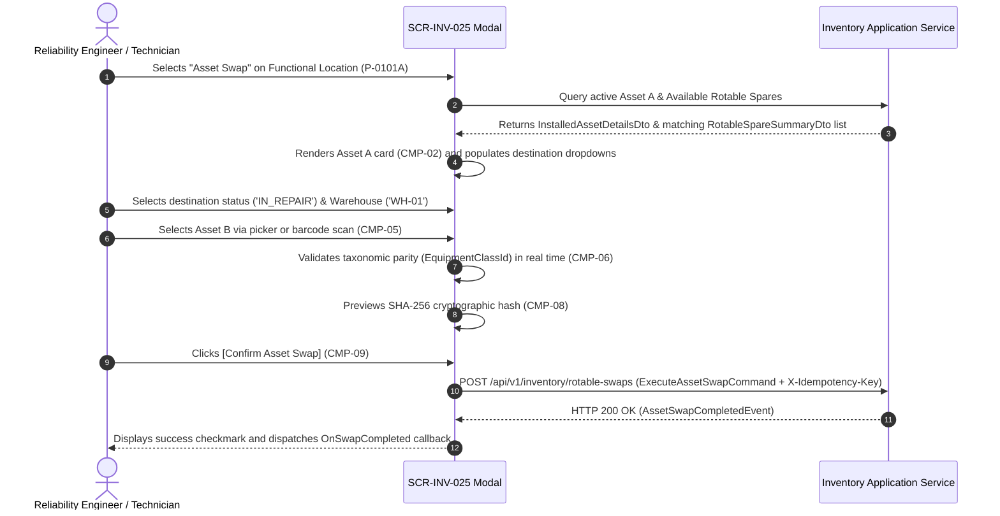

# SCR-INV-025: Rotable Asset Rotation and Replacement Modal (Asset Swap)

## 1. Purpose and Operational Context

* **View Objective:** Atomic, transactional substitution of an active physical Level 6 Equipment Unit (Asset A) mounted at a Level 5 Functional Location by an identical replacement rotable unit from warehouse inventory (Asset B) without altering the Functional Location master identity. Enforces ISO 14224 (Section 6) taxonomy by preserving historical MTBF reliability tracking on the individual physical machine while keeping the functional tag continuously active.
* **Primary Target Persona:** Reliability Engineer evaluating equipment reliability trends, recording rotable machine swaps, and commissioning overhauled units into operational positions.
* **Secondary Personas:**
  * **Maintenance Technician:** Performs physical field swap, scans replacement serial barcodes, and confirms dismantling destination.
  * **Warehouse Manager:** Reconciles rotable inventory movements and receives dismantled units into the repair workshop.
  * **Maintenance Supervisor:** Approves equipment substitutions associated with high-priority corrective work orders.
* **Operational Context:** Accessible in field environments on rugged industrial tablets during physical equipment dismounting, and in control offices on desktop workstations. Detailed responsive profiles and breakpoints are specified in Section 8.
* **Mode of Operation:** Contextual Transactional Modal Task. Deploys as an interruptive dialog on desktop workstations and adapts to a touch-first bottom sheet on mobile and portrait tablet viewports. Excludes continuous process telemetry manipulation, focusing strictly on asset lifecycle state transitions, barcode scanning, and cryptographic audit persistence. Detailed interaction rules and dimensions are specified in §5.2 and §8.

---

## 2. Visual Artifact


> *Note: Conceptual wireframe illustrating the Asset Swap container, dual equipment inspection cards (Asset A Dismounting vs. Asset B Installation), barcode scan trigger, taxonomic compatibility validation pill, and cryptographic audit summary.*

---

## 3. Functional Component Inventory

> The base layout, typography, and design tokens are inherited from [DT-UI-DS-DOC-001](../../DT-UI-DS-DOC-001.md). This table defines the present components, semantic tokens, and architectural roles. Detailed interaction rules, layout constraints, and protocols are specified in Section 5.

| ID | Control / Component | Visual Role / Content | Semantic Token | Architectural Role & Reference |
| :--- | :--- | :--- | :--- | :--- |
| `CMP-01` | Modal Container & Header | Modal shell / Bottom sheet header | Surface: `--dt-color-surface-card`<br>Border: `--dt-color-border-panel`<br>Elevation: `--dt-z-modal` | Hosts title ("Rotable Asset Swap"), Functional Location tag, Equipment Class badge, and dismissal control. Adapts from desktop centered dialog to tactile bottom sheet on mobile portrait viewports. Detailed in §5.2 and §8. |
| `CMP-02` | Asset A Dismounting Card | Currently installed machine card | Surface: `--dt-color-surface-base`<br>Border: `--dt-color-border-subtle`<br>Radius: `--dt-radius-md` | Displays mounted asset details including Serial Number, Model, Operating Hours, and Installation Date. Hosts mandatory destination controls (`CMP-03`). Detailed in §5.1. |
| `CMP-03` | Destination Status & Warehouse Controls | Status selector and warehouse picker | Surface: `--dt-color-surface-base`<br>Border: `--dt-color-border-subtle` | Dropdown pair capturing post-dismount destination status and target storage warehouse. Blocks submission if left unassigned (`AF-002`). Detailed in §5.1, §5.3.2, and §7.2.3. |
| `CMP-04` | Asset B Selection Card | Replacement rotable picker card | Surface: `--dt-color-surface-base`<br>Border: `--dt-color-border-subtle`<br>Radius: `--dt-radius-md` | Hosts replacement equipment selector, serial number display, optical scan trigger (`CMP-05`), and live taxonomic compatibility badge (`CMP-06`). Detailed in §5.1. |
| `CMP-05` | Barcode / NFC Scan Trigger | Tactile camera/scanner button | Surface: `--dt-color-surface-raised`<br>Border: `--dt-color-border-subtle`<br>Touch Target: `--dt-touch-target-mobile` | Activates camera-based barcode scanning or Web NFC reader to instantly select Asset B by physical asset barcode tag (`FR-592`). Detailed in §5.2.3 and §7.3. |
| `CMP-06` | Taxonomic Compatibility Indicator | Real-time validation badge | Dynamic Surface: `--dt-color-state-success` or `--dt-color-alarm-critical` | Validates that Asset B matches the exact `EquipmentClassId` of the Functional Location and is currently in `IN_STORAGE` status (`AF-001`, `FR-593`). Detailed in §5.3.1. |
| `CMP-07` | Work Order Linkage Field | Optional justifying WO input | Surface: `--dt-color-surface-base`<br>Border: `--dt-color-border-subtle` | Searchable input linking the equipment swap transaction to a justifying work order. Detailed in §5.1. |
| `CMP-08` | Cryptographic Audit Hash Strip | Chained SHA-256 preview strip | Surface: `--dt-color-surface-raised`<br>Font: `--dt-font-mono-data` | Displays real-time generated SHA-256 hash chaining payload (`TR-001`), visualizing the immutable cryptographic audit record dispatched with the transaction. Detailed in §5.3.3. |
| `CMP-09` | Atomic Commit Action Button | Primary transactional confirm button | Surface: `--dt-color-state-info`<br>Disabled Surface: `--dt-color-state-disabled` | Primary action `[Confirm Asset Swap]`. Enforces single-commit atomic execution (`NFR-596`); disabled until all taxonomic and destination constraints are satisfied. Detailed in §5.3.4. |
| `CMP-10` | Cancellation & Dismiss Button | Secondary cancellation control | Surface: `--dt-color-surface-raised`<br>Border: `--dt-color-border-subtle` | Safely dismisses the modal without altering database configuration or location links. Detailed in §5.2.1. |

---

## 4. Screen State Matrix

| State | Visual Modification in the Interface | Activation Condition |
| :--- | :--- | :--- |
| **Normal / Default** | Modal open over backdrop. Asset A details populated. Destination dropdowns unselected. Asset B selector empty. `CMP-09` is disabled (`--dt-color-state-disabled`). | User triggers "Asset Swap" from Functional Location detail or Work Order panel. |
| **Scanning Barcode / NFC** | Modal displays camera viewfinder overlay with scanning reticle and cancel button. Status text: *"Align barcode within reticle..."* | Technician taps `CMP-05` on mobile tablet or workstation with barcode reader. |
| **Taxonomic Incompatibility (AF-001)** | Asset B card highlights with red border (`--dt-color-alarm-critical`). `CMP-06` displays critical badge: *"Taxonomic Incompatibility: Asset belongs to Class B-PMP-REC, expected B-PMP-CENT"*. `CMP-09` is hard-disabled. | Selected replacement equipment does not share identical `EquipmentClassId` or is not available in warehouse (`AF-001`). |
| **Incomplete Destination (AF-002)** | Destination fields in `CMP-03` highlight with amber focus outline (`--dt-color-alarm-warning`, $2\text{px}$) and warning icon `#icon-warning`. Error banner indicates: *"Mandatory dismantling destination required"*. | User attempts to confirm swap without selecting destination status or warehouse (`AF-002`). |
| **Ready for Execution** | All fields valid. `CMP-06` displays Teal badge: *"Taxonomic Compatibility Confirmed (Sulzer OH2 API 610)"*. Hash strip `CMP-08` displays valid SHA-256 preview. `CMP-09` becomes active. | Valid Asset B selected + Asset A destination selected + WO linked. |
| **Executing Atomic Commit** | `CMP-09` renders loading spinner shimmer (`--dt-color-surface-raised`). All form inputs disabled to prevent duplicate submissions. | User taps `[Confirm Asset Swap]`. |
| **Swap Completed (Success)** | Modal transitions to success checkmark animation (`--dt-color-state-success`), displays transaction summary and new installation ID, then automatically closes after $1.5\text{s}$. | Atomic database transaction commits successfully in $< 2\text{s}$ (`NFR-597`). |
| **Offline Queued / Disconnected Execution** | Modal renders amber offline badge (`--dt-color-alarm-warning`) in header: *"Offline Mode — Transaction Enqueued"*. Success checkmark animates with Outbox sync icon (`#icon-sync-pending`) and local lease token. Modal dismisses after $1.5\text{s}$; parent view displays incremented pending sync badge. | User confirms swap while industrial tablet is disconnected from network (`TR-007`). Operation is committed to local encrypted outbox storage. |

---

## 5. Interaction Rules and Data Flow

### 5.1. Initial Load & Lifecycle



1. **Initial Context Binding:** The modal initializes with the context of the active Functional Location (`FunctionalLocationId`). It queries active mounted equipment details (`InstalledAssetDetailsDto`) currently mapped to the target location tag.
2. **Rotable Spares Filtering:** The system queries available rotable spare units (`RotableSpareSummaryDto`) satisfying taxonomic parity and warehouse availability:
   $$\text{EquipmentClassId} = \text{FL.EquipmentClassId} \quad \land \quad \text{LifecycleStatus} = \text{IN\_STORAGE} \quad \land \quad \text{MaintenanceStatus} = \text{OPERATIONAL} \quad \land \quad \text{IsMounted} = \text{false}$$
3. **Atomic Single-Commit Invariant (`NFR-596`, `NFR-597`):** The substitution executes as a single-commit atomic command (`ExecuteAssetSwapCommand`). Upon confirmation, the application transitions dismounted equipment to the designated storage warehouse, mounts the replacement rotable unit to the functional location, and appends a SHA-256 chained audit record in $< 2\text{s}$. Detailed command dispatch protocol in §5.3.4.

---

### 5.2. Modal Mechanics & Tactile Ergonomics

1. **Interaction Modality & Container Physics:**
   * **Desktop & Tablet Landscape (Modal Modality):** Operates as a centered modal dialog over a dimmed backdrop (`--dt-color-surface-overlay`). Enforces keyboard focus trapping: `Escape` cancels interaction, and `Enter` confirms when form is valid. Layout bounds and card configurations are detailed in Section 8.
   * **Tablet Portrait (Bottom Sheet Modality):** Operates as a sliding **Bottom Sheet** docked at the viewport bottom edge ([DT-UI-DS-DOC-001 §6.3](../../DT-UI-DS-DOC-001.md#63-sliding-containers-pattern-bottom-sheets-and-drawers)). Enforces tactile drag gestures with hysteresis to prevent accidental collapse, supports discrete single-tap toggling between natural and expanded height, and keeps the sticky footer action button visible above the viewport edge. Dimensions are detailed in Section 8.
2. **Tactile Targets:** All interactive controls (status dropdowns, barcode scan button, confirm action) enforce touch targets $\ge 48\times 48\text{px}$ with $\ge 8\text{px}$ margin separation to ensure comfortable operation with industrial gloves (`ISO 9241-110 Clause 5.3`, `--dt-touch-target-mobile`).
3. **Barcode Scanning Mechanics:** Tapping `CMP-05` invokes `IBarcodeScannerInterop` optical camera stream or hardware laser scanner listener. Scanning an asset barcode immediately resolves the serial number against the inventory catalog, populating Asset B in $< 300\text{ms}$.

---

### 5.3. Domain Workflows & Validation Rules

#### 5.3.1. Taxonomic Compatibility Validation (AF-001)
When Asset B is selected:
1. The client verifies:
   $$\text{AssetB.EquipmentClassId} == \text{AssetA.EquipmentClassId}$$
2. If classes mismatch, the modal interrupts the flow, displays the critical compatibility banner `CMP-06`, and disables `CMP-09`.
3. If Asset B is flagged in any lifecycle status other than `IN_STORAGE` or maintenance status other than `OPERATIONAL` (e.g., `DECOMMISSIONED` or `UNDER_MAINTENANCE`), the selection is rejected with alert: *"Selected equipment is not available in warehouse inventory"*.

#### 5.3.2. Dismantling Destination Enforcement (AF-002)
To eliminate logical asset orphanhood:
1. Destination status `CMP-03` requires an explicit selection from `{IN_REPAIR, IN_STORAGE, DAMAGED}`.
2. Holding warehouse `CMP-03` requires an explicit selection from active storage warehouses.
3. If either field is omitted, clicking `[Confirm Asset Swap]` applies WCAG 2.1 AA redundant coding (amber focus ring + warning icon `#icon-warning` + inline text label), blocking submission.

#### 5.3.3. Cryptographic Audit Trail Chaining (TR-001)
Upon confirmation, the client computes the candidate payload hash:
$$\text{PayloadHash} = \text{SHA-256}(\text{PreviousHash} \parallel \text{TechnicianUserId} \parallel \text{FunctionalLocationTag} \parallel \text{DismountedSerial} \parallel \text{ReplacementSerial} \parallel \text{WorkOrderId} \parallel \text{Timestamp})$$
The resulting cryptographic hash is bound to the transaction command payload, chained to `PreviousHash` to guarantee unalterable lifecycle traceability ([TR-001](../../../requirements/common/TR-001.md)).

#### 5.3.4. Atomic Asset Swap Command Dispatch (CMP-09, TR-001, TR-007, ADR-005, ADR-007)
Upon pressing `[Confirm Asset Swap]`, the client dispatches an atomic substitution command against the backend API endpoint:
`POST /api/v1/inventory/rotable-swaps`

* **Client Request Headers:** Includes `X-Idempotency-Key: {uuidv7}` ([ADR-007](../../../architecture/adr/ADR-007.md)) guaranteeing exactly-once transaction processing during network reconnection retries.
* **Command Payload:** Serializes `ExecuteAssetSwapCommand` (§7.2.3) binding functional location, dismounted equipment ID, destination status enum, holding warehouse ID, replacement equipment ID, optional justifying work order reference, technician user ID, and previous cryptographic hash.
* **Backend Persistence Invariant:** The backend orchestrates `ExecuteAssetSwapCommand` within a single-commit atomic transaction ([ADR-005](../../../architecture/adr/ADR-005.md), `NFR-596`): unlinking the dismounted asset, updating destination status and warehouse holding state, mounting the replacement rotable unit, and recording the chained cryptographic audit entry ([TR-001](../../../requirements/common/TR-001.md)). Returns HTTP 200 OK with `AssetSwapCompletedEvent`.
* **Success Handling (HTTP 200 OK):** Transitions UI state to `Swap Completed (Success)`, renders checkmark animation, dispatches `OnSwapCompleted` callback with `AssetSwapCompletedEvent`, and dismisses modal after $1.5\text{s}$.
* **Offline Outbox Fallback (TR-007, TR-002):** On network disconnection or HTTP 5xx timeout, the client serializes `ExecuteAssetSwapCommand` into local encrypted storage via `IOfflineStorage` ([TR-002](../../../requirements/common/TR-002.md)), assigns an offline lease token, displays the "Offline Queued" state (§4), and dismisses after $1.5\text{s}$. Background synchronization worker drains the queue upon reconnecting to plant Wi-Fi.

---

## 6. Industrial and Safety Considerations

* **ANSI/ISA-101 HPHMI Compliance ([TR-011](../../../requirements/common/TR-011.md)):** The modal maintains a subdued grayscale palette (`--dt-color-surface-card`, `--dt-color-surface-base`). Saturated colors are restricted to:
  * Muted Teal (`--dt-color-state-success`) for verified taxonomic compatibility.
  * Amber (`--dt-color-alarm-warning`) for missing mandatory fields (`AF-002`).
  * Red (`--dt-color-alarm-critical`) for taxonomic class mismatches (`AF-001`).
* **Taxonomic Safety Interlock:** Physical equipment rotation must never violate process engineering boundaries (e.g., mounting a low-pressure pump on a high-pressure crude export manifold). Hardware and taxonomic validation prevents operator error.
* **Offline Operational Continuity ([TR-007](../../../requirements/common/TR-007.md)):** Rotable equipment swaps frequently take place in process battery units with radio-frequency shadows or absent plant Wi-Fi. The interface must never block field execution due to connectivity loss; swaps are confirmed locally and safely committed to encrypted storage to maintain operational continuity and prevent unrecorded physical equipment rotation.

---

## 7. Frontend Component Contract (Blazor / Razor)

### 7.1. Component Hierarchy & File Mapping

```text
Components/Inventory/
└── AssetSwapModal.razor                               # CMP-01: Root Modal Container (SCR-INV-025)
    ├── DismountedAssetCard.razor                      # CMP-02 & CMP-03: Asset A details & destination picker
    ├── ReplacementAssetCard.razor                     # CMP-04: Asset B selection & specs
    │   ├── BarcodeScannerButton.razor                 # CMP-05: Tactile scan trigger
    │   └── TaxonomicCompatibilityBadge.razor          # CMP-06: Parity validation badge
    ├── WorkOrderReferenceInput.razor                  # CMP-07: WO justification linkage
    ├── ChainedAuditPreviewStrip.razor                 # CMP-08: Cryptographic hash strip
    └── ModalActionFooter.razor                        # CMP-09 & CMP-10: Commit and cancel controls
```

---

### 7.2. Physical Component Parameters & DTO Contracts (.NET 10 / C# 14)

#### 7.2.1. `AssetSwapModal.razor` (Root View)

```csharp
[Parameter, EditorRequired]
public required Guid FunctionalLocationId { get; set; }

[Parameter, EditorRequired]
public required string FunctionalLocationTag { get; set; }

[Parameter]
public Guid? PreselectedWorkOrderId { get; set; }

[Parameter]
public bool IsVisible { get; set; }

[Parameter]
public EventCallback<AssetSwapCompletedEvent> OnSwapCompleted { get; set; }

[Parameter]
public EventCallback OnCancelled { get; set; }
```

#### 7.2.2. Subcomponent Parameters (`CMP-01` to `CMP-10`)

```csharp
// CMP-02 & CMP-03: DismountedAssetCard.razor
[Parameter, EditorRequired]
public required InstalledAssetDetailsDto InstalledAsset { get; set; }

[Parameter, EditorRequired]
public DismountDestinationStatus? DestinationStatus { get; set; }

[Parameter, EditorRequired]
public EventCallback<DismountDestinationStatus?> DestinationStatusChanged { get; set; }

[Parameter, EditorRequired]
public Guid? HoldingWarehouseId { get; set; }

[Parameter, EditorRequired]
public EventCallback<Guid?> HoldingWarehouseIdChanged { get; set; }

[Parameter]
public bool HasDestinationError { get; set; }

// CMP-04: ReplacementAssetCard.razor
[Parameter]
public RotableSpareSummaryDto? SelectedReplacement { get; set; }

[Parameter]
public EventCallback<RotableSpareSummaryDto?> SelectedReplacementChanged { get; set; }

[Parameter]
public bool HasTaxonomicError { get; set; }

// CMP-05: BarcodeScannerButton.razor
[Parameter]
public bool IsScanning { get; set; }

[Parameter]
public EventCallback OnScanTriggered { get; set; }

// CMP-06: TaxonomicCompatibilityBadge.razor
[Parameter]
public bool? IsCompatible { get; set; }

[Parameter]
public string? CompatibilityMessage { get; set; }

// CMP-07: WorkOrderReferenceInput.razor
[Parameter]
public Guid? WorkOrderId { get; set; }

[Parameter]
public EventCallback<Guid?> WorkOrderIdChanged { get; set; }

// CMP-08: ChainedAuditPreviewStrip.razor
[Parameter, EditorRequired]
public required string CryptographicPreviewHash { get; set; }

// CMP-09 & CMP-10: ModalActionFooter.razor
[Parameter]
public bool CanCommit { get; set; }

[Parameter]
public bool IsSubmitting { get; set; }

[Parameter]
public EventCallback OnCommitConfirmed { get; set; }

[Parameter]
public EventCallback OnDismissCancelled { get; set; }
```

#### 7.2.3. Data Transfer Objects (DTOs) and Enums

```csharp
public enum DismountDestinationStatus
{
    IN_REPAIR,
    IN_STORAGE,
    DAMAGED
}

public record InstalledAssetDetailsDto(
    Guid EquipmentUnitId,
    string SerialNumber,
    string Manufacturer,
    string Model,
    Guid EquipmentClassId,
    string EquipmentClassName,
    long OperatingHours,
    DateTimeOffset InstallationDate
);

public record RotableSpareSummaryDto(
    Guid EquipmentUnitId,
    string SerialNumber,
    string Manufacturer,
    string Model,
    Guid EquipmentClassId,
    string EquipmentClassName,
    string LifecycleStatus,
    string MaintenanceStatus,
    string OperationalStatus,
    Guid WarehouseId,
    string WarehouseName,
    bool IsCompatible
);

public record ExecuteAssetSwapCommand(
    Guid FunctionalLocationId,
    Guid DismountedAssetId,
    DismountDestinationStatus DestinationStatus,
    Guid HoldingWarehouseId,
    Guid ReplacementAssetId,
    Guid? JustifyingWorkOrderId,
    Guid TechnicianUserId,
    string PreviousHash
);

public record AssetSwapCompletedEvent(
    Guid InstallationId,
    string FunctionalLocationTag,
    string DismountedSerialNumber,
    string InstalledSerialNumber,
    string CryptographicHash,
    DateTimeOffset Timestamp
);
```

---

### 7.3. Client-Side DOM & Interop Bridge

1. **Optical Barcode & NFC Scanner Interop (`IBarcodeScannerInterop`):**
   * Encapsulates hardware barcode scanners and optical camera streams, parsing Code 128 / QR / DataMatrix serial tags and dispatching selection events without UI thread blocking.
2. **Tactile Bottom Sheet Gesture Interop (`IDrawerGestureInterop`):**
   * Handles drag gestures and discrete single-tap toggling between $45\text{vh}$ and $85\text{vh}$ with tactile threshold snapping.
3. **Web Cryptography SHA-256 Bridge (`ICryptoInterop`):**
   * Computes candidate `PayloadHash` asynchronously in a dedicated Web Worker to preview unalterable cryptographic chaining in `CMP-08`.
4. **Encrypted Offline Storage Interop (`IOfflineStorage`):**
   * Interfaces with client-side encrypted relational storage (SQLCipher / AES-256) for local transactional outbox queuing during offline field operation ([TR-002](../../../requirements/common/TR-002.md), [TR-007](../../../requirements/common/TR-007.md)).

---

## 8. Layout and Responsive Adaptability

| Viewport / Breakpoint | Layout Organization | Ergonomic Rules |
| :--- | :--- | :--- |
| **Desktop Workstation**<br>($\ge 1920\text{px}$, `--dt-breakpoint-xl`) | Centered modal dialog (sized by `--dt-layout-modal-width-desktop`, max-height $80\text{vh}$); dual-card horizontal layout comparing Asset A vs. Asset B. | Mouse click interaction; `Tab` key focus cycling; `Enter` to commit; `Escape` to cancel. |
| **Industrial Tablet Landscape**<br>($1280\text{px} - 1919\text{px}$, `--dt-breakpoint-lg` / $1280\times 800\text{px}$) | Centered modal container (sized by `--dt-layout-modal-width-tablet`); vertically stacked Asset A and Asset B cards. | Touch targets $\ge 48\text{px}$; large barcode scan button; clear contrast borders. |
| **Industrial Tablet Portrait**<br>($768\text{px} - 1279\text{px}$, `--dt-breakpoint-md` / $800\times 1280\text{px}$) | **Bottom Sheet Container** docking at bottom; natural initial height (`--dt-layout-bottom-sheet-height-initial`), expandable via touch drag or discrete tap to maximum ceiling (`--dt-layout-bottom-sheet-height-expanded`) per [DT-UI-DS-DOC-001 §6.3](../../DT-UI-DS-DOC-001.md#63-sliding-containers-pattern-bottom-sheets-and-drawers). | Drag handle gesture support; discrete tap switching; gloved touch targets $\ge 48\times 48\text{px}$ with $\ge 8\text{px}$ margin; sticky footer button `[Confirm Asset Swap]` always visible. |

---

## 9. Traceability and Requirements Matrix

| Requirement | Addressed in Component | Verification & Implementation Mechanism |
| :--- | :--- | :--- |
| [FR-591](../../../requirements/user-stories/inv/INV-025.md#functional-requirements-fr) | `CMP-01`, `CMP-02`, `CMP-04` | Interface executes functional replacement of physical Level 6 equipment at Level 5 location. |
| [FR-592](../../../requirements/user-stories/inv/INV-025.md#functional-requirements-fr) | `CMP-03`, `CMP-09` | Atomically updates uninstalled asset status to "In Repair", "In Storage", or "Damaged". |
| [FR-593](../../../requirements/user-stories/inv/INV-025.md#functional-requirements-fr) | `CMP-04`, `CMP-06` | Validates replacement unit is "Available" / "In Storage" and matches `EquipmentClassId` (`AF-001`). |
| [FR-594](../../../requirements/user-stories/inv/INV-025.md#functional-requirements-fr) | `CMP-04`, `CMP-09` | Associates new unit to location, immediately switching status to "Operational" with current date. |
| [FR-595](../../../requirements/user-stories/inv/INV-025.md#functional-requirements-fr) | `CMP-08`, `CMP-09` | Records rotation details in audit log: location tag, uninstalled serial, installed serial, user, WO reference. |
| [NFR-596](../../../requirements/user-stories/inv/INV-025.md#non-functional-requirements-nfr) | `CMP-09` | Single-commit database transaction ensuring atomic execution or complete rollback. |
| [NFR-597](../../../requirements/user-stories/inv/INV-025.md#non-functional-requirements-nfr) | `CMP-09` | Hierarchical update and status changes complete in $< 2\text{s}$ on server. |
| [TR-001](../../../requirements/common/TR-001.md) | `CMP-08`, `CMP-09` | Immutable append-only audit trail logging with SHA-256 hash chaining. |
| [TR-005](../../../requirements/common/TR-005.md) | `CMP-01` | Adheres to DDD Bounded Contexts (Taxonomy, Inventory, Governance) without cross-boundary bleeding. |
| [TR-006](../../../requirements/common/TR-006.md) | `CMP-01` | Enforces RBAC permissions (`Reliability Engineer`, `Technician`, `Supervisor`). |
| [TR-007](../../../requirements/common/TR-007.md) | `CMP-01`, `CMP-09` | Offline fault resilience: queues atomic swap operations into encrypted local outbox storage during field disconnects. |
| [TR-008](../../../requirements/common/TR-008.md) | `CMP-06` | Enforces ISO 14224 taxonomic constraints and class parity in domain rules. |
| [TR-010](../../../requirements/common/TR-010.md) | `CMP-01`, `CMP-09` | Real-time synchronization: broadcasts completed rotable swap events to connected clients via WebSockets (< 1s). |
| [TR-011](../../../requirements/common/TR-011.md) | `CMP-01`..`CMP-10` | ANSI/ISA-101 HPHMI: 90/10 grayscale palette, saturated color reserved for status and alerts. |
