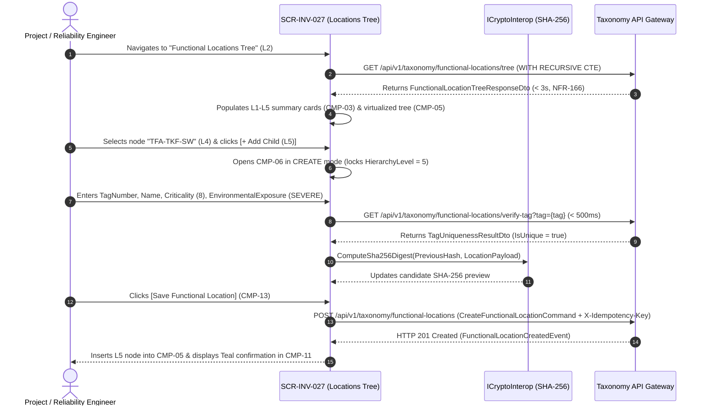

# SCR-INV-027: ISO 14224 Functional Locations Hierarchy Tree and Taxonomic Governance

## 1. Purpose and Operational Context

* **View Objective:** Centralized Level 2 taxonomic explorer and governance workspace for structuring, reorganizing, and auditing the plant's ISO 14224 Functional Location hierarchy across Levels 1 to 5 (`Industry` $\to$ `Business Category` $\to$ `Installation` $\to$ `Plant / Unit` $\to$ `Section / System`). Decouples permanent process slots from physical rotating machinery ([ADR-008](../../../architecture/adr/ADR-008.md)), governs process criticality ($1..10$) and environmental exposure inheritance, enforces cycle-free re-parenting (`FR-162`, `NFR-167`), and blocks deletion of occupied or parent nodes (`FR-163`).
* **Primary Target Persona:** Project Engineer and Reliability Engineer defining root and child Functional Locations, calibrating process criticality indices, reorganizing plant branches, and exporting taxonomic coverage reports (`FR-165`).
* **Secondary Personas:**
  * **Maintenance Planner & Supervisor:** Navigates the process hierarchy to inspect installed equipment units, verify RIME criticality multipliers, and drill down into Level 3 Equipment Master Data Cards ([SCR-INV-005](SCR-INV-005.md)).
  * **Maintenance Technician & Warehouse Manager:** Searches operational positions by Tag (`FR-164`) to verify currently mounted serial numbers or initiate rotable equipment swaps ([SCR-INV-025](SCR-INV-025.md)).
  * **Auditor:** Inspects the chronological SHA-256 audit ledger of structural tree changes and installation history ([TR-001](../../../requirements/common/TR-001.md)).
* **Operational Context:** Deployed in engineering and planning offices on desktop workstations, and accessible in supervisory tablet environments. Responsive adaptations across breakpoints are governed in Section 8.
* **Mode of Operation:** Taxonomic Supervision and Governance mode. Direct DCS/SCADA process control manipulation is strictly excluded. Structural mutations (creating, editing, re-parenting, or deleting nodes) are restricted via RBAC to `Project Engineer` and `Reliability Engineer`, while tree navigation and Level 3 drill-down to [SCR-INV-005](SCR-INV-005.md) are available to all roles ([DT-UI-NAV-DOC-001 §5](../../DT-UI-NAV-DOC-001.md#5-transition-matrix-and-access-control-rbac)).
* **Web Portal Workspace Invariant:** Operates within the unified Blazor Web Portal shell alongside a persistent right-hand workspace dock (`CMP-12` hosting `CMP-06`/`CMP-07` and `CMP-10`) using the Blender N-panel vertical tab spine pattern established in [SCR-MTTO-026](../mtto/SCR-MTTO-026.md) to prevent horizontal layout shift (`CLS = 0`).

---

## 2. Visual Artifact


> *Note: Production UI prototype capture illustrating the Functional Locations Hierarchy Tree workstation layout, collapsible navigation sidebar, 5-card ISO 14224 level summary strip, multi-criteria filter bar, virtualized recursive tree grid with level badges and equipment occupancy links, persistent right dock with node inspector, mounted equipment slot card, and sticky governance footer.*

---

## 3. Functional Component Inventory

> The base grid, typography, neutral palettes, and minimal tactile contact areas are inherited from [DT-UI-DS-DOC-001](../../DT-UI-DS-DOC-001.md). This inventory defines the canonical components present on the screen, their design tokens, and their architectural scope. Interaction rules and geometric algorithms are specified in Section 5; responsive container adaptations are governed by Section 8.

1. **`CMP-01`: Web Portal Shell & Sidebar**
   - **Visual Role:** Collapsible navigation sidebar hosting global modules, module hierarchy, and route markers.
   - **Design Tokens:**
     - Surface: `--dt-color-surface-base`
     - Border: `--dt-color-border-subtle`
     - Width: `--dt-layout-sidebar-width-expanded` (Desktop) / `--dt-layout-sidebar-width-collapsed` (Tablet Landscape)
   - **Architectural Scope:** Hosts global module navigation per [DT-UI-NAV-DOC-001](../../DT-UI-NAV-DOC-001.md), highlighting "Functional Locations Tree" under Inventory & Taxonomy. Responsive widths in Section 8.

2. **`CMP-02`: Top Workstation Header & Action Bar**
   - **Visual Role:** Sticky top header hosting breadcrumbs, quick search shortcut (`Ctrl + K`), `[+ New Root Location (L1)]` trigger (`FR-160`), `[Export Architecture]` menu (`FR-165`), and operator session badge.
   - **Design Tokens:**
     - Surface: `--dt-color-surface-card`
     - Border: `--dt-color-border-subtle`
     - Elevation: `--dt-z-header-sticky`
     - Primary Button: `--dt-color-state-info`
   - **Architectural Scope:** Top navigation bar managing root node creation, taxonomy report generation (`CSV` / `JSON`), and operator session presence. Detailed in §5.2 and §5.3.4.

3. **`CMP-03`: ISO 14224 Level Summary & Coverage Cards**
   - **Visual Role:** 5-card interactive summary strip displaying node counts across ISO 14224 Levels 1 to 5 (`L1: Industry`, `L2: Business`, `L3: Installation`, `L4: Plant / Unit`, `L5: Section / System`) plus Level 5 equipment occupancy coverage (`TR-008-FR-418`).
   - **Design Tokens:**
     - Surface: `--dt-color-surface-card`
     - Border: `--dt-color-border-subtle`
     - Radius: `--dt-radius-md`
     - Active Filter Ring: `--dt-color-state-info`
   - **Architectural Scope:** Provides one-click level filtering and taxonomic coverage metrics without duplicate filter chips ([DT-UI-DS-DOC-001 §6.5](../../DT-UI-DS-DOC-001.md#65-status-badge-counter-discipline-anti-badge-inflation-principle)). Detailed in §5.1.

4. **`CMP-04`: Multi-Criteria Taxonomy Filter Toolbar**
   - **Visual Role:** Flat toolbar hosting debounced Tag/Name search input (`FR-164`), Criticality band selector (`1..10`), Environmental Exposure selector, slot occupancy filter (`Occupied` / `Vacant`), and `[Expand All]` / `[Collapse All]` tree triggers.
   - **Design Tokens:**
     - Surface: `--dt-color-surface-base`
     - Controls: `--dt-color-surface-card`
     - Border: `--dt-color-border-subtle`
     - Control Height: `--dt-control-height-sm` (Desktop) / `--dt-touch-target-mobile` (Tablet)
     - Radius: `--dt-radius-sm`
   - **Architectural Scope:** Executes $< 500\text{ms}$ indexed tree filtering (`TR-008-NFR-419`). Detailed in §5.2.

5. **`CMP-05`: Interactive ISO 14224 Hierarchy Tree Explorer**
   - **Visual Role:** Virtualized multi-column hierarchical tree grid rendering parent-child connector guides, expand/collapse chevrons, monospace level tags (`L1`–`L5`), `TagNumber`, `Name`, `Criticality` index, `EnvironmentalExposure`, mounted `EquipmentUnit` serial reference, and contextual `[+ Child]` / `[Move]` triggers.
   - **Design Tokens:**
     - Header Surface: `--dt-color-surface-base`
     - Row Surface: `--dt-color-surface-card`
     - Connector Guides: `--dt-color-border-subtle`
     - Row Height: `--dt-layout-table-row-height`
     - Selected Row Indicator: `--dt-color-state-info`
   - **Architectural Scope:** Core Adjacency List tree explorer hydrated via recursive CTE projections (`WITH RECURSIVE` per [DT-ARQ-DB-DOC-001 §3.5](../../../architecture/DT-ARQ-DB-DOC-001.md#35-iso-14224-hierarchy-resolution-inv-027)) in $< 3\text{s}$ (`NFR-166`). Detailed in §5.1 and §5.2.

6. **`CMP-06`: Functional Location Node Inspector & Form**
   - **Visual Role:** Master-detail inspector hosted inside dock `CMP-12` displaying or editing the selected node's attributes (`TagNumber`, `Name`, `Description`, `HierarchyLevel`, `ParentLocationTag`, `Criticality`, `GeographicLocation`, `EnvironmentalExposure`) in a 2-column stacked key-value grid.
   - **Design Tokens:**
     - Surface: `--dt-color-surface-card`
     - Border: `--dt-color-border-subtle`, `--dt-color-border-panel` (Edit Mode)
     - Typography: `--dt-font-caption`, `--dt-font-body-md`, `--dt-font-mono-data`
   - **Architectural Scope:** Governs `FunctionalLocation.AddChild(child)` (`FR-160`, `FR-161`) and node metadata calibration while maintaining zero layout shift (`CLS = 0`) between View and Edit modes. Detailed in §5.3.1.

7. **`CMP-07`: Mounted Equipment Unit & Slot Occupancy Card**
   - **Visual Role:** Contextual card inside `CMP-06` (for Level 5 nodes) displaying the currently mounted Level 6 `EquipmentUnit` (`SerialNumber`, `EquipmentClassName`, `OperationalStatus`, `InstalledAtUtc`) or `VACANT SLOT` status, with direct handoff triggers (`[Inspect Master Card]`, `[Rotable Swap]`, `[+ Register Equipment]`).
   - **Design Tokens:**
     - Surface: `--dt-color-surface-base`
     - Border: `--dt-color-border-subtle`
     - Button Surface: `--dt-color-surface-btn-secondary`
     - Radius: `--dt-radius-md`
   - **Architectural Scope:** Bridges the Level 5 `FunctionalLocation` slot to its mounted Level 6 `EquipmentUnit` ([SCR-INV-005](SCR-INV-005.md)) and Rotable Asset Swap modal ([SCR-INV-025](SCR-INV-025.md)) per [ADR-008](../../../architecture/adr/ADR-008.md). Detailed in §5.2.

8. **`CMP-08`: Tree Re-Parenting & Cycle Prevention Modal**
   - **Visual Role:** Centered transactional modal dialog for moving a Functional Location node (`ReorganizeTree`) to a new parent node, featuring a target parent picker, live level-coherence preview, cycle detection status pill, and mandatory audit justification input.
   - **Design Tokens:**
     - Surface: `--dt-color-surface-card`
     - Backdrop: `--dt-color-surface-overlay`
     - Width & Max-Height: `--dt-layout-modal-width`, `--dt-layout-modal-max-height`
     - Radius: `--dt-radius-xl`
     - Elevation: `--dt-z-modal`
     - Cycle Alert: `--dt-color-alarm-critical`
   - **Architectural Scope:** Enforces `FunctionalLocation.ReorganizeTree(newParentId)` (`FR-162`, `NFR-167`, `NFR-168`, `AF-002`), blocking descendant self-parenting cycles and level inversions in $< 1\text{s}$. Detailed in §5.3.2.

9. **`CMP-09`: Dependency-Gated Node Deletion Modal**
   - **Visual Role:** Safety-gated confirmation modal inspecting child node count and mounted equipment occupancy before permitting node removal (`RemoveChild`).
   - **Design Tokens:**
     - Surface: `--dt-color-surface-card`
     - Width: `--dt-layout-modal-width`
     - Radius: `--dt-radius-xl`
     - Elevation: `--dt-z-modal`
     - Blocked Alert: `--dt-color-alarm-critical`
   - **Architectural Scope:** Enforces `FunctionalLocation.RemoveChild(childId)` (`FR-163`, `AF-003`), hard-disabling deletion whenever `ChildLocationsCount > 0` or `MountedEquipmentId != null`. Detailed in §5.3.3.

10. **`CMP-10`: Chained Cryptographic Taxonomy Audit Pane**
    - **Visual Role:** Append-only audit ledger tab hosted in dock `CMP-12` displaying chronological node creations, re-parenting movements, criticality changes, operator badges, and SHA-256 integrity hashes.
    - **Design Tokens:**
      - Surface: `--dt-color-surface-card`
      - Border: `--dt-color-border-subtle`
      - Hash Typography: `--dt-font-mono-data`
    - **Architectural Scope:** Satisfies [TR-001](../../../requirements/common/TR-001.md), [TR-008-NFR-422](../../../requirements/common/TR-008.md), and [ADR-003](../../../architecture/adr/ADR-003.md). Detailed in §5.3.1.

11. **`CMP-11`: Inline Validation & Concurrency Status Slot**
    - **Visual Role:** Permanent `CLS = 0` diagnostic slot on the left side of sticky footer `CMP-13` displaying 4-channel WCAG 2.1 AA redundant alerts (`#icon-ban`, `#icon-warning`, `#icon-check` + text).
    - **Design Tokens:**
      - Surface: `--dt-color-surface-card`
      - Critical Conflict: `--dt-color-alarm-critical`
      - Warning: `--dt-color-alarm-warning`
      - Documentary Success: `--dt-color-state-success`
    - **Architectural Scope:** Surfaces `AF-001` duplicate Tag errors, `FR-161` level mismatches, `AF-004` optimistic concurrency conflicts (`NFR-169`), and post-commit documentary confirmation. Detailed in §5.3.

12. **`CMP-12`: Persistent Workspace Dock & Vertical Tab Strip**
    - **Visual Role:** Right-hand workspace dock with vertical spine tabs (`NODE DETAIL` / `SHA-256 AUDIT`) hosting `CMP-06`/`CMP-07` and `CMP-10`.
    - **Design Tokens:**
      - Track Surface: `--dt-color-surface-base`
      - Panel Surface: `--dt-color-surface-card`
      - Active Tab: `--dt-color-surface-raised`
      - Width: `--dt-layout-drawer-width-desktop` / `--dt-layout-drawer-width-tablet`
      - Elevation: `--dt-shadow-panel`
      - Active Indicator: `--dt-color-state-info`
    - **Architectural Scope:** Preserves tree expansion state and row selection across inspection and audit tab switches without horizontal layout shift. Detailed in §5.2 and Section 8.

13. **`CMP-13`: Sticky Taxonomy Governance & Handoff Footer**
    - **Visual Role:** Permanent sticky bottom bar hosting `CMP-11` status slot, Level 3 equipment drill-down (`[Open Equipment Master Card]`), `[Reorganize Node]`, `[Delete Node]`, mandatory `AuditJustification` input, and `[Save Functional Location]`.
    - **Design Tokens:**
      - Surface: `--dt-color-surface-card`
      - Border: `--dt-color-border-hairline`
      - Height: `--dt-layout-footer-height`
      - Elevation: `--dt-z-header-sticky`
      - Primary CTA: `--dt-color-state-info`
      - Secondary Button: `--dt-color-surface-btn-secondary`
    - **Architectural Scope:** Coordinates atomic taxonomic mutations (`NFR-168`) and L2 $\to$ L3 navigation handoffs ([DT-UI-NAV-DOC-001 §5](../../DT-UI-NAV-DOC-001.md#5-transition-matrix-and-access-control-rbac)). Detailed in §5.2 and §5.3.

---

## 4. Screen State Catalog

1. **Tree Inspection Mode (Default)**
   - **Activation Condition:** User navigates to `SCR-INV-027` from the Web Portal sidebar.
   - **Visual Modification:** Neutral grayscale surfaces (`--dt-color-surface-card`). Tree grid `CMP-05` renders expanded to Level 3 by default with monospace level tags (`L1`–`L5`) and plain text metadata. Right dock `CMP-12` displays the selected node's read-only specifications in `CMP-06` and mounted equipment summary in `CMP-07`.

2. **Loading / Hydrating Hierarchy (`NFR-166`)**
   - **Activation Condition:** Initial recursive tree query or bulk branch expansion.
   - **Visual Modification:** Skeleton shimmer (`--dt-color-surface-raised`) across `CMP-03` summary cards and `CMP-05` tree rows; mutation triggers disabled.

3. **Create Child / Root Node Mode (`FR-160`, `FR-161`)**
   - **Activation Condition:** Engineer clicks `[+ New Root Location (L1)]` in `CMP-02` or `[+ Add Child]` on a parent node (Levels 1 to 4) in `CMP-05`/`CMP-06`.
   - **Visual Modification:** `CMP-06` transitions to editable creation mode (`TaxonomyInspectorMode.CREATE`), locking `HierarchyLevel` to `1` (for root) or `Parent.HierarchyLevel + 1` (`FR-161`). Footer `CMP-13` displays validation slot `CMP-11`, `[Cancel]`, and `[Save Functional Location]`.

4. **Duplicate Tag or Level Incoherence (`AF-001`)**
   - **Activation Condition:** Debounced uniqueness check (`< 500ms`) detects that the entered `TagNumber` already exists in `tax.functional_locations` or violates parent-child level progression (`FR-161`).
   - **Visual Modification:** `TagNumber` input highlights with a critical red border (`--dt-color-alarm-critical`) and `#icon-ban` glyph. `CMP-11` displays in the footer status slot: *"Taxonomic Integrity Error: Functional Location Tag already exists in the master catalog."* Commit button hard-disabled (`CLS = 0`).

5. **Tree Re-Parenting & Cycle Detection (`AF-002` / `FR-162`)**
   - **Activation Condition:** Engineer clicks `[Reorganize Node]` and selects a candidate destination parent in modal `CMP-08`.
   - **Visual Modification:** If the candidate parent is a descendant of the node being moved or causes a subtree depth $> 5$, `CMP-08` highlights the target selector in `--dt-color-alarm-critical` with `#icon-ban` and displays: *"Hierarchy Integrity Violation: Moving this Functional Location to the selected target would create a circular reference or exceed ISO 14224 Level 5 depth."* Confirm button remains hard-disabled.

6. **Occupied or Parent Node Deletion Blocked (`AF-003` / `FR-163`)**
   - **Activation Condition:** Engineer clicks `[Delete Node]` on a Functional Location that has `ChildLocationsCount > 0` or an active mounted `EquipmentUnit` (`MountedEquipmentId != null`).
   - **Visual Modification:** Modal `CMP-09` renders a critical red interlock banner (`--dt-color-alarm-critical`, `#icon-ban`) listing the blocking child count or mounted equipment serial number, hard-disabling the delete confirmation button and offering a direct link to [SCR-INV-025](SCR-INV-025.md) (*"Dismount via Rotable Asset Swap"*).

7. **Concurrent Modification Conflict (`AF-004` / `NFR-169`)**
   - **Activation Condition:** Engineer submits a node edit or re-parenting command whose optimistic concurrency token (`RowVersion`) mismatches the server state due to a simultaneous edit by another engineer.
   - **Visual Modification:** `CMP-11` renders an amber concurrency warning (`--dt-color-alarm-warning`, `#icon-warning`) in the footer status slot: *"Concurrent Modification Detected: Target branch was updated by another engineer. Tree refreshed; please review before re-applying."*

8. **Documentary Confirmation (Success)**
   - **Activation Condition:** Atomic creation, update, or re-parenting command commits successfully (`NFR-168`).
   - **Visual Modification:** `CMP-11` displays a Teal confirmation pill (`--dt-color-state-success`, `#icon-check`) with the committed `TagNumber` and SHA-256 integrity hash (`CLS = 0`), refreshing `CMP-05` in place.

---

## 5. Interaction Rules and Data Flow

### 5.1. Initial Load & Recursive Hierarchy Resolution



1. **Recursive CTE Tree Hydration (`NFR-166`, [DT-ARQ-DB-DOC-001 §3.5](../../../architecture/DT-ARQ-DB-DOC-001.md#35-iso-14224-hierarchy-resolution-inv-027)):**
   * On initialization, the backend resolves the Adjacency List (`parent_id`) using a PostgreSQL `WITH RECURSIVE` Common Table Expression, returning the ordered tree projection with precomputed breadcrumb paths (`FullPathTag`), child counts (`ChildLocationsCount`), and active Level 6 equipment occupancy (`MountedEquipmentSerialNumber`) in $< 3\text{s}$. In-memory full-table assembly on the client is prohibited.
2. **ISO 14224 Five-Level Taxonomic Model (`FR-160`, `TR-008-FR-413`):**
   * Every node is classified into one of the five canonical ISO 14224 spatial levels (`IsoFunctionalLocationLevel`, §7.2.3):
     * **Level 1 (`L1_INDUSTRY`):** Industry sector (e.g., *Petroleum Refining & Terminals*).
     * **Level 2 (`L2_BUSINESS_CATEGORY`):** Business stream (e.g., *Downstream Crude & Product Storage*).
     * **Level 3 (`L3_INSTALLATION`):** Facility / Terminal (e.g., *Cartagena Maritime Terminal — TFA*).
     * **Level 4 (`L4_PLANT_UNIT`):** Process unit / Area (e.g., *Crude Transfer Pumping Station — CSS*).
     * **Level 5 (`L5_SECTION_SYSTEM`):** Functional equipment slot (e.g., *Crude Export Booster Pump Slot A — TFA-CSS-P-0101A*). Physical Level 6 `EquipmentUnits` mount exclusively at Level 5 slots.

---

### 5.2. Tree Ergonomics & Navigation Handoffs

1. **Virtualized Tree Grid & Keyboard Navigation (`CMP-05`):**
   * Employs UI virtualization (`Virtualize<FunctionalLocationTreeNodeDto>`) with fixed row height (`--dt-layout-table-row-height`) to maintain 60 FPS scrolling across multi-thousand-node plant trees (`NFR-166`).
   * Supports full keyboard tree traversal: `ArrowDown` / `ArrowUp` moves focus between visible nodes; `ArrowRight` expands a collapsed branch; `ArrowLeft` collapses an expanded branch; `Enter` inspects the focused node in `CMP-06`.
2. **Search & Multi-Criteria Ancestor Path Expansion (`FR-164`, `TR-008-FR-418`):**
   * Typing in the debounced search input ($250\text{ms}$) or selecting a Criticality / Environmental Exposure / Level filter in `CMP-03`/`CMP-04` filters the tree in $< 500\text{ms}$ (`TR-008-NFR-419`), automatically expanding ancestor branches (`L1` $\to$ `L4`) of matching leaf nodes so their hierarchical context remains visible.
3. **Level 2 $\to$ Level 3 Equipment Master Card Handoff ([DT-UI-NAV-DOC-001 §5](../../DT-UI-NAV-DOC-001.md#5-transition-matrix-and-access-control-rbac)):**
   * Selecting a Level 5 node in `CMP-05` populates `CMP-07` (`MountedEquipmentSlotCard.razor`). Clicking `[Inspect Master Card]` (or `[Open Equipment Master Card]` in `CMP-13`) transitions to [SCR-INV-005](SCR-INV-005.md) (`L2` $\to$ `L3`) passing `EquipmentUnitId` (if occupied) or `PreselectedFunctionalLocationId` with `mode=CREATE` (if vacant).

---

### 5.3. Domain Workflows & Structural Integrity Rules

#### 5.3.1. Parent-Child Level Coherence & Tag Uniqueness (`FR-160`, `FR-161`, `AF-001`)
1. **Strict Level Progression (`FR-161`):** Invoking `FunctionalLocation.AddChild(child)` ([DT-DM-DOC-002 §2.1](../../../domain-models/class/DT-DM-DOC-002.md#21-functionallocation-aggregate-root)) enforces:
   $$\text{Child.HierarchyLevel} == \text{Parent.HierarchyLevel} + 1 \quad \land \quad 1 \le \text{HierarchyLevel} \le 5$$
   Root nodes (`ParentId == null`) are restricted strictly to `L1_INDUSTRY` (`HierarchyLevel = 1`). Level 5 nodes (`L5_SECTION_SYSTEM`) cannot have child Functional Locations; instead, they host Level 6 `EquipmentUnits`.
2. **Global Tag Uniqueness (`AF-001`):** As the Engineer enters `TagNumber` in `CMP-06`, the client executes a debounced uniqueness check ($250\text{ms}$). Duplicate tags trigger State 4 (`AF-001`), applying `--dt-color-alarm-critical` and `#icon-ban` in `CMP-11` (`CLS = 0`).

#### 5.3.2. Tree Reorganization & Recursive Cycle Prevention (`FR-162`, `NFR-167`, `NFR-168`, `AF-002`)
1. **Cycle Detection Invariant (`NFR-167`, `TR-008-NFR-417`):** When moving node $u$ to candidate parent $v$ in modal `CMP-08` (`FunctionalLocation.ReorganizeTree(newParentId)`), the system validates in $< 1\text{s}$ using a recursive ancestor check that $v$ is not $u$ and $v \notin \text{Descendants}(u)$, and that moving $u$'s subtree preserves valid level depth ($\text{MaxDepth}(u) + \text{Level}(v) \le 5$).
2. **Atomic Subtree Re-Parenting (`NFR-168`):** Upon confirmation with mandatory `AuditJustification` ($\ge 15$ characters), the backend updates `parent_id`, recalculates materialized/recursive paths, and logs the SHA-256 audit entry within a single ACID transaction.

#### 5.3.3. Dependency-Gated Node Deletion (`FR-163`, `AF-003`)
1. Invoking `FunctionalLocation.RemoveChild(childId)` ([DT-DM-DOC-002 §2.1](../../../domain-models/class/DT-DM-DOC-002.md#21-functionallocation-aggregate-root)) evaluates the deletion guard:
   $$\text{CanDelete}(u) \iff (\text{ChildLocationsCount}(u) == 0) \land (\text{MountedEquipmentUnitId}(u) == \varnothing)$$
2. If either condition is false, `CMP-09` blocks deletion (`ON DELETE RESTRICT` per [DT-ERD-DOC-001 §4](../../../domain-models/entity-relationship/DT-ERD-DOC-001.md#4-referential-relationships-and-cascading-fks)) and directs the user to relocate child nodes or execute a Rotable Asset Swap ([SCR-INV-025](SCR-INV-025.md)).

#### 5.3.4. Concurrency Isolation & Architecture Export (`FR-165`, `NFR-169`, `AF-004`)
1. **Optimistic Concurrency Guard (`NFR-169`, `AF-004`):** Every mutation command carries the node's concurrency token (`RowVersion`) and `X-Idempotency-Key`. Concurrent modifications by another engineer return HTTP 409 Conflict, triggering State 7 (`AF-004`) and refreshing the affected branch without silent data loss.
2. **Taxonomic Architecture Export (`FR-165`):** Clicking `[Export Architecture]` in `CMP-02` exports the full or filtered hierarchy (`CSV` / `JSON`) including ISO level paths, criticality indices, environmental exposures, and mounted equipment serial numbers.

---

## 6. Industrial and Safety Considerations

* **Process Slot vs. Physical Machine Decoupling (ISO 14224 §8.1 / [ADR-008](../../../architecture/adr/ADR-008.md)):** Separating the Level 5 `FunctionalLocation` (where process criticality and environmental exposure reside) from the serialized Level 6 `EquipmentUnit` ensures that RIME backlog prioritization ([SCR-MTTO-026](../mtto/SCR-MTTO-026.md)) and SIMOPS spatial mapping ([SCR-VIS-008](../vis/SCR-VIS-008.md)) remain intact across rotable equipment swaps.
* **Criticality Inheritance & RIME Fail-Safe Prevention ([DT-DM-DOC-001 §4.5](../../../domain-models/class/DT-DM-DOC-001.md#45-functionallocationcriticality)):** Configuring the `Criticality` index ($1..10$) on Level 4 and Level 5 Functional Locations directly feeds the RIME prioritization engine, eliminating unconfigured criticality fail-safe alerts (`AF-002` in `SCR-MTTO-026`).
* **HPHMI Grayscale & Anti-Badge-Inflation Discipline ([TR-011](../../../requirements/common/TR-011.md)):** In accordance with [DT-UI-DS-DOC-001 §1](../../DT-UI-DS-DOC-001.md#1-scope) and [§6.5](../../DT-UI-DS-DOC-001.md#65-status-badge-counter-discipline-anti-badge-inflation-principle), taxonomic level markers (`L1`–`L5`), environmental exposure labels, and normal equipment occupancy states render in neutral grayscale typography (`--dt-font-mono-data`, `--dt-color-text-body`, `--dt-color-text-muted`), reserving `--dt-color-alarm-critical` and `--dt-color-alarm-warning` strictly for high-criticality alerts ($9..10$), `AF-001`–`AF-004` validation conflicts, and unconfigured criticality warnings.

---

## 7. Frontend Component Contract (Blazor / Razor)

### 7.1. Component Hierarchy & File Mapping

```text
Pages/Inventory/
└── FunctionalLocationsTreePage.razor                  # Root View (SCR-INV-027)
    ├── PortalSidebarNav.razor                         # CMP-01: Collapsible desktop navigation sidebar
    ├── FunctionalLocationHeaderBar.razor              # CMP-02: Breadcrumbs, root creation, export & session badge
    ├── TaxonomyLevelSummaryCards.razor                # CMP-03: 5-card ISO 14224 L1-L5 interactive filter strip
    ├── FunctionalLocationFilterToolbar.razor          # CMP-04: Search, criticality, exposure & occupancy filters
    ├── FunctionalLocationTreeExplorer.razor           # CMP-05: Virtualized recursive Adjacency List tree grid
    ├── TaxonomyWorkspaceDock.razor                    # CMP-12: Persistent right dock with vertical tab spine
    │   ├── FunctionalLocationNodeInspector.razor      # CMP-06: Node metadata inspector & create/edit form
    │   │   └── MountedEquipmentSlotCard.razor         # CMP-07: Level 5 slot occupancy & L3 handoff card
    │   └── LocationAuditLogPane.razor                 # CMP-10: Chained SHA-256 taxonomic audit trail pane
    ├── ReorganizeLocationModal.razor                  # CMP-08: Re-parenting & <1s cycle detection modal (AF-002)
    ├── DeleteLocationGuardModal.razor                 # CMP-09: Dependency-gated node deletion modal (AF-003)
    └── TaxonomyActionFooter.razor                     # CMP-13: Sticky bottom governance & L3 handoff bar
        └── TaxonomyValidationAlertSlot.razor          # CMP-11: CLS=0 redundant validation & concurrency slot
```

---

### 7.2. Physical Component Parameters & DTO Contracts (.NET 10 / C# 14)

#### 7.2.1. `FunctionalLocationsTreePage.razor` (Root View)

```csharp
[Parameter, SupplyParameterFromQuery(Name = "tag")]
public string? InitialSelectedLocationTag { get; set; }

[Parameter, SupplyParameterFromQuery(Name = "level")]
public int? InitialLevelFilter { get; set; }
```

#### 7.2.2. Subcomponent Parameter Contracts (`CMP-01` to `CMP-13`)

```csharp
// CMP-01: PortalSidebarNav.razor
[Parameter]
public bool IsCollapsed { get; set; }

[Parameter]
public bool IsMobileDrawerOpen { get; set; }

[Parameter]
public string ActiveRouteCode { get; set; } = "SCR-INV-027";

[Parameter]
public EventCallback<bool> OnCollapseToggled { get; set; }

// CMP-02: FunctionalLocationHeaderBar.razor
[Parameter]
public required string OperatorBadgeCode { get; set; }

[Parameter]
public required string OperatorDisplayName { get; set; }

[Parameter]
public bool CanMutateTaxonomy { get; set; }

[Parameter]
public EventCallback OnCreateRootLocationClicked { get; set; }

[Parameter]
public EventCallback<TaxonomyExportFormat> OnExportRequested { get; set; }

[Parameter]
public EventCallback OnToggleMobileNavigation { get; set; }

// CMP-03: TaxonomyLevelSummaryCards.razor
[Parameter]
public required TaxonomyCoverageMetricsDto Metrics { get; set; }

[Parameter]
public IsoFunctionalLocationLevel? ActiveLevelFilter { get; set; }

[Parameter]
public EventCallback<IsoFunctionalLocationLevel?> OnLevelFilterSelected { get; set; }

// CMP-04: FunctionalLocationFilterToolbar.razor
[Parameter]
public string? SearchQuery { get; set; }

[Parameter]
public int? SelectedCriticalityFilter { get; set; }

[Parameter]
public EnvironmentalExposureLevel? SelectedExposureFilter { get; set; }

[Parameter]
public bool? IsOccupiedFilter { get; set; }

[Parameter]
public EventCallback<string?> OnSearchQueryChanged { get; set; }

[Parameter]
public EventCallback<int?> OnCriticalityFilterChanged { get; set; }

[Parameter]
public EventCallback<EnvironmentalExposureLevel?> OnExposureFilterChanged { get; set; }

[Parameter]
public EventCallback<bool?> OnOccupiedFilterChanged { get; set; }

[Parameter]
public EventCallback OnExpandAllClicked { get; set; }

[Parameter]
public EventCallback OnCollapseAllClicked { get; set; }

[Parameter]
public EventCallback OnResetFiltersClicked { get; set; }

// CMP-05: FunctionalLocationTreeExplorer.razor
[Parameter]
public required IReadOnlyList<FunctionalLocationTreeNodeDto> TreeNodes { get; set; }

[Parameter]
public Guid? SelectedLocationId { get; set; }

[Parameter]
public IReadOnlySet<Guid> ExpandedNodeIds { get; set; } = new HashSet<Guid>();

[Parameter]
public bool CanMutateTaxonomy { get; set; }

[Parameter]
public EventCallback<FunctionalLocationTreeNodeDto> OnNodeSelected { get; set; }

[Parameter]
public EventCallback<Guid> OnNodeExpandToggled { get; set; }

[Parameter]
public EventCallback<FunctionalLocationTreeNodeDto> OnAddChildRequested { get; set; }

[Parameter]
public EventCallback<FunctionalLocationTreeNodeDto> OnReorganizeNodeRequested { get; set; }

// CMP-12: TaxonomyWorkspaceDock.razor
[Parameter]
public bool IsOpen { get; set; }

[Parameter]
public TaxonomyDockTab ActiveTab { get; set; } = TaxonomyDockTab.NODE_DETAIL;

[Parameter]
public EventCallback<TaxonomyDockTab> OnTabChanged { get; set; }

[Parameter]
public EventCallback OnClosed { get; set; }

// CMP-06: FunctionalLocationNodeInspector.razor
[Parameter]
public required TaxonomyInspectorMode Mode { get; set; }

[Parameter]
public FunctionalLocationTreeNodeDto? SelectedNode { get; set; }

[Parameter]
public FunctionalLocationTreeNodeDto? ParentNode { get; set; }

[Parameter]
public required UpsertFunctionalLocationFormDto FormModel { get; set; }

[Parameter]
public EventCallback<UpsertFunctionalLocationFormDto> FormModelChanged { get; set; }

[Parameter]
public bool IsTagUnique { get; set; } = true;

// CMP-07: MountedEquipmentSlotCard.razor
[Parameter]
public required Guid FunctionalLocationId { get; set; }

[Parameter]
public required string FunctionalLocationTag { get; set; }

[Parameter]
public MountedEquipmentSummaryDto? MountedEquipment { get; set; }

[Parameter]
public EventCallback<Guid> OnInspectEquipmentMasterCard { get; set; }

[Parameter]
public EventCallback<Guid> OnOpenRotableSwapModal { get; set; }

[Parameter]
public EventCallback<Guid> OnRegisterNewEquipmentAtSlot { get; set; }

// CMP-08: ReorganizeLocationModal.razor (AF-002)
[Parameter]
public bool IsVisible { get; set; }

[Parameter]
public FunctionalLocationTreeNodeDto? SourceNode { get; set; }

[Parameter]
public required IReadOnlyList<FunctionalLocationTreeNodeDto> CandidateParentNodes { get; set; }

[Parameter]
public TreeReorganizationValidationDto? ValidationResult { get; set; }

[Parameter]
public EventCallback<Guid> OnCandidateParentSelected { get; set; }

[Parameter]
public EventCallback<ReorganizeFunctionalLocationCommand> OnReorganizeConfirmed { get; set; }

[Parameter]
public EventCallback OnCloseRequested { get; set; }

// CMP-09: DeleteLocationGuardModal.razor (AF-003)
[Parameter]
public bool IsVisible { get; set; }

[Parameter]
public FunctionalLocationTreeNodeDto? TargetNode { get; set; }

[Parameter]
public EventCallback<Guid> OnDeleteConfirmed { get; set; }

[Parameter]
public EventCallback<Guid> OnOpenSwapToClearSlot { get; set; }

[Parameter]
public EventCallback OnCloseRequested { get; set; }

// CMP-10: LocationAuditLogPane.razor
[Parameter]
public required IReadOnlyList<TaxonomyAuditEntryDto> AuditEntries { get; set; }

// CMP-13: TaxonomyActionFooter.razor
[Parameter]
public required TaxonomyInspectorMode Mode { get; set; }

[Parameter]
public FunctionalLocationTreeNodeDto? SelectedNode { get; set; }

[Parameter]
public bool CanMutateTaxonomy { get; set; }

[Parameter]
public bool CanSubmit { get; set; }

[Parameter]
public bool IsSubmitting { get; set; }

[Parameter]
public TaxonomyConflictType? ActiveConflict { get; set; }

[Parameter]
public string? ConflictMessage { get; set; }

[Parameter]
public string AuditJustification { get; set; } = string.Empty;

[Parameter]
public EventCallback<string> AuditJustificationChanged { get; set; }

[Parameter]
public EventCallback<Guid> OnNavigateToEquipmentMasterCard { get; set; }

[Parameter]
public EventCallback OnEnterEditModeClicked { get; set; }

[Parameter]
public EventCallback OnOpenReorganizeModalClicked { get; set; }

[Parameter]
public EventCallback OnOpenDeleteModalClicked { get; set; }

[Parameter]
public EventCallback OnCancelMutationClicked { get; set; }

[Parameter]
public EventCallback OnSaveLocationClicked { get; set; }

// CMP-11: TaxonomyValidationAlertSlot.razor
[Parameter]
public TaxonomyConflictType? ActiveConflict { get; set; }

[Parameter]
public string? ConflictMessage { get; set; }
```

#### 7.2.3. Data Transfer Objects (DTOs) and Enums

```csharp
/// <summary>
/// Canonical ISO 14224:2016 Functional Location hierarchy levels (1..5).
/// </summary>
public enum IsoFunctionalLocationLevel
{
    L1_INDUSTRY = 1,
    L2_BUSINESS_CATEGORY = 2,
    L3_INSTALLATION = 3,
    L4_PLANT_UNIT = 4,
    L5_SECTION_SYSTEM = 5
}

/// <summary>
/// Controlled environmental exposure vocabulary per DT-DM-DOC-001 §4.6 (ISO 14224 Table A.70).
/// </summary>
public enum EnvironmentalExposureLevel
{
    SEVERE,
    MODERATE,
    LOW,
    UNKNOWN
}

/// <summary>
/// Controlled equipment operational status vocabulary per DT-DM-DOC-001 §4.4.
/// </summary>
public enum EquipmentOperationalStatus
{
    UP,
    DOWN,
    STANDBY
}

public enum TaxonomyInspectorMode
{
    INSPECT,
    CREATE,
    EDIT
}

public enum TaxonomyDockTab
{
    NODE_DETAIL,
    AUDIT_TRAIL
}

public enum TaxonomyConflictType
{
    DUPLICATE_TAG_NUMBER,
    INVALID_HIERARCHY_LEVEL,
    CIRCULAR_REFERENCE_DETECTED,
    NODE_DELETION_BLOCKED_DEPENDENCIES,
    CONCURRENT_MODIFICATION_CONFLICT,
    LOCATION_COMMITTED_SUCCESS
}

public enum TaxonomyExportFormat
{
    FULL_TREE_CSV,
    FULL_TREE_JSON
}

public record FunctionalLocationTreeNodeDto
{
    public required Guid FunctionalLocationId { get; init; }
    public Guid? ParentId { get; init; }
    public string? ParentTagNumber { get; init; }
    public required string TagNumber { get; init; }
    public required string Name { get; init; }
    public string? Description { get; init; }
    public required IsoFunctionalLocationLevel HierarchyLevel { get; init; }
    public required string FullPathTag { get; init; }
    public int? Criticality { get; init; }
    public string? GeographicLocation { get; init; }
    public required EnvironmentalExposureLevel EnvironmentalExposure { get; init; }
    public required int ChildLocationsCount { get; init; }
    public required int MaxSubtreeDepth { get; init; }
    public MountedEquipmentSummaryDto? MountedEquipment { get; init; }
    public required string RowVersion { get; init; }
    public required string LatestIntegrityHash { get; init; }
}

public record MountedEquipmentSummaryDto
{
    public required Guid EquipmentUnitId { get; init; }
    public required string SerialNumber { get; init; }
    public required string EquipmentClassName { get; init; }
    public required string ManufacturerModel { get; init; }
    public required EquipmentOperationalStatus OperationalStatus { get; init; }
    public required DateTimeOffset InstalledAtUtc { get; init; }
}

public record TaxonomyCoverageMetricsDto
{
    public required int TotalLocationsCount { get; init; }
    public required int Level1Count { get; init; }
    public required int Level2Count { get; init; }
    public required int Level3Count { get; init; }
    public required int Level4Count { get; init; }
    public required int Level5TotalSlots { get; init; }
    public required int Level5OccupiedSlots { get; init; }
}

public record UpsertFunctionalLocationFormDto
{
    public Guid? FunctionalLocationId { get; set; }
    public Guid? ParentId { get; set; }
    public string TagNumber { get; set; } = string.Empty;
    public string Name { get; set; } = string.Empty;
    public string? Description { get; set; }
    public IsoFunctionalLocationLevel HierarchyLevel { get; set; } = IsoFunctionalLocationLevel.L1_INDUSTRY;
    public int? Criticality { get; set; }
    public string? GeographicLocation { get; set; }
    public EnvironmentalExposureLevel EnvironmentalExposure { get; set; } = EnvironmentalExposureLevel.MODERATE;
    public string? RowVersion { get; set; }
}

public record TreeReorganizationValidationDto
{
    public required Guid SourceLocationId { get; init; }
    public required Guid CandidateParentId { get; init; }
    public required bool IsValid { get; init; }
    public required bool CreatesCycle { get; init; }
    public required bool ExceedsMaxLevelDepth { get; init; }
    public required IsoFunctionalLocationLevel ResultingLevel { get; init; }
    public string? DiagnosticMessage { get; init; }
}

public record CreateFunctionalLocationCommand
{
    public Guid? ParentId { get; init; }
    public required string TagNumber { get; init; }
    public required string Name { get; init; }
    public string? Description { get; init; }
    public required IsoFunctionalLocationLevel HierarchyLevel { get; init; }
    public int? Criticality { get; init; }
    public string? GeographicLocation { get; init; }
    public required EnvironmentalExposureLevel EnvironmentalExposure { get; init; }
    public required string AuditJustification { get; init; }
    public required Guid EngineerUserId { get; init; }
    public required string PreviousHash { get; init; }
}

public record ReorganizeFunctionalLocationCommand
{
    public required Guid FunctionalLocationId { get; init; }
    public required Guid NewParentId { get; init; }
    public required string RowVersion { get; init; }
    public required string AuditJustification { get; init; }
    public required Guid EngineerUserId { get; init; }
    public required string PreviousHash { get; init; }
}

public record TaxonomyAuditEntryDto
{
    public required Guid AuditLogId { get; init; }
    public required DateTimeOffset TimestampUtc { get; init; }
    public required string OperatorBadgeCode { get; init; }
    public required string ActionType { get; init; }
    public required string LocationTag { get; init; }
    public required string ChangeSummary { get; init; }
    public required string AuditJustification { get; init; }
    public required string PreviousHash { get; init; }
    public required string IntegrityHash { get; init; }
}
```

---

### 7.3. Client-Side DOM & Interop Bridge

1. **Virtualized Tree & Keyboard Navigation Interop (`ITreeVirtualizationInterop`):**
   * Lazily renders visible flattened tree rows within the scroll container while maintaining keyboard focus state (`ArrowUp`, `ArrowDown`, `ArrowLeft`, `ArrowRight`), achieving $< 3\text{s}$ initial load (`NFR-166`) and 60 FPS scroll performance across large catalogs.
2. **Sub-Second Cycle & Uniqueness Validator (`ITaxonomyValidationInterop`):**
   * Evaluates subtree cycle prevention ($v \notin \text{Descendants}(u)$) and level-depth bounds synchronously on the loaded tree projection in $< 50\text{ms}$ and dispatches debounced ($250\text{ms}$) global `TagNumber` uniqueness checks in $< 500\text{ms}$ (`NFR-167`, `TR-008-NFR-419`).
3. **Web Cryptography SHA-256 Digest Bridge (`ICryptoInterop`):**
   * Computes the candidate `IntegrityHash` asynchronously in a Web Worker as taxonomic mutations are prepared (`TR-001`, `ADR-003`).

---

## 8. Layout and Responsive Adaptability

### 8.1. Desktop Workstation (`--dt-breakpoint-xl`)
* **Layout Organization:** Asymmetric 3-column workstation split ([DT-UI-DS-DOC-001 §2.3](../../DT-UI-DS-DOC-001.md#23-responsive-breakpoints-and-reference-frames)): left navigation sidebar `CMP-01` expanded at `--dt-layout-sidebar-width-expanded`, central hierarchy workspace hosting the 5 summary cards `CMP-03`, filter toolbar `CMP-04`, and virtualized tree explorer `CMP-05`, paired with the persistent right workspace dock `CMP-12` sized by `--dt-layout-drawer-width-desktop` (`--dt-shadow-panel`). Modals `CMP-08` and `CMP-09` center at `--dt-layout-modal-width-desktop` bounded by `--dt-layout-modal-max-height`. Sticky footer `CMP-13` (`--dt-layout-footer-height`) spans the bottom workspace.
* **Ergonomic Rules:** Mouse and keyboard navigation; dense tree row height governed by `--dt-layout-table-row-height`; single-click node inspection in `CMP-06` without horizontal layout shift (`CLS = 0`).

### 8.2. Industrial Tablet Landscape (`--dt-breakpoint-lg`)
* **Layout Organization:** Navigation sidebar `CMP-01` collapses to an icon-only rail sized by `--dt-layout-sidebar-width-collapsed`; workspace dock `CMP-12` operates as a slide-over lateral panel sized by `--dt-layout-drawer-width-tablet`; summary cards `CMP-03` remain in a fluid horizontal strip; modals `CMP-08` and `CMP-09` size to `--dt-layout-modal-width-tablet`.
* **Ergonomic Rules:** Tree expand/collapse chevrons and action triggers enforce `--dt-touch-target-mobile` hit areas; sticky footer `CMP-13` (`--dt-layout-footer-height`) remains permanently pinned.

### 8.3. Industrial Tablet Portrait (`--dt-breakpoint-md`)
* **Layout Organization:** Navigation sidebar `CMP-01` transitions to an off-canvas drawer; summary cards `CMP-03` wrap into a compact grid; workspace dock `CMP-12` transitions to an adaptive **Bottom Sheet** initializing at `--dt-layout-bottom-sheet-height-initial` and expanding up to `--dt-layout-bottom-sheet-height-expanded` (`--dt-radius-2xl` top curvature) with a header tab switcher (`NODE DETAIL` / `SHA-256 AUDIT`).
* **Ergonomic Rules:** Touch targets governed by `--dt-touch-target-mobile` with `--dt-space-2` separation; discrete single-tap toggling on the bottom-sheet handle ([DT-UI-DS-DOC-001 §6.3](../../DT-UI-DS-DOC-001.md#63-sliding-containers-pattern-bottom-sheets-and-drawers)).

---

## 9. Traceability and Requirements Matrix

| Requirement | Addressed in Component | Verification & Implementation Mechanism |
| :--- | :--- | :--- |
| [FR-160](../../../requirements/user-stories/inv/INV-027.md#functional-requirements-fr) | `CMP-02`, `CMP-05`, `CMP-06` | Enables creation of Level 1 root nodes and Levels 2–5 child Functional Locations complying with ISO 14224. |
| [FR-161](../../../requirements/user-stories/inv/INV-027.md#functional-requirements-fr) | `CMP-06`, `CMP-11` | Enforces sequential parent-child level coherence ($\text{Child.Level} == \text{Parent.Level} + 1$) and blocks disordered levels (`AF-001`). |
| [FR-162](../../../requirements/user-stories/inv/INV-027.md#functional-requirements-fr) | `CMP-05`, `CMP-08` | Provides dynamic tree re-parenting (`ReorganizeTree`) with recursive cycle and depth validation (`AF-002`). |
| [FR-163](../../../requirements/user-stories/inv/INV-027.md#functional-requirements-fr) | `CMP-09`, `CMP-11` | Blocks deletion of Functional Locations with child nodes or actively mounted Equipment Units (`AF-003`). |
| [FR-164](../../../requirements/user-stories/inv/INV-027.md#functional-requirements-fr) | `CMP-03`, `CMP-04`, `CMP-05` | Debounced fuzzy search and multi-criteria filtering by Level, Criticality, Environmental Exposure, and Occupancy with ancestor auto-expansion. |
| [FR-165](../../../requirements/user-stories/inv/INV-027.md#functional-requirements-fr) | `CMP-02`, `CMP-03` | Generates and exports structured Functional Location architecture and coverage reports (`CSV` and `JSON`). |
| [NFR-166](../../../requirements/user-stories/inv/INV-027.md#non-functional-requirements-nfr) | `CMP-05` | Recursive CTE projection (`WITH RECURSIVE`) and UI row virtualization load and render extensive hierarchies in $< 3\text{s}$. |
| [NFR-167](../../../requirements/user-stories/inv/INV-027.md#non-functional-requirements-nfr) | `CMP-06`, `CMP-08`, `CMP-11` | Tag uniqueness, level coherence, and circular reference detection execute in $< 1\text{s}$ (`< 500ms` indexed lookup). |
| [NFR-168](../../../requirements/user-stories/inv/INV-027.md#non-functional-requirements-nfr) | `CMP-08`, `CMP-13` | All-or-nothing ACID transaction guarantees tree creations and re-parenting operations never leave partial or orphaned branches. |
| [NFR-169](../../../requirements/user-stories/inv/INV-027.md#non-functional-requirements-nfr) | `CMP-06`, `CMP-08`, `CMP-11` | Optimistic concurrency token (`RowVersion`) prevents simultaneous edits by multiple engineers from overwriting tree changes (`AF-004`). |
| [TR-001](../../../requirements/common/TR-001.md) | `CMP-10`, `CMP-13` | Immutable append-only audit trail logging with SHA-256 hash chaining on all taxonomic mutations. |
| [TR-005](../../../requirements/common/TR-005.md) | `CMP-05`, `CMP-08`, `CMP-13` | Enforces TLS/HTTPS encryption in transit across all recursive tree queries, uniqueness checks, and mutation commands. |
| [TR-006](../../../requirements/common/TR-006.md) | `CMP-02`, `CMP-06`, `CMP-13` | Enforces RBAC role authorization (`Project Engineer` and `Reliability Engineer` for mutations; read/navigation access for all roles). |
| [TR-008](../../../requirements/common/TR-008.md) | `CMP-03` to `CMP-09` | Enforces ISO 14224 taxonomic hierarchy (Levels 1 to 5), cycle prevention, and taxonomic coverage reporting. |
| [TR-011](../../../requirements/common/TR-011.md) | `CMP-01` to `CMP-13` | ANSI/ISA-101 HPHMI 90/10 grayscale baseline, zero badge inflation on static level tags, and WCAG 2.1 AA redundant coding. |
| [ADR-003](../../../architecture/adr/ADR-003.md) | `CMP-10`, `CMP-13` | Tamper-evident cryptographic SHA-256 hash chaining (`PreviousHash` $\to$ `IntegrityHash`) on taxonomic audit records. |
| [ADR-005](../../../architecture/adr/ADR-005.md) | `CMP-06`, `CMP-13` | Time-sequential UUIDv7 identifier generation for newly created `FunctionalLocation` entities. |
| [ADR-008](../../../architecture/adr/ADR-008.md) | `CMP-07` | Decouples permanent Level 5 `FunctionalLocation` slots from physical Level 6 `EquipmentUnit` installation history. |