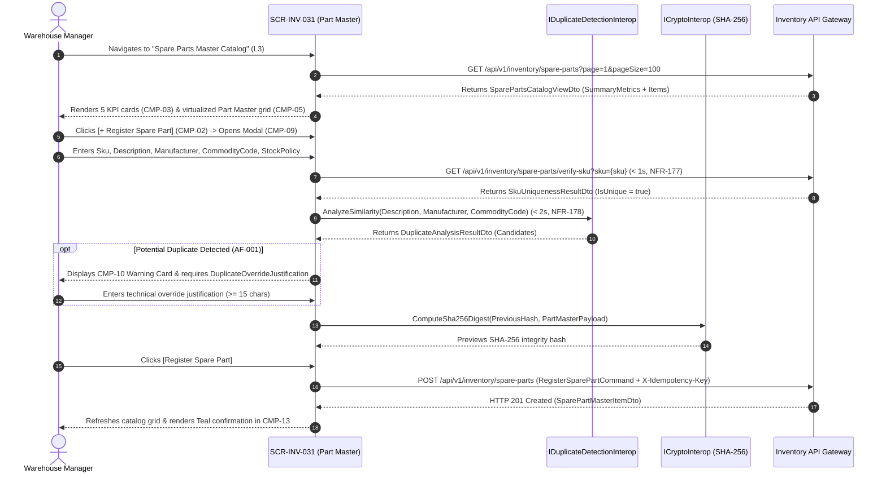

# SCR-INV-031: Spare Parts Master Catalog and Replenishment Policy Governance

## 1. Purpose and Operational Context

* **View Objective:** Centralized Level 3 master catalog (`Part Master`) for onboarding, classifying, and governing MRO spare parts, rotable components, and operational supplies (`inv.spare_parts`) alongside their commercial supplier contracts (`inv.suppliers`). Enforces $< 1\text{s}$ SKU uniqueness (`NFR-177`), $< 2\text{s}$ phonetic/semantic duplicate detection (`FR-171`, `NFR-178`), cascading ISO 14224 Equipment Class and Commodity Code classification (`FR-172`, `NFR-179`), dynamic replenishment policy parameterization (`REORDER_POINT`, `MIN_MAX`, `JUST_IN_TIME` per `FR-173`), ISO 80000 Unit of Measure standardization (`FR-181`), and versioned cryptographic auditability (`FR-174`, `TR-001`).
* **Primary Target Persona:** Warehouse Manager registering standardized spare parts, resolving potential catalog duplicates (`AF-001`), calibrating replenishment policies (`SparePart.UpdateStockPolicy`), managing supplier warranty terms (`Supplier.UpdateContactInfo`), and exporting audit reports (`FR-176`).
* **Secondary Personas:**
  * **Maintenance Planner:** Navigates from Preventive Maintenance Scheduling ([SCR-MTTO-001](../mtto/SCR-MTTO-001.md)) via `"Verify Spare Parts"` (`L3` $\to$ `L3`) to locate compatible parts (`FR-175`), verify available vs. reserved stock balances, and check whether an item is stocked in warehouse bins or procured on demand (`JUST_IN_TIME`).
  * **Reliability Engineer:** Associates Level 8 `MaintainableItems` ([SCR-MTTO-029](../mtto/SCR-MTTO-029.md)) with standardized Part Master SKUs and flags rebuildable rotable assemblies (`IsRebuildable`).
  * **Auditor:** Reviews versioned stock policy changes, duplicate override justifications, and SHA-256 hash-chained catalog records (`FR-174`, `FR-176`, `TR-001`).
* **Operational Context:** Deployed on high-resolution desktop workstations in warehouse management and maintenance planning offices, and accessible on supervisory industrial tablets. Responsive adaptations across breakpoints are governed in Section 8.
* **Mode of Operation:** Master Catalog Governance and Technical Search mode. Direct DCS/SCADA process control manipulation is strictly excluded. Physical deletion of spare parts with historical transactions is prohibited (`ON DELETE RESTRICT` per [DT-ERD-DOC-001 §4](../../../domain-models/entity-relationship/DT-ERD-DOC-001.md#4-referential-relationships-and-cascading-fks)); discontinued items transition to `SparePartStatus.OBSOLETE` (`DT-DM-DOC-001 §4.26`).
* **Web Portal Workspace Invariant:** Operates within the unified Blazor Web Portal shell paired with a persistent right-hand workspace dock (`CMP-12` hosting `CMP-07`/`CMP-08` and `CMP-11`) using the Blender N-panel vertical tab spine pattern established in [SCR-MTTO-026](../mtto/SCR-MTTO-026.md) to prevent horizontal layout shift (`CLS = 0`).

---

## 2. Visual Artifact


> *Note: Production UI prototype capture illustrating the Spare Parts Master Catalog desktop workstation layout, collapsible navigation sidebar, 5-card catalog health and replenishment policy KPI strip, cascading Commodity Code and Equipment Class filter toolbar, virtualized Part Master grid, persistent right dock with stock policy calibration form, supplier warranty card, and sticky governance footer.*

---

## 3. Functional Component Inventory

> The base grid, typography, neutral palettes, and minimal tactile contact areas are inherited from [DT-UI-DS-DOC-001](../../DT-UI-DS-DOC-001.md). This inventory defines the canonical components present on the screen, their design tokens, and their architectural scope. Interaction rules and geometric algorithms are specified in Section 5; responsive container adaptations are governed by Section 8.

1. **`CMP-01`: Web Portal Shell & Sidebar**
   - **Visual Role:** Collapsible navigation sidebar hosting global modules, module hierarchy, and route markers.
   - **Design Tokens:**
     - Surface: `--dt-color-surface-base`
     - Border: `--dt-color-border-subtle`
     - Width: `--dt-layout-sidebar-width-expanded` (Desktop) / `--dt-layout-sidebar-width-collapsed` (Tablet Landscape)
   - **Architectural Scope:** Hosts global module navigation per [DT-UI-NAV-DOC-001](../../DT-UI-NAV-DOC-001.md), highlighting "Spare Parts Catalog" under Inventory & Taxonomy. Responsive widths in Section 8.

2. **`CMP-02`: Part Master Header & Action Bar**
   - **Visual Role:** Sticky top header hosting breadcrumbs, `[+ Register Spare Part]` primary CTA (`FR-170`), `[Export Catalog Report]` menu (`FR-176`), and operator session badge.
   - **Design Tokens:**
     - Surface: `--dt-color-surface-card`
     - Border: `--dt-color-border-subtle`
     - Elevation: `--dt-z-header-sticky`
     - Primary Button: `--dt-color-state-info`
   - **Architectural Scope:** Launches the part registration modal (`CMP-09`), generates structured cyclical audit exports (`CSV` / `JSON`), and displays active operator identity. Detailed in §5.1 and §5.2.

3. **`CMP-03`: Catalog Health & Policy Summary Cards**
   - **Visual Role:** 5-card interactive KPI filter bar displaying aggregate catalog metrics (`Total Active SKUs`, `Below Reorder Point`, `Rebuildable Rotables`, `Direct Purchase / JIT`, and `Suspended / Obsolete`).
   - **Design Tokens:**
     - Surface: `--dt-color-surface-card`
     - Border: `--dt-color-border-subtle`
     - Radius: `--dt-radius-md`
     - Active Filter Ring: `--dt-color-state-info`
     - Reorder Alert Accent: `--dt-color-alarm-warning`
   - **Architectural Scope:** Acts as a one-click in-memory filter across the Part Master grid without duplicate filter chip rows ([DT-UI-DS-DOC-001 §6.5](../../DT-UI-DS-DOC-001.md#65-status-badge-counter-discipline-anti-badge-inflation-principle)). Detailed in §5.1.

4. **`CMP-04`: Cascading Commodity & Technical Filter Toolbar**
   - **Visual Role:** Flat toolbar hosting cascading Commodity Family $\to$ Sub-Group selector (`FR-172`, `NFR-179`), compatible ISO 14224 `EquipmentClass` selector, `StockPolicy` filter, `Supplier` filter, and debounced multi-criteria search input (`FR-175`, `NFR-180`).
   - **Design Tokens:**
     - Surface: `--dt-color-surface-base`
     - Controls: `--dt-color-surface-card`
     - Border: `--dt-color-border-subtle`
     - Control Height: `--dt-control-height-sm` (Desktop) / `--dt-touch-target-mobile` (Tablet)
     - Radius: `--dt-radius-sm`
   - **Architectural Scope:**Constrains sub-categories dynamically based on the selected parent commodity family in $< 1\text{s}$ (`NFR-179`). Detailed in §5.2.

5. **`CMP-05`: Dense Virtualized Part Master Data Grid**
   - **Visual Role:** Virtualized multi-column tabular grid rendering `Sku`, `Description` & `Manufacturer`, `CommodityCode` & `EquipmentClassName`, `StockPolicy` & `IsRebuildable` indicator, `UnitOfMeasure` (`FR-181`), `QuantityOnHand` / `ReservedQuantity` / `AvailableQuantity`, `ReorderPoint` / `MaxCapacity`, `UnitCost`, and `SparePartStatus` badge (`CMP-06`).
   - **Design Tokens:**
     - Header Surface: `--dt-color-surface-base`
     - Row Surface: `--dt-color-surface-card`
     - Border: `--dt-color-border-subtle`
     - Row Height: `--dt-layout-table-row-height`
     - Selected Row Indicator: `--dt-color-state-info`
     - Numeric Typography: `--dt-font-mono-data`
   - **Architectural Scope:** Core catalog grid (`inv.spare_parts`) virtualized for extensive industrial catalogs (`NFR-180`). Direct row clicking inspects the SKU in `CMP-07`. Detailed in §5.2.

6. **`CMP-06`: Part Status & Replenishment Alert Badges**
   - **Visual Role:** Morphological capsule pills (`--dt-radius-full`) encoding lifecycle status (`SUSPENDED`, `OBSOLETE`) and stock threshold breaches (`BELOW REORDER`, `STOCKOUT`).
   - **Design Tokens:**
     - Normal (`ACTIVE` within stock limits, `JUST_IN_TIME`): plain muted text (`--dt-color-text-body`, `--dt-color-text-muted`)
     - Warning (`SUSPENDED`, `BELOW REORDER`): `--dt-color-alarm-warning`
     - Critical (`STOCKOUT`): `--dt-color-alarm-critical`
     - Radius: `--dt-radius-full`
   - **Architectural Scope:** Enforces 90/10 HPHMI and Anti-Badge-Inflation rules ([DT-UI-DS-DOC-001 §6.5.1](../../DT-UI-DS-DOC-001.md#651-morphological-differentiation-status-badges-vs-interactive-buttons)): healthy `ACTIVE` parts render without decorative green badges. Detailed in §5.1.

7. **`CMP-07`: Spare Part Master Inspector & Policy Calibration Rail**
   - **Visual Role:** Master-detail inspector hosted inside dock `CMP-12` displaying technical specifications, ISO 80000 `UnitOfMeasure` conversion preview (`FR-181`), dynamic `StockPolicy` editor (`FR-173`, `FR-174`), lifecycle `Status` selector (`ACTIVE`, `SUSPENDED`, `OBSOLETE`), and supplier card `CMP-08`.
   - **Design Tokens:**
     - Surface: `--dt-color-surface-card`
     - Policy Box: `--dt-color-surface-base`
     - Border: `--dt-color-border-subtle`, `--dt-color-border-panel` (Inputs)
     - Typography: `--dt-font-caption`, `--dt-font-body-md`, `--dt-font-mono-data`
   - **Architectural Scope:** Invokes `SparePart.UpdateStockPolicy(policy, reorderPoint, maxCapacity)` ([DT-DM-DOC-002 §4.1](../../../domain-models/class/DT-DM-DOC-002.md#41-sparepart-aggregate-root)) and dynamically hides storage thresholds when `JUST_IN_TIME` is selected (`AF-002`). Detailed in §5.3.2 and §5.3.3.

8. **`CMP-08`: Supplier & Commercial Warranty Card**
   - **Visual Role:** Nested card inside `CMP-07` displaying and editing the linked `Supplier` Aggregate Root (`SupplierName`, `ContactInfo`, and `WarrantyTerms`).
   - **Design Tokens:**
     - Surface: `--dt-color-surface-base`
     - Border: `--dt-color-border-subtle`
     - Radius: `--dt-radius-md`
   - **Architectural Scope:** Governs `Supplier.UpdateContactInfo(contactInfo, warrantyTerms)` ([DT-DM-DOC-002 §4.3](../../../domain-models/class/DT-DM-DOC-002.md#43-supplier-aggregate-root), [DT-ERD-DOC-001 §3.3.5](../../../domain-models/entity-relationship/DT-ERD-DOC-001.md#335-suppliers)). Detailed in §5.3.3.

9. **`CMP-09`: Register New Spare Part Modal**
   - **Visual Role:** Centered transactional modal dialog (`--dt-layout-modal-width`, `--dt-layout-modal-max-height`) for onboarding a new Spare Part (`FR-170`), featuring cascading commodity selectors (`FR-172`), dynamic policy fields (`FR-173`), real-time SKU uniqueness check (`NFR-177`), and duplicate similarity detector (`CMP-10`).
   - **Design Tokens:**
     - Surface: `--dt-color-surface-card`
     - Backdrop: `--dt-color-surface-overlay`
     - Width & Max-Height: `--dt-layout-modal-width`, `--dt-layout-modal-max-height`
     - Radius: `--dt-radius-xl`
     - Elevation: `--dt-z-modal`
     - Primary CTA: `--dt-color-state-info`
   - **Architectural Scope:** Enforces catalog purity at intake (`FR-170`, `FR-171`, `AF-001`, `AF-002`). Detailed in §5.3.1.

10. **`CMP-10`: Potential Duplicate Detection & Override Card (`AF-001`)**
    - **Visual Role:** Redundant Shape + Color warning card (`#icon-warning` + `--dt-color-alarm-warning`) deployed inside `CMP-09` when semantic/phonetic similarity analysis (`< 2s`, `NFR-178`) identifies existing SKUs with matching technical specifications.
    - **Design Tokens:**
      - Surface: `--dt-color-surface-base`
      - Border: `--dt-color-alarm-warning`
      - Radius: `--dt-radius-md`
    - **Architectural Scope:** Lists candidate duplicate SKUs and blocks registration unless the Warehouse Manager either cancels or provides a mandatory `DuplicateOverrideJustification` ($\ge 15$ characters) sealed into the audit trail (`FR-171`, `AF-001`). Detailed in §5.3.1.

11. **`CMP-11`: Chained Cryptographic Catalog Audit Pane**
    - **Visual Role:** Append-only cryptographic audit tab hosted in dock `CMP-12` displaying versioned policy updates (`FR-174`), duplicate override justifications, supplier warranty edits, and SHA-256 integrity hashes.
    - **Design Tokens:**
      - Surface: `--dt-color-surface-card`
      - Border: `--dt-color-border-subtle`
      - Hash Typography: `--dt-font-mono-data`
    - **Architectural Scope:** Satisfies [FR-174](../../../requirements/user-stories/inv/INV-031.md#functional-requirements-fr), [TR-001](../../../requirements/common/TR-001.md), and [ADR-003](../../../architecture/adr/ADR-003.md). Detailed in §5.3.3.

12. **`CMP-12`: Persistent Workspace Dock & Vertical Tab Strip**
    - **Visual Role:** Right-hand workspace dock with vertical spine tabs (`PART SPECIFICATION` / `SHA-256 AUDIT`) hosting `CMP-07`/`CMP-08` and `CMP-11`.
    - **Design Tokens:**
      - Track Surface: `--dt-color-surface-base`
      - Panel Surface: `--dt-color-surface-card`
      - Active Tab: `--dt-color-surface-raised`
      - Width: `--dt-layout-drawer-width-desktop` / `--dt-layout-drawer-width-tablet`
      - Elevation: `--dt-shadow-panel`
      - Active Indicator: `--dt-color-state-info`
    - **Architectural Scope:** Preserves catalog scroll position and row selection across specification and version-audit tab switches (`CLS = 0`). Detailed in §5.2 and Section 8.

13. **`CMP-13`: Sticky Catalog Governance & Handoff Footer**
    - **Visual Role:** Permanent sticky bottom bar hosting `CLS = 0` validation status slot, contextual Level 3 handoffs (`[Check Kardex History]`, `[< Return to Preventive Scheduling]`), mandatory `AuditJustification` input, and `[Save Policy & Attributes]`.
    - **Design Tokens:**
      - Surface: `--dt-color-surface-card`
      - Border: `--dt-color-border-hairline`
      - Height: `--dt-layout-footer-height`
      - Elevation: `--dt-z-header-sticky`
      - Primary CTA: `--dt-color-state-info`
      - Secondary Button: `--dt-color-surface-btn-secondary`
    - **Architectural Scope:** Commits versioned catalog updates (`FR-174`) and orchestrates L3 navigation handoffs ([DT-UI-NAV-DOC-001 §5](../../DT-UI-NAV-DOC-001.md#5-transition-matrix-and-access-control-rbac)). Detailed in §5.2 and §5.3.3.

---

## 4. Screen State Catalog

1. **Catalog Inspection Mode (Default)**
   - **Activation Condition:** User navigates to `SCR-INV-031` from the Web Portal Inventory menu or from [SCR-MTTO-001](../mtto/SCR-MTTO-001.md) (`[Verify Spare Parts]`).
   - **Visual Modification:** Neutral grayscale surfaces (`--dt-color-surface-card`). Virtualized grid `CMP-05` renders active spare parts sorted by `Sku`. Routine `ACTIVE` parts within normal stock bounds render without chromatic pills. Right dock `CMP-12` displays the selected SKU's specifications in `CMP-07` and supplier warranty details in `CMP-08`.

2. **Loading / Searching Catalog (`NFR-180`)**
   - **Activation Condition:** Initial catalog hydration or execution of multi-criteria search/category filters.
   - **Visual Modification:** Skeleton shimmer (`--dt-color-surface-raised`) across `CMP-03` summary cards and `CMP-05` rows; mutation actions disabled.

3. **Registering New Spare Part (`FR-170`)**
   - **Activation Condition:** Warehouse Manager clicks `[+ Register Spare Part]` in `CMP-02`.
   - **Visual Modification:** Modal `CMP-09` deploys centered over `--dt-color-surface-overlay`. Cascading Commodity Family $\to$ Sub-Group selector (`FR-172`) populates valid sub-categories in $< 1\text{s}$ (`NFR-179`).

4. **Exact SKU Collision (`NFR-177`)**
   - **Activation Condition:** Debounced SKU check (`< 1s`, `NFR-177`) in `CMP-09` detects that the entered `Sku` already exists in `inv.spare_parts`.
   - **Visual Modification:** `Sku` input highlights with a critical red border (`--dt-color-alarm-critical`) and `#icon-ban` glyph, displaying: *"SKU Conflict: Identifier SKU-SEAL-API682 is already registered in the Part Master."* Submit button is hard-disabled (`CLS = 0`).

5. **Potential Duplicate Detected (`AF-001` / `FR-171` / `NFR-178`)**
   - **Activation Condition:** Phonetic and token similarity check (`< 2s`, `NFR-178`) in `CMP-09` detects one or more existing spare parts with matching `Manufacturer`, `CommodityCode`, and `Description`.
   - **Visual Modification:** Warning card `CMP-10` expands inside `CMP-09` with an amber border (`--dt-color-alarm-warning`) and `#icon-warning` glyph, listing the similar existing SKUs and requiring either `[Cancel & Use Existing SKU]` or a mandatory `DuplicateOverrideJustification` ($\ge 15$ characters) before unlocking `[Register Spare Part]`.

6. **Direct Purchase / Just-In-Time Mode (`AF-002` / `FR-173`)**
   - **Activation Condition:** Warehouse Manager selects `StockPolicyType.JUST_IN_TIME` in `CMP-09` or `CMP-07`.
   - **Visual Modification:** Physical warehouse storage threshold inputs (`ReorderPoint` and `MaxCapacity`) smoothly hide/lock to `0.0000` (`FR-173`, `AF-002`), and a neutral informational indicator displays: *"Direct Purchase Policy (JIT): Material procured on demand for scheduled Work Orders; zero warehouse bin stock maintained."*

7. **Versioned Policy Edit Mode (`AF-003` / `FR-174`)**
   - **Activation Condition:** Warehouse Manager modifies `StockPolicy`, `ReorderPoint`, `MaxCapacity`, `UnitCost`, `Status` (`ACTIVE`, `SUSPENDED`, `OBSOLETE`), or `Supplier` warranty terms in `CMP-07`/`CMP-08`.
   - **Visual Modification:** Modified fields highlight with focus border (`--dt-color-border-focus`). Footer `CMP-13` requires a mandatory `AuditJustification` ($\ge 15$ characters) before enabling `[Save Policy & Attributes]`.

8. **Documentary Confirmation (Success)**
   - **Activation Condition:** New part registration (`RegisterSparePartCommand`) or versioned policy update (`UpdateSparePartPolicyCommand`) commits atomically.
   - **Visual Modification:** Footer validation slot in `CMP-13` renders a Teal confirmation pill (`--dt-color-state-success`, `#icon-check`) displaying the committed `Sku`, version number, and SHA-256 integrity hash (`CLS = 0`).

---

## 5. Interaction Rules and Data Flow

### 5.1. Initial Load & Duplicate Detection Lifecycle



1. **Numerical Precision Invariant ([DT-ARQ-DB-DOC-001 §2](../../../architecture/DT-ARQ-DB-DOC-001.md#2-physical-integrity-invariants-and-constraints)):**
   * All stock quantities and policy thresholds (`QuantityOnHand`, `ReservedQuantity`, `AvailableQuantity`, `ReorderPoint`, `MaxCapacity`) bind strictly to `decimal` (`DECIMAL(12,4)` in `inv.spare_parts`), and `UnitCost` binds strictly to `decimal` (`DECIMAL(12,2)`).
2. **Cascading Commodity & ISO 14224 Equipment Class Taxonomy (`FR-172`, `NFR-179`):**
   * Selecting a superior Commodity Family (e.g., `ROTATING_SEALS_AND_BEARINGS`) filters the child Commodity Code sub-categories (e.g., `CARTRIDGE_MECHANICAL_SEALS`, `ANTI_FRICTION_BEARINGS`) and compatible ISO 14224 `EquipmentClasses` in $< 1\text{s}$ (`NFR-179`).

---

### 5.2. Catalog Ergonomics & Cross-Screen Handoffs

1. **Virtualized Grid & Multi-Criteria Technical Search (`CMP-04`, `CMP-05`, `FR-175`, `NFR-180`):**
   * Employs `Virtualize<SparePartMasterItemDto>` with fixed row height (`--dt-layout-table-row-height`) to maintain 60 FPS scrolling across catalogs exceeding $50,000$ SKUs (`NFR-180`).
   * Debounced ($250\text{ms}$) multi-criteria search queries across `Sku`, `Description`, `Manufacturer`, `CommodityCode`, and compatible `EquipmentClassName` (`FR-175`).
2. **Preventive Scheduling & Kardex Handoffs ([DT-UI-NAV-DOC-001 §5](../../DT-UI-NAV-DOC-001.md#5-transition-matrix-and-access-control-rbac)):**
   * When navigated from [SCR-MTTO-001](../mtto/SCR-MTTO-001.md) (`Verify Spare Parts`), `CMP-04` pre-filters the catalog by the target `EquipmentClassId`, and `CMP-13` exposes `[< Return to Preventive Scheduling]` to pass selected BOM spare part SKUs back to the maintenance plan.
   * Clicking `[Check Kardex History]` in `CMP-07` or `CMP-13` routes directly to [SCR-INV-006](SCR-INV-006.md) pre-filtered by `SparePartId`.

---

### 5.3. Domain Workflows & Catalog Purity Rules

#### 5.3.1. Sub-Second SKU Uniqueness & Duplicate Similarity Detection (`FR-170`, `FR-171`, `NFR-177`, `NFR-178`, `AF-001`)
1. **Immediate SKU Uniqueness (`NFR-177`):** Entering a `Sku` in `CMP-09` triggers an indexed lookup completing in $< 1\text{s}$. Exact collisions trigger State 4 (`#icon-ban` + `--dt-color-alarm-critical`), unconditionally blocking creation.
2. **Semantic & Trigram Similarity Analysis (`FR-171`, `NFR-178`, `AF-001`):** As the Manager enters `Description` and `Manufacturer`, the system evaluates normalized trigram/token similarity against existing records in $< 2\text{s}$. If any existing item scores above the similarity threshold ($\ge 0.80$), `CMP-10` surfaces the matching SKUs (`AF-001`), requiring an explicit `DuplicateOverrideJustification` before allowing registration.

#### 5.3.2. Dynamic Replenishment Policy Adaptation & ISO 80000 UoM Validation (`FR-173`, `FR-181`, `AF-002`)
1. **Dynamic Policy Rules (`FR-173`, `AF-002`, [DT-DM-DOC-001 §4.27](../../../domain-models/class/DT-DM-DOC-001.md#427-sparepartstockpolicy)):**
   * **`StockPolicyType.REORDER_POINT`:** Requires $\text{ReorderPoint} > 0$ and $\text{MaxCapacity} \ge \text{ReorderPoint}$.
   * **`StockPolicyType.MIN_MAX`:** Requires minimum threshold ($\text{ReorderPoint} > 0$) and maximum target ceiling ($\text{MaxCapacity} > \text{ReorderPoint}$).
   * **`StockPolicyType.JUST_IN_TIME` (`AF-002`):** Hides storage threshold inputs in `CMP-07`/`CMP-09`, automatically setting `ReorderPoint = 0` and `MaxCapacity = 0`.
2. **Standardized Units of Measure (`FR-181`):** `UnitOfMeasure` is constrained to standardized ISO 80000 / UNECE Rec 20 codes (`EA` Each, `SET` Set/Kit, `L` Liter, `KG` Kilogram, `M` Meter), preventing free-text unit synonyms (such as `"pcs"`, `"unid"`, `"litros"`) from corrupting inventory conversions.

#### 5.3.3. Versioned Policy Updates, Supplier Governance & Lifecycle Transitions (`FR-174`, `AF-003`, `TR-001`)
1. **Versioned Policy & Attribute Mutation (`FR-174`, `AF-003`):** Invoking `SparePart.UpdateStockPolicy(policy, reorderPoint, maxCapacity)` ([DT-DM-DOC-002 §4.1](../../../domain-models/class/DT-DM-DOC-002.md#41-sparepart-aggregate-root)) or `Supplier.UpdateContactInfo(contactInfo, warrantyTerms)` ([DT-DM-DOC-002 §4.3](../../../domain-models/class/DT-DM-DOC-002.md#43-supplier-aggregate-root)) increments the technical catalog revision and appends a SHA-256 hash-chained record in `CMP-11` (`TR-001`, `ADR-003`).
2. **Controlled Lifecycle Archival ([DT-DM-DOC-001 §4.26](../../../domain-models/class/DT-DM-DOC-001.md#426-sparepartstatus)):** Transitioning a part to `SparePartStatus.OBSOLETE` blocks new purchase orders while retaining full historical Kardex and failure traceability; `SparePartStatus.SUSPENDED` temporarily quarantines the SKU during quality or supplier investigations.

---

## 6. Industrial and Safety Considerations

* **Rotable vs. Consumable Traceability (`IsRebuildable` / ISO 14224):** Explicitly flagging repairable assemblies (`IsRebuildable == true`) ensures that when a technician replaces a component in [SCR-MTTO-002](../mtto/SCR-MTTO-002.md), the dismounted item is routed to workshop overhaul rather than scrapped, preserving serialized reliability history.
* **Catalog Purity & MRO Stockout Prevention (`FR-171`, `FR-173`):** Duplicate SKUs fragment warehouse safety stock across multiple part numbers, causing false stockout alarms or excess working capital. Sub-2-second similarity detection (`CMP-10`) and deterministic `UpdateStockPolicy` validation eliminate catalog fragmentation.
* **HPHMI Grayscale & Anti-Badge-Inflation Governance ([TR-011](../../../requirements/common/TR-011.md)):** In accordance with [DT-UI-DS-DOC-001 §1](../../DT-UI-DS-DOC-001.md#1-scope) and [§6.5](../../DT-UI-DS-DOC-001.md#65-status-badge-counter-discipline-anti-badge-inflation-principle), static attributes (`CommodityCode`, `EquipmentClassName`, `UnitOfMeasure`, `SupplierName`) and normal `ACTIVE` stock states render as subdued neutral text without capsule borders, reserving `--dt-color-alarm-warning` (`BELOW_REORDER_POINT`, `SUSPENDED`, `AF-001` duplicate warning) and `--dt-color-alarm-critical` (`STOCKOUT`, exact SKU collision) strictly for actionable exceptions.

---

## 7. Frontend Component Contract (Blazor / Razor)

### 7.1. Component Hierarchy & File Mapping

```text
Pages/Inventory/
└── SparePartsMasterCatalogPage.razor                  # Root View (SCR-INV-031)
    ├── PortalSidebarNav.razor                         # CMP-01: Collapsible desktop navigation sidebar
    ├── PartMasterHeaderBar.razor                      # CMP-02: Breadcrumbs, [+ Register Spare Part] & export menu
    ├── PartMasterSummaryCards.razor                   # CMP-03: 5-card interactive catalog health & policy KPI strip
    ├── PartMasterFilterToolbar.razor                  # CMP-04: Cascading commodity, class, policy & search bar
    ├── SparePartsCatalogGrid.razor                    # CMP-05: Virtualized multi-column Part Master data grid
    │   └── SparePartStatusBadge.razor                 # CMP-06: Redundant status & replenishment alert pill
    ├── PartMasterWorkspaceDock.razor                  # CMP-12: Persistent right dock with vertical tab spine
    │   ├── SparePartInspectionRail.razor              # CMP-07: Part specs, dynamic policy editor & UoM validator
    │   │   └── SupplierWarrantyCard.razor             # CMP-08: Linked Supplier contact & warranty terms card
    │   └── PartMasterAuditLogPane.razor               # CMP-11: Chained SHA-256 versioned policy audit pane
    ├── RegisterSparePartModal.razor                   # CMP-09: New SKU onboarding modal with <1s/<2s checks
    │   └── DuplicateCandidateWarningCard.razor        # CMP-10: AF-001 phonetic/semantic duplicate override card
    └── PartMasterActionFooter.razor                   # CMP-13: Sticky governance footer, alert slot & L3 handoffs
```

---

### 7.2. Physical Component Parameters & DTO Contracts (.NET 10 / C# 14)

#### 7.2.1. `SparePartsMasterCatalogPage.razor` (Root View)

```csharp
[Parameter, SupplyParameterFromQuery(Name = "classId")]
public Guid? FilterEquipmentClassId { get; set; }

[Parameter, SupplyParameterFromQuery(Name = "sku")]
public string? InitialSelectedSku { get; set; }

[Parameter, SupplyParameterFromQuery(Name = "returnUrl")]
public string? ReturnUrl { get; set; }
```

#### 7.2.2. Subcomponent Parameter Contracts (`CMP-01` to `CMP-13`)

```csharp
// CMP-01: PortalSidebarNav.razor
[Parameter]
public bool IsCollapsed { get; set; }

[Parameter]
public bool IsMobileDrawerOpen { get; set; }

[Parameter]
public string ActiveRouteCode { get; set; } = "SCR-INV-031";

[Parameter]
public EventCallback<bool> OnCollapseToggled { get; set; }

// CMP-02: PartMasterHeaderBar.razor
[Parameter]
public required string OperatorBadgeCode { get; set; }

[Parameter]
public required string OperatorDisplayName { get; set; }

[Parameter]
public bool CanManageCatalog { get; set; }

[Parameter]
public EventCallback OnOpenRegisterModalClicked { get; set; }

[Parameter]
public EventCallback<CatalogExportFormat> OnExportRequested { get; set; }

[Parameter]
public EventCallback OnToggleMobileNavigation { get; set; }

// CMP-03: PartMasterSummaryCards.razor
[Parameter]
public required PartMasterSummaryMetricsDto Metrics { get; set; }

[Parameter]
public PartMasterKpiFilter? ActiveKpiFilter { get; set; }

[Parameter]
public EventCallback<PartMasterKpiFilter?> OnKpiFilterSelected { get; set; }

// CMP-04: PartMasterFilterToolbar.razor
[Parameter]
public required IReadOnlyList<CommodityHierarchyNodeDto> CommodityFamilies { get; set; }

[Parameter]
public required IReadOnlyList<EquipmentClassLookupDto> EquipmentClasses { get; set; }

[Parameter]
public required IReadOnlyList<SupplierDetailsDto> Suppliers { get; set; }

[Parameter]
public string? SelectedCommodityCode { get; set; }

[Parameter]
public Guid? SelectedEquipmentClassId { get; set; }

[Parameter]
public StockPolicyType? SelectedPolicyFilter { get; set; }

[Parameter]
public SparePartStatus? SelectedStatusFilter { get; set; }

[Parameter]
public Guid? SelectedSupplierId { get; set; }

[Parameter]
public string? SearchQuery { get; set; }

[Parameter]
public EventCallback<string?> OnCommodityFilterChanged { get; set; }

[Parameter]
public EventCallback<Guid?> OnEquipmentClassFilterChanged { get; set; }

[Parameter]
public EventCallback<StockPolicyType?> OnPolicyFilterChanged { get; set; }

[Parameter]
public EventCallback<SparePartStatus?> OnStatusFilterChanged { get; set; }

[Parameter]
public EventCallback<Guid?> OnSupplierFilterChanged { get; set; }

[Parameter]
public EventCallback<string?> OnSearchQueryChanged { get; set; }

[Parameter]
public EventCallback OnResetFiltersClicked { get; set; }

// CMP-05: SparePartsCatalogGrid.razor
[Parameter]
public required IReadOnlyList<SparePartMasterItemDto> SpareParts { get; set; }

[Parameter]
public Guid? SelectedSparePartId { get; set; }

[Parameter]
public EventCallback<SparePartMasterItemDto> OnSparePartSelected { get; set; }

// CMP-06: SparePartStatusBadge.razor
[Parameter]
public required SparePartStatus Status { get; set; }

[Parameter]
public required StockPolicyType StockPolicy { get; set; }

[Parameter]
public required decimal QuantityOnHand { get; set; }

[Parameter]
public required decimal ReorderPoint { get; set; }

// CMP-12: PartMasterWorkspaceDock.razor
[Parameter]
public bool IsOpen { get; set; }

[Parameter]
public PartMasterDockTab ActiveTab { get; set; } = PartMasterDockTab.PART_SPECIFICATION;

[Parameter]
public EventCallback<PartMasterDockTab> OnTabChanged { get; set; }

[Parameter]
public EventCallback OnClosed { get; set; }

// CMP-07: SparePartInspectionRail.razor
[Parameter]
public SparePartMasterItemDto? SelectedPart { get; set; }

[Parameter]
public required UpdateSparePartPolicyFormDto PolicyForm { get; set; }

[Parameter]
public EventCallback<UpdateSparePartPolicyFormDto> PolicyFormChanged { get; set; }

[Parameter]
public bool IsReadOnly { get; set; }

[Parameter]
public EventCallback<Guid> OnCheckKardexRequested { get; set; }

// CMP-08: SupplierWarrantyCard.razor
[Parameter]
public required SupplierDetailsDto Supplier { get; set; }

[Parameter]
public bool IsReadOnly { get; set; }

[Parameter]
public EventCallback<SupplierDetailsDto> OnSupplierContactUpdated { get; set; }

// CMP-09: RegisterSparePartModal.razor
[Parameter]
public bool IsVisible { get; set; }

[Parameter]
public required IReadOnlyList<CommodityHierarchyNodeDto> CommodityFamilies { get; set; }

[Parameter]
public required IReadOnlyList<EquipmentClassLookupDto> EquipmentClasses { get; set; }

[Parameter]
public required IReadOnlyList<SupplierDetailsDto> Suppliers { get; set; }

[Parameter]
public bool IsSkuUnique { get; set; } = true;

[Parameter]
public IReadOnlyList<DuplicateSparePartCandidateDto> DuplicateCandidates { get; set; } = [];

[Parameter]
public EventCallback<string> OnSkuChangedForCheck { get; set; }

[Parameter]
public EventCallback<RegisterSparePartCommand> OnSparePartRegistered { get; set; }

[Parameter]
public EventCallback OnCloseRequested { get; set; }

// CMP-10: DuplicateCandidateWarningCard.razor (AF-001)
[Parameter]
public required IReadOnlyList<DuplicateSparePartCandidateDto> Candidates { get; set; }

[Parameter]
public string OverrideJustification { get; set; } = string.Empty;

[Parameter]
public EventCallback<string> OverrideJustificationChanged { get; set; }

[Parameter]
public EventCallback<Guid> OnUseExistingPartSelected { get; set; }

// CMP-11: PartMasterAuditLogPane.razor
[Parameter]
public required IReadOnlyList<PartMasterAuditEntryDto> AuditEntries { get; set; }

// CMP-13: PartMasterActionFooter.razor
[Parameter]
public SparePartMasterItemDto? SelectedPart { get; set; }

[Parameter]
public bool CanManageCatalog { get; set; }

[Parameter]
public bool HasUnsavedPolicyChanges { get; set; }

[Parameter]
public bool CanSavePolicy { get; set; }

[Parameter]
public bool IsSaving { get; set; }

[Parameter]
public string? ValidationMessage { get; set; }

[Parameter]
public string AuditJustification { get; set; } = string.Empty;

[Parameter]
public EventCallback<string> AuditJustificationChanged { get; set; }

[Parameter]
public string? ReturnUrl { get; set; }

[Parameter]
public EventCallback OnReturnToPreventiveScheduling { get; set; }

[Parameter]
public EventCallback<Guid> OnNavigateToKardexHistory { get; set; }

[Parameter]
public EventCallback OnDiscardChangesClicked { get; set; }

[Parameter]
public EventCallback OnSavePolicyChangesClicked { get; set; }
```

#### 7.2.3. Data Transfer Objects (DTOs) and Enums

```csharp
/// <summary>
/// Controlled spare part availability lifecycle vocabulary per DT-DM-DOC-001 §4.26.
/// </summary>
public enum SparePartStatus
{
    ACTIVE,
    OBSOLETE,
    SUSPENDED
}

/// <summary>
/// Controlled spare part replenishment policy vocabulary per DT-DM-DOC-001 §4.27.
/// </summary>
public enum StockPolicyType
{
    REORDER_POINT,
    MIN_MAX,
    JUST_IN_TIME
}

/// <summary>
/// Standardized ISO 80000 / UNECE Rec 20 Units of Measure per FR-181.
/// </summary>
public enum StandardUnitOfMeasure
{
    EA,
    SET,
    L,
    KG,
    M
}

public enum PartMasterKpiFilter
{
    ALL_ACTIVE,
    BELOW_REORDER_POINT,
    REBUILDABLE_ROTABLES,
    DIRECT_PURCHASE_JIT,
    SUSPENDED_OR_OBSOLETE
}

public enum PartMasterDockTab
{
    PART_SPECIFICATION,
    SHA256_AUDIT
}

public enum CatalogExportFormat
{
    PART_MASTER_CSV,
    PART_MASTER_JSON
}

public record PartMasterSummaryMetricsDto
{
    public required int TotalActiveSkusCount { get; init; }
    public required int BelowReorderPointCount { get; init; }
    public required int RebuildableRotablesCount { get; init; }
    public required int DirectPurchaseJitCount { get; init; }
    public required int SuspendedOrObsoleteCount { get; init; }
    public required decimal TotalInventoryValuation { get; init; }
}

public record CommodityHierarchyNodeDto
{
    public required string CommodityCode { get; init; }
    public required string FamilyName { get; init; }
    public string? ParentCommodityCode { get; init; }
    public IReadOnlyList<CommodityHierarchyNodeDto> SubCategories { get; init; } = [];
}

public record EquipmentClassLookupDto
{
    public required Guid EquipmentClassId { get; init; }
    public required string ClassName { get; init; }
    public string? ManufacturerStandard { get; init; }
}

public record SupplierDetailsDto
{
    public required Guid SupplierId { get; init; }
    public required string Name { get; init; }
    public required string ContactInfo { get; init; }
    public required string WarrantyTerms { get; init; }
}

public record SparePartMasterItemDto
{
    public required Guid SparePartId { get; init; }
    public required string Sku { get; init; }
    public required string Description { get; init; }
    public required string Manufacturer { get; init; }
    public string? CommodityCode { get; init; }
    public required StandardUnitOfMeasure UnitOfMeasure { get; init; }
    public required StockPolicyType StockPolicy { get; init; }
    public required bool IsRebuildable { get; init; }
    public required decimal QuantityOnHand { get; init; }
    public required decimal ReservedQuantity { get; init; }
    public decimal AvailableQuantity => QuantityOnHand - ReservedQuantity;
    public required decimal ReorderPoint { get; init; }
    public required decimal MaxCapacity { get; init; }
    public required decimal UnitCost { get; init; }
    public required SparePartStatus Status { get; init; }
    public required SupplierDetailsDto Supplier { get; init; }
    public Guid? EquipmentClassId { get; init; }
    public string? EquipmentClassName { get; init; }
    public required int VersionNumber { get; init; }
    public required string LatestIntegrityHash { get; init; }
}

public record DuplicateSparePartCandidateDto
{
    public required Guid ExistingSparePartId { get; init; }
    public required string ExistingSku { get; init; }
    public required string Description { get; init; }
    public required string Manufacturer { get; init; }
    public required decimal SimilarityScore { get; init; }
}

public record UpdateSparePartPolicyFormDto
{
    public required Guid SparePartId { get; set; }
    public StockPolicyType StockPolicy { get; set; }
    public decimal ReorderPoint { get; set; }
    public decimal MaxCapacity { get; set; }
    public decimal UnitCost { get; set; }
    public bool IsRebuildable { get; set; }
    public SparePartStatus Status { get; set; }
}

public record RegisterSparePartCommand
{
    public required string Sku { get; init; }
    public required string Description { get; init; }
    public required string Manufacturer { get; init; }
    public required string CommodityCode { get; init; }
    public required StandardUnitOfMeasure UnitOfMeasure { get; init; }
    public required StockPolicyType StockPolicy { get; init; }
    public required bool IsRebuildable { get; init; }
    public required decimal ReorderPoint { get; init; }
    public required decimal MaxCapacity { get; init; }
    public required decimal UnitCost { get; init; }
    public required Guid SupplierId { get; init; }
    public Guid? EquipmentClassId { get; init; }
    public string? DuplicateOverrideJustification { get; init; }
    public required Guid ManagerUserId { get; init; }
    public required string PreviousHash { get; init; }
}

public record UpdateSparePartPolicyCommand
{
    public required Guid SparePartId { get; init; }
    public required StockPolicyType StockPolicy { get; init; }
    public required decimal ReorderPoint { get; init; }
    public required decimal MaxCapacity { get; init; }
    public required decimal UnitCost { get; init; }
    public required SparePartStatus Status { get; init; }
    public required string AuditJustification { get; init; }
    public required Guid ManagerUserId { get; init; }
    public required string PreviousHash { get; init; }
}

public record PartMasterAuditEntryDto
{
    public required Guid AuditLogId { get; init; }
    public required DateTimeOffset TimestampUtc { get; init; }
    public required string OperatorBadgeCode { get; init; }
    public required string ActionType { get; init; }
    public required string Sku { get; init; }
    public required string ChangeSummary { get; init; }
    public required string AuditJustification { get; init; }
    public required string PreviousHash { get; init; }
    public required string IntegrityHash { get; init; }
}
```

---

### 7.3. Client-Side DOM & Interop Bridge

1. **Debounced SKU Uniqueness & Phonetic Similarity Bridge (`IDuplicateDetectionInterop`):**
   * Throttles SKU uniqueness queries ($250\text{ms}$ debounce, completing in $< 1\text{s}$ per `NFR-177`) and executes token/phonetic similarity scoring against `Description`, `Manufacturer`, and `CommodityCode` in $< 2\text{s}$ (`FR-171`, `NFR-178`).
2. **Virtualized Catalog Grid Interop (`IVirtualizationInterop`):**
   * Lazily renders visible Part Master rows within the scrollable grid viewport, maintaining sub-second filtering and 60 FPS scrolling across industrial catalogs (`NFR-180`).
3. **Web Cryptography SHA-256 Digest Bridge (`ICryptoInterop`):**
   * Computes candidate `IntegrityHash` digests asynchronously in a Web Worker for new SKU onboarding and versioned policy mutations (`FR-174`, `TR-001`, `ADR-003`).

---

## 8. Layout and Responsive Adaptability

### 8.1. Desktop Workstation (`--dt-breakpoint-xl`)
* **Layout Organization:** Asymmetric 3-column workstation split ([DT-UI-DS-DOC-001 §2.3](../../DT-UI-DS-DOC-001.md#23-responsive-breakpoints-and-reference-frames)): left navigation sidebar `CMP-01` expanded at `--dt-layout-sidebar-width-expanded`, central Part Master workspace hosting the 5 summary KPI cards `CMP-03`, cascading filter toolbar `CMP-04`, and virtualized catalog grid `CMP-05`, paired with the persistent right workspace dock `CMP-12` sized by `--dt-layout-drawer-width-desktop` (`--dt-shadow-panel`). Registration modal `CMP-09` centers at `--dt-layout-modal-width-desktop` bounded by `--dt-layout-modal-max-height`. Sticky footer `CMP-13` (`--dt-layout-footer-height`) spans the bottom workspace.
* **Ergonomic Rules:** Optimized for mouse and keyboard navigation; dense table row height governed by `--dt-layout-table-row-height`; zero horizontal layout shift (`CLS = 0`).

### 8.2. Industrial Tablet Landscape (`--dt-breakpoint-lg`)
* **Layout Organization:** Navigation sidebar `CMP-01` collapses to an icon-only rail sized by `--dt-layout-sidebar-width-collapsed`; workspace dock `CMP-12` operates as a slide-over lateral panel sized by `--dt-layout-drawer-width-tablet`; modal `CMP-09` sizes to `--dt-layout-modal-width-tablet`.
* **Ergonomic Rules:** Filter selectors and modal inputs enforce `--dt-touch-target-mobile` hit areas; sticky footer `CMP-13` (`--dt-layout-footer-height`) remains permanently pinned.

### 8.3. Industrial Tablet Portrait (`--dt-breakpoint-md`)
* **Layout Organization:** Navigation sidebar `CMP-01` transitions to an off-canvas drawer; KPI summary cards `CMP-03` wrap into a multi-row grid; workspace dock `CMP-12` transitions to an adaptive **Bottom Sheet** initializing at `--dt-layout-bottom-sheet-height-initial` and expanding up to `--dt-layout-bottom-sheet-height-expanded` (`--dt-radius-2xl` upper curvature); catalog grid `CMP-05` prioritizes SKU, Description, Available Stock, Policy, and Status columns.
* **Ergonomic Rules:** Touch targets governed by `--dt-touch-target-mobile` with `--dt-space-2` separation; discrete single-tap toggling on the bottom-sheet handle ([DT-UI-DS-DOC-001 §6.3](../../DT-UI-DS-DOC-001.md#63-sliding-containers-pattern-bottom-sheets-and-drawers)).

---

## 9. Traceability and Requirements Matrix

| Requirement                                                                                  | Addressed in Component                 | Verification & Implementation Mechanism                                                                                                                  |
| :------------------------------------------------------------------------------------------- | :------------------------------------- | :------------------------------------------------------------------------------------------------------------------------------------------------------- |
| [FR-170](../../../requirements/user-stories/inv/INV-031.md#functional-requirements-fr)       | `CMP-02`, `CMP-05`, `CMP-09`           | Registers spare parts capturing unique `Sku`, `Description`, `Manufacturer`, `CommodityCode`, `SupplierId`, and `EquipmentClassId`.                      |
| [FR-171](../../../requirements/user-stories/inv/INV-031.md#functional-requirements-fr)       | `CMP-09`, `CMP-10`                     | Compares technical attributes during registration to flag potential duplicates (`AF-001`) and require override justification.                            |
| [FR-172](../../../requirements/user-stories/inv/INV-031.md#functional-requirements-fr)       | `CMP-04`, `CMP-09`                     | Cascading hierarchical selector for Commodity Family $\to$ Sub-Group and compatible ISO 14224 Equipment Classes.                                         |
| [FR-173](../../../requirements/user-stories/inv/INV-031.md#functional-requirements-fr)       | `CMP-07`, `CMP-09`                     | Dynamically adapts `ReorderPoint` and `MaxCapacity` inputs based on `StockPolicy`, hiding storage thresholds for `JUST_IN_TIME` (`AF-002`).              |
| [FR-174](../../../requirements/user-stories/inv/INV-031.md#functional-requirements-fr)       | `CMP-07`, `CMP-08`, `CMP-11`, `CMP-13` | Updates technical attributes, `StockPolicy`, `SparePartStatus`, and `Supplier` warranty terms under versioned SHA-256 audit control (`AF-003`).          |
| [FR-175](../../../requirements/user-stories/inv/INV-031.md#functional-requirements-fr)       | `CMP-03`, `CMP-04`, `CMP-05`           | Multi-criteria technical search by SKU, Description, Manufacturer, Commodity Code, Equipment Class, Policy, and Supplier.                                |
| [FR-176](../../../requirements/user-stories/inv/INV-031.md#functional-requirements-fr)       | `CMP-02`, `CMP-03`                     | Exports consolidated Part Master catalog and stock valuation reports (`CSV` and `JSON`) for cyclical inventory audits.                                   |
| [FR-181](../../../requirements/user-stories/inv/INV-031.md#functional-requirements-fr)       | `CMP-05`, `CMP-07`, `CMP-09`           | Enforces standardized ISO 80000 Units of Measure (`StandardUnitOfMeasure` enum) across all catalog items.                                                |
| [NFR-177](../../../requirements/user-stories/inv/INV-031.md#non-functional-requirements-nfr) | `CMP-09`                               | Debounced indexed `Sku` uniqueness verification completes in $< 1\text{s}$.                                                                              |
| [NFR-178](../../../requirements/user-stories/inv/INV-031.md#non-functional-requirements-nfr) | `CMP-09`, `CMP-10`                     | Trigram and phonetic similarity analysis for potential duplicate detection completes in $< 2\text{s}$.                                                   |
| [NFR-179](../../../requirements/user-stories/inv/INV-031.md#non-functional-requirements-nfr) | `CMP-04`, `CMP-09`                     | In-memory cascading Commodity Code and Equipment Class category navigation executes in $< 1\text{s}$.                                                    |
| [NFR-180](../../../requirements/user-stories/inv/INV-031.md#non-functional-requirements-nfr) | `CMP-04`, `CMP-05`                     | UI row virtualization and indexed backend filtering sustain sub-second search performance across extensive industrial catalogs.                          |
| [TR-001](../../../requirements/common/TR-001.md)                                             | `CMP-09`, `CMP-11`, `CMP-13`           | Immutable append-only audit trail logging with SHA-256 hash chaining for all SKU creations and policy updates.                                           |
| [TR-005](../../../requirements/common/TR-005.md)                                             | `CMP-05`, `CMP-09`, `CMP-13`           | Enforces TLS/HTTPS encryption in transit across all catalog queries, duplicate checks, and policy mutation commands.                                     |
| [TR-006](../../../requirements/common/TR-006.md)                                             | `CMP-02`, `CMP-07`, `CMP-09`, `CMP-13` | Enforces RBAC permissions (`Warehouse Manager` for catalog/policy mutations; read/verification access for `Planner`, `Reliability Eng.`, and `Auditor`). |
| [TR-008](../../../requirements/common/TR-008.md)                                             | `CMP-04`, `CMP-07`, `CMP-09`           | Enforces ISO 14224 Equipment Class compatibility and hierarchical material classification rules.                                                         |
| [TR-011](../../../requirements/common/TR-011.md)                                             | `CMP-01` to `CMP-13`                   | ANSI/ISA-101 HPHMI 90/10 neutral grayscale workspace, zero badge inflation on healthy SKUs, and WCAG 2.1 AA redundant coding.                            |
| [ADR-003](../../../architecture/adr/ADR-003.md)                                              | `CMP-11`, `CMP-13`                     | Tamper-evident cryptographic SHA-256 hash chaining (`PreviousHash` $\to$ `IntegrityHash`) on Part Master audit records.                                  |
| [ADR-005](../../../architecture/adr/ADR-005.md)                                              | `CMP-09`                               | Time-sequential UUIDv7 identifier generation for newly registered `SparePart` entities.                                                                  |