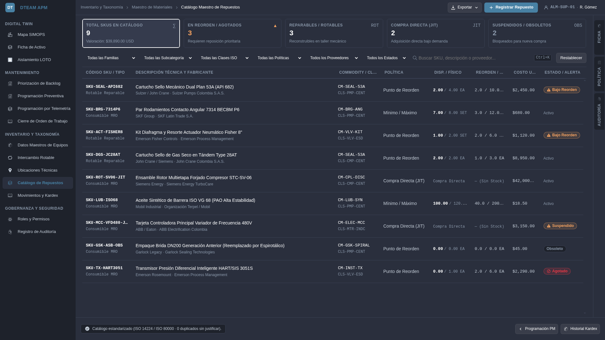
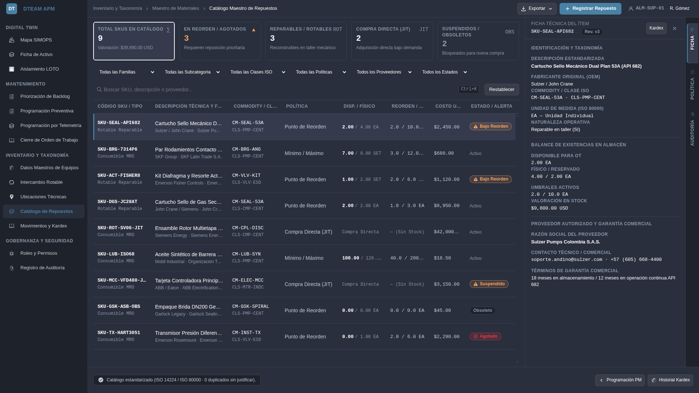
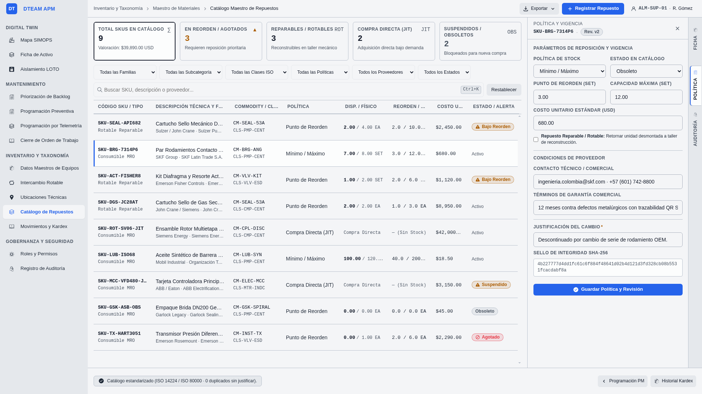
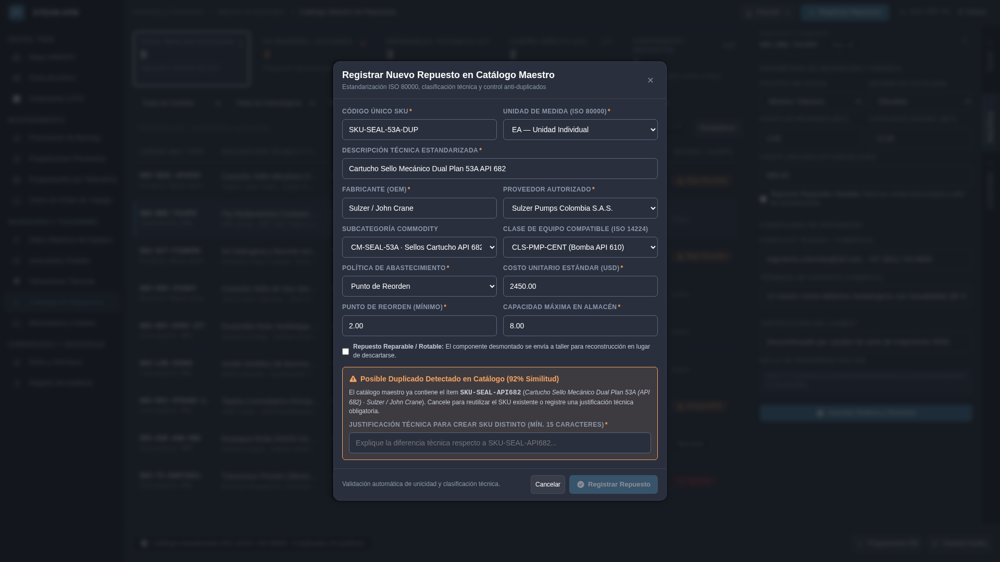
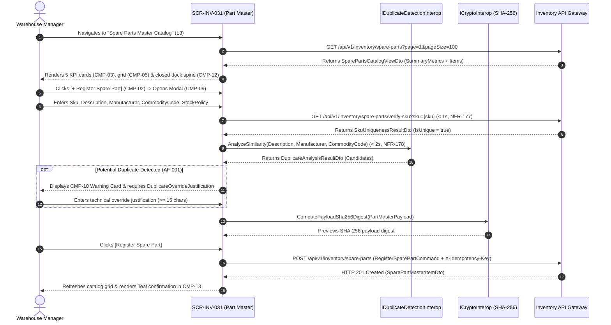

# SCR-INV-031: Spare Parts Master Catalog and Replenishment Policy Governance

## 1. Purpose and Operational Context

* **View Objective:** Centralized Level 3 master catalog (`Part Master`) for onboarding, classifying, and governing MRO spare parts, rotable components, and operational supplies (`SparePart` Aggregate Root) alongside their commercial supplier contracts (`Supplier` Aggregate Root). Enforces $< 1\text{s}$ SKU uniqueness (`NFR-177`), $< 2\text{s}$ phonetic/semantic duplicate detection (`FR-171`, `NFR-178`), cascading ISO 14224 Equipment Class and Commodity Code classification (`FR-172`, `NFR-179`), dynamic replenishment policy parameterization (`REORDER_POINT`, `MIN_MAX`, `JUST_IN_TIME` per `FR-173`), ISO 80000 Unit of Measure standardization (`FR-181`), cyclical audit exports (`FR-176`), and versioned cryptographic auditability (`FR-174`, `TR-001`).
* **Primary Target Persona:** Warehouse Manager registering standardized spare parts (`CMP-02` $\to$ `CMP-09`), resolving potential catalog duplicates (`AF-001`), calibrating replenishment policies (`SparePart.UpdateStockPolicy`), managing supplier warranty terms (`Supplier.UpdateContactInfo`), and exporting audit reports (`FR-176`).
* **Secondary Personas:**
  * **Maintenance Planner:** Navigates from Preventive Maintenance Scheduling ([SCR-MTTO-001](../mtto/SCR-MTTO-001.md)) via `"Verify Spare Parts"` (`L3` $\to$ `L3`) to locate compatible parts (`FR-175`), verify available vs. reserved stock balances, and check whether an item is stocked in warehouse bins or procured on demand (`JUST_IN_TIME`).
  * **Reliability Engineer:** Associates Maintainable Items ([SCR-MTTO-029](../mtto/SCR-MTTO-029.md)) with standardized Part Master SKUs and flags rebuildable rotable assemblies (`IsRebuildable`).
  * **Auditor:** Reviews versioned stock policy changes, duplicate override justifications, and SHA-256 hash-chained catalog records (`FR-174`, `FR-176`, `TR-001`).
* **Operational Context:** Deployed exclusively on high-resolution Desktop Workstations inside warehouse management, purchasing, and maintenance planning offices ([DT-UI-NAV-DOC-001 §4.2](../../DT-UI-NAV-DOC-001.md#42-navigation-structure-web-portal-client)). Compact desktop adaptations are governed in Section 8.
* **Mode of Operation:** Master Catalog Governance and Technical Search mode. Direct DCS/SCADA process control manipulation is strictly excluded. Physical deletion of spare parts with historical transactions is prohibited (dependency-protected deletion per [DT-ERD-DOC-001 §4](../../../domain-models/entity-relationship/DT-ERD-DOC-001.md#4-referential-relationships-and-cascading-fks)); discontinued items transition to `SparePartStatus.OBSOLETE` (`DT-DM-DOC-001 §4.26`).
* **Web Portal Workspace Invariant:** Operates within the unified desktop Blazor Web Portal shell paired with an on-demand, closed-by-default right workspace dock (`CMP-12` hosting `CMP-07`, `CMP-08`, and `CMP-11` across three dedicated vertical spine tabs: `Spec | Policy | Audit`) matching the Blender N-panel pattern established in [SCR-MTTO-026](../mtto/SCR-MTTO-026.md) and [SCR-MTTO-029](../mtto/SCR-MTTO-029.md). Clicking outside catalog table rows (outside interactive dock, modal, filter, or header controls) automatically clears the active SKU selection and closes `CMP-12`, preserving `CLS = 0`.

---

## 2. Visual Artifact



> *Figure 2.1 — Desktop Workstation (`1920×1080`, Dark Theme, Closed Dock by Default): Illustrates the active sidebar route (`CMP-01`), single-CTA header bar with `[Export]` dropdown and `[+ Register Spare Part]` (`CMP-02`), 5 interactive catalog KPI cards (`CMP-03`), clean hairline-bordered 6-selector plus search filter bar (`CMP-04`), virtualized Part Master grid with neutral active lifecycle states (`ACTIVE` rendered uniformly without synthetic status badges), Amber warning pills for below-reorder/suspended SKUs, and Red critical pill for zero-available-stock SKUs (`CMP-05`, `CMP-06`), collapsed `Spec | Policy | Audit` vertical spine (`CMP-12`), and handoff footer (`CMP-13`).*



> *Figure 2.2 — Desktop Workstation (`1920×1080`, Dark Theme, `Spec` Tab Open): Illustrates row selection highlighting (`SKU-SEAL-API682`) and deployment of the `Spec` tab (`CMP-07`) displaying hairline-divided sections for Identification & Taxonomy, Warehouse Stock Balances, and Authorized Supplier & Commercial Warranty reference alongside a direct header `[Kardex]` link.*



> *Figure 2.3 — Desktop Workstation (`1920×1080`, Light Theme, `Policy` Tab `AF-003`): Illustrates the dedicated `Policy` tab (`CMP-08`) keeping replenishment policy calibration, lifecycle `Status`, editable supplier warranty terms, dirty-field focus borders, mandatory audit justification input, SHA-256 seal preview, and `[Save Policy & Revision]` completely visible above the fold without vertical scrolling.*



> *Figure 2.4 — Register New Spare Part Modal with Duplicate Warning (`1920×1080`, Dark Theme, `AF-001`): Illustrates the centered Level 4 onboarding dialog (`CMP-09`) with ISO 80000 Unit of Measure selector, cascading Commodity/Equipment Class selectors, and expanded `AF-001` similarity detection card (`CMP-10`) blocking submission until technical override justification is provided.*

---

## 3. Functional Component Inventory

> The base grid, typography, neutral palettes, minimum caption typography (`--dt-font-caption`), and minimal tactile contact areas are inherited from [DT-UI-DS-DOC-001](../../DT-UI-DS-DOC-001.md). This inventory defines the canonical components present on the screen, their design tokens, and their architectural scope. Interaction rules and geometric algorithms are specified in Section 5; responsive container adaptations are governed by Section 8.

1. **`CMP-01`: Web Portal Shell & Sidebar**
   - **Visual Role:** Collapsible desktop navigation sidebar hosting global modules, module hierarchy, and route markers.
   - **Design Tokens:**
     - Surface: `--dt-color-surface-base`
     - Border: `--dt-color-border-hairline`
     - Active Route Indicator: `--dt-color-state-info`
     - Width: `--dt-layout-sidebar-width-expanded` (Desktop) / `--dt-layout-sidebar-width-collapsed` (User-collapsed rail)
   - **Architectural Scope:** Hosts global module navigation per [DT-UI-NAV-DOC-001](../../DT-UI-NAV-DOC-001.md), highlighting the Spare Parts Catalog route under Inventory & Taxonomy. Layout rules governed in Section 8.

2. **`CMP-02`: Part Master Header & Single Primary Action Bar**
   - **Visual Role:** Sticky top header hosting breadcrumb trail, `[Export]` cyclical audit menu (`CSV` / `JSON` per `FR-176`), the screen's sole `[+ Register Spare Part]` primary CTA (`FR-170`), and operator session badge.
   - **Design Tokens:**
     - Surface: `--dt-color-surface-card`
     - Border: `--dt-color-border-subtle`
     - Elevation: `--dt-z-header-sticky`
     - Primary Button: `--dt-color-state-info`
   - **Architectural Scope:** Launches `CMP-09` (`RegisterSparePartModal.razor`) and triggers structured audit exports. Detailed in §5.1 and §5.2.

3. **`CMP-03`: Catalog Health & Policy Summary Cards**
   - **Visual Role:** 5-card interactive KPI filter bar displaying aggregate catalog metrics (`Total Catalog SKUs`, `Below Reorder / Stockout`, `Rebuildable Rotables`, `Direct Purchase / JIT`, and `Suspended / Obsolete`).
   - **Design Tokens:**
     - Surface: `--dt-color-surface-card`
     - Border: `--dt-color-border-subtle`
     - Radius: `--dt-radius-md`
     - Active Filter Ring: `--dt-color-text-primary`
     - Reorder Alert Accent: `--dt-color-alarm-warning`
   - **Architectural Scope:** Acts as a one-click in-memory filter across the Part Master grid without duplicate filter chip rows ([DT-UI-DS-DOC-001 §6.5](../../DT-UI-DS-DOC-001.md#65-status-badge-counter-discipline-anti-badge-inflation-principle)). Detailed in §5.1.

4. **`CMP-04`: Cascading Commodity & Technical Filter Toolbar**
   - **Visual Role:** Flat toolbar hosting cascading Commodity Family $\to$ Sub-Category selectors (`FR-172`, `NFR-179`), compatible ISO 14224 `EquipmentClass` selector, `StockPolicy` filter, authorized `Supplier` filter, `SparePartStatus` filter, debounced multi-criteria search input with keyboard shortcut hint (`FR-175`, `NFR-180`), and `[Reset]` action.
   - **Design Tokens:**
     - Surface: `--dt-color-surface-card`
     - Control Fill & Border: `--dt-color-surface-card`, `--dt-color-border-subtle`
     - Control Height: `--dt-control-height-sm`
     - Radius: `--dt-radius-md`
   - **Architectural Scope:** Constrains sub-categories dynamically based on the selected parent commodity family in $< 1\text{s}$ (`NFR-179`). Detailed in §5.2.

5. **`CMP-05`: Dense Virtualized Part Master Data Grid**
   - **Visual Role:** Virtualized multi-column tabular grid rendering `Sku` & rebuildable classification, `Description` & `Manufacturer`/`SupplierName`, `CommodityCode` & `EquipmentClassName`, `StockPolicy`, `AvailableQuantity` / `QuantityOnHand` + `UnitOfMeasure` (`FR-181`), `ReorderPoint` / `MaxCapacity`, `UnitCost`, and `SparePartStatus` indicator (`CMP-06`).
   - **Design Tokens:**
     - Header Surface: `--dt-color-surface-card`
     - Row Surface: `--dt-color-surface-card`
     - Border: `--dt-color-border-subtle`
     - Row Height: `--dt-layout-table-row-height`
     - Selected Row Indicator: `--dt-color-state-info`
     - Numeric & Code Typography: `--dt-font-mono-data`, `--dt-font-caption` minimum floor
   - **Architectural Scope:** Core catalog grid (`SparePart` Aggregate Root) virtualized for industrial catalogs (`NFR-180`). Direct row clicking inspects the SKU in `CMP-12` (`Spec` tab by default or retains `Policy` tab if active); clicking outside table rows deselects the active SKU and closes the dock. Detailed in §5.2.

6. **`CMP-06`: Part Status & Replenishment Alert Badges**
   - **Visual Role:** Morphological capsule pills (`--dt-radius-full`) encoding out-of-policy lifecycle states (`SUSPENDED`, `OBSOLETE`) and stock threshold breaches (`BELOW_REORDER_POINT`, `STOCKOUT`), paired with redundant icons (`#icon-warning`, `#icon-ban`).
   - **Design Tokens:**
     - Normal (`ACTIVE` within stock bounds, including healthy `JUST_IN_TIME` SKUs): plain muted text (`--dt-color-text-muted`) with no capsule border
     - Obsolete (`OBSOLETE`): neutral subdued capsule (`--dt-color-surface-base`, `--dt-color-border-subtle`, `--dt-color-text-muted`)
     - Warning (`SUSPENDED`, `BELOW_REORDER_POINT`): `--dt-color-alarm-warning`
     - Critical (`STOCKOUT`): `--dt-color-alarm-critical`
     - Radius: `--dt-radius-full`
   - **Architectural Scope:** Enforces 90/10 HPHMI and Anti-Badge-Inflation rules ([DT-UI-DS-DOC-001 §6.5.1](../../DT-UI-DS-DOC-001.md#651-morphological-differentiation-status-badges-vs-interactive-buttons)): healthy `ACTIVE` parts render strictly as `ACTIVE` neutral text without synthetic status labels or decorative green badges. Detailed in §5.1.

7. **`CMP-07`: Spare Part Technical Specification & Stock Balance Pane (`Spec` Tab)**
   - **Visual Role:** Dedicated read-only technical inspection pane inside dock `CMP-12` (`SparePartSpecificationPane.razor`) displaying hairline-divided Identification & Taxonomy, ISO 80000 `UnitOfMeasure` readout (`FR-181`), rebuildable operational nature, Warehouse Stock Balances (`AvailableQuantity`, `QuantityOnHand` / `ReservedQuantity`, active thresholds, valuation), Authorized `Supplier` contact & commercial warranty reference (`SupplierWarrantyCard.razor`), and header `[Kardex]` navigation link.
   - **Design Tokens:**
     - Panel Surface: `--dt-color-surface-card`
     - Section Divider: `--dt-color-border-subtle`
     - Typography: `--dt-font-caption`, `--dt-font-body-md`, `--dt-font-mono-data`
   - **Architectural Scope:** Keeps technical consultation uncluttered and above the fold while isolating policy mutations into `CMP-08`. Detailed in §5.2.

8. **`CMP-08`: Replenishment Policy & Supplier Terms Calibration Pane (`Policy` Tab)**
   - **Visual Role:** Dedicated versioned governance editor inside dock `CMP-12` (`SparePartPolicyCalibrationPane.razor`) displaying dynamic `StockPolicy` selector (`FR-173`, `FR-174`), lifecycle `Status` selector (`ACTIVE`, `SUSPENDED`, `OBSOLETE`), `ReorderPoint` / `MaxCapacity` / `UnitCost` / `IsRebuildable` controls, editable `Supplier` contact & warranty terms (`Supplier.UpdateContactInfo`), mandatory `AuditJustification` ($\ge 15$ chars), candidate SHA-256 preview strip, and `[Save Policy & Revision]` commit button — all fitting above the fold at `--dt-breakpoint-xl`.
   - **Design Tokens:**
     - Panel Surface: `--dt-color-surface-card`
     - Input Fill & Border: `--dt-color-surface-card`, `--dt-color-border-panel`, `--dt-color-border-focus` (dirty fields)
     - Section Divider: `--dt-color-border-subtle`
     - Primary CTA: `--dt-color-state-info`
   - **Architectural Scope:** Invokes `SparePart.UpdateStockPolicy(policy, reorderPoint, maxCapacity)` ([DT-DM-DOC-002 §4.1](../../../domain-models/class/DT-DM-DOC-002.md#41-sparepart-aggregate-root)) and `Supplier.UpdateContactInfo(contactInfo, warrantyTerms)` ([DT-DM-DOC-002 §4.3](../../../domain-models/class/DT-DM-DOC-002.md#43-supplier-aggregate-root)), dynamically hiding storage thresholds when `JUST_IN_TIME` is selected (`AF-002`). Detailed in §5.3.2 and §5.3.3.

9. **`CMP-09`: Register New Spare Part Modal**
   - **Visual Role:** Centered Level 4 transactional modal dialog (`--dt-layout-modal-width`, `--dt-layout-modal-max-height`) for onboarding a new Spare Part (`FR-170`), featuring cascading commodity selectors (`FR-172`), dynamic policy fields (`FR-173`), real-time SKU uniqueness check (`NFR-177`), and duplicate similarity detector (`CMP-10`).
   - **Design Tokens:**
     - Surface: `--dt-color-surface-card`
     - Input Fill & Border: `--dt-color-surface-card`, `--dt-color-border-panel`
     - Backdrop: `--dt-color-surface-overlay`
     - Width & Max-Height: `--dt-layout-modal-width`, `--dt-layout-modal-max-height`
     - Radius: `--dt-radius-xl`
     - Elevation: `--dt-z-modal`
     - Primary CTA: `--dt-color-state-info`
   - **Architectural Scope:** Enforces catalog purity at intake (`FR-170`, `FR-171`, `AF-001`, `AF-002`). Detailed in §5.3.1.

10. **`CMP-10`: Potential Duplicate Detection & Override Card (`AF-001`)**
    - **Visual Role:** Redundant Shape + Color alert card (`#icon-warning` + `--dt-color-alarm-warning` for semantic similarity; `#icon-ban` + `--dt-color-alarm-critical` for exact SKU collision) deployed inside `CMP-09` when uniqueness or similarity analysis (`< 2s`, `NFR-178`) identifies conflicting SKUs.
    - **Design Tokens:**
      - Warning Accent: `--dt-color-alarm-warning`
      - Exact Collision Accent: `--dt-color-alarm-critical`
      - Radius: `--dt-radius-md`
    - **Architectural Scope:** Lists candidate duplicate SKUs and blocks registration unless an exact collision is resolved or the Warehouse Manager provides a mandatory `DuplicateOverrideJustification` ($\ge 15$ characters) sealed into the audit trail (`FR-171`, `AF-001`). Detailed in §5.3.1.

11. **`CMP-11`: Chained Cryptographic Catalog Audit Pane (`Audit` Tab)**
    - **Visual Role:** Append-only cryptographic audit timeline hosted in dock `CMP-12` (`PartMasterAuditLogPane.razor`) displaying versioned policy updates (`FR-174`), duplicate override justifications, supplier warranty edits, and SHA-256 integrity hashes.
    - **Design Tokens:**
      - Surface: `--dt-color-surface-card`
      - Border: `--dt-color-border-subtle`
      - Hash Typography: `--dt-font-mono-data`, `--dt-font-caption`
    - **Architectural Scope:** Satisfies [FR-174](../../../requirements/user-stories/inv/INV-031.md#functional-requirements-fr), [TR-001](../../../requirements/common/TR-001.md), and [ADR-003](../../../architecture/adr/ADR-003.md). Detailed in §5.3.3.

12. **`CMP-12`: Progressive-Disclosure Workspace Dock & 3-Tab Vertical Spine**
    - **Visual Role:** Closed-by-default right workspace dock with persistent Blender N-panel vertical spine tabs (`Spec | Policy | Audit`) hosting `CMP-07`, `CMP-08`, and `CMP-11` on Desktop Workstations.
    - **Design Tokens:**
      - Track Surface (Open): `--dt-color-surface-base`
      - Panel Surface: `--dt-color-surface-card`
      - Active Tab: `--dt-color-surface-raised`
      - Active Indicator: `--dt-color-state-info`
    - **Architectural Scope:** Maximizes catalog horizontal real estate on initial load (`SelectedSparePartId == null`), opens cleanly on row selection or spine-tab click (`CLS = 0`), displays an empty selection prompt if `Spec`/`Policy` is opened without an active row, and automatically clears selection and closes when clicking outside catalog table rows. Detailed in §5.2 and Section 8.

13. **`CMP-13`: Sticky Catalog Governance & L3 Handoff Footer**
    - **Visual Role:** Permanent sticky bottom action bar dedicated exclusively to the `CLS = 0` catalog status/confirmation pill and contextual Level 3 navigation handoffs (`[< Preventive Scheduling]`, `[Kardex History]`), eliminating duplicate registration or commit CTAs.
    - **Design Tokens:**
      - Surface: `--dt-color-surface-card`
      - Border: `--dt-color-border-subtle`
      - Height: `--dt-layout-footer-height`
      - Elevation: `--dt-z-header-sticky`
      - Success Confirmation: `--dt-color-state-success`
      - Secondary Button: `--dt-color-surface-btn-secondary`
    - **Architectural Scope:** Displays atomic transaction feedback (`FR-174`) and orchestrates cross-screen L3 transitions ([DT-UI-NAV-DOC-001 §5](../../DT-UI-NAV-DOC-001.md#5-transition-matrix-and-access-control-rbac)). Detailed in §5.2 and §5.3.3.

---

## 4. Screen State Catalog

1. **Catalog Inspection Mode (Default)**
   - **Activation Condition:** User navigates to `SCR-INV-031` from the Web Portal Inventory menu or from [SCR-MTTO-001](../mtto/SCR-MTTO-001.md) (`[Verify Spare Parts]`).
   - **Visual Modification:** Neutral grayscale surfaces (`--dt-color-surface-card`). Virtualized grid `CMP-05` renders active spare parts with zero initial row selection (`SelectedSparePartId == null`). Routine `ACTIVE` parts within normal stock bounds (including `JUST_IN_TIME`) render cleanly as plain muted `ACTIVE` text without chromatic pills; right dock `CMP-12` remains closed by default with the `Spec | Policy | Audit` spine visible. Selecting a row opens `CMP-07` (`Spec` tab) in `CMP-12`; clicking outside table rows clears selection and closes `CMP-12`.

2. **Loading / Searching Catalog (`NFR-180`)**
   - **Activation Condition:** Initial catalog hydration or execution of multi-criteria search/category/supplier/status filters.
   - **Visual Modification:** Skeleton shimmer (`--dt-color-surface-raised`) across `CMP-03` summary cards and `CMP-05` rows; mutation actions disabled.

3. **Registering New Spare Part (`FR-170`)**
   - **Activation Condition:** Warehouse Manager clicks `[+ Register Spare Part]` in header `CMP-02`.
   - **Visual Modification:** Modal `CMP-09` deploys centered over `--dt-color-surface-overlay`. Cascading Commodity Family $\to$ Sub-Category selector (`FR-172`) populates valid sub-categories in $< 1\text{s}$ (`NFR-179`).

4. **Exact SKU Collision (`NFR-177`)**
   - **Activation Condition:** Debounced SKU check (`< 1s`, `NFR-177`) in `CMP-09` detects that the entered `Sku` already exists in the `SparePart` master catalog.
   - **Visual Modification:** `Sku` input highlights with a critical red border (`--dt-color-alarm-critical`), `CMP-10` renders `#icon-ban` and critical conflict notice, and the submit button is hard-disabled (`CLS = 0`).

5. **Potential Duplicate Detected (`AF-001` / `FR-171` / `NFR-178`)**
   - **Activation Condition:** Phonetic and token similarity check (`< 2s`, `NFR-178`) in `CMP-09` detects one or more existing spare parts with matching `Manufacturer`, `CommodityCode`, and `Description`.
   - **Visual Modification:** Warning card `CMP-10` expands inside `CMP-09` with an amber border (`--dt-color-alarm-warning`) and `#icon-warning` glyph, listing the similar existing SKUs and requiring either `[Cancel]` or a mandatory `DuplicateOverrideJustification` ($\ge 15$ characters) before unlocking `[Register Spare Part]`.

6. **Direct Purchase / Just-In-Time Mode (`AF-002` / `FR-173`)**
   - **Activation Condition:** Warehouse Manager selects `StockPolicyType.JUST_IN_TIME` in `CMP-09` or `CMP-08` (`Policy` tab).
   - **Visual Modification:** Physical warehouse storage threshold inputs (`ReorderPoint` and `MaxCapacity`) smoothly hide/lock to zero (`FR-173`, `AF-002`), and an informational dashed notice explains direct demand procurement against scheduled Work Orders.

7. **Versioned Policy Edit Mode (`AF-003` / `FR-174`)**
   - **Activation Condition:** Warehouse Manager switches to the `Policy` tab (`CMP-08`) inside dock `CMP-12` and modifies `StockPolicy`, `ReorderPoint`, `MaxCapacity`, `UnitCost`, `Status` (`ACTIVE`, `SUSPENDED`, `OBSOLETE`), or `Supplier` warranty terms.
   - **Visual Modification:** Modified inputs highlight with focus border (`--dt-color-border-focus`). `[Save Policy & Revision]` unlocks once policy thresholds are valid and `AuditJustification` contains $\ge 15$ characters.

8. **Documentary Confirmation (Success)**
   - **Activation Condition:** New part registration (`RegisterSparePartCommand`), versioned policy update (`UpdateSparePartPolicyCommand`), or audit export (`CSV`/`JSON`) completes atomically.
   - **Visual Modification:** Status pill in sticky footer `CMP-13` renders Teal confirmation (`--dt-color-state-success`, `#icon-check`) displaying the committed `Sku`, revision number, and SHA-256 chain status (`CLS = 0`).

---

## 5. Interaction Rules and Data Flow

### 5.1. Initial Load & Duplicate Detection Lifecycle



1. **Numerical Precision Invariant ([DT-ARQ-DB-DOC-001 §2](../../../architecture/DT-ARQ-DB-DOC-001.md#2-physical-integrity-invariants-and-constraints)):**
   * All stock quantities and policy thresholds (`QuantityOnHand`, `ReservedQuantity`, `AvailableQuantity`, `ReorderPoint`, `MaxCapacity`) bind strictly to `decimal` (`SparePart` fixed-precision storage), and `UnitCost` binds strictly to monetary `decimal`.
2. **Cascading Commodity & ISO 14224 Equipment Class Taxonomy (`FR-172`, `NFR-179`):**
   * Selecting a parent Commodity Family filters the child Commodity Code sub-categories and compatible ISO 14224 `EquipmentClasses` in $< 1\text{s}$ (`NFR-179`).

---

### 5.2. Catalog Ergonomics & Cross-Screen Handoffs

1. **Virtualized Grid & Multi-Criteria Technical Search (`CMP-04`, `CMP-05`, `FR-175`, `NFR-180`):**
   * Employs `Virtualize<SparePartMasterItemDto>` with fixed row height (`--dt-layout-table-row-height`) to maintain fluid scrolling across catalogs exceeding $50,000$ SKUs (`NFR-180`).
   * Debounced ($250\text{ms}$) multi-criteria search (`Ctrl+K` shortcut focus) filters across `Sku`, `Description`, `Manufacturer`, and `SupplierName` alongside dropdown filters for Commodity, Equipment Class, Stock Policy, Authorized Supplier, and Status (`FR-175`).
   * Clicking outside table rows (and outside `CMP-12`, modals, or interactive filter/header triggers) clears `SelectedSparePartId` and closes the right dock (`--dt-layout-drawer-width-desktop` / `--dt-layout-drawer-width-tablet`, detailed in Section 8).
2. **Preventive Scheduling & Kardex Handoffs ([DT-UI-NAV-DOC-001 §5](../../DT-UI-NAV-DOC-001.md#5-transition-matrix-and-access-control-rbac)):**
   * When navigated from [SCR-MTTO-001](../mtto/SCR-MTTO-001.md) (`Verify Spare Parts`), `CMP-04` pre-filters the catalog by target `EquipmentClassId`, and `CMP-13` exposes `[< Preventive Scheduling]`.
   * Clicking `[Kardex]` in `CMP-07` (`SparePartSpecificationPane`) or `[Kardex History]` in `CMP-13` routes directly to [SCR-INV-006](SCR-INV-006.md) pre-filtered by `SparePartId` / `Sku`.

---

### 5.3. Domain Workflows & Catalog Purity Rules

#### 5.3.1. Sub-Second SKU Uniqueness & Duplicate Similarity Detection (`FR-170`, `FR-171`, `NFR-177`, `NFR-178`, `AF-001`)
1. **Immediate SKU Uniqueness (`NFR-177`):** Entering a `Sku` in `CMP-09` triggers an indexed lookup completing in $< 1\text{s}$. Exact collisions trigger State 4 (`#icon-ban` + `--dt-color-alarm-critical`), unconditionally blocking creation.
2. **Semantic & Trigram Similarity Analysis (`FR-171`, `NFR-178`, `AF-001`):** As the Manager enters `Description` and `Manufacturer`, the system evaluates normalized trigram/token similarity against existing records in $< 2\text{s}$. If any existing item scores above the similarity threshold ($\ge 0.80$), `CMP-10` surfaces the matching SKUs (`AF-001`), requiring an explicit `DuplicateOverrideJustification` ($\ge 15$ characters) before allowing registration.

#### 5.3.2. Dynamic Replenishment Policy Adaptation & ISO 80000 UoM Validation (`FR-173`, `FR-181`, `AF-002`)
1. **Dynamic Policy Rules (`FR-173`, `AF-002`, [DT-DM-DOC-001 §4.27](../../../domain-models/class/DT-DM-DOC-001.md#427-sparepartstockpolicy)):**
   * **`StockPolicyType.REORDER_POINT`:** Requires $\text{ReorderPoint} > 0$ and $\text{MaxCapacity} \ge \text{ReorderPoint}$.
   * **`StockPolicyType.MIN_MAX`:** Requires minimum threshold ($\text{ReorderPoint} > 0$) and maximum target ceiling ($\text{MaxCapacity} > \text{ReorderPoint}$).
   * **`StockPolicyType.JUST_IN_TIME` (`AF-002`):** Hides storage threshold inputs in `CMP-08`/`CMP-09`, automatically locking `ReorderPoint = 0` and `MaxCapacity = 0`.
2. **Standardized Units of Measure (`FR-181`):** `UnitOfMeasure` is constrained to standardized ISO 80000 / UNECE Rec 20 codes (`EA` Each, `SET` Set/Kit, `L` Liter, `KG` Kilogram, `M` Meter), preventing free-text unit synonyms from corrupting inventory conversions.

#### 5.3.3. Versioned Policy Updates, Supplier Governance & Lifecycle Transitions (`FR-174`, `AF-003`, `TR-001`)
1. **Versioned Policy & Attribute Mutation (`FR-174`, `AF-003`):** Invoking `PUT /api/v1/inventory/spare-parts/{id}/policy` (`UpdateSparePartPolicyCommand` carrying `X-Idempotency-Key: {uuidv7}` per [ADR-007](../../../architecture/adr/ADR-007.md) and `If-Match: "{ConcurrencyToken}"` for optimistic concurrency control per [DT-ARQ-DB-DOC-001 §3.12](../../../architecture/DT-ARQ-DB-DOC-001.md#312-optimistic-concurrency-control-via-postgresql-xmin-system-column-inv-027-nfr-169); concurrent mutations return HTTP `409 Conflict`) executes `SparePart.UpdateStockPolicy(policy, reorderPoint, maxCapacity)` ([DT-DM-DOC-002 §4.1](../../../domain-models/class/DT-DM-DOC-002.md#41-sparepart-aggregate-root)) or `Supplier.UpdateContactInfo(contactInfo, warrantyTerms)` ([DT-DM-DOC-002 §4.3](../../../domain-models/class/DT-DM-DOC-002.md#43-supplier-aggregate-root)) inside `CMP-08`, increments the technical catalog revision, and seals the mandatory `AuditJustification` inside a SHA-256 hash-chained `AuditLog` structured state payload ([DT-ERD-DOC-001 §6.7](../../../domain-models/entity-relationship/DT-ERD-DOC-001.md#67-admaudit_logsprevious_state-and-new_state), `CMP-11`, `TR-001`, [ADR-003](../../../architecture/adr/ADR-003.md#canonical-hash-formula-audit-constants)).
2. **Controlled Lifecycle Archival ([DT-DM-DOC-001 §4.26](../../../domain-models/class/DT-DM-DOC-001.md#426-sparepartstatus)):** Transitioning a part to `SparePartStatus.OBSOLETE` blocks new purchase orders while retaining full historical Kardex and failure traceability; `SparePartStatus.SUSPENDED` temporarily quarantines the SKU during quality or supplier investigations.

---

## 6. Industrial and Safety Considerations

* **Rotable vs. Consumable Traceability (`IsRebuildable` / ISO 14224):** Explicitly flagging repairable assemblies (`IsRebuildable == true`) ensures that when a technician replaces a component in [SCR-MTTO-002](../mtto/SCR-MTTO-002.md), the dismounted item is routed to workshop overhaul rather than scrapped, preserving serialized reliability history.
* **Catalog Purity & MRO Stockout Prevention (`FR-171`, `FR-173`):** Duplicate SKUs fragment warehouse safety stock across multiple part numbers, causing false stockout alarms or excess working capital. Sub-2-second similarity detection (`CMP-10`) and deterministic `UpdateStockPolicy` validation eliminate catalog fragmentation, while redundant `STOCKOUT` (`AvailableQuantity <= 0`) alerts surface immediate availability hazards.
* **HPHMI Grayscale & Anti-Badge-Inflation Governance ([TR-011](../../../requirements/common/TR-011.md)):** In accordance with [DT-UI-DS-DOC-001 §1](../../DT-UI-DS-DOC-001.md#1-scope) and [§6.5](../../DT-UI-DS-DOC-001.md#65-status-badge-counter-discipline-anti-badge-inflation-principle), static attributes (`CommodityCode`, `EquipmentClassName`, `UnitOfMeasure`, `SupplierName`) and healthy `ACTIVE` / `JUST_IN_TIME` items render as subdued neutral text without capsule borders, reserving `--dt-color-alarm-warning` (`BELOW_REORDER_POINT`, `SUSPENDED`, `AF-001` duplicate warning) and `--dt-color-alarm-critical` (`STOCKOUT`, exact SKU collision) strictly for actionable exceptions.

---

## 7. Frontend Component Contract (Blazor / Razor)

### 7.1. Component Hierarchy & File Mapping

```text
Pages/Inventory/
└── SparePartsMasterCatalogPage.razor                  # Root View (SCR-INV-031)
    ├── PortalSidebarNav.razor                         # CMP-01: Collapsible desktop navigation sidebar
    ├── PartMasterHeaderBar.razor                      # CMP-02: Breadcrumbs, [Export] & single [+ Register Spare Part]
    ├── PartMasterSummaryCards.razor                   # CMP-03: 5-card interactive catalog health & policy KPI strip
    ├── PartMasterFilterToolbar.razor                  # CMP-04: Cascading commodity, class, policy, supplier, status & search bar
    ├── SparePartsCatalogGrid.razor                    # CMP-05: Virtualized multi-column Part Master data grid
    │   └── SparePartStatusBadge.razor                 # CMP-06: Redundant status & replenishment alert pill
    ├── PartMasterWorkspaceDock.razor                  # CMP-12: Closed-by-default right dock with 3-tab spine (Spec | Policy | Audit)
    │   ├── SparePartSpecificationPane.razor           # CMP-07: Hairline-divided technical spec, stock balances & Kardex handoff
    │   │   └── SupplierWarrantyCard.razor             # Authorized Supplier commercial contact & warranty reference
    │   ├── SparePartPolicyCalibrationPane.razor       # CMP-08: Dynamic StockPolicy editor, Supplier terms, SHA-256 preview & commit
    │   └── PartMasterAuditLogPane.razor               # CMP-11: Chained SHA-256 versioned policy audit pane
    ├── RegisterSparePartModal.razor                   # CMP-09: New SKU onboarding modal with <1s/<2s uniqueness checks
    │   └── DuplicateCandidateWarningCard.razor        # CMP-10: AF-001 similarity/collision warning & override card
    └── PartMasterActionFooter.razor                   # CMP-13: CLS = 0 governance status slot & L3 handoff links
```

---

### 7.2. Physical Component Parameters & DTO Contracts (.NET 10 / C# 14)

#### 7.2.1. `SparePartsMasterCatalogPage.razor` (Root View)

```csharp
[Parameter, SupplyParameterFromQuery(Name = "classId")]
public Guid? FilterEquipmentClassId { get; set; }

[Parameter, SupplyParameterFromQuery(Name = "sku")]
public string? InitialSelectedSku { get; set; }

[Parameter, SupplyParameterFromQuery(Name = "returnUrl")]
public string? ReturnUrl { get; set; }
```

#### 7.2.2. Subcomponent Parameter Contracts (`CMP-01` to `CMP-13`)

Shared Shell Component (`CMP-01` `PortalSidebarNav.razor`, `ActiveRouteCode = "SCR-INV-031"`): see [DT-UI-CTR-001 §3.1](../../contracts/DT-UI-CTR-001.md#31-application-shell-navigation).

```csharp
// CMP-02: PartMasterHeaderBar.razor
[Parameter]
public required string OperatorBadgeCode { get; set; }

[Parameter]
public required string OperatorDisplayName { get; set; }

[Parameter]
public bool CanManageCatalog { get; set; }

[Parameter]
public EventCallback OnOpenRegisterModalClicked { get; set; }

[Parameter]
public EventCallback<CatalogExportFormat> OnExportRequested { get; set; }

// CMP-03: PartMasterSummaryCards.razor
[Parameter]
public required PartMasterSummaryMetricsDto Metrics { get; set; }

[Parameter]
public PartMasterKpiFilter? ActiveKpiFilter { get; set; }

[Parameter]
public EventCallback<PartMasterKpiFilter?> OnKpiFilterSelected { get; set; }

// CMP-04: PartMasterFilterToolbar.razor
[Parameter]
public required IReadOnlyList<CommodityHierarchyNodeDto> CommodityFamilies { get; set; }

[Parameter]
public required IReadOnlyList<EquipmentClassLookupDto> EquipmentClasses { get; set; }

[Parameter]
public required IReadOnlyList<SupplierDetailsDto> Suppliers { get; set; }

[Parameter]
public string? SelectedCommodityCode { get; set; }

[Parameter]
public Guid? SelectedEquipmentClassId { get; set; }

[Parameter]
public StockPolicyType? SelectedPolicyFilter { get; set; }

[Parameter]
public SparePartStatus? SelectedStatusFilter { get; set; }

[Parameter]
public Guid? SelectedSupplierId { get; set; }

[Parameter]
public string? SearchQuery { get; set; }

[Parameter]
public EventCallback<string?> OnCommodityFilterChanged { get; set; }

[Parameter]
public EventCallback<Guid?> OnEquipmentClassFilterChanged { get; set; }

[Parameter]
public EventCallback<StockPolicyType?> OnPolicyFilterChanged { get; set; }

[Parameter]
public EventCallback<SparePartStatus?> OnStatusFilterChanged { get; set; }

[Parameter]
public EventCallback<Guid?> OnSupplierFilterChanged { get; set; }

[Parameter]
public EventCallback<string?> OnSearchQueryChanged { get; set; }

[Parameter]
public EventCallback OnResetFiltersClicked { get; set; }

// CMP-05: SparePartsCatalogGrid.razor
[Parameter]
public required IReadOnlyList<SparePartMasterItemDto> SpareParts { get; set; }

[Parameter]
public Guid? SelectedSparePartId { get; set; }

[Parameter]
public EventCallback<SparePartMasterItemDto?> OnSparePartSelected { get; set; }

// CMP-06: SparePartStatusBadge.razor
[Parameter]
public required SparePartStatus Status { get; set; }

[Parameter]
public required StockPolicyType StockPolicy { get; set; }

[Parameter]
public required decimal QuantityOnHand { get; set; }

[Parameter]
public required decimal ReservedQuantity { get; set; }

[Parameter]
public required decimal ReorderPoint { get; set; }

// CMP-12: PartMasterWorkspaceDock.razor
[Parameter]
public bool IsOpen { get; set; }

[Parameter]
public PartMasterDockTab ActiveTab { get; set; } = PartMasterDockTab.PART_SPECIFICATION;

[Parameter]
public EventCallback<PartMasterDockTab> OnTabChanged { get; set; }

[Parameter]
public EventCallback OnClosed { get; set; }

// CMP-07: SparePartSpecificationPane.razor (Spec Tab)
[Parameter]
public SparePartMasterItemDto? SelectedPart { get; set; }

[Parameter]
public EventCallback<Guid> OnCheckKardexRequested { get; set; }

[Parameter]
public EventCallback OnCloseRequested { get; set; }

// SupplierWarrantyCard.razor (Read-only commercial section inside CMP-07)
[Parameter]
public required SupplierDetailsDto Supplier { get; set; }

// CMP-08: SparePartPolicyCalibrationPane.razor (Policy Tab)
[Parameter]
public SparePartMasterItemDto? SelectedPart { get; set; }

[Parameter]
public required UpdateSparePartPolicyFormDto PolicyForm { get; set; }

[Parameter]
public EventCallback<UpdateSparePartPolicyFormDto> PolicyFormChanged { get; set; }

[Parameter]
public required SupplierDetailsDto Supplier { get; set; }

[Parameter]
public EventCallback<SupplierDetailsDto> OnSupplierContactUpdated { get; set; }

[Parameter]
public string AuditJustification { get; set; } = string.Empty;

[Parameter]
public EventCallback<string> AuditJustificationChanged { get; set; }

[Parameter]
public required string CandidateIntegrityHash { get; set; }

[Parameter]
public bool HasUnsavedPolicyChanges { get; set; }

[Parameter]
public bool CanSavePolicy { get; set; }

[Parameter]
public bool IsSaving { get; set; }

[Parameter]
public bool IsReadOnly { get; set; }

[Parameter]
public EventCallback OnSavePolicyChangesClicked { get; set; }

[Parameter]
public EventCallback OnCloseRequested { get; set; }

// CMP-09: RegisterSparePartModal.razor
[Parameter]
public bool IsVisible { get; set; }

[Parameter]
public required IReadOnlyList<CommodityHierarchyNodeDto> CommodityFamilies { get; set; }

[Parameter]
public required IReadOnlyList<EquipmentClassLookupDto> EquipmentClasses { get; set; }

[Parameter]
public required IReadOnlyList<SupplierDetailsDto> Suppliers { get; set; }

[Parameter]
public bool IsSkuUnique { get; set; } = true;

[Parameter]
public IReadOnlyList<DuplicateSparePartCandidateDto> DuplicateCandidates { get; set; } = [];

[Parameter]
public EventCallback<string> OnSkuChangedForCheck { get; set; }

[Parameter]
public EventCallback<RegisterSparePartCommand> OnSparePartRegistered { get; set; }

[Parameter]
public EventCallback OnCloseRequested { get; set; }

// CMP-10: DuplicateCandidateWarningCard.razor (AF-001)
[Parameter]
public required IReadOnlyList<DuplicateSparePartCandidateDto> Candidates { get; set; }

[Parameter]
public bool IsExactSkuCollision { get; set; }

[Parameter]
public string OverrideJustification { get; set; } = string.Empty;

[Parameter]
public EventCallback<string> OverrideJustificationChanged { get; set; }

[Parameter]
public EventCallback<Guid> OnUseExistingPartSelected { get; set; }

// CMP-11: PartMasterAuditLogPane.razor (Audit Tab)
[Parameter]
public required IReadOnlyList<PartMasterAuditEntryDto> AuditEntries { get; set; }

[Parameter]
public EventCallback OnCloseRequested { get; set; }

// CMP-13: PartMasterActionFooter.razor
[Parameter]
public Guid? SelectedSparePartId { get; set; }

[Parameter]
public CatalogValidationSeverity ValidationSeverity { get; set; } = CatalogValidationSeverity.INFO;

[Parameter]
public string? ValidationMessage { get; set; }

[Parameter]
public string? ReturnUrl { get; set; }

[Parameter]
public EventCallback OnReturnToPreventiveScheduling { get; set; }

[Parameter]
public EventCallback<Guid?> OnNavigateToKardexHistory { get; set; }
```

#### 7.2.3. Data Transfer Objects (DTOs) and Enums

Shared Domain Enums (`SparePartStatus`, `StockPolicyType`, `AuditActionType`): see [DT-DM-DOC-001 §4](../../../domain-models/class/DT-DM-DOC-001.md#4-controlled-vocabulary).

Shared Lookup DTOs (`EquipmentClassLookupDto`): see [DT-UI-CTR-001 §2](../../contracts/DT-UI-CTR-001.md#2-shared-lookup-dtos).

Shared Presentation Enums (`StandardUnitOfMeasure`): see [DT-UI-CTR-001 §4](../../contracts/DT-UI-CTR-001.md#4-shared-value-types-and-presentation-enums).

```csharp
public enum PartMasterKpiFilter
{
    ALL_ACTIVE,
    BELOW_REORDER_POINT,
    REBUILDABLE_ROTABLES,
    DIRECT_PURCHASE_JIT,
    SUSPENDED_OR_OBSOLETE
}

public enum PartMasterDockTab
{
    PART_SPECIFICATION,
    REPLENISHMENT_POLICY,
    SHA256_AUDIT
}

public enum CatalogExportFormat
{
    PART_MASTER_CSV,
    PART_MASTER_JSON
}

public enum CatalogValidationSeverity
{
    INFO,
    SUCCESS,
    WARNING,
    CRITICAL
}

public record PartMasterSummaryMetricsDto
{
    public required int TotalActiveSkusCount { get; init; }
    public required int BelowReorderOrStockoutCount { get; init; }
    public required int RebuildableRotablesCount { get; init; }
    public required int DirectPurchaseJitCount { get; init; }
    public required int SuspendedOrObsoleteCount { get; init; }
    public required decimal TotalInventoryValuation { get; init; }
}

public record CommodityHierarchyNodeDto
{
    public required string CommodityCode { get; init; }
    public required string FamilyName { get; init; }
    public string? ParentCommodityCode { get; init; }
    public IReadOnlyList<CommodityHierarchyNodeDto> SubCategories { get; init; } = [];
}

public record SupplierDetailsDto
{
    public required Guid SupplierId { get; init; }
    public required string Name { get; init; }
    public required string ContactInfo { get; init; }
    public required string WarrantyTerms { get; init; }
}

public record SparePartMasterItemDto
{
    public required Guid SparePartId { get; init; }
    public required string Sku { get; init; }
    public required string Description { get; init; }
    public required string Manufacturer { get; init; }
    public string? CommodityCode { get; init; }
    public required StandardUnitOfMeasure UnitOfMeasure { get; init; }
    public required StockPolicyType StockPolicy { get; init; }
    public required bool IsRebuildable { get; init; }
    public required decimal QuantityOnHand { get; init; }
    public required decimal ReservedQuantity { get; init; }
    public decimal AvailableQuantity => QuantityOnHand - ReservedQuantity;
    public required decimal ReorderPoint { get; init; }
    public required decimal MaxCapacity { get; init; }
    public required decimal UnitCost { get; init; }
    public required SparePartStatus Status { get; init; }
    public required SupplierDetailsDto Supplier { get; init; }
    public Guid? EquipmentClassId { get; init; }
    public string? EquipmentClassName { get; init; }
    public required string LatestIntegrityHash { get; init; }
    public required uint ConcurrencyToken { get; init; }
}

public record DuplicateSparePartCandidateDto
{
    public required Guid ExistingSparePartId { get; init; }
    public required string ExistingSku { get; init; }
    public required string Description { get; init; }
    public required string Manufacturer { get; init; }
    public required decimal SimilarityScore { get; init; }
}

public record UpdateSparePartPolicyFormDto
{
    public required Guid SparePartId { get; set; }
    public StockPolicyType StockPolicy { get; set; }
    public decimal ReorderPoint { get; set; }
    public decimal MaxCapacity { get; set; }
    public decimal UnitCost { get; set; }
    public bool IsRebuildable { get; set; }
    public SparePartStatus Status { get; set; }
}

/// <summary>
/// Spare part registration payload; <c>audit_logs.previous_hash</c> is resolved and chained server-side pre-commit by <c>AuditSaveChangesInterceptor</c> (DT-ARQ-DB-DOC-001 §3.9, never client-supplied).
/// </summary>
public record RegisterSparePartCommand
{
    public required string Sku { get; init; }
    public required string Description { get; init; }
    public required string Manufacturer { get; init; }
    public required string CommodityCode { get; init; }
    public required StandardUnitOfMeasure UnitOfMeasure { get; init; }
    public required StockPolicyType StockPolicy { get; init; }
    public required bool IsRebuildable { get; init; }
    public required decimal ReorderPoint { get; init; }
    public required decimal MaxCapacity { get; init; }
    public required decimal UnitCost { get; init; }
    public required Guid SupplierId { get; init; }
    public Guid? EquipmentClassId { get; init; }
    public string? DuplicateOverrideJustification { get; init; }
    public required Guid ManagerUserId { get; init; }
}

/// <summary>
/// Versioned replenishment policy update payload; AuditJustification persists inside the AuditLog NewState JSONB envelope per DT-ERD-DOC-001 §6.7, and <c>audit_logs.previous_hash</c> is resolved and chained server-side pre-commit by <c>AuditSaveChangesInterceptor</c> (DT-ARQ-DB-DOC-001 §3.9, never client-supplied).
/// </summary>
public record UpdateSparePartPolicyCommand
{
    public required Guid SparePartId { get; init; }
    public required StockPolicyType StockPolicy { get; init; }
    public required decimal ReorderPoint { get; init; }
    public required decimal MaxCapacity { get; init; }
    public required decimal UnitCost { get; init; }
    public required bool IsRebuildable { get; init; }
    public required SparePartStatus Status { get; init; }
    public required Guid SupplierId { get; init; }
    public required string SupplierContactInfo { get; init; }
    public required string SupplierWarrantyTerms { get; init; }
    public required string AuditJustification { get; init; }
    public required Guid ManagerUserId { get; init; }
    public required uint ConcurrencyToken { get; init; }
    /// <summary>
    /// Optional PostgreSQL <c>xmin</c> concurrency token for the <c>Supplier</c> (<c>suppliers</c>) row when supplier contact or warranty terms are modified alongside the spare part policy.
    /// </summary>
    public uint? SupplierConcurrencyToken { get; init; }
}

public record PartMasterAuditEntryDto
{
    public required Guid AuditLogId { get; init; }
    public required DateTimeOffset TimestampUtc { get; init; }
    public required string OperatorBadgeCode { get; init; }
    public required AuditActionType ActionType { get; init; }
    public required string Sku { get; init; }
    public required string ChangeSummary { get; init; }
    public required string AuditJustification { get; init; }
    public required string PreviousHash { get; init; }
    public required string IntegrityHash { get; init; }
}
```

---

### 7.3. Client-Side DOM & Interop Bridge

1. **Debounced SKU Uniqueness & Phonetic Similarity Bridge (`IDuplicateDetectionInterop`):**
   * Throttles SKU uniqueness queries ($250\text{ms}$ debounce, completing in $< 1\text{s}$ per `NFR-177`) and executes token/phonetic similarity scoring against `Description`, `Manufacturer`, and `CommodityCode` in $< 2\text{s}$ (`FR-171`, `NFR-178`).
2. **Virtualized Catalog Grid Interop (`IVirtualizationInterop`):**
   * Lazily renders visible Part Master rows within the scrollable grid viewport, maintaining sub-second filtering and responsive scrolling across industrial catalogs (`NFR-180`).
3. **Web Cryptography SHA-256 Digest Bridge (`ICryptoInterop`):**
   * Computes candidate `IntegrityHash` digests asynchronously in a Web Worker for new SKU onboarding and versioned policy mutations (`FR-174`, `TR-001`, `ADR-003`).
4. **Modal Focus Trap, Click-Outside Deselection & Keyboard Shortcut Bridge (`IModalFocusInterop`):**
   * Handles focus trapping, backdrop-click dismissal, and `Escape` dismissal across `RegisterSparePartModal.razor`, `Ctrl+K` search focus routing, and click-outside listener collapsing `PartMasterWorkspaceDock.razor` while clearing `SelectedSparePartId` when clicking outside grid rows and active dock/filter/header controls.

---

## 8. Layout and Responsive Adaptability

### 8.1. Desktop Workstation (`--dt-breakpoint-xl`, Primary Scope)
* **Layout Organization:** Asymmetric Desktop Web Portal workstation split ([DT-UI-DS-DOC-001 §2.3](../../DT-UI-DS-DOC-001.md#23-responsive-breakpoints-and-reference-frames), [DT-UI-NAV-DOC-001 §4.2](../../DT-UI-NAV-DOC-001.md#42-navigation-structure-web-portal-client)): left navigation sidebar `CMP-01` expanded at `--dt-layout-sidebar-width-expanded`, central Part Master workspace hosting the 5 summary KPI cards `CMP-03`, 6-selector plus search filter toolbar `CMP-04`, and virtualized catalog grid `CMP-05`. On the right edge, persistent vertical tab strip (`Spec | Policy | Audit`) keeps inspection dock `CMP-12` (`--dt-layout-drawer-width-desktop`) **closed by default** on initial load (`SelectedSparePartId == null`), opens cleanly on demand without horizontal shift (`CLS = 0`), and automatically collapses/deselects when clicking outside table rows. Modal `CMP-09` centers at `--dt-layout-modal-width-desktop` bounded by `--dt-layout-modal-max-height`. Sticky footer `CMP-13` (`--dt-layout-footer-height`) spans the bottom workspace.
* **Ergonomic Rules:** Enforces strict `--dt-font-caption` minimum font size across all labels, sub-metadata lines, and hashes; optimized for mouse and keyboard navigation (`Ctrl + K` search focus, `Escape` modal/dock dismissal); dense row height governed by `--dt-layout-table-row-height`; single primary registration CTA outside modals; zero horizontal scroll.

### 8.2. Compact Desktop Workstation (`--dt-breakpoint-lg`)
* **Layout Organization:** On compact desktop and laptop monitors (`--dt-breakpoint-lg`), navigation sidebar `CMP-01` collapses to `--dt-layout-sidebar-width-collapsed`, filter selectors in `CMP-04` wrap cleanly into two hairline-aligned rows (with search input and `[Reset]` paired on Row 2 when dock `CMP-12` is open), and proportional table column widths preserve legibility across all 8 catalog columns alongside `CMP-12` (`--dt-layout-drawer-width-tablet`). Per [DT-UI-NAV-DOC-001 §4.1–§4.2](../../DT-UI-NAV-DOC-001.md#42-navigation-structure-web-portal-client), Tablet Landscape and Tablet Portrait field client breakpoints are outside the operational scope of centralized Warehouse Manager Part Master administration.
* **Ergonomic Rules:** Filter controls adhere to `--dt-control-height-sm`; table rows maintain `--dt-layout-table-row-height` with virtualized scrolling (`CLS = 0`).

---

## 9. Traceability and Requirements Matrix

| Requirement | Addressed in Component | Verification & Implementation Mechanism |
| :--- | :--- | :--- |
| [FR-170](../../../requirements/user-stories/inv/INV-031.md#functional-requirements-fr) | `CMP-02`, `CMP-05`, `CMP-09` | Registers spare parts capturing unique `Sku`, `Description`, `Manufacturer`, `CommodityCode`, `SupplierId`, and `EquipmentClassId`. |
| [FR-171](../../../requirements/user-stories/inv/INV-031.md#functional-requirements-fr) | `CMP-09`, `CMP-10` | Compares technical attributes during registration to flag potential duplicates (`AF-001`) and require override justification. |
| [FR-172](../../../requirements/user-stories/inv/INV-031.md#functional-requirements-fr) | `CMP-04`, `CMP-09` | Cascading hierarchical selector for Commodity Family $\to$ Sub-Category and compatible ISO 14224 Equipment Classes. |
| [FR-173](../../../requirements/user-stories/inv/INV-031.md#functional-requirements-fr) | `CMP-08`, `CMP-09` | Dynamically adapts `ReorderPoint` and `MaxCapacity` inputs based on `StockPolicy`, hiding storage thresholds for `JUST_IN_TIME` (`AF-002`). |
| [FR-174](../../../requirements/user-stories/inv/INV-031.md#functional-requirements-fr) | `CMP-08`, `CMP-11`, `CMP-13` | Updates technical attributes (`IsRebuildable`), `StockPolicy`, `SparePartStatus`, and `Supplier` warranty terms under versioned SHA-256 audit control (`AF-003`). |
| [FR-175](../../../requirements/user-stories/inv/INV-031.md#functional-requirements-fr) | `CMP-03`, `CMP-04`, `CMP-05` | Multi-criteria technical search by SKU, Description, Manufacturer, Commodity Code, Equipment Class, Policy, Supplier, and Status. |
| [FR-176](../../../requirements/user-stories/inv/INV-031.md#functional-requirements-fr) | `CMP-02`, `CMP-03`, `CMP-13` | Exports consolidated Part Master catalog and stock valuation reports (`CSV` and `JSON`) for cyclical inventory audits. |
| [FR-181](../../../requirements/user-stories/inv/INV-031.md#functional-requirements-fr) | `CMP-05`, `CMP-07`, `CMP-09` | Enforces standardized ISO 80000 Units of Measure (`StandardUnitOfMeasure` enum) across all catalog items. |
| [NFR-177](../../../requirements/user-stories/inv/INV-031.md#non-functional-requirements-nfr) | `CMP-09`, `CMP-10` | Debounced indexed `Sku` uniqueness verification completes in $< 1\text{s}$. |
| [NFR-178](../../../requirements/user-stories/inv/INV-031.md#non-functional-requirements-nfr) | `CMP-09`, `CMP-10` | Trigram and phonetic similarity analysis for potential duplicate detection completes in $< 2\text{s}$. |
| [NFR-179](../../../requirements/user-stories/inv/INV-031.md#non-functional-requirements-nfr) | `CMP-04`, `CMP-09` | In-memory cascading Commodity Code and Equipment Class category navigation executes in $< 1\text{s}$. |
| [NFR-180](../../../requirements/user-stories/inv/INV-031.md#non-functional-requirements-nfr) | `CMP-04`, `CMP-05` | UI row virtualization and indexed backend filtering sustain sub-second search performance across extensive industrial catalogs. |
| [TR-001](../../../requirements/common/TR-001.md) | `CMP-08`, `CMP-09`, `CMP-11`, `CMP-13` | Immutable append-only audit trail logging with SHA-256 hash chaining for all SKU creations and policy updates. |
| [TR-005](../../../requirements/common/TR-005.md) | `CMP-05`, `CMP-08`, `CMP-09` | Enforces TLS/HTTPS encryption in transit across all catalog queries, duplicate checks, and policy mutation commands. |
| [TR-006](../../../requirements/common/TR-006.md) | `CMP-02`, `CMP-08`, `CMP-09` | Enforces RBAC permissions (`Warehouse Manager` for catalog/policy mutations; read/verification access for `Planner`, `Reliability Eng.`, and `Auditor`). |
| [TR-008](../../../requirements/common/TR-008.md) | `CMP-04`, `CMP-07`, `CMP-09` | Enforces ISO 14224 Equipment Class compatibility and hierarchical material classification rules. |
| [TR-011](../../../requirements/common/TR-011.md) | `CMP-01` to `CMP-13` | ANSI/ISA-101 HPHMI 90/10 neutral grayscale workspace, zero badge inflation on healthy SKUs, `--dt-font-caption` floor, and WCAG 2.1 AA redundant coding. |
| [ADR-003](../../../architecture/adr/ADR-003.md) | `CMP-08`, `CMP-09`, `CMP-11` | Tamper-evident cryptographic SHA-256 hash chaining (`PreviousHash` $\to$ `IntegrityHash`) on Part Master audit records. |
| [ADR-005](../../../architecture/adr/ADR-005.md) | `CMP-09` | Time-sequential UUIDv7 identifier generation for newly registered `SparePart` entities. |
| [ADR-007](../../../architecture/adr/ADR-007.md) | `CMP-08`, `CMP-09` | Mandatory `X-Idempotency-Key: {uuidv7}` header paired with PostgreSQL `xmin` optimistic concurrency (`If-Match`) across SKU onboarding and versioned replenishment policy updates. |
