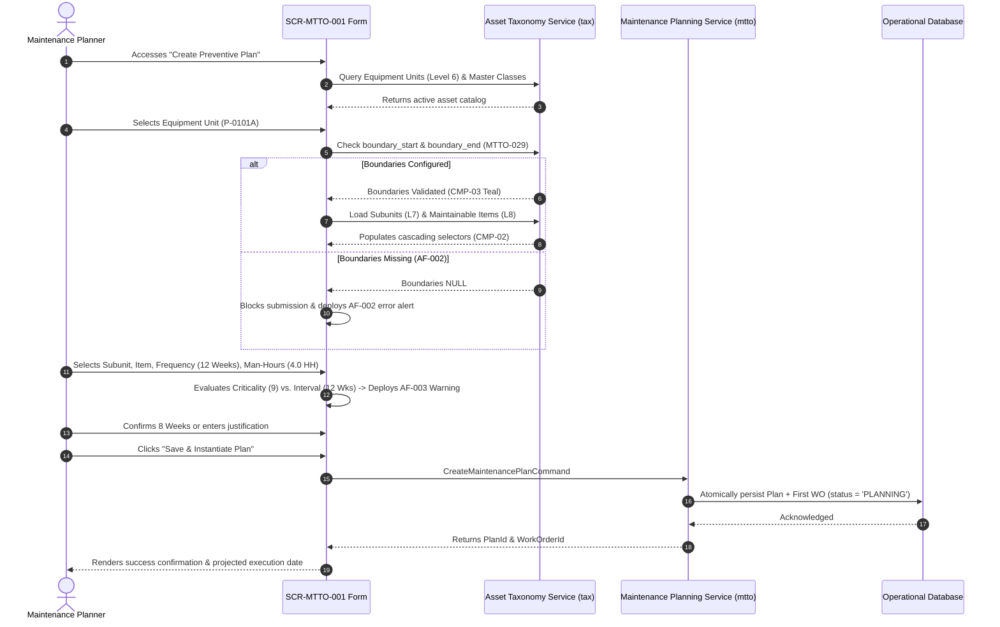

# SCR-MTTO-001: Preventive Maintenance Scheduling Form (Calendar Intervals)

## 1. Purpose and Operational Context

* **View Objective:** Centralized configuration form for creating, calibrating, and scheduling recurring preventive maintenance plans based exclusively on calendar time intervals (weeks or months). Links plans to ISO 14224 taxonomic levels (Equipment Unit Level 6, Subunit Level 7, Maintainable Item Level 8), enforces physical battery limits verification ([[MTTO-029]]), estimates required labor resources (Wrench Time in Man-Hours), calculates the initial RIME priority score ($Score = \text{Criticality} \times \text{Work Class Weight}$), and automatically projects the initial Work Order into `PLANNING` status.
* **Primary Target Persona:** Maintenance Planner defining recurring preventive maintenance cadences, balancing workload hours, and assigning maintenance specialties to prevent catastrophic equipment wear (ISO 55001 §8.1).
* **Secondary Personas:**
  * **Maintenance Supervisor:** Reviews projected preventive work orders and verifies craft availability.
  * **Reliability Engineer:** Verifies taxonomic boundary compliance and receives optimization alerts when inspection cadences on high-criticality assets exceed recommended limits.
* **Operational Context:** Planning control rooms and engineering workstations (`--dt-breakpoint-xl`, $\ge 1400\text{px}$) and supervisory industrial tablets in landscape orientation (`--dt-breakpoint-lg`, $901\text{px} - 1399\text{px}$).
* **Mode of Operation:** Supervisory Technical Configuration mode. Focuses on master plan parameterization, resource allocation, and automated work order projection. Direct DCS/SCADA process control manipulation is strictly excluded.
* **Web Portal Workspace Invariant:** Operates as a Level 3 technical form within the Blazor Web Portal shell (`Pages/Maintenance/CreatePreventivePlanPage.razor`), accessible directly from the Maintenance menu or via drill-down from the RIME Backlog Dashboard ([[SCR-MTTO-026]]).

---

## 2. Visual Artifact

![[SCR-MTTO-001-wireframe.svg]]

> *Note: Conceptual wireframe illustrating the Web Portal layout, cascading ISO 14224 asset selector, physical boundary verification badge, calendar cadence controller, labor resource estimator, RIME score preview, and projected work order card.*

---

## 3. Functional Component Inventory

> The base layout, typography, and design tokens are inherited from [[DT-UI-DS-DOC-001]]. This table defines the present components, semantic tokens, and architectural roles. Detailed interaction rules, layout constraints, and geometric algorithms are strictly specified in Section 5.

| ID | Control / Component | Visual Role / Content | Semantic Token | Architectural Role & Reference |
| :--- | :--- | :--- | :--- | :--- |
| `CMP-01` | Form Breadcrumbs & Header | Top breadcrumb navigation and form title | Surface: `--dt-color-surface-card`<br>Border: `--dt-color-border-subtle` | Displays path (`Maintenance > Preventive Scheduling > Create Calendar Plan`), active asset tag pill, and navigation backlink to [[SCR-MTTO-026]]. |
| `CMP-02` | Cascading ISO 14224 Selector | 3-tier taxonomic dropdown hierarchy | Surface: `--dt-color-surface-base`<br>Border: `--dt-color-border-subtle` | Cascading dropdowns: Equipment Unit L6 (`P-0101A`), Subunit L7 (`Sealing System`), and Maintainable Item L8 (`Mechanical Seal`) (`FR-001`). Enforces strict taxonomic parent-child linkage. |
| `CMP-03` | Boundary Limits Verification Badge | Battery limits compliance indicator | Dynamic Surface: `--dt-color-state-success` or `--dt-color-alarm-warning` | Real-time check verifying whether the selected asset has defined physical battery limits (`boundary_start`, `boundary_end` per [[MTTO-029]]). Hard-blocks saving if missing (`AF-002`). |
| `CMP-04` | Calendar Cadence Controller | Numerical interval and frequency unit | Surface: `--dt-color-surface-base`<br>Border: `--dt-color-border-subtle` | Numeric stepper ($1..52$) combined with unit selector (`Weeks`, `Months`) (`FR-002`). Calculates `next_work_order_date` (`CMP-05`) in real time. |
| `CMP-05` | Next Work Order Date Indicator | Dynamic execution date preview | Surface: `--dt-color-surface-raised`<br>Font: `--dt-font-family-mono` | Displays the projected execution date calculated by adding the selected interval strictly to the current date or plan baseline (`FR-003`). |
| `CMP-06` | Labor & Resource Estimation Grid | Man-Hours (Wrench Time) & Specialty | Surface: `--dt-color-surface-base`<br>Border: `--dt-color-border-subtle` | Numeric input for Estimated Man-Hours (e.g. $4.0\text{ HH}$) and craft selector (`Mechanical`, `Electrical`, `Instrumentation`). Enforces non-zero numeric validation (`AF-001`). |
| `CMP-07` | Task Scope Description Textarea | Narrative of maintenance tasks | Surface: `--dt-color-surface-base`<br>Border: `--dt-color-border-subtle` | Multiline text area capturing technical scope, standard operating procedure (SOP) references, and required safety isolation points. |
| `CMP-08` | RIME Priority Preview Card | Initial priority score decomposition | Surface: `--dt-color-surface-raised`<br>Border: `--dt-color-border-subtle` | Displays Asset Criticality ($1..10$), Work Class weight (default 6 for Systematic PM, 7 for Regulated PM), and resulting RIME Score ($C \times W$) with redundant priority badge (`CMP-08` per [[SCR-MTTO-026]]). |
| `CMP-09` | High-Criticality Interval Alert Banner | Optimization warning ribbon | Surface: `--dt-color-surface-raised`<br>Border: `--dt-color-alarm-warning` | Deployed when Asset Criticality $> 8$ and interval $> 8$ weeks (`AF-003`). Recommends $\le 8$ weeks, providing a one-click adjust button or mandatory justification override. |
| `CMP-10` | Projected Work Order Preview Card | Initial instantiated WO preview | Surface: `--dt-color-surface-base`<br>Border: `--dt-color-state-info` | Previews the first Work Order to be automatically created in `PLANNING` status upon plan confirmation (`FR-005`). |
| `CMP-11` | Spare Parts Verification Action Link | Navigation button to parts catalog | Surface: `--dt-color-surface-raised`<br>Border: `--dt-color-border-subtle` | Direct link to [[SCR-INV-031]] ("Verify Spare Parts", L3 $\to$ L3) enabling planners to corroborate bill-of-materials availability prior to plan registration. |
| `CMP-12` | Plan Confirmation & Action Bar | Sticky bottom submission bar | Surface: `--dt-color-surface-card`<br>Border: `--dt-color-border-subtle` | Bottom bar hosting "Cancel" and "Save & Instantiate Plan" primary action button. Enforces mandatory field completeness (`AF-001`). |

---

## 4. Screen State Matrix

| State | Visual Modification in the Interface | Activation Condition |
| :--- | :--- | :--- |
| **Normal / Empty Form** | Form fields render empty or with default prompts. `CMP-03` renders neutral placeholder. `CMP-12` primary button is disabled (`opacity: 0.45`). | Planner accesses "Create Preventive Plan" prior to asset selection. |
| **Asset Selected & Validated** | `CMP-03` displays Teal badge: *"Physical Boundaries Verified (ISO 14224)"*. Subunit and Maintainable Item dropdowns become active. RIME score card populates with asset criticality. | Planner selects a valid Level 6 Equipment Unit with defined battery limits. |
| **Boundary Missing Blocked (AF-002)** | `CMP-03` displays amber warning badge: *"Missing Physical Boundaries"*. Warning banner deployed: *"Cannot schedule maintenance on an asset without defined battery limits (MTTO-029). Request configuration from Reliability Engineer."* Form disabled. | Selected asset has `boundary_start` or `boundary_end` as `NULL` (`AF-002`). |
| **High Criticality Alert (AF-003)** | Warning banner `CMP-09` deployed above cadence controller. Text warns: *"Asset criticality is 9. Recommended interval is ≤ 8 weeks."* Form displays *"Adjust to 8 Weeks"* quick button and justification textarea. | Asset Criticality $> 8$ and selected interval $> 8$ weeks (`AF-003`). |
| **Missing Mandatory Fields (AF-001)** | Omitted inputs highlight with amber outline (`--dt-color-alarm-warning`, $2\text{px}$) and warning icon `#icon-warning`. Error toast alerts: *"Mandatory fields required: Asset, Subunit, Item, Frequency, Man-Hours, Description."* | Planner attempts to submit form without satisfying mandatory constraints (`AF-001`). |
| **Saving / Instantiating** | Primary button `CMP-12` renders skeleton shimmer and loading indicator. Inputs locked. | Planner activates "Save & Instantiate Plan". |
| **Plan Created (Success)** | Form displays green success alert banner, shows generated Work Order ID (`WO-2026-PLAN-XXXX`), and provides links to "View Active Plans" or "Create Another Plan". | Atomic persistence of plan and initial work order completes in $< 1\text{s}$ (`NFR-008`). |

---

## 5. Interaction Rules and Data Flow

### 5.1. Initial Load & Lifecycle



1. **Taxonomic Hierarchy Loading:** When an Equipment Unit (Level 6) is selected, the system filters `tax.subunits` where `equipment_unit_id = :selected_id`. Selecting a Subunit dynamically loads `tax.maintainable_items` where `subunit_id = :subunit_id` (`FR-001`).
2. **Deterministic Next Date Calculation (`FR-003`):** The system calculates:
   $$\text{next\_work\_order\_date} = \text{CurrentDate} + (\text{IntervalValue} \times \text{UnitMultiplier})$$
   where $\text{UnitMultiplier} = 7\text{ days}$ for weeks, or $30.4375\text{ days}$ for months.
3. **Automatic Work Order Instantiation (`FR-005`):** On plan confirmation, the system creates a plan row in `mtto.maintenance_plans` and automatically instantiates the first preventative Work Order in `mtto.work_orders`:
   * `status = 'PLANNING'`
   * `scheduled_date = :next_work_order_date`
   * `estimated_labor_hours = :man_hours`
   * `work_class = 6` (or 7 if Regulated PM is checked)
   * `priority_score = :asset_criticality * :work_class`

---

### 5.2. Form Mechanics & Cascading Selectors

1. **Cascading Reset Policy:** Modifying the Level 6 Equipment Unit automatically clears and resets Subunit and Maintainable Item selections. Modifying Subunit clears Maintainable Item.
2. **Frequency Presets:** The form provides quick-select chips for common industrial cadences: `1 Week` (Weekly lubrication), `4 Weeks` (Monthly inspection), `12 Weeks` (Quarterly seal check), `26 Weeks` (Semi-annual overhaul), `52 Weeks` (Annual turnaround).
3. **Spare Parts Verification (`CMP-11`):** Clicking "Verify Spare Parts" transitions the user to [[SCR-INV-031]] with the context of the selected Maintainable Item pre-filtered, allowing the planner to confirm stock levels before finalizing the recurring schedule.

---

### 5.3. Domain Workflows & Validation Rules

#### 5.3.1. Physical Boundaries Validation (AF-002)
1. Per ISO 14224 (Section 5.6) and [[MTTO-029]], maintenance costs and scopes cannot be ambiguously assigned.
2. The form checks `tax.equipment_units.boundary_start` and `boundary_end`. If either is null or whitespace:
   * The form displays `AF-002` error warning: *"Cannot schedule preventive maintenance on an asset without defined physical boundaries (ISO 14224). Request boundary configuration from the Reliability Engineer."*
   * The save button is completely disabled.

#### 5.3.2. High-Criticality Interval Warning (AF-003)
1. If $\text{AssetCriticality} \ge 8$ and the entered interval is $> 8\text{ weeks}$:
   * The banner `CMP-09` appears: *"For high criticality assets, it is recommended to schedule preventive plans with intervals less than or equal to 8 weeks. Do you want to proceed with the current frequency?"*
   * The Planner can click *"Adjust to 8 Weeks"* to automatically re-parameterize the cadence, or enter a technical justification in an override field to preserve the longer interval.

---

## 6. Industrial and Safety Considerations

* **ANSI/ISA-101 HPHMI Compliance ([[TR-011]]):** Form uses neutral grayscale surfaces (`--dt-color-surface-base`, `--dt-color-surface-card`). Color is strictly functional:
  * Green (`--dt-color-state-success`) for verified boundaries and successful plan creation.
  * Amber (`--dt-color-alarm-warning`) for missing mandatory fields (`AF-001`) and cadence optimization alerts (`AF-003`).
* **Taxonomic Data Hygiene ([[TR-008]]):** Prevents generic "free-text" maintenance planning. By enforcing ISO 14224 Levels 6, 7, and 8, maintenance history is cleanly attributed to maintainable items, enabling accurate MTBF and Pareto failure analytics.
* **Wrench Time Estimation:** Labor hours are captured as pure active wrench time, adhering to modern EAM/CMMS engineering best practices.

---

## 7. Frontend Component Contract (Blazor / Razor)

### 7.1. Component Hierarchy & File Mapping

```text
Pages/Maintenance/
└── CreatePreventivePlanPage.razor                     # Root View (SCR-MTTO-001)
    ├── FormBreadcrumbHeader.razor                     # CMP-01: Header and navigation
    ├── IsoHierarchyCascadingSelector.razor            # CMP-02: L6 / L7 / L8 picker
    ├── BoundaryComplianceBadge.razor                 # CMP-03: Boundary limits status
    ├── CalendarCadenceController.razor                # CMP-04 & CMP-05: Interval & next date
    ├── LaborEstimationCard.razor                      # CMP-06: Man-hours & craft specialty
    ├── PlanScopeEditor.razor                          # CMP-07: Task narrative and SOP link
    ├── RimePriorityPreview.razor                      # CMP-08: RIME score breakdown
    ├── HighCriticalityAlertBanner.razor               # CMP-09: Cadence optimization alert
    ├── ProjectedWorkOrderCard.razor                   # CMP-10: Instantiated WO preview
    └── FormActionFooter.razor                         # CMP-12: Sticky save/cancel controls
```

---

### 7.2. Physical Component Parameters & DTO Contracts (.NET 10 / C# 14)

#### 7.2.1. `CreatePreventivePlanPage.razor` (Root View)

```csharp
namespace Dteam.Ui.Pages.Maintenance;

public partial class CreatePreventivePlanPage : ComponentBase
{
    [Inject]
    public required IMaintenancePlanningService PlanningService { get; init; }

    [Inject]
    public required ITaxonomyService TaxonomyService { get; init; }

    [Parameter]
    public string? PreselectedEquipmentUnitId { get; set; }
}
```

#### 7.2.2. Commands & DTOs

```csharp
namespace Dteam.Domain.Maintenance.Dtos;

public record CreateMaintenancePlanCommand(
    Guid EquipmentUnitId,
    Guid SubunitId,
    Guid MaintainableItemId,
    int FrequencyValue,
    FrequencyType FrequencyUnit,
    decimal EstimatedLaborHours,
    MaintenanceCraft Specialty,
    string TaskDescription,
    string? CadenceOverrideJustification,
    string PlannerUserId
);

public enum FrequencyType
{
    Weeks,
    Months
}

public enum MaintenanceCraft
{
    Mechanical,
    Electrical,
    Instrumentation,
    Reliability
}

public record MaintenancePlanSummaryDto(
    Guid PlanId,
    string EquipmentTag,
    string MaintainableItemName,
    string FrequencyDescription,
    DateOnly NextWorkOrderDate,
    string Status,
    Guid InitialWorkOrderId,
    int RimeScore
);
```

---

### 7.3. Client-Side DOM & Interop Bridge

1. **Debounced Date Calculation:** Client-side JavaScript bridge recalculating `next_work_order_date` instantaneously as the planner adjusts numeric inputs or changes frequency units without server roundtrip.
2. **Keyboard Navigation:** Full support for `Tab` key progression, `Enter` to confirm, and `Escape` to cancel.

---

## 8. Layout and Responsive Adaptability

| Viewport / Breakpoint | Layout Organization | Ergonomic Rules |
| :--- | :--- | :--- |
| **Desktop Workstation**<br>($\ge 1400\text{px}$, `--dt-breakpoint-xl`) | Dual-column responsive grid: Left column ($65\%$) hosts cascading selectors, cadence, and labor estimates; Right column ($35\%$) hosts boundary badge, RIME preview, and projected WO card. | Form container max-width $1200\text{px}$; inputs $40\text{px}$ height; dense legible typography. |
| **Industrial Tablet Landscape**<br>($901\text{px} - 1399\text{px}$, `--dt-breakpoint-lg`) | Single-column vertically stacked card layout; sidebar navigation collapses to icon rail ($64\text{px}$). | Touch targets $\ge 44\text{px}$; large numerical steppers for interval; quick-cadence chips. |
| **Industrial Tablet Portrait**<br>($600\text{px} - 900\text{px}$, `--dt-breakpoint-md`) | Single-column layout; sticky action footer always docked above viewport bottom; touch targets $\ge 48\times 48\text{px}$. | Optimized for gloved field use; large tap surfaces; collapsible summary accordion. |

---

## 9. Traceability and Requirements Matrix

| Requirement | Addressed in Component | Verification & Implementation Mechanism |
| :--- | :--- | :--- |
| **FR-001** | `CMP-02` | Cascading selection of Level 6 equipment unit, Level 7 subunit, and Level 8 maintainable item. |
| **FR-002** | `CMP-04` | Plan creation form defines frequency strictly based on calendar time intervals (weeks/months). |
| **FR-003** | `CMP-05` | Automatically calculates next Work Order date based on selected frequency and baseline. |
| **FR-004** | `CMP-12` | Blocks saving plan if mandatory fields (equipment, item, frequency, labor hours) are missing. |
| **FR-005** | `CMP-10` | Automatically projects and instantiates first Work Order in `PLANNING` status upon confirmation. |
| **FR-006** | `CMP-01`, `CMP-10` | Displays summary of plan tracking attributes (asset, item, frequency, next date, status). |
| **NFR-007** | `CMP-12` | Fault tolerance and offline queuing resilience for planning actions. |
| **NFR-008** | `CMP-02`, `CMP-04` | Interface responds to user interactions (cascading selection, date calc) in under 1 second. |
| **NFR-009** | `CMP-02` | Virtualized catalog loading supporting extensive taxonomy catalogs without UI lag. |
| **TR-005** | `CMP-01` | Adheres to DDD Bounded Contexts (`mtto`, `tax`, `inv`). |
| **TR-006** | `CMP-01`, `CMP-12` | Enforces RBAC permissions (`Maintenance Planner`, `Maintenance Supervisor`). |
| **TR-008** | `CMP-02`, `CMP-03` | Enforces ISO 14224 taxonomy and physical battery limits ([[MTTO-029]]). |
| **TR-011** | `CMP-01`..`CMP-12` | ANSI/ISA-101 HPHMI: 90/10 grayscale palette, functional alert color. |
