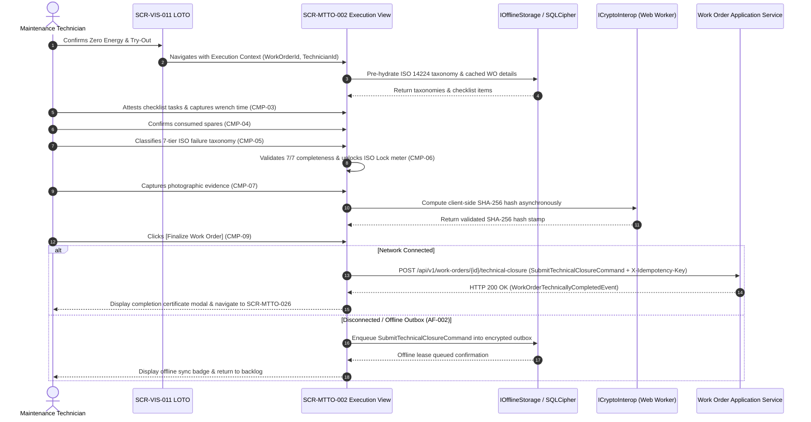

# SCR-MTTO-002: Mobile Work Order Execution, ISO 14224 Failure Coding, and Technical Closure

## 1. Purpose and Operational Context

* **View Objective:** Mobile field technical execution, taxonomy failure diagnosis, and formal technical closure of active Work Orders (ANSI/ISA-101 Level 4). Enforces strict ISO 14224 reliability coding (Maintainable Item, Failure Mode, Mechanism, Cause, Detection Method, Operational Condition, and Operational Impact), actual Wrench Time capture, immutable photographic evidence acquisition with SHA-256 cryptographic hashing ([TR-003](../../../requirements/common/TR-003.md)), and atomic status transition to `COMPLETE` ([DT-ERD-DOC-001 §3.2.6](../../../domain-models/entity-relationship/DT-ERD-DOC-001.md#326-work_orders)), with full offline-first resilience via encrypted local database ([TR-002](../../../requirements/common/TR-002.md)) and transactional outbox synchronization ([TR-007](../../../requirements/common/TR-007.md)).
* **Primary Target Persona:** Maintenance Technician operating on rugged industrial tablets in Class I Div 2 hazardous process areas under adverse conditions (glare, noise, chemical-resistant gloves). Detailed responsive profiles and breakpoints are specified in Section 8.
* **Secondary Personas:**
  * **Maintenance Supervisor:** Reviews field execution metrics, verifies Wrench Time variance, and performs administrative closure (`CLOSED`).
  * **Reliability Engineer:** Consumes structured ISO 14224 failure distributions for Weibull analysis, Bad Actor tracking, and MTBF/MTTR calculations.
  * **HSEQ Inspector:** Audits the cryptographic hash chain of field evidence and verifies de-isolation safety handover protocols.
* **Operational Context:** Deployed on portable industrial tablets and intrinsically safe handheld devices. Requires tactile targets, high-contrast typography, zero nested modal traps, and resilient persistence against unexpected power loss or radio-frequency shadowing inside tank dikes and pump battery limits. Tactile dimensions are specified in §5.2 and §8.
* **Mode of Operation:** Transactional Execution & Field Technical Certification mode. Direct DCS/SCADA process control manipulation is strictly excluded; field mechanics log physical intervention data, parts consumption, and diagnostic classifications.
* **Upstream & Downstream Navigation Invariants:**
  * **Upstream Continuity:** Directly launched upon successful Zero Energy verification and work initiation in [SCR-VIS-011](../vis/SCR-VIS-011.md), automatically transitioning the Work Order lifecycle state to `IN_PROGRESS`.
  * **Downstream Transitions:** Hosts the trigger for the Rotable Asset Swap modal ([SCR-INV-025](../inv/SCR-INV-025.md)) when physical equipment replacement is required, and routes to the RIME Backlog Dashboard ([SCR-MTTO-026](./SCR-MTTO-026.md)) upon confirmed technical closure.

---

## 2. Visual Artifact

### 2.1. Tab 1: Scope & Timing (Light Theme)


> *Note: Production UI prototype capture illustrating the mobile execution header, frameless task checklist with monochromatic completion checks, decoupled timing master card with dual telemetry gauges, and sticky action bar.*

### 2.2. Tab 2: Materials & Spares Allocation (Light Theme)


> *Note: Production UI prototype capture illustrating allocated warehouse spares with tactile quantity steppers and contextual rotable asset swap launch pane.*

### 2.3. Tab 3: ISO 14224 Diagnosis (Dark Theme)


> *Note: Production UI prototype capture illustrating the 7-node sequential quality gate stepper and cascading taxonomy classification matrix in Dark Theme.*

### 2.4. Tab 4: Photographic Evidence (Dark Theme)


> *Note: Production UI prototype capture illustrating cryptographic evidence acquisition, verified photo attachment cards with SHA-256 seal, and unlocked technical closure button.*

---

## 3. Functional Component Inventory

> The base layout, typography, and design tokens are inherited from [DT-UI-DS-DOC-001](../../DT-UI-DS-DOC-001.md). This inventory defines the canonical components present on the screen, their design tokens, and their architectural scope. Interaction rules and geometric algorithms are specified in Section 5; responsive container adaptations are governed by Section 8.

1. **`CMP-01`: Mobile Execution Header**
   - **Visual Role:** Work Order & Asset context strip displaying Work Order ID, Target Equipment Name and Tag, Functional Location, active technician session, operational status badge, neutral de-energized LOTO status capsule, integrated telemetry chip, and queued outbox badge.
   - **Design Tokens:**
     - Surface: `--dt-color-surface-base`
     - Border: `--dt-color-border-subtle`
   - **Architectural Scope:** Anchored contextual header maintaining persistent operational awareness across all tabs. Detailed in §5.1 and §5.3.5.

2. **`CMP-02`: Operational Tabs Controller**
   - **Visual Role:** 4-channel edge-to-edge flush tab bar allowing instant switching between: `[1. Scope]`, `[2. Spares]`, `[3. ISO Diagnosis]`, and `[4. Evidence]`. Active tab merges visually with the main workspace and displays a high-contrast bottom indicator.
   - **Design Tokens:**
     - Surface: `--dt-color-surface-base`
     - Active Surface: `--dt-color-surface-card`
     - Border: `--dt-color-border-subtle`
     - Active Indicator: `--dt-color-text-primary`
   - **Architectural Scope:** Primary view routing controller supporting tactile navigation and touch swipe gestures across tablet viewports. Detailed in §5.2.

3. **`CMP-03`: Scope & Timing Panel**
   - **Visual Role:** Frameless step checklist paired with unified timing cockpit master card featuring dual circular telemetry gauges, field stopwatch subcard with subtle fill, and actual labor hours section with circular steppers, monochromatic quick-access preset pills, and full-width CTA pill.
   - **Design Tokens:**
     - Surface: `--dt-color-surface-card`
     - Divider: `--dt-color-border-subtle`
     - Active Preset Fill: `--dt-primitive-gray-980` (Light) / `--dt-primitive-gray-10` (Dark)
     - Primary CTA: `--dt-color-state-info`
   - **Architectural Scope:** Wrench Time logging and task execution verification per [DT-UI-DS-DOC-001 §6.6](../../DT-UI-DS-DOC-001.md#66-tactile-field-controls-high-velocity-touch-primitives). Detailed in §5.2 and §5.3.1.

4. **`CMP-04`: Materials & Spares Allocation Panel**
   - **Visual Role:** Frameless parts consumed list with circular tactile quantity steppers, paired across a vertical divider with the equipment rotation pane hosting the trigger for rotable swap modal.
   - **Design Tokens:**
     - Surface: `--dt-color-surface-card`
     - Divider: `--dt-color-border-subtle`
     - Trigger Surface: `--dt-color-surface-btn-secondary`
   - **Architectural Scope:** Materials reconciliation and equipment exchange branching to [SCR-INV-025](../inv/SCR-INV-025.md) per [DT-UI-DS-DOC-001 §6.6](../../DT-UI-DS-DOC-001.md#66-tactile-field-controls-high-velocity-touch-primitives). Detailed in §5.2 and §5.3.6.

5. **`CMP-05`: ISO 14224 Multi-Tier Taxonomy Matrix**
   - **Visual Role:** Frameless 7-tier sequential failure coding matrix enforcing cascading custom popover dropdowns ($1 \to 7$), downtime numeric input, and full-width technical observations.
   - **Design Tokens:**
     - Surface: `--dt-color-surface-card`
     - Divider: `--dt-color-border-subtle`
     - Control Border: `--dt-color-border-panel`
     - Popover Border: `--dt-color-border-hairline`
   - **Architectural Scope:** Core reliability taxonomy data collection governed by ISO 14224 standards. Detailed in §5.3.1.

6. **`CMP-06`: ISO 14224 Hard Lock Indicator**
   - **Visual Role:** Sequential 7-node horizontal stepper indicating failure coding progress with high-contrast active ring/pulse, neutral checkmarks, and muted pending nodes.
   - **Design Tokens:**
     - Surface: `--dt-color-surface-card`
     - Node Border: `--dt-color-border-panel`
     - Link: `--dt-color-border-subtle`
     - Active Indicator: `--dt-color-text-primary`
   - **Architectural Scope:** Visual gatekeeper for the technical closure interlock formula. Detailed in §5.3.2 and §8.3.

7. **`CMP-07`: Cryptographic Evidence Capture Section**
   - **Visual Role:** Frameless multi-evidence array uploader ($1 : 0..N$) with dashed dropzone placeholder for empty state, transitioning to verified gallery cards with monospace SHA-256 digital seals upon capture.
   - **Design Tokens:**
     - Surface: `--dt-color-surface-card`
     - Border: `--dt-color-border-subtle`
     - Hash Typography: `--dt-font-mono-data`
   - **Architectural Scope:** Tamper-resistant photographic evidence acquisition and cryptographic sealing ([TR-003](../../../requirements/common/TR-003.md)). Detailed in §5.3.3.

8. **`CMP-08`: Integrated Telemetry & Outbox Indicator**
   - **Visual Role:** Zero-shift diagnostic telemetry chip integrated into header `CMP-01`, displaying connection state, offline status, queued outbox count, and sync timestamps without layout shift (CLS = 0).
   - **Design Tokens:**
     - Surface: `--dt-color-surface-base`
     - Border: `--dt-color-border-subtle`
   - **Architectural Scope:** Offline-first synchronization status monitoring ([TR-002](../../../requirements/common/TR-002.md), [TR-007](../../../requirements/common/TR-007.md)). Detailed in §5.3.5.

9. **`CMP-09`: Technical Finalization Action Bar**
   - **Visual Role:** Sticky bottom closure controller with progressive directional navigation buttons and primary action button `[Finalize Work Order]`.
   - **Design Tokens:**
     - Surface: `--dt-color-surface-card`
     - Border: `--dt-color-border-subtle`
     - Elevation: `--dt-z-header-sticky`
     - Primary Button: `--dt-color-state-info` (Text: `--dt-primitive-gray-10`)
     - Secondary Button: `--dt-color-surface-btn-secondary`
   - **Architectural Scope:** Atomic technical closure command dispatcher hard-gated by the Boolean conjunction of `CMP-06` and `CMP-07`, adhering to the 3-tier action hierarchy ([DT-UI-DS-DOC-001 §6.5.1](../../DT-UI-DS-DOC-001.md#651-morphological-differentiation-status-badges-vs-interactive-buttons) and [§6.6.2](../../DT-UI-DS-DOC-001.md#662-tactile-pill-actions-presets)). Detailed in §5.2 and §5.3.4.

10. **`CMP-10`: De-Isolation Safety Handover Strip**
    - **Visual Role:** Flush safety acknowledgment strip reminding the technician that physical padlocks remain locked until formal de-isolation handover is executed.
    - **Design Tokens:**
      - Surface: `--dt-color-surface-base`
      - Border: `--dt-color-border-subtle`
    - **Architectural Scope:** Operational safety boundary enforcement separating technical work completion from plant re-energization. Detailed in §6.

---

## 4. Screen State Catalog

1. **Normal / In Progress (Default)**
   - **Activation Condition:** Initial load of `SCR-MTTO-002` following work authorization from [SCR-VIS-011](../vis/SCR-VIS-011.md).
   - **Visual Modification:** Header displays `IN_PROGRESS` in neutral high-contrast capsule badge (`--dt-color-surface-base`, `--dt-color-border-subtle`, `--dt-color-text-primary`). Checklist editable. Stopwatch counter increments. Tab 3 shows incomplete taxonomy. `CMP-09` `[Finalize Work Order]` is hard-disabled via the ISO Lock.

2. **Loading / Synchronizing**
   - **Activation Condition:** Initial data hydration from local SQLCipher cache or background delta synchronization in progress.
   - **Visual Modification:** Skeleton shimmer on form fields and spares table (`--dt-color-surface-raised`). Taxonomy dropdowns show animated loading indicator while hydrating local SQLite cache. Controls locked.

3. **Taxonomy Incomplete / Missing Fields (AF-001)**
   - **Activation Condition:** Technician attempts to finalize or navigates away while any of the 7 mandatory ISO fields or downtime is empty.
   - **Visual Modification:** Missing mandatory taxonomy selectors highlighted with dynamic asterisk (`*`). Sequential stepper `CMP-06` highlights the active next step with a neutral pulse indicator while keeping downstream dropdowns locked (`disabled`) per ISO 14224 causal hierarchy. Action button `CMP-09` remains disabled.

4. **Evidence Capturing & Hashing**
   - **Activation Condition:** Technician captures or selects photo evidence in `CMP-07`.
   - **Visual Modification:** Camera viewfinder overlay active or file upload progress bar visible. Monospace hash chip displays animated status *"Computing SHA-256..."*. Validated photos replace the empty-state dashed dropzone with verified gallery cards ($1..N$) displaying thumbnail, file metadata, and tamper-resistant digital stamp (`SHA-256: [hash]`). Action toolbar remains active for additional captures.

5. **Evidence Corrupt / Hash Mismatch (AF-003)**
   - **Activation Condition:** Cryptographic verification detects corrupted binary stream or zero-byte payload (`TR-003-NFR-380`).
   - **Visual Modification:** File preview replaced by critical red border (`--dt-color-alarm-critical`) and error glyph (`#icon-ban`). Banner displays: *"File integrity error. SHA-256 discrepancy detected. Please recapture evidence"*. Form progression blocked.

6. **Offline Mode (AF-002)**
   - **Activation Condition:** Device loses Wi-Fi/cellular connectivity in field process areas (`ASR-001`).
   - **Visual Modification:** Zero layout shift (CLS = 0). Header telemetry chip updates to `OFFLINE · [HH:MM]`, `[1 PENDING SYNC]` amber badge illuminates, and `[DE-ENERGIZED EQUIPMENT]` capsule is automatically hidden to avoid false certainty of unverified live telemetry. Local SQLCipher cache active.

7. **Ready to Finalize (Unlocked)**
   - **Activation Condition:** All 7 ISO 14224 fields selected + Downtime specified + Photo evidence captured with valid hash + Checklist attested + Positive Actual Labor Hours logged.
   - **Visual Modification:** `CMP-06` sequential 7-node stepper marks all 7 circular nodes as completed (`#icon-check`) with completed connecting links, updating the Tab 3 header badge to `[7/7]` (and Tab 1 to full completion ratio). All media attachments display validated cryptographic seal. Action button `CMP-09` `[Finalize Work Order]` unlocks in primary action styling (`--dt-color-state-info`, `--dt-primitive-gray-10` text per [DT-UI-DS-DOC-001 §6.5.1](../../DT-UI-DS-DOC-001.md#651-morphological-differentiation-status-badges-vs-interactive-buttons) and [§6.6.2](../../DT-UI-DS-DOC-001.md#662-tactile-pill-actions-presets)).

8. **Technical Closure Complete**
   - **Activation Condition:** Technician confirms `[Finalize Work Order]`. System commits atomic transaction.
   - **Visual Modification:** Form transitions to read-only state. Header badge updates to `COMPLETE`. Standardized completion certificate modal (header with close `X`, body with structured key-value certificate rows and SHA-256 seal, footer with primary action `[Return to Work Orders]`) confirms closure and redirects to [SCR-MTTO-026](./SCR-MTTO-026.md).

9. **Execution Suspended — Safety Interlock Breach (`AF-005`)**
   - **Activation Condition:** Continuous boundary telemetry or safety monitoring detects unexpected residual energy or barrier breach during `IN_PROGRESS` execution ([UC-MTTO-002 §4](../../../domain-models/use-cases/mtto/UC-MTTO-002.md#af-005-safety-interlock-breach-active-hazardous-energy-detected), [DT-DM-DOC-001 §4.21](../../../domain-models/class/DT-DM-DOC-001.md#421-workordercurrentstatus)).
   - **Visual Modification:** System immediately halts form interaction via `WorkOrder.SuspendExecution(reason)` ([DT-DM-DOC-002 §3](../../../domain-models/class/DT-DM-DOC-002.md#3-layer-2-maintenance-management-mtto)), transitions Work Order status to `SUSPENDED`, preserves the in-flight draft in encrypted local storage, and deploys a non-interactive full-screen emergency evacuation alert (`--dt-z-modal-fail-safe`, `--dt-color-alarm-critical`) directing immediate area evacuation.

---

## 5. Interaction Rules and Data Flow

### 5.1. Initial Load & Lifecycle



1. **Context Ingestion Contract:**
   * When navigated from [SCR-VIS-011](../vis/SCR-VIS-011.md), the route receives the initial execution context payload:
     $$\mathcal{P}_{\text{init}} = \langle \text{WorkOrderId}: \text{Guid}, \text{EquipmentTag}: \text{string}, \text{FunctionalLocation}: \text{string}, \text{TechnicianId}: \text{Guid}, \text{LotoIsolationStatus}: \text{IsolationStatus} \rangle$$
   * If the initial Work Order status is `SCHEDULED`, the client dispatches an execution start command, transitioning the Work Order status to `IN_PROGRESS` with server-side audit timestamp logging.
2. **Local Cache Pre-Hydration (Offline Readiness):**
   * Pre-hydrates the ISO 14224 taxonomic datasets (maintainable items catalog, equipment class failure modes) from the local encrypted database ([TR-002](../../../requirements/common/TR-002.md)), guaranteeing zero network latency when populating dropdowns in field dead-zones.

### 5.2. Mobile Ergonomics & Tactile Mechanics

1. **Gloved Touch Target Invariant (ISO 9241-110 Clause 5.3 / `--dt-touch-target-mobile`):**
   * All interactive controls (checkboxes, dropdown triggers, camera buttons, tab headers, spare parts quantity steppers) enforce a minimal bounding box governed by `--dt-touch-target-mobile` with `--dt-space-2` separation, ensuring error-free operation with nitrile and leather field gloves.
   * Step navigation directional arrow buttons enforce an enlarged footprint governed by `--dt-control-width-nav-step` $\times$ `--dt-control-height-nav-step` (and `--dt-control-width-nav-step-mobile` $\times$ `--dt-control-height-nav-step-mobile` on mobile) with subtle neutral secondary surface fill (`--dt-color-surface-btn-secondary`), subtle perimeter ring (`--dt-color-border-subtle`), standard curvature (`--dt-radius-md`), and explicit SVG chevrons (`#icon-chevron-left`, `#icon-chevron-right`).
   * Custom scope checklist implements a frameless list layout with tactile circular check indicators (`--dt-control-size-checkbox`, `--dt-radius-full`): unselected items render a neutral hairline perimeter ring, while verified items fill with high-contrast monochromatic fill (`--dt-color-text-primary`) and an embedded checkmark in surface color. Individual item bounding boxes are purged in favor of subtle baseline dividers (`--dt-color-border-subtle`) and full-width touch hit rows.
2. **Asymmetric Layout Grids & Continuous Workspace Dividers (`CMP-03` & `CMP-04`):**
   * **Continuous Data Architecture (Zero Card Plague):** Adheres to the frameless HPHMI surface discipline ([DT-UI-DS-DOC-001 §3.2](../../DT-UI-DS-DOC-001.md#32-semantic-tokens-for-light-and-dark-themes) and [§6.6](../../DT-UI-DS-DOC-001.md#66-tactile-field-controls-high-velocity-touch-primitives)). Primary content sections render directly on the workspace surface (`--dt-color-surface-card`) without redundant outer card wrappers. Initial sections within a tab have no top border, while subsequent stacked sections are separated by a subtle top divider (`--dt-color-border-subtle`).
   * **Scope & Timing Grid (`CMP-03`):** Enforces an asymmetric two-column desktop/landscape grid expanding across the full vertical workspace height: The primary left column provides expansive breadth for frameless procedural task checklist items, while the secondary right column (`--dt-color-border-subtle`) hosts the enclosed timing cockpit master card. In portrait mode, the vertical divider transitions into an edge-to-edge full-width horizontal divider (`--dt-color-border-subtle` with zero side gaps).
   * **Spares & Rotable Asset Grid (`CMP-04`):** Mirrors the exact asymmetric two-column full-height stretch rhythm: The primary left column hosts allocated warehouse parts (Allocated Materials & Spares) with circular tactile quantity steppers, while the secondary right column (`--dt-color-border-subtle`) hosts the frameless equipment rotation pane with natural flow spacing and a dedicated rotable swap trigger bound to `--dt-color-surface-btn-secondary`.
   * Encapsulates real-time diagnostic field timing and formal CMMS accounting entry into a single structured master card with edge-to-edge flush headers:
     * **Telemetry Widgets Section (`ScopeWidgetsSection`):** High-contrast inset instrument bezel with darker recessed background (`--dt-color-surface-base`) extending flush to the master container borders, hosting dual circular SVG gauges for field stopwatch and labor progress, center bridge percentage pill, and Work Order telemetry reference without redundant analytical rows.
     * **Field Intervention Stopwatch Section (`FieldStopwatchSection`):** Frameless section directly on the controls body, hosting field intervention timer, tactile pill toggle (`[Pause]` / `[Resume]` with permanent capsule curvature `--dt-radius-full` and monochromatic high-contrast active fill), discrete bump pill (`[+15 min]`), tactile circular reset button, and a bottom divider line separating it from labor accounting.
     * **Actual Labor Hours Section (`ActualLaborHoursSection`):** Hosts the official CMMS accounting field featuring circular steppers (`−` / `+`), recessed numeric display sharing the identical surface treatment as the steppers, monochromatic left-aligned quick preset pills with content-fit widths (`2.0h`, `2.5h`, `3.0h`, `3.5h (Planned)`), horizontal divider line, and full-width CTA pill (`[Log Time to Record]`) bound to `--dt-color-state-info`.
3. **Sticky Bottom Finalization Bar (`CMP-09`):**
   * Pinned to the bottom viewport boundary with height `--dt-layout-footer-height` and elevation `--dt-z-header-sticky`, separated via `--dt-color-border-subtle`.
   * Workspace container uses standard internal padding (`--dt-space-4` inline, `--dt-space-6` bottom) without artificial bottom scroll padding, allowing checklist items to scroll naturally with `--dt-layout-footer-clearance`.
   * Guided workflow: Progressive navigation (`← Previous` and `Next →`) guides the technician sequentially; primary action `[Finalize Work Order]` unlocks strictly on Step 4 (Evidence) once quality gates are satisfied.
4. **Flush Tab Navigation Physics (`CMP-02`):**
   * Edge-to-edge flush tab bar with zero inter-tab gap or rounded corners, sitting directly adjacent to the LOTO handover strip and workspace bounds.
   * Supports horizontal touch swipe gestures across touch viewports. Badges are strictly reserved for quantifiable counters (`[5/7]`, `[3 items]`, `[0/7]`, `[0/1]`), purging decorative pseudo-badges per ANSI/ISA-101.01 §6.2.

### 5.3. Domain Workflows, Taxonomy Enums, and Cryptographic Mutation

#### 5.3.1. ISO 14224 Multi-Tier Taxonomy Matrix & Sequential Cascade (`CMP-05`)
* Failure classification is strictly constrained by ISO 14224 reliability standards and domain model contracts ([DT-ERD-DOC-001 §3.2.2](../../../domain-models/entity-relationship/DT-ERD-DOC-001.md#322-failure_records)), enforcing a strict causal top-down cascade ($1 \to 7$) where each dropdown remains locked (`disabled`) until its immediate predecessor is populated, and mutating an upstream tier resets all downstream tiers:
  * **Tier 1: Maintainable Item:** Filtered dynamically by the target equipment class (e.g., for Centrifugal Pump `P-0101A` per API 610: *Mechanical Seal*, *Impeller*, *Bearings*, *Shaft*, *Casing*, *Coupling*).
  * **Tier 2: Failure Mode:** Constrained by Maintainable Item (e.g., for Mechanical Seal: *External Leakage (EL)*, *Vibration Excursion (VE)*, *Overheating (OH)*).
  * **Tier 3: Failure Mechanism:** Observable physical degradation (e.g., *Mechanical Wear*, *Abrasive Erosion*, *Thermal Fatigue*, *Elastomer Degradation*).
  * **Tier 4: Failure Cause:** Root engineering origin (e.g., *Lubrication Deficiency*, *Shaft Misalignment*, *Cavitation Erosion*, *Operational Off-Design*).
  * **Tier 5: Detection Method:** Controlled vocabulary mapped to enum `DetectionMethod` (§7.2.3).
  * **Tier 6: Operational Condition:** Controlled vocabulary mapped to enum `OperationalCondition` (§7.2.3).
  * **Tier 7: Operational Impact:** Controlled vocabulary mapped to enum `OperationalImpact` (§7.2.3).
  * **Quantitative Metric: Downtime Hours:** Numeric field recording hours of lost operational availability ($\ge 0.0\text{h}$).
  * **Technical Observations:** Full-width field capturing empirical observations and diagnostic notes directly tied to the failure record.

#### 5.3.2. The ISO 14224 Hard Lock Formula & Sequential Stepper (`CMP-06`, `FR-012`)
* Visualized via a 7-node sequential horizontal stepper using monochromatic progression indicators (circular step nodes joined by horizontal connector bars, without decorative lock pills or helper text per [DT-UI-DS-DOC-001 §6.5](../../DT-UI-DS-DOC-001.md#65-status-badge-counter-discipline-anti-badge-inflation-principle)).
* The primary action button `CMP-09` `[Finalize Work Order]` is governed by the asymmetric Boolean lock:
  $$\text{CanFinalize} = \mathcal{T}_{\text{complete}} \land \mathcal{E}_{\text{valid}} \land \mathcal{W}_{\text{valid}}$$
  where:
  $$\mathcal{T}_{\text{complete}} = (\text{Item} \ne \varnothing) \land (\text{Mode} \ne \varnothing) \land (\text{Mech} \ne \varnothing) \land (\text{Cause} \ne \varnothing) \land (\text{Method} \ne \varnothing) \land (\text{Condition} \ne \varnothing) \land (\text{Impact} \ne \varnothing) \land (\text{Downtime} \ge 0.0)$$
  $$\mathcal{E}_{\text{valid}} = (\text{MediaAttachmentCount} \ge 1) \land (\forall e \in \text{Attachments}, e.\text{SHA256HashVerified} == \text{true})$$
  $$\mathcal{W}_{\text{valid}} = (\text{ActualLaborHours} > 0.0) \land (\text{AllChecklistItemsChecked} == \text{true})$$
* Any false term renders the button `disabled` with dynamic visual indicator (`*`) on omitted fields (`AF-001`).

#### 5.3.3. Multi-Evidence Photographic Capture & Cryptographic Hashing Pipeline (`CMP-07`, `TR-003`)
* Supports an array of $0..N$ attachments (`List<MediaAttachmentDto>` per [DT-ERD-DOC-001 §3.2.4](../../../domain-models/entity-relationship/DT-ERD-DOC-001.md#324-media_attachments)):
  1. Displays a reserved dashed dropzone container as empty-state placeholder with direct camera trigger.
  2. Capturing photo via hardware camera or file picker downsamples image to maximum $1920\times 1080$ JPEG format (quality 0.85) to optimize offline storage footprint.
  3. Computes cryptographic checksum asynchronously in a Web Worker via ICryptoInterop (SHA-256).
  4. Renders individual gallery cards displaying image thumbnail (`--dt-layout-thumbnail-size`), metadata, delete trigger, and verified monospace hash stamp (`SHA-256: [hash]`).
  5. Packages validated media items into `MediaAttachmentDto` records linking image URI, file format, timestamp, and hash string to the failure record context.
  6. If file reading throws an I/O error or hash evaluation fails, the UI enters state `Evidence Corrupt` (`AF-003`), halts finalization, and forces recapture.

#### 5.3.4. Atomic Technical Closure Command Dispatch (`CMP-09`, `TR-001`)
* Upon pressing `[Finalize Work Order]`, the application dispatches an atomic technical closure command (`SubmitTechnicalClosureCommand`) against the backend API endpoint `POST /api/v1/work-orders/{id}/technical-closure`.
* **Client Command Contract:**
  * **Request Headers:** Includes `X-Idempotency-Key: {uuidv7}` ([ADR-007](../../../architecture/adr/ADR-007.md)) to guarantee exactly-once processing during network reconnection retries.
  * **Command Payload:** Serializes `FailureRecordInputDto` (7-tier ISO 14224 classifications, downtime, technician notes), `ActualLaborHours`, and `List<MediaAttachmentDto>` (evidence attachments with computed SHA-256 signatures).
  * **Backend Persistence Invariant:** Backend orchestrates the atomic transaction (failure record insertion, Work Order status update to `COMPLETE`, history logging, and cryptographic audit chaining) governed by [DT-ARQ-DB-DOC-001 §2](../../../architecture/DT-ARQ-DB-DOC-001.md#2-physical-integrity-invariants-and-constraints) and [DT-ERD-DOC-001 §3.2.6](../../../domain-models/entity-relationship/DT-ERD-DOC-001.md#326-work_orders).
  * **Success Handling (HTTP 200 OK):** Transitions UI state to `COMPLETE`, displays non-disruptive completion modal, and navigates downstream to the RIME Backlog Dashboard ([SCR-MTTO-026](./SCR-MTTO-026.md)).
  * **Failure / Disconnected Handling:** On network timeout or HTTP 5xx error, transitions to the Zero-Shift Offline Outbox Protocol (§5.3.5, [TR-007](../../../requirements/common/TR-007.md)).

#### 5.3.5. Zero-Shift Offline Telemetry and Outbox Protocol (`AF-002`, `TR-002`, `TR-007`, `ADR-007`)
* If network connection is lost or heartbeat timeout occurs:
  1. Telemetry indicator in header transitions from `ONLINE · [HH:MM]` to `OFFLINE · [HH:MM]` with disconnected network glyph.
  2. Amber badge `[1 PENDING SYNC]` illuminates directly in the header context.
  3. **Fail-Safe Zero-Energy Masking:** The safety capsule `[DE-ENERGIZED EQUIPMENT]` is automatically suppressed from the header UI during offline operation. While mechanical padlocks remain locked, real-time electrical zero-voltage and zero-current attestation cannot be confirmed via disconnected DCS telemetry; displaying a stale positive safety confirmation during telemetry blackout violates process safety integrity principles.
  4. Zero layout shift is incurred (CLS = 0), preventing disorienting viewport jumps or content displacement on tablet screens.
  5. The full atomic command payload is serialized into JSON and written to the encrypted local outbox protected by database encryption at rest ([TR-002](../../../requirements/common/TR-002.md)).
  6. Assigns a unique `IdempotencyKey` (UUIDv7) per `ADR-007`.
  7. Marks the local UI view as `COMPLETE (Pending Sync)`.
  8. Background synchronization worker monitors connectivity; upon restoration, drains the outbox queue via idempotent `POST /api/v1/work-orders/{id}/technical-closure` with `X-Idempotency-Key` header.

#### 5.3.6. Rotable Asset Swap Branching (`CMP-04`)
* If the physical repair requires unmounting the pump unit, tapping `[Rotate Dismounted Equipment]` preserves the in-flight form draft in local memory and deploys the in-situ overlay modal [SCR-INV-025](../inv/SCR-INV-025.md). Upon completing the asset swap, `SCR-INV-025` returns the new mounted equipment serial number (`P-0101B`) and stamps the replacement reference into technical observations.

---

## 6. Industrial and Safety Considerations

* **De-Isolation / De-LOTO Safety Handover Boundary (ISO 45001 §8.1 / OSHA 1910.147):** Technical closure (`COMPLETE`) of a Work Order never authorizes plant re-energization. Flush strip `CMP-10` enforces the physical boundary invariant: *"CAUTION: Hazardous energy isolations established in SCR-VIS-011 remain locked. Physical padlock removal and de-isolation must be executed via formal Operations Handover prior to commissioning."*
* **Fail-Safe Zero-Energy Telemetry Masking (`AF-002`):** During wireless connectivity dropouts, the positive `[DE-ENERGIZED EQUIPMENT]` header confirmation pill is automatically suppressed (§4 State 6, §5.3.5) to prevent technicians from relying on stale zero-energy telemetry while disconnected.
* **Safety Interlock Execution Suspension (`AF-005`):** Any boundary telemetry detection of unexpected residual pressure, hazardous voltage, or barrier breach triggers `WorkOrder.SuspendExecution(reason)` ([DT-DM-DOC-002 §3](../../../domain-models/class/DT-DM-DOC-002.md#3-layer-2-maintenance-management-mtto)), locking input controls and deploying the critical non-dismissible evacuation overlay (`--dt-z-modal-fail-safe`, `--dt-color-alarm-critical`).
* **HPHMI & Priority 4 Diagnostic Segregation ([TR-011](../../../requirements/common/TR-011.md)):** Neutral 90/10 surface hierarchy, monochromatic tactile field presets ([DT-UI-DS-DOC-001 §6.6](../../DT-UI-DS-DOC-001.md#66-tactile-field-controls-high-velocity-touch-primitives)), and Priority 4 diagnostic styling for `CMP-08` network status adhere strictly to [DT-UI-DS-DOC-001 §1](../../DT-UI-DS-DOC-001.md#1-scope) and [§3.3](../../DT-UI-DS-DOC-001.md#33-alarm-and-safety-semantics-10-reserved).

---

## 7. Frontend Component Contract (Blazor / Razor)

### 7.1. Component Hierarchy & File Mapping

```text
Pages/
└── MobileWorkOrderClosingPage.razor                 # Root View (SCR-MTTO-002)
    ├── ExecutionHeader.razor                        # CMP-01: Header with fail-safe LOTO & context
    │   └── OfflineTelemetryIndicator.razor          # CMP-08: Zero-shift header telemetry & outbox badge
    ├── DeIsolationHandoverStrip.razor               # CMP-10: Flush LOTO safety acknowledgment strip
    ├── OperationalTabsBar.razor                     # CMP-02: Flush 4-channel tab selector
    ├── ScopeExecutionTab.razor                      # CMP-03: Scope & timing cockpit container
    │   ├── TaskChecklistCard.razor                  # Frameless step checklist (--dt-control-size-checkbox)
    │   ├── FieldStopwatchCard.razor                 # Dual telemetry gauges & field intervention stopwatch
    │   └── ActualLaborHoursCard.razor               # Wrench time steppers (--dt-touch-target-mobile) & presets
    ├── SparesAllocationTab.razor                    # CMP-04: Consumed spares list & Asset Swap trigger
    ├── IsoTaxonomyDiagnosisTab.razor                # CMP-05: 7-tier ISO 14224 matrix & observations
    │   └── IsoComplianceStepper.razor               # CMP-06: 7-node sequential quality gate stepper
    ├── MultimediaEvidenceTab.razor                  # CMP-07: Multi-evidence array uploader & SHA-256 verifier
    │   ├── EvidenceDropzone.razor                   # Reserved dashed empty-state dropzone
    │   └── EvidenceCard.razor                       # Verified photo card with thumbnail & SHA-256 stamp
    ├── TechnicalFinalizeBar.razor                   # CMP-09: Sticky bottom bar with nav arrows (--dt-control-height-nav-step)
    └── ClosureCertificateModal.razor                # Technical closure confirmation & SHA-256 certificate modal
```

### 7.2. Physical Component Parameters & DTO Contracts (.NET 10 / C# 14)

#### 7.2.1. `MobileWorkOrderClosingPage.razor` (Root View)

```csharp
[Parameter]
public required Guid WorkOrderId { get; set; }

[Parameter, SupplyParameterFromQuery]
public string? ReturnUrl { get; set; }
```

#### 7.2.2. Subcomponent Parameter Contracts (`CMP-01` to `CMP-10`)

```csharp
// CMP-01: ExecutionHeader.razor
[Parameter]
public required WorkOrderClosingContextDto Context { get; set; }

[Parameter]
public bool IsOffline { get; set; }

[Parameter]
public int PendingSyncCount { get; set; }

[Parameter]
public DateTimeOffset? LastSyncTime { get; set; }

// CMP-08: OfflineTelemetryIndicator.razor
[Parameter]
public bool IsOffline { get; set; }

[Parameter]
public int PendingSyncCount { get; set; }

[Parameter]
public DateTimeOffset? LastSyncTime { get; set; }

// CMP-10: DeIsolationHandoverStrip.razor
[Parameter]
public required IsolationStatus LotoIsolationStatus { get; set; }

[Parameter]
public string? LotoTagReference { get; set; }

// CMP-02: OperationalTabsBar.razor
[Parameter]
public required int ActiveTabIndex { get; set; }

[Parameter]
public EventCallback<int> ActiveTabIndexChanged { get; set; }

[Parameter]
public int CompletedScopeItems { get; set; }

[Parameter]
public int TotalScopeItems { get; set; }

[Parameter]
public int AllocatedSparesCount { get; set; }

[Parameter]
public int CompletedIsoTiers { get; set; }

[Parameter]
public int AttachmentCount { get; set; }

// CMP-03: ScopeExecutionTab.razor
[Parameter]
public required IReadOnlyList<ScopeTaskItemDto> Tasks { get; set; }

[Parameter]
public EventCallback<Guid> OnTaskToggled { get; set; }

[Parameter]
public decimal ActualLaborHours { get; set; }

[Parameter]
public EventCallback<decimal> ActualLaborHoursChanged { get; set; }

[Parameter]
public decimal PlannedLaborHours { get; set; }

// TaskChecklistCard.razor
[Parameter]
public required IReadOnlyList<ScopeTaskItemDto> Tasks { get; set; }

[Parameter]
public EventCallback<Guid> OnTaskToggled { get; set; }

// FieldStopwatchCard.razor
[Parameter]
public int ElapsedSeconds { get; set; }

[Parameter]
public bool IsRunning { get; set; }

[Parameter]
public decimal PlannedLaborHours { get; set; }

[Parameter]
public EventCallback<bool> OnRunningToggled { get; set; }

[Parameter]
public EventCallback<int> OnBumpMinutesRequested { get; set; }

[Parameter]
public EventCallback OnResetRequested { get; set; }

// ActualLaborHoursCard.razor
[Parameter]
public decimal ActualLaborHours { get; set; }

[Parameter]
public decimal PlannedLaborHours { get; set; }

[Parameter]
public EventCallback<decimal> ActualLaborHoursChanged { get; set; }

[Parameter]
public EventCallback<decimal> OnLogTimeCommitted { get; set; }

// CMP-04: SparesAllocationTab.razor
[Parameter]
public required IReadOnlyList<SparePartAllocationDto> SpareParts { get; set; }

[Parameter]
public EventCallback<SparePartAllocationDto> OnQuantityChanged { get; set; }

[Parameter]
public EventCallback OnRotateEquipmentRequested { get; set; }

// CMP-05: IsoTaxonomyDiagnosisTab.razor
[Parameter]
public required FailureRecordInputDto Model { get; set; }

[Parameter]
public EventCallback<FailureRecordInputDto> ModelChanged { get; set; }

[Parameter]
public required Guid EquipmentClassId { get; set; }

[Parameter]
public bool IsReadOnly { get; set; }

// CMP-06: IsoComplianceStepper.razor
[Parameter]
public int CompletedTierCount { get; set; }

[Parameter]
public int TotalTiers { get; set; } = 7;

[Parameter]
public bool IsLocked { get; set; }

// CMP-07: MultimediaEvidenceTab.razor
[Parameter]
public required IReadOnlyList<MediaAttachmentDto> Attachments { get; set; }

[Parameter]
public EventCallback<MediaAttachmentDto> OnAttachmentAdded { get; set; }

[Parameter]
public EventCallback<Guid> OnAttachmentRemoved { get; set; }

[Parameter]
public bool IsCapturing { get; set; }

[Parameter]
public bool HasIntegrityError { get; set; }

// EvidenceDropzone.razor
[Parameter]
public bool IsCapturing { get; set; }

[Parameter]
public EventCallback OnCaptureTriggered { get; set; }

// EvidenceCard.razor
[Parameter]
public required MediaAttachmentDto Attachment { get; set; }

[Parameter]
public bool IsCorrupt { get; set; }

[Parameter]
public EventCallback<Guid> OnRemoveClicked { get; set; }

// CMP-09: TechnicalFinalizeBar.razor
[Parameter]
public int CurrentStep { get; set; }

[Parameter]
public int TotalSteps { get; set; } = 4;

[Parameter]
public bool CanFinalize { get; set; }

[Parameter]
public bool IsSubmitting { get; set; }

[Parameter]
public EventCallback OnPreviousStep { get; set; }

[Parameter]
public EventCallback OnNextStep { get; set; }

[Parameter]
public EventCallback OnFinalizeTriggered { get; set; }

// ClosureCertificateModal.razor (State 8)
[Parameter]
public bool IsVisible { get; set; }

[Parameter]
public required string WorkOrderNumber { get; set; }

[Parameter]
public required string AuditIntegrityHash { get; set; }

[Parameter]
public bool IsQueuedOffline { get; set; }

[Parameter]
public EventCallback OnCloseRequested { get; set; }

[Parameter]
public EventCallback OnReturnToBacklog { get; set; }
```

#### 7.2.3. Data Transfer Objects (DTOs) and Enums

```csharp
/// <summary>
/// Controlled failure detection method vocabulary per DT-DM-DOC-001 §4.9.
/// </summary>
public enum DetectionMethod
{
    PERIODIC_MAINTENANCE,
    FUNCTIONAL_TESTING,
    INSPECTION,
    PERIODIC_CBM,
    PRESSURE_TESTING,
    CONTINUOUS_CBM,
    PRODUCTION_INTERFERENCE,
    CASUAL_OBSERVATION,
    CORRECTIVE_MAINTENANCE,
    ON_DEMAND,
    OTHER
}

/// <summary>
/// Controlled equipment operational condition at failure vocabulary per DT-DM-DOC-001 §4.10.
/// </summary>
public enum OperationalCondition
{
    RUNNING,
    START_UP,
    RUN_DOWN,
    HOT_STANDBY,
    COLD_STANDBY,
    IDLE,
    TESTING
}

/// <summary>
/// Controlled failure operational impact vocabulary per DT-DM-DOC-001 §4.11.
/// </summary>
public enum OperationalImpact
{
    EXTENSIVE_STOP,
    STOP_ABOVE_ACCEPTABLE,
    STOP_BELOW_ACCEPTABLE,
    STOP_MINOR
}

/// <summary>
/// Controlled media attachment format vocabulary per DT-DM-DOC-001 §4.19.
/// </summary>
public enum MediaAttachmentFileType
{
    PDF,
    JPG,
    PNG
}

/// <summary>
/// Controlled work order execution status vocabulary per DT-DM-DOC-001 §4.21.
/// </summary>
public enum WorkOrderStatus
{
    PLANNING,
    WAITING_PARTS,
    SCHEDULED,
    IN_PROGRESS,
    SUSPENDED,
    COMPLETE,
    CLOSED
}

/// <summary>
/// Controlled work order isolation lifecycle vocabulary per DT-DM-DOC-001 §4.32.
/// </summary>
public enum IsolationStatus
{
    PENDING_ISOLATION,
    ISOLATED,
    VERIFIED_ZERO_ENERGY,
    LEASED_OFFLINE,
    RELEASED
}

public record WorkOrderClosingContextDto
{
    public required Guid WorkOrderId { get; init; }
    public required string WorkOrderNumber { get; init; }
    public required Guid TechnicianId { get; init; }
    public required string TechnicianFullName { get; init; }
    public required Guid EquipmentUnitId { get; init; }
    public required Guid EquipmentClassId { get; init; }
    public required string EquipmentTag { get; init; }
    public required string EquipmentName { get; init; }
    public required string FunctionalLocation { get; init; }
    public required WorkOrderStatus CurrentStatus { get; init; }
    public required IsolationStatus LotoIsolationStatus { get; init; }
    public required decimal EstimatedHours { get; init; }
    public decimal? ActualLaborHours { get; init; }
}

public record FailureRecordInputDto
{
    public Guid? MaintainableItemId { get; set; }
    public string? FailureMode { get; set; }
    public string? FailureMechanism { get; set; }
    public string? FailureCause { get; set; }
    public DetectionMethod? DetectionMethod { get; set; }
    public OperationalCondition? OperationalCondition { get; set; }
    public OperationalImpact? OperationalImpact { get; set; }
    public decimal DowntimeHours { get; set; }
    public string? TechnicianNotes { get; set; }
}

public record ScopeTaskItemDto
{
    public required Guid TaskId { get; init; }
    public required string Description { get; init; }
    public required bool IsCompleted { get; init; }
}

public record SparePartAllocationDto
{
    public required Guid SparePartId { get; init; }
    public required string Sku { get; init; }
    public required string Description { get; init; }
    public required string UnitOfMeasure { get; init; }
    public required decimal PlannedQuantity { get; init; }
    public decimal ActualQuantity { get; set; }
    public required string WarehouseLocation { get; init; }
}

public record MediaAttachmentDto
{
    public required Guid Id { get; init; }
    public required string FileUrl { get; init; }
    public required MediaAttachmentFileType FileType { get; init; }
    public required string IntegrityHashSha256 { get; init; }
    public bool CapturedOffline { get; init; }
    public required DateTimeOffset UploadedAt { get; init; }
}

public record SubmitTechnicalClosureCommand
{
    public required Guid WorkOrderId { get; init; }
    public required Guid TechnicianId { get; init; }
    public required decimal ActualLaborHours { get; init; }
    public required IReadOnlyList<ScopeTaskItemDto> ScopeChecklist { get; init; }
    public required FailureRecordInputDto FailureRecord { get; init; }
    public required IReadOnlyList<SparePartAllocationDto> ConsumedSpares { get; init; }
    public required IReadOnlyList<MediaAttachmentDto> EvidenceAttachments { get; init; }
    public required string PreviousHash { get; init; }
}
```

### 7.3. Client-Side DOM & Interop Bridge

1. **Hardware Camera & Image Compression Interop (`ICameraInterop`):**
   * Encapsulates device media capture capabilities with fallback to native OS camera file picker.
   * Performs client-side image downsampling and JPEG compression asynchronously off the main UI thread to guarantee media payloads $< 1.5\text{MB}$ prior to local persistence.
2. **Web Crypto SHA-256 Hashing Bridge (`ICryptoInterop`):**
   * Dispatches cryptographic SHA-256 checksum computation asynchronously to a dedicated Web Worker to prevent UI thread stuttering or frame drops on industrial tablets during binary processing.
3. **Encrypted Offline Storage Interop (`IOfflineStorage`):**
   * Interfaces with client-side encrypted relational storage (AES-256 via SQLCipher) for immediate transactional outbox queuing during disconnected field operations ([TR-002](../../../requirements/common/TR-002.md), [TR-007](../../../requirements/common/TR-007.md)).

---

## 8. Layout and Responsive Adaptability

### 8.1. Desktop Workstation (`--dt-breakpoint-xl`)
* **Layout Organization:** Centered flush 4-tab execution workspace (`CMP-02`) bounded by `--dt-layout-form-max-width` ([DT-UI-DS-DOC-001 §2.4](../../DT-UI-DS-DOC-001.md#24-structural-layout-and-dimensional-tokens)), featuring multi-column internal tab grids (Tab 1 & Tab 2 pair a frameless primary section on the left with a full-height vertical divider `--dt-color-border-subtle` and the secondary operational column on the right; Tab 3 renders the 7-node horizontal stepper above the 2-column ISO 14224 matrix separated by a top divider). Sticky footer `CMP-09` (`--dt-layout-footer-height`) spans bottom width.
* **Ergonomic Rules:** Mouse click focus; keyboard numeric navigation; dense multi-tier custom popover dropdowns; full-resolution image preview modal.

### 8.2. Industrial Tablet Landscape (`--dt-breakpoint-lg`)
* **Layout Organization:** Flush 4-tab execution workspace (`CMP-02`) bounded up to `--dt-layout-form-max-width` with asymmetric two-column internal tab grids stretching across the full workspace height. The primary checklist and parts tables flow naturally with standard clearance (`--dt-layout-footer-clearance`), scrolling vertically as items exceed viewport height without artificial padding. Sticky footer `CMP-09` pinned at bottom (`--dt-layout-footer-height`).
* **Ergonomic Rules:** Gloved touch targets governed by `--dt-touch-target-mobile` with `--dt-space-2` separation; camera trigger anchored for dual-thumb reachability.

### 8.3. Industrial Tablet Portrait (`--dt-breakpoint-md`)
* **Layout Organization:** Single-column vertical stack inside each swipeable tab view (`CMP-02`). In Tabs 1 & 2, the vertical column divider transitions into an edge-to-edge full-width horizontal divider (`--dt-color-border-subtle`). In Tab 3, the ISO 14224 matrix collapses to a single column, and the 7-node stepper (`CMP-06`) stacks concise tier labels directly underneath the circular indicators with centered horizontal connector links so all 7 nodes fit without horizontal scrolling. Sticky footer `CMP-09` pinned at bottom.
* **Ergonomic Rules:** Gloved operation ergonomics (`--dt-touch-target-mobile`, `--dt-space-2` gap); single-hand thumb navigation; zero horizontal scrollbars inside the ISO quality gate stepper (`CMP-06`).

---

## 9. Traceability and Requirements Matrix

| Requirement | Addressed in Component | Verification & Implementation Mechanism |
| :--- | :--- | :--- |
| [FR-010](../../../requirements/user-stories/mtto/MTTO-002.md#functional-requirements-fr) | `CMP-03`, `CMP-09` | Registration of actual labor duration and Wrench Time tracking from mobile interface. |
| [FR-011](../../../requirements/user-stories/mtto/MTTO-002.md#functional-requirements-fr) | `CMP-05` | Mandatory 7-tier classification strictly using ISO 14224 maintainable item catalog and failure record entities. |
| [FR-012](../../../requirements/user-stories/mtto/MTTO-002.md#functional-requirements-fr) | `CMP-06`, `CMP-09` | **ISO 14224 Hard Lock:** Hard-disables finalization button until all mandatory taxonomy fields and downtime are complete. |
| [FR-013](../../../requirements/user-stories/mtto/MTTO-002.md#functional-requirements-fr) | `CMP-07` | Multimedia photographic attachment capture, preview thumbnail generation, and persistent linkage to media attachment records. |
| [FR-014](../../../requirements/user-stories/mtto/MTTO-002.md#functional-requirements-fr) | `CMP-09` | Atomic transition of Work Order state to `COMPLETE` and dispatch of domain event notification to Reliability Engineer. |
| [NFR-015](../../../requirements/user-stories/mtto/MTTO-002.md#non-functional-requirements-nfr) | `CMP-08`, `CMP-09` | Offline-First persistence using encrypted SQLCipher local storage with crash-resilient transactional journaling. |
| [NFR-016](../../../requirements/user-stories/mtto/MTTO-002.md#non-functional-requirements-nfr) | `CMP-02`, `CMP-05` | Mobile response latency $< 2\text{s}$ achieved via pre-hydrated local taxonomy caches and Web Worker SHA-256 hashing. |
| [NFR-017](../../../requirements/user-stories/mtto/MTTO-002.md#non-functional-requirements-nfr) | `CMP-01` to `CMP-10` | Cross-platform mobile suitability on Android industrial tablets and iOS/Windows devices via responsive CSS tokens. |
| [TR-001](../../../requirements/common/TR-001.md) | `CMP-09` | Append-only immutable audit trail logging with SHA-256 hash chaining upon Work Order technical closure. |
| [TR-002](../../../requirements/common/TR-002.md) | `CMP-08` | Local database encryption at rest using AES-256 (SQLCipher) for all cached work orders, failure records, and media payloads. |
| [TR-003](../../../requirements/common/TR-003.md) | `CMP-07` | Client-side asynchronous SHA-256 hash evaluation of all captured media files stored in metadata for tamper detection. |
| [TR-005](../../../requirements/common/TR-005.md) | `CMP-08`, `CMP-09` | Enforces TLS/HTTPS and WSS encryption across all technical closure command dispatches and background outbox synchronization. |
| [TR-006](../../../requirements/common/TR-006.md) | `CMP-01`, `CMP-09` | Enforces RBAC role authorization and authenticated technician session validation prior to technical closure submission. |
| [TR-007](../../../requirements/common/TR-007.md) | `CMP-08`, `CMP-09` | Transactional Offline Sync Outbox queues completed technical closures during disconnected field operation with idempotent retry. |
| [TR-008](../../../requirements/common/TR-008.md) | `CMP-05`, `CMP-06` | Validates ISO 14224 hierarchical integrity linking Level 6 `EquipmentUnit` class taxonomy to Level 8 `MaintainableItem` failure records. |
| [TR-010](../../../requirements/common/TR-010.md) | `CMP-01`, `CMP-08` | Real-time synchronization via WebSockets/SignalR for telemetry connection health and outbox reconciliation. |
| [TR-011](../../../requirements/common/TR-011.md) | `CMP-01` to `CMP-10` | ANSI/ISA-101 HPHMI & ISO 9241-110 ergonomics: 90/10 neutral grayscale palette, Priority 4 diagnostic segregation, and `--dt-touch-target-mobile` gloved controls with `--dt-space-2` separation. |
| [ADR-005](../../../architecture/adr/ADR-005.md) | `CMP-07`, `CMP-08`, `CMP-09` | Client-side sequential UUIDv7 identifier generation for offline-captured failure records and media attachments. |
| [ADR-006](../../../architecture/adr/ADR-006.md) | `CMP-01`, `CMP-08` | Integration with Cryptographic Offline Lease protocol for disconnected field operations. |
| [ADR-007](../../../architecture/adr/ADR-007.md) | `CMP-08`, `CMP-09` | Idempotency key (`X-Idempotency-Key`) generation attached to technical closure payloads to prevent duplicate commits. |

