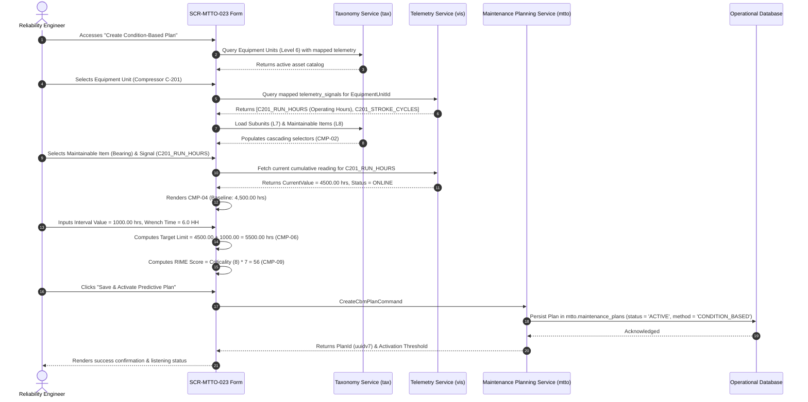
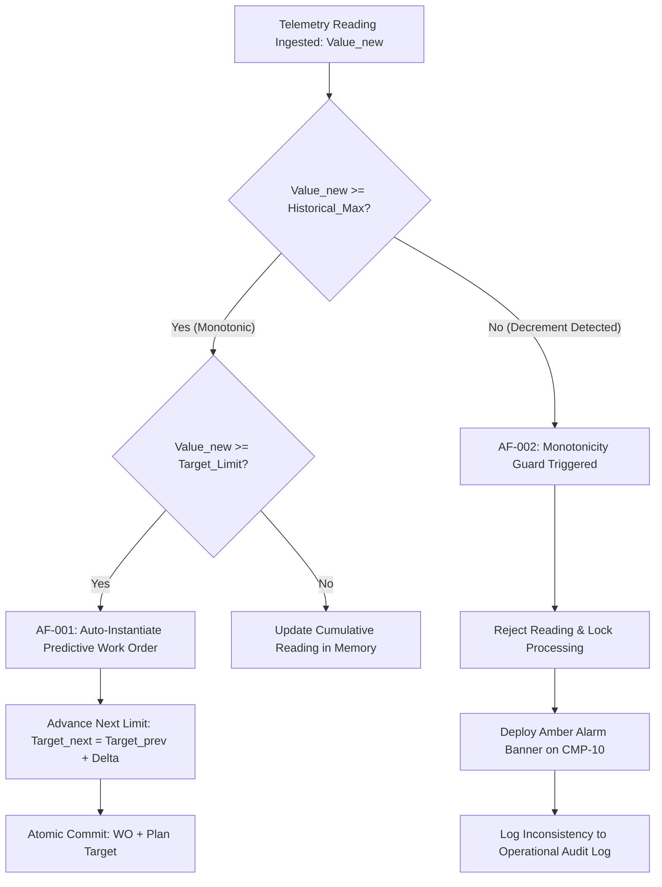

# SCR-MTTO-023: Condition-Based Predictive Maintenance Scheduling Form (Telemetry)

## 1. Purpose and Operational Context

* **View Objective:** Centralized configuration form for creating, calibrating, and activating condition-based predictive maintenance (CBM) plans governed by real-time IoT and SCADA telemetry data streams. Links maintenance trigger criteria to ISO 14224 taxonomic levels (Equipment Unit Level 6, Subunit Level 7, Maintainable Item Level 8), establishes cumulative measurement units (Running Hours, Kilometers, Production Cycles, Wear Depth), ingests baseline accumulated values, calculates deterministic non-drifting activation thresholds ($\text{Target}_{\text{next}} = \text{Target}_{\text{prev}} + \Delta$), enforces strict counter monotonicity validation (fail-safe counter decrement blocking), estimates active wrench time, calculates the predictive RIME priority score ($Score = \text{Criticality} \times 7$), and persists the plan into `LISTENING` / `ACTIVE` state.
* **Primary Target Persona:** Reliability Engineer establishing condition-based reliability models, configuring predictive triggers, and auditing sensor signal integrity to prevent catastrophic equipment failures without over-maintaining assets (ISO 55001 §8.1 / ISO 14224:2016 Annex E).
* **Secondary Personas:**
  * **Maintenance Planner:** Reviews condition triggers, allocates estimated labor resources (Wrench Time in Man-Hours), and performs manual counter entry during SCADA network contingency (`AF-003`).
  * **SCADA / Automation Specialist:** Verifies telemetry signal mappings (`vis.telemetry_signals`), polling frequencies, and TLS 1.3 edge gateway ingestion pipelines.
* **Operational Context:** Planning control rooms and reliability engineering workstations (`--dt-breakpoint-xl`, $\ge 1400\text{px}$) and supervisory industrial tablets in landscape orientation (`--dt-breakpoint-lg`, $901\text{px} - 1399\text{px}$).
* **Mode of Operation:** Supervisory Technical Configuration mode. Focuses on master predictive plan definition, mathematical threshold formulation, and automated asynchronous work order rule evaluation. Direct DCS/SCADA process control manipulation is strictly excluded.
* **Web Portal Workspace Invariant:** Operates as a Level 3 technical form within the Blazor Web Portal shell (`Pages/Maintenance/CreatePredictivePlanPage.razor`), accessible directly from the Maintenance menu or via drill-down from the RIME Backlog Dashboard ([[SCR-MTTO-026]]) by clicking "Schedule by Sensor".

---

## 2. Visual Artifact

![[SCR-MTTO-023-wireframe.svg]]

> *Note: Conceptual wireframe illustrating the Web Portal layout, cascading ISO 14224 asset selector, mapped telemetry signal selector, baseline accumulation indicator, interval cadence controller, initial target limit calculator, labor resource estimator, RIME score preview, and SCADA stream health badge.*

---

## 3. Functional Component Inventory

> The base layout, typography, and design tokens are inherited from [[DT-UI-DS-DOC-001]]. This table defines the present components, semantic tokens, and architectural roles. Detailed interaction rules, layout constraints, and geometric algorithms are strictly specified in Section 5.

| ID | Control / Component | Visual Role / Content | Semantic Token | Architectural Role & Reference |
| :--- | :--- | :--- | :--- | :--- |
| `CMP-01` | Form Breadcrumbs & Header | Top breadcrumb navigation and form title | Surface: `--dt-color-surface-card`<br>Border: `--dt-color-border-subtle` | Displays path (`Maintenance > Predictive Scheduling > Create Condition-Based Plan (Telemetry)`), active asset tag pill, and navigation backlink to [[SCR-MTTO-026]]. |
| `CMP-02` | Cascading ISO 14224 Selector | 3-tier taxonomic dropdown hierarchy | Surface: `--dt-color-surface-base`<br>Border: `--dt-color-border-subtle` | Cascading dropdowns: Equipment Unit L6 (`Compressor C-201`), Subunit L7 (`Bearing Assembly`), and Maintainable Item L8 (`Drive-End Journal Bearing`) (`FR-583`, `TR-008`). Enforces strict taxonomic parent-child linkage. |
| `CMP-03` | Mapped Telemetry Signal Selector | Dropdown of registered IoT sensor streams | Surface: `--dt-color-surface-base`<br>Border: `--dt-color-border-subtle` | Displays available telemetry signals mapped to the selected equipment unit in `vis.telemetry_signals` (e.g. `C201_RUN_HOURS`, `C201_STROKE_CYCLES`). Shows sensor tag, unit, and polling rate (`FR-583`, `FR-584`). |
| `CMP-04` | Baseline Accumulation & SCADA Status | Live sensor telemetry reading & link state | Surface: `--dt-color-surface-raised`<br>Border: `--dt-color-border-subtle` | Read-only numerical display of current historical accumulated usage (e.g., $4,500.00\text{ hrs}$) alongside real-time connection badge: *"SCADA STREAM: ONLINE"* (`--dt-color-state-success`) or *"OFFLINE"* (`--dt-color-alarm-warning`). |
| `CMP-05` | Trigger Cadence & Interval Stepper | Numeric interval value and unit picker | Surface: `--dt-color-surface-base`<br>Border: `--dt-color-border-subtle` | High-precision numeric input ($0.01$ to $1,000,000.00$) for delta interval ($\Delta = 1,000.00$) and unit selector (`Operating Hours`, `Cycles`, `Kilometers`, `Wear mm`) (`FR-583`, `FR-590`). |
| `CMP-06` | Target Limit Mathematical Preview | Dynamic threshold preview & formula display | Surface: `--dt-color-surface-raised`<br>Font: `--dt-font-family-mono` | Displays calculated activation threshold: $\text{Target Limit} = \text{Baseline} (4,500) + \Delta (1,000) = 5,500.00\text{ hrs}$. Displays drift prevention formula indicator: $\text{Target}_{\text{next}} = \text{Target}_{\text{prev}} + \Delta$ (`FR-585`). |
| `CMP-07` | Labor & Resource Estimation Grid | Man-Hours (Wrench Time) & Specialty | Surface: `--dt-color-surface-base`<br>Border: `--dt-color-border-subtle` | Numeric input for Estimated Man-Hours (e.g., $6.0\text{ HH}$) and required technical craft dropdown (`MECHANICAL`, `ELECTRICAL`, `INSTRUMENTATION_AND_CONTROL`, `CONDITION_MONITORING`). Enforces non-zero numeric validation (`AF-001`). |
| `CMP-08` | Task Scope Description Textarea | Narrative of predictive maintenance tasks | Surface: `--dt-color-surface-base`<br>Border: `--dt-color-border-subtle` | Multiline text area capturing technical scope, vibration analysis SOP reference, lubrication tolerances, and LOTO isolation points. |
| `CMP-09` | RIME Predictive Priority Score Card | Priority score breakdown & badge | Surface: `--dt-color-surface-raised`<br>Border: `--dt-color-border-subtle` | Evaluates Asset Criticality ($1..10$) and sets Work Class weight to 7 ("Predictive Maintenance"). Computes dynamic RIME Score ($Criticality \times 7$) with redundant priority badge (`CMP-08` per [[SCR-MTTO-026]]). |
| `CMP-10` | Monotonicity Guard & Inconsistency Alert | Anti-decrement rule status & alarm banner | Dynamic Surface: `--dt-color-surface-raised`<br>Border: `--dt-color-alarm-warning` | Displays status of fail-safe monotonicity check (`FR-586`). In case of counter decrement (e.g., reading $4,300 < 4,500$), deploys high-visibility amber warning and locks processing (`AF-002`). |
| `CMP-11` | Contingency Manual Reading Trigger | Button to open manual entry modal | Surface: `--dt-color-surface-base`<br>Border: `--dt-color-border-subtle` | Opens `Modal-Contingency-Reading` allowing planners to manually record hour meter logs during SCADA outages (`AF-003`, `FR-587`). |
| `CMP-12` | Plan Confirmation & Action Bar | Sticky bottom action controls | Surface: `--dt-color-surface-card`<br>Border: `--dt-color-border-subtle` | Bottom bar hosting "Cancel" and "Save & Activate Predictive Plan" primary action button. Enforces completeness of mandatory parameters. |

---

## 4. Screen State Matrix

| State | Visual Modification in the Interface | Activation Condition |
| :--- | :--- | :--- |
| **Normal / Initial Load** | Form fields render empty. `CMP-03` prompts *"Select Asset to load mapped signals"*. `CMP-04` displays empty baseline placeholder. `CMP-12` primary button is disabled (`opacity: 0.45`). | Reliability Engineer accesses "Create Condition-Based Plan" prior to asset selection. |
| **Asset & Signal Bound** | `CMP-03` populates with active telemetry signals. Selecting a signal queries current telemetry value in `CMP-04` ($4,500.00\text{ hrs}$) and displays green *"STREAM: ONLINE (1s poll)"* indicator. `CMP-06` computes initial limit dynamically. | Engineer selects valid Level 6 Equipment Unit and binds a mapped sensor stream (`FR-583`, `FR-584`). |
| **Monotonicity Alert (AF-002)** | `CMP-10` deploys full-width amber alert banner: *"Telemetry Monotonicity Violation: Received reading (4,300.00) is lower than historical accumulation (4,500.00). Ingestion blocked by fail-safe guard (FR-586)."* Interface locks target recalculation. | Ingested telemetry frame or manual entry reports a value lower than the recorded historical baseline (`AF-002`, `FR-586`). |
| **Manual Contingency Active (AF-003)** | `CMP-04` displays amber badge: *"SCADA STREAM: OFFLINE — MANUAL LOGGING ACTIVE"*. Modal `Modal-Contingency-Reading` opens for physical counter capture with mandatory technician attestation. | Planner triggers manual reading fallback due to SCADA link outage (`AF-003`, `FR-587`). |
| **Missing Mandatory Fields** | Incomplete inputs highlight with amber outline (`--dt-color-alarm-warning`, $2\text{px}$) and warning icon `#icon-warning`. Error toast alerts: *"Mandatory fields required: Asset, Maintainable Item, Telemetry Signal, Interval, Wrench Time, Scope."* | User attempts to activate plan without completing mandatory fields (`AF-001`). |
| **Submitting / Persisting** | Primary button `CMP-12` renders skeleton shimmer and loading indicator. Inputs locked. | Engineer activates "Save & Activate Predictive Plan". |
| **Plan Active (Success)** | Form displays green success alert banner: *"Predictive Plan CBM-2026-XXXX Activated. Listening for telemetry triggers at threshold 5,500.00 hrs."* Provides action links to "View Active Plans" or "Trigger Simulation". | Atomic persistence completes in $< 1\text{s}$ (`NFR-588`). |

---

## 5. Interaction Rules and Data Flow

### 5.1. Initial Load & Lifecycle



---

### 5.2. Mathematical Trigger Formulation & Drift Prevention

1. **Initial Threshold Calculation (`FR-585`):**
   When establishing the predictive plan, the initial trigger threshold is computed from the current baseline:
   $$\text{Target Limit}_{\text{initial}} = \text{CurrentAccumulation} + \Delta\text{Interval}$$
   *Example:* Baseline $= 4,500.00\text{ hrs}$, Interval $\Delta = 1,000.00\text{ hrs} \implies \text{Target Limit} = 5,500.00\text{ hrs}$.

2. **Drift Prevention Recalculation Rule (`AF-001`):**
   When telemetry reports a reading that reaches or exceeds the threshold (e.g., sensor reports $5,502.50\text{ hrs}$ due to SCADA transmission latency), the next target limit is calculated strictly from the **previous target limit**, never from the delayed arrival reading:
   $$\text{Target Limit}_{\text{next}} = \text{Target Limit}_{\text{prev}} + \Delta\text{Interval}$$
   $$\text{Target Limit}_{\text{next}} = 5,500.00 + 1,000.00 = 6,500.00\text{ hrs}$$
   *Design Rationale:* Basing the calculation on the delayed reading ($5,502.50 + 1,000 = 6,502.50$) introduces positive schedule drift, gradually extending maintenance intervals beyond engineering reliability design limits.

3. **High-Precision Floating-Point Preservation (`FR-590`):**
   All accumulators and threshold limits are stored and computed using `DECIMAL(12,2)` / `DECIMAL(18,6)` in database schema and `decimal` in C# (.NET 10), preventing floating-point rounding errors across long-term cumulative operations.

---

### 5.3. Domain Workflows & Validation Rules

#### 5.3.1. Telemetry Monotonicity Check (AF-002 & FR-586)



1. Telemetry usage counters (hour meters, cycle counts) are physically strictly monotonic non-decreasing.
2. If an ingested reading $V_{\text{new}} < V_{\text{historical}}$:
   * The system immediately rejects $V_{\text{new}}$ and keeps the accumulator at $V_{\text{historical}}$.
   * An inconsistency alarm is raised (`CMP-10`), notifying the Reliability Engineer of possible sensor reset, calibration failure, or rollover.
   * Automated Work Order evaluation is frozen until human inspection or corrective reset is approved.

#### 5.3.2. Contingency Manual Reading Recording (AF-003 & FR-587)

1. During telemetry outages, planners open `Modal-Contingency-Reading` from `CMP-11`.
2. Mandatory fields:
   * `PhysicalReadingValue` (decimal): Must be $\ge V_{\text{historical}}$.
   * `ReadingTimestamp` (UTC): Must be $\le \text{CurrentUtc}$.
   * `InspectorUserId` (string): Authenticated operator ID.
   * `PhysicalGaugePhotoUrl` (string, optional): Verification photo of the field gauge.
3. Upon submission, the manual reading updates the baseline. If the manual reading meets or exceeds `Target Limit`, the system automatically triggers Work Order instantiation per `AF-001`.

---

## 6. Industrial and Safety Considerations

* **ANSI/ISA-101 HPHMI Compliance ([[TR-011]]):** Grayscale base surfaces (`--dt-color-surface-base`, `--dt-color-surface-card`). Color reserved exclusively for operational states:
  * Green (`--dt-color-state-success`) for active telemetry connection and verified stream.
  * Amber (`--dt-color-alarm-warning`) for monotonicity warnings (`AF-002`) and SCADA link offline states (`AF-003`).
* **Negative Interlock & RIME Priority:** Predictive work orders are automatically assigned Work Class 7 ("Predictive Maintenance"). With an asset criticality of 8, $\text{RIME Score} = 8 \times 7 = 56$, ensuring prioritized backlog placement in [[SCR-MTTO-026]] without subjective human tampering.
* **Fail-Safe Data Ingestion (NFR-588 / NFR-589):** Telemetry ingestion endpoints enforce TLS 1.3 encryption and evaluate trigger rules asynchronously in $< 3\text{ seconds}$ (`NFR-588`), preventing stream bottlenecks.

---

## 7. Frontend Component Contract (Blazor / Razor)

### 7.1. Component Hierarchy & File Mapping

```text
Pages/Maintenance/
└── CreatePredictivePlanPage.razor                     # Root View (SCR-MTTO-023)
    ├── FormBreadcrumbHeader.razor                     # CMP-01: Header and navigation
    ├── IsoHierarchyCascadingSelector.razor            # CMP-02: L6 / L7 / L8 picker
    ├── MappedTelemetrySignalSelector.razor            # CMP-03: Sensor signal picker
    ├── BaselineAccumulationCard.razor                 # CMP-04: Baseline counter & link status
    ├── CadenceIntervalStepper.razor                   # CMP-05: Delta interval input
    ├── TargetLimitPreviewCard.razor                   # CMP-06: Mathematical threshold preview
    ├── LaborEstimationCard.razor                      # CMP-07: Man-hours & craft specialty
    ├── PlanScopeEditor.razor                          # CMP-08: Task narrative and SOP link
    ├── RimePriorityPreview.razor                      # CMP-09: RIME score breakdown
    ├── MonotonicityGuardBanner.razor                  # CMP-10: Inconsistency warning banner
    ├── ContingencyReadingModal.razor                  # CMP-11: Manual entry dialog (AF-003)
    └── FormActionFooter.razor                         # CMP-12: Sticky save/cancel controls
```

---

### 7.2. Physical Component Parameters & DTO Contracts (.NET 10 / C# 14)

```csharp
public partial class CreatePredictivePlanPage : ComponentBase
{
    [Inject]
    public required IMaintenancePlanningService PlanningService { get; init; }

    [Inject]
    public required ITelemetryQueryService TelemetryService { get; init; }

    [Inject]
    public required ITaxonomyService TaxonomyService { get; init; }

    [Parameter]
    public string? PreselectedEquipmentUnitId { get; set; }
}

public record CreateCbmPlanCommand(
    Guid EquipmentUnitId,
    Guid SubunitId,
    Guid MaintainableItemId,
    Guid TelemetrySignalId,
    decimal IntervalValue,
    TelemetryMeasurementUnit MeasurementUnit,
    decimal CurrentBaselineValue,
    decimal InitialTargetLimit,
    decimal EstimatedLaborHours,
    MaintenanceCraft Specialty,
    string TechnicalDescription,
    string PlannerUserId
);

public record TelemetrySignalDto(
    Guid SignalId,
    Guid EquipmentUnitId,
    string SignalName,
    string PhysicalUnit,
    decimal CurrentValue,
    DateTime LastUpdatedUtc,
    bool IsOnline,
    bool IsSafetyCritical
);

public record RecordManualReadingCommand(
    Guid EquipmentUnitId,
    Guid TelemetrySignalId,
    decimal ManualCounterValue,
    DateTime ReadingTimestampUtc,
    string OperatorUserId,
    string? PhysicalGaugePhotoUrl
);

public enum TelemetryMeasurementUnit
{
    OperatingHours,
    Cycles,
    Kilometers,
    WearDepthMm
}

public enum MaintenanceCraft
{
    Mechanical,
    Electrical,
    InstrumentationAndControl,
    ConditionMonitoring,
    Lubrication
}
```

---

### 7.3. Client-Side DOM & Interop Bridge

1. **Debounced Target Calculation:** Client-side JavaScript bridge recalculating $\text{Target Limit} = \text{Baseline} + \text{Interval}$ instantaneously as the user modifies interval values without server roundtrips.
2. **Real-Time Telemetry Subscription:** SignalR hub connection (`TelemetryHub`) pushing live sensor updates to `BaselineAccumulationCard.razor`.

---

## 8. Layout and Responsive Adaptability

| Viewport / Breakpoint | Layout Organization | Ergonomic Rules |
| :--- | :--- | :--- |
| **Desktop Workstation**<br>($\ge 1400\text{px}$, `--dt-breakpoint-xl`) | Dual-column responsive grid: Left column ($65\%$) hosts cascading selectors, telemetry signal picker, cadence, and labor estimates; Right column ($35\%$) hosts SCADA status, mathematical preview, RIME score, and monotonicity guard. | Form container max-width $1240\text{px}$; inputs $40\text{px}$ height; dense legible typography. |
| **Industrial Tablet Landscape**<br>($901\text{px} - 1399\text{px}$, `--dt-breakpoint-lg`) | Single-column vertically stacked card layout; sidebar navigation collapses to icon rail ($64\text{px}$). | Touch targets $\ge 44\text{px}$; large numerical steppers for interval; quick-interval chips. |
| **Industrial Tablet Portrait**<br>($600\text{px} - 900\text{px}$, `--dt-breakpoint-md`) | Single-column layout; sticky action footer always docked above viewport bottom; touch targets $\ge 48\times 48\text{px}$. | Optimized for gloved field use; large tap surfaces; collapsible mathematical summary. |

---

## 9. Traceability and Requirements Matrix

| Requirement | Addressed in Component | Verification & Implementation Mechanism |
| :--- | :--- | :--- |
| **FR-583** | `CMP-02`, `CMP-03`, `CMP-05` | Allows configuration of preventive plans associated with cumulative usage variables (hour meters, cycle counters). |
| **FR-584** | `CMP-03`, `CMP-04` | Integrates with telemetry endpoint receiving external counter readings from SCADA/IoT devices. |
| **FR-585** | `CMP-06` | Calculates cumulative usage value and projects automated Work Order trigger when threshold is reached. |
| **FR-586** | `CMP-10` | Blocks processing of usage readings presenting values lower than historical cumulative (monotonicity check). |
| **FR-587** | `CMP-11` | Provides manual contingency reading record mechanism from asset record during telemetry communication failures. |
| **FR-590** | `CMP-05`, `CMP-06` | Preserves high precision of cumulative counters using `DECIMAL(12,2)` / `DECIMAL(18,6)` to prevent rounding errors. |
| **NFR-588** | `CMP-04`, `CMP-06` | Ingestion and rule evaluation completed in $< 3\text{ seconds}$ from telemetry frame receipt. |
| **NFR-589** | `CMP-03` | Telemetry data reception secured via authentication and TLS 1.3 encryption. |
| **TR-005** | `CMP-01` | Adheres strictly to DDD Bounded Contexts (`mtto`, `tax`, `vis`). |
| **TR-006** | `CMP-01`, `CMP-12` | Enforces RBAC permissions (`Reliability Engineer`, `Maintenance Planner`). |
| **TR-008** | `CMP-02` | Enforces ISO 14224 taxonomy structure (Level 6 Equipment Unit, Level 7 Subunit, Level 8 Maintainable Item). |
| **TR-010** | `CMP-03`, `CMP-04` | Integrates with SCADA / Historian module for automated data acquisition. |
| **TR-011** | `CMP-01`..`CMP-12` | ANSI/ISA-101 HPHMI: 90/10 grayscale palette, functional alert color. |
