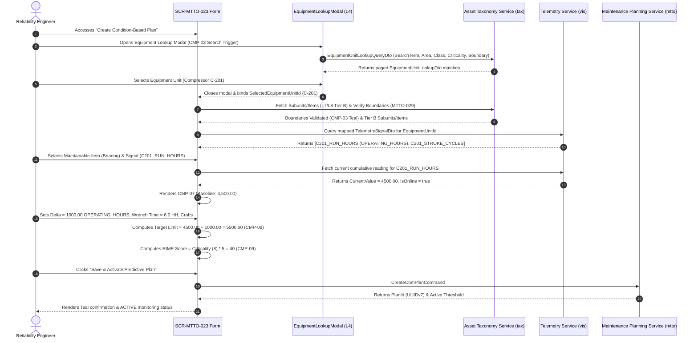
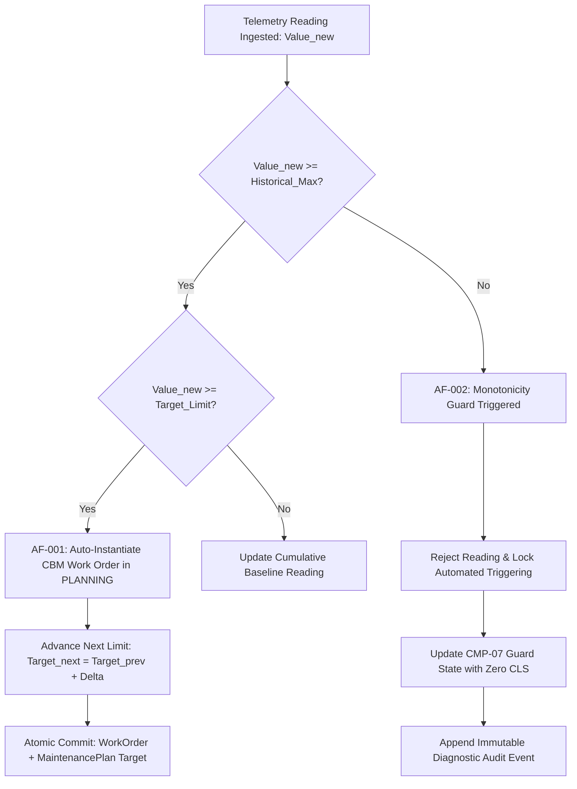

# SCR-MTTO-023: Condition-Based Predictive Maintenance Scheduling Form (Telemetry)

## 1. Purpose and Operational Context

* **View Objective:** Centralized configuration form for creating, calibrating, and activating condition-based predictive maintenance (CBM) plans governed by real-time IoT and SCADA telemetry data streams. Links maintenance trigger criteria to ISO 14224 taxonomic levels via a Tier A searchable lookup modal ([DT-UI-DS-DOC-001 §6.7](../../DT-UI-DS-DOC-001.md#67-relational-entity-lookup-modal-pattern-lov-list-of-values)) for Equipment Unit (Level 6) cascading into parent-scoped Subunit (Level 7) and Maintainable Item (Level 8) selectors, enforces physical battery limits verification ([MTTO-029](../../../requirements/user-stories/mtto/MTTO-029.md)), pairs mapped sensor signals with cumulative measurement units, ingests baseline accumulated values, calculates deterministic non-drifting activation thresholds ($\text{Target}_{\text{next}} = \text{Target}_{\text{prev}} + \Delta$), enforces strict counter monotonicity validation (fail-safe counter decrement blocking), estimates active wrench time and required crafts, calculates the predictive RIME priority score ($Score = \text{Criticality} \times \text{Work Class Weight}$) per [ADR-002](../../../architecture/adr/ADR-002.md), and persists the plan into `ACTIVE` state.
* **Primary Target Persona:** Reliability Engineer establishing condition-based reliability models, configuring predictive triggers, and auditing sensor signal integrity to prevent catastrophic equipment failures without over-maintaining assets (ISO 55001 / ISO 14224 Annex E).
* **Secondary Personas:**
  * **Maintenance Planner:** Reviews condition triggers, allocates estimated labor resources (Wrench Time in Man-Hours), and performs manual counter entry during SCADA network contingency (`AF-003`).
  * **SCADA / Automation Specialist:** Verifies telemetry signal mappings, polling frequencies, and TLS 1.3 edge gateway ingestion pipelines.
* **Operational Context:** Planning control rooms, reliability engineering workstations, and supervisory industrial tablets in landscape orientation.
* **Mode of Operation:** Supervisory Technical Configuration mode. Focuses on master predictive plan definition, mathematical threshold formulation, and automated asynchronous work order rule evaluation. Direct DCS/SCADA process control manipulation is strictly excluded.
* **Web Portal Workspace Invariant:** Operates as a Level 3 technical form within the Blazor Web Portal shell (`Pages/Maintenance/CreatePredictivePlanPage.razor`), accessible directly from the Maintenance menu or via drill-down from the RIME Backlog Dashboard ([SCR-MTTO-026](./SCR-MTTO-026.md)).

---

## 2. Visual Artifact

### 2.1. Condition-Based Telemetry Scheduling Form (Dark Theme)


> *Note: Production UI prototype capture at 1280×800 in Dark Theme. Exhibits the portal navigation sidebar (CMP-01), sticky breadcrumb header and `PM-CBM` plan context sheet (CMP-02), cascading ISO 14224 selector with inline battery limits verification (CMP-03), telemetry signal and interval controller (CMP-04), labor estimation and craft toggles (CMP-05, CMP-06), SCADA stream & monotonicity guard panel (CMP-07), threshold preview (CMP-08), predictive RIME score card (CMP-09), projected CBM work order card (CMP-10), and grounded action footer (CMP-12).*

### 2.2. Condition-Based Telemetry Scheduling Form (Light Theme)


> *Note: Production UI prototype capture at 1280×800 in Light Theme.*

---

## 3. Functional Component Inventory

> The base grid, typography, neutral palettes, and minimal tactile contact areas are inherited from [DT-UI-DS-DOC-001](../../DT-UI-DS-DOC-001.md). This inventory defines the canonical components present on the screen, their design tokens, and their architectural scope. Interaction rules and geometric algorithms are specified in Section 5; responsive container adaptations are governed by Section 8.

1. **`CMP-01`: Portal Sidebar Navigation**
   - **Visual Role:** Collapsible persistent sidebar providing access to core modules (Digital Twin, Work Orders, Maintenance Plans, Asset Inventory, Governance).
   - **Design Tokens:**
     - Width (Expanded): `--dt-layout-sidebar-width-expanded`
     - Width (Collapsed): `--dt-layout-sidebar-width-collapsed`
     - Surface: `--dt-color-surface-card`
     - Border: `--dt-color-border-subtle`
     - Active Route Indicator: `--dt-color-state-info`
   - **Architectural Scope:** Hosts shared application routing, collapsible state (`IsCollapsed`), and active route tracking (`ActiveRouteCode = "SCR-MTTO-023"`). Detailed in §8.

2. **`CMP-02`: Form Breadcrumbs, Header & Plan Context Sheet**
   - **Visual Role:** Sticky top bar presenting hierarchical breadcrumb path (*"Maintenance › Predictive Plans (CBM) › Telemetry Scheduling"*), backlink to [SCR-MTTO-026](./SCR-MTTO-026.md), and operator session metadata (`OperatorBadgeCode`, `OperatorDisplayName`), paired with the `PM-CBM` context summary header sheet displaying `MaintenanceMethod` (`CONDITION_BASED`), `SelectedSignalTag`, `InitialTargetLimit`, and `PlanStatus` (`DRAFT` / `ACTIVE`).
   - **Design Tokens:**
     - Surface: `--dt-color-surface-base`
     - Summary Sheet Surface: `--dt-color-surface-card`
     - Border: `--dt-color-border-subtle`
     - Typography: `--dt-font-body-md`, `--dt-font-caption`, `--dt-font-mono-data`
     - Height: `--dt-control-height-lg`
   - **Architectural Scope:** Establishes spatial orientation, operator traceability, and live CBM trigger parameterization summary.

3. **`CMP-03`: Cascading ISO 14224 Selector, L4 Equipment Lookup Trigger & Boundary Limits Strip**
   - **Visual Role:** Reference-picker trigger for ISO Level 6 Equipment Unit (`Compressor C-201`) launching a searchable Level 4 Enterprise Equipment Lookup Modal (`EquipmentLookupModal`) with multi-criteria filters (Text Query on Tag/Model/Serial, Functional Location Area, Equipment Class, Criticality band, and Physical Boundary Readiness), cascading into Tier B parent-scoped selectors for Subunit Level 7 (`Bearing Assembly`) and Maintainable Item Level 8 (`Drive-End Journal Bearing`), paired with an inline physical battery limits verification strip (`BoundaryStart`, `BoundaryEnd` per [MTTO-029](../../../requirements/user-stories/mtto/MTTO-029.md)) and navigation link to [SCR-MTTO-029](./SCR-MTTO-029.md).
   - **Design Tokens:**
     - Surface: `--dt-color-surface-card`
     - Modal Overlay: `--dt-color-surface-overlay`
     - Modal Width & Max-Height: `--dt-layout-modal-width`, `--dt-layout-modal-max-height`
     - Table Row Height: `--dt-layout-table-row-height`
     - Border: `--dt-color-border-subtle`
     - Verified Boundary Surface: `--dt-color-state-success`
     - Missing Boundary Block: `--dt-color-alarm-critical`
     - Control Height: `--dt-control-height-lg`
     - Radius: `--dt-radius-md`, `--dt-radius-xl`, `--dt-radius-full`
   - **Architectural Scope:** Implements the Tier A Relational Lookup pattern ([DT-UI-DS-DOC-001 §6.7](../../DT-UI-DS-DOC-001.md#67-relational-entity-lookup-modal-pattern-lov-list-of-values)) to eliminate full-plant catalog DOM bloat, enforces ISO 14224 taxonomic parent-child linkage (`FR-583`, `TR-008`), and hard-blocks plan registration if physical battery limits are undefined (`FR-096`, `AF-004`).

4. **`CMP-04`: Telemetry Signal & Interval Cadence Controller**
   - **Visual Role:** Paired selector for registered SCADA/IoT telemetry streams (`TelemetrySignalDto`), cumulative physical measurement unit selector (`TelemetryMeasurementUnit`), high-precision numeric trigger delta input ($\Delta$, minimum $0.01$), and tactile capsule frequency preset pills (`250`, `500`, `1,000`, `2,500`, `5,000`).
   - **Design Tokens:**
     - Surface: `--dt-color-surface-card`
     - Border: `--dt-color-border-subtle`
     - Active Preset Fill: `--dt-primitive-gray-980` (Light) / `--dt-primitive-gray-10` (Dark)
     - Typography: `--dt-font-mono-data`
     - Control Height: `--dt-control-height-lg`
     - Preset Radius: `--dt-radius-full`
   - **Architectural Scope:** Binds the equipment unit's monotonic usage stream (`FR-583`, `FR-584`, `FR-590`, [DT-UI-DS-DOC-001 §6.6.2](../../DT-UI-DS-DOC-001.md#662-tactile-pill-actions-presets)) and drives live threshold computation (`CMP-08`).

5. **`CMP-05`: Labor & Multi-Craft Estimation Grid**
   - **Visual Role:** Numeric input for Estimated Active Wrench Time (Man-Hours) and multi-select craft specialty capsule toggles (`Condition Monitoring`, `Mechanical`, `Electrical`, `Instrumentation`, `Lubrication`).
   - **Design Tokens:**
     - Surface: `--dt-color-surface-card`
     - Border: `--dt-color-border-subtle`
     - Active Specialty Fill: `--dt-primitive-gray-980` (Light) / `--dt-primitive-gray-10` (Dark)
     - Control Height: `--dt-control-height-lg`
     - Specialty Toggle Radius: `--dt-radius-full`
   - **Architectural Scope:** Captures pure active wrench time and required technical crafts, validating positive non-zero values and at least one selected craft (`AF-004`).

6. **`CMP-06`: Predictive Plan Scope & SOP Textarea**
   - **Visual Role:** Multiline input capturing technical CBM scope, vibration/tribology standard references, inspection tolerances, and LOTO isolation notes.
   - **Design Tokens:**
     - Surface: `--dt-color-surface-card`
     - Border: `--dt-color-border-subtle`
     - Typography: `--dt-font-body-md`
   - **Architectural Scope:** Stores technical instructions propagated to automatically instantiated predictive Work Orders.

7. **`CMP-07`: SCADA Stream, Baseline Accumulation & Monotonicity Guard Card**
   - **Visual Role:** Live telemetry status header (*"ONLINE (1s POLL)"* in Teal `--dt-color-state-success` or *"MANUAL LOGGING"* in Amber `--dt-color-alarm-warning`), read-only historical baseline counter readout, fixed-height monotonicity guard status strip (`ACTIVE` / `BLOCKED` with zero layout shift `CLS = 0`), one-click *"Reset Sensor"* action when blocked, and *"Contingency Manual Reading"* trigger button (`CMP-11`).
   - **Design Tokens:**
     - Surface: `--dt-color-surface-card`
     - Healthy Stream Badge: `--dt-color-state-success`
     - Contingency Badge: `--dt-color-alarm-warning`
     - Decrement Block Accent: `--dt-color-alarm-critical`
     - Border: `--dt-color-border-subtle`
     - Typography: `--dt-font-mono-data`, `--dt-font-caption`
   - **Architectural Scope:** Surfaces live SCADA baseline accumulation (`FR-584`), enforces fail-safe monotonicity protection (`FR-586`, `AF-002`), and initiates contingency fallback (`FR-587`, `AF-003`) without shifting primary form controls.

8. **`CMP-08`: Initial Activation Threshold & Anti-Drift Card**
   - **Visual Role:** Transparent, uncolored preview frame displaying the computed initial trigger threshold ($\text{Baseline} + \Delta$) alongside the explicit drift-prevention rule ($\text{Target}_{n+1} = \text{Target}_{n} + \Delta$).
   - **Design Tokens:**
     - Surface: transparent over `--dt-color-surface-card`
     - Border: `--dt-color-border-subtle`
     - Typography: `--dt-font-mono-data`, `--dt-font-caption`
   - **Architectural Scope:** Previews exact activation limit client-side (`FR-585`, `FR-590`) and documents zero-drift threshold advancement (`AF-001`).

9. **`CMP-09`: Predictive RIME Priority Preview Card**
   - **Visual Role:** Real-time decomposition of equipment criticality ($1..10$), Work Class weight (`5` for Predictive Maintenance per `DT-DM-DOC-001 §4.24`), and calculated RIME Score ($C \times 5$) with priority tier pill ($\blacksquare$ `PLAN` in neutral grayscale for `< 50`, $\blacktriangle$ `SCHEDULE` in Amber for `50..79`, $\blacklozenge$ `DO FIRST` in Red for `>= 80`).
   - **Design Tokens:**
     - Surface: transparent over `--dt-color-surface-card`
     - Border: `--dt-color-border-subtle`
     - Neutral Tier Text/Border: `--dt-color-text-muted`, `--dt-color-border-panel`
     - High/Critical Tier Accents: `--dt-color-alarm-warning`, `--dt-color-alarm-critical`
     - Typography: `--dt-font-mono-data`
   - **Architectural Scope:** Computes objective RIME triage score per ISO 55001 planning governance ([ADR-002](../../../architecture/adr/ADR-002.md)), strictly honoring ISA-101 90/10 grayscale neutrality for routine scores.

10. **`CMP-10`: Projected CBM Work Order Card**
    - **Visual Role:** Preview card displaying the Work Order template to be automatically instantiated in `PLANNING` status upon threshold breach (`AF-001`), showing projected folio format, trigger condition, wrench time and craft allocation, and a `"Verify Spare Parts"` handoff action to [SCR-INV-031](../inv/SCR-INV-031.md).
    - **Design Tokens:**
      - Surface: `--dt-color-surface-card`
      - Border: `--dt-color-border-subtle`
      - Link Accent: `--dt-color-state-info`
      - Typography: `--dt-font-caption`, `--dt-font-mono-data`
    - **Architectural Scope:** Communicates downstream Work Order automation attributes and supports spare-parts readiness verification prior to plan activation.

11. **`CMP-11`: Contingency Manual Reading Modal**
    - **Visual Role:** Level 4 modal dialog allowing planners to manually capture physical hour-meter or cycle readings during SCADA outages (`AF-003`), containing numeric counter input ($\ge V_{\text{historical}}$), reading UTC/local timestamp ($\le \text{CurrentUtc}$), operator identifier, optional gauge evidence photo URL, and inline validation feedback.
    - **Design Tokens:**
      - Modal Backdrop: `--dt-color-surface-overlay`
      - Modal Surface: `--dt-color-surface-card`
      - Modal Width & Max-Height: `--dt-layout-modal-width`, `--dt-layout-modal-max-height`
      - Border & Error Accent: `--dt-color-border-subtle`, `--dt-color-alarm-critical`
      - Radius: `--dt-radius-xl`
    - **Architectural Scope:** Implements graceful degradation for SCADA communication failures (`FR-587`, `AF-003`), validating counter monotonicity inline before updating baseline accumulation.

12. **`CMP-12`: Plan Confirmation & Action Bar**
    - **Visual Role:** Grounded sticky footer bar hosting *"Cancel"* and *"Save & Activate Predictive Plan"* primary CTA paired with a conditional inline validation feedback message.
    - **Design Tokens:**
      - Surface: `--dt-color-surface-card`
      - Border: `--dt-color-border-subtle`
      - Primary CTA: `--dt-color-state-info`
      - Disabled CTA: `--dt-color-state-disabled`
      - Height: `--dt-layout-footer-height`
    - **Architectural Scope:** Enforces atomic plan creation (`ACTIVE`) and blocks submission whenever physical battery limits are missing, monotonicity is breached, or mandatory parameters are incomplete (`CLS = 0`).

---

## 4. Screen State Catalog

1. **Normal / Empty Form**
   - **Activation Condition:** Reliability Engineer accesses *"Create Condition-Based Plan"* prior to asset selection.
   - **Visual Modification:** `CMP-03` Equipment Unit reference-picker displays placeholder prompt with `#icon-search` trigger; Subunit and Maintainable Item cascade controls remain inactive; boundary badge renders neutral placeholder; `CMP-07` displays empty baseline readout; primary commit CTA `CMP-12` is disabled (`--dt-color-state-disabled`).
2. **Equipment Lookup Catalog Open & Filtered (L4 Modal)**
   - **Activation Condition:** Engineer clicks the `CMP-03` Equipment Unit reference-picker trigger or `#icon-search` button to browse the master Level 6 asset catalog.
   - **Visual Modification:** Level 4 modal dialog renders over `--dt-color-surface-overlay` scrim (`--dt-layout-modal-max-height`) with auto-focused debounced search input, four contextual filter controls (`FunctionalLocation`, `EquipmentClass`, `Criticality`, `BoundaryReadiness`), and a dense tabular result list sized by `--dt-layout-table-row-height`. Assets without defined battery limits remain explicitly tagged (`--dt-color-alarm-critical`) for inspection or remediation routing.
3. **Asset & Signal Bound**
   - **Activation Condition:** Engineer selects a valid Level 6 Equipment Unit (`Compressor C-201`) from the lookup modal with verified physical boundaries and binds mapped telemetry stream (`C201_RUN_HOURS`).
   - **Visual Modification:** Lookup modal closes; `CMP-03` reference-picker displays selected tag/area metadata and Teal badge (`--dt-color-state-success`): *"Physical Boundaries Verified"*; Tier B selectors populate Subunits and Maintainable Items cleanly. `CMP-07` renders current historical value (`4,500.00`) and Teal stream pill *"ONLINE (1s POLL)"*. `CMP-08` computes initial activation threshold (`5,500.00 OPERATING_HOURS`). `CMP-09` displays `Score = 40` with neutral grayscale $\blacksquare$ `PLAN` badge.
4. **Boundary Missing Blocked (`AF-004`)**
   - **Activation Condition:** Selected Equipment Unit has `BoundaryStart` or `BoundaryEnd` undefined ([MTTO-029](../../../requirements/user-stories/mtto/MTTO-029.md)).
   - **Visual Modification:** `CMP-03` inline boundary pill switches to Red (`--dt-color-alarm-critical`): *"Physical Boundaries Missing"*. Footer `CMP-12` displays critical feedback banner blocking submission and disables primary CTA (`--dt-color-state-disabled`).
5. **Monotonicity Alert (`AF-002`)**
   - **Activation Condition:** Ingested telemetry frame or manual entry reports a counter value strictly lower than the recorded historical baseline (`4,300.00 < 4,500.00`) (`FR-586`).
   - **Visual Modification:** `CMP-07` borders highlight in Red (`--dt-color-alarm-critical`) without layout shift (`CLS = 0`); monotonicity pill switches to *"BLOCKED"*; reserved status box displays received vs. historical values and enables *"Reset Sensor"* button; footer `CMP-12` blocks plan activation.
6. **Manual Contingency Active (`AF-003`)**
   - **Activation Condition:** Maintenance Planner opens `CMP-11` during SCADA outage to log physical field meter reading (`FR-587`).
   - **Visual Modification:** L4 modal overlay (`--dt-color-surface-overlay`) renders `CMP-11` over centered card (`--dt-color-surface-card`). Upon valid submission, `CMP-07` status pill switches to Amber (`--dt-color-alarm-warning`): *"MANUAL LOGGING"*, baseline updates, and if threshold is reached, triggers `AF-001` confirmation toast. Invalid values display inline Red error inside the modal without native browser alerts.
7. **Missing Mandatory Fields (`AF-004`)**
   - **Activation Condition:** User clears or enters non-positive values for interval delta, wrench time, crafts, or scope narrative.
   - **Visual Modification:** Footer `CMP-12` displays Amber warning message (`--dt-color-alarm-warning`, `#icon-warning`) and disables primary CTA (`--dt-color-state-disabled`).
8. **Plan Active (Success)**
   - **Activation Condition:** Atomic persistence completes in $< 1\text{s}$ (`NFR-588`).
   - **Visual Modification:** Context sheet status updates to `ACTIVE`; Teal confirmation toast (`--dt-color-state-success`, `#icon-check`) confirms monitoring toward target threshold (`5,500.00 OPERATING_HOURS`).

---

## 5. Interaction Rules and Data Flow

### 5.1. Initial Load & Lifecycle



---

### 5.2. Mathematical Trigger Formulation & Drift Prevention

1. **Initial Threshold Calculation (`FR-585`):**
   When establishing the predictive plan, the initial trigger threshold is computed from the current historical baseline:
   $$\text{Target Limit}_{\text{initial}} = \text{CurrentAccumulation} + \Delta\text{Interval}$$
   *Example:* Baseline $= 4,500.00\text{ OPERATING\_HOURS}$, Interval $\Delta = 1,000.00 \implies \text{Target Limit} = 5,500.00\text{ OPERATING\_HOURS}$.
2. **Drift Prevention Recalculation Rule (`AF-001`):**
   When telemetry reports a reading that reaches or exceeds the threshold (e.g., sensor reports $5,502.50$ due to SCADA transmission latency), the next target limit is calculated strictly from the **previous target limit**, never from the delayed arrival reading:
   $$\text{Target Limit}_{\text{next}} = \text{Target Limit}_{\text{prev}} + \Delta\text{Interval}$$
   $$\text{Target Limit}_{\text{next}} = 5,500.00 + 1,000.00 = 6,500.00$$
   *Design Rationale:* Basing recalculation on delayed readings ($5,502.50 + 1,000 = 6,502.50$) introduces cumulative positive schedule drift beyond engineering reliability limits.
3. **High-Precision Decimal Preservation (`FR-590`):**
   All accumulators, interval deltas, and threshold limits use high-precision `decimal` arithmetic end-to-end (no binary floating-point rounding drift).
4. **RIME Priority Calculation ([ADR-002](../../../architecture/adr/ADR-002.md)):**
   Predictive plans compute priority using Work Class Weight `5` (`Predictive Maintenance (Analysis / Route)` per `DT-DM-DOC-001 §4.24`):
   $$\text{RimeScore} = \text{EquipmentUnit.Criticality} \times 5$$
   For `C-201` ($\text{Criticality} = 8$), $\text{RimeScore} = 8 \times 5 = 40$ ($\blacksquare$ `PLAN`).

---

### 5.3. Domain Workflows & Validation Rules

#### 5.3.1. Telemetry Monotonicity Check (`AF-002` & `FR-586`)



1. Cumulative telemetry counters (`OPERATING_HOURS`, `CYCLES`, `KILOMETERS`, `WEAR_DEPTH_MM`) are physically strictly monotonic non-decreasing.
2. If an ingested reading satisfies $V_{\text{new}} < V_{\text{historical}}$:
   * The system immediately rejects $V_{\text{new}}$ and retains $V_{\text{historical}}$.
   * `CMP-07` deploys the blocked monotonicity state in its fixed-height container (`CLS = 0`) and notifies the Reliability Engineer of possible sensor reset, calibration failure, or rollover.
   * Automated Work Order instantiation and plan activation are halted until inspected and reset.

#### 5.3.2. Contingency Manual Reading Recording (`AF-003` & `FR-587`)

1. During telemetry outages, planners open `CMP-11` from `CMP-07`.
2. Validation rules on `RecordManualReadingCommand`:
   * `ManualCounterValue` (`decimal`): Must be $\ge V_{\text{historical}}$.
   * `ReadingTimestampUtc` (`DateTimeOffset`): Must be $\le \text{CurrentUtc}$.
   * `OperatorUserId` (`Guid`): Authenticated operator identity required.
   * `PhysicalGaugePhotoUrl` (`string?`): Optional verification gauge photograph reference.
3. Validation errors render inline inside `CMP-11` (`--dt-color-alarm-critical`), prohibiting native browser dialogs. Upon valid submission, the baseline updates and triggers `AF-001` automatically if the reading meets or exceeds `InitialTargetLimit`.

#### 5.3.3. Physical Boundaries Validation (`AF-004` & `MTTO-029`)

1. Per ISO 14224 and [MTTO-029](../../../requirements/user-stories/mtto/MTTO-029.md), if `BoundaryStart` or `BoundaryEnd` on `EquipmentUnitLookupDto` is null or whitespace:
   * `CMP-03` displays the Red missing-boundaries badge alongside a direct navigation link to [SCR-MTTO-029](./SCR-MTTO-029.md).
   * `CMP-12` disables plan submission (`--dt-color-state-disabled`) and renders the blocking reason in the grounded footer.

---

## 6. Industrial and Safety Considerations

* **ANSI/ISA-101 HPHMI Compliance ([TR-011](../../../requirements/common/TR-011.md)):** Form enforces the 90/10 grayscale baseline and Anti-Badge-Inflation rules inherited from [DT-UI-DS-DOC-001 §1](../../DT-UI-DS-DOC-001.md#1-scope) and [§6.5](../../DT-UI-DS-DOC-001.md#65-status-badge-counter-discipline-anti-badge-inflation-principle) using neutral surfaces (`--dt-color-surface-base`, `--dt-color-surface-card`). Routine RIME tiers (`< 50`) remain strictly neutral grayscale (`--dt-color-text-primary` / `--dt-color-border-panel`). Saturated chromatic color is strictly functional:
  * **Teal** (`--dt-color-state-success` with `#icon-check`) for active SCADA telemetry connection, verified physical boundaries, and documentary confirmation of plan activation.
  * **Amber** (`--dt-color-alarm-warning` with `#icon-warning`) for manual contingency override state (`AF-003`) and incomplete mandatory parameter guidance.
  * **Red** (`--dt-color-alarm-critical` with `#icon-ban`) for monotonicity decrement blocks (`AF-002`) and missing physical battery limits hard-blocks (`AF-004`).
* **Objective RIME Governance ([ADR-002](../../../architecture/adr/ADR-002.md)):** Predictive plans assign Work Class `5` (`Predictive Maintenance` per `DT-DM-DOC-001 §4.24`). For a Criticality `8` compressor (`C-201`), $\text{RIME Score} = 8 \times 5 = 40$, ensuring objective priority queuing in [SCR-MTTO-026](./SCR-MTTO-026.md).
* **Fail-Safe Data Ingestion (`NFR-588` / `NFR-589`):** Telemetry ingestion endpoints enforce TLS 1.3 encryption and evaluate trigger rules asynchronously in $< 3\text{ seconds}$, preventing stream bottlenecks.

---

## 7. Frontend Component Contract (Blazor / Razor)

### 7.1. Component Hierarchy & File Mapping

```text
Pages/Maintenance/
└── CreatePredictivePlanPage.razor                     # Root View (SCR-MTTO-023)
    ├── PortalSidebarNav.razor                         # CMP-01: Shared navigation sidebar
    ├── FormBreadcrumbHeader.razor                     # CMP-02: Header, breadcrumb, backlink & PM-CBM strip
    ├── IsoHierarchyCascadingSelector.razor            # CMP-03: L6 picker trigger, L7/L8 cascades & boundary check
    │   └── EquipmentLookupModal.razor                 # CMP-03 (L4 Modal): Searchable L6 asset lookup (Tier A)
    ├── MappedTelemetrySignalSelector.razor            # CMP-04: Sensor signal, unit & delta interval controller
    ├── LaborEstimationCard.razor                      # CMP-05: Active wrench time and multi-craft toggles
    ├── PlanScopeEditor.razor                          # CMP-06: Task scope narrative and SOP reference
    ├── BaselineAccumulationCard.razor                 # CMP-07: SCADA stream, baseline & monotonicity guard
    ├── TargetLimitPreviewCard.razor                   # CMP-08: Initial threshold & anti-drift formula preview
    ├── RimePriorityPreview.razor                      # CMP-09: Real-time RIME score breakdown (Weight 5)
    ├── ProjectedWorkOrderCard.razor                   # CMP-10: Triggered CBM WO preview & spare parts handoff
    ├── ContingencyReadingModal.razor                  # CMP-11: L4 manual counter entry modal (AF-003)
    └── FormActionFooter.razor                         # CMP-12: Grounded sticky footer commit bar
```

---

### 7.2. Physical Component Parameters & DTO Contracts (.NET 10 / C# 14)

#### 7.2.1. `CreatePredictivePlanPage.razor` (Root View)

```csharp
[Parameter]
public Guid? PreselectedEquipmentUnitId { get; set; }

[Parameter]
public string? PreselectedTagNumber { get; set; }
```

#### 7.2.2. Subcomponent Parameter Contracts (`CMP-01` to `CMP-12`)

```csharp
// CMP-01: PortalSidebarNav.razor
[Parameter]
public bool IsCollapsed { get; set; }

[Parameter]
public string ActiveRouteCode { get; set; } = "SCR-MTTO-023";

[Parameter]
public EventCallback<bool> OnCollapseToggled { get; set; }

// CMP-02: FormBreadcrumbHeader.razor
[Parameter]
public required string OperatorBadgeCode { get; set; }

[Parameter]
public required string OperatorDisplayName { get; set; }

[Parameter]
public string? ActiveSignalTag { get; set; }

[Parameter]
public decimal? InitialTargetLimit { get; set; }

[Parameter]
public MaintenancePlanStatus PlanStatus { get; set; } = MaintenancePlanStatus.DRAFT;

[Parameter]
public EventCallback OnBackToBacklogClicked { get; set; }

// CMP-03: IsoHierarchyCascadingSelector.razor
[Parameter]
public EquipmentUnitLookupDto? SelectedEquipmentUnit { get; set; }

[Parameter]
public EventCallback OnOpenEquipmentLookupModal { get; set; }

[Parameter]
public required IReadOnlyList<SubunitLookupDto> AvailableSubunits { get; set; }

[Parameter]
public required IReadOnlyList<MaintainableItemLookupDto> AvailableMaintainableItems { get; set; }

[Parameter]
public Guid? SelectedSubunitId { get; set; }

[Parameter]
public EventCallback<Guid?> SelectedSubunitIdChanged { get; set; }

[Parameter]
public Guid? SelectedMaintainableItemId { get; set; }

[Parameter]
public EventCallback<Guid?> SelectedMaintainableItemIdChanged { get; set; }

[Parameter]
public bool HasDefinedBoundaries { get; set; }

[Parameter]
public string? BoundaryDescription { get; set; }

[Parameter]
public EventCallback OnInspectBoundariesRequested { get; set; }

// CMP-03 (L4 Modal): EquipmentLookupModal.razor (Tier A Reference Contract per DT-UI-DS-DOC-001 §6.7)
[Parameter]
public bool IsOpen { get; set; }

[Parameter]
public required EquipmentUnitLookupQueryDto Query { get; set; }

[Parameter]
public EventCallback<EquipmentUnitLookupQueryDto> OnQueryChanged { get; set; }

[Parameter]
public required IReadOnlyList<EquipmentUnitLookupDto> SearchResults { get; set; }

[Parameter]
public int TotalCount { get; set; }

[Parameter]
public Guid? SelectedEquipmentUnitId { get; set; }

[Parameter]
public EventCallback<EquipmentUnitLookupDto> OnEquipmentUnitSelected { get; set; }

[Parameter]
public EventCallback OnCloseRequested { get; set; }

// CMP-04: MappedTelemetrySignalSelector.razor
[Parameter]
public required IReadOnlyList<TelemetrySignalDto> AvailableSignals { get; set; }

[Parameter]
public TelemetrySignalType? SelectedSignalType { get; set; }

[Parameter]
public EventCallback<TelemetrySignalDto> OnSignalSelected { get; set; }

[Parameter]
public TelemetryMeasurementUnit IntervalUnit { get; set; } = TelemetryMeasurementUnit.OPERATING_HOURS;

[Parameter]
public EventCallback<TelemetryMeasurementUnit> IntervalUnitChanged { get; set; }

[Parameter]
public decimal IntervalValue { get; set; } = 1000.00m;

[Parameter]
public EventCallback<decimal> IntervalValueChanged { get; set; }

// CMP-05: LaborEstimationCard.razor
[Parameter]
public decimal EstimatedLaborHours { get; set; } = 6.0m;

[Parameter]
public EventCallback<decimal> EstimatedLaborHoursChanged { get; set; }

[Parameter]
public IReadOnlyList<MaintenanceCraft> RequiredCrafts { get; set; } = [MaintenanceCraft.CONDITION_MONITORING];

[Parameter]
public EventCallback<IReadOnlyList<MaintenanceCraft>> RequiredCraftsChanged { get; set; }

// CMP-06: PlanScopeEditor.razor
[Parameter]
public string TechnicalDescription { get; set; } = string.Empty;

[Parameter]
public EventCallback<string> TechnicalDescriptionChanged { get; set; }

// CMP-07: BaselineAccumulationCard.razor
[Parameter]
public decimal CurrentBaselineValue { get; set; }

[Parameter]
public TelemetryMeasurementUnit BaselineUnit { get; set; }

[Parameter]
public bool IsStreamOnline { get; set; }

[Parameter]
public bool IsManualContingencyActive { get; set; }

[Parameter]
public bool IsMonotonicityBlocked { get; set; }

[Parameter]
public decimal? RejectedDecrementValue { get; set; }

[Parameter]
public EventCallback OnResetMonotonicityRequested { get; set; }

[Parameter]
public EventCallback OnOpenContingencyModalRequested { get; set; }

// CMP-08: TargetLimitPreviewCard.razor
[Parameter]
public decimal BaselineValue { get; set; }

[Parameter]
public decimal DeltaIntervalValue { get; set; }

[Parameter]
public decimal CalculatedTargetLimit { get; set; }

[Parameter]
public TelemetryMeasurementUnit TargetUnit { get; set; }

// CMP-09: RimePriorityPreview.razor
[Parameter]
public int AssetCriticality { get; set; }

[Parameter]
public int WorkClassWeight { get; set; } = 5;

[Parameter]
public int CalculatedRimeScore { get; set; }

// CMP-10: ProjectedWorkOrderCard.razor
[Parameter]
public required ProjectedWorkOrderPreviewDto ProjectedWorkOrder { get; set; }

[Parameter]
public EventCallback OnVerifySparePartsRequested { get; set; }

// CMP-11: ContingencyReadingModal.razor
[Parameter]
public bool IsOpen { get; set; }

[Parameter]
public decimal MinimumAllowedReading { get; set; }

[Parameter]
public EventCallback<RecordManualReadingCommand> OnSubmitManualReading { get; set; }

[Parameter]
public EventCallback OnCancelModal { get; set; }

// CMP-12: FormActionFooter.razor
[Parameter]
public bool CanSubmit { get; set; }

[Parameter]
public bool IsSubmitting { get; set; }

[Parameter]
public string? ValidationMessage { get; set; }

[Parameter]
public EventCallback OnSavePlanConfirmed { get; set; }

[Parameter]
public EventCallback OnCancelClicked { get; set; }
```

#### 7.2.3. Data Transfer Objects (DTOs) and Enums

```csharp
/// <summary>
/// Telemetry measurement unit subset projection of MaintenancePlan.intervalUnit (DT-DM-DOC-001 §4.14).
/// </summary>
public enum TelemetryMeasurementUnit
{
    OPERATING_HOURS,
    CYCLES,
    KILOMETERS,
    WEAR_DEPTH_MM
}

public enum TelemetrySignalType
{
    TEMPERATURE,
    PRESSURE,
    VIBRATION,
    FLOW_RATE,
    VOLTAGE,
    CURRENT,
    RPM,
    OPERATING_HOURS,
    CYCLES
}

public enum MaintenanceMethod
{
    PREVENTIVE,
    PREDICTIVE,
    CONDITION_BASED
}

public enum MaintenanceCraft
{
    MECHANICAL,
    ELECTRICAL,
    INSTRUMENTATION_AND_CONTROL,
    LUBRICATION,
    CONDITION_MONITORING,
    ELECTRONICS,
    WELDING_FABRICATION,
    FACILITIES
}

public enum MaintenancePlanStatus
{
    DRAFT,
    ACTIVE,
    INACTIVE,
    ARCHIVED
}

public enum WorkOrderStatus
{
    PLANNING,
    WAITING_PARTS,
    SCHEDULED,
    IN_PROGRESS,
    SUSPENDED,
    COMPLETE,
    CLOSED
}

public record EquipmentUnitLookupQueryDto
{
    public string? SearchTerm { get; init; }
    public Guid? FunctionalLocationId { get; init; }
    public Guid? EquipmentClassId { get; init; }
    public int? MinCriticality { get; init; }
    public int? MaxCriticality { get; init; }
    public bool? HasBoundariesFilter { get; init; }
    public int PageNumber { get; init; } = 1;
    public int PageSize { get; init; } = 25;
}

public record EquipmentUnitLookupDto
{
    public required Guid EquipmentUnitId { get; init; }
    public required string TagNumber { get; init; }
    public required string Name { get; init; }
    public required string SerialNumber { get; init; }
    public required string FunctionalLocationTag { get; init; }
    public required string EquipmentClassName { get; init; }
    public required int Criticality { get; init; }
    public int MappedSignalCount { get; init; }
    public bool HasBoundaries { get; init; }
    public string? BoundaryStart { get; init; }
    public string? BoundaryEnd { get; init; }
}

public record SubunitLookupDto
{
    public required Guid SubunitId { get; init; }
    public required Guid EquipmentUnitId { get; init; }
    public required string SubunitName { get; init; }
}

public record MaintainableItemLookupDto
{
    public required Guid MaintainableItemId { get; init; }
    public required Guid SubunitId { get; init; }
    public required string ItemName { get; init; }
}

public record TelemetrySignalDto
{
    public required Guid SignalId { get; init; }
    public required TelemetrySignalType SignalType { get; init; }
    public required Guid EquipmentUnitId { get; init; }
    public required string SignalTag { get; init; }
    public required string SignalName { get; init; }
    public required TelemetryMeasurementUnit MeasurementUnit { get; init; }
    public required decimal CurrentValue { get; init; }
    public required DateTimeOffset LastUpdatedUtc { get; init; }
    public required bool IsOnline { get; init; }
    public required bool IsSafetyCritical { get; init; }
}

public record ProjectedWorkOrderPreviewDto
{
    public required string ProjectedWorkOrderNumber { get; init; }
    public required decimal TriggerThresholdValue { get; init; }
    public required TelemetryMeasurementUnit TriggerUnit { get; init; }
    public required WorkOrderStatus Status { get; init; }
    public required int RimeScore { get; init; }
}

public record CreateCbmPlanCommand
{
    public required Guid EquipmentUnitId { get; init; }
    public required Guid SubunitId { get; init; }
    public required Guid MaintainableItemId { get; init; }
    public required string MonitoredSignalTag { get; init; }
    public required TelemetrySignalType MonitoredSignalType { get; init; }
    public required decimal IntervalValue { get; init; }
    public required TelemetryMeasurementUnit IntervalUnit { get; init; }
    public required decimal CurrentBaselineValue { get; init; }
    public required decimal InitialTargetLimit { get; init; }
    public required decimal EstimatedLaborHours { get; init; }
    public required IReadOnlyList<MaintenanceCraft> RequiredCrafts { get; init; }
    public required string TechnicalDescription { get; init; }
    public required Guid PlannerUserId { get; init; }
}

public record RecordManualReadingCommand
{
    public required Guid EquipmentUnitId { get; init; }
    public required string MonitoredSignalTag { get; init; }
    public required TelemetrySignalType MonitoredSignalType { get; init; }
    public required decimal ManualCounterValue { get; init; }
    public required DateTimeOffset ReadingTimestampUtc { get; init; }
    public required Guid OperatorUserId { get; init; }
    public string? PhysicalGaugePhotoUrl { get; init; }
}
```

---

### 7.3. Client-Side DOM & Interop Bridge

1. **Debounced Target Calculation (`ITelemetryThresholdInterop`):** Client-side interop recalculating $\text{Target Limit} = \text{Baseline} + \Delta$ instantaneously using decimal-safe parsing as interval values or selected signals change, without server roundtrips.
2. **Real-Time Telemetry Subscription (`ITelemetryStreamInterop`):** SignalR hub subscription pushing live counter updates and monotonicity violation states to `BaselineAccumulationCard.razor` without altering vertical card geometry (`CLS = 0`).

---

## 8. Layout and Responsive Adaptability

### 8.1. Desktop Workstation (`--dt-breakpoint-xl`)
* **Layout Organization:** Full Web Portal shell with expanded navigation sidebar (`--dt-layout-sidebar-width-expanded`); workspace organizes into an asymmetric two-column technical configuration layout within `--dt-layout-form-max-width`. The flexible primary technical canvas hosts the `PM-CBM` context summary header (`CMP-02`) and sequential setup cards: Cascading ISO 14224 selector with inline boundary compliance (`CMP-03`), Telemetry signal & delta interval controller (`CMP-04`), and Labor & scope configuration (`CMP-05`, `CMP-06`). The dedicated right-hand governance inspection rail (`--dt-layout-drawer-width-tablet` / `--dt-layout-drawer-width`) hosts SCADA stream & monotonicity guard (`CMP-07`), Initial activation threshold (`CMP-08`), Predictive RIME score (`CMP-09`), and Projected CBM Work Order card (`CMP-10`). Sticky action footer `CMP-12` (`--dt-layout-footer-height`) remains grounded at bottom.
* **Ergonomic Rules:** Mouse and keyboard navigation; form controls adhere to `--dt-control-height-lg`; dense legible technical typography (`--dt-font-body-md`, `--dt-font-mono-data`); zero horizontal scroll; zero layout shift (`CLS = 0`).

### 8.2. Industrial Tablet Landscape (`--dt-breakpoint-lg`)
* **Layout Organization:** Navigation sidebar collapses to an icon-only rail (`--dt-layout-sidebar-width-collapsed`); workspace organizes into a fluid dual-column layout preserving the primary canvas alongside the governance inspection rail (`--dt-layout-drawer-width-tablet`) or a compact single-column stacked card sequence on narrow widths; preset and craft capsules wrap naturally; permanent sticky action footer (`CMP-12`, `--dt-layout-footer-height`) remains docked.
* **Ergonomic Rules:** Touch targets governed by `--dt-touch-target-mobile` with `--dt-space-2` separation for gloved operation; prominent numeric inputs and interval preset capsules.

### 8.3. Industrial Tablet Portrait (`--dt-breakpoint-md`)
* **Layout Organization:** Single-column vertical stack with full-width touch targets within `--dt-layout-form-max-width`; off-canvas navigation drawer triggered via top brand mark button in `CMP-02`; inspection cards flow sequentially beneath configuration cards; bottom scroll clearance enforced via `--dt-layout-footer-clearance`. Sticky action footer `CMP-12` remains thumb-reachable.
* **Ergonomic Rules:** Gloved operation ergonomics with touch targets governed by `--dt-touch-target-mobile`; sticky bottom action footer (`CMP-12`) prevents thumb strain.

---

## 9. Traceability and Requirements Matrix

| Requirement | Addressed in Component | Verification & Implementation Mechanism |
| :--- | :--- | :--- |
| [FR-583](../../../requirements/user-stories/mtto/MTTO-023.md#functional-requirements-fr) | `CMP-03`, `CMP-04` | Configures condition-based plans linked to ISO 14224 Level 6/7/8 hierarchy and cumulative usage variables (`TelemetryMeasurementUnit`). |
| [FR-584](../../../requirements/user-stories/mtto/MTTO-023.md#functional-requirements-fr) | `CMP-04`, `CMP-07` | Integrates with SCADA/IoT telemetry ingestion endpoint receiving external counter readings (`TelemetrySignalDto`). |
| [FR-585](../../../requirements/user-stories/mtto/MTTO-023.md#functional-requirements-fr) | `CMP-08`, `CMP-10` | Computes cumulative threshold and projects automated CBM Work Order instantiation without schedule drift. |
| [FR-586](../../../requirements/user-stories/mtto/MTTO-023.md#functional-requirements-fr) | `CMP-07`, `CMP-12` | Enforces strict counter monotonicity, rejecting decremented readings and blocking submission with zero CLS. |
| [FR-587](../../../requirements/user-stories/mtto/MTTO-023.md#functional-requirements-fr) | `CMP-07`, `CMP-11` | Provides contingency manual counter capture modal during SCADA communication failures (`AF-003`). |
| [FR-590](../../../requirements/user-stories/mtto/MTTO-023.md#functional-requirements-fr) | `CMP-04`, `CMP-08` | Preserves decimal arithmetic precision for cumulative usage counters and non-drifting thresholds. |
| [FR-096](../../../requirements/user-stories/mtto/MTTO-029.md#functional-requirements-fr) | `CMP-03`, `CMP-12` | Enforces physical battery limits verification (`MTTO-029`) before allowing predictive plan activation. |
| [NFR-588](../../../requirements/user-stories/mtto/MTTO-023.md#non-functional-requirements-nfr) | `CMP-07`, `CMP-08` | Telemetry frame ingestion and trigger evaluation completed in $< 3\text{ seconds}$. |
| [NFR-589](../../../requirements/user-stories/mtto/MTTO-023.md#non-functional-requirements-nfr) | `CMP-04` | Telemetry ingestion channel secured via authentication and TLS 1.3 encryption. |
| [TR-001](../../../requirements/common/TR-001.md) | `CMP-07`, `CMP-11`, `CMP-12` | Immutable Audit: logs plan activation, monotonicity violations, and contingency manual entries. |
| [TR-005](../../../requirements/common/TR-005.md) | `CMP-01`, `CMP-04` | Encryption in Transit: TLS/HTTPS transport across `mtto`, `tax`, and `vis` service DTO boundaries. |
| [TR-006](../../../requirements/common/TR-006.md) | `CMP-02`, `CMP-12` | Role-Based Access Control (RBAC): enforces permissions (`Reliability Engineer`, `Maintenance Planner`). |
| [TR-008](../../../requirements/common/TR-008.md) | `CMP-03` | Enforces ISO 14224 taxonomy structure (Level 6, Level 7, Level 8) and physical battery limits. |
| [TR-010](../../../requirements/common/TR-010.md) | `CMP-04`, `CMP-07`, `CMP-10` | Integrates with SCADA / Historian telemetry streams and broadcasts instantiated Work Order events. |
| [TR-011](../../../requirements/common/TR-011.md) | `CMP-01`..`CMP-12` | ANSI/ISA-101 HPHMI: 90/10 grayscale palette, functional alert color discipline, and neutral tier baselines paired with [DT-UI-DS-DOC-001 §6.7](../../DT-UI-DS-DOC-001.md#67-relational-entity-lookup-modal-pattern-lov-list-of-values) for Tier A LOV lookup ergonomics. |
| [ADR-002](../../../architecture/adr/ADR-002.md) | `CMP-09`, `CMP-10` | Strategy Pattern for RIME Prioritization Engine (`WorkClassWeight = 5` for Predictive Maintenance). |
| [ADR-005](../../../architecture/adr/ADR-005.md) | `CMP-03`, `CMP-10`, `CMP-11` | Time-sequential UUIDv7 generation for plan, work order, and telemetry entities. |
