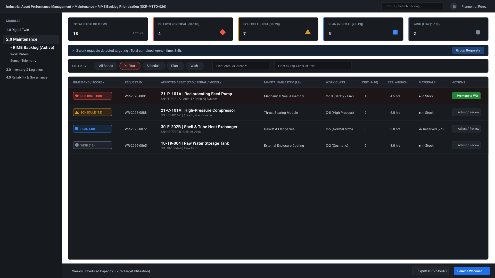
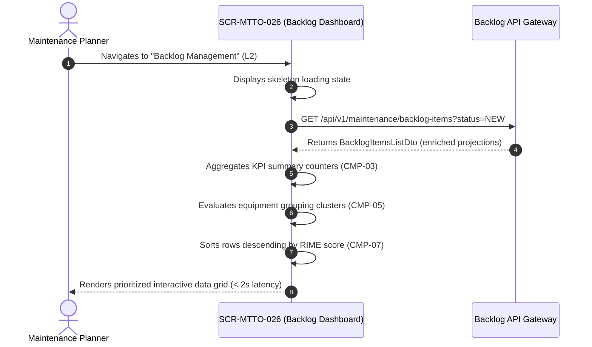
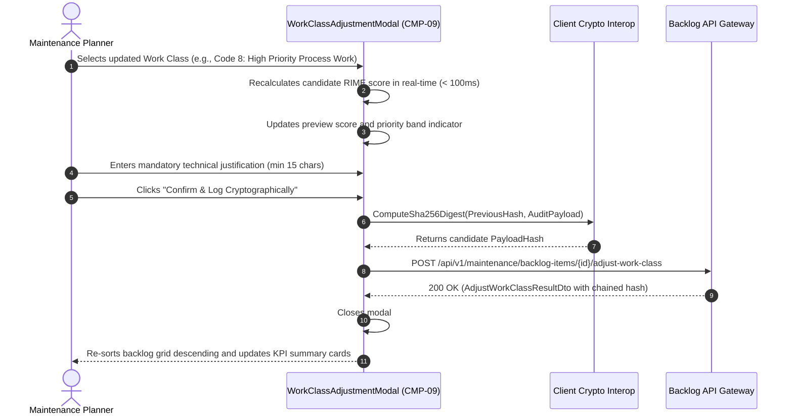

# SCR-MTTO-026: RIME Backlog Prioritization Dashboard

## 1. Purpose and Operational Context

* **View Objective:** Centralized supervisory dashboard for objective, quantitative prioritization of work requests in the maintenance backlog. Automatically assigns a standardized priority score by delegating calculation to the industrial RIME (Ranking Index for Maintenance Expenditure) prioritization strategy engine ([ADR-002](../../../architecture/adr/ADR-002.md)), combining static Asset Criticality ($1..10$) and Work Class weight ($1..10$) into an audited score ($1..100$). Eliminates subjective bias, enforces compliance with ISO 55001 (§6.2.2), and consolidates resource availability (labor hours and materials) to streamline weekly workload scheduling.
* **Primary Target Persona:** Maintenance Planner executing weekly workload distribution, reviewing incoming requests, adjusting work class classifications when operational conditions shift, and promoting prioritized backlog items into scheduled work orders.
* **Secondary Personas:**
  * **Maintenance Supervisor:** Reviews prioritized backlog, verifies labor availability, and approves emergency work overrides.
  * **Reliability Engineer:** Receives fail-safe notifications for assets lacking configured criticality, updates master data catalogs, and evaluates equipment failure grouping opportunities.
* **Operational Context:** Deployed in central maintenance engineering and planning control offices on high-resolution desktop workstations. Also accessible from portable industrial tablets in supervisory and reliability office environments.
* **Mode of Operation:** Supervisory Prioritization and Governance mode. Direct DCS/SCADA process control manipulation is strictly excluded. Actions focus on multi-criteria backlog sorting, work class adjustment with cryptographic audit trails, fail-safe mitigation, grouping recommendations, work order promotion ([SCR-MTTO-001](SCR-MTTO-001.md)), and sensor-based telemetry scheduling ([SCR-MTTO-023](SCR-MTTO-023.md)).
* **Web Portal Workspace Invariant:** Operates as a Level 2 supervisory portal view (ANSI/ISA-101 Level 2 per [DT-UI-NAV-DOC-001](../../DT-UI-NAV-DOC-001.md)) within the unified Blazor Web Portal shell. Features collapsible navigation, breadcrumb navigation, dense multi-column tabular data grids with column-level sorting, sticky KPI summary cards, and slide-over inspection drawers.

---

## 2. Visual Artifact



> *Note: Conceptual wireframe illustrating the Web Portal workstation layout, collapsible navigation sidebar, top breadcrumb header, summary KPI cards, advanced filter toolbar, grouping recommendation ribbon, and dense prioritized data grid.*

---

## 3. Functional Component Inventory

> The base layout, typography, and design tokens are inherited from [DT-UI-DS-DOC-001](../../DT-UI-DS-DOC-001.md). This table defines the present components, semantic tokens, and architectural roles. Detailed interaction rules, layout constraints, and responsive resolutions are strictly specified in Section 5 and Section 8.

| ID | Control / Component | Visual Role / Content | Semantic Token | Architectural Role & Reference |
| :--- | :--- | :--- | :--- | :--- |
| `CMP-01` | Web Portal Shell & Sidebar | Collapsible navigation sidebar | Surface: `--dt-color-surface-base`<br>Border: `--dt-color-border-subtle` | Hosts global module navigation (Digital Twin, Maintenance, Inventory, Governance per [DT-UI-NAV-DOC-001](../../DT-UI-NAV-DOC-001.md)). Highlights "Priorización de Backlog" as the active route. Responsive widths governed in Section 8. |
| `CMP-02` | Top Workstation Header | Breadcrumb trail, search, governance notifications, and user badge | Surface: `--dt-color-surface-card`<br>Border: `--dt-color-border-subtle` | Sticky header hosting breadcrumbs, quick search trigger (`Ctrl + K`), immutable audit log trigger, unconfigured criticality alert button (`CMP-06`), and standardized operator session badge. |
| `CMP-03` | KPI Summary Metric Cards | 5-card interactive filter & summary bar | Surface: `--dt-color-surface-card`<br>Border: `--dt-color-border-subtle`<br>Radius: `--dt-radius-md` | Displays aggregate counters across the 4 RIME priority bands plus total pending count. Serves as the sole interactive priority band filter for the data grid, preventing redundant filter chip rows. Detailed in §5.1. |
| `CMP-04` | Multi-Criteria Filter Toolbar | Dropdowns, search input, and inline grouping pill | Surface: `--dt-color-surface-card`<br>Border: `--dt-color-border-subtle` | Hosts Functional Location hierarchy dropdown, Work Class selector, live text search, and the inline equipment grouping suggestion pill (`CMP-05`) with zero vertical layout shift. Specification in §5.2. |
| `CMP-05` | Inline Grouping Suggestion Pill | Compact inline batching indicator | Surface: `--dt-color-surface-raised`<br>Border: `--dt-color-border-subtle`<br>Radius: `--dt-radius-md` | Compact pill embedded inside `CMP-04` deployed when multiple pending work requests target the same Level 6 Equipment Unit. Displays affected asset tag, count of pending requests, combined wrench time, and quick batch filter button. Workflow in §5.3.3. |
| `CMP-06` | Criticality Governance Alert Modal | Unconfigured asset notification & dispatch modal | Surface: `--dt-color-surface-overlay`<br>Border: `--dt-color-border-panel`<br>Elevation: `--dt-z-modal` | Triggered via the header warning indicator when work requests reference assets lacking configured criticality in the catalog. Informs that a preventive floor score was assigned, provides a "View Affected Request" filter action, and dispatches a calibration request to the Reliability Engineer. Workflow in §5.3.2. |
| `CMP-07` | Dense Prioritized Data Grid | Multi-column sortable table | Surface: `--dt-color-surface-base`<br>Border: `--dt-color-border-subtle`<br>Text: `--dt-color-text-body` | Virtualized tabular grid rendering prioritized backlog requests descending by RIME score. Columns: Priority Category & Score, Request ID, Affected Asset, Maintainable Item (L8), Description, Work Class, Asset Criticality, Est. Wrench Time / Material Status, and Actions (primary "Plan" button + compact `···` contextual menu). Specification in §5.2. |
| `CMP-08` | Priority Category Badges | High-contrast redundant status badges | Surface: `--dt-color-surface-raised`<br>Border: `--dt-color-border-panel`<br>Accents: `--dt-color-alarm-critical`, `--dt-color-alarm-warning`, `--dt-color-state-info`, `--dt-color-text-muted` | Four-tier visual categorization implementing ANSI/ISA-101 redundant coding (Shape + Color + Score + Label). Governed by Anti-Badge-Inflation Principle ([DT-UI-DS-DOC-001 §6.5](../../DT-UI-DS-DOC-001.md#65-status-badge-counter-discipline-anti-badge-inflation-principle)). Details in §5.1. |
| `CMP-09` | Work Class Adjustment Modal | Priority modification dialog | Surface: `--dt-color-surface-overlay`<br>Border: `--dt-color-border-panel`<br>Elevation: `--dt-z-modal` | Modal dialog for modifying Work Class. Displays current score, interactive Work Class selector, live recalculated RIME score, mandatory technical justification textarea, and cryptographic SHA-256 hash preview. Workflow in §5.3.1. |
| `CMP-10` | RIME Calculation Breakdown Modal | Educational factor inspection dialog | Surface: `--dt-color-surface-overlay`<br>Border: `--dt-color-border-panel`<br>Elevation: `--dt-z-modal` | Informational dialog decomposing the active RIME formula, active strategy, and normative standard citations. Specification in §5.3. |
| `CMP-11` | Chained Cryptographic Audit Drawer | Slide-over immutable audit log | Surface: `--dt-color-surface-drawer`<br>Border: `--dt-color-border-panel`<br>Elevation: `--dt-z-drawer-sidebar` | Lateral slide-over panel displaying the immutable append-only trail of priority modifications, displaying timestamps, user IDs, old vs. new scores, technical justifications, and linked SHA-256 hashes. |
| `CMP-12` | Workload Confirmation & Export Bar | Bottom sticky action bar | Surface: `--dt-color-surface-card`<br>Border: `--dt-color-border-subtle` | Bottom bar consolidating weekly selected man-hours vs. team capacity, centralizing data export options (`CSV` / `JSON` / `Selected`) and hosting the primary "Confirm Weekly Workload" action button. Workflow in §5.3.4. |

---

## 4. Screen State Matrix

| State | Visual Modification in the Interface | Activation Condition |
| :--- | :--- | :--- |
| **Normal (Default)** | Neutral grayscale surfaces. Full prioritized data grid populated descending by RIME score. Normal material availability states (`In Stock`, `Reserved`) rendered as subdued plain text without colored background pills. | Successful data fetch of pending work requests and asset master catalogs. |
| **Loading** | Table rows and KPI summary cards display animated skeleton shimmer (`--dt-color-surface-raised`). Action buttons disabled. | Initial page load or asynchronous execution of bulk filter / sort operations. |
| **Selected Row** | Target table row renders high-contrast focus border (`--dt-color-border-focus`, $2\text{px}$) and elevated background (`--dt-color-surface-raised`). | Planner clicks or uses keyboard navigation (`ArrowUp`/`ArrowDown`) on a table row. |
| **Priority Recalculation (AF-001)** | Modal overlay `CMP-09` appears with backdrop dimming (`--dt-z-modal`). Live recalculation badge updates in real-time ($<100\text{ms}$). Submit button disabled until valid justification is entered ($\ge 15$ characters). | Planner opens the row overflow menu (`···`) and selects "Adjust Work Class". |
| **Fail-Safe Active (AF-002)** | Header notification button in `CMP-02` displays amber warning indicator (`--dt-color-alarm-warning`) with counter badge. Affected row displays amber warning icon with tooltip: *"Criticality not configured on asset. Preventive priority floor applied (Score: 75)"*. | One or more pending work requests are linked to assets lacking criticality in the master catalog. |
| **Grouping Recommendation (FR-068)** | Compact inline pill `CMP-05` rendered inside the filter toolbar `CMP-04` with `#icon-layers`. Affected rows highlight with subtle accent border. Zero vertical displacement of the data grid. | Algorithmic detection of $\ge 2$ pending requests sharing the same Level 6 equipment unit. |
| **Filtered / Search Active** | Data grid displays matching subset with active KPI card highlighted via `--dt-color-border-focus`. | Planner clicks an interactive KPI card, selects a Functional Location filter, or types in the search field. |
| **Empty Backlog** | Data grid displays centered neutral empty state illustration (`#icon-check-circle`), title *"No Pending Work Requests"*, and subtitle *"All backlog items have been prioritized and promoted into scheduled work orders."* | Zero work requests in status `NEW` in the database. |

---

## 5. Interaction Rules and Data Flow

### 5.1. Initial Load & Lifecycle



1. **Initial Query:** On page initialization, the client dispatches a query to retrieve active backlog item projections for all work requests in `NEW` status, enriched with ISO 14224 Equipment Unit, Functional Location, and Maintainable Item metadata.
2. **Deterministic Calculation:** The system verifies that each backlog item reflects the deterministic calculation governed by the active strategy of the RIME prioritization engine ([ADR-002](../../../architecture/adr/ADR-002.md)). The default MVP two-factor formula computes:
   $$\text{Score} = C_{\text{asset}} \times W_{\text{class}}$$
   where $C_{\text{asset}} \in [1, 10]$ is retrieved from the asset catalog, and $W_{\text{class}} \in [1, 10]$ is the standardized weight of the selected Work Class.
3. **Priority Band Categorization:** Every row is mapped to its categorical band according to [NFR-061](../../../requirements/user-stories/mtto/MTTO-026.md#non-functional-requirements-nfr):
   * **Do First** ($80 \le \text{Score} \le 100$): Emergency Category. Redundant indicator: Red diamond ($\blacklozenge$, `--dt-color-alarm-critical`).
   * **Schedule** ($50 \le \text{Score} \le 79$): High Category. Redundant indicator: Amber triangle ($\blacktriangle$, `--dt-color-alarm-warning`).
   * **Plan** ($20 \le \text{Score} \le 49$): Normal Category. Redundant indicator: Blue square ($\blacksquare$, `--dt-color-state-info`).
   * **Wish** ($1 \le \text{Score} \le 19$): Low Category. Redundant indicator: Slate circle ($\bullet$, `--dt-color-text-muted`).
4. **Initial Ordering:** The data grid is deterministically sorted descending by `PriorityScore`. If two items share identical scores, tie-breaking sorts ascending by `RequestDate` (FIFO order).

---

### 5.2. Table Mechanics & Desktop Ergonomics

1. **Sorting Mechanics:** Clicking any column header toggles sorting: `Descending` $\to$ `Ascending` $\to$ `Reset to Default RIME Order`. Column headers indicate sort direction with canonical SVG chevron glyphs (`#icon-chevron-up`, `#icon-chevron-down`).
2. **Multi-Criteria Filtering:**
   * **Priority Band:** Interactive KPI summary cards (`CMP-03`) act directly as one-click band filters in-memory without server round-trip, eliminating duplicate filter chip rows in `CMP-04`.
   * **Functional Location Filter:** Hierarchical dropdown supporting filtering by Plant Level 3 (Installation), Level 4 (Plant/Area), or Level 5 (System).
   * **Work Class Filter:** Dropdown filtering by specific work classes (e.g., "Safety Emergency", "Predictive Maintenance").
   * **Fuzzy Text Search:** Debounced input ($300\text{ms}$) searching across `TagNumber`, `SerialNumber`, `Description`, and `MaintainableItem`.
3. **Row Action Hierarchy & Peripheral Noise Reduction:** To prevent visual clutter across dense data grids, each row displays only the primary action button (`Plan`) alongside a compact contextual overflow menu button (`···`) housing secondary analytical actions (`Adjust Work Class`, `Inspect RIME Breakdown`).
4. **Keyboard Navigation:**
   * `ArrowUp` / `ArrowDown`: Moves row selection through the table without mouse interaction.
   * `Enter`: Opens the selected row's action drawer or detail view.
   * `Ctrl + K`: Globally focuses the search input.
   * `Escape`: Closes any open modal dialog or slide-over drawer.
5. **Data Virtualization & Performance:** For backlog volumes exceeding $100$ items, the Blazor data grid employs UI virtualization (`Virtualize<BacklogItemDto>`), maintaining DOM node count $< 60$ and guaranteeing response times $< 2\text{s}$ for datasets up to $1,000$ items ([NFR-071](../../../requirements/user-stories/mtto/MTTO-026.md#non-functional-requirements-nfr)).

---

### 5.3. Domain Workflows & Prioritization Engine

#### 5.3.1. Work Class Modification & Dynamic Recalculation (AF-001)

When the Planner identifies that operational conditions warrant an adjusted priority:



1. **Trigger:** The Planner selects "Adjust Work Class" from the row's contextual overflow menu (`···`).
2. **Latency Requirement:** The UI recalculates the new RIME score in $< 100\text{ms}$ ([NFR-070](../../../requirements/user-stories/mtto/MTTO-026.md#non-functional-requirements-nfr)), dynamically updating the preview badge.
3. **Mandatory Justification:** The confirmation button remains disabled until the Planner enters a technical justification containing at least $15$ non-whitespace characters.
4. **Cryptographic Integrity Hash ([TR-001](../../../requirements/common/TR-001.md), [ADR-003](../../../architecture/adr/ADR-003.md)):** Upon confirmation, the client dispatches an `AdjustWorkClassCommand`. The backend system atomically commits the work class change, rescores the backlog item, and appends an immutable record into the audit trail:
   $$\text{PayloadHash} = \text{SHA-256}(\text{PreviousHash} \parallel \text{PlannerUserId} \parallel \text{WorkRequestId} \parallel \text{PreviousScore} \parallel \text{CalculatedScore} \parallel \text{TechnicalJustification} \parallel \text{TimestampUtc})$$
5. **Re-sorting:** The backlog grid automatically re-sorts descending, moving the modified request to its new objective position without page reload.

---

#### 5.3.2. Asset without Defined Criticality Fail-Safe Workflow (AF-002)

To prevent unconfigured equipment criticality from artificially burying a critical maintenance intervention:

1. **Fail-Safe Trigger:** When a work request references an equipment unit whose `AssetCriticality` is unconfigured in the master catalog.
2. **Pessimistic Floor Assignment:** The system overrides the multiplicative calculation and assigns a **minimum floor score of 75** (placing the item in the *Schedule / High Category* band), regardless of how low the selected Work Class weight is.
3. **Visual Highlighting:** The request row renders with an amber warning indicator in the criticality column (`sin-configurar (Piso: 75)`), and the top header notification button (`CMP-02`) displays an active warning badge without shifting the vertical layout of the data grid.
4. **Reliability Notification (`CMP-06`):** Clicking the header notification badge opens the Criticality Governance Dialog (`CMP-06`). From this dialog, the Planner can either click *"Filter Affected Request"* to isolate the unconfigured equipment row in the grid or click *"Dispatch Reliability Notification"* to send an automated governance task to the Reliability Engineer responsible for populating the asset's technical sheet.

---

#### 5.3.3. Equipment Grouping Recommendations (FR-068)

1. **Clustering Algorithm:** On data load, the system groups all pending requests by `EquipmentUnitId`.
2. **Threshold Rule:** When $\text{Count}(\text{requests}) \ge 2$ for the same physical equipment:
   * The Inline Grouping Pill `CMP-05` renders inside the right zone of the Filter Toolbar (`CMP-04`), preserving full vertical viewport height for the backlog grid.
   * Text specifies: *"Grouping: {Count} in {TagNumber} ({TotalHours} HH)"*.
   * Action button *"Filter Batch"* filters the data grid strictly to the affected asset, enabling the Planner to bundle interventions into a single planned shutdown or maintenance window.

---

#### 5.3.4. Workload Distribution Confirmation & Export (FR-069)

1. **Workload Confirmation ([UC-MTTO-026](../../../domain-models/use-cases/mtto/UC-MTTO-026.md) Step 7):** The bottom bar `CMP-12` tracks the cumulative estimated wrench hours of selected backlog items against the weekly team capacity. Clicking "Confirm Weekly Distribution" approves the selected items for scheduling, updating their status to `APPROVED` and transitioning authorized requests to Preventive Scheduling ([SCR-MTTO-001](SCR-MTTO-001.md)) or Predictive Scheduling ([SCR-MTTO-023](SCR-MTTO-023.md)).
2. **Data Portability ([FR-069](../../../requirements/user-stories/mtto/MTTO-026.md#functional-requirements-fr)):** Clicking the unified "Export Data" dropdown menu in `CMP-12` generates structured export packages (`CSV` or `JSON` for the full view or current selection) containing all prioritized metadata, factor breakdowns, asset serial numbers, and material availability flags for external reporting.

---

## 6. Industrial and Safety Considerations

* **ANSI/ISA-101 HPHMI Grayscale 90/10 Rule ([TR-011](../../../requirements/common/TR-011.md)):** The backlog dashboard utilizes a neutral, subdued grayscale background (`--dt-color-surface-base`, `--dt-color-surface-card`) to prevent cognitive fatigue during extended planning sessions. Saturated colors are strictly reserved for priority and shortage indicators:
  * Red (`--dt-color-alarm-critical`) is allocated exclusively to emergency **Do First** items ($80 - 100$) and out-of-stock material shortages (`OutOfStock`).
  * Amber (`--dt-color-alarm-warning`) is allocated to **Schedule** items ($50 - 79$), partial material availability (`PartiallyAvailable`), and fail-safe governance warnings.
  * Normal operational states—including `InStock` and `ReservedInWarehouse` material availability—render strictly as plain subdued text (`--dt-color-text-muted`) with zero green fills or decorative bullets, preventing visual competition with genuine priority alarms.
* **Redundant Visual Coding:** In strict compliance with accessibility and high-performance HMI principles, priority bands never rely solely on color. Every priority badge (`CMP-08`) combines:
  1. A distinctive geometric symbol ($\blacklozenge$, $\blacktriangle$, $\blacksquare$, $\bullet$).
  2. High-contrast semantic token color.
  3. Explicit numeric score ($1..100$) and text category label.
* **Status Badge & Counter Discipline (Anti-Badge-Inflation Principle per [DT-UI-DS-DOC-001 §6.5](../../DT-UI-DS-DOC-001.md#65-status-badge-counter-discipline-anti-badge-inflation-principle)):** Interactive status badges are strictly reserved for dynamic state lifecycle containers (`CMP-08`), shortage alerts, and interactive quantitative counters (`CMP-03`). Static metadata (such as user roles, work class descriptions, or equipment serials) and normal material availability states render strictly as structured plain text using subdued metadata typography (`--dt-color-text-muted`), preventing visual clutter and alarm desensitization.
* **Fail-Safe Principle ([ASR-002](../../../architecture/asr/DT-ARQ-ASR-001.md#2-real-time-loto-security-and-fail-safe), AF-002):** Lack of asset metadata is treated conservatively. Setting unconfigured assets to a priority floor of 75 ensures that missing technical data cannot lead to deferred maintenance on potentially hazardous or production-critical equipment.
* **Cryptographic Integrity & Segregation of Duties ([TR-001](../../../requirements/common/TR-001.md), [TR-006](../../../requirements/common/TR-006.md)):** Manual adjustment of priority parameters directly impacts equipment reliability and operational safety. All adjustments mandate technical justifications and are sealed in the immutable SHA-256 audit chain. The ability to modify priority order manually without changing Work Class is strictly restricted to authorized Maintenance Supervisors ([NFR-062](../../../requirements/user-stories/mtto/MTTO-026.md#non-functional-requirements-nfr)).

---

## 7. Frontend Component Contract (Blazor / Razor)

### 7.1. Component Hierarchy & File Mapping

```text
Pages/
└── RimeBacklogDashboardPage.razor                     # Root View (SCR-MTTO-026)
    ├── PortalSidebarNav.razor                         # CMP-01: Collapsible desktop navigation sidebar
    ├── BacklogHeaderBar.razor                         # CMP-02: Top breadcrumb, alert trigger, and user badge
    ├── BacklogSummaryCards.razor                      # CMP-03: 5-card interactive KPI filter summary
    ├── BacklogFilterToolbar.razor                     # CMP-04: Dropdowns, search, and inline grouping pill
    │   └── GroupingRecommendationPill.razor           # CMP-05: Inline equipment batching trigger
    ├── CriticalityGovernanceModal.razor               # CMP-06: AF-002 Unconfigured asset governance modal
    ├── PrioritizedBacklogGrid.razor                   # CMP-07: Dense virtualized tabular data grid
    │   ├── PriorityBandBadge.razor                    # CMP-08: Redundant category badge
    │   └── MaterialAvailabilityIndicator.razor        # HPHMI material availability text/shortage pill
    ├── WorkClassAdjustmentModal.razor                 # CMP-09: AF-001 Priority modification dialog
    ├── RimeBreakdownModal.razor                       # CMP-10: FR-066 Formula decomposition dialog
    ├── ChainedAuditLogDrawer.razor                    # CMP-11: Slide-over cryptographic audit drawer
    └── WorkloadConfirmationFooter.razor               # CMP-12: Sticky capacity footer and unified export menu
```

---

### 7.2. Physical Component Parameters & DTO Contracts (.NET 10 / C# 14)

#### 7.2.1. `RimeBacklogDashboardPage.razor` (Root View Parameter Contract)

```csharp
// Route & Query Parameters for RimeBacklogDashboardPage.razor (SCR-MTTO-026)
[Parameter, SupplyParameterFromQuery(Name = "loc")]
public string? SelectedFunctionalLocationTag { get; set; }

[Parameter, SupplyParameterFromQuery(Name = "band")]
public string? InitialBandFilter { get; set; }
```

#### 7.2.2. Subcomponent Parameter Contracts (`CMP-01` – `CMP-12`)

```csharp
// CMP-01: PortalSidebarNav.razor
[Parameter] public bool IsCollapsed { get; set; }
[Parameter] public string ActiveRouteId { get; set; } = "SCR-MTTO-026";
[Parameter] public EventCallback<bool> OnCollapseToggled { get; set; }

// CMP-02: BacklogHeaderBar.razor
[Parameter, EditorRequired] public string OperatorBadgeCode { get; set; } = default!;
[Parameter, EditorRequired] public string OperatorDisplayName { get; set; } = default!;
[Parameter] public int ActiveGovernanceAlertCount { get; set; }
[Parameter] public EventCallback OnOpenGovernanceAlertModal { get; set; }
[Parameter] public EventCallback OnToggleAuditDrawer { get; set; }

// CMP-03: BacklogSummaryCards.razor
[Parameter, EditorRequired] public BacklogSummaryMetricsDto Metrics { get; set; } = default!;
[Parameter] public RimePriorityBand? ActiveBandFilter { get; set; }
[Parameter] public EventCallback<RimePriorityBand?> OnBandFilterSelected { get; set; }

// CMP-04 & CMP-05: BacklogFilterToolbar.razor & GroupingRecommendationPill.razor
[Parameter] public string? SelectedLocationFilter { get; set; }
[Parameter] public WorkClassCode? SelectedWorkClassFilter { get; set; }
[Parameter] public string? SearchQuery { get; set; }
[Parameter] public EquipmentGroupingSuggestionDto? GroupingSuggestion { get; set; }
[Parameter] public EventCallback<string?> OnLocationFilterChanged { get; set; }
[Parameter] public EventCallback<WorkClassCode?> OnWorkClassFilterChanged { get; set; }
[Parameter] public EventCallback<string?> OnSearchQueryChanged { get; set; }
[Parameter] public EventCallback<string> OnApplyGroupingCluster { get; set; }
[Parameter] public EventCallback OnResetFilters { get; set; }

// CMP-06: CriticalityGovernanceModal.razor
[Parameter] public bool IsVisible { get; set; }
[Parameter] public BacklogItemDto? UnconfiguredItem { get; set; }
[Parameter] public EventCallback<string> OnFilterAffectedEquipment { get; set; }
[Parameter] public EventCallback<Guid> OnDispatchReliabilityNotification { get; set; }
[Parameter] public EventCallback OnClose { get; set; }

// CMP-07 & CMP-08: PrioritizedBacklogGrid.razor & PriorityBandBadge.razor
[Parameter, EditorRequired] public IReadOnlyList<BacklogItemDto> BacklogItems { get; set; } = [];
[Parameter] public IReadOnlySet<Guid> SelectedItemIds { get; set; } = new HashSet<Guid>();
[Parameter] public EventCallback<Guid> OnToggleRowSelection { get; set; }
[Parameter] public EventCallback<BacklogItemDto> OnAdjustWorkClassRequested { get; set; }
[Parameter] public EventCallback<BacklogItemDto> OnInspectBreakdownRequested { get; set; }
[Parameter] public EventCallback<BacklogItemDto> OnPromoteToWorkOrder { get; set; }

// CMP-09: WorkClassAdjustmentModal.razor
[Parameter] public BacklogItemDto? TargetItem { get; set; }
[Parameter] public bool IsVisible { get; set; }
[Parameter] public EventCallback<AdjustWorkClassCommand> OnConfirmed { get; set; }
[Parameter] public EventCallback OnCancelled { get; set; }

// CMP-10: RimeBreakdownModal.razor
[Parameter] public RimeCalculationBreakdownDto? Breakdown { get; set; }
[Parameter] public bool IsVisible { get; set; }
[Parameter] public EventCallback OnClose { get; set; }

// CMP-11: ChainedAuditLogDrawer.razor
[Parameter] public bool IsOpen { get; set; }
[Parameter, EditorRequired] public IReadOnlyList<ChainedAuditEntryDto> AuditEntries { get; set; } = [];
[Parameter] public EventCallback OnClose { get; set; }

// CMP-12: WorkloadConfirmationFooter.razor
[Parameter] public int SelectedCount { get; set; }
[Parameter] public decimal SelectedWrenchHours { get; set; }
[Parameter] public decimal WeeklyCapacityHours { get; set; } = 40.0m;
[Parameter] public EventCallback OnConfirmWeeklyDistribution { get; set; }
[Parameter] public EventCallback<BacklogExportFormat> OnExportRequested { get; set; }
```

#### 7.2.3. Data Transfer Objects (DTOs) & Commands

```csharp
public record BacklogItemDto(
    Guid Id,
    Guid WorkRequestId,
    Guid EquipmentUnitId,
    string WorkRequestNumber,
    string Description,
    string FunctionalLocationTag,
    string FunctionalLocationName,
    string EquipmentSerialNumber,
    string EquipmentModel,
    string MaintainableItemName,
    WorkClassCode WorkClass,
    int? AssetCriticality,
    int PriorityScore,
    RimePriorityBand PriorityBand,
    bool IsFailSafeApplied,
    decimal EstimatedWrenchHours,
    MaterialAvailabilityStatus MaterialStatus,
    DateTimeOffset RequestDate,
    string Status
);

public record BacklogSummaryMetricsDto(
    int TotalBacklogCount,
    decimal TotalEstimatedHours,
    int DoFirstCount,
    int ScheduleCount,
    int PlanCount,
    int WishCount
);

public record EquipmentGroupingSuggestionDto(
    Guid EquipmentUnitId,
    string FunctionalLocationTag,
    string EquipmentSerialNumber,
    int PendingRequestCount,
    decimal TotalEstimatedHours
);

public record ChainedAuditEntryDto(
    Guid AuditEntryId,
    DateTimeOffset TimestampUtc,
    string WorkRequestNumber,
    string FunctionalLocationTag,
    string OperatorBadgeCode,
    int PreviousScore,
    int NewScore,
    string TechnicalJustification,
    string PreviousHash,
    string PayloadHash
);

public enum RimePriorityBand
{
    DoFirst,    // 80 - 100
    Schedule,   // 50 - 79
    Plan,       // 20 - 49
    Wish        // 1 - 19
}

public enum WorkClassCode
{
    SafetyEnvironmentalEmergency = 10,
    ProductionShutdown = 9,
    HighPriorityProcess = 8,
    RegulatedPreventive = 7,
    SystematicPreventive = 6,
    PredictiveMaintenance = 5,
    NonCriticalCorrective = 4,
    EngineeringModification = 3,
    AestheticOrderCleanliness = 2,
    OperationalConvenience = 1
}

public enum MaterialAvailabilityStatus
{
    InStock,
    PartiallyAvailable,
    ReservedInWarehouse,
    OutOfStock
}

public enum BacklogExportFormat
{
    FullViewCsv,
    FullViewJson,
    SelectedItemsJson
}

public record AdjustWorkClassCommand(
    Guid WorkRequestId,
    WorkClassCode NewWorkClass,
    int CalculatedScore,
    string TechnicalJustification,
    string PlannerUserId,
    string PreviousHash
);

public record RimeCalculationBreakdownDto(
    Guid WorkRequestId,
    string ActiveStrategyName,
    int AssetCriticality,
    int WorkClassWeight,
    int RawScore,
    int FinalScore,
    bool IsFailSafeApplied,
    string ApplicableStandardReference
);
```

---

### 7.3. Client-Side DOM & Interop Bridge

1. **Virtualization Interop (`IVirtualizationInterop`):** Client-side viewport scroll measurement capability that lazily renders only visible table rows within the scrollable grid container, keeping UI response times under $100\text{ms}$ during high-density backlog scrolling.
2. **Real-Time Recalculation Bridge:** Client-side evaluation within the Work Class Adjustment Modal (`CMP-09`) that computes the candidate score instantaneously in WebAssembly without dispatching server roundtrips until final confirmation.
3. **Keyboard Shortcut Interop (`IKeyboardShortcutInterop`):** Focus and keybinding capability capturing `ArrowUp`, `ArrowDown`, `Ctrl+K`, and `Escape` events to support mouse-free desktop workstation operation.
4. **Cryptographic Digest Preview Interop (`ICryptoInterop`):** Client-side SHA-256 digest capability that computes the candidate `PayloadHash` in real time as the Planner enters the technical justification, providing immediate visual verification of the chained audit signature.

---

## 8. Layout and Responsive Adaptability

| Viewport / Breakpoint | Layout Organization | Ergonomic Rules |
| :--- | :--- | :--- |
| **Desktop Workstation**<br>($\ge 1920\text{px}$, `--dt-breakpoint-xl`) | Full workstation grid layout. Navigation sidebar expanded ($240\text{px}$); 5 summary KPI cards in a single row; 10-column data grid with all operational metadata visible without horizontal scrolling; slide-over audit drawer docks laterally (`--dt-layout-drawer-width-desktop`). | Optimized for mouse and keyboard navigation; row height $44\text{px}$; dense font sizing (`--dt-font-body-md`, $14\text{px}$); single-click row selection and compact contextual action menu (`···`). |
| **Compact Desktop / Tablet Landscape**<br>($1280\text{px} - 1919\text{px}$, `--dt-breakpoint-lg`) | Navigation sidebar collapses to icon-only rail ($64\text{px}$); KPI summary cards remain in a 5-column fluid row; inline grouping pill wraps cleanly inside the filter toolbar; modals render centered. | Touch and pointer targets comply with $\ge 44\text{px}$; horizontal table scroll prevented by compacting secondary description width. |
| **Tablet Portrait / Secondary Terminal**<br>($768\text{px} - 1279\text{px}$, `--dt-breakpoint-md`) | Sidebar hidden into off-canvas drawer; KPI summary cards wrap into a 2-row grid; data grid prioritizes 7 core operational columns; bottom sticky confirmation bar docks above system chrome. | Touch targets $\ge 48\times 48\text{px}$ with $\ge 8\text{px}$ spacing; action menus expand for touch ergonomics. |

---

## 9. Traceability and Requirements Matrix

| Requirement | Addressed in Component | Verification & Implementation Mechanism |
| :--- | :--- | :--- |
| [FR-058](../../../requirements/user-stories/mtto/MTTO-026.md#functional-requirements-fr) | `CMP-07`, `CMP-10` | Retrieves numerical asset criticality ($1..10$) from ISO 14224 Functional Location and Equipment Unit master records. |
| [FR-059](../../../requirements/user-stories/mtto/MTTO-026.md#functional-requirements-fr) | `CMP-07`, `CMP-09` | Mandates Work Class selection associating standardized numerical weight ($1..10$) per [DT-DM-DOC-001 §4.20](../../../domain-models/class/DT-DM-DOC-001.md#420-workrequestworkclasscode-work-class-rime). |
| [FR-060](../../../requirements/user-stories/mtto/MTTO-026.md#functional-requirements-fr) | `CMP-07`, `CMP-10` | Priority score calculated deterministically by delegating to active strategy of RIME prioritization engine ([ADR-002](../../../architecture/adr/ADR-002.md)). |
| [FR-065](../../../requirements/user-stories/mtto/MTTO-026.md#functional-requirements-fr) | `CMP-07` | Each row renders priority metadata, affected equipment unit, intervention type, estimated costs, and wrench hours. |
| [FR-066](../../../requirements/user-stories/mtto/MTTO-026.md#functional-requirements-fr) | `CMP-10` | RIME breakdown modal displays exact factor decomposition and cites ISO 55001 (§6.2.2) standards. |
| [FR-067](../../../requirements/user-stories/mtto/MTTO-026.md#functional-requirements-fr) | `CMP-04` | Advanced filtering capabilities by Priority Category, Functional Location hierarchy, Work Class, and dates. |
| [FR-068](../../../requirements/user-stories/mtto/MTTO-026.md#functional-requirements-fr) | `CMP-05` | Generates smart grouping recommendations when detecting $\ge 2$ pending interventions on the same physical equipment. |
| [FR-069](../../../requirements/user-stories/mtto/MTTO-026.md#functional-requirements-fr) | `CMP-12` | Export button outputs prioritized backlog in structured formats (`CSV` and `JSON`) for external analytics. |
| [FR-074](../../../requirements/user-stories/mtto/MTTO-026.md#functional-requirements-fr) | `CMP-07`, `CMP-10` | Deterministic calculation engine: identical criticality and work class inputs produce identical scores across the system. |
| [FR-075](../../../requirements/user-stories/mtto/MTTO-026.md#functional-requirements-fr) | `CMP-07` | Event-driven background recalculation upon changes to master asset criticality in catalog. |
| [FR-076](../../../requirements/user-stories/mtto/MTTO-026.md#functional-requirements-fr) | `CMP-02`, `CMP-09` | Significant category shifts (e.g., transition into "Do First") trigger event-driven pub-sub notifications to planners. |
| [NFR-061](../../../requirements/user-stories/mtto/MTTO-026.md#non-functional-requirements-nfr) | `CMP-03`, `CMP-08` | Classifies and visually differentiates requests into 4 priority bands with redundant shape and color coding. |
| [NFR-062](../../../requirements/user-stories/mtto/MTTO-026.md#non-functional-requirements-nfr) | `CMP-07` | Backlog organized strictly descending by RIME score; manual alteration restricted to authorized Supervisor roles. |
| [NFR-070](../../../requirements/user-stories/mtto/MTTO-026.md#non-functional-requirements-nfr) | `CMP-09` | Work Class priority recalculation in modal executes in $< 100\text{ms}$ in the user interface. |
| [NFR-071](../../../requirements/user-stories/mtto/MTTO-026.md#non-functional-requirements-nfr) | `CMP-07` | Virtualized data grid maintains response times $< 2\text{s}$ for datasets exceeding $500$ rows. |
| [NFR-072](../../../requirements/user-stories/mtto/MTTO-026.md#non-functional-requirements-nfr) | `CMP-10` | Prioritization strategy parameters versioned and protected against unauthorized tampering ([ADR-002](../../../architecture/adr/ADR-002.md)). |
| [NFR-073](../../../requirements/user-stories/mtto/MTTO-026.md#non-functional-requirements-nfr) | `CMP-07`, `CMP-08` | Visibility of technical priority scores restricted to authorized planning and reliability governance roles. |
| [TR-001](../../../requirements/common/TR-001.md) | `CMP-09`, `CMP-11` | Immutable append-only audit trail logging with SHA-256 hash chaining for all priority adjustments. |
| [TR-006](../../../requirements/common/TR-006.md) | `CMP-01`, `CMP-02` | Enforces RBAC permissions (`Maintenance Planner`, `Maintenance Supervisor`, `Reliability Engineer`). |
| [TR-011](../../../requirements/common/TR-011.md) | `CMP-01`..`CMP-12` | Strict adherence to ANSI/ISA-101 HPHMI: 90/10 neutral grayscale canvas, saturated color reserved for alarms/bands. |
| [ADR-002](../../../architecture/adr/ADR-002.md) | `CMP-07`, `CMP-10` | Encapsulates RIME calculation under Strategy Pattern (`IRimeCalculator`), decoupling domain entities. |
