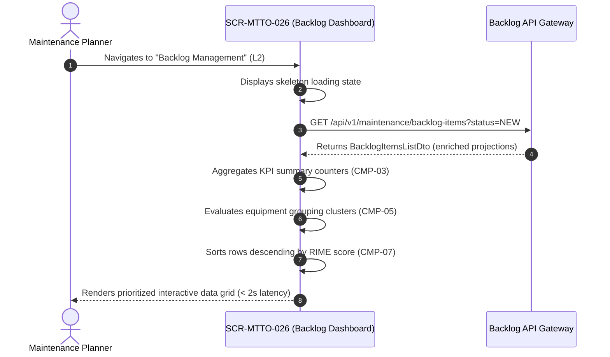
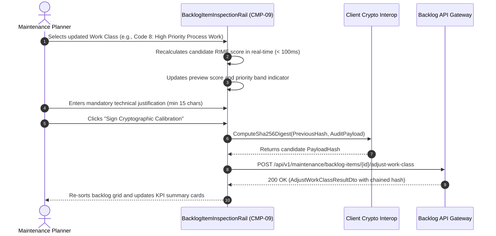

# SCR-MTTO-026: RIME Backlog Prioritization Dashboard

## 1. Purpose and Operational Context

* **View Objective:** Centralized supervisory dashboard for objective, quantitative prioritization of work requests in the maintenance backlog. Automatically assigns a standardized priority score by delegating calculation to the industrial RIME (Ranking Index for Maintenance Expenditure) prioritization strategy engine ([ADR-002](../../../architecture/adr/ADR-002.md)), combining static Asset Criticality ($1..10$) and Work Class weight ($1..10$) into an audited score ($1..100$). Eliminates subjective bias, enforces compliance with ISO 55001 Section 6.2.2, and consolidates resource availability (labor hours and materials) to streamline weekly workload scheduling.
* **Primary Target Persona:** Maintenance Planner executing weekly workload distribution, reviewing incoming requests, adjusting work class classifications when operational conditions shift, and promoting prioritized backlog items into scheduled work orders.
* **Secondary Personas:**
  * **Maintenance Supervisor:** Reviews prioritized backlog, verifies labor availability, and approves emergency work overrides.
  * **Reliability Engineer:** Receives fail-safe notifications for assets lacking configured criticality, updates master data catalogs, and evaluates equipment failure grouping opportunities.
* **Operational Context:** Deployed in central maintenance engineering and planning control offices on high-resolution desktop workstations. Also accessible from portable industrial tablets in supervisory and reliability office environments.
* **Mode of Operation:** Supervisory Prioritization and Governance mode. Direct DCS/SCADA process control manipulation is strictly excluded. Actions focus on multi-criteria backlog sorting, work class adjustment with cryptographic audit trails, fail-safe mitigation, grouping recommendations, work order promotion ([SCR-MTTO-001](SCR-MTTO-001.md)), and sensor-based telemetry scheduling ([SCR-MTTO-023](SCR-MTTO-023.md)).
* **Web Portal Workspace Invariant:** Operates as a Level 2 supervisory portal view (ANSI/ISA-101 Level 2 per [DT-UI-NAV-DOC-001](../../DT-UI-NAV-DOC-001.md)) within the unified Blazor Web Portal shell. Features collapsible navigation, breadcrumb navigation, dense multi-column tabular data grids with column-level sorting, sticky KPI summary cards, and persistent right dock inspection panels (`CMP-13` hosting `CMP-09` and `CMP-11`).

---

## 2. Visual Artifact


> *Note: Production UI prototype capture illustrating the Archetype C desktop workstation layout, collapsible navigation sidebar, interactive KPI summary cards, flat multi-criteria filter toolbar with inline grouping trigger, dense prioritized data grid with locked column dimensions, persistent right dock with Blender N-panel-inspired vertical tabs, and sticky workload confirmation footer.*

---

## 3. Functional Component Inventory

> The base grid, typography, neutral palettes, and minimal tactile contact areas are inherited from [DT-UI-DS-DOC-001](../../DT-UI-DS-DOC-001.md). This inventory defines the canonical components present on the screen, their design tokens, and their architectural scope. Interaction rules and geometric algorithms are specified in Section 5; responsive container adaptations are governed by Section 8.

1. **`CMP-01`: Web Portal Shell & Sidebar**
   - **Visual Role:** Collapsible navigation sidebar hosting global modules, module hierarchy, and route markers.
   - **Design Tokens:**
     - Surface: `--dt-color-surface-base`
     - Border: `--dt-color-border-subtle`
     - Width: `--dt-layout-sidebar-width-expanded` (Desktop) / `--dt-layout-sidebar-width-collapsed` (Tablet Landscape)
   - **Architectural Scope:** Hosts global module navigation (Digital Twin, Maintenance, Inventory, Governance per [DT-UI-NAV-DOC-001](../../DT-UI-NAV-DOC-001.md)). Highlights "Backlog Prioritization" as the active route. Responsive widths governed in Section 8.

2. **`CMP-02`: Top Workstation Header**
   - **Visual Role:** Sticky workstation header hosting breadcrumbs, quick search trigger (`Ctrl + K`), unconfigured criticality alert button (`CMP-06`), and operator session badge.
   - **Design Tokens:**
     - Surface: `--dt-color-surface-card`
     - Border: `--dt-color-border-subtle`
     - Elevation: `--dt-z-header-sticky`
   - **Architectural Scope:** Top navigation bar managing global shortcut routing, session presence, and the unconfigured asset governance alert entry point. Detailed in §5.2.

3. **`CMP-03`: KPI Summary Metric Cards**
   - **Visual Role:** 5-card interactive filter and summary bar displaying aggregate counters across the 4 RIME priority bands plus total pending requests.
   - **Design Tokens:**
     - Surface: `--dt-color-surface-card`
     - Border: `--dt-color-border-subtle`
     - Radius: `--dt-radius-md`
     - Focus Ring: `--dt-color-state-info`
   - **Architectural Scope:** Serves as the primary one-click priority band filter for the data grid, preventing redundant filter chip rows per [DT-UI-DS-DOC-001 §6.5](../../DT-UI-DS-DOC-001.md#65-status-badge-counter-discipline-anti-badge-inflation-principle). Detailed in §5.1.

4. **`CMP-04`: Multi-Criteria Filter Toolbar**
   - **Visual Role:** Flat canvas toolbar hosting Functional Location hierarchy dropdown, Work Class selector, debounced text search, and the inline equipment grouping suggestion pill (`CMP-05`).
   - **Design Tokens:**
     - Surface: `--dt-color-surface-base`
     - Controls: `--dt-color-surface-card`
     - Border: `--dt-color-border-subtle`
     - Radius: `--dt-radius-sm`
   - **Architectural Scope:** Primary multi-criteria filter controller operating directly on the canvas without outer box nesting or vertical layout shift. Detailed in §5.2.

5. **`CMP-05`: Inline Grouping Suggestion Pill**
   - **Visual Role:** Compact inline batching indicator deployed when multiple pending work requests target the same Level 6 Equipment Unit.
   - **Design Tokens:**
     - Surface: `--dt-color-surface-card`
     - Border: `--dt-color-border-subtle`
     - Radius: `--dt-radius-md`
     - Accent: `--dt-color-state-info`
   - **Architectural Scope:** Intelligent grouping indicator rendered within `CMP-04` using flat inline text dividers (`|`) to display affected asset tag, request count, combined wrench hours, and one-click batch filter action ([FR-068](../../../requirements/user-stories/mtto/MTTO-026.md#functional-requirements-fr)). Detailed in §5.3.3.

6. **`CMP-06`: Criticality Governance Alert Modal**
   - **Visual Role:** Fail-safe modal dialog triggered when work requests reference equipment units lacking configured criticality in the catalog.
   - **Design Tokens:**
     - Surface: `--dt-color-surface-overlay`
     - Border: `--dt-color-border-panel`
     - Width & Max-Height: `--dt-layout-modal-width`, `--dt-layout-modal-max-height`
     - Radius: `--dt-radius-xl`
     - Elevation: `--dt-z-modal`
     - Warning Accent: `--dt-color-alarm-warning`
   - **Architectural Scope:** Governance interlock modal providing affected request filtering and automated notification dispatch to the Reliability Engineer (`AF-002`). Detailed in §5.3.2.

7. **`CMP-07`: Dense Prioritized Data Grid**
   - **Visual Role:** Virtualized multi-column tabular grid rendering prioritized backlog requests descending by RIME score across 9 operational columns.
   - **Design Tokens:**
     - Header Surface: `--dt-color-surface-base`
     - Row Surface: `--dt-color-surface-card`
     - Border: `--dt-color-border-subtle`
     - Row Height: `--dt-layout-table-row-height`
     - Selection Indicator: `--dt-color-state-info`
   - **Architectural Scope:** Core backlog management grid virtualized for large datasets ([NFR-071](../../../requirements/user-stories/mtto/MTTO-026.md#non-functional-requirements-nfr)). Direct row clicking triggers inspection in `CMP-09`, eliminating redundant per-row action buttons. Detailed in §5.2.

8. **`CMP-08`: Priority Category Badges**
   - **Visual Role:** High-contrast redundant capsule pills combining geometric symbol, semantic color, numeric score, and category label.
   - **Design Tokens:**
     - Surface: `--dt-color-surface-base`
     - Radius: `--dt-radius-full`
     - Critical Accent: `--dt-color-alarm-critical`
     - Warning Accent: `--dt-color-alarm-warning`
     - Body Text: `--dt-color-text-body`
     - Muted Text: `--dt-color-text-muted`
   - **Architectural Scope:** Four-tier visual categorization implementing ANSI/ISA-101 redundant coding per [DT-UI-DS-DOC-001 §6.5.1](../../DT-UI-DS-DOC-001.md#651-morphological-differentiation-status-badges-vs-interactive-buttons). Detailed in §5.1.

9. **`CMP-09`: Contextual Request Inspection & Calibration Rail**
   - **Visual Role:** Lateral inspection rail hosted in the workspace dock featuring request facts, embedded RIME decomposition (`CMP-10`), Work Class recalibration selector, justification textarea, and cryptographic sign action.
   - **Design Tokens:**
     - Surface: `--dt-color-surface-card`
     - Border: `--dt-color-border-subtle`
     - Primary Action: `--dt-color-state-info`
   - **Architectural Scope:** Lateral master-detail pane hosted within `CMP-13` supporting side-by-side comparison without modal blindness or horizontal layout shift. Detailed in §5.2 and §5.3.1.

10. **`CMP-10`: RIME Factor Decomposition Panel**
    - **Visual Role:** Inline technical card hosted inside `CMP-09` displaying the multiplicative Criticality $\times$ Work Class formula, ISO 55001 Section 6.2.2 compliance note, and fail-safe floor status.
    - **Design Tokens:**
      - Surface: `--dt-color-surface-base`
      - Border: `--dt-color-border-subtle`
      - Typography: `--dt-font-mono-data`
    - **Architectural Scope:** Mathematical and normative audit breakdown card ([FR-066](../../../requirements/user-stories/mtto/MTTO-026.md#functional-requirements-fr)). Detailed in §5.1 and §5.3.1.

11. **`CMP-11`: Chained Cryptographic Audit Pane**
    - **Visual Role:** Integrated immutable audit log tab pane displaying chronological priority calibrations, timestamps, operator IDs, justifications, and SHA-256 integrity seals.
    - **Design Tokens:**
      - Surface: `--dt-color-surface-card`
      - Border: `--dt-color-border-subtle`
      - Hash Typography: `--dt-font-mono-data`
    - **Architectural Scope:** Append-only cryptographic ledger tab hosted in `CMP-13` ([TR-001](../../../requirements/common/TR-001.md), [ADR-003](../../../architecture/adr/ADR-003.md)). Detailed in §5.2 and §5.3.1.

12. **`CMP-12`: Workload Confirmation & Export Bar**
    - **Visual Role:** Sticky bottom action bar tracking cumulative selected man-hours vs. weekly team capacity, hosting export triggers and the primary confirmation button.
    - **Design Tokens:**
      - Surface: `--dt-color-surface-card`
      - Border: `--dt-color-border-subtle`
      - Height: `--dt-layout-footer-height`
      - Elevation: `--dt-z-header-sticky`
      - Primary CTA: `--dt-color-state-info`
    - **Architectural Scope:** Workload consolidation and data export controller ([FR-069](../../../requirements/user-stories/mtto/MTTO-026.md#functional-requirements-fr), [UC-MTTO-026 §3](../../../domain-models/use-cases/mtto/UC-MTTO-026.md#3-main-flow)). Detailed in §5.3.4.

13. **`CMP-13`: Persistent Workspace Dock & Tab Strip**
    - **Visual Role:** Lateral dock container with vertical pill tabs oriented along the lateral spine (Blender N-panel pattern), hosting `CMP-09` and `CMP-11`.
    - **Design Tokens:**
      - Track Surface: `--dt-color-surface-base`
      - Panel Surface: `--dt-color-surface-card`
      - Active Tab: `--dt-color-surface-raised`
      - Elevation: `--dt-shadow-panel`
      - Indicator: `--dt-color-state-info`
      - Radius: `--dt-radius-md`
    - **Architectural Scope:** Persistent lateral workspace dock preserving table selection across tab swaps without horizontal layout shift. Detailed in §5.2 and Section 8.

---

## 4. Screen State Catalog

1. **Normal / Default**
   - **Activation Condition:** Successful data retrieval of pending work requests and asset master records.
   - **Visual Modification:** Neutral grayscale surfaces. Prioritized data grid populated descending by RIME score. Routine `PLAN` ($20-49$) and `WISH` ($1-19$) bands and normal material availability states (`IN_STOCK`, `RESERVED_IN_WAREHOUSE`) render in neutral grayscale without chromatic fills.

2. **Loading / Shimmer**
   - **Activation Condition:** Initial page load or asynchronous execution of bulk filter / sort operations.
   - **Visual Modification:** Table rows and KPI summary cards display animated skeleton shimmer (`--dt-color-surface-raised`). Action buttons disabled.

3. **Selected Row**
   - **Activation Condition:** Planner selects a row checkbox or navigates with `ArrowUp` / `ArrowDown`.
   - **Visual Modification:** Target row renders a high-contrast left selection indicator bar (`--dt-color-state-info`) and subtle selection background tint. Workload confirmation bar (`CMP-12`) updates selected hour counters.

4. **Detail Inspection State**
   - **Activation Condition:** Planner clicks any point within a backlog row or uses keyboard navigation.
   - **Visual Modification:** Inspection rail `CMP-09` displays inside persistent right dock `CMP-13` alongside the prioritized grid. Main canvas body reserves dock padding dynamically, preventing horizontal layout shift. Selected row displays inspection outline; embedded `CMP-10` and Work Class calibration selector are active.

5. **Cryptographic Audit State**
   - **Activation Condition:** Planner clicks the *SHA-256 Audit* vertical tab in `CMP-13`.
   - **Visual Modification:** The dock switches pane content to `CMP-11`, rendering the chained SHA-256 audit ledger without closing the dock or clearing row selections in `CMP-07`.

6. **Priority Recalculation (AF-001)**
   - **Activation Condition:** Planner modifies the Work Class selector in `CMP-09`.
   - **Visual Modification:** Inspection rail updates the preview RIME score and category badge in real-time ($< 100\text{ms}$). The confirmation CTA remains disabled until valid justification is entered ($\ge 15$ characters).

7. **Fail-Safe Active (AF-002)**
   - **Activation Condition:** One or more pending work requests reference equipment units lacking configured criticality in the catalog.
   - **Visual Modification:** Header notification button in `CMP-02` displays amber warning indicator (`--dt-color-alarm-warning`) with counter badge. Affected row displays amber warning icon with tooltip: *"Criticality not configured on asset. Preventive priority floor applied (Score: 75)"*.

8. **Grouping Recommendation (FR-068)**
   - **Activation Condition:** Algorithmic detection of $\ge 2$ pending requests sharing the same Level 6 equipment unit.
   - **Visual Modification:** Compact inline pill `CMP-05` renders inside filter toolbar `CMP-04` with `#icon-layers`. Affected rows highlight with subtle accent border. Zero vertical displacement of the data grid.

9. **Filtered / Search Active**
   - **Activation Condition:** Planner clicks an interactive KPI card, selects a Functional Location filter, or types in the debounced search input.
   - **Visual Modification:** Data grid renders matching subset with the active KPI filter card highlighted via `--dt-color-state-info` focus border. Zero matching records displays empty filter message.

10. **Empty Backlog**
    - **Activation Condition:** Zero work requests in `NEW` status in the database.
    - **Visual Modification:** Data grid displays centered neutral empty state illustration (`#icon-check-circle`), title *"No Pending Work Requests"*, and subtitle *"All backlog items have been prioritized and promoted into scheduled work orders."*

---

## 5. Interaction Rules and Data Flow

### 5.1. Initial Load & Lifecycle



1. **Initial Query:** On page initialization, the client dispatches a query to retrieve active backlog item projections for all work requests in `NEW` status, enriched with ISO 14224 Equipment Unit, Functional Location, and Maintainable Item metadata.
2. **Deterministic Calculation:** The system verifies that each backlog item reflects the deterministic calculation governed by the active strategy of the RIME prioritization engine ([ADR-002](../../../architecture/adr/ADR-002.md)). The default MVP two-factor formula computes:
   $$\text{Score} = C_{\text{asset}} \times W_{\text{class}}$$
   where $C_{\text{asset}} \in [1, 10]$ is retrieved from the asset catalog, and $W_{\text{class}} \in [1, 10]$ is the standardized weight of the selected Work Class.
3. **Priority Band Categorization:** Every row is mapped to its categorical band according to [NFR-061](../../../requirements/user-stories/mtto/MTTO-026.md#non-functional-requirements-nfr):
   * **Do First** ($80 \le \text{Score} \le 100$): Emergency Category. Redundant indicator: Red diamond ($\blacklozenge$, `--dt-color-alarm-critical`).
   * **Schedule** ($50 \le \text{Score} \le 79$): High Category. Redundant indicator: Amber triangle ($\blacktriangle$, `--dt-color-alarm-warning`).
   * **Plan** ($20 \le \text{Score} \le 49$): Normal Category. Redundant indicator: Neutral steel square ($\blacksquare$, `--dt-color-text-body`, border `--dt-color-border-panel`).
   * **Wish** ($1 \le \text{Score} \le 19$): Low Category. Redundant indicator: Subdued slate circle ($\bullet$, `--dt-color-text-muted`, border `--dt-color-border-subtle`).
4. **Initial Ordering:** The data grid is deterministically sorted descending by `PriorityScore`. If two items share identical scores, tie-breaking sorts ascending by `RequestDate` (FIFO order).

---

### 5.2. Table Mechanics & Desktop Ergonomics

1. **Sorting Mechanics:** Clicking any column header toggles sorting: `Descending` $\to$ `Ascending` $\to$ `Reset to Default RIME Order`. Column headers retain neutral primary text (`--dt-color-text-primary`) and indicate sort direction via the neutral chevron glyph (`#icon-chevron-up`, `#icon-chevron-down`), preventing non-functional chromatic noise.
2. **Multi-Criteria Filtering:**
   * **Priority Band:** Interactive KPI summary cards (`CMP-03`) act directly as one-click band filters in-memory without server round-trip, eliminating duplicate filter chip rows in `CMP-04`.
   * **Functional Location Filter:** Hierarchical dropdown supporting filtering by Plant Level 3 (Installation), Level 4 (Plant/Area), or Level 5 (System).
   * **Work Class Filter:** Dropdown filtering by specific work classes (e.g., "Safety Emergency", "Predictive Maintenance").
   * **Fuzzy Text Search:** Debounced input ($300\text{ms}$) searching across `TagNumber`, `SerialNumber`, `Description`, and `MaintainableItem`.
3. **Master-Detail Inspection:** Clicking any point within a row selects and inspects the request in the right dock (`CMP-09`). The primary "Plan Request" promotion action is situated in the inspection rail header, removing the redundant "Actions" column from the table grid and keeping the 9-column technical data canvas clear and uncluttered.
4. **Keyboard Navigation:**
   * `ArrowUp` / `ArrowDown`: Moves row selection through the table without mouse interaction.
   * `Enter`: Selects and inspects the focused backlog row in the right dock (`CMP-09`).
   * `Ctrl + K`: Globally focuses the search input.
   * `Escape`: Closes the active dock panel or open governance alert modal.
5. **Asymmetric Workstation Split & Zero Layout Shift:** At desktop widths, the prioritized backlog canvas is paired with the persistent right dock container (`CMP-13`, governed by `--dt-layout-drawer-width-desktop`). To prevent horizontal layout shift or table width collapse, the canvas body reserves dock padding, ensuring seamless inspection without modal blindness or horizontal scrollbars.
6. **Persistent Vertical Tab Dock (Blender N-panel Pattern):** The right dock features vertical pill tabs oriented along the lateral spine with left-rounded geometry (`--dt-radius-md`). The surface hierarchy follows a three-tier depth: dark track canvas (`--dt-color-surface-base`), intermediate dock panel (`--dt-color-surface-card`), and elevated active pill tab (`--dt-color-surface-raised`) with an inset active indicator bar (`--dt-color-state-info`). Tab state is persistent: clicking the active tab keeps the panel open without accidental collapse; switching between *Request Detail* (`CMP-09`) and *SHA-256 Audit* (`CMP-11`) swaps the pane content instantaneously while preserving selected rows in the table.
7. **Data Virtualization & Performance:** For backlog volumes exceeding $100$ items, the Blazor data grid employs UI virtualization (`Virtualize<BacklogItemDto>`), maintaining DOM node count $< 60$ and guaranteeing response times $< 2\text{s}$ for datasets up to $1,000$ items ([NFR-071](../../../requirements/user-stories/mtto/MTTO-026.md#non-functional-requirements-nfr)).

---

### 5.3. Domain Workflows & Prioritization Engine

#### 5.3.1. Work Class Modification & Dynamic Recalculation (AF-001)

When the Planner identifies that operational conditions warrant an adjusted priority:



1. **Trigger:** The Planner clicks a backlog row; the right dock opens with `CMP-09` displaying the selected request.
2. **Latency Requirement:** The UI recalculates the new RIME score in $< 100\text{ms}$ ([NFR-070](../../../requirements/user-stories/mtto/MTTO-026.md#non-functional-requirements-nfr)), dynamically updating the preview badge.
3. **Mandatory Justification:** The confirmation button remains disabled until the Planner enters a technical justification containing at least $15$ non-whitespace characters.
4. **Cryptographic Integrity Hash ([TR-001](../../../requirements/common/TR-001.md), [ADR-003](../../../architecture/adr/ADR-003.md)):** Upon confirmation, the client dispatches an `AdjustWorkClassCommand`. The backend system atomically commits the work class change, rescores the backlog item, and appends an immutable record into the audit trail:
   $$\text{PayloadHash} = \text{SHA-256}(\text{PreviousHash} \parallel \text{PlannerUserId} \parallel \text{WorkRequestId} \parallel \text{PreviousScore} \parallel \text{CalculatedScore} \parallel \text{TechnicalJustification} \parallel \text{TimestampUtc})$$
5. **Re-sorting:** The backlog grid automatically re-sorts descending, moving the modified request to its new objective position without page reload.

---

#### 5.3.2. Asset without Defined Criticality Fail-Safe Workflow (AF-002)

To prevent unconfigured equipment criticality from artificially burying a critical maintenance intervention:

1. **Fail-Safe Trigger:** When a work request references an equipment unit whose `AssetCriticality` is unconfigured in the master catalog.
2. **Pessimistic Floor Assignment:** The system overrides the multiplicative calculation and assigns a **minimum floor score of 75** (placing the item in the *Schedule / High Category* band), regardless of how low the selected Work Class weight is.
3. **Visual Highlighting:** The request row renders with an amber warning indicator in the criticality column (`Unconfigured / Floor: 75`), and the top header notification button (`CMP-02`) displays an active warning badge without shifting the vertical layout of the data grid.
4. **Reliability Notification (`CMP-06`):** Clicking the header notification badge opens the Criticality Governance Dialog (`CMP-06`). From this dialog, the Planner can either click *"Filter Affected Request"* to isolate the unconfigured equipment row in the grid or click *"Dispatch Reliability Notification"* to send an automated governance task to the Reliability Engineer responsible for populating the asset's technical sheet.

---

#### 5.3.3. Equipment Grouping Recommendations (FR-068)

1. **Clustering Algorithm:** On data load, the system groups all pending requests by `EquipmentUnitId`.
2. **Threshold Rule:** When $\text{Count}(\text{requests}) \ge 2$ for the same physical equipment:
   * The Inline Grouping Pill `CMP-05` renders inside the right zone of the Filter Toolbar (`CMP-04`), preserving full vertical viewport height for the backlog grid.
   * Text specifies: *"Suggested Batch: {Count} in {TagNumber} ({TotalHours} HH)"*.
   * Action link *"Filter Batch"* filters the data grid strictly to the affected asset, enabling the Planner to bundle interventions into a single planned shutdown or maintenance window.

---

#### 5.3.4. Workload Distribution Confirmation & Export (FR-069)

1. **Workload Confirmation ([UC-MTTO-026 §3](../../../domain-models/use-cases/mtto/UC-MTTO-026.md#3-main-flow)):** The bottom bar `CMP-12` tracks the cumulative estimated wrench hours of selected backlog items against the weekly team capacity. Clicking "Confirm Weekly Distribution" approves the selected items for scheduling, updating their status to `APPROVED` and transitioning authorized requests to Preventive Scheduling ([SCR-MTTO-001](SCR-MTTO-001.md)) or Predictive Scheduling ([SCR-MTTO-023](SCR-MTTO-023.md)).
2. **Data Portability ([FR-069](../../../requirements/user-stories/mtto/MTTO-026.md#functional-requirements-fr)):** Clicking the unified "Export Data" dropdown menu in `CMP-12` generates structured export packages (`CSV` or `JSON` for the full view or current selection) containing all prioritized metadata, factor breakdowns, asset serial numbers, and material availability flags for external reporting.

---

## 6. Industrial and Safety Considerations

* **Fail-Safe Unconfigured Criticality Floor (`AF-002` / [ADR-002](../../../architecture/adr/ADR-002.md)):** Missing asset criticality metadata in the master catalog is treated conservatively as a potential safety and production risk. Assigning a pessimistic priority floor of `75` (*Schedule / High* band) prevents unconfigured equipment from being buried at the bottom of the backlog while alerting the Reliability Engineer via `CMP-06` (§5.3.2).
* **Cryptographic Integrity & Segregation of Duties ([NFR-062](../../../requirements/user-stories/mtto/MTTO-026.md#non-functional-requirements-nfr), [TR-001](../../../requirements/common/TR-001.md), [TR-006](../../../requirements/common/TR-006.md)):** Manual Work Class recalibrations directly alter maintenance scheduling order and require a mandatory technical justification ($\ge 15$ characters) sealed into the append-only SHA-256 hash chain (`CMP-11`). Direct manual reordering without Work Class justification is restricted by RBAC to authorized Maintenance Supervisors.
* **HPHMI Salience & Anti-Badge-Inflation Governance ([TR-011](../../../requirements/common/TR-011.md)):** In accordance with [DT-UI-DS-DOC-001 §1](../../DT-UI-DS-DOC-001.md#1-scope) and [§6.5](../../DT-UI-DS-DOC-001.md#65-status-badge-counter-discipline-anti-badge-inflation-principle), routine priority bands (`PLAN`, `WISH`) and normal material availability states (`IN_STOCK`, `RESERVED_IN_WAREHOUSE`) render in subdued neutral grayscale without chromatic fills, reserving `--dt-color-alarm-critical` (`DO_FIRST`, `OUT_OF_STOCK`) and `--dt-color-alarm-warning` (`SCHEDULE`, `PARTIALLY_AVAILABLE`, `AF-002` floor) strictly for actionable exceptions (§5.1).

---

## 7. Frontend Component Contract (Blazor / Razor)

### 7.1. Component Hierarchy & File Mapping

```text
Pages/
└── RimeBacklogDashboardPage.razor                     # Root View (SCR-MTTO-026)
    ├── PortalSidebarNav.razor                         # CMP-01: Collapsible desktop navigation sidebar
    ├── BacklogHeaderBar.razor                         # CMP-02: Top breadcrumb, alert trigger, and user badge
    ├── BacklogSummaryCards.razor                      # CMP-03: 5-card interactive KPI filter summary
    ├── BacklogFilterToolbar.razor                     # CMP-04: Dropdowns, search, and inline grouping pill
    │   └── GroupingRecommendationPill.razor           # CMP-05: Inline equipment batching trigger
    ├── CriticalityGovernanceModal.razor               # CMP-06: AF-002 Unconfigured asset governance modal
    ├── PrioritizedBacklogGrid.razor                   # CMP-07: Dense virtualized tabular data grid (9 columns)
    │   ├── PriorityBandBadge.razor                    # CMP-08: Redundant category badge
    │   └── MaterialAvailabilityIndicator.razor        # HPHMI material availability text/shortage pill
    ├── BacklogWorkspaceDock.razor                     # CMP-13: Workspace dock container with vertical tab strip
    │   ├── BacklogItemInspectionRail.razor            # CMP-09: Contextual request inspection, promotion & calibration rail
    │   │   └── RimeBreakdownCard.razor                # CMP-10: FR-066 embedded factor decomposition
    │   └── ChainedAuditLogPane.razor                  # CMP-11: Integrated cryptographic audit trail tab pane
    └── WorkloadConfirmationFooter.razor               # CMP-12: Sticky capacity footer and unified export menu
```

---

### 7.2. Physical Component Parameters & DTO Contracts (.NET 10 / C# 14)

#### 7.2.1. `RimeBacklogDashboardPage.razor` (Root View Parameter Contract)

```csharp
// Route & Query Parameters for RimeBacklogDashboardPage.razor (SCR-MTTO-026)
[Parameter, SupplyParameterFromQuery(Name = "loc")]
public string? SelectedFunctionalLocationTag { get; set; }

[Parameter, SupplyParameterFromQuery(Name = "band")]
public string? InitialBandFilter { get; set; }
```

#### 7.2.2. Subcomponent Parameter Contracts (`CMP-01` – `CMP-13`)

```csharp
// CMP-01: PortalSidebarNav.razor
[Parameter]
public bool IsCollapsed { get; set; }

[Parameter]
public string ActiveRouteCode { get; set; } = "SCR-MTTO-026";

[Parameter]
public EventCallback<bool> OnCollapseToggled { get; set; }

// CMP-02: BacklogHeaderBar.razor
[Parameter]
public required string OperatorBadgeCode { get; set; }

[Parameter]
public required string OperatorDisplayName { get; set; }

[Parameter]
public int ActiveGovernanceAlertCount { get; set; }

[Parameter]
public EventCallback OnOpenGovernanceAlertModal { get; set; }

// CMP-03: BacklogSummaryCards.razor
[Parameter]
public required BacklogSummaryMetricsDto Metrics { get; set; }

[Parameter]
public RimePriorityBand? ActiveBandFilter { get; set; }

[Parameter]
public EventCallback<RimePriorityBand?> OnBandFilterSelected { get; set; }

// CMP-04: BacklogFilterToolbar.razor
[Parameter]
public string? SelectedLocationFilter { get; set; }

[Parameter]
public WorkClassCode? SelectedWorkClassFilter { get; set; }

[Parameter]
public string? SearchQuery { get; set; }

[Parameter]
public EquipmentGroupingSuggestionDto? GroupingSuggestion { get; set; }

[Parameter]
public EventCallback<string?> OnLocationFilterChanged { get; set; }

[Parameter]
public EventCallback<WorkClassCode?> OnWorkClassFilterChanged { get; set; }

[Parameter]
public EventCallback<string?> OnSearchQueryChanged { get; set; }

[Parameter]
public EventCallback<string> OnApplyGroupingCluster { get; set; }

[Parameter]
public EventCallback OnDismissGroupingSuggestion { get; set; }

[Parameter]
public EventCallback OnResetFilters { get; set; }

// CMP-05: GroupingRecommendationPill.razor
[Parameter]
public required EquipmentGroupingSuggestionDto Suggestion { get; set; }

[Parameter]
public EventCallback<string> OnFilterClusterClicked { get; set; }

[Parameter]
public EventCallback OnDismissClicked { get; set; }

// CMP-06: CriticalityGovernanceModal.razor
[Parameter]
public bool IsVisible { get; set; }

[Parameter]
public IReadOnlyList<BacklogItemDto> UnconfiguredItems { get; set; } = [];

[Parameter]
public EventCallback<string> OnFilterAffectedEquipment { get; set; }

[Parameter]
public EventCallback<Guid> OnDispatchReliabilityNotification { get; set; }

[Parameter]
public EventCallback OnClose { get; set; }

// CMP-07: PrioritizedBacklogGrid.razor
[Parameter]
public required IReadOnlyList<BacklogItemDto> BacklogItems { get; set; }

[Parameter]
public IReadOnlySet<Guid> SelectedItemIds { get; set; } = new HashSet<Guid>();

[Parameter]
public Guid? InspectedItemId { get; set; }

[Parameter]
public EventCallback<Guid> OnToggleRowSelection { get; set; }

[Parameter]
public EventCallback<BacklogItemDto> OnInspectRowRequested { get; set; }

// CMP-08: PriorityBandBadge.razor
[Parameter]
public required int PriorityScore { get; set; }

[Parameter]
public required RimePriorityBand Band { get; set; }

// MaterialAvailabilityIndicator.razor
[Parameter]
public required decimal EstimatedWrenchHours { get; set; }

[Parameter]
public required MaterialAvailabilityStatus MaterialStatus { get; set; }

// CMP-13: BacklogWorkspaceDock.razor
[Parameter]
public bool IsOpen { get; set; }

[Parameter]
public BacklogDockTab ActiveTab { get; set; } = BacklogDockTab.DETAIL;

[Parameter]
public EventCallback<BacklogDockTab> OnTabChanged { get; set; }

[Parameter]
public EventCallback OnClosed { get; set; }

// CMP-09: BacklogItemInspectionRail.razor
[Parameter]
public BacklogItemDto? TargetItem { get; set; }

[Parameter]
public RimeCalculationBreakdownDto? Breakdown { get; set; }

[Parameter]
public EventCallback<AdjustWorkClassCommand> OnConfirmed { get; set; }

[Parameter]
public EventCallback<Guid> OnPromoteToPreventivePlan { get; set; }

[Parameter]
public EventCallback<Guid> OnScheduleBySensorRequested { get; set; }

// CMP-10: RimeBreakdownCard.razor
[Parameter]
public required RimeCalculationBreakdownDto Breakdown { get; set; }

// CMP-11: ChainedAuditLogPane.razor
[Parameter]
public required IReadOnlyList<ChainedAuditEntryDto> AuditEntries { get; set; }

// CMP-12: WorkloadConfirmationFooter.razor
[Parameter]
public int SelectedCount { get; set; }

[Parameter]
public decimal SelectedWrenchHours { get; set; }

[Parameter]
public decimal WeeklyCapacityHours { get; set; } = 40.0m;

[Parameter]
public EventCallback OnConfirmWeeklyDistribution { get; set; }

[Parameter]
public EventCallback<BacklogExportFormat> OnExportRequested { get; set; }
```

#### 7.2.3. Data Transfer Objects (DTOs) & Commands

```csharp
public record BacklogItemDto
{
    public required Guid Id { get; init; }
    public required Guid WorkRequestId { get; init; }
    public required Guid EquipmentUnitId { get; init; }
    public required Guid FunctionalLocationId { get; init; }
    public required string WorkRequestNumber { get; init; }
    public required string Description { get; init; }
    public required string FunctionalLocationTag { get; init; }
    public required string FunctionalLocationName { get; init; }
    public required string EquipmentTag { get; init; }
    public required string EquipmentSerialNumber { get; init; }
    public required string EquipmentClass { get; init; }
    public required string MaintainableItemName { get; init; }
    public required WorkClassCode WorkClass { get; init; }
    public int? AssetCriticality { get; init; }
    public required int PriorityScore { get; init; }
    public required RimePriorityBand PriorityBand { get; init; }
    public bool IsFailSafeApplied { get; init; }
    public required decimal EstimatedWrenchHours { get; init; }
    public required decimal EstimatedCost { get; init; }
    public required MaterialAvailabilityStatus MaterialStatus { get; init; }
    public required DateTimeOffset RequestDate { get; init; }
    public required BacklogItemStatus Status { get; init; }
}

public record BacklogSummaryMetricsDto
{
    public required int TotalBacklogCount { get; init; }
    public required decimal TotalEstimatedHours { get; init; }
    public required int DoFirstCount { get; init; }
    public required int ScheduleCount { get; init; }
    public required int PlanCount { get; init; }
    public required int WishCount { get; init; }
}

public record EquipmentGroupingSuggestionDto
{
    public required Guid EquipmentUnitId { get; init; }
    public required Guid FunctionalLocationId { get; init; }
    public required string FunctionalLocationTag { get; init; }
    public required string EquipmentTag { get; init; }
    public required string EquipmentSerialNumber { get; init; }
    public required int PendingRequestCount { get; init; }
    public required decimal TotalEstimatedHours { get; init; }
}

public record ChainedAuditEntryDto
{
    public required Guid AuditEntryId { get; init; }
    public required DateTimeOffset TimestampUtc { get; init; }
    public required string WorkRequestNumber { get; init; }
    public required string FunctionalLocationTag { get; init; }
    public required string OperatorBadgeCode { get; init; }
    public required int PreviousScore { get; init; }
    public required int NewScore { get; init; }
    public required string TechnicalJustification { get; init; }
    public required string PreviousHash { get; init; }
    public required string PayloadHash { get; init; }
}

public record AdjustWorkClassCommand
{
    public required Guid WorkRequestId { get; init; }
    public required WorkClassCode NewWorkClass { get; init; }
    public required int CalculatedScore { get; init; }
    public required string TechnicalJustification { get; init; }
    public required Guid PlannerUserId { get; init; }
    public required string PreviousHash { get; init; }
}

public record RimeCalculationBreakdownDto
{
    public required Guid WorkRequestId { get; init; }
    public required string ActiveStrategyName { get; init; }
    public required int AssetCriticality { get; init; }
    public required int WorkClassWeight { get; init; }
    public required int RawScore { get; init; }
    public required int FinalScore { get; init; }
    public bool IsFailSafeApplied { get; init; }
    public required string ApplicableStandardReference { get; init; }
}

/// <summary>
/// Controlled backlog prioritization lifecycle vocabulary per DT-DM-DOC-001 §4.8.
/// </summary>
public enum BacklogItemStatus
{
    PENDING,
    READY,
    DEFERRED
}

/// <summary>
/// Standardized 4-tier RIME priority bands per NFR-061.
/// </summary>
public enum RimePriorityBand
{
    DO_FIRST,   // 80 - 100
    SCHEDULE,   // 50 - 79
    PLAN,       // 20 - 49
    WISH        // 1 - 19
}

/// <summary>
/// Controlled RIME Work Class weights (1..10) per DT-DM-DOC-001 §4.24.
/// </summary>
public enum WorkClassCode
{
    SAFETY_ENVIRONMENTAL_EMERGENCY = 10,
    PRODUCTION_SHUTDOWN = 9,
    HIGH_PRIORITY_PROCESS = 8,
    REGULATED_PREVENTIVE = 7,
    SYSTEMATIC_PREVENTIVE = 6,
    PREDICTIVE_MAINTENANCE = 5,
    NON_CRITICAL_CORRECTIVE = 4,
    ENGINEERING_MODIFICATION = 3,
    AESTHETIC_ORDER_CLEANLINESS = 2,
    OPERATIONAL_CONVENIENCE = 1
}

/// <summary>
/// Consolidated warehouse spare part availability status for backlog planning.
/// </summary>
public enum MaterialAvailabilityStatus
{
    IN_STOCK,
    RESERVED_IN_WAREHOUSE,
    PARTIALLY_AVAILABLE,
    OUT_OF_STOCK
}

public enum BacklogExportFormat
{
    FULL_VIEW_CSV,
    FULL_VIEW_JSON,
    SELECTED_ITEMS_JSON
}

public enum BacklogDockTab
{
    DETAIL,
    AUDIT
}
```

---

### 7.3. Client-Side DOM & Interop Bridge

1. **Virtualization Interop (`IVirtualizationInterop`):** Client-side viewport scroll measurement capability that lazily renders only visible table rows within the scrollable grid container, keeping UI response times under $100\text{ms}$ during high-density backlog scrolling.
2. **Real-Time Recalculation Bridge:** Client-side evaluation within the Work Class Inspection & Calibration Rail (`CMP-09`) that computes the candidate score instantaneously in WebAssembly without dispatching server roundtrips until final confirmation.
3. **Keyboard Shortcut Interop (`IKeyboardShortcutInterop`):** Focus and keybinding capability capturing `ArrowUp`, `ArrowDown`, `Ctrl+K`, and `Escape` events to support mouse-free desktop workstation operation.
4. **Cryptographic Digest Preview Interop (`ICryptoInterop`):** Client-side SHA-256 digest capability that computes the candidate `PayloadHash` in real time as the Planner enters the technical justification, providing immediate visual verification of the chained audit signature.

---

## 8. Layout and Responsive Adaptability

### 8.1. Desktop Workstation (`--dt-breakpoint-xl`)
* **Layout Organization:** Asymmetric 3-column workstation split ([DT-UI-DS-DOC-001 §2.3](../../DT-UI-DS-DOC-001.md#23-responsive-breakpoints-and-reference-frames)): left navigation sidebar `CMP-01` expanded at `--dt-layout-sidebar-width-expanded`, central prioritized data grid `CMP-07` with 5 summary KPI cards `CMP-03` in a single row, and persistent right workspace dock `CMP-13` sized by `--dt-layout-drawer-width-desktop` with zero horizontal layout shift. Sticky workload footer `CMP-12` (`--dt-layout-footer-height`) spans the bottom workspace.
* **Ergonomic Rules:** Optimized for mouse and keyboard navigation; dense table row height governed by `--dt-layout-table-row-height`; single-click row inspection and side-by-side comparison without modal blindness; persistent vertical pill tabs on the lateral dock spine.

### 8.2. Industrial Tablet Landscape (`--dt-breakpoint-lg`)
* **Layout Organization:** Navigation sidebar `CMP-01` collapses to an icon-only rail sized by `--dt-layout-sidebar-width-collapsed`; workspace dock `CMP-13` operates as a collapsible slide-over lateral panel sized by `--dt-layout-drawer-width-tablet` (`--dt-shadow-panel`); KPI summary cards `CMP-03` remain in a fluid horizontal strip; inline grouping pill `CMP-05` wraps cleanly within `CMP-04`.
* **Ergonomic Rules:** Compact toolbar filter controls adhere to `--dt-control-height-sm` on desktop pointers and expand interactive hit areas to `--dt-touch-target-mobile` on touch tablets; horizontal table scroll preserves column legibility.

### 8.3. Industrial Tablet Portrait (`--dt-breakpoint-md`)
* **Layout Organization:** Navigation sidebar `CMP-01` transitions to an off-canvas drawer; KPI summary cards `CMP-03` wrap into a multi-row grid; workspace dock `CMP-13` transitions to an adaptive bottom sheet initializing at `--dt-layout-bottom-sheet-height-initial` and expanding up to `--dt-layout-bottom-sheet-height-expanded` with a header tab switcher; data grid `CMP-07` prioritizes core operational columns.
* **Ergonomic Rules:** Touch targets governed by `--dt-touch-target-mobile` with `--dt-space-2` separation; discrete tap switching on the bottom-sheet handle ([DT-UI-DS-DOC-001 §6.3](../../DT-UI-DS-DOC-001.md#63-sliding-containers-pattern-bottom-sheets-and-drawers)); row inspection remains non-blocking.

---

## 9. Traceability and Requirements Matrix

| Requirement | Addressed in Component | Verification & Implementation Mechanism |
| :--- | :--- | :--- |
| [FR-058](../../../requirements/user-stories/mtto/MTTO-026.md#functional-requirements-fr) | `CMP-07`, `CMP-10` | Retrieves numerical asset criticality ($1..10$) from ISO 14224 Functional Location and Equipment Unit master records. |
| [FR-059](../../../requirements/user-stories/mtto/MTTO-026.md#functional-requirements-fr) | `CMP-07`, `CMP-09` | Mandates Work Class selection associating standardized numerical weight ($1..10$) per [DT-DM-DOC-001 §4.24](../../../domain-models/class/DT-DM-DOC-001.md#424-workrequestworkclasscode-work-class-rime). |
| [FR-060](../../../requirements/user-stories/mtto/MTTO-026.md#functional-requirements-fr) | `CMP-07`, `CMP-10` | Priority score calculated deterministically by delegating to active strategy of RIME prioritization engine ([ADR-002](../../../architecture/adr/ADR-002.md)). |
| [FR-065](../../../requirements/user-stories/mtto/MTTO-026.md#functional-requirements-fr) | `CMP-07` | Each row renders priority metadata, affected equipment unit, intervention type, estimated costs, and wrench hours. |
| [FR-066](../../../requirements/user-stories/mtto/MTTO-026.md#functional-requirements-fr) | `CMP-10` | RIME factor breakdown card in `CMP-09` displays exact factor decomposition and cites ISO 55001 Section 6.2.2 standards. |
| [FR-067](../../../requirements/user-stories/mtto/MTTO-026.md#functional-requirements-fr) | `CMP-04` | Advanced filtering capabilities by Priority Category, Functional Location hierarchy, Work Class, and dates. |
| [FR-068](../../../requirements/user-stories/mtto/MTTO-026.md#functional-requirements-fr) | `CMP-05` | Generates smart grouping recommendations when detecting $\ge 2$ pending interventions on the same physical equipment. |
| [FR-069](../../../requirements/user-stories/mtto/MTTO-026.md#functional-requirements-fr) | `CMP-12` | Export button outputs prioritized backlog in structured formats (`CSV` and `JSON`) for external analytics. |
| [FR-074](../../../requirements/user-stories/mtto/MTTO-026.md#functional-requirements-fr) | `CMP-07`, `CMP-10` | Deterministic calculation engine: identical criticality and work class inputs produce identical scores across the system. |
| [FR-075](../../../requirements/user-stories/mtto/MTTO-026.md#functional-requirements-fr) | `CMP-07` | Event-driven background recalculation upon changes to master asset criticality in catalog. |
| [FR-076](../../../requirements/user-stories/mtto/MTTO-026.md#functional-requirements-fr) | `CMP-02`, `CMP-09` | Significant category shifts (e.g., transition into "Do First") trigger event-driven pub-sub notifications to planners. |
| [NFR-061](../../../requirements/user-stories/mtto/MTTO-026.md#non-functional-requirements-nfr) | `CMP-03`, `CMP-08` | Classifies and visually differentiates requests into 4 priority bands with redundant shape and color coding. |
| [NFR-062](../../../requirements/user-stories/mtto/MTTO-026.md#non-functional-requirements-nfr) | `CMP-07` | Backlog organized strictly descending by RIME score; manual alteration restricted to authorized Supervisor roles. |
| [NFR-070](../../../requirements/user-stories/mtto/MTTO-026.md#non-functional-requirements-nfr) | `CMP-09` | Work Class priority recalculation in `CMP-09` executes in $< 100\text{ms}$ in the user interface. |
| [NFR-071](../../../requirements/user-stories/mtto/MTTO-026.md#non-functional-requirements-nfr) | `CMP-07` | Virtualized data grid maintains response times $< 2\text{s}$ for datasets exceeding $500$ rows. |
| [NFR-072](../../../requirements/user-stories/mtto/MTTO-026.md#non-functional-requirements-nfr) | `CMP-10` | Prioritization strategy parameters versioned and protected against unauthorized tampering ([ADR-002](../../../architecture/adr/ADR-002.md)). |
| [NFR-073](../../../requirements/user-stories/mtto/MTTO-026.md#non-functional-requirements-nfr) | `CMP-07`, `CMP-08` | Visibility of technical priority scores restricted to authorized planning and reliability governance roles. |
| [TR-001](../../../requirements/common/TR-001.md) | `CMP-09`, `CMP-11` | Immutable append-only audit trail logging with SHA-256 hash chaining for all Work Class priority adjustments. |
| [TR-005](../../../requirements/common/TR-005.md) | `CMP-07`, `CMP-09`, `CMP-11` | Enforces TLS/HTTPS encryption in transit across all backlog queries, priority recalibration commands, and audit log reads. |
| [TR-006](../../../requirements/common/TR-006.md) | `CMP-01`, `CMP-02`, `CMP-09` | Enforces RBAC permissions (`Maintenance Planner`, `Maintenance Supervisor`, `Reliability Engineer`) and Supervisor-only manual order locks (`NFR-062`). |
| [TR-008](../../../requirements/common/TR-008.md) | `CMP-04`, `CMP-07`, `CMP-09` | Enforces ISO 14224 hierarchical integrity across Functional Location filters (`Levels 1 to 5`), `EquipmentUnit` (`Level 6`), and `MaintainableItem` (`Level 8`). |
| [TR-011](../../../requirements/common/TR-011.md) | `CMP-01`..`CMP-13` | Strict adherence to ANSI/ISA-101 HPHMI: 90/10 neutral grayscale canvas, saturated color reserved for alarms/bands. |
| [ADR-002](../../../architecture/adr/ADR-002.md) | `CMP-07`, `CMP-10` | Encapsulates deterministic RIME calculation and fail-safe floor (`75`) under Strategy Pattern (`IRimeCalculator`). |
| [ADR-003](../../../architecture/adr/ADR-003.md) | `CMP-09`, `CMP-11` | Tamper-evident cryptographic SHA-256 hash chaining (`PreviousHash` $\to$ `PayloadHash`) on priority calibration records. |
