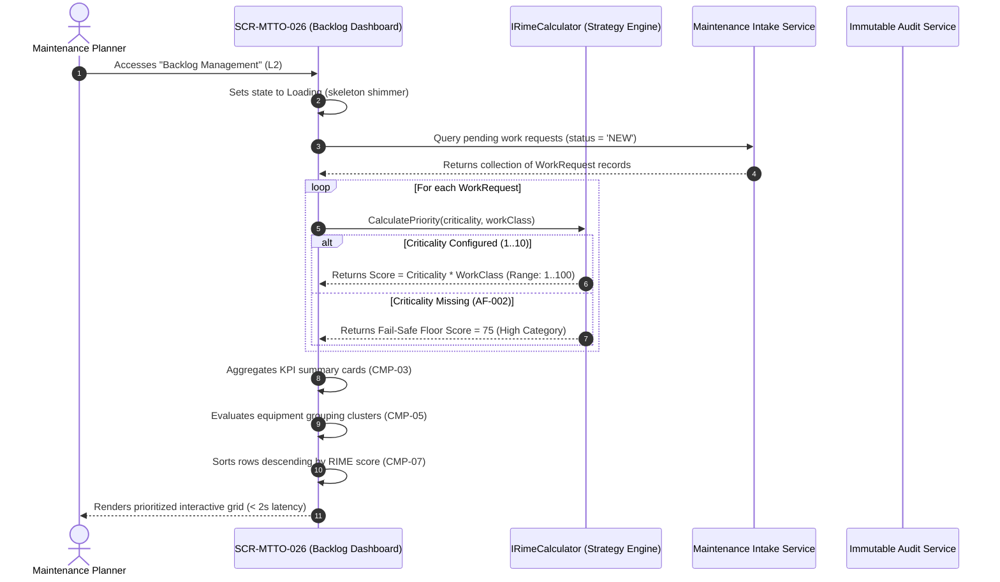
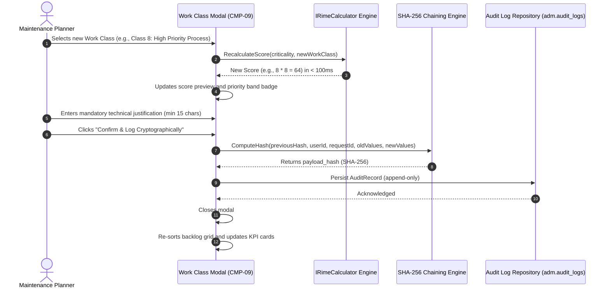

# SCR-MTTO-026: RIME Backlog Prioritization Dashboard

## 1. Purpose and Operational Context

* **View Objective:** Centralized supervisory dashboard for objective, quantitative prioritization of work requests in the maintenance backlog. Automatically assigns a standardized priority score by delegating the calculation to the industrial RIME (Ranking Index for Maintenance Expenditure) strategy engine (`IRimeCalculator`, [[ADR-002]]), combining Asset Criticality ($1..10$) and Work Class weight ($1..10$) into an audited score ($1..100$). Eliminates subjective bias, enforces compliance with ISO 55001 (§6.2.2), and consolidates resource availability (labor hours and materials) to streamline weekly workload scheduling.
* **Primary Target Persona:** Maintenance Planner executing weekly workload distribution, reviewing incoming requests, adjusting work class classifications when operational conditions shift, and promoting prioritized backlog items into scheduled work orders.
* **Secondary Personas:**
  * **Maintenance Supervisor:** Reviews prioritized backlog, verifies labor availability, and approves emergency work overrides.
  * **Reliability Engineer:** Receives fail-safe notifications for assets lacking configured criticality, updates master data catalogs, and evaluates equipment failure grouping opportunities.
* **Operational Context:** Deployed in central maintenance engineering and planning control offices on desktop workstations ($\ge 1400\text{px}$, `--dt-breakpoint-xl`). Also accessible from industrial tablets in supervisory office environments (`--dt-breakpoint-lg`).
* **Mode of Operation:** Supervisory Prioritization and Governance mode. Direct DCS/SCADA process control manipulation is strictly excluded. Actions focus on multi-criteria backlog sorting, work class adjustment with cryptographic audit trails, fail-safe mitigation, grouping recommendations, work order promotion (`SCR-MTTO-001`), and sensor-based telemetry scheduling (`SCR-MTTO-023`).
* **Web Portal Workspace Invariant:** Operates as a Level 2 supervisory portal view (ANSI/ISA-101 Level 2 per [[DT-UI-NAV-DOC-001]]) within the unified Blazor Web Portal shell. Features collapsible navigation, breadcrumb navigation, dense multi-column tabular data grids with column-level sorting, sticky KPI summary cards, and slide-over inspection drawers.

---

## 2. Visual Artifact

![[SCR-MTTO-026-wireframe.svg]]

> *Note: Conceptual wireframe illustrating the Web Portal workstation layout, collapsible navigation sidebar, top breadcrumb header, summary KPI cards, advanced filter toolbar, grouping recommendation ribbon, and dense prioritized data grid.*

---

## 3. Functional Component Inventory

> The base layout, typography, and design tokens are inherited from [[DT-UI-DS-DOC-001]]. This table defines the present components, semantic tokens, and architectural roles. Detailed interaction rules, layout constraints, and geometric algorithms are strictly specified in Section 5.

| ID | Control / Component | Visual Role / Content | Semantic Token | Architectural Role & Reference |
| :--- | :--- | :--- | :--- | :--- |
| `CMP-01` | Web Portal Shell & Sidebar | Collapsible navigation sidebar | Surface: `--dt-color-surface-base`<br>Border: `--dt-color-border-subtle` | Hosts global module navigation (1.0 Digital Twin, 2.0 Maintenance, 3.0 Inventory, 4.0 Governance per [[DT-UI-NAV-DOC-001]]). Highlights "2.0 Maintenance / RIME Backlog" as the active route. Width: $240\text{px}$ expanded, $64\text{px}$ collapsed. |
| `CMP-02` | Top Workstation Header | Breadcrumb trail, search, and user profile | Surface: `--dt-color-surface-card`<br>Border: `--dt-color-border-subtle` | Sticky header ($48\text{px}$ height) hosting breadcrumbs (`Maintenance > Backlog Management > RIME Prioritization Dashboard`), quick search trigger (`Ctrl + K`), notification bell with fail-safe indicator, and authenticated Planner session badge. |
| `CMP-03` | KPI Summary Metric Cards | 5-card operational summary bar | Surface: `--dt-color-surface-card`<br>Border: `--dt-color-border-subtle`<br>Radius: `--dt-radius-md` | Displays aggregate counters: Total Pending, Do First [80-100], Schedule [50-79], Plan [20-49], and Wish [1-19]. Acts as one-click quick filters for the data grid. Detailed in §5.1. |
| `CMP-04` | Multi-Criteria Filter Toolbar | Filter chips, dropdowns, and search input | Surface: `--dt-color-surface-card`<br>Border: `--dt-color-border-subtle` | Hosts Priority Band chips, Functional Location hierarchy dropdown, Work Class selector, live text search (Tag, Serial, Description), and view toggles. Specification in §5.2. |
| `CMP-05` | Grouping Recommendation Ribbon | Smart bundling alert ribbon | Surface: `--dt-color-surface-raised`<br>Border: `--dt-color-state-info`<br>Radius: `--dt-radius-md` | Dynamic banner deployed when multiple pending work requests target the same Level 6 Equipment Unit (`FR-068`). Displays affected asset tag, count of pending requests, combined wrench time, and "Bundle Requests" action button. Workflow in §5.3. |
| `CMP-06` | Criticality Fail-Safe Notice Ribbon | Safety floor alert banner | Surface: `--dt-color-surface-raised`<br>Border: `--dt-color-alarm-warning`<br>Radius: `--dt-radius-md` | Deployed when work requests reference assets lacking configured criticality in the catalog (`AF-002`). Informs that a preventive floor score of 75 was assigned, and provides a direct "Notify Reliability Engineer" dispatch button. Workflow in §5.3. |
| `CMP-07` | Dense Prioritized Data Grid | Multi-column sortable table | Surface: `--dt-color-surface-base`<br>Border: `--dt-color-border-subtle`<br>Text: `--dt-color-text-body` | Virtualized tabular grid rendering prioritized backlog requests descending by RIME score. Columns: Priority Category & Score, Request ID, Affected Asset (Tag, Serial Number, Model), Maintainable Item (L8), Description, Work Class, Asset Criticality, Est. Wrench Time, Material Availability, and Actions. Specification in §5.2. |
| `CMP-08` | Priority Category Badges | High-contrast redundant status badges | Badge Surfaces: Dynamic per band<br>Border: Dynamic per band | Four-tier visual categorization implementing ANSI/ISA-101 and [[TR-011]] redundant coding (Shape + Color): Do First ($\blacklozenge$, Red), Schedule ($\blacktriangle$, Amber), Plan ($\blacksquare$, Blue), Wish ($\bullet$, Slate). Details in §5.1. |
| `CMP-09` | Work Class Adjustment Modal | Priority modification dialog | Surface: `--dt-color-surface-overlay`<br>Border: `--dt-color-border-panel`<br>Elevation: `--dt-z-modal` ($1000$) | Modal dialog for modifying Work Class (`AF-001`). Displays current score, interactive Work Class selector ($1..10$), live recalculated RIME score ($<100\text{ms}$ per `NFR-070`), mandatory technical justification textarea, and cryptographic SHA-256 hash generation (`TR-001`). Workflow in §5.3. |
| `CMP-10` | RIME Calculation Breakdown Modal | Educational factor inspection dialog | Surface: `--dt-color-surface-overlay`<br>Border: `--dt-color-border-panel`<br>Elevation: `--dt-z-modal` ($1000$) | Informational dialog (`FR-066`) decomposing the active RIME formula ($\text{Asset Criticality} \times \text{Work Class Weight} = \text{RIME Score}$), active strategy (`ADR-002`), and standard citations (ISO 55001 §6.2.2). Specification in §5.3. |
| `CMP-11` | Chained Cryptographic Audit Drawer | Slide-over immutable audit log | Surface: `--dt-color-surface-drawer`<br>Border: `--dt-color-border-panel`<br>Elevation: `--dt-z-drawer-sidebar` ($800$) | Lateral slide-over panel displaying the immutable append-only trail of priority modifications, displaying timestamps, user IDs, old vs. new scores, technical justifications, and linked SHA-256 hashes (`TR-001`, `SCR-ADM-032`). |
| `CMP-12` | Workload Confirmation & Export Bar | Bottom sticky action bar | Surface: `--dt-color-surface-card`<br>Border: `--dt-color-border-subtle` | Bottom bar consolidating weekly selected man-hours vs. team capacity, providing "Confirm Workload Distribution" (`UC-MTTO-026` step 6) and "Export Backlog (CSV / JSON)" (`FR-069`) controls. |

---

## 4. Screen State Matrix

| State | Visual Modification in the Interface | Activation Condition |
| :--- | :--- | :--- |
| **Normal (Default)** | Neutral grayscale surfaces. Full prioritized data grid populated descending by RIME score. All KPI cards active. No open modal. | Successful data fetch of pending work requests (`status = 'NEW'`) and asset master catalogs. |
| **Loading** | Table rows and KPI summary cards display animated skeleton shimmer (`--dt-color-surface-raised`). Action buttons disabled. | Initial page load or asynchronous execution of bulk filter / sort operations. |
| **Selected Row** | Target table row renders high-contrast focus border (`--dt-color-border-focus`, $2\text{px}$) and elevated background (`--dt-color-surface-raised`). Row action buttons become visible on hover/focus. | Planner clicks or uses keyboard navigation (`ArrowUp`/`ArrowDown`) on a table row. |
| **Priority Recalculation (AF-001)** | Modal overlay `CMP-09` appears with backdrop dimming (`--dt-z-modal`). Live recalculation badge pulses in real-time ($<100\text{ms}$). Submit button disabled until valid justification is entered ($\ge 15$ characters). | Planner clicks "Adjust Work Class" or selects a different Work Class dropdown option on a backlog row. |
| **Fail-Safe Active (AF-002)** | Prominent warning ribbon `CMP-06` deployed above data grid. Affected row displays amber warning icon with tooltip: *"Criticality not configured on asset. Maximum temporary priority assigned preventively (Score: 75)"*. | One or more pending work requests are linked to assets lacking criticality in `functional_locations` or `equipment_units`. |
| **Grouping Recommendation (FR-068)** | Informational ribbon `CMP-05` deployed above data grid with icon `#icon-layers`. Affected rows highlight with subtle accent border. | Algorithmic detection of $\ge 2$ pending requests sharing the same Level 6 `equipment_unit_id`. |
| **Filtered / Search Active** | Data grid displays matching subset with active filter chips highlighted in blue (`--dt-color-state-info`). Result counter updates (e.g., *"Showing 4 of 18 requests"*). | Planner activates a priority band chip, selects a Functional Location filter, or types in the search field. |
| **Empty Backlog** | Data grid displays centered neutral empty state illustration (`#icon-check-circle`), title *"No Pending Work Requests"*, and subtitle *"All backlog items have been prioritized and promoted into scheduled work orders."* | Zero work requests in status `NEW` in the database. |

---

## 5. Interaction Rules and Data Flow

### 5.1. Initial Load & Lifecycle



1. **Initial Query:** On page initialization, the component queries `mtto.work_requests` joined with `tax.equipment_units`, `tax.functional_locations`, and `tax.maintainable_items` for all records with `status = 'NEW'`.
2. **Deterministic Calculation:** The system executes the active strategy of `IRimeCalculator` ([[ADR-002]]) for every retrieved row. The default MVP two-factor formula computes:
   $$\text{Score} = C_{\text{asset}} \times W_{\text{class}}$$
   where $C_{\text{asset}} \in [1, 10]$ is retrieved from the asset catalog, and $W_{\text{class}} \in [1, 10]$ is the standardized weight of the selected Work Class.
3. **Priority Band Categorization:** Every row is mapped to its categorical band according to `NFR-061`:
   * **Do First** ($80 \le \text{Score} \le 100$): Emergency Category. Redundant indicator: Red diamond ($\blacklozenge$, `--dt-color-alarm-critical`).
   * **Schedule** ($50 \le \text{Score} \le 79$): High Category. Redundant indicator: Amber triangle ($\blacktriangle$, `--dt-color-alarm-warning`).
   * **Plan** ($20 \le \text{Score} \le 49$): Normal Category. Redundant indicator: Blue square ($\blacksquare$, `--dt-color-state-info`).
   * **Wish** ($1 \le \text{Score} \le 19$): Low Category. Redundant indicator: Slate circle ($\bullet$, `--dt-color-text-muted`).
4. **Initial Ordering:** The data grid is deterministically sorted descending by `priority_score`. If two items share identical scores, tie-breaking sorts ascending by `request_date` (FIFO order).

---

### 5.2. Table Mechanics & Desktop Ergonomics

1. **Sorting Mechanics:** Clicking any column header toggles sorting: `Descending` $\to$ `Ascending` $\to$ `Reset to Default RIME Order`. Column headers indicate sort direction with canonical SVG chevron glyphs (`#icon-chevron-up`, `#icon-chevron-down`).
2. **Multi-Criteria Filtering:**
   * **Priority Band:** Quick-filter chips in `CMP-04` filter instantaneously in-memory without server round-trip.
   * **Functional Location Filter:** Hierarchical dropdown supporting filtering by Plant Level 3 (Installation), Level 4 (Plant/Area), or Level 5 (System).
   * **Work Class Filter:** Dropdown filtering by specific work classes (e.g., "Safety Emergency", "Predictive Maintenance").
   * **Fuzzy Text Search:** Debounced input ($300\text{ms}$) searching across `TagNumber`, `SerialNumber`, `Description`, and `MaintainableItem`.
3. **Keyboard Navigation:**
   * `ArrowUp` / `ArrowDown`: Moves row selection through the table without mouse interaction.
   * `Enter`: Opens the selected row's action drawer or detail view.
   * `Ctrl + K`: Globally focuses the search input.
   * `Escape`: Closes any open modal dialog or slide-over drawer.
4. **Data Virtualization & Performance:** For backlog volumes exceeding $100$ items, the Blazor data grid employs UI virtualization (`Virtualize<BacklogItemDto>`), maintaining DOM node count $< 60$ and guaranteeing response times $< 2\text{s}$ for datasets up to $1,000$ items (`NFR-071`).

---

### 5.3. Domain Workflows & Prioritization Engine

#### 5.3.1. Work Class Modification & Dynamic Recalculation (AF-001)

When the Planner identifies that operational conditions warrant an adjusted priority:



1. **Trigger:** The Planner clicks "Adjust Priority" on a backlog row or changes the inline Work Class selector.
2. **Latency Requirement:** The UI recalculates the new RIME score in $< 100\text{ms}$ (`NFR-070`), dynamically updating the preview badge.
3. **Mandatory Justification:** The confirmation button remains disabled until the Planner enters a technical justification containing at least $15$ non-whitespace characters.
4. **Cryptographic Integrity Hash (`TR-001`, `ADR-003`):** Upon confirmation, the client dispatches an `AdjustWorkClassCommand`. The system generates an append-only record in `adm.audit_logs`:
   $$\text{payload\_hash} = \text{SHA-256}(\text{previous\_hash} \parallel \text{user\_id} \parallel \text{request\_id} \parallel \text{old\_score} \parallel \text{new\_score} \parallel \text{justification} \parallel \text{timestamp})$$
5. **Re-sorting:** The backlog grid automatically re-sorts descending, moving the modified request to its new objective position without page reload.

---

#### 5.3.2. Asset without Defined Criticality Fail-Safe Workflow (AF-002)

To prevent unconfigured equipment criticality from artificially burying a critical maintenance intervention:

1. **Fail-Safe Trigger:** When a work request references an `equipment_unit_id` whose `criticality` is `NULL` or unconfigured in the master catalog.
2. **Pessimistic Floor Assignment:** The system overrides the multiplicative calculation and assigns a **minimum floor score of 75** (placing the item in the *Schedule / High Category* band), regardless of how low the selected Work Class weight is.
3. **Visual Highlighting:** The request row renders with a prominent amber warning indicator and tooltip: *"Criticality not configured on the asset. Maximum temporary priority assigned preventively."*
4. **Reliability Notification:** The top ribbon `CMP-06` displays an alert banner. Clicking "Notify Reliability Engineer" dispatches an automated notification message to the Reliability Engineer responsible for the functional area, creating a pending data governance task to populate the asset's technical sheet.

---

#### 5.3.3. Equipment Grouping Recommendations (FR-068)

1. **Clustering Algorithm:** On data load, the system groups all pending requests by `equipment_unit_id`.
2. **Threshold Rule:** When $\text{Count}(\text{requests}) \ge 2$ for the same physical equipment:
   * The Grouping Recommendation Ribbon `CMP-05` appears above the grid.
   * Text specifies: *"Equipment Unit {TagNumber} ({SerialNumber}) has {Count} pending interventions totaling {TotalHours} estimated wrench hours."*
   * Action button *"View Cluster"* filters the data grid strictly to the affected asset, enabling the Planner to bundle interventions into a single planned shutdown or maintenance window.

---

#### 5.3.4. Workload Distribution Confirmation & Export (FR-069)

1. **Workload Confirmation (`UC-MTTO-026` Step 6):** The bottom bar `CMP-12` tracks the cumulative estimated wrench hours of selected backlog items against the weekly team capacity. Clicking "Confirm Workload" approves the selected items for scheduling, updating their status to `APPROVED` and transitioning authorized requests to Preventive Scheduling (`SCR-MTTO-001`).
2. **Data Portability (`FR-069`):** Clicking "Export Backlog" generates structured export packages (`CSV` or `JSON`) containing all prioritized metadata, factor breakdowns, asset serial numbers, and material availability flags for external reporting in business intelligence tools.

---

## 6. Industrial and Safety Considerations

* **ANSI/ISA-101 HPHMI Grayscale 90/10 Rule ([[TR-011]]):** The backlog dashboard utilizes a neutral, subdued grayscale background (`--dt-color-surface-base`, `--dt-color-surface-card`) to prevent cognitive fatigue during extended planning sessions. Saturated colors are strictly reserved for priority indicators:
  * Red is exclusively allocated to emergency **Do First** items ($80 - 100$).
  * Amber is allocated to **Schedule** ($50 - 79$) and fail-safe warnings.
  * Informational status indicators (normal plans, material availability) utilize subdued blue and neutral slate tones.
* **Redundant Visual Coding:** In strict compliance with accessibility and high-performance HMI principles, priority bands never rely solely on color. Every priority badge combines:
  1. A distinctive geometric symbol ($\blacklozenge$, $\blacktriangle$, $\blacksquare$, $\bullet$).
  2. High-contrast semantic token color.
  3. Explicit numeric score ($1..100$) and text category label.
* **Fail-Safe Principle ([[ASR-002]], AF-002):** Lack of asset metadata is treated conservatively. Setting unconfigured assets to a priority floor of 75 ensures that missing technical data cannot lead to deferred maintenance on potentially hazardous or production-critical equipment.
* **Cryptographic Integrity & Segregation of Duties ([[TR-001]], [[TR-006]]):** Manual adjustment of priority parameters directly impacts equipment reliability and operational safety. All adjustments mandate technical justifications and are sealed in the immutable SHA-256 audit chain. The ability to modify priority order manually without changing Work Class is strictly restricted to authorized Maintenance Supervisors (`NFR-062`).

---

## 7. Frontend Component Contract (Blazor / Razor)

### 7.1. Component Hierarchy & File Mapping

```text
Pages/
└── RimeBacklogDashboardPage.razor                     # Root View (SCR-MTTO-026)
    ├── BacklogHeaderBar.razor                         # CMP-02: Top breadcrumb and search header
    ├── BacklogSummaryCards.razor                      # CMP-03: 5-card operational metric summary
    ├── BacklogFilterToolbar.razor                     # CMP-04: Filter chips, dropdowns, and search
    ├── GroupingRecommendationBanner.razor             # CMP-05: Asset grouping notification banner
    ├── CriticalityFailSafeBanner.razor                # CMP-06: Unconfigured asset alert banner
    ├── PrioritizedBacklogGrid.razor                   # CMP-07: Dense virtualized tabular data grid
    │   ├── PriorityBandBadge.razor                    # CMP-08: Redundant category badge
    │   └── MaterialAvailabilityIndicator.razor        # In-stock status pill
    ├── WorkClassAdjustmentModal.razor                 # CMP-09: AF-001 Priority modification dialog
    ├── RimeBreakdownModal.razor                       # CMP-10: FR-066 Formula decomposition dialog
    ├── ChainedAuditLogDrawer.razor                    # CMP-11: Slide-over cryptographic audit drawer
    └── WorkloadConfirmationFooter.razor               # CMP-12: Sticky action footer and export bar
```

---

### 7.2. Physical Component Parameters & DTO Contracts (.NET 10 / C# 14)

#### 7.2.1. `RimeBacklogDashboardPage.razor` (Root View)

```csharp
public partial class RimeBacklogDashboardPage : ComponentBase
{
    [Inject]
    public required IBacklogService BacklogService { get; init; }

    [Inject]
    public required IRimeCalculator RimeCalculator { get; init; }

    [Inject]
    public required IAuditLogService AuditLogService { get; init; }

    [Parameter]
    public string? SelectedFunctionalLocationId { get; set; }

    [Parameter]
    public RimePriorityBand? InitialBandFilter { get; set; }
}
```

#### 7.2.2. Subcomponent Parameters

```csharp
public partial class PrioritizedBacklogGrid : ComponentBase
{
    [Parameter, EditorRequired]
    public required IReadOnlyList<BacklogItemDto> BacklogItems { get; set; }

    [Parameter]
    public EventCallback<BacklogItemDto> OnRowSelected { get; set; }

    [Parameter]
    public EventCallback<BacklogItemDto> OnAdjustWorkClassRequested { get; set; }

    [Parameter]
    public EventCallback<BacklogItemDto> OnInspectBreakdownRequested { get; set; }

    [Parameter]
    public EventCallback<BacklogItemDto> OnPromoteToWorkOrder { get; set; }
}

public partial class WorkClassAdjustmentModal : ComponentBase
{
    [Parameter, EditorRequired]
    public required BacklogItemDto TargetItem { get; set; }

    [Parameter]
    public bool IsVisible { get; set; }

    [Parameter]
    public EventCallback<AdjustWorkClassCommand> OnConfirmed { get; set; }

    [Parameter]
    public EventCallback OnCancelled { get; set; }
}
```

#### 7.2.3. Data Transfer Objects (DTOs) & Commands

```csharp
public record BacklogItemDto(
    Guid Id,
    Guid WorkRequestId,
    Guid EquipmentUnitId,
    string WorkRequestNumber,
    string Description,
    string FunctionalLocationTag,
    string FunctionalLocationName,
    string EquipmentSerialNumber,
    string EquipmentModel,
    string MaintainableItemName,
    WorkClassCode WorkClass,
    int? AssetCriticality,
    int PriorityScore,
    RimePriorityBand PriorityBand,
    bool IsFailSafeApplied,
    decimal EstimatedWrenchHours,
    MaterialAvailabilityStatus MaterialStatus,
    DateTimeOffset RequestDate,
    string Status
);

public enum RimePriorityBand
{
    DoFirst,    // 80 - 100
    Schedule,   // 50 - 79
    Plan,       // 20 - 49
    Wish        // 1 - 19
}

public enum WorkClassCode
{
    SafetyEnvironmentalEmergency = 10,
    ProductionShutdown = 9,
    HighPriorityProcess = 8,
    RegulatedPreventive = 7,
    SystematicPreventive = 6,
    PredictiveMaintenance = 5,
    NonCriticalCorrective = 4,
    EngineeringModification = 3,
    AestheticOrderCleanliness = 2,
    OperationalConvenience = 1
}

public enum MaterialAvailabilityStatus
{
    InStock,
    PartiallyAvailable,
    ReservedInWarehouse,
    OutOfStock
}

public record AdjustWorkClassCommand(
    Guid WorkRequestId,
    WorkClassCode NewWorkClass,
    int CalculatedScore,
    string TechnicalJustification,
    string PlannerUserId,
    string PreviousHash
);

public record RimeCalculationBreakdownDto(
    Guid WorkRequestId,
    string ActiveStrategyName,
    int AssetCriticality,
    int WorkClassWeight,
    int RawScore,
    int FinalScore,
    bool IsFailSafeApplied,
    string ApplicableStandardReference
);
```

---

### 7.3. Client-Side DOM & Interop Bridge

1. **Virtualization Interop:** Blazor Virtualize interop calculating client-side container scroll offsets to lazily render only the visible table rows, keeping UI response times under $100\text{ms}$ during fast scrolling.
2. **Real-time Recalculation Debounce:** Client-side JavaScript bridge in the Work Class Adjustment Modal calculating the interim score instantaneously via client-side web assembly without dispatching server roundtrips until final submission.
3. **Keyboard Shortcut Interop (`backlogKeyNav.js`):** Direct listener on `keydown` capturing `ArrowUp`, `ArrowDown`, `Ctrl+K`, and `Escape`, providing a seamless desktop workstation experience matching industrial software standards.
4. **Client-Side SHA-256 Integrity Preview:** Uses the Web Cryptography API (`crypto.subtle.digest`) to calculate the candidate `payload_hash` in real-time as the Planner types the justification, providing immediate visual feedback of the cryptographic signature.

---

## 8. Layout and Responsive Adaptability

| Viewport / Breakpoint | Layout Organization | Ergonomic Rules |
| :--- | :--- | :--- |
| **Desktop Workstation**<br>($\ge 1400\text{px}$, `--dt-breakpoint-xl`) | Full workstation grid layout. Navigation sidebar expanded ($240\text{px}$); 5 summary KPI cards in a single row; 10-column data grid with all operational metadata visible without horizontal scrolling; side-over audit drawer docks laterally ($480\text{px}$). | Optimized for mouse and keyboard navigation; row height $44\text{px}$; dense font sizing (`--dt-font-body-md`, $14\text{px}$); double-click row to open detail. |
| **Industrial Tablet Landscape**<br>($901\text{px} - 1399\text{px}$, `--dt-breakpoint-lg`) | Navigation sidebar collapses to icon-only rail ($64\text{px}$); KPI summary cards wrap to 2 rows; data grid displays 7 primary columns (hiding Model and Maintainable Item into expandable row details); modals render centered. | Touch targets comply with $\ge 44\text{px}$; row height expands to $48\text{px}$; single-tap row selection; swipe right to toggle sidebar rail. |
| **Industrial Tablet Portrait**<br>($600\text{px} - 900\text{px}$, `--dt-breakpoint-md`) | Sidebar hidden into hamburger off-canvas drawer; KPI summary cards convert to horizontal swipe carousel; data grid switches to card-based list layout; bottom sticky bar docks securely above navigation chrome. | Touch targets $\ge 48\times 48\text{px}$ with $\ge 8\text{px}$ spacing; action buttons full-width; modals convert to bottom sheet dialogs. |

---

## 9. Traceability and Requirements Matrix

| Requirement | Addressed in Component | Verification & Implementation Mechanism |
| :--- | :--- | :--- |
| **FR-058** | `CMP-07`, `CMP-10` | Retrieves numerical asset criticality ($1..10$) from `tax.functional_locations` / `tax.equipment_units`. |
| **FR-059** | `CMP-07`, `CMP-09` | Mandates Work Class selection associating standardized numerical weight ($1..10$) per [[DT-DM-DOC-001]] §4.20. |
| **FR-060** | `CMP-07`, `CMP-10` | Priority score calculated deterministically by delegating to active strategy of `IRimeCalculator` ([[ADR-002]]). |
| **FR-065** | `CMP-07` | Each row renders priority metadata, affected equipment unit, intervention type, estimated costs, and wrench hours. |
| **FR-066** | `CMP-10` | RIME breakdown modal displays exact factor decomposition and cites ISO 55001 (§6.2.2) standards. |
| **FR-067** | `CMP-04` | Advanced filtering capabilities by Priority Category, Functional Location hierarchy, Work Class, and dates. |
| **FR-068** | `CMP-05` | Generates smart grouping recommendations when detecting $\ge 2$ pending interventions on the same physical equipment. |
| **FR-069** | `CMP-12` | Export button outputs prioritized backlog in structured formats (`CSV` and `JSON`) for external analytics. |
| **FR-074** | `CMP-07`, `CMP-10` | Deterministic calculation engine: identical criticality and work class inputs produce identical scores across the system. |
| **FR-075** | `CMP-07` | Database transactions trigger automated recalculation upon changes to master asset criticality in catalog. |
| **FR-076** | `CMP-02`, `CMP-09` | Significant category shifts (e.g., transition into "Do First") trigger event-driven pub-sub notifications to planners. |
| **NFR-061** | `CMP-03`, `CMP-08` | Classifies and visually differentiates requests into 4 priority bands with redundant shape and color coding. |
| **NFR-062** | `CMP-07` | Backlog organized strictly descending by RIME score; manual alteration restricted to authorized Supervisor roles. |
| **NFR-070** | `CMP-09` | Work Class priority recalculation in modal executes in $< 100\text{ms}$ in the user interface. |
| **NFR-071** | `CMP-07` | Virtualized data grid maintains response times $< 2\text{s}$ for datasets exceeding $500$ rows. |
| **NFR-072** | `CMP-10` | Prioritization strategy parameters versioned and protected against unauthorized tampering ([[ADR-002]]). |
| **NFR-073** | `CMP-07`, `CMP-08` | Visibility of technical priority scores restricted to authorized planning and reliability governance roles. |
| **TR-001** | `CMP-09`, `CMP-11` | Immutable append-only audit trail logging with SHA-256 hash chaining for all priority adjustments. |
| **TR-006** | `CMP-01`, `CMP-02` | Enforces RBAC permissions (`Maintenance Planner`, `Maintenance Supervisor`, `Reliability Engineer`). |
| **TR-011** | `CMP-01`..`CMP-12` | Strict adherence to ANSI/ISA-101 HPHMI: 90/10 neutral grayscale canvas, saturated color reserved for alarms/bands. |
| **ADR-002** | `CMP-07`, `CMP-10` | Encapsulates RIME calculation under Strategy Pattern (`IRimeCalculator`), decoupling domain entities. |
