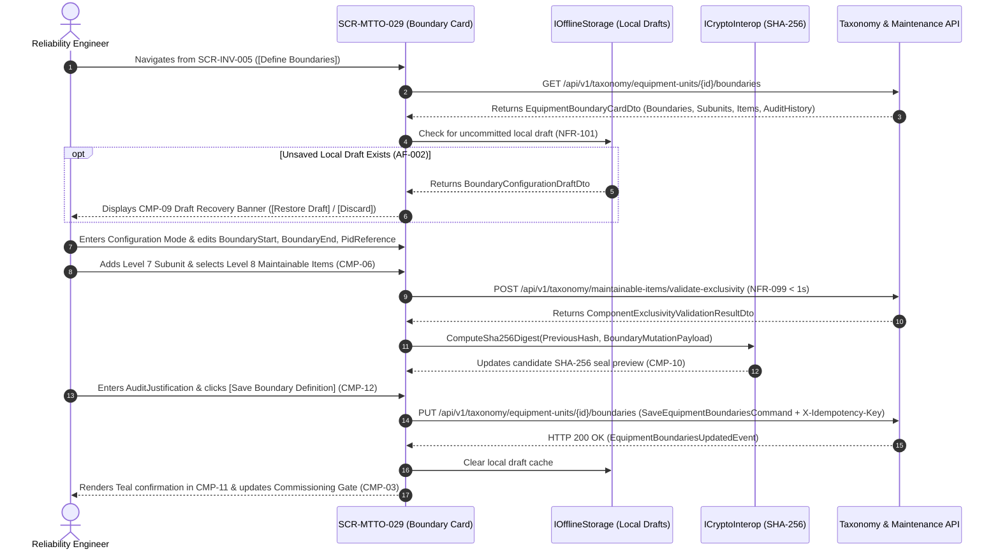

# SCR-MTTO-029: Asset Physical Boundary Limits and ISO 14224 Sub-Tree Decomposition Card

## 1. Purpose and Operational Context

* **View Objective:** Technical definition, hierarchical validation, and field consultation of physical battery limits (`BoundaryStart`, `BoundaryEnd`, and P&ID engineering scope) and internal ISO 14224 sub-tree decomposition (Level 6 `EquipmentUnit` $\to$ Level 7 `Subunit` $\to$ Level 8 `MaintainableItem`) for master equipment units. Eliminates ambiguity in maintenance cost allocation and failure coding between adjacent machinery while enforcing the Commissioning Gate precondition (`EquipmentUnit.Activate()` per [DT-DM-DOC-002 §2.2](../../../domain-models/class/DT-DM-DOC-002.md#22-equipmentunit-aggregate-root)).
* **Primary Target Persona:** Reliability Engineer defining upstream/downstream physical battery limits, structuring Level 7 Subunits and Level 8 Maintainable Items, resolving cross-asset component ownership collisions (`AF-001`), and auditing historical boundary adjustments (`FR-098`).
* **Secondary Personas:**
  * **Maintenance Planner:** Consults Level 8 Maintainable Item breakdowns and linked MRO spare part correspondences when structuring preventive and condition-based maintenance plans ([SCR-MTTO-001](SCR-MTTO-001.md), [SCR-MTTO-023](SCR-MTTO-023.md)).
  * **Maintenance Technician & Supervisor:** Inspects physical battery limits and included components in read-only mode on rugged field tablets (`NFR-097`, `AF-003`) to verify whether an observed leak or fault belongs to the equipment unit or adjacent process piping prior to logging failures in [SCR-MTTO-002](SCR-MTTO-002.md).
  * **Auditor:** Verifies chronological boundary modification logs and SHA-256 cryptographic integrity seals (`FR-098`, [TR-001](../../../requirements/common/TR-001.md)).
* **Operational Context:** Deployed on high-resolution desktop workstations in reliability engineering offices and on rugged industrial tablets in plant process areas. Responsive layout adaptations across desktop and tablet viewports are governed in Section 8.
* **Mode of Operation:** Taxonomic Governance & Field Technical Consultation mode. Direct DCS/SCADA process control manipulation is strictly excluded. Supports two operational modalities: **Configuration Mode** (restricted via RBAC to `Reliability Engineer` and `Maintenance Planner` per [DT-UI-NAV-DOC-001 §5](../../DT-UI-NAV-DOC-001.md#5-transition-matrix-and-access-control-rbac)) and **Read-Only Field Consultation Mode** (`NFR-097`, `AF-003`).
* **Upstream & Downstream Navigation Invariants:**
  * **Upstream Continuity:** Launched from the Equipment Master Data Card ([SCR-INV-005](../inv/SCR-INV-005.md)) via `[Define Boundaries]` (`L3` $\to$ `L3`) or from the Mobile Field Client side drawer ([DT-UI-NAV-DOC-001 §4.1](../../DT-UI-NAV-DOC-001.md#41-navigation-structure-mobile-client)).
  * **Downstream Transitions:** Returns to [SCR-INV-005](../inv/SCR-INV-005.md) upon formalizing boundaries to unlock the equipment Commissioning Gate, or routes to the Spare Parts Master Catalog ([SCR-INV-031](../inv/SCR-INV-031.md)) to inspect MRO spares linked to Level 8 Maintainable Items.

---

## 2. Visual Artifact


> *Note: Production UI prototype capture illustrating the Asset Boundary Limits Card desktop workstation layout, collapsible navigation sidebar, equipment commissioning gate header, physical battery limits specification card, interactive ISO 14224 boundary envelope diagram, Level 7 Subunit and Level 8 Maintainable Item decomposition tree, Annex A design attributes inspector, chronological SHA-256 boundary audit ledger, and sticky governance footer.*

---

## 3. Functional Component Inventory

> The base grid, typography, neutral palettes, and minimal tactile contact areas are inherited from [DT-UI-DS-DOC-001](../../DT-UI-DS-DOC-001.md). This inventory defines the canonical components present on the screen, their design tokens, and their architectural scope. Interaction rules and geometric algorithms are specified in Section 5; responsive container adaptations are governed by Section 8.

1. **`CMP-01`: Portal Shell & Navigation Sidebar**
   - **Visual Role:** Collapsible navigation sidebar hosting global modules, module hierarchy, and route markers.
   - **Design Tokens:**
     - Surface: `--dt-color-surface-base`
     - Border: `--dt-color-border-hairline`
     - Width: `--dt-layout-sidebar-width-expanded` (Desktop) / `--dt-layout-sidebar-width-collapsed` (Tablet Landscape)
   - **Architectural Scope:** Hosts global module navigation per [DT-UI-NAV-DOC-001](../../DT-UI-NAV-DOC-001.md), highlighting "Boundary Limits Card" under the Maintenance domain. Responsive widths governed in Section 8.

2. **`CMP-02`: Boundary Card Header & Mode Switcher**
   - **Visual Role:** Sticky top header hosting breadcrumb navigation, equipment unit quick-switcher popover, local draft auto-save indicator, operator session badge, and mode toggle (`[Configure Boundaries]` / `[Read-Only View]`).
   - **Design Tokens:**
     - Surface: `--dt-color-surface-card`
     - Border: `--dt-color-border-hairline`
     - Elevation: `--dt-z-header-sticky`
     - Primary Button: `--dt-color-state-info`
   - **Architectural Scope:** Manages equipment context switching, RBAC mode toggling (`NFR-097`), and crash-resilient draft persistence status (`NFR-101`). Detailed in §5.1 and §5.2.

3. **`CMP-03`: Equipment Context & Commissioning Gate Strip**
   - **Visual Role:** Top identification sheet displaying the Level 6 `TagNumber` badge, `SerialNumber`, `EquipmentClassName`, `FunctionalLocationTag`, `LifecycleStatus`, and Commissioning Gate readiness indicator (`FR-096`).
   - **Design Tokens:**
     - Surface: `--dt-color-surface-card`
     - Border: `--dt-color-border-subtle`
     - Tag Typography: `--dt-font-mono-data`
     - Gate Pending Accent: `--dt-color-alarm-warning`
   - **Architectural Scope:** Communicates whether mandatory physical battery limits and Level 7/8 sub-tree definitions are complete to enable `EquipmentUnit.Activate()` ([DT-DM-DOC-002 §2.2](../../../domain-models/class/DT-DM-DOC-002.md#22-equipmentunit-aggregate-root)). Detailed in §5.1.

4. **`CMP-04`: Physical Battery Limits Specification Card**
   - **Visual Role:** Structured engineering card capturing and displaying `BoundaryStart` (initial process interface), `BoundaryEnd` (final process interface), and the governing `PidReferenceCode` (P&ID schematic reference).
   - **Design Tokens:**
     - Surface: `--dt-color-surface-card`
     - Border: `--dt-color-border-subtle`, `--dt-color-border-panel` (Inputs)
     - Typography: `--dt-font-body-md`, `--dt-font-mono-data`
     - Radius: `--dt-radius-md`
   - **Architectural Scope:** Maps directly to `EquipmentUnit.DefineBoundaries(boundaryStart, boundaryEnd)` (`FR-091`, `FR-092`, `FR-102`). Supports extended technical specifications detailing suction/discharge flanges, isolation valves, and MCC load terminals. Detailed in §5.3.1.

5. **`CMP-05`: ISO 14224 Boundary Envelope Diagram Card**
   - **Visual Role:** Flat 2D HPHMI schematic block diagram illustrating the dashed ISO 14224 physical boundary envelope around the Level 6 Equipment Unit, visually segregating internal Level 7 Subunits from external process headers and utility supplies.
   - **Design Tokens:**
     - Surface: `--dt-color-surface-card`
     - Diagram Viewport: `--dt-color-surface-base`
     - Envelope Stroke: `--dt-color-border-panel`
     - Internal Node Fill: `--dt-color-surface-raised`
     - Typography: `--dt-font-mono-data`, `--dt-color-text-primary`, `--dt-color-text-muted`
   - **Architectural Scope:** Provides visual cost and failure boundary disambiguation per ISO 14224 Annex A (`Z = 0` flat 2D schematic discipline per [DT-UI-DS-DOC-001 §5.1](../../DT-UI-DS-DOC-001.md#51-hphmi-shadow-discipline-canvas-vs-hud-chrome-separation)). Detailed in §5.2.

6. **`CMP-06`: Level 7 Subunit & Level 8 Maintainable Item Tree Card**
   - **Visual Role:** Interactive two-tier taxonomic decomposition tree (`EquipmentUnit` L6 $\to$ `Subunit` L7 $\to$ `MaintainableItem` L8) with inline count capsules, item status indicators, and configuration triggers (`[+ Add Subunit]`, `[+ Link Maintainable Item]`).
   - **Design Tokens:**
     - Surface: `--dt-color-surface-card`
     - Divider: `--dt-color-border-subtle`
     - Selected Row: `--dt-color-surface-raised`, `--dt-color-state-info` (Left Indicator Bar)
     - Conflict Highlight: `--dt-color-alarm-critical`
     - Row Height: `--dt-layout-table-row-height`
   - **Architectural Scope:** Governs `EquipmentUnit.AddSubunit(subunit)` and `Subunit.AddMaintainableItem(item)` ([DT-DM-DOC-002 §2.2–§2.3](../../../domain-models/class/DT-DM-DOC-002.md#2-layer-1-asset-taxonomy-iso-14224)). Transitions to a clean read-only collapsible accordion on field tablets (`AF-003`). Detailed in §5.2 and §5.3.2.

7. **`CMP-07`: Maintainable Item Inspector & Annex A Attributes Card**
   - **Visual Role:** Lateral detail inspector displaying the selected Level 8 `MaintainableItem` (`ComponentName`, `SubunitType`, `SparePartType`, `MaintainableItemStatus`), structured ISO 14224 Annex A `DesignAttributes` key-value pairs (`JSONB`), and linked MRO spare part SKUs.
   - **Design Tokens:**
     - Surface: `--dt-color-surface-card`
     - Border: `--dt-color-border-subtle`
     - Typography: `--dt-font-caption`, `--dt-font-body-md`, `--dt-font-mono-data`
   - **Architectural Scope:** Inspects and edits `tax.maintainable_items` and `inv.maintainable_item_spare_parts` ([DT-ERD-DOC-001 §3.1.4](../../../domain-models/entity-relationship/DT-ERD-DOC-001.md#314-maintainable_items), [§3.3.2](../../../domain-models/entity-relationship/DT-ERD-DOC-001.md#332-maintainable_item_spare_parts)). Detailed in §5.3.2.

8. **`CMP-08`: Real-Time Component Uniqueness & Hierarchy Validator**
   - **Visual Role:** Compact diagnostic status strip inside `CMP-06` reporting real-time hierarchical coherence (`L6 -> L7 -> L8`) and single-parent ownership verification (`NFR-093`, `NFR-094`, `NFR-103`).
   - **Design Tokens:**
     - Surface: `--dt-color-surface-base`
     - Border: `--dt-color-border-subtle`
     - Conflict Accent: `--dt-color-alarm-critical`
     - Warning Accent: `--dt-color-alarm-warning`
   - **Architectural Scope:** Enforces [TR-008-FR-414](../../../requirements/common/TR-008.md) in $< 1\text{s}$ (`NFR-099`), blocking a Level 8 `MaintainableItem` from being assigned to two Level 6 `EquipmentUnits` simultaneously (`AF-001`). Detailed in §5.3.2.

9. **`CMP-09`: Local Draft Crash-Recovery Banner**
   - **Visual Role:** Non-modal Priority 4 diagnostic strip deployed at the top of the workspace when an uncommitted boundary configuration draft is recovered from local encrypted storage after a connection drop or browser closure (`NFR-101`, `AF-002`).
   - **Design Tokens:**
     - Surface: `--dt-color-surface-raised`
     - Border: `--dt-color-border-subtle`
     - Text: `--dt-color-text-body`, `--dt-color-text-muted`
     - Height: `--dt-layout-banner-diagnostic-height`
   - **Architectural Scope:** Preserves in-progress boundary text and L7/L8 tree structures in `IOfflineStorage` with `[Restore Draft]` and `[Discard]` actions (`AF-002`). Detailed in §5.3.4.

10. **`CMP-10`: Chronological Boundary Audit History Ledger**
    - **Visual Role:** Append-only engineering audit card in the right governance rail displaying chronological boundary adjustments, before/after diffs, operator badges, technical justifications, and chained SHA-256 integrity hashes (`FR-098`).
    - **Design Tokens:**
      - Surface: `--dt-color-surface-raised`
      - Border: `--dt-color-border-subtle`
      - Hash Typography: `--dt-font-mono-data`
    - **Architectural Scope:** Provides immutable audit traceability per [FR-098](../../../requirements/user-stories/mtto/MTTO-029.md#functional-requirements-fr), [TR-001](../../../requirements/common/TR-001.md), and [ADR-003](../../../architecture/adr/ADR-003.md). Detailed in §5.3.3.

11. **`CMP-11`: Inline Validation & Conflict Status Indicator**
    - **Visual Role:** Permanent `CLS = 0` validation status slot integrated into the left side of sticky footer `CMP-12`, displaying 4-channel redundant alerts (`#icon-ban`, `#icon-warning`, `#icon-check` + text).
    - **Design Tokens:**
      - Surface: `--dt-color-surface-card`
      - Critical Conflict: `--dt-color-alarm-critical`
      - Warning: `--dt-color-alarm-warning`
      - Documentary Success: `--dt-color-state-success`
    - **Architectural Scope:** Surfaces `AF-001` duplicate component ownership collisions, omitted boundary fields (`FR-096`), and post-commit documentary confirmation without vertical layout shift (`CLS = 0`). Detailed in §5.3.2.

12. **`CMP-12`: Sticky Boundary Governance & Handoff Footer**
    - **Visual Role:** Permanent sticky bottom action bar hosting contextual Level 3 navigation handoffs (`[< Back to Master Card]`, `[Inspect Linked Spares]`), validation status slot `CMP-11`, mandatory audit justification input, and atomic commit button (`[Save Boundary Definition]`).
    - **Design Tokens:**
      - Surface: `--dt-color-surface-card`
      - Border: `--dt-color-border-hairline`
      - Height: `--dt-layout-footer-height`
      - Elevation: `--dt-z-header-sticky`
      - Primary CTA: `--dt-color-state-info`
      - Secondary Button: `--dt-color-surface-btn-secondary`
    - **Architectural Scope:** Executes atomic boundary and sub-tree persistence (`NFR-095`) and orchestrates L3 handoffs ([DT-UI-NAV-DOC-001 §5](../../DT-UI-NAV-DOC-001.md#5-transition-matrix-and-access-control-rbac)). Detailed in §5.3.3.

---

## 4. Screen State Catalog

1. **Read-Only Consultation Mode (Default / Field View — `NFR-097`, `AF-003`)**
   - **Activation Condition:** User navigates to `SCR-MTTO-029` from [SCR-INV-005](../inv/SCR-INV-005.md) in view mode or accesses "Boundary Limits Card" from a mobile field tablet ([DT-UI-NAV-DOC-001 §4.1](../../DT-UI-NAV-DOC-001.md#41-navigation-structure-mobile-client)).
   - **Visual Modification:** Neutral grayscale surfaces (`--dt-color-surface-card`). `BoundaryStart`, `BoundaryEnd`, and `PidReferenceCode` in `CMP-04` render as borderless stacked key-value cells without input frames or mandatory asterisks (`*`). `CMP-06` renders the Level 7 Subunit and Level 8 Maintainable Item hierarchy as a clean expandable accordion. Normal component statuses (`MaintainableItemStatus.OPERATIONAL`) render as plain monospace text without capsule pills. Footer `CMP-12` hosts `[< Back to Master Card]` and `[Inspect Linked Spares]` on the left, and `[Configure Boundaries]` on the right (visible only to `Reliability Engineer` and `Maintenance Planner`).

2. **Configuration Mode (Active Editing)**
   - **Activation Condition:** Authorized `Reliability Engineer` or `Maintenance Planner` clicks `[Configure Boundaries]` in `CMP-02`/`CMP-12`, or navigates from an uncommissioned equipment unit (`EquipmentLifecycleStatus.COMMISSIONING`) requiring initial boundary formalization (`FR-096`).
   - **Visual Modification:** `BoundaryStart`, `BoundaryEnd`, and `PidReferenceCode` in `CMP-04` transition to soft-surface inputs (`--dt-color-border-panel`, `--dt-radius-md`) with zero vertical layout shift (`CLS = 0`). `CMP-06` enables `[+ Add Subunit]` and `[+ Link Maintainable Item]` triggers. Footer `CMP-12` transitions to commit mode hosting validation slot `CMP-11`, mandatory `AuditJustification` input, `[Cancel]`, and `[Save Boundary Definition]`.

3. **Loading / Validating Hierarchy**
   - **Activation Condition:** Initial sub-tree hydration or asynchronous catalog-wide component uniqueness verification (`NFR-099`, `NFR-100`).
   - **Visual Modification:** Skeleton shimmer (`--dt-color-surface-raised`) across `CMP-04`–`CMP-07`; commit controls locked.

4. **Incomplete Mandatory Boundary Fields (`FR-096`)**
   - **Activation Condition:** Engineer attempts to save while `BoundaryStart`, `BoundaryEnd`, `PidReferenceCode`, or at least one Level 7 `Subunit` / Level 8 `MaintainableItem` is missing.
   - **Visual Modification:** Omitted inputs in `CMP-04` or empty tree container in `CMP-06` highlight with an amber outline (`--dt-color-alarm-warning`) and `#icon-warning` glyph. `CMP-11` displays in the footer status slot: *"ISO 14224 Boundary Gate: Initial boundary, final boundary, P&ID reference, and at least one Level 8 Maintainable Item are required to formalize the equipment unit."* Commit button remains disabled (`CLS = 0`).

5. **Component Assignment Collision (`AF-001` / `NFR-093`)**
   - **Activation Condition:** Real-time uniqueness validator (`CMP-08`) detects that a selected Level 8 `MaintainableItem` is already bound to another Level 6 `EquipmentUnit` in the master catalog (`TR-008-FR-414`).
   - **Visual Modification:** Conflicting row in `CMP-06` highlights with a critical red border (`--dt-color-alarm-critical`) and `#icon-ban` glyph, displaying the owning equipment tag (e.g., `[Bound to P-0101B]`). `CMP-11` renders a critical conflict alert in the footer status slot (`#icon-ban`): *"ISO 14224 Consistency Error: Maintainable Item SM-02 already belongs to the physical boundaries of Equipment Unit P-0101B. Unlink from source asset before saving."* `[Save Boundary Definition]` is hard-disabled (`CLS = 0`).

6. **Deep Hierarchy Inconsistency (`NFR-094` / `NFR-103`)**
   - **Activation Condition:** Integrity verification routine detects an orphaned Level 8 `MaintainableItem` lacking a valid parent Level 7 `Subunit` or a taxonomic class mismatch between the `SubunitType` and parent `EquipmentClass`.
   - **Visual Modification:** Affected node in `CMP-06` highlights with an amber warning border (`--dt-color-alarm-warning`) and `#icon-warning` glyph. `CMP-11` displays actionable remediation guidance in the footer status slot (`TR-008-NFR-421`).

7. **Recovered Unsaved Session Draft (`AF-002` / `NFR-101`)**
   - **Activation Condition:** Engineer reopens `SCR-MTTO-029` after an unexpected session drop, network interruption, or browser closure while an uncommitted draft exists in `IOfflineStorage`.
   - **Visual Modification:** Diagnostic strip `CMP-09` (`--dt-layout-banner-diagnostic-height`, `--dt-color-surface-raised`) appears at the top of the workspace with `#icon-wifi-off`: *"Unsaved boundary configuration draft recovered from local storage (Last edit: HH:mm UTC). [Restore Draft] [Discard]"*.

8. **Documentary Confirmation (Success)**
   - **Activation Condition:** Atomic persistence of physical boundaries, L7/L8 sub-tree associations, and SHA-256 audit log entry succeeds (`NFR-095`).
   - **Visual Modification:** `CMP-11` renders a Teal documentary confirmation pill (`--dt-color-state-success`, `#icon-check`) in the footer status slot displaying the committed SHA-256 integrity hash, updates `CMP-03` Commissioning Gate status to `BOUNDARIES VERIFIED`, and transitions the view to Read-Only Consultation Mode.

---

## 5. Interaction Rules and Data Flow

### 5.1. Initial Load & Lifecycle



1. **Context Hydration & Commissioning Gate Evaluation (`FR-091`, `FR-096`):**
   * On initialization with `EquipmentUnitId`, the view retrieves `EquipmentBoundaryCardDto` (§7.2.3), hydrating the current `BoundaryStart`, `BoundaryEnd`, `PidReferenceCode`, the nested Level 7 `SubunitDto` and Level 8 `MaintainableItemDto` hierarchy, and the chronological audit trail (`BoundaryAuditEntryDto`).
   * If `BoundaryStart` or `BoundaryEnd` is empty or the Level 7/8 sub-tree contains zero items, `CMP-03` flags the Commissioning Gate as `PENDING BOUNDARY DEFINITION`, preventing `EquipmentUnit.Activate()` in [SCR-INV-005](../inv/SCR-INV-005.md).
2. **Orthogonal Component Status Hygiene ([DT-DM-DOC-001 §4.7](../../../domain-models/class/DT-DM-DOC-001.md#47-maintainableitemstatus)):**
   * Each Level 8 `MaintainableItem` in `CMP-06` and `CMP-07` reflects its canonical status (`MaintainableItemStatus.OPERATIONAL`, `DEGRADED`, `FAILED`, `UNDER_REPAIR`, `REPLACED`).
   * Per [DT-UI-DS-DOC-001 §6.5](../../DT-UI-DS-DOC-001.md#65-status-badge-counter-discipline-anti-badge-inflation-principle), `OPERATIONAL` and `REPLACED` items render as subdued monospace text (`--dt-font-mono-data`, `--dt-color-text-muted`), reserving Amber capsule pills (`--dt-color-alarm-warning`) for `DEGRADED` / `UNDER_REPAIR` and Red capsule pills (`--dt-color-alarm-critical`) for `FAILED`.

---

### 5.2. Spatial Navigation & Tactile Mechanics

1. **Asymmetric Dual-Pane Workstation Split:**
   * At desktop resolutions (`--dt-breakpoint-xl`), the workspace is structured into an asymmetric two-column layout governed by `--dt-space-6` perimeter padding and `--dt-space-4` column gap:
     * **Left Primary Column (Boundary & Sub-Tree Canvas):** Hosts the Equipment Context Strip (`CMP-03`), Physical Battery Limits Specification Card (`CMP-04`), and the Level 7 / Level 8 Decomposition Tree (`CMP-06` with embedded validator `CMP-08`).
     * **Right Secondary Rail (Diagram, Inspector & Audit Rail):** Hosts the ISO 14224 Boundary Envelope Diagram (`CMP-05`), the selected Level 8 Maintainable Item Inspector (`CMP-07`), and the Chronological SHA-256 Boundary Audit Ledger (`CMP-10`).
2. **Tree Interaction & Tactile Ergonomics:**
   * Selecting any Level 7 `Subunit` or Level 8 `MaintainableItem` row in `CMP-06` highlights the corresponding block inside the `CMP-05` Boundary Envelope Diagram and populates `CMP-07` without page reload.
   * On industrial tablets (`--dt-breakpoint-lg`, `--dt-breakpoint-md`), all tree expand/collapse chevrons, item selection rows, and action triggers enforce `--dt-touch-target-mobile` minimums with `--dt-space-2` separation.
3. **Zero Layout Shift (`CLS = 0`):**
   * Switching between Read-Only Consultation Mode and Configuration Mode preserves identical card heights and grid geometry. Validation errors (`AF-001`, `FR-096`, `NFR-094`) render strictly inside the pre-allocated `CMP-11` slot in sticky footer `CMP-12` and inline on the affected tree row.

---

### 5.3. Domain Workflows & Validation Rules

#### 5.3.1. Physical Battery Limits & Extended Specification Rules (`FR-092`, `FR-096`, `FR-102`)
1. **Mandatory Boundary Pair (`FR-092`, `FR-096`):** Formalizing boundaries invokes `EquipmentUnit.DefineBoundaries(boundaryStart, boundaryEnd)` ([DT-DM-DOC-002 §2.2](../../../domain-models/class/DT-DM-DOC-002.md#22-equipmentunit-aggregate-root)), requiring non-empty specifications for both `BoundaryStart` (e.g., *"DN200 ANSI 300# suction flange downstream of isolation valve MOV-0101A"*) and `BoundaryEnd` (e.g., *"DN150 ANSI 600# discharge flange and MCC-02 feeder breaker M-0101A load terminals"*), plus the governing `PidReferenceCode` (e.g., *"PID-TFA-1045-REV3"*).
2. **Extended Specification Support (`FR-102`):** Input controls in `CMP-04` support multi-line technical descriptions up to the physical schema limit (`VARCHAR(150)` on `tax.equipment_units.boundary_start` / `boundary_end`, with extended boundary notes and P&ID metadata persisted in structured `design_attributes` `JSONB`) without text clipping or horizontal overflow.

#### 5.3.2. Level 7/8 Sub-Tree Structuring & Component Exclusivity Invariant (`NFR-093`, `NFR-094`, `NFR-099`, `AF-001`, `TR-008`)
1. **Strict Taxonomic Nesting (`NFR-094`, `TR-008-NFR-415`):** Every Level 8 `MaintainableItem` must be linked to a parent Level 7 `Subunit` belonging to the target Level 6 `EquipmentUnit`:
   $$\text{EquipmentUnit (L6)} \xrightarrow{1:N} \text{Subunit (L7)} \xrightarrow{1:N} \text{MaintainableItem (L8)}$$
   Direct attachment of a Level 8 item to a Level 6 equipment unit without an intermediate Level 7 subunit is blocked by the domain model (`Subunit.AddMaintainableItem`).
2. **Single-Asset Component Exclusivity (`NFR-093`, `TR-008-FR-414`, `AF-001`):** A physical or logical Level 8 `MaintainableItem` instance (`MaintainableItemId`) cannot belong to two Level 6 `EquipmentUnits` simultaneously:
   $$\forall m \in \text{MaintainableItems}, \quad |\text{EquipmentUnits}(m)| \le 1$$
   When the Engineer selects or links a `MaintainableItem` in `CMP-06`, the system executes an asynchronous uniqueness verification in $< 1\text{s}$ (`NFR-099`). If the item is already assigned to another active `EquipmentUnit`, the UI triggers State 5 (`AF-001`), highlights the conflicting row with `--dt-color-alarm-critical` and `#icon-ban`, identifies the conflicting equipment tag, and hard-disables `[Save Boundary Definition]`.

#### 5.3.3. Atomic Persistence & Chained SHA-256 Boundary Audit History (`FR-098`, `NFR-095`, `TR-001`, `ADR-003`)
1. **Atomic Transaction Boundary (`NFR-095`, `TR-008-NFR-420`):** Clicking `[Save Boundary Definition]` in `CMP-12` dispatches `SaveEquipmentBoundariesCommand` (§7.2.3) with header `X-Idempotency-Key: {uuidv7}`. The backend commits `tax.equipment_units` (`boundary_start`, `boundary_end`), `tax.subunits`, `tax.maintainable_items`, `inv.maintainable_item_spare_parts`, and `adm.audit_logs` within a single ACID transaction. If any hierarchical or uniqueness check fails, the entire transaction rolls back cleanly.
2. **Chained Cryptographic Audit Trail (`FR-098`, `TR-001`, `ADR-003`):** Every boundary creation or modification requires a mandatory `AuditJustification` ($\ge 15$ characters) and appends a tamper-evident record to `CMP-10`:
   $$\text{IntegrityHash} = \text{SHA-256}(\text{PreviousHash} \parallel \text{EngineerUserId} \parallel \text{EquipmentUnitId} \parallel \text{BoundaryStart} \parallel \text{BoundaryEnd} \parallel \text{SubunitItemTreeHash} \parallel \text{AuditJustification} \parallel \text{TimestampUtc})$$

#### 5.3.4. Session Crash-Recovery & Field Read-Only Persistence (`NFR-097`, `NFR-101`, `AF-002`, `AF-003`)
1. **Auto-Saved Local Configuration Drafts (`NFR-101`, `AF-002`):** During active editing in Configuration Mode, every field or tree mutation is debounced ($500\text{ms}$) and persisted into local encrypted storage (`IOfflineStorage` / `TR-002`). If the browser closes unexpectedly or network connectivity drops, reopening `SCR-MTTO-029` surfaces `CMP-09` (`LocalDraftRecoveryBanner.razor`), allowing one-click restoration of the uncommitted hierarchy.
2. **Mobile Field Read-Only Consultation (`NFR-097`, `AF-003`, `TR-007`):** When accessed by a Maintenance Technician on a field tablet (online or offline), `SCR-MTTO-029` locks all mutation controls and renders the cached boundary envelope and L7/L8 component tree in Read-Only Consultation Mode.

---

## 6. Industrial and Safety Considerations

* **Cost & Failure Attribution Precision (ISO 14224 §6 / ISO 55001):** Ambiguous physical boundaries between a driven equipment unit (e.g., centrifugal pump), its driver (electric motor), and connected suction/discharge isolation valves corrupt MTBF metrics and maintenance expenditure (RIME) tracking. `CMP-04` and `CMP-05` enforce an explicit, auditable demarcation prior to asset commissioning (`FR-096`).
* **LOTO & Physical Boundary Alignment (ISO 45001 §8.1):** Defining upstream (`BoundaryStart`) and downstream (`BoundaryEnd`) mechanical and electrical interfaces directly informs the physical isolation boundary points (`IsolationPoint` in [SCR-VIS-011](../vis/SCR-VIS-011.md)) required to bring the equipment unit to a Zero Energy state.
* **HPHMI Visual Discipline & Anti-Badge-Inflation ([TR-011](../../../requirements/common/TR-011.md)):** In accordance with [DT-UI-DS-DOC-001 §1](../../DT-UI-DS-DOC-001.md#1-scope), [§5.1](../../DT-UI-DS-DOC-001.md#51-hphmi-shadow-discipline-canvas-vs-hud-chrome-separation), and [§6.5](../../DT-UI-DS-DOC-001.md#65-status-badge-counter-discipline-anti-badge-inflation-principle), the boundary envelope diagram (`CMP-05`) uses flat 2D neutral grayscale geometry (`Z = 0`), normal `OPERATIONAL` maintainable items render without decorative status pills, and saturated colors (`--dt-color-alarm-critical`, `--dt-color-alarm-warning`) are reserved strictly for `AF-001` ownership collisions, `FAILED`/`DEGRADED` components, and missing mandatory boundary gates.

---

## 7. Frontend Component Contract (Blazor / Razor)

### 7.1. Component Hierarchy & File Mapping

```text
Pages/Maintenance/
└── AssetBoundaryLimitsPage.razor                      # Root View (SCR-MTTO-029)
    ├── PortalSidebarNav.razor                         # CMP-01: Collapsible navigation sidebar
    ├── BoundaryHeaderBar.razor                        # CMP-02: Breadcrumbs, unit switcher, draft status & mode toggle
    ├── LocalDraftRecoveryBanner.razor                 # CMP-09: Crash/session recovery diagnostic banner (AF-002)
    ├── EquipmentBoundaryContextCard.razor             # CMP-03: L6 identity & Commissioning Gate readiness strip
    ├── PhysicalBatteryLimitsEditorCard.razor          # CMP-04: BoundaryStart, BoundaryEnd & P&ID specification card
    ├── IsoBoundaryDiagramCard.razor                   # CMP-05: 2D HPHMI boundary envelope schematic diagram
    ├── SubunitHierarchyTreeCard.razor                 # CMP-06: Interactive L7 Subunit -> L8 Maintainable Item tree
    │   └── HierarchyIntegrityValidatorStrip.razor     # CMP-08: Real-time <1s exclusivity & tree coherence bar
    ├── MaintainableItemInspectorCard.razor            # CMP-07: Selected L8 item details, Annex A JSONB & BOM spares
    ├── BoundaryAuditHistoryCard.razor                 # CMP-10: Chronological SHA-256 boundary audit ledger (FR-098)
    └── BoundaryActionFooter.razor                     # CMP-12: Permanent sticky footer with L3 handoffs & commit CTA
        └── BoundaryValidationAlertSlot.razor          # CMP-11: CLS=0 redundant validation & collision alert slot
```

---

### 7.2. Physical Component Parameters & DTO Contracts (.NET 10 / C# 14)

#### 7.2.1. `AssetBoundaryLimitsPage.razor` (Root View)

```csharp
[Parameter]
public required Guid EquipmentUnitId { get; set; }

[Parameter, SupplyParameterFromQuery(Name = "mode")]
public BoundaryViewMode InitialMode { get; set; } = BoundaryViewMode.READ_ONLY;
```

#### 7.2.2. Subcomponent Parameter Contracts (`CMP-01` to `CMP-12`)

```csharp
// CMP-01: PortalSidebarNav.razor
[Parameter]
public bool IsCollapsed { get; set; }

[Parameter]
public bool IsMobileDrawerOpen { get; set; }

[Parameter]
public string ActiveRouteCode { get; set; } = "SCR-MTTO-029";

[Parameter]
public EventCallback<bool> OnCollapseToggled { get; set; }

// CMP-02: BoundaryHeaderBar.razor
[Parameter]
public required BoundaryViewMode ActiveMode { get; set; }

[Parameter]
public required EquipmentBoundaryHeaderDto CurrentEquipment { get; set; }

[Parameter]
public required IReadOnlyList<EquipmentBoundaryHeaderDto> CatalogEquipmentUnits { get; set; }

[Parameter]
public required string OperatorBadgeCode { get; set; }

[Parameter]
public required string OperatorDisplayName { get; set; }

[Parameter]
public bool CanEditBoundaries { get; set; }

[Parameter]
public DateTimeOffset? LastDraftSavedAtUtc { get; set; }

[Parameter]
public EventCallback<Guid> OnEquipmentUnitSelected { get; set; }

[Parameter]
public EventCallback<BoundaryViewMode> OnModeChanged { get; set; }

[Parameter]
public EventCallback OnToggleMobileNavigation { get; set; }

// CMP-09: LocalDraftRecoveryBanner.razor (AF-002)
[Parameter]
public bool HasRecoverableDraft { get; set; }

[Parameter]
public DateTimeOffset? DraftTimestampUtc { get; set; }

[Parameter]
public EventCallback OnRestoreDraftRequested { get; set; }

[Parameter]
public EventCallback OnDiscardDraftRequested { get; set; }

// CMP-03: EquipmentBoundaryContextCard.razor
[Parameter]
public required EquipmentBoundaryHeaderDto Header { get; set; }

[Parameter]
public bool IsCommissioningGateSatisfied { get; set; }

// CMP-04: PhysicalBatteryLimitsEditorCard.razor
[Parameter]
public string PidReferenceCode { get; set; } = string.Empty;

[Parameter]
public EventCallback<string> PidReferenceCodeChanged { get; set; }

[Parameter]
public string BoundaryStart { get; set; } = string.Empty;

[Parameter]
public EventCallback<string> BoundaryStartChanged { get; set; }

[Parameter]
public string BoundaryEnd { get; set; } = string.Empty;

[Parameter]
public EventCallback<string> BoundaryEndChanged { get; set; }

[Parameter]
public bool IsReadOnly { get; set; }

[Parameter]
public bool HasMissingBoundaryError { get; set; }

// CMP-05: IsoBoundaryDiagramCard.razor
[Parameter]
public required string EquipmentTag { get; set; }

[Parameter]
public required string PidReferenceCode { get; set; }

[Parameter]
public required string BoundaryStart { get; set; }

[Parameter]
public required string BoundaryEnd { get; set; }

[Parameter]
public required IReadOnlyList<SubunitNodeDto> Subunits { get; set; }

[Parameter]
public Guid? SelectedSubunitId { get; set; }

[Parameter]
public EventCallback<Guid> OnSubunitDiagramNodeClicked { get; set; }

// CMP-06: SubunitHierarchyTreeCard.razor
[Parameter]
public required IReadOnlyList<SubunitNodeDto> Subunits { get; set; }

[Parameter]
public Guid? SelectedSubunitId { get; set; }

[Parameter]
public Guid? SelectedMaintainableItemId { get; set; }

[Parameter]
public bool IsReadOnly { get; set; }

[Parameter]
public EventCallback<Guid> OnSubunitSelected { get; set; }

[Parameter]
public EventCallback<Guid> OnMaintainableItemSelected { get; set; }

[Parameter]
public EventCallback<AddSubunitRequestDto> OnSubunitAdded { get; set; }

[Parameter]
public EventCallback<Guid> OnSubunitRemoved { get; set; }

[Parameter]
public EventCallback<LinkMaintainableItemRequestDto> OnMaintainableItemLinked { get; set; }

[Parameter]
public EventCallback<Guid> OnMaintainableItemUnlinked { get; set; }

// CMP-08: HierarchyIntegrityValidatorStrip.razor
[Parameter]
public bool IsValidating { get; set; }

[Parameter]
public required HierarchyValidationSummaryDto ValidationSummary { get; set; }

// CMP-07: MaintainableItemInspectorCard.razor
[Parameter]
public MaintainableItemNodeDto? SelectedItem { get; set; }

[Parameter]
public bool IsReadOnly { get; set; }

[Parameter]
public EventCallback<MaintainableItemNodeDto> OnItemAttributesUpdated { get; set; }

[Parameter]
public EventCallback<Guid> OnInspectSparePartCatalogRequested { get; set; }

// CMP-10: BoundaryAuditHistoryCard.razor
[Parameter]
public required IReadOnlyList<BoundaryAuditEntryDto> AuditEntries { get; set; }

[Parameter]
public required string CandidateOrLatestIntegrityHash { get; set; }

// CMP-12: BoundaryActionFooter.razor
[Parameter]
public required BoundaryViewMode ActiveMode { get; set; }

[Parameter]
public bool CanEditBoundaries { get; set; }

[Parameter]
public bool CanCommit { get; set; }

[Parameter]
public bool IsSubmitting { get; set; }

[Parameter]
public BoundaryConflictType? ActiveConflict { get; set; }

[Parameter]
public string? ConflictMessage { get; set; }

[Parameter]
public string AuditJustification { get; set; } = string.Empty;

[Parameter]
public EventCallback<string> AuditJustificationChanged { get; set; }

[Parameter]
public EventCallback OnBackToMasterCardClicked { get; set; }

[Parameter]
public EventCallback OnVerifySparePartsClicked { get; set; }

[Parameter]
public EventCallback OnEnterConfigureModeClicked { get; set; }

[Parameter]
public EventCallback OnCancelConfigurationClicked { get; set; }

[Parameter]
public EventCallback OnCommitBoundariesClicked { get; set; }

// CMP-11: BoundaryValidationAlertSlot.razor
[Parameter]
public BoundaryConflictType? ActiveConflict { get; set; }

[Parameter]
public string? ConflictMessage { get; set; }
```

#### 7.2.3. Data Transfer Objects (DTOs) and Enums

```csharp
public enum BoundaryViewMode
{
    READ_ONLY,
    CONFIGURE
}

/// <summary>
/// Controlled equipment lifecycle vocabulary per DT-DM-DOC-001 §4.2.
/// </summary>
public enum EquipmentLifecycleStatus
{
    IN_STORAGE,
    INSTALLED,
    COMMISSIONING,
    DECOMMISSIONED
}

/// <summary>
/// Controlled maintainable item health/lifecycle status vocabulary per DT-DM-DOC-001 §4.7.
/// </summary>
public enum MaintainableItemStatus
{
    OPERATIONAL,
    DEGRADED,
    FAILED,
    UNDER_REPAIR,
    REPLACED
}

public enum BoundaryConflictType
{
    INCOMPLETE_BOUNDARY_FIELDS,
    COMPONENT_OWNERSHIP_COLLISION,
    HIERARCHY_COHERENCE_VIOLATION,
    BOUNDARIES_COMMITTED_SUCCESS
}

public record EquipmentBoundaryCardDto
{
    public required EquipmentBoundaryHeaderDto Header { get; init; }
    public required string PidReferenceCode { get; init; }
    public required string BoundaryStart { get; init; }
    public required string BoundaryEnd { get; init; }
    public required bool IsCommissioningGateSatisfied { get; init; }
    public IReadOnlyList<SubunitNodeDto> Subunits { get; init; } = [];
    public IReadOnlyList<BoundaryAuditEntryDto> AuditHistory { get; init; } = [];
    public required string LatestIntegrityHash { get; init; }
}

public record EquipmentBoundaryHeaderDto
{
    public required Guid EquipmentUnitId { get; init; }
    public required string SerialNumber { get; init; }
    public string? FunctionalLocationTag { get; init; }
    public string? FunctionalLocationName { get; init; }
    public required Guid EquipmentClassId { get; init; }
    public required string EquipmentClassName { get; init; }
    public string? ManufacturerStandard { get; init; }
    public required EquipmentLifecycleStatus LifecycleStatus { get; init; }
}

public record SubunitNodeDto
{
    public required Guid SubunitId { get; init; }
    public required Guid EquipmentUnitId { get; init; }
    public required string SubunitType { get; init; }
    public required string Name { get; init; }
    public IReadOnlyList<MaintainableItemNodeDto> MaintainableItems { get; init; } = [];
}

public record MaintainableItemNodeDto
{
    public required Guid MaintainableItemId { get; init; }
    public required Guid SubunitId { get; init; }
    public required string ComponentName { get; init; }
    public required string SubunitType { get; init; }
    public string? SparePartType { get; init; }
    public required MaintainableItemStatus Status { get; init; }
    public IReadOnlyDictionary<string, string> DesignAttributes { get; init; } = new Dictionary<string, string>();
    public IReadOnlyList<LinkedSparePartSummaryDto> LinkedSpareParts { get; init; } = [];
    public bool HasOwnershipCollision { get; init; }
    public string? ConflictingEquipmentTag { get; init; }
}

public record LinkedSparePartSummaryDto
{
    public required Guid SparePartId { get; init; }
    public required string Sku { get; init; }
    public required string Description { get; init; }
    public required string UnitOfMeasure { get; init; }
}

public record AddSubunitRequestDto
{
    public required string SubunitType { get; init; }
    public required string Name { get; init; }
}

public record LinkMaintainableItemRequestDto
{
    public required Guid TargetSubunitId { get; init; }
    public Guid? ExistingMaintainableItemId { get; init; }
    public required string ComponentName { get; init; }
    public required string SubunitType { get; init; }
    public string? SparePartType { get; init; }
    public IReadOnlyDictionary<string, string> DesignAttributes { get; init; } = new Dictionary<string, string>();
}

public record HierarchyValidationSummaryDto
{
    public required bool IsCoherent { get; init; }
    public required int TotalSubunitsCount { get; init; }
    public required int TotalMaintainableItemsCount { get; init; }
    public required int CollisionCount { get; init; }
    public string? DiagnosticMessage { get; init; }
}

public record ComponentExclusivityValidationResultDto
{
    public required Guid MaintainableItemId { get; init; }
    public required bool IsExclusive { get; init; }
    public Guid? ConflictingEquipmentUnitId { get; init; }
    public string? ConflictingEquipmentSerialNumber { get; init; }
    public string? ConflictingFunctionalLocationTag { get; init; }
}

public record BoundaryAuditEntryDto
{
    public required Guid AuditLogId { get; init; }
    public required DateTimeOffset TimestampUtc { get; init; }
    public required string OperatorBadgeCode { get; init; }
    public required string PreviousBoundaryStart { get; init; }
    public required string NewBoundaryStart { get; init; }
    public required string PreviousBoundaryEnd { get; init; }
    public required string NewBoundaryEnd { get; init; }
    public required int SubunitCountDelta { get; init; }
    public required int MaintainableItemCountDelta { get; init; }
    public required string AuditJustification { get; init; }
    public required string PreviousHash { get; init; }
    public required string IntegrityHash { get; init; }
}

public record SaveEquipmentBoundariesCommand
{
    public required Guid EquipmentUnitId { get; init; }
    public required string PidReferenceCode { get; init; }
    public required string BoundaryStart { get; init; }
    public required string BoundaryEnd { get; init; }
    public required IReadOnlyList<SubunitNodeDto> Subunits { get; init; }
    public required string AuditJustification { get; init; }
    public required Guid EngineerUserId { get; init; }
    public required string PreviousHash { get; init; }
}
```

---

### 7.3. Client-Side DOM & Interop Bridge

1. **Real-Time Component Exclusivity & Tree Validator (`IHierarchyValidationInterop`):**
   * Evaluates L6 $\to$ L7 $\to$ L8 parent-child coherence synchronously on the client thread and dispatches debounced ($250\text{ms}$) exclusivity queries against the catalog index, completing duplicate component ownership checks in $< 1\text{s}$ (`NFR-099`, `TR-008-NFR-419`).
2. **Crash-Resilient Local Draft Persistence (`IOfflineStorage`):**
   * Serializes uncommitted `SaveEquipmentBoundariesCommand` drafts into encrypted local SQLCipher/IndexedDB storage (`TR-002`) on every state mutation (`NFR-101`, `AF-002`), and caches committed boundary trees for offline field technician consultation (`NFR-097`, `AF-003`, `TR-007`).
3. **Web Cryptography SHA-256 Digest Bridge (`ICryptoInterop`):**
   * Computes the candidate `IntegrityHash` across the boundary specification and canonicalized L7/L8 sub-tree JSON payload asynchronously in a Web Worker (`TR-001`, `ADR-003`).

---

## 8. Layout and Responsive Adaptability

### 8.1. Desktop Workstation (`--dt-breakpoint-xl`)
* **Layout Organization:** Full Web Portal shell with expanded navigation sidebar `CMP-01` (`--dt-layout-sidebar-width-expanded`). The central workspace organizes into an asymmetric 2-column split: the primary left column hosts the Equipment Context Strip (`CMP-03`), Physical Battery Limits Specification Card (`CMP-04`), and the interactive Level 7/8 Decomposition Tree (`CMP-06` + `CMP-08`); the right governance rail (`--dt-layout-drawer-width-desktop`) hosts the ISO 14224 Boundary Envelope Diagram (`CMP-05`), Maintainable Item Inspector (`CMP-07`), and Chronological SHA-256 Boundary Audit Ledger (`CMP-10`). Permanent sticky footer `CMP-12` (`--dt-layout-footer-height`) spans the bottom workspace.
* **Ergonomic Rules:** Optimized for mouse and keyboard tree traversal (`ArrowUp` / `ArrowDown` / `ArrowRight` / `ArrowLeft`); dense table/tree row height governed by `--dt-layout-table-row-height`; zero horizontal layout shift (`CLS = 0`).

### 8.2. Industrial Tablet Landscape (`--dt-breakpoint-lg`)
* **Layout Organization:** Navigation sidebar `CMP-01` collapses to an icon-only rail (`--dt-layout-sidebar-width-collapsed`); primary boundary and tree canvas occupies the left workspace while the right inspector/audit rail (`CMP-05`, `CMP-07`, `CMP-10`) docks as a collapsible panel sized by `--dt-layout-drawer-width-tablet` (`--dt-shadow-panel`). Sticky footer `CMP-12` (`--dt-layout-footer-height`) remains permanently pinned at the bottom.
* **Ergonomic Rules:** Touch targets across all tree nodes, accordion headers, and footer buttons enforce `--dt-touch-target-mobile` with `--dt-space-2` separation.

### 8.3. Industrial Tablet Portrait (`--dt-breakpoint-md`)
* **Layout Organization:** Navigation sidebar `CMP-01` transitions to an off-canvas drawer; workspace stacks vertically within `--dt-layout-form-max-width` (`CMP-03` $\to$ `CMP-04` $\to$ `CMP-05` $\to$ `CMP-06` $\to$ `CMP-10`) with bottom scroll clearance (`--dt-layout-footer-clearance`). Selecting a Level 8 item in `CMP-06` opens `CMP-07` inside an adaptive **Bottom Sheet** (`--dt-layout-bottom-sheet-height-initial` $\to$ `--dt-layout-bottom-sheet-height-expanded`, `--dt-radius-2xl` upper curvature).
* **Ergonomic Rules:** Gloved field operation ergonomics (`--dt-touch-target-mobile`); discrete single-tap toggling on the bottom-sheet handle ([DT-UI-DS-DOC-001 §6.3](../../DT-UI-DS-DOC-001.md#63-sliding-containers-pattern-bottom-sheets-and-drawers)); read-only field consultation mode (`AF-003`) suppresses all edit chrome.

---

## 9. Traceability and Requirements Matrix

| Requirement | Addressed in Component | Verification & Implementation Mechanism |
| :--- | :--- | :--- |
| [FR-091](../../../requirements/user-stories/mtto/MTTO-029.md#functional-requirements-fr) | `CMP-02`, `CMP-03`, `CMP-12` | Direct Level 3 navigation entry from `SCR-INV-005` (`[Define Boundaries]`) and equipment unit selector in `CMP-02`. |
| [FR-092](../../../requirements/user-stories/mtto/MTTO-029.md#functional-requirements-fr) | `CMP-04`, `CMP-06`, `CMP-07` | Captures `BoundaryStart`, `BoundaryEnd`, `PidReferenceCode`, Level 7 `Subunits`, and multiple Level 8 `MaintainableItems`. |
| [FR-096](../../../requirements/user-stories/mtto/MTTO-029.md#functional-requirements-fr) | `CMP-03`, `CMP-04`, `CMP-11`, `CMP-12` | Enforces mandatory physical boundary fields and L7/L8 decomposition before unlocking the Equipment Unit Commissioning Gate (`Activate()`). |
| [FR-098](../../../requirements/user-stories/mtto/MTTO-029.md#functional-requirements-fr) | `CMP-10`, `CMP-12` | Chronological engineering audit ledger displaying historical boundary diffs, justifications, and chained SHA-256 seals. |
| [FR-102](../../../requirements/user-stories/mtto/MTTO-029.md#functional-requirements-fr) | `CMP-04`, `CMP-07` | Multi-line boundary inputs and structured `DesignAttributes` (`JSONB`) accommodate complex physical flange, valve, and electrical specifications. |
| [NFR-093](../../../requirements/user-stories/mtto/MTTO-029.md#non-functional-requirements-nfr) | `CMP-06`, `CMP-08`, `CMP-11` | Validates single-asset component exclusivity, blocking any Level 8 `MaintainableItem` already assigned to another `EquipmentUnit` (`AF-001`). |
| [NFR-094](../../../requirements/user-stories/mtto/MTTO-029.md#non-functional-requirements-nfr) | `CMP-06`, `CMP-08`, `CMP-11` | Enforces strict L6 $\to$ L7 $\to$ L8 parent-child hierarchical coherence across all sub-tree mutations. |
| [NFR-095](../../../requirements/user-stories/mtto/MTTO-029.md#non-functional-requirements-nfr) | `CMP-12` | Single-commit ACID transaction persists boundaries, L7/L8 nodes, and SHA-256 audit log atomically or rolls back completely. |
| [NFR-097](../../../requirements/user-stories/mtto/MTTO-029.md#non-functional-requirements-nfr) | `CMP-02`, `CMP-04`, `CMP-06`, `CMP-07` | Enforces Read-Only Consultation Mode (`AF-003`) for field technicians consulting boundaries on mobile tablets. |
| [NFR-099](../../../requirements/user-stories/mtto/MTTO-029.md#non-functional-requirements-nfr) | `CMP-08` | Indexed component ownership uniqueness validation completes in $< 1\text{s}$ (`TR-008-NFR-419`). |
| [NFR-100](../../../requirements/user-stories/mtto/MTTO-029.md#non-functional-requirements-nfr) | `CMP-06`, `CMP-08` | Server-side indexed hierarchy validation maintains sub-second responsiveness across catalogs up to $50,000$ units. |
| [NFR-101](../../../requirements/user-stories/mtto/MTTO-029.md#non-functional-requirements-nfr) | `CMP-02`, `CMP-09` | Debounced local draft auto-save in `IOfflineStorage` preserves form progress across session drops or browser closures (`AF-002`). |
| [NFR-103](../../../requirements/user-stories/mtto/MTTO-029.md#non-functional-requirements-nfr) | `CMP-08`, `CMP-11` | Automated hierarchy integrity verification routine detects and flags orphaned or anomalous historical component links. |
| [TR-001](../../../requirements/common/TR-001.md) | `CMP-10`, `CMP-12` | Immutable append-only audit trail logging with SHA-256 cryptographic hash chaining on all boundary mutations. |
| [TR-002](../../../requirements/common/TR-002.md) | `CMP-09` | AES-256 / SQLCipher encryption at rest for locally cached boundary sheets and auto-saved configuration drafts. |
| [TR-005](../../../requirements/common/TR-005.md) | `CMP-08`, `CMP-12` | Enforces TLS/HTTPS encryption in transit across all boundary queries, exclusivity checks, and command dispatches. |
| [TR-006](../../../requirements/common/TR-006.md) | `CMP-02`, `CMP-12` | Enforces RBAC permissions (`Reliability Engineer` and `Maintenance Planner` for edits; read-only field access for `Technician`). |
| [TR-007](../../../requirements/common/TR-007.md) | `CMP-04` to `CMP-09` | Supports offline read-only boundary consultation on field tablets and resilient local draft recovery. |
| [TR-008](../../../requirements/common/TR-008.md) | `CMP-06`, `CMP-07`, `CMP-08` | Enforces ISO 14224 taxonomic hierarchy (Level 6 `EquipmentUnit` $\to$ Level 7 `Subunit` $\to$ Level 8 `MaintainableItem`) and component uniqueness. |
| [TR-011](../../../requirements/common/TR-011.md) | `CMP-01` to `CMP-12` | ANSI/ISA-101 HPHMI 90/10 neutral grayscale workspace, flat 2D boundary diagram, and WCAG 2.1 AA 4-channel redundant coding. |
| [ADR-003](../../../architecture/adr/ADR-003.md) | `CMP-10`, `CMP-12` | Tamper-evident SHA-256 hash chaining (`PreviousHash` $\to$ `IntegrityHash`) on boundary configuration commits. |
| [ADR-005](../../../architecture/adr/ADR-005.md) | `CMP-06`, `CMP-12` | Time-sequential UUIDv7 identifier generation for newly created Level 7 `Subunit` and Level 8 `MaintainableItem` entities. |