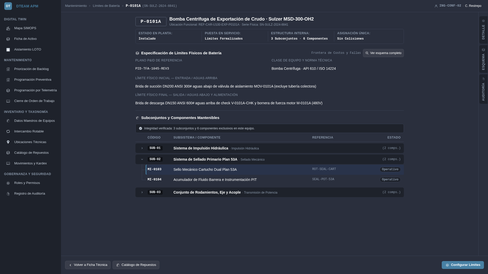
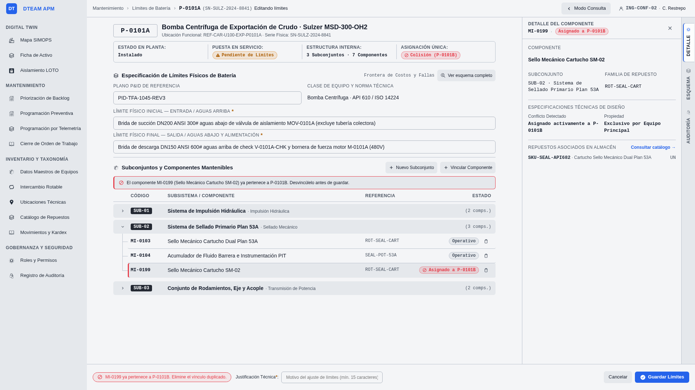
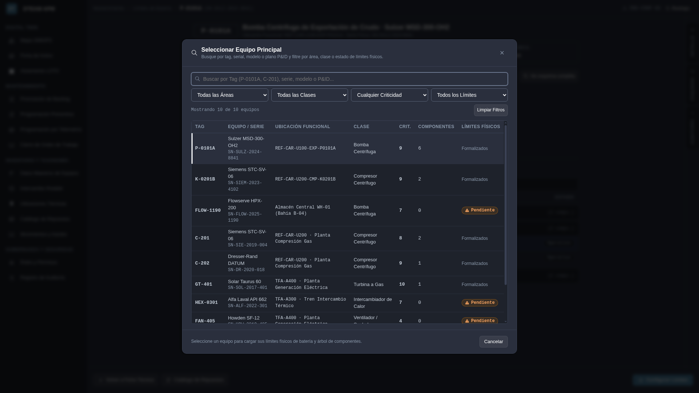
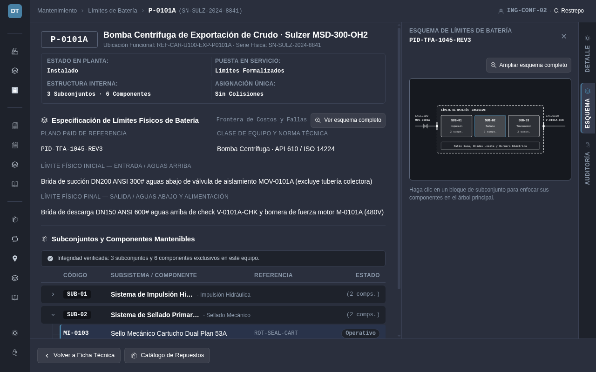
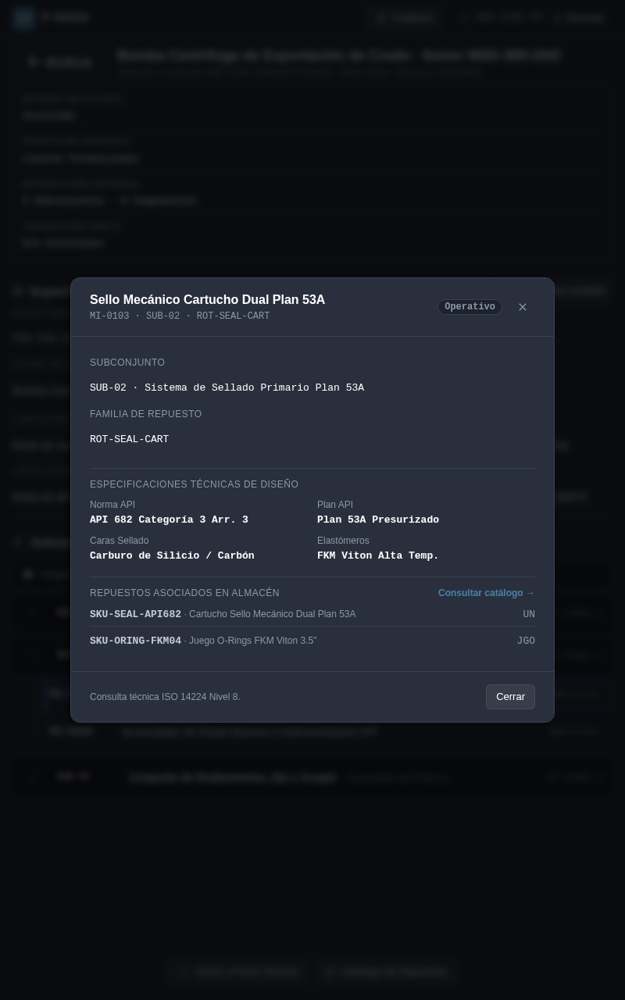
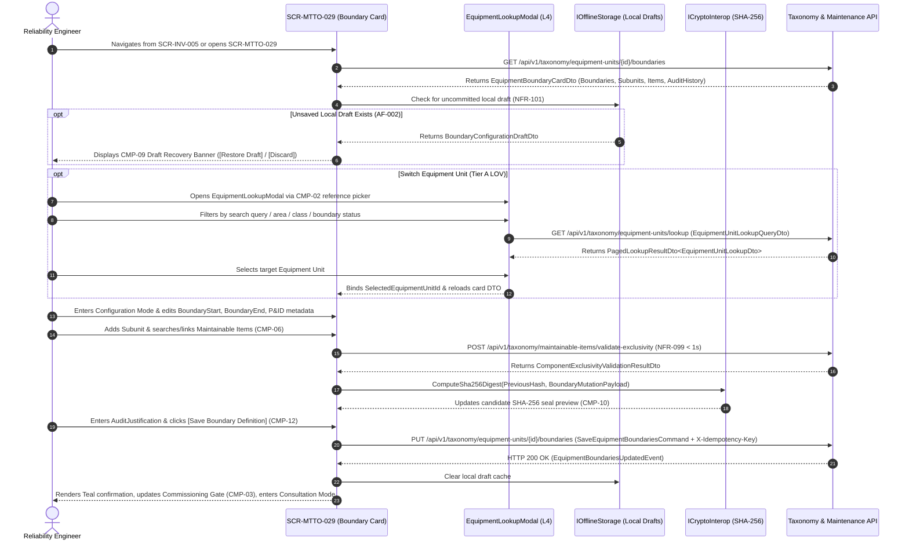

# SCR-MTTO-029: Asset Physical Boundary Limits and ISO 14224 Sub-Tree Decomposition Card

## 1. Purpose and Operational Context

* **View Objective:** Technical definition, hierarchical validation, and field consultation of physical battery limits (`BoundaryStart`, `BoundaryEnd`, and governing P&ID schematic reference metadata) alongside internal ISO 14224 sub-tree decomposition (`EquipmentUnit` $\to$ `Subunit` $\to$ `MaintainableItem`) for master equipment units. Eliminates ambiguity in maintenance cost allocation and failure coding between adjacent machinery, pairs with a Tier A searchable Enterprise Equipment Lookup Modal ([DT-UI-DS-DOC-001 §6.7](../../DT-UI-DS-DOC-001.md#67-relational-entity-lookup-modal-pattern-lov-list-of-values)) for high-volume plant navigation, and enforces the Commissioning Gate precondition (`EquipmentUnit.Activate()` per [DT-DM-DOC-002 §2.2](../../../domain-models/class/DT-DM-DOC-002.md#22-equipmentunit-aggregate-root)).
* **Primary Target Persona:** Reliability Engineer defining upstream/downstream physical battery limits, structuring Subunits and Maintainable Items, resolving cross-asset component ownership collisions (`AF-001`), and auditing historical boundary adjustments (`FR-098`).
* **Secondary Personas:**
  * **Maintenance Planner:** Consults Maintainable Item breakdowns and linked MRO spare part correspondences when structuring preventive and condition-based maintenance plans ([SCR-MTTO-001](SCR-MTTO-001.md), [SCR-MTTO-023](SCR-MTTO-023.md)).
  * **Maintenance Technician & Supervisor:** Inspects physical battery limits and included components in Read-Only Consultation Mode on rugged field tablets (`NFR-097`, `AF-003`) to verify whether an observed leak or fault belongs to the equipment unit or adjacent process piping prior to logging failures in [SCR-MTTO-002](SCR-MTTO-002.md).
  * **Auditor:** Verifies chronological boundary modification logs and SHA-256 cryptographic integrity seals (`FR-098`, [TR-001](../../../requirements/common/TR-001.md)).
* **Operational Context:** Deployed on high-resolution desktop workstations in reliability engineering offices for audited configuration and inspection, and on rugged industrial tablets in plant process areas defaulting to Read-Only Field Consultation Mode (`AF-003`). Responsive layout adaptations across desktop and tablet viewports are governed in Section 8.
* **Mode of Operation:** Taxonomic Governance & Field Technical Consultation mode. Direct DCS/SCADA process control manipulation is strictly excluded. Supports two operational modalities: **Configuration Mode** (desktop and supervisory access restricted via RBAC to `Reliability Engineer` and `Maintenance Planner` per [DT-UI-NAV-DOC-001 §5](../../DT-UI-NAV-DOC-001.md#5-transition-matrix-and-access-control-rbac)) and **Read-Only Field Consultation Mode** (`NFR-097`, `AF-003`, mandatory default on industrial field tablets).
* **Upstream & Downstream Navigation Invariants:**
  * **Upstream Continuity:** Launched from the Equipment Master Data Card ([SCR-INV-005](../inv/SCR-INV-005.md)) via `[Define Boundaries]`, from maintenance scheduling verification links ([SCR-MTTO-001](SCR-MTTO-001.md), [SCR-MTTO-023](SCR-MTTO-023.md)), or from the Mobile Field Client side drawer ([DT-UI-NAV-DOC-001 §4.1](../../DT-UI-NAV-DOC-001.md#41-navigation-structure-mobile-client)).
  * **Downstream Transitions:** Switches master units via the Tier A `EquipmentLookupModal` ([DT-UI-DS-DOC-001 §6.7](../../DT-UI-DS-DOC-001.md#67-relational-entity-lookup-modal-pattern-lov-list-of-values)), returns to [SCR-INV-005](../inv/SCR-INV-005.md) upon formalizing boundaries to unlock the equipment Commissioning Gate, or routes to the Spare Parts Master Catalog ([SCR-INV-031](../inv/SCR-INV-031.md)) to inspect MRO spares linked to Maintainable Items.

---

## 2. Visual Artifact



> *Figure 2.1 — Desktop Workstation (`1920×1080`, Dark Theme, Read-Only Consultation Mode): Illustrates the expanded portal sidebar (`CMP-01`), sticky header with clickable equipment tag link (`CMP-02`), commissioning gate readiness strip (`CMP-03`), physical battery limits specification card (`CMP-04`) with `[View Full Schematic]` L4 modal trigger, tabular-aligned explorer TreeGrid (`CMP-06`, `CMP-08`) with fixed column headers (`Code | Subsystem / Component | Reference | Status`), vertical on-demand right dock tab strip (`Detail` | `Schematic` | `Audit`), and sticky governance footer with single `[Configure Boundaries]` action (`CMP-12`).*



> *Figure 2.2 — Desktop Workstation (`1920×1080`, Light Theme, Audited Configuration Mode & Exclusivity Validation): Illustrates soft-surface editable boundary inputs (`CMP-04`), L4 modal triggers (`[+ New Subunit]`, `[+ Link Component]`) preserving `CLS = 0`, single-asset component ownership exclusivity verification (`CMP-08`, `AF-001`), the on-demand `Detail` dock panel (`CMP-07`) open beside the workspace, and mandatory audit justification input in the sticky footer (`CMP-11`, `CMP-12`).*



> *Figure 2.3 — Tier A Enterprise Equipment Lookup Modal (`1920×1080`, Dark Theme): Illustrates the Level 4 `EquipmentLookupModal` launched from the breadcrumb equipment tag link (`CMP-02`) with multi-criteria filtering, neutral subdued text for formalized units, and Amber warning pills reserved for pending units.*



> *Figure 2.4 — Industrial Tablet Landscape (`1280×800`, Dark Theme, Read-Only Field Consultation Mode `AF-003`): Illustrates automatic collapse of `CMP-01` to the icon-only rail (`--dt-layout-sidebar-width-collapsed`), suppression of configuration triggers (`CMP-02`, `CMP-06`, `CMP-12`), and the on-demand `Schematic` dock tab (`--dt-layout-drawer-width-tablet`) displaying the 2D Boundary Envelope Diagram (`CMP-05`).*



> *Figure 2.5 — Industrial Tablet Portrait (`800×1280`, Dark Theme, Read-Only Field Consultation Mode `AF-003`): Illustrates vertical single-column stacking, off-canvas navigation drawer, suppression of the desktop right dock in favor of a header `[Audit]` Level 4 modal trigger (`CMP-10`), and the centered Level 4 Component Detail Modal (`MaintainableItemDetailModal.razor`, `CMP-07`) with hairline-divided technical specification and spare parts sections deployed upon tapping a maintainable component.*

---

## 3. Functional Component Inventory

> The base grid, typography, neutral palettes, and minimal tactile contact areas are inherited from [DT-UI-DS-DOC-001](../../DT-UI-DS-DOC-001.md). This inventory defines the canonical components present on the screen, their design tokens, and their architectural scope. Interaction rules and geometric algorithms are specified in Section 5; responsive container adaptations are governed by Section 8.

1. **`CMP-01`: Portal Shell & Navigation Sidebar**
   - **Visual Role:** Collapsible navigation sidebar hosting global modules, module hierarchy, and route markers.
   - **Design Tokens:**
     - Surface: `--dt-color-surface-base`
     - Border: `--dt-color-border-hairline`
     - Width (Expanded / Collapsed): `--dt-layout-sidebar-width-expanded` / `--dt-layout-sidebar-width-collapsed`
     - Active Route Indicator: `--dt-color-state-info`
   - **Architectural Scope:** Hosts global module navigation per [DT-UI-NAV-DOC-001](../../DT-UI-NAV-DOC-001.md), highlighting the Boundary Limits Card under Maintenance. Responsive drawer rules detailed in Section 8.

2. **`CMP-02`: Boundary Card Header, Reference Picker & Session Context**
   - **Visual Role:** Sticky top header hosting breadcrumb navigation with a clickable equipment tag link launching the Tier A Level 4 `EquipmentLookupModal` ([DT-UI-DS-DOC-001 §6.7](../../DT-UI-DS-DOC-001.md#67-relational-entity-lookup-modal-pattern-lov-list-of-values)), local draft autosave indicator, active-edit `[Consultation Mode]` exit trigger, and operator session badge.
   - **Design Tokens:**
     - Surface: `--dt-color-surface-card`
     - Modal Overlay: `--dt-color-surface-overlay`
     - Modal Width & Max-Height: `--dt-layout-modal-width`, `--dt-layout-modal-max-height`
     - Border: `--dt-color-border-hairline`, `--dt-color-border-panel`
     - Elevation: `--dt-z-header-sticky`, `--dt-z-modal`
     - Primary Button: `--dt-color-state-info`
   - **Architectural Scope:** Eliminates inline catalog dropdown bloat for 50,000+ asset plants by delegating `EquipmentUnit` switching to a multi-criteria paged search modal, while enforcing role- and device-aware modality switching. Detailed in §5.1 and §5.2.

3. **`CMP-03`: Equipment Context & Commissioning Gate Strip**
   - **Visual Role:** Top identification sheet displaying the equipment `TagNumber` badge, `SerialNumber`, `EquipmentClassName`, `FunctionalLocationTag`, `LifecycleStatus`, and Commissioning Gate readiness indicator.
   - **Design Tokens:**
     - Surface: `--dt-color-surface-card`
     - Border: `--dt-color-border-subtle`
     - Tag Typography: `--dt-font-mono-data`
     - Gate Pending Accent: `--dt-color-alarm-warning`
     - Verified Gate Text: `--dt-color-text-primary`
   - **Architectural Scope:** Communicates whether mandatory physical battery limits and internal Subunit/Maintainable Item decomposition are formalized to unlock `EquipmentUnit.Activate()` ([DT-DM-DOC-002 §2.2](../../../domain-models/class/DT-DM-DOC-002.md#22-equipmentunit-aggregate-root)). Detailed in §5.1.

4. **`CMP-04`: Physical Battery Limits Specification Card**
   - **Visual Role:** Structured engineering card displaying and editing `BoundaryStart` (initial upstream process/power interface), `BoundaryEnd` (final downstream process/load interface), governing `PidReferenceCode` engineering drawing metadata, and a `[View Full Schematic]` button launching the Level 4 `BoundaryDiagramModal`.
   - **Design Tokens:**
     - Surface: `--dt-color-surface-card`
     - Border: `--dt-color-border-subtle`, `--dt-color-border-panel` (Inputs)
     - Typography: `--dt-font-body-md`, `--dt-font-mono-data`, `--dt-font-caption` (minimum label floor)
     - Warning Highlight: `--dt-color-alarm-warning`
     - Radius: `--dt-radius-md`
   - **Architectural Scope:** Maps directly to `EquipmentUnit.DefineBoundaries(boundaryStart, boundaryEnd)` alongside structured P&ID engineering metadata. Transitions seamlessly between borderless read-only key-value cells and soft-surface inputs with zero layout shift (`CLS = 0`). Detailed in §5.3.1.

5. **`CMP-05`: ISO 14224 Boundary Envelope Diagram (`Schematic` Dock Tab & L4 Modal)**
   - **Visual Role:** Flat 2D HPHMI schematic block diagram hosted inside the on-demand `Schematic` dock tab (with `[Expand Full Schematic]` aligned above the top-right corner of the diagram viewport to launch the Level 4 `BoundaryDiagramModal`), illustrating the dashed ISO 14224 physical boundary envelope around all internal Subunits while visually segregating excluded upstream/downstream process headers and isolation valves.
   - **Design Tokens:**
     - Surface: `--dt-color-surface-card`
     - Diagram Viewport: `--dt-color-bg-canvas` (Dark) / `--dt-color-surface-base` (Light, aligned with [SCR-MTTO-002](SCR-MTTO-002.md))
     - Envelope Stroke: `--dt-color-border-panel`
     - Internal Node Fill: `--dt-color-surface-raised`
     - Active Subunit Highlight: `--dt-color-state-info`
     - Typography: `--dt-font-caption` (SVG minimum label floor), `--dt-font-mono-data`, `--dt-color-text-primary`, `--dt-color-text-muted`
   - **Architectural Scope:** Provides immediate spatial disambiguation of cost and failure attribution (`Z = 0` flat 2D schematic discipline per [DT-UI-DS-DOC-001 §5.1](../../DT-UI-DS-DOC-001.md#51-hphmi-shadow-discipline-canvas-vs-hud-chrome-separation)). Clicking any Subunit block focuses that Subunit exclusively in `CMP-06` and opens `CMP-07`. Detailed in §5.2.

6. **`CMP-06`: Collapsible Subassembly & Maintainable Component Navigation TreeGrid Card**
   - **Visual Role:** Tabular-aligned two-tier explorer TreeGrid (`Subunit` $\to$ `MaintainableItem`) with sticky-style shared column headers (`Code`, `Subsystem / Component`, `Reference`, `Status`), borderless elevated full-width Subunit group bands with high-contrast dark charcoal `SUB-xx` code pills, independently collapsible accordion branches allowing multiple Subunits to be expanded simultaneously, continuous trunk-and-branch tree guide lines descending beneath the chevron gutter, Level 4 modal triggers (`[+ Add Subunit]` $\to$ `AddSubunitModal`, `[+ Link Maintainable Item]` $\to$ `LinkMaintainableItemModal`) preserving `CLS = 0`, and per-row unlink actions in Configuration Mode.
   - **Design Tokens:**
     - Surface: `--dt-color-surface-card`
     - Subunit Group Band: `--dt-color-surface-base`
     - Subunit Code Tag: `--dt-primitive-gray-850` (Light) / `--dt-primitive-gray-950` (Dark) with `--dt-font-mono-data`
     - Tree Trunk & Divider: `--dt-color-border-subtle`
     - Routine Status Pill (`OPERATIONAL`): `--dt-color-surface-base`, `--dt-color-border-subtle`, `--dt-color-text-muted`
     - Selected Row: `--dt-color-surface-raised`, `--dt-color-state-info` (Left Indicator Bar)
     - Conflict Highlight: `--dt-color-alarm-critical`
     - Row Height: `--dt-layout-table-row-height`
   - **Architectural Scope:** Governs `EquipmentUnit.AddSubunit(subunit)` and `Subunit.AddMaintainableItem(item)` ([DT-DM-DOC-002 §2.2–§2.3](../../../domain-models/class/DT-DM-DOC-002.md#2-layer-1-asset-taxonomy-iso-14224)) with `1 : 1..N` dynamic multi-item support and searchable catalog filtering (`MaintainableItemLookupQueryDto`). Lets operators keep multiple Subunits open concurrently for cross-subsystem comparison while keeping `Code`, `Reference`, and `Status` columns strictly aligned. Detailed in §5.2 and §5.3.2.

7. **`CMP-07`: Maintainable Component Inspector & Annex A Attributes (`Detail` Dock Tab / L4 Portrait Modal)**
   - **Visual Role:** On-demand lateral detail dock tab on Desktop/Tablet Landscape (or centered Level 4 `MaintainableItemDetailModal` on Tablet Portrait) displaying the selected `MaintainableItem` (`ComponentName`, localized `MaintainableItemStatus`, parent `Subunit`, `SparePartType`), separated cleanly via horizontal hairline dividers into ISO 14224 Annex A `DesignAttributes` key-value pairs and linked MRO spare part SKUs with catalog handoff (avoiding redundant nested boxes).
   - **Design Tokens:**
     - Surface: `--dt-color-surface-card`
     - Section Divider: `--dt-color-border-subtle`
     - Portrait Modal Width & Max-Height: `--dt-layout-modal-width`, `--dt-layout-modal-max-height` over `--dt-color-surface-overlay`
     - Typography: `--dt-font-caption`, `--dt-font-body-md`, `--dt-font-mono-data`
   - **Architectural Scope:** Renders `MaintainableItemNodeDto` attributes and linked `LinkedSparePartSummaryDto` references without leaking persistence schema internals, routing to the Spare Parts Master Catalog ([SCR-INV-031](../inv/SCR-INV-031.md)) on demand. Detailed in §5.3.2 and §8.3.

8. **`CMP-08`: Hierarchy Coherence & Ownership Exclusivity Validator Strip**
   - **Visual Role:** Fixed-height status bar embedded at the top of `CMP-06` reporting real-time parent-child tree coherence and concise single-asset component ownership verification without latency jitter, redundant prefixes, or badge clutter.
   - **Design Tokens:**
     - Surface: `--dt-color-surface-base`
     - Border: `--dt-color-border-subtle`
     - Conflict Accent: `--dt-color-alarm-critical`
     - Warning Accent: `--dt-color-alarm-warning`
     - Verified Indicator: `--dt-color-text-primary`
   - **Architectural Scope:** Enforces single-asset component exclusivity and parent-child hierarchical coherence, immediately flagging conflicting equipment tags before commit. Detailed in §5.3.2.

9. **`CMP-09`: Local Draft Crash-Recovery Banner**
   - **Visual Role:** Non-modal Priority 4 floating diagnostic strip (`CLS = 0` overlay anchored below the top header) deployed when an uncommitted boundary configuration draft is recovered from local encrypted storage after a connection drop or browser closure.
   - **Design Tokens:**
     - Surface: `--dt-color-surface-raised`
     - Border: `--dt-color-border-subtle`
     - Text: `--dt-color-text-body`, `--dt-color-text-muted`
     - Height: `--dt-layout-banner-diagnostic-height`
   - **Architectural Scope:** Preserves in-progress boundary text and subassembly tree structures in `IOfflineStorage` with `[Restore Draft]` and `[Discard]` actions without shifting workspace content. Detailed in §5.3.4.

10. **`CMP-10`: Chronological Boundary Audit History Ledger (`Audit` Dock Tab / L4 Portrait Modal)**
    - **Visual Role:** Append-only engineering revision tab in the progressive-disclosure right dock (and accessible on Tablet Portrait via the header `[Audit]` button opening the centered Level 4 `BoundaryAuditHistoryModal`) displaying chronological boundary adjustments, wrapped timestamp/operator headers, technical justifications, and hairline-separated chained SHA-256 verification digests at `--dt-font-caption` minimum readability.
    - **Design Tokens:**
      - Surface: `--dt-color-surface-card`
      - Border: `--dt-color-border-subtle`
      - Hash Typography: `--dt-font-caption`, `--dt-font-family-mono`
    - **Architectural Scope:** Provides immutable audit traceability per [TR-001](../../../requirements/common/TR-001.md) and [ADR-003](../../../architecture/adr/ADR-003.md) across both workstation docks and mobile/tablet portrait viewports. Detailed in §5.3.3.

11. **`CMP-11`: Inline Validation & Conflict Status Indicator**
    - **Visual Role:** Permanent `CLS = 0` validation status slot integrated into the left side of sticky footer `CMP-12`, displaying 4-channel redundant alerts (`#icon-ban`, `#icon-warning`, `#icon-check`, `#icon-info` + descriptive message).
    - **Design Tokens:**
      - Surface: `--dt-color-surface-card`
      - Critical Conflict: `--dt-color-alarm-critical`
      - Warning: `--dt-color-alarm-warning`
      - Documentary Success: `--dt-color-state-success`
    - **Architectural Scope:** Surfaces duplicate component ownership collisions (`AF-001`), omitted boundary fields (`AF-004`), and post-commit documentary confirmation without vertical layout shift (`CLS = 0`). Detailed in §5.3.2 and §5.3.3.

12. **`CMP-12`: Sticky Boundary Governance & Handoff Footer**
    - **Visual Role:** Permanent sticky bottom action bar hosting contextual Level 3 navigation handoffs (`[< Back to Master Card]`, `[Spare Parts Catalog]`), validation status slot `CMP-11`, mandatory audit justification input, and atomic commit CTA (`[Save Boundary Definition]`).
    - **Design Tokens:**
      - Surface: `--dt-color-surface-card`
      - Border: `--dt-color-border-hairline`
      - Height: `--dt-layout-footer-height`
      - Elevation: `--dt-z-header-sticky`
      - Primary CTA: `--dt-color-state-info`
      - Disabled CTA: `--dt-color-state-disabled`
      - Secondary Button: `--dt-color-surface-btn-secondary`
    - **Architectural Scope:** Dispatches `SaveEquipmentBoundariesCommand` atomically and orchestrates Level 3 cross-screen handoffs ([DT-UI-NAV-DOC-001 §5](../../DT-UI-NAV-DOC-001.md#5-transition-matrix-and-access-control-rbac)). Detailed in §5.3.3.

---

## 4. Screen State Catalog

1. **Read-Only Consultation Mode (Default / Field Tablet View — `NFR-097`, `AF-003`)**
   - **Activation Condition:** User navigates to `SCR-MTTO-029` from [SCR-INV-005](../inv/SCR-INV-005.md) in consultation mode, or opens the card from a field industrial tablet (`Mobile Field Client`).
   - **Visual Modification:** Neutral grayscale surfaces (`--dt-color-surface-card`). `BoundaryStart`, `BoundaryEnd`, and `PidReferenceCode` in `CMP-04` render as borderless stacked key-value cells without input frames or mandatory asterisks (`*`). `CMP-06` renders as a multi-expandable TreeGrid explorer; healthy `OPERATIONAL` components render as neutral grayscale pills (`--dt-color-surface-base`, `--dt-color-border-subtle`, `--dt-color-text-muted`) without green tints or dot symbols ([DT-UI-DS-DOC-001 §6.5.1](../../DT-UI-DS-DOC-001.md#651-morphological-differentiation-status-badges-vs-interactive-buttons)). On Desktop, footer `CMP-12` hosts `[< Back to Master Card]`, `[Spare Parts Catalog]`, and `[Configure Boundaries]` (visible only to `Reliability Engineer` / `Maintenance Planner`). On Tablet Portrait field consultation (`AF-003`), edit chrome is suppressed without redundant helper banners, selecting a component opens `CMP-07` in `MaintainableItemDetailModal.razor`, and the header exposes `[Audit]` to open `BoundaryAuditHistoryModal.razor` (`CMP-10`).
2. **Equipment Lookup Catalog Open & Filtered (L4 Modal — [DT-UI-DS-DOC-001 §6.7](../../DT-UI-DS-DOC-001.md#67-relational-entity-lookup-modal-pattern-lov-list-of-values))**
   - **Activation Condition:** User clicks the recessed `CMP-02` Equipment Unit reference-picker link (`#icon-search`) to inspect or switch to another physical asset.
   - **Visual Modification:** Level 4 modal dialog (`EquipmentLookupModal`) renders over `--dt-color-surface-overlay` scrim (`--dt-layout-modal-max-height`) with auto-focused debounced search input (Tag, Serial, Model, P&ID), four contextual filters (`FunctionalLocation`, `EquipmentClass`, `Criticality`, `BoundaryReadiness`), and a dense tabular result list sized by `--dt-layout-table-row-height`. Units with formalized boundaries render as plain subdued text (`--dt-color-text-muted`), reserving Amber warning pills (`--dt-color-alarm-warning`) strictly for units awaiting boundary formalization.
3. **Configuration Mode (Active Editing)**
   - **Activation Condition:** Authorized `Reliability Engineer` or `Maintenance Planner` clicks the single `[Configure Boundaries]` primary CTA in sticky footer `CMP-12`, or opens an uncommissioned equipment unit (`EquipmentLifecycleStatus.COMMISSIONING`) requiring initial boundary formalization (`FR-096`).
   - **Visual Modification:** `BoundaryStart`, `BoundaryEnd`, and `PidReferenceCode` in `CMP-04` transition cleanly to soft-surface inputs (`--dt-color-border-panel`, `--dt-radius-md`) with `CLS = 0`. `CMP-06` enables `[+ Add Subunit]` and `[+ Link Component]` Level 4 modal triggers plus per-row unlink buttons (`#icon-trash`). Footer `CMP-12` switches to commit mode hosting validation slot `CMP-11`, mandatory `AuditJustification` input, `[Cancel]`, and `[Save Boundary Definition]`.
4. **Component Search & Subunit Creation L4 Modals Active (`CLS = 0`)**
   - **Activation Condition:** Engineer clicks `[+ Add Subunit]` or `[+ Link Component]` inside `CMP-06` during Configuration Mode, or clicks `[View Full Schematic]` in `CMP-04` / `CMP-05`.
   - **Visual Modification:** Dedicated Level 4 modal (`AddSubunitModal`, `LinkMaintainableItemModal`, or `BoundaryDiagramModal`) opens over `--dt-color-surface-overlay` without shifting the underlying Subassembly tree (`CLS = 0`), presenting either a structured Subunit form (Subunit Classification + Name), a searchable Maintainable Item catalog filter (`MaintainableItemLookupQueryDto`) displaying each candidate's live occupancy (`Available` vs `Bound to [Tag]`), or an enlarged 2D boundary envelope schematic.
5. **Loading / Validating Hierarchy**
   - **Activation Condition:** Initial unit hydration or catalog-wide component exclusivity check (`NFR-099`, `NFR-100`).
   - **Visual Modification:** Skeleton shimmer (`--dt-color-surface-raised`) across `CMP-04`–`CMP-07`; commit CTA disabled (`--dt-color-state-disabled`).
6. **Incomplete Mandatory Boundary Fields (`FR-096` / `AF-004`)**
   - **Activation Condition:** Engineer edits or attempts to save while `BoundaryStart`, `BoundaryEnd`, or at least one `Subunit` / `MaintainableItem` is missing.
   - **Visual Modification:** Omitted inputs in `CMP-04` or empty tree container in `CMP-06` highlight with `--dt-color-alarm-warning` and `#icon-warning`. `CMP-11` displays actionable guidance in the footer status slot and disables `[Save Boundary Definition]` (`CLS = 0`).
7. **Component Assignment Collision (`AF-001` / `NFR-093`)**
   - **Activation Condition:** Exclusivity validation (`CMP-08`) detects that a selected `MaintainableItem` is already assigned to another Level 6 `EquipmentUnit` (`TR-008-FR-414`).
   - **Visual Modification:** Conflicting row in `CMP-06` highlights with `--dt-color-alarm-critical` left bar and `#icon-ban` badge identifying the owning equipment tag (e.g., `Bound to P-0101B`). `CMP-08` and `CMP-11` display critical collision alerts, and `[Save Boundary Definition]` is hard-disabled (`CLS = 0`).
8. **Deep Hierarchy Inconsistency (`NFR-094` / `NFR-103`)**
   - **Activation Condition:** Integrity verification detects an orphaned `MaintainableItem` or taxonomic class mismatch between `SubunitType` and parent `EquipmentClass`.
   - **Visual Modification:** Affected node in `CMP-06` highlights with `--dt-color-alarm-warning` and `#icon-warning`; `CMP-08` and `CMP-11` display remediation guidance.
9. **Recovered Unsaved Session Draft (`AF-002` / `NFR-101`)**
   - **Activation Condition:** Engineer reopens `SCR-MTTO-029` after an unexpected session drop or browser closure while an uncommitted draft exists in `IOfflineStorage`.
   - **Visual Modification:** Diagnostic strip `CMP-09` (`--dt-layout-banner-diagnostic-height`, `--dt-color-surface-raised`) renders at the top with `#icon-wifi-off`, timestamp, `[Restore Draft]`, and `[Discard]`.
10. **Documentary Confirmation (Success)**
    - **Activation Condition:** Atomic persistence of physical boundaries, L7/L8 sub-tree associations, and SHA-256 audit log entry completes (`NFR-095`).
    - **Visual Modification:** `CMP-11` / documentary toast (`--dt-color-state-success`, `#icon-check`) confirms saved integrity seal; `CMP-03` Commissioning Gate updates to `BOUNDARIES VERIFIED`; `CMP-10` prepends the new revision entry; view transitions cleanly to Read-Only Consultation Mode.

---

## 5. Interaction Rules and Data Flow

### 5.1. Initial Load & Lifecycle



1. **Context Hydration & Commissioning Gate Evaluation (`FR-091`, `FR-096`):**
   * On initialization with `EquipmentUnitId`, `AssetBoundaryLimitsPage.razor` retrieves `EquipmentBoundaryCardDto` (§7.2.3), hydrating `BoundaryStart`, `BoundaryEnd`, P&ID reference metadata, the nested `SubunitNodeDto` and `MaintainableItemNodeDto` hierarchy, and `BoundaryAuditEntryDto` history.
   * If `BoundaryStart` or `BoundaryEnd` is empty or the sub-tree contains zero Maintainable Items, `CMP-03` flags the Commissioning Gate as `PENDING BOUNDARY DEFINITION`, blocking `EquipmentUnit.Activate()` in [SCR-INV-005](../inv/SCR-INV-005.md) and plan creation in [SCR-MTTO-001](SCR-MTTO-001.md) / [SCR-MTTO-023](SCR-MTTO-023.md).
2. **Orthogonal Component Status Hygiene ([DT-DM-DOC-001 §4.7](../../../domain-models/class/DT-DM-DOC-001.md#47-maintainableitemstatus)):**
   * Each `MaintainableItem` in `CMP-06` and `CMP-07` reflects its canonical status (`MaintainableItemStatus`: `OPERATIONAL`, `DEGRADED`, `FAILED`, `UNDER_REPAIR`, `REPLACED`), localized into natural plant Spanish in the UI.
   * Per [DT-UI-DS-DOC-001 §6.5](../../DT-UI-DS-DOC-001.md#65-status-badge-counter-discipline-anti-badge-inflation-principle), `OPERATIONAL` and `REPLACED` items render as neutral grayscale pills (`--dt-color-surface-base`, `--dt-color-border-subtle`, `--dt-color-text-muted`) without green tints or dot symbols, reserving Amber warning pills (`--dt-color-alarm-warning`) for `DEGRADED` / `UNDER_REPAIR` and Red critical pills (`--dt-color-alarm-critical`) for `FAILED` or ownership collisions.

---

### 5.2. Spatial Navigation & Tactile Mechanics

1. **ANSI/ISA-101 Progressive Disclosure Workspace (`L2` $\to$ `L3` $\to$ `L4`):**
   * At Desktop and Tablet Landscape resolutions, the primary engineering datasheet (`CMP-03`, `CMP-04`, `CMP-06`, `CMP-08`) occupies the main canvas unobstructed, while secondary reference modules (`CMP-07` `Detail`, `CMP-05` `Schematic`, `CMP-10` `Audit`) dock behind an on-demand vertical tab strip on the right edge (closed by default on initial load and sliding open smoothly to `--dt-layout-drawer-width` upon selection).
   * All functional text, badges, SVG diagram labels, and audit metadata enforce a strict `--dt-font-caption` minimum readability floor with `--dt-font-body-md` primary copy.
2. **Multi-Expand TreeGrid Accordion, Diagram & Portrait L4 Modal Ergonomics:**
   * Subunit branches in `CMP-06` toggle independently so operators can keep multiple Subunits expanded concurrently for cross-assembly comparison.
   * Tapping any Maintainable Item row focuses it and opens the `Detail` dock tab on Desktop/Tablet Landscape, or opens `CMP-07` inside the centered Level 4 modal (`MaintainableItemDetailModal.razor`) on Tablet Portrait (`--dt-breakpoint-md`) with `--dt-touch-target-mobile` controls; on Tablet Portrait, tapping `[Audit]` in `CMP-02` opens the centered Level 4 `BoundaryAuditHistoryModal.razor` (`CMP-10`).
   * Clicking `[View Full Schematic]` / `[Expand Full Schematic]` opens the Level 4 `BoundaryDiagramModal` for full-width boundary inspection; clicking any Subunit node inside the diagram expands and focuses that Subunit in `CMP-06`.
3. **Zero Layout Shift (`CLS = 0`):**
   * Switching between Read-Only Consultation Mode and Configuration Mode preserves fixed card headers, boundary field row heights, and footer geometry (`--dt-layout-footer-height`). Draft recovery (`CMP-09`) renders as a floating overlay strip, and entity creation/linking opens in Level 4 modals (`AddSubunitModal`, `LinkMaintainableItemModal`) so tree rows never jump vertically.

---

### 5.3. Domain Workflows & Validation Rules

#### 5.3.1. Physical Battery Limits & P&ID Metadata Alignment (`FR-092`, `FR-096`, `FR-102`)
1. **Mandatory Boundary Pair (`FR-092`, `FR-096`):** Formalizing boundaries invokes `EquipmentUnit.DefineBoundaries(boundaryStart, boundaryEnd)` ([DT-DM-DOC-002 §2.2](../../../domain-models/class/DT-DM-DOC-002.md#22-equipmentunit-aggregate-root)), requiring non-empty technical specifications for both `BoundaryStart` (up to $150$ characters, e.g., *"DN200 ANSI 300# suction flange downstream of isolation valve MOV-0101A"*) and `BoundaryEnd` (up to $150$ characters, e.g., *"DN150 ANSI 600# discharge flange and MCC-02 feeder breaker M-0101A load terminals"*).
2. **Governing P&ID Engineering Metadata (`FR-102`):** The governing P&ID drawing identifier (`PidReferenceCode`, e.g., *"PID-TFA-1045-REV3"*) is captured alongside the boundary limits as structured engineering boundary metadata persisted within the asset's boundary revision payload and technical `DesignAttributes` without altering the core relational schema.

#### 5.3.2. Tier A Equipment Lookup, Sub-Tree Structuring & Exclusivity (`NFR-093`, `NFR-094`, `NFR-099`, `AF-001`, `TR-008`)
1. **Enterprise Equipment Lookup ([DT-UI-DS-DOC-001 §6.7](../../DT-UI-DS-DOC-001.md#67-relational-entity-lookup-modal-pattern-lov-list-of-values)):** Opening `EquipmentLookupModal` dispatches paged queries (`EquipmentUnitLookupQueryDto`) supporting multi-criteria filtering (`SearchTerm`, `FunctionalLocationId`, `EquipmentClassId`, `MinCriticality`, `MaxCriticality`, `HasBoundariesFilter`) and rendering `--dt-layout-table-row-height` rows with explicit boundary readiness status (`HasBoundaries`).
2. **Dynamic Subunit & Maintainable Item Composition (`1 : 1..N`):**
   * `CMP-06` enables creating structured `Subunit` nodes (`SubunitType` + `Name`) and opening a searchable `MaintainableItem` linker (`MaintainableItemLookupQueryDto`) displaying part family, Annex A summary, and live catalog occupancy (`Available` vs `Bound to [Tag]`).
   * Every Level 8 `MaintainableItem` must be nested under a parent Level 7 `Subunit` belonging to the Level 6 `EquipmentUnit`:
     $$\text{EquipmentUnit (L6)} \xrightarrow{1:N} \text{Subunit (L7)} \xrightarrow{1:N} \text{MaintainableItem (L8)}$$
3. **Single-Asset Component Exclusivity (`NFR-093`, `TR-008-FR-414`, `AF-001`):** A `MaintainableItem` instance cannot belong to two `EquipmentUnits` simultaneously:
   $$\forall m \in \text{MaintainableItems}, \quad |\text{EquipmentUnits}(m)| \le 1$$
   When a candidate item is linked or validated, the system executes asynchronous uniqueness verification in $< 1\text{s}$ (`NFR-099`). Any conflict triggers State 7 (`AF-001`), highlighting the row with `--dt-color-alarm-critical` and `#icon-ban`, displaying the owning unit tag, and hard-disabling `[Save Boundary Definition]`.

#### 5.3.3. Client Command Dispatch & Cryptographic Audit Chain (`FR-098`, `NFR-095`, `TR-001`, `ADR-003`)
1. **Atomic Command Dispatch (`NFR-095`):** Clicking `[Save Boundary Definition]` in `CMP-12` requires a mandatory `AuditJustification` ($\ge 15$ characters) and dispatches `SaveEquipmentBoundariesCommand` (§7.2.3) to `PUT /api/v1/taxonomy/equipment-units/{id}/boundaries` with header `X-Idempotency-Key: {uuidv7}`. On `HTTP 200 OK`, the client clears local draft storage, updates `CMP-03` Commissioning Gate state, prepends the committed revision to `CMP-10`, and returns cleanly to Read-Only Consultation Mode; on conflict or validation failure (`HTTP 409` / `422`), `CMP-11` surfaces the server diagnostic without data loss.
2. **Chained Cryptographic Digest Preview (`FR-098`, `TR-001`, `ADR-003`):** `ICryptoInterop` computes the candidate SHA-256 integrity preview displayed in `CMP-10`:
   $$\text{IntegrityHash} = \text{SHA-256}(\text{PreviousHash} \parallel \text{EngineerUserId} \parallel \text{EquipmentUnitId} \parallel \text{BoundaryStart} \parallel \text{BoundaryEnd} \parallel \text{SubunitItemTreeHash} \parallel \text{AuditJustification} \parallel \text{TimestampUtc})$$

#### 5.3.4. Session Crash-Recovery & Field Read-Only Consultation (`NFR-097`, `NFR-101`, `AF-002`, `AF-003`)
1. **Auto-Saved Local Configuration Drafts (`NFR-101`, `AF-002`):** During active editing in Configuration Mode, boundary and sub-tree mutations debounce ($500\text{ms}$) into encrypted local storage (`IOfflineStorage` / `TR-002`). Reopening `SCR-MTTO-029` with an uncommitted draft activates `CMP-09` (`[Restore Draft]` / `[Discard]`).
2. **Mobile Field Read-Only Consultation (`NFR-097`, `AF-003`, `TR-007`):** When accessed from an industrial field tablet (online or offline), `SCR-MTTO-029` enforces `BoundaryViewMode.READ_ONLY`, suppresses edit chrome, routes item selection on portrait viewports to the centered Level 4 detail modal (`MaintainableItemDetailModal.razor`), and exposes audit history via the header `[Audit]` modal (`BoundaryAuditHistoryModal.razor`).

---

## 6. Industrial and Safety Considerations

* **Cost & Failure Attribution Precision (ISO 14224 §6 / ISO 55001):** Ambiguous physical boundaries between a driven equipment unit, its electric/turbine driver, and adjacent header valves corrupt MTBF reliability calculations and RIME cost tracking. `CMP-04` and `CMP-05` enforce explicit boundary demarcation prior to asset commissioning (`FR-096`).
* **LOTO & Physical Boundary Alignment (ISO 45001 §8.1):** Defining upstream (`BoundaryStart`) and downstream (`BoundaryEnd`) mechanical and electrical interfaces directly informs the energy isolation points (`IsolationPoint` in [SCR-VIS-011](../vis/SCR-VIS-011.md)) needed to reach a Zero Energy state.
* **HPHMI Visual Discipline & Anti-Badge-Inflation ([TR-011](../../../requirements/common/TR-011.md)):** Per [DT-UI-DS-DOC-001 §1](../../DT-UI-DS-DOC-001.md#1-scope), [§5.1](../../DT-UI-DS-DOC-001.md#51-hphmi-shadow-discipline-canvas-vs-hud-chrome-separation), and [§6.5](../../DT-UI-DS-DOC-001.md#65-status-badge-counter-discipline-anti-badge-inflation-principle), `CMP-05` uses flat 2D neutral grayscale geometry (`Z = 0`), healthy `OPERATIONAL` components omit decorative green pills, and saturated colors (`--dt-color-alarm-critical`, `--dt-color-alarm-warning`) are reserved strictly for `AF-001` ownership collisions, `FAILED`/`DEGRADED` items, and incomplete commissioning gates.

---

## 7. Frontend Component Contract (Blazor / Razor)

### 7.1. Component Hierarchy & File Mapping

```text
Pages/Maintenance/
└── AssetBoundaryLimitsPage.razor                      # Root View (SCR-MTTO-029)
    ├── PortalSidebarNav.razor                         # CMP-01: Collapsible navigation sidebar
    ├── BoundaryHeaderBar.razor                        # CMP-02: Breadcrumbs, picker link, draft status & mode toggle
    ├── EquipmentLookupModal.razor                     # CMP-02 (L4): Tier A enterprise Equipment Unit lookup modal
    ├── LocalDraftRecoveryBanner.razor                 # CMP-09: Floating CLS=0 crash-recovery banner (AF-002)
    ├── EquipmentBoundaryContextCard.razor             # CMP-03: Unit identity & Commissioning Gate readiness strip
    ├── PhysicalBatteryLimitsEditorCard.razor          # CMP-04: BoundaryStart, BoundaryEnd, P&ID & schematic modal trigger
    ├── SubunitHierarchyTreeCard.razor                 # CMP-06: Collapsible Subunit -> MaintainableItem accordion tree
    │   └── HierarchyIntegrityValidatorStrip.razor     # CMP-08: Real-time <1s exclusivity & tree coherence bar
    ├── BoundaryInspectionDock.razor                   # Progressive-disclosure right dock (Detail | Schematic | Audit)
    │   ├── MaintainableItemInspectorCard.razor        # CMP-07: Selected component details, Annex A & BOM spares
    │   ├── IsoBoundaryDiagramCard.razor               # CMP-05: 2D HPHMI boundary envelope schematic diagram
    │   └── BoundaryAuditHistoryCard.razor             # CMP-10: Chronological SHA-256 boundary audit ledger (FR-098)
    ├── BoundaryDiagramModal.razor                     # CMP-05 (L4): Expanded 2D boundary schematic inspection modal
    ├── AddSubunitModal.razor                          # CMP-06 (L4): Structured Subunit creation modal (CLS=0)
    ├── LinkMaintainableItemModal.razor                # CMP-06 (L4): Searchable catalog component linker modal (CLS=0)
    ├── MaintainableItemDetailModal.razor              # CMP-07 (Tablet Portrait L4): Centered component detail modal (AF-003)
    ├── BoundaryAuditHistoryModal.razor                # CMP-10 (Tablet Portrait L4): Centered revision & SHA-256 audit modal
    └── BoundaryActionFooter.razor                     # CMP-12: Permanent sticky footer with L3 handoffs & commit CTA
        └── BoundaryValidationAlertSlot.razor          # CMP-11: CLS=0 redundant validation & collision alert slot
```

---

### 7.2. Physical Component Parameters & DTO Contracts (.NET 10 / C# 14)

#### 7.2.1. `AssetBoundaryLimitsPage.razor` (Root View)

```csharp
[Parameter]
public required Guid EquipmentUnitId { get; set; }

[Parameter, SupplyParameterFromQuery(Name = "mode")]
public BoundaryViewMode InitialMode { get; set; } = BoundaryViewMode.READ_ONLY;
```

#### 7.2.2. Subcomponent Parameter Contracts (`CMP-01` to `CMP-12` + Modals/Sheets)

```csharp
// CMP-01: PortalSidebarNav.razor
[Parameter]
public bool IsCollapsed { get; set; }

[Parameter]
public bool IsMobileDrawerOpen { get; set; }

[Parameter]
public string ActiveRouteCode { get; set; } = "SCR-MTTO-029";

[Parameter]
public EventCallback<bool> OnCollapseToggled { get; set; }

// CMP-02: BoundaryHeaderBar.razor
[Parameter]
public required BoundaryViewMode ActiveMode { get; set; }

[Parameter]
public required EquipmentBoundaryHeaderDto CurrentEquipment { get; set; }

[Parameter]
public required string OperatorBadgeCode { get; set; }

[Parameter]
public required string OperatorDisplayName { get; set; }

[Parameter]
public bool CanEditBoundaries { get; set; }

[Parameter]
public bool HasUncommittedChanges { get; set; }

[Parameter]
public DateTimeOffset? LastDraftSavedAtUtc { get; set; }

[Parameter]
public EventCallback OnOpenEquipmentLookupRequested { get; set; }

[Parameter]
public EventCallback OnOpenAuditModalRequested { get; set; }

[Parameter]
public EventCallback<BoundaryViewMode> OnModeChanged { get; set; }

[Parameter]
public EventCallback OnToggleMobileNavigation { get; set; }

// CMP-02 (L4 Modal): EquipmentLookupModal.razor (Tier A Reference Contract per DT-UI-DS-DOC-001 §6.7)
[Parameter]
public bool IsOpen { get; set; }

[Parameter]
public required EquipmentUnitLookupQueryDto Query { get; set; }

[Parameter]
public EventCallback<EquipmentUnitLookupQueryDto> OnQueryChanged { get; set; }

[Parameter]
public required IReadOnlyList<EquipmentUnitLookupDto> SearchResults { get; set; }

[Parameter]
public int TotalCount { get; set; }

[Parameter]
public Guid? SelectedEquipmentUnitId { get; set; }

[Parameter]
public EventCallback<EquipmentUnitLookupDto> OnEquipmentUnitSelected { get; set; }

[Parameter]
public EventCallback OnCloseRequested { get; set; }

// CMP-09: LocalDraftRecoveryBanner.razor (AF-002)
[Parameter]
public bool HasRecoverableDraft { get; set; }

[Parameter]
public DateTimeOffset? DraftTimestampUtc { get; set; }

[Parameter]
public EventCallback OnRestoreDraftRequested { get; set; }

[Parameter]
public EventCallback OnDiscardDraftRequested { get; set; }

// CMP-03: EquipmentBoundaryContextCard.razor
[Parameter]
public required EquipmentBoundaryHeaderDto Header { get; set; }

[Parameter]
public bool IsCommissioningGateSatisfied { get; set; }

[Parameter]
public int SubunitCount { get; set; }

[Parameter]
public int MaintainableItemCount { get; set; }

[Parameter]
public bool HasExclusivityCollision { get; set; }

// CMP-04: PhysicalBatteryLimitsEditorCard.razor
[Parameter]
public string PidReferenceCode { get; set; } = string.Empty;

[Parameter]
public EventCallback<string> PidReferenceCodeChanged { get; set; }

[Parameter]
public string BoundaryStart { get; set; } = string.Empty;

[Parameter]
public EventCallback<string> BoundaryStartChanged { get; set; }

[Parameter]
public string BoundaryEnd { get; set; } = string.Empty;

[Parameter]
public EventCallback<string> BoundaryEndChanged { get; set; }

[Parameter]
public bool IsReadOnly { get; set; }

[Parameter]
public bool HasMissingBoundaryError { get; set; }

[Parameter]
public EventCallback OnOpenDiagramModalRequested { get; set; }

// CMP-05: IsoBoundaryDiagramCard.razor
[Parameter]
public required string EquipmentTag { get; set; }

[Parameter]
public string? PidReferenceCode { get; set; }

[Parameter]
public required string BoundaryStart { get; set; }

[Parameter]
public required string BoundaryEnd { get; set; }

[Parameter]
public required IReadOnlyList<SubunitNodeDto> Subunits { get; set; }

[Parameter]
public Guid? SelectedSubunitId { get; set; }

[Parameter]
public EventCallback<Guid> OnSubunitDiagramNodeClicked { get; set; }

[Parameter]
public EventCallback OnExpandDiagramModalRequested { get; set; }

// Progressive-Disclosure Right Dock: BoundaryInspectionDock.razor
[Parameter]
public bool IsOpen { get; set; }

[Parameter]
public BoundaryDockTab ActiveTab { get; set; } = BoundaryDockTab.DETAIL;

[Parameter]
public EventCallback<BoundaryDockTab> OnTabChanged { get; set; }

[Parameter]
public EventCallback OnCloseDockRequested { get; set; }

// CMP-05 (L4 Modal): BoundaryDiagramModal.razor
[Parameter]
public bool IsOpen { get; set; }

[Parameter]
public required string EquipmentTag { get; set; }

[Parameter]
public string? PidReferenceCode { get; set; }

[Parameter]
public required string BoundaryStart { get; set; }

[Parameter]
public required string BoundaryEnd { get; set; }

[Parameter]
public required IReadOnlyList<SubunitNodeDto> Subunits { get; set; }

[Parameter]
public Guid? SelectedSubunitId { get; set; }

[Parameter]
public EventCallback<Guid> OnSubunitDiagramNodeClicked { get; set; }

[Parameter]
public EventCallback OnCloseModalRequested { get; set; }

// CMP-06: SubunitHierarchyTreeCard.razor
[Parameter]
public required IReadOnlyList<SubunitNodeDto> Subunits { get; set; }

[Parameter]
public Guid? SelectedSubunitId { get; set; }

[Parameter]
public Guid? SelectedMaintainableItemId { get; set; }

[Parameter]
public bool IsReadOnly { get; set; }

[Parameter]
public required MaintainableItemLookupQueryDto ComponentSearchQuery { get; set; }

[Parameter]
public required PagedLookupResultDto<MaintainableItemLookupDto> ComponentSearchResults { get; set; }

[Parameter]
public EventCallback<Guid> OnSubunitSelected { get; set; }

[Parameter]
public EventCallback<Guid> OnMaintainableItemSelected { get; set; }

[Parameter]
public EventCallback OnOpenAddSubunitModalRequested { get; set; }

[Parameter]
public EventCallback<Guid?> OnOpenLinkMaintainableItemModalRequested { get; set; }

[Parameter]
public EventCallback<AddSubunitRequestDto> OnSubunitAdded { get; set; }

[Parameter]
public EventCallback<Guid> OnSubunitRemoved { get; set; }

[Parameter]
public EventCallback<MaintainableItemLookupQueryDto> OnComponentSearchChanged { get; set; }

[Parameter]
public EventCallback<LinkMaintainableItemRequestDto> OnMaintainableItemLinked { get; set; }

[Parameter]
public EventCallback<Guid> OnMaintainableItemUnlinked { get; set; }

// CMP-06 (L4 Modal): AddSubunitModal.razor
[Parameter]
public bool IsOpen { get; set; }

[Parameter]
public EventCallback<AddSubunitRequestDto> OnSubunitCreated { get; set; }

[Parameter]
public EventCallback OnCloseModalRequested { get; set; }

// CMP-06 (L4 Modal): LinkMaintainableItemModal.razor
[Parameter]
public bool IsOpen { get; set; }

[Parameter]
public Guid? TargetSubunitId { get; set; }

[Parameter]
public required MaintainableItemLookupQueryDto SearchQuery { get; set; }

[Parameter]
public required PagedLookupResultDto<MaintainableItemLookupDto> SearchResults { get; set; }

[Parameter]
public EventCallback<MaintainableItemLookupQueryDto> OnSearchQueryChanged { get; set; }

[Parameter]
public EventCallback<LinkMaintainableItemRequestDto> OnMaintainableItemLinked { get; set; }

[Parameter]
public EventCallback OnCloseModalRequested { get; set; }

// CMP-08: HierarchyIntegrityValidatorStrip.razor
[Parameter]
public bool IsValidating { get; set; }

[Parameter]
public required HierarchyValidationSummaryDto ValidationSummary { get; set; }

// CMP-07: MaintainableItemInspectorCard.razor
[Parameter]
public MaintainableItemNodeDto? SelectedItem { get; set; }

[Parameter]
public bool IsReadOnly { get; set; }

[Parameter]
public EventCallback<MaintainableItemNodeDto> OnItemAttributesUpdated { get; set; }

[Parameter]
public EventCallback<Guid> OnInspectSparePartCatalogRequested { get; set; }

// CMP-07 (Tablet Portrait L4 Modal): MaintainableItemDetailModal.razor
[Parameter]
public bool IsOpen { get; set; }

[Parameter]
public MaintainableItemNodeDto? SelectedItem { get; set; }

[Parameter]
public EventCallback<Guid> OnInspectSparePartCatalogRequested { get; set; }

[Parameter]
public EventCallback OnCloseModalRequested { get; set; }

// CMP-10 (Tablet Portrait L4 Modal): BoundaryAuditHistoryModal.razor
[Parameter]
public bool IsOpen { get; set; }

[Parameter]
public required IReadOnlyList<BoundaryAuditEntryDto> AuditEntries { get; set; }

[Parameter]
public required string PreviousChainHash { get; set; }

[Parameter]
public required string CandidateOrLatestIntegrityHash { get; set; }

[Parameter]
public EventCallback OnCloseModalRequested { get; set; }

// CMP-10: BoundaryAuditHistoryCard.razor
[Parameter]
public required IReadOnlyList<BoundaryAuditEntryDto> AuditEntries { get; set; }

[Parameter]
public required string PreviousChainHash { get; set; }

[Parameter]
public required string CandidateOrLatestIntegrityHash { get; set; }

// CMP-12: BoundaryActionFooter.razor
[Parameter]
public required BoundaryViewMode ActiveMode { get; set; }

[Parameter]
public bool CanEditBoundaries { get; set; }

[Parameter]
public bool CanCommit { get; set; }

[Parameter]
public bool IsSubmitting { get; set; }

[Parameter]
public BoundaryValidationState ValidationState { get; set; }

[Parameter]
public BoundaryConflictType? ActiveConflict { get; set; }

[Parameter]
public string? ConflictMessage { get; set; }

[Parameter]
public string AuditJustification { get; set; } = string.Empty;

[Parameter]
public EventCallback<string> AuditJustificationChanged { get; set; }

[Parameter]
public EventCallback OnBackToMasterCardClicked { get; set; }

[Parameter]
public EventCallback OnVerifySparePartsClicked { get; set; }

[Parameter]
public EventCallback OnEnterConfigureModeClicked { get; set; }

[Parameter]
public EventCallback OnCancelConfigurationClicked { get; set; }

[Parameter]
public EventCallback OnCommitBoundariesClicked { get; set; }

// CMP-11: BoundaryValidationAlertSlot.razor
[Parameter]
public BoundaryValidationState ValidationState { get; set; }

[Parameter]
public BoundaryConflictType? ActiveConflict { get; set; }

[Parameter]
public string? ConflictMessage { get; set; }
```

#### 7.2.3. Data Transfer Objects (DTOs) and Enums

```csharp
public enum BoundaryViewMode
{
    READ_ONLY,
    CONFIGURE
}

public enum BoundaryDockTab
{
    DETAIL,
    SCHEMATIC,
    AUDIT
}

/// <summary>
/// Controlled equipment lifecycle vocabulary per DT-DM-DOC-001 §4.2.
/// </summary>
public enum EquipmentLifecycleStatus
{
    IN_STORAGE,
    INSTALLED,
    COMMISSIONING,
    DECOMMISSIONED
}

/// <summary>
/// Controlled maintainable item health/lifecycle status vocabulary per DT-DM-DOC-001 §4.7.
/// </summary>
public enum MaintainableItemStatus
{
    OPERATIONAL,
    DEGRADED,
    FAILED,
    UNDER_REPAIR,
    REPLACED
}

public enum BoundaryValidationState
{
    VALID_READY,
    NEEDS_JUSTIFICATION,
    BLOCKED_CONFLICT,
    COMMITTED_SUCCESS
}

public enum BoundaryConflictType
{
    INCOMPLETE_BOUNDARY_FIELDS,
    COMPONENT_OWNERSHIP_COLLISION,
    HIERARCHY_COHERENCE_VIOLATION
}

public record PagedLookupResultDto<T>
{
    public required IReadOnlyList<T> Items { get; init; }
    public required int TotalCount { get; init; }
    public required int PageNumber { get; init; }
    public required int PageSize { get; init; }
}

public record EquipmentUnitLookupQueryDto
{
    public string? SearchTerm { get; init; }
    public Guid? FunctionalLocationId { get; init; }
    public Guid? EquipmentClassId { get; init; }
    public int? MinCriticality { get; init; }
    public int? MaxCriticality { get; init; }
    public bool? HasBoundariesFilter { get; init; }
    public int PageNumber { get; init; } = 1;
    public int PageSize { get; init; } = 25;
}

public record EquipmentUnitLookupDto
{
    public required Guid EquipmentUnitId { get; init; }
    public required string TagNumber { get; init; }
    public required string Name { get; init; }
    public required string SerialNumber { get; init; }
    public required string Model { get; init; }
    public string? FunctionalLocationTag { get; init; }
    public required string EquipmentClassName { get; init; }
    public required int Criticality { get; init; }
    public required EquipmentLifecycleStatus LifecycleStatus { get; init; }
    public int MappedSignalCount { get; init; }
    public required bool HasBoundaries { get; init; }
    public string? BoundaryStart { get; init; }
    public string? BoundaryEnd { get; init; }
    public required int SubunitCount { get; init; }
    public required int MaintainableItemCount { get; init; }
}

public record MaintainableItemLookupQueryDto
{
    public string? SearchTerm { get; init; }
    public string? SparePartType { get; init; }
    public bool OnlyUnassigned { get; init; }
    public int PageNumber { get; init; } = 1;
    public int PageSize { get; init; } = 25;
}

public record MaintainableItemLookupDto
{
    public required Guid MaintainableItemId { get; init; }
    public required string ComponentName { get; init; }
    public required string SubunitType { get; init; }
    public string? SparePartType { get; init; }
    public required MaintainableItemStatus Status { get; init; }
    public Guid? AssignedEquipmentUnitId { get; init; }
    public string? AssignedEquipmentTag { get; init; }
    public IReadOnlyDictionary<string, string> DesignAttributes { get; init; } = new Dictionary<string, string>();
    public IReadOnlyList<LinkedSparePartSummaryDto> LinkedSpareParts { get; init; } = [];
}

public record EquipmentBoundaryCardDto
{
    public required EquipmentBoundaryHeaderDto Header { get; init; }
    public string? PidReferenceCode { get; init; }
    public required string BoundaryStart { get; init; }
    public required string BoundaryEnd { get; init; }
    public required bool IsCommissioningGateSatisfied { get; init; }
    public IReadOnlyList<SubunitNodeDto> Subunits { get; init; } = [];
    public IReadOnlyList<BoundaryAuditEntryDto> AuditHistory { get; init; } = [];
    public required string PreviousIntegrityHash { get; init; }
    public required string LatestIntegrityHash { get; init; }
}

public record EquipmentBoundaryHeaderDto
{
    public required Guid EquipmentUnitId { get; init; }
    public required string TagNumber { get; init; }
    public required string SerialNumber { get; init; }
    public required string Manufacturer { get; init; }
    public required string Model { get; init; }
    public string? FunctionalLocationTag { get; init; }
    public string? FunctionalLocationName { get; init; }
    public required Guid EquipmentClassId { get; init; }
    public required string EquipmentClassName { get; init; }
    public string? ManufacturerStandard { get; init; }
    public required EquipmentLifecycleStatus LifecycleStatus { get; init; }
}

public record SubunitNodeDto
{
    public required Guid SubunitId { get; init; }
    public required Guid EquipmentUnitId { get; init; }
    public required string SubunitType { get; init; }
    public required string Name { get; init; }
    public IReadOnlyList<MaintainableItemNodeDto> MaintainableItems { get; init; } = [];
}

public record MaintainableItemNodeDto
{
    public required Guid MaintainableItemId { get; init; }
    public required Guid SubunitId { get; init; }
    public required string ComponentName { get; init; }
    public required string SubunitType { get; init; }
    public string? SparePartType { get; init; }
    public required MaintainableItemStatus Status { get; init; }
    public IReadOnlyDictionary<string, string> DesignAttributes { get; init; } = new Dictionary<string, string>();
    public IReadOnlyList<LinkedSparePartSummaryDto> LinkedSpareParts { get; init; } = [];
    public bool HasOwnershipCollision { get; init; }
    public string? ConflictingEquipmentTag { get; init; }
}

public record LinkedSparePartSummaryDto
{
    public required Guid SparePartId { get; init; }
    public required string Sku { get; init; }
    public required string Description { get; init; }
    public required string UnitOfMeasure { get; init; }
}

public record AddSubunitRequestDto
{
    public required string SubunitType { get; init; }
    public required string Name { get; init; }
}

public record LinkMaintainableItemRequestDto
{
    public required Guid TargetSubunitId { get; init; }
    public required Guid MaintainableItemId { get; init; }
    public required string ComponentName { get; init; }
    public required string SubunitType { get; init; }
    public string? SparePartType { get; init; }
}

public record HierarchyValidationSummaryDto
{
    public required bool IsCoherent { get; init; }
    public required int TotalSubunitsCount { get; init; }
    public required int TotalMaintainableItemsCount { get; init; }
    public required int CollisionCount { get; init; }
    public string? DiagnosticMessage { get; init; }
}

public record ComponentExclusivityValidationResultDto
{
    public required Guid MaintainableItemId { get; init; }
    public required bool IsExclusive { get; init; }
    public Guid? ConflictingEquipmentUnitId { get; init; }
    public string? ConflictingEquipmentSerialNumber { get; init; }
    public string? ConflictingFunctionalLocationTag { get; init; }
}

public record BoundaryAuditEntryDto
{
    public required Guid AuditLogId { get; init; }
    public required DateTimeOffset TimestampUtc { get; init; }
    public required string OperatorBadgeCode { get; init; }
    public required string PreviousBoundaryStart { get; init; }
    public required string NewBoundaryStart { get; init; }
    public required string PreviousBoundaryEnd { get; init; }
    public required string NewBoundaryEnd { get; init; }
    public required int SubunitCountDelta { get; init; }
    public required int MaintainableItemCountDelta { get; init; }
    public required string AuditJustification { get; init; }
    public required string PreviousHash { get; init; }
    public required string IntegrityHash { get; init; }
}

public record SaveEquipmentBoundariesCommand
{
    public required Guid EquipmentUnitId { get; init; }
    public string? PidReferenceCode { get; init; }
    public required string BoundaryStart { get; init; }
    public required string BoundaryEnd { get; init; }
    public required IReadOnlyList<SubunitNodeDto> Subunits { get; init; }
    public required string AuditJustification { get; init; }
    public required Guid EngineerUserId { get; init; }
    public required string PreviousHash { get; init; }
}
```

---

### 7.3. Client-Side DOM & Interop Bridge

1. **Real-Time Component Exclusivity & Tree Validator (`IHierarchyValidationInterop`):**
   * Evaluates parent-child coherence synchronously on the client thread and dispatches debounced ($250\text{ms}$) exclusivity queries against the catalog index, completing duplicate component ownership checks in $< 1\text{s}$ (`NFR-099`).
2. **Crash-Resilient Local Draft Persistence (`IOfflineStorage`):**
   * Serializes uncommitted `SaveEquipmentBoundariesCommand` drafts into encrypted local storage (`TR-002`) on state mutations (`NFR-101`, `AF-002`), and caches committed boundary hierarchies for offline field technician consultation (`NFR-097`, `AF-003`, `TR-007`).
3. **Web Cryptography SHA-256 Digest Bridge (`ICryptoInterop`):**
   * Computes the candidate `IntegrityHash` across the boundary specification and canonicalized sub-tree payload asynchronously (`TR-001`, `ADR-003`).
4. **Responsive Level 4 Modal Focus & Escape-Key Bridge (`IModalFocusInterop`):**
   * Manages focus trapping, backdrop click dismissal, and `Escape` closure for `EquipmentLookupModal.razor`, `BoundaryDiagramModal.razor`, `AddSubunitModal.razor`, `LinkMaintainableItemModal.razor`, `MaintainableItemDetailModal.razor`, and `BoundaryAuditHistoryModal.razor` across workstation and portrait tablet viewports.

---

## 8. Layout and Responsive Adaptability

### 8.1. Desktop Workstation (`--dt-breakpoint-xl`)
* **Layout Organization:** Full Web Portal shell with expanded navigation sidebar `CMP-01` (`--dt-layout-sidebar-width-expanded`). The central datasheet canvas hosts the Equipment Context Strip (`CMP-03`), Physical Battery Limits Specification Card (`CMP-04`), and collapsible Subassembly/Component Decomposition Tree (`CMP-06` + `CMP-08`). On the right edge, a persistent vertical tab strip (`Detail` | `Schematic` | `Audit`) keeps the progressive-disclosure inspection dock (`CMP-07`, `CMP-05`, `CMP-10`, sized by `--dt-layout-drawer-width-desktop`) closed by default and opens it cleanly on demand. Permanent sticky footer `CMP-12` (`--dt-layout-footer-height`) spans the bottom workspace.
* **Ergonomic Rules:** Supports both Read-Only Consultation Mode and audited Configuration Mode for authorized personas; enforces a strict `--dt-font-caption` minimum font size across all functional labels, diagram annotations, and tables; optimized for mouse and keyboard navigation (`ArrowUp` / `ArrowDown` / `Enter` / `Escape`); dense row height governed by `--dt-layout-table-row-height`; zero horizontal scroll; zero layout shift (`CLS = 0`).

### 8.2. Industrial Tablet Landscape (`--dt-breakpoint-lg`)
* **Layout Organization:** Navigation sidebar `CMP-01` collapses automatically to an icon-only rail (`--dt-layout-sidebar-width-collapsed`); primary boundary and tree canvas occupies the main workspace while the progressive-disclosure right dock (`Detail` | `Schematic` | `Audit`) opens on demand sized by `--dt-layout-drawer-width-tablet`. Defaults to Read-Only Field Consultation Mode (`AF-003`), hiding editing triggers in `CMP-02`, `CMP-06`, and `CMP-12`. Sticky footer `CMP-12` (`--dt-layout-footer-height`) remains permanently pinned.
* **Ergonomic Rules:** Touch targets across all tree nodes, lookup modal rows, accordion headers, and footer buttons enforce `--dt-touch-target-mobile` with `--dt-space-2` separation.

### 8.3. Industrial Tablet Portrait (`--dt-breakpoint-md`)
* **Layout Organization:** Navigation sidebar `CMP-01` transitions to an off-canvas drawer and the desktop right dock is suppressed; header `CMP-02` surfaces `[Audit]` to access `BoundaryAuditHistoryModal.razor` (`CMP-10`). Workspace stacks vertically within `--dt-layout-form-max-width` (`CMP-03` $\to$ `CMP-04` $\to$ `CMP-06`) with bottom scroll clearance (`--dt-layout-footer-clearance`). Defaults strictly to Read-Only Field Consultation Mode (`AF-003`), suppressing edit chrome; tapping `[View Full Schematic]` opens `BoundaryDiagramModal.razor` (`CMP-05`), and tapping any Maintainable Component in `CMP-06` opens `CMP-07` inside the centered Level 4 modal (`MaintainableItemDetailModal.razor`).
* **Ergonomic Rules:** Gloved field operation ergonomics (`--dt-touch-target-mobile`); backdrop-tap and `Escape` dismissal on all Level 4 modals without horizontal scrolling or redundant notice banners.

---

## 9. Traceability and Requirements Matrix

| Requirement | Addressed in Component | Verification & Implementation Mechanism |
| :--- | :--- | :--- |
| [FR-091](../../../requirements/user-stories/mtto/MTTO-029.md#functional-requirements-fr) | `CMP-02`, `CMP-03`, `CMP-12` | Direct Level 3 navigation entry from `SCR-INV-005` (`[Define Boundaries]`) and Tier A `EquipmentLookupModal` in `CMP-02`. |
| [FR-092](../../../requirements/user-stories/mtto/MTTO-029.md#functional-requirements-fr) | `CMP-04`, `CMP-06`, `CMP-07` | Captures `BoundaryStart`, `BoundaryEnd`, P&ID drawing metadata, Subunits, and multi-selection of Maintainable Items (`1 : 1..N`). |
| [FR-096](../../../requirements/user-stories/mtto/MTTO-029.md#functional-requirements-fr) | `CMP-03`, `CMP-04`, `CMP-11`, `CMP-12` | Enforces mandatory physical boundary fields and component decomposition before unlocking the Equipment Unit Commissioning Gate (`Activate()`). |
| [FR-098](../../../requirements/user-stories/mtto/MTTO-029.md#functional-requirements-fr) | `CMP-10`, `CMP-12` | Chronological engineering audit ledger displaying historical boundary revisions, justifications, and chained SHA-256 seals. |
| [FR-102](../../../requirements/user-stories/mtto/MTTO-029.md#functional-requirements-fr) | `CMP-04`, `CMP-07` | Multi-line boundary inputs and structured `DesignAttributes` accommodate complex physical flange, valve, and electrical specifications. |
| [NFR-093](../../../requirements/user-stories/mtto/MTTO-029.md#non-functional-requirements-nfr) | `CMP-06`, `CMP-08`, `CMP-11` | Validates single-asset component exclusivity, blocking any Maintainable Item already assigned to another Equipment Unit (`AF-001`). |
| [NFR-094](../../../requirements/user-stories/mtto/MTTO-029.md#non-functional-requirements-nfr) | `CMP-06`, `CMP-08`, `CMP-11` | Enforces strict Equipment Unit $\to$ Subunit $\to$ Maintainable Item parent-child hierarchical coherence across all sub-tree mutations. |
| [NFR-095](../../../requirements/user-stories/mtto/MTTO-029.md#non-functional-requirements-nfr) | `CMP-12` | Atomic command dispatch (`SaveEquipmentBoundariesCommand`) persists boundaries, sub-tree nodes, and audit log together or rolls back cleanly. |
| [NFR-097](../../../requirements/user-stories/mtto/MTTO-029.md#non-functional-requirements-nfr) | `CMP-02`, `CMP-04`, `CMP-06`, `CMP-07`, `CMP-10` | Enforces Read-Only Consultation Mode (`AF-003`) with centered Level 4 component detail and audit history modals for field technicians on industrial tablets. |
| [NFR-099](../../../requirements/user-stories/mtto/MTTO-029.md#non-functional-requirements-nfr) | `CMP-08` | Indexed component ownership uniqueness validation completes in $< 1\text{s}$. |
| [NFR-100](../../../requirements/user-stories/mtto/MTTO-029.md#non-functional-requirements-nfr) | `CMP-02`, `CMP-06`, `CMP-08` | Paged Tier A/B lookup queries and indexed hierarchy validation maintain sub-second responsiveness across catalogs up to $50,000$ units. |
| [NFR-101](../../../requirements/user-stories/mtto/MTTO-029.md#non-functional-requirements-nfr) | `CMP-02`, `CMP-09` | Debounced local draft auto-save in `IOfflineStorage` preserves form progress across session drops or unexpected browser closures (`AF-002`). |
| [NFR-103](../../../requirements/user-stories/mtto/MTTO-029.md#non-functional-requirements-nfr) | `CMP-08`, `CMP-11` | Automated hierarchy integrity verification routine detects and flags orphaned or anomalous historical component links. |
| [TR-001](../../../requirements/common/TR-001.md) | `CMP-10`, `CMP-12` | Immutable append-only audit trail logging with SHA-256 cryptographic hash chaining on all boundary mutations. |
| [TR-002](../../../requirements/common/TR-002.md) | `CMP-09` | AES-256 encryption at rest for locally cached boundary sheets and auto-saved configuration drafts. |
| [TR-005](../../../requirements/common/TR-005.md) | `CMP-08`, `CMP-12` | Enforces TLS/HTTPS encryption in transit across all boundary queries, exclusivity checks, and command dispatches. |
| [TR-006](../../../requirements/common/TR-006.md) | `CMP-02`, `CMP-12` | Enforces RBAC permissions (`Reliability Engineer` and `Maintenance Planner` for configuration; read-only field access for `Technician`). |
| [TR-007](../../../requirements/common/TR-007.md) | `CMP-04` to `CMP-09` | Supports offline read-only boundary consultation on field tablets and resilient local draft recovery. |
| [TR-008](../../../requirements/common/TR-008.md) | `CMP-06`, `CMP-07`, `CMP-08` | Enforces ISO 14224 taxonomic hierarchy (`EquipmentUnit` $\to$ `Subunit` $\to$ `MaintainableItem`) and component uniqueness. |
| [TR-011](../../../requirements/common/TR-011.md) | `CMP-01` to `CMP-12` | ANSI/ISA-101 HPHMI 90/10 neutral grayscale workspace, flat 2D boundary diagram, WCAG 2.1 AA redundant coding, and [DT-UI-DS-DOC-001 §6.7](../../DT-UI-DS-DOC-001.md#67-relational-entity-lookup-modal-pattern-lov-list-of-values) Tier A lookup ergonomics. |
| [ADR-003](../../../architecture/adr/ADR-003.md) | `CMP-10`, `CMP-12` | Tamper-evident cryptographic SHA-256 hash chaining (`PreviousHash` $\to$ `IntegrityHash`) on boundary configuration commits. |
| [ADR-005](../../../architecture/adr/ADR-005.md) | `CMP-06`, `CMP-12` | Time-sequential UUIDv7 identifier generation for newly created `Subunit` and `MaintainableItem` entities. |
