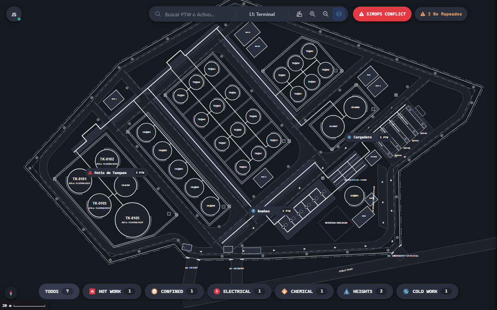

# SCR-VIS-008: General Plant Map with Work Permits Layer (SIMOPS)

## 1. Purpose and Operational Context

* **View Objective:** Macro-spatial overview (Plot Plan / Common Operational Picture) of plant Functional Locations (ANSI/ISA-101 Level 1). Enables safety inspectors and supervisors to toggle a dynamic Work Permits (PTW) safety layer, detecting Simultaneous Operations (SIMOPS) conflicts and identifying unmapped orphan permits.
* **Target Personas:** 
  * **HSEQ Inspector (Primary):** Audits safety compliance, monitors redundant hazard cues, resolves unmapped orphan permits, and analyzes SIMOPS spatial intersections.
  * **Maintenance Supervisor:** Maintains situational awareness, coordinates concurrent contractor tasks, and escalates to Level 3 equipment inspection.
* **Operational Context:** Rugged industrial field tablets in landscape and portrait orientations, and central maintenance desktop consoles.
* **Mode of Operation:** Spatial supervision, safety audit, and passive contextual navigation. The interface does not issue industrial control maneuvers or manipulate process setpoints.

---

## 2. Visual Artifact



> *Prototype capture illustrating the Level 1 General Plant Map with active SIMOPS work permit overlay and contextual navigation toolbar.*

---

## 3. Functional Component Inventory

> The base grid, typography, neutral palettes, and minimal tactile contact areas are inherited from [DT-UI-DS-DOC-001](../../DT-UI-DS-DOC-001.md). This inventory defines the canonical components present on the screen, their design tokens, and their architectural scope. Interaction rules and geometric algorithms are specified in Section 5; responsive container adaptations are governed by Section 8.

1. **`CMP-01`: L1 Plot Plan Canvas**
   - **Visual Role:** Macro plant SVG vector canvas rendering Functional Locations (ISO 14224 Levels 1 to 5) and Level 6 Equipment Units in a flat 2D neutral grayscale palette.
   - **Design Tokens:** 
	   - Surface: `--dt-color-bg-canvas` 
	   - Elevation: `--dt-z-canvas`
   - **Architectural Scope:** Primary spatial viewport ([DT-UI-DS-DOC-001 §5.1](../../DT-UI-DS-DOC-001.md#51-hphmi-shadow-discipline-canvas-vs-hud-chrome-separation)). Supports middle-click desktop panning, single-finger touch dragging, and semantic zoom clustering. Detailed in §5.4.

2. **`CMP-02`: Viewport Toolbar & HUD Navigation Cluster**
   - **Visual Role:** Centered floating capsule toolbar hosting an inline search input, level indicator, viewport controls, binary Work Permits layer toggle, and adjacent non-modal alert pills (`SIMOPS Conflict`, `Unmapped Permits`).
   - **Design Tokens:** 
	   - Surface: `--dt-color-surface-card` 
	   - Elevation: `--dt-shadow-hud` 
	   - Radius: `--dt-radius-full`
	   - Level Badge Width: `--dt-layout-toolbar-badge-width`
   - **Architectural Scope:** Hosts quick search (`Search PTW or Equipment...`), fixed-width level indicator (`L1: Terminal` / `L2: Subsystem`), reset view (1:1), zoom controls (+ / −), binary Work Permits layer toggle (`[#icon-layers]`), and dynamic alert badges per [DT-UI-DS-DOC-001 §5.2](../../DT-UI-DS-DOC-001.md#52-elevation-shadows). Adaptive condensation specified in §5.2.

3. **`CMP-03`: User Profile Indicator**
   - **Visual Role:** Circular floating button displaying active operator initials and static session presence dot.
   - **Design Tokens:** 
	   - Surface: `--dt-color-surface-card`
	   - Elevation: `--dt-shadow-hud`
	   - Radius: `--dt-radius-full`
	   - Touch Target: `--dt-touch-target-mobile`
	   - Session Dot: `--dt-color-state-success`
   - **Architectural Scope:** Anchored at top-left viewport margin per [DT-UI-DS-DOC-001 §5.2](../../DT-UI-DS-DOC-001.md#52-elevation-shadows). Triggers operator session and profile menu.

4. **`CMP-04`: Functional Zone Polygon**
   - **Visual Role:** Vector boundaries representing plant Functional Locations rendered in neutral grayscale.
   - **Design Tokens:** 
	   - Border: `--dt-color-border-subtle`
	   - Fill: transparent / neutral
   - **Architectural Scope:** Anchors spatial hazard grouping and hosts zone cluster pills (`CMP-09`) at centroids during macro zoom ($Z < \text{--dt-zoom-scale-l1-max}$).

5. **`CMP-05`: PTW Overlay Badges**
   - **Visual Role:** Floating vector capsule pills positioned over affected equipment units with semantic hazard dots and dynamic spatial hazard buffers.
   - **Design Tokens:** 
	   - Surface: `--dt-color-surface-card`
	   - Elevation: `--dt-shadow-hud`
	   - Radius: `--dt-radius-full`
	   - Dynamic Buffers: `--dt-z-layer-ptw`
   - **Architectural Scope:** Represents active authorized permits on the map. Applies mandatory 4-channel redundant coding per [DT-UI-DS-DOC-001 §6.2](../../DT-UI-DS-DOC-001.md#62-redundant-coding-matrix-for-permits-and-loto). Interaction and collision detection rules in §5.1.

6. **`CMP-06`: Context Popover Card**
   - **Visual Role:** Transient card displaying permit metadata, validity window, contractor, LOTO reference, and drill-down action.
   - **Design Tokens:** 
	   - Surface: `--dt-color-surface-raised`
	   - Border: `--dt-color-border-subtle`
	   - Elevation: `--dt-shadow-panel`
	   - Radius: `--dt-radius-lg`
   - **Architectural Scope:** Deployed upon tapping `CMP-05`. Features a secondary action button (`[View Permit Details]`) for Level 3 drill-down per [DT-UI-DS-DOC-001 §6.5.1](../../DT-UI-DS-DOC-001.md#651-morphological-differentiation-status-badges-vs-interactive-buttons) and §5.5. Viewport collision flipping and light-dismiss rules in §5.4.

7. **`CMP-07`: SIMOPS Integrity Panel**
   - **Visual Role:** Collapsible drawer displaying visualization failures and unmapped permits as flat rows separated by hairline dividers with dedicated resolution triggers (`#icon-location`).
   - **Design Tokens:** 
	   - Surface: `--dt-color-surface-drawer`
	   - Border: `--dt-color-border-panel`
	   - Elevation: `--dt-shadow-panel`
   - **Architectural Scope:** Manages orphan permit resolution (`AF-001`). Dismissed via header close action or by tapping empty canvas. Escalation rules in §5.2; responsive docking in §8.

8. **`CMP-08`: Filter Chips Panel**
   - **Visual Role:** Discrete floating touch pills at screen bottom for toggling permit visibility, with hazard-tinted active states and elevated count capsules tracking mapped spatial permits.
   - **Design Tokens:** 
	   - Surface: `--dt-color-surface-card`
	   - Elevation: `--dt-shadow-hud`
	   - Radius: `--dt-radius-full`
   - **Architectural Scope:** Direct-touch filter controls and permanent visual permit legend (excluding unmapped orphan permits per §5.2 and §6). Supports touch swiping and desktop `Shift + Wheel` horizontal scrolling. Interaction rules in §5.4.

9. **`CMP-09`: Zone Cluster Pill**
   - **Visual Role:** High-salience overview capsule pills rendered at Functional Location centroids consolidating tactical permit counts.
   - **Design Tokens:** 
	   - Surface: `--dt-color-surface-card`
	   - Elevation: `--dt-shadow-hud`
	   - Radius: `--dt-radius-full`
   - **Architectural Scope:** Macro density aggregation ($Z < \text{--dt-zoom-scale-l1-max}$). Mutually exclusive with discrete badges (`CMP-05`). Tapping zooms into the target functional zone. Semantic zoom mechanics in §5.4.

10. **`CMP-10`: Cartographic Compass & Metric Scale HUD**
    - **Visual Role:** Fixed bottom-left spatial HUD combining a circular north-orientation compass indicator and a dynamic metric scale bar (e.g., `20 m`).
    - **Design Tokens:** 
	    - Surface: `--dt-color-surface-card`
	    - Elevation: `--dt-shadow-hud`
	    - Compass Footprint: `--dt-control-size-hud`
	    - Radius: `--dt-radius-full` (Compass)
    - **Architectural Scope:** Decoupled HTML overlay anchored at the bottom-left margin per [DT-UI-DS-DOC-001 §2.2](../../DT-UI-DS-DOC-001.md#22-dimensions-of-controls-and-touch-areas) and [§5.2](../../DT-UI-DS-DOC-001.md#52-elevation-shadows). Computes real-world meter intervals dynamically from the SVG `CALIBRATION-VECTOR` ([DT-UI-SVG-DOC-001 §11](../../DT-UI-SVG-DOC-001.md#11-spatial-metric-calibration)) and active viewport zoom scale.

---

## 4. Screen State Catalog

1. **Normal (Inactive Layer)**
   - **Activation Condition:** User deactivates the "Work Permits" layer in `CMP-02` or default initial state.
   - **Visual Modification:** Canvas renders Functional Locations in neutral grayscale palette. No superimposed safety badges.

2. **Loading**
   - **Activation Condition:** Initial SVG plot plan retrieval or spatial query transition.
   - **Visual Modification:** Dimmed activity indicator centered over canvas; skeleton shimmer on panel containers.

3. **Active PTW Layer**
   - **Activation Condition:** Activation of the "Work Permits" layer switch in `CMP-02` (`FR-182`).
   - **Visual Modification:** Renders `CMP-09` cluster pills at $Z < \text{--dt-zoom-scale-l1-max}$, or discrete `CMP-05` badges with spatial hazard buffers at $\text{--dt-zoom-scale-l1-max} \le Z < \text{--dt-zoom-scale-l2-max}$. Layer button in `CMP-02` highlights with `--dt-color-state-info`.

4. **Selected Permit (Popover Active)**
   - **Activation Condition:** Tap / Click on `CMP-05` badge on the canvas (`FR-184`).
   - **Visual Modification:** Target `CMP-05` badge highlights with informational halo (`--dt-color-state-info`). Card `CMP-06` deploys adjacent to badge, clamps inside viewport margins, and dismisses upon pan/zoom.

5. **SIMOPS Spatial Conflict Active**
   - **Activation Condition:** Automated Spatial Integrity Engine detects Euclidean distance $D_{AB} < R_A + R_B$ between incompatible permits per §5.1.
   - **Visual Modification:** Overlapping hazard buffers render pulsing diagonal hatch pattern. Conflicting badges display an animated pulsing halo (`--dt-color-alarm-critical`). Viewport toolbar displays `[#icon-warning SIMOPS CONFLICT]` pill. Non-modal toast banner slides down at top edge detailing conflicting permits.

6. **Expiring Soon Warning**
   - **Activation Condition:** System detects permit time window has $< 60\text{ min}$ remaining until `ValidTo`.
   - **Visual Modification:** Target `CMP-05` badge displays amber pulsing border; status in `CMP-06` displays "EXPIRING SOON" in `--dt-color-alarm-warning`.

7. **Detected Orphanhood (SIMOPS Alert)**
   - **Activation Condition:** Approved permits detected lacking SVG `MeshMapping` (`FR-185`, `AF-001`).
   - **Visual Modification:** Toolbar badge highlights in `--dt-color-alarm-critical` with unmapped count (e.g., `[#icon-warning 3]`). Non-modal top toast banner (`--dt-layout-toast-max-height`) notifies operator. Explicit tap opens `CMP-07` without viewport hijacking.

8. **Loss of Synchronization**
   - **Activation Condition:** Interruption of real-time SignalR connection or heartbeat timeout (`FR-187`, `NFR-194`, `AF-002`).
   - **Visual Modification:** Priority 4 Diagnostic banner deployed at screen top with neutral stale icon (`#icon-wifi-off`) and last sync timestamp: `[#icon-wifi-off] CACHE MODE: Telemetry link interrupted (Last sync: HH:mm:ss COT)`. Top navigation container offsets down by `--dt-layout-banner-diagnostic-height` to prevent control occlusion. Badges remain visible in cached state. Process alarm colors (amber/red) prohibited.

---

## 5. Interaction Rules and Data Flow

### 5.1. Spatial Resolution, Proximity Engine, and Layer Rendering
1. Upon loading the view, the system retrieves the vector layout representing the facility's Functional Locations (ISO 14224 Levels 1 to 5).
2. When the Work Permits layer is active, the system queries all `WorkPermits` in the `APPROVED` lifecycle state.
3. **Referential Resolution Path:**
   $$\text{WorkPermit} \xrightarrow{\text{EquipmentUnitId}} \text{EquipmentUnit} \xrightarrow{\text{MeshMapping}} \text{SVG Coordinates / Centroid}$$
   * If the Equipment Unit has an explicit `MeshMapping` node in the SVG, the `CMP-05` badge is centered over that equipment hotspot.
   * If the Equipment Unit is mapped to a parent Functional Location without discrete geometry, the badge is placed in the designated zone cluster header (`CMP-04`).
4. **Automated SIMOPS Proximity & Collision Detection Engine (ISO 45001 §8.1 / Endsley SA Level 3):**
   * The spatial engine computes Euclidean distances between all active permit locations:
     $$D_{AB} = \sqrt{(X_B - X_A)^2 + (Y_B - Y_A)^2}$$
   * **Dynamic Spatial Hazard Buffers (`--dt-z-layer-ptw`):**
     * **HOT_WORK:** $15\text{m}$ physical radius rendered as a semi-transparent circle (`--dt-color-alarm-critical` at $15\%$ opacity).
     * **CONFINED_SPACE:** $13\text{m}$ safe clearance radius rendered as an amber semi-transparent circle (`--dt-color-alarm-warning` at $15\%$ opacity).
     * **Other Types:** Configurable safe operational clearance buffer ($5\text{m}$ default).
   * **Collision Trigger:** When $D_{AB} < R_A + R_B$, a SIMOPS conflict is automatically triggered:
      * Overlapping intersection zone renders a high-contrast pulsing diagonal hatch pattern.
      * Both affected `CMP-05` badges display an animated pulsing conflict halo in `--dt-color-alarm-critical`.
      * `CMP-02` Toolbar activates a dedicated conflict pill: `[#icon-warning SIMOPS CONFLICT]`. Tapping the pill centers the viewport over the conflict zone midpoint and surfaces the non-modal SIMOPS conflict alert banner.
      * An operational SIMOPS alert banner slides down non-modally at the top viewport edge: *"SIMOPS ALERT: Co-activity incompatibility between Hot Work (PTW-1042) and Confined Space (PTW-1043) in Tank Farm."*
5. **Mandatory 4-Channel Redundant Coding Matrix (FR-183, TR-011, WCAG 2.1 AA):**
   * To prevent single-channel color dependency and ensure pre-attentive salience, every `CMP-05` badge encodes its permit classification across four sensory channels (Color + Geometric Shape + Vector Icon + Alphanumeric Label) governed strictly by [DT-UI-DS-DOC-001 §6.2](../../DT-UI-DS-DOC-001.md#62-redundant-coding-matrix-for-permits-and-loto) and canonical permit vocabulary in [DT-DM-DOC-001 §4.34](../../../domain-models/class/DT-DM-DOC-001.md#434-workpermitpermittype).
   * Spatial hazard buffers, collision halos, and hatch patterns render with click-through transparency to guarantee continuous pan drag gestures across permit zones.
   * Badges render as floating capsule pills with `--dt-color-surface-card` fill, `--dt-shadow-hud` elevation, semantic hazard dot, mono permit tag, and tactile touch targets governed by `--dt-touch-target-mobile` for gloved field operation.

### 5.2. Integrity Panel Governance & Non-Modal Escalation (Orphan Detection — `AF-001`)
1. If an approved `WorkPermit` references an `EquipmentUnitId` that has no geometric representation or spatial metadata in the loaded layout, the permit is classified as **Orphan**.
2. **Safety Rule:** The permit is **never** drawn at an arbitrary coordinate on the map to prevent misleading spatial situational awareness.
3. **Strict Non-Modal Escalation (ISO 9241-110 §5.5 Controllability & ISO 11064-5):**
   * Detecting unmapped permits shall **never** automatically deploy or expand `CMP-07`, preventing viewport hijacking.
   * The alert counter on `CMP-02` Toolbar displays a borderless warning pill `[#icon-warning 3 Unmapped]` with subtle warning fill and `--dt-shadow-hud` elevation.
   * A single-line non-modal toast banner (height `--dt-layout-toast-max-height`, elevation `--dt-z-toast-alert`) slides down at the top viewport edge:
     `"SIMOPS Alert: 3 Permits lack spatial mapping. [View List] [Dismiss]"`
4. **Explicit Operator Deployment & Tablet Physical Constraints:**
   * Tapping `[View List]` or the toolbar badge expands `CMP-07`.
   * **Tablet Landscape:** `CMP-07` docks as a lateral panel preserving canvas visibility; layout sizing is detailed in Section 8.
   * **Tablet Portrait:** `CMP-07` renders as a **Bottom Sheet** docked at the viewport bottom with its capsule drag handle nested directly inside the drawer header container to guarantee background tone parity; height bounds are detailed in Section 8.
   * **Canvas Light-Dismiss:** Tapping or clicking any empty region of the vector canvas (`CMP-01`) immediately dismisses `CMP-07`, enabling effortless one-touch closure without requiring explicit interaction with the close ('X') button.
   * Container toggling operates via **discrete single taps** on dedicated handles governed by `--dt-touch-target-mobile` (per [DT-UI-DS-DOC-001 §6.3](../../DT-UI-DS-DOC-001.md#63-sliding-containers-pattern-bottom-sheets-and-drawers)). Continuous drag gestures are optional and never mandatory.
5. **Flat List Ergonomics for Visualization Failures:**
   * To prevent visual crowding and eliminate nested card borders ("Russian doll" effect) inside `CMP-07` (layout dimensions in §8), orphan items are rendered directly on the drawer background surface (`--dt-color-surface-drawer`) as flat rows separated by hairline dividers (`--dt-color-border-subtle`).
   * Each orphan record presents: `Permit Identifier` with a compact 4-channel hazard capsule pill, expiration timestamp, `Expected TagNumber`, Contractor, a decoupled warning issue description on its own line, and a compact top-right icon button (`#icon-location`, `FR-186`) to trigger spatial reassignment.
6. **Adaptive Toolbar Badge Condensation (`CMP-02`):**
   * In tablet landscape with `CMP-07` deployed, toolbar `CMP-02` condenses the unmapped orphan badge to an icon-only `[#icon-warning 3]` format to prevent toolbar crowding.
   * On desktop workstations, in tablet portrait, and whenever `CMP-07` is closed, the badge displays its full alphanumeric label `[#icon-warning 3 Unmapped]`. Responsive breakpoint mapping is detailed in Section 8.

### 5.3. Real-Time Synchronization (`TR-010`)
1. The client subscribes to the SignalR hub for work permit domain events:
   * `WorkPermitApproved`: Injects a new `CMP-05` badge (or updates `CMP-09` cluster count) within $< 5\text{s}$ (`FR-187`, `NFR-192`).
   * `WorkPermitRevoked` / `WorkPermitClosed`: Removes the badge with a fluid fade transition in $< 5\text{s}$.
   * `WorkPermitExpiringSoon`: Transitions the badge to the expiring warning state.
2. **Operational Resilience (`AF-002`):** If the real-time link drops, the client transitions to the "Loss of Synchronization" diagnostic state without blocking canvas navigation, preserving the last known snapshot with explicit timestamp traceability (`NFR-194`).

### 5.4. Dual Navigation, Tactile Controllability, and Semantic Zoom Clustering
1. **Semantic Zoom Clustering (ANSI/ISA-101.01 §6.3.1 / Hollifield Ch. 8):** The viewport supports continuous pan/zoom governed by the canonical Design System tokens ([DT-UI-DS-DOC-001 §2.5](../../DT-UI-DS-DOC-001.md#25-spatial-navigation-and-semantic-zoom-tokens-ansiisa-10101-viewports)):
   * **Scale $Z < \text{--dt-zoom-scale-l1-max}$ (Level 1 Plant Overview / COP):** Discrete equipment badges are **completely suppressed**. Functional Locations render consolidated **Zone Cluster Pills** (`CMP-09`) at centroids (e.g., `[#icon-warning Tank Farm \| 3 PTW]` when conflict-active or `[#icon-hot-work Pump House \| 2 PTW]` in normal state), preserving the 90/10 grayscale rule and preventing visual clutter (`NFR-190`).
   * **Scale $\text{--dt-zoom-scale-l1-max} \le Z < \text{--dt-zoom-scale-l2-max}$ (Level 2 Process Area Layout):** Cluster pills are suppressed and expand into individual **Discrete Equipment Badges** (`CMP-05`) positioned over ISO 14224 Level 6 Equipment Units with dynamic spatial hazard buffers.
   * **Scale $Z \ge \text{--dt-zoom-scale-l2-max}$ (Level 3 Equipment Detail Faceplate):** Micro tactical detail disclosing nozzles, valves, local instrument numbers, and active LOTO lock numbers.
2. **Dual-Mode Canvas Pan Ergonomics:**
   * **Desktop Workstations:** Continuous canvas panning strictly requires **middle-click (mouse wheel drag)** with pointer capture. Primary left-click is exclusively reserved for selecting equipment, toggling toolbar controls, and inspecting safety badges.
   * **Touch Tablets:** Supports direct 1-finger canvas dragging with a strict **$4\text{px}$ movement threshold** to cleanly differentiate intentional pan gestures from stationary taps on equipment badges.
3. **Transient Popover Card Dismissal and Viewport Clamping (`CMP-06`):**
   * **Adaptive Viewport Clamping & Collision Flipping:** Dynamically calculates bounding box and flips leftward when colliding with the right viewport margin ($X + W > \text{Viewport}_W - \text{--dt-space-4}$); clamps vertically within safe boundaries ($[\text{--dt-layout-popover-top-clearance}, \text{Viewport}_H - H - \text{--dt-space-4}]$) respecting top toolbar clearance.
   * **Transient Light-Dismiss:** Moving the canvas via pan drag or adjusting zoom immediately dismisses `CMP-06` to maintain unobstructed visual scanning. Ending a pan gesture immediately unblocks input handling so subsequent stationary clicks or taps on equipment badges deploy `CMP-06` without gesture-lock.
   * **Secondary Action Trigger:** Features a label-only secondary action button (`[View Permit Details]`, borderless in light theme with subtle hairline framing in dark theme, without trailing chevron, per [DT-UI-DS-DOC-001 §6.5.1](../../DT-UI-DS-DOC-001.md#651-morphological-differentiation-status-badges-vs-interactive-buttons)) to initiate Level 3 inspection (§5.5).
4. **Horizontal Filter Chips Ergonomics (`CMP-08`):**
   * Transparent horizontal container anchored at the bottom viewport margin hosting independently floating, borderless filter pills elevated with `--dt-shadow-hud`.
   * Applies hazard-specific tinted fills upon selection (`HOT_WORK`, `CONFINED_SPACE`, etc.) and `--dt-color-surface-raised` for `ALL`, with widened count capsules.
   * Supports direct touch swipe on field tablets.
   * Supports horizontal scrolling on desktop via mouse wheel combined with the `Shift` key (`Shift + Wheel`).
5. **Tactile Ergonomics:** On touch devices (`Industrial Tablet`), all interactive triggers (`CMP-02`, `CMP-03`, `CMP-07`, `CMP-08`, `CMP-09`) maintain tactile touch targets governed by `--dt-touch-target-mobile`.
6. **Hover vs. Tap Bifurcation:** Desktop pointers display a compact hover tooltip (`FR-189`). Touch devices deploy the persistent `CMP-06` card upon direct tap (`FR-184`), dismissible via tap-away, pan/zoom motion, or close ('X') button.

### 5.5. Hierarchical Escalation (L1 $\to$ L3 Transition)
1. Clicking on `[View Permit Details]` within `CMP-06` initiates an operational drill-down, transitioning the inspector directly into the Level 3 Equipment Task Faceplate ([SCR-VIS-033](./SCR-VIS-033.md)) for the target equipment unit.
2. Direct selection of an Equipment Unit on the canvas (outside a PTW badge) seamlessly deploys the [SCR-VIS-033](./SCR-VIS-033.md) contextual drawer without changing screens.

---

## 6. Industrial and Safety Considerations

* **Read-Only Supervisory Boundary (ISO 45001 §8.1):** `SCR-VIS-008` operates strictly as a passive spatial supervision and SIMOPS audit interface. It cannot issue equipment start/stop commands, alter process setpoints, or bypass LOTO interlocks ([DT-UI-NAV-DOC-001 §6.2](../../DT-UI-NAV-DOC-001.md#62-loto-lockout-and-fail-safe-guard)).
* **Spatial Integrity Fail-Safe (`AF-001`):** Unmapped permits (`MeshMapping` status `UNMAPPED` or `SYNC_ERROR`) are strictly withheld from arbitrary canvas placement and excluded from mapped spatial filter counts (`CMP-08`) to prevent false spatial confidence during co-activity risk assessment (§5.2).
* **HPHMI & Accessibility Governance ([TR-011](../../../requirements/common/TR-011.md)):** Visual salience, 4-channel redundant permit coding, semantic zoom decluttering, and Priority 4 diagnostic state segregation adhere strictly to [DT-UI-DS-DOC-001 §1](../../DT-UI-DS-DOC-001.md#1-scope), [§6.2](../../DT-UI-DS-DOC-001.md#62-redundant-coding-matrix-for-permits-and-loto), and the interaction mechanics in §4 and §5.

---

## 7. Frontend Component Contract (Blazor / Razor)

### 7.1. Component Hierarchy & File Mapping

```text
Pages/
└── GeneralPlantMapPage.razor                 # Root View (SCR-VIS-008)
    ├── PlotPlanCanvas2D.razor                # CMP-01: Macro SVG canvas with pan/zoom
    │   ├── FunctionalZonePolygon.razor       # CMP-04: Functional Location vector polygon
    │   ├── ZoneClusterPill.razor             # CMP-09: Macro density aggregation pill (Z < --dt-zoom-scale-l1-max)
    │   ├── PtwOverlayBadge.razor             # CMP-05: Redundant coding safety badge (Z >= --dt-zoom-scale-l1-max)
    │   └── SimopsHazardBuffer.razor          # Dynamic spatial buffer circle & conflict hatch
    ├── ViewportToolbar.razor                 # CMP-02: Floating navigation & binary PTW layer bar
    ├── UserProfileButton.razor               # CMP-03: Top-left user profile indicator
    ├── PtwContextPopover.razor               # CMP-06: Compact permit popover card
    ├── SimopsIntegrityDrawer.razor           # CMP-07: Visualization failures side drawer (--dt-layout-drawer-width)
    ├── PtwFilterChips.razor                  # CMP-08: Bottom floating risk filter chips
    ├── CartographicHud.razor                 # CMP-10: Bottom-left compass & metric scale HUD
    └── StaleCacheBanner.razor                # Diagnostic stale cache banner (AF-002)
```

### 7.2. Physical Component Parameters & DTO Contracts (.NET 10 / C# 14)

#### 7.2.1. `GeneralPlantMapPage.razor` (Root View)
```csharp
[Parameter]
public string? FacilityCode { get; set; }

[Parameter]
public Guid? InitialPermitId { get; set; }
```

#### 7.2.2. Subcomponent Parameter Contracts

```csharp
// CMP-01: PlotPlanCanvas2D.razor
[Parameter]
public required string SvgRawContent { get; set; }

[Parameter]
public required IReadOnlyList<PtwOverlayDto> Permits { get; set; }

[Parameter]
public required IReadOnlyList<ZoneClusterPillDto> Clusters { get; set; }

[Parameter]
public required IReadOnlyList<SimopsConflictDto> Conflicts { get; set; }

[Parameter]
public double ZoomScale { get; set; } = 1.0;

[Parameter]
public EventCallback<string> OnEquipmentSelected { get; set; }

[Parameter]
public EventCallback<Guid> OnPermitBadgeClicked { get; set; }

[Parameter]
public EventCallback<string> OnZoneClusterClicked { get; set; }

// CMP-09: ZoneClusterPill.razor
[Parameter]
public required ZoneClusterPillDto Cluster { get; set; }

[Parameter]
public EventCallback<string> OnClusterClicked { get; set; }

// CMP-05: PtwOverlayBadge.razor
[Parameter]
public required PtwOverlayDto Permit { get; set; }

[Parameter]
public bool IsSelected { get; set; }

[Parameter]
public bool HasSimopsConflict { get; set; }

[Parameter]
public EventCallback<Guid> OnBadgeClicked { get; set; }

// SimopsHazardBuffer.razor
[Parameter]
public required PtwOverlayDto Permit { get; set; }

[Parameter]
public bool HasConflict { get; set; }

// CMP-06: PtwContextPopover.razor
[Parameter]
public required PtwOverlayDto Permit { get; set; }

[Parameter]
public EventCallback OnCloseRequested { get; set; }

[Parameter]
public EventCallback<string> OnViewDetailsRequested { get; set; }

// CMP-07: SimopsIntegrityDrawer.razor
[Parameter]
public required IReadOnlyList<OrphanPermitDto> OrphanPermits { get; set; }

[Parameter]
public bool IsOpen { get; set; }

[Parameter]
public EventCallback<bool> OnOpenChanged { get; set; }

[Parameter]
public EventCallback<Guid> OnResolveInconsistencyRequested { get; set; }

// CMP-08: PtwFilterChips.razor
[Parameter]
public PermitType? SelectedFilter { get; set; }

[Parameter]
public int TotalMappedPermitsCount { get; set; }

[Parameter]
public required IReadOnlyDictionary<PermitType, int> PermitCounts { get; set; }

[Parameter]
public EventCallback<PermitType?> OnFilterChanged { get; set; }

// CMP-02: ViewportToolbar.razor
[Parameter]
public string? SearchQuery { get; set; }

[Parameter]
public EventCallback<string?> OnSearchQueryChanged { get; set; }

[Parameter]
public double ZoomScale { get; set; } = 1.0;

[Parameter]
public bool IsPtwLayerActive { get; set; } = true;

[Parameter]
public int SimopsConflictCount { get; set; }

[Parameter]
public int OrphanPermitsCount { get; set; }

[Parameter]
public bool IsIntegrityDrawerOpen { get; set; }

[Parameter]
public EventCallback OnZoomInRequested { get; set; }

[Parameter]
public EventCallback OnZoomOutRequested { get; set; }

[Parameter]
public EventCallback OnResetViewRequested { get; set; }

[Parameter]
public EventCallback<bool> OnPtwLayerToggled { get; set; }

[Parameter]
public EventCallback OnSimopsConflictBadgeClicked { get; set; }

[Parameter]
public EventCallback OnOrphanBadgeClicked { get; set; }

// CMP-03: UserProfileButton.razor
[Parameter]
public required string UserInitials { get; set; }

[Parameter]
public EventCallback OnProfileMenuRequested { get; set; }

// CMP-04: FunctionalZonePolygon.razor
[Parameter]
public required PlantZoneDto Zone { get; set; }

// CMP-10: CartographicHud.razor
[Parameter]
public double ZoomScale { get; set; } = 1.0;

[Parameter]
public double ScaleRatioMetersPerUnit { get; set; } = 0.2;

// Diagnostic Banner: StaleCacheBanner.razor (AF-002)
[Parameter]
public bool IsStale { get; set; }

[Parameter]
public DateTimeOffset? LastSyncTimestamp { get; set; }
```

#### 7.2.3. Data Transfer Objects (DTOs)

```csharp
/// <summary>
/// Controlled permit risk classification vocabulary per DT-DM-DOC-001 §4.34.
/// </summary>
public enum PermitType
{
    HOT_WORK,
    COLD_WORK,
    CONFINED_SPACE,
    ELECTRICAL,
    WORK_AT_HEIGHT,
    EXCAVATION,
    CHEMICAL
}

/// <summary>
/// Controlled permit lifecycle status vocabulary per DT-DM-DOC-001 §4.35.
/// </summary>
public enum WorkPermitStatus
{
    DRAFT,
    PENDING,
    APPROVED,
    EXPIRED,
    REVOKED,
    CLOSED
}

public record PtwOverlayDto
{
    public required Guid Id { get; init; }
    public required string PermitIdentifier { get; init; } // e.g. "PTW-1042"
    public required PermitType Type { get; init; }
    public required string Contractor { get; init; }
    public required Guid IssuerUserId { get; init; }
    public required string IssuerFullName { get; init; }
    public required Guid EquipmentUnitId { get; init; }
    public required string EquipmentTag { get; init; }
    public required double CoordinateX { get; init; }
    public required double CoordinateY { get; init; }
    public required DateTimeOffset ValidFrom { get; init; }
    public required DateTimeOffset ValidTo { get; init; }
    public required WorkPermitStatus Status { get; init; }
    public bool IsExpiringSoon { get; init; }
    public string? AssociatedLotoNumber { get; init; }
    public double BufferRadiusMeters { get; init; } = 5.0; // 15m HOT_WORK, 13m CONFINED_SPACE, 5m default
    public bool HasSimopsConflict { get; init; }
    public IReadOnlyList<Guid> ConflictingPermitIds { get; init; } = [];
}

public record ZoneClusterPillDto
{
    public required string FunctionalLocationCode { get; init; }
    public required string ZoneName { get; init; }
    public required double CentroidX { get; init; }
    public required double CentroidY { get; init; }
    public required int TotalPermitsCount { get; init; }
    public bool HasSimopsConflict { get; init; }
    public PermitType? DominantPermitType { get; init; }
}

public record SimopsConflictDto
{
    public required Guid Id { get; init; }
    public required Guid PermitAId { get; init; }
    public required Guid PermitBId { get; init; }
    public required string PermitAIdentifier { get; init; }
    public required string PermitBIdentifier { get; init; }
    public required PermitType PermitAType { get; init; }
    public required PermitType PermitBType { get; init; }
    public required double DistanceMeters { get; init; }
    public required double SafeDistanceMeters { get; init; }
    public required string ConflictDescription { get; init; }
}

public record OrphanPermitDto
{
    public required Guid Id { get; init; }
    public required string PermitIdentifier { get; init; }
    public required PermitType Type { get; init; }
    public required string Contractor { get; init; }
    public required Guid EquipmentUnitId { get; init; }
    public required string ExpectedEquipmentTag { get; init; }
    public required string DiagnosticMessage { get; init; }
    public required DateTimeOffset ValidTo { get; init; }
}

public record PlantPlotPlanDto
{
    public required string FacilityCode { get; init; }
    public required string FacilityName { get; init; }
    public required string SvgContent { get; init; }
    public IReadOnlyList<PlantZoneDto> Zones { get; init; } = [];
}

public record PlantZoneDto
{
    public required string FunctionalLocationCode { get; init; }
    public required string ZoneName { get; init; }
    public required int IsoHierarchyLevel { get; init; }
}
```

### 7.3. Client-Side DOM & Interop Bridge

1. **SVG Viewport Navigation Interop (`ISvgViewportInterop`):**
   * Encapsulates client-side coordinate transformations, pointer capture, middle-click panning, tactile drag thresholding ($4\text{px}$), and focal mouse-wheel matrix evaluation ([ADR-001](../../../architecture/adr/ADR-001.md)).
   * Maintains $\ge 30\text{ FPS}$ on tablets and $\ge 60\text{ FPS}$ on desktop consoles (`NFR-190`) without generating roundtrip network traffic.
2. **SIMOPS Spatial & Proximity Engine (`ISimopsSpatialEngine`):**
   * Computes Euclidean distance matrix ($D_{AB} < R_A + R_B$) and dynamic buffer geometries across active permits in client memory.
   * Manages SVG layer rendering for hazard buffers and conflict diagonal hatching with click-through transparency.
3. **Semantic Event Dispatching:**
   * Hotspot groups in the SVG declare standardized data attributes (`data-tag="P-101"`, `data-permit-id="uuid"`).
   * Direct clicks or taps on permit badges dispatch `OnPermitBadgeClicked(permitId)`. Taps on equipment geometry outside active badges dispatch `OnEquipmentSelected(tagNumber)`, invoking the [SCR-VIS-033](./SCR-VIS-033.md) Level 3 faceplate.

---

## 8. Layout and Responsive Adaptability

### 8.1. Desktop Workstation (`--dt-breakpoint-xl`)
* **Layout Organization:** Canvas `CMP-01` occupies full viewport.
  Floating pill toolbar `CMP-02` displays level badge (`L1: Terminal` / `L2: Subsystem`) and full alphanumeric orphan badge (`[#icon-warning 3 Unmapped]`).
  Filter chips panel `CMP-08` displays uncompressed risk chips (`HOT_WORK`, `CONFINED_SPACE`, etc.) along the bottom viewport edge, with cartographic HUD `CMP-10` anchored at the bottom-left margin.
  Non-modal integrity drawer `CMP-07` docks as a lateral right panel sized by `--dt-layout-drawer-width-desktop`.
* **Ergonomic Rules:** Mouse wheel focal zoom; middle-click canvas pan; cursor tooltips enabled on hover; popover cards `CMP-06` clamp within viewport bounds; tapping empty canvas dismisses `CMP-07`.

### 8.2. Industrial Tablet Landscape (`--dt-breakpoint-lg`)
* **Layout Organization:** Canvas `CMP-01` occupies full viewport.
  Toolbar `CMP-02` applies adaptive badge condensation when `CMP-07` is deployed (`[#icon-warning 3]`).
  Filter chips panel `CMP-08` enables horizontal touch swipe, with cartographic HUD `CMP-10` anchored at bottom-left.
  Integrity drawer `CMP-07` slides over the right flank sized by `--dt-layout-drawer-width-tablet`, preserving $\ge 70\%$ canvas visibility per [DT-UI-DS-DOC-001 §2.4](../../DT-UI-DS-DOC-001.md#24-structural-layout-and-dimensional-tokens).
* **Ergonomic Rules:** Touch pan dead-zone threshold (§5.4); interactive touch targets governed by `--dt-touch-target-mobile`; hover tooltips disabled, direct tap opens popover card; tapping empty canvas dismisses `CMP-07`.

### 8.3. Industrial Tablet Portrait (`--dt-breakpoint-md`)
* **Layout Organization:** Canvas `CMP-01` occupies full viewport.
  Toolbar `CMP-02` retains the inline search bar and stacks the alert strip directly below the main toolbar capsule, displaying the uncompressed orphan badge (`[#icon-warning 3 Unmapped]`) per §5.2.
  Integrity drawer `CMP-07` operates as a bottom sheet with its tactile drag handle nested inside the drawer header container (initial resting height governed by `--dt-layout-bottom-sheet-height-initial`, expanding up to `--dt-layout-bottom-sheet-height-expanded`).
* **Ergonomic Rules:** Single-finger drag pan; pinch-to-zoom; discrete tap switching on `--dt-touch-target-mobile` handle ([DT-UI-DS-DOC-001 §6.3](../../DT-UI-DS-DOC-001.md#63-sliding-containers-pattern-bottom-sheets-and-drawers)); floating HUD chrome (`CMP-10` bottom-left, `CMP-08` bottom-center) docks to bottom viewport margins; tapping empty canvas dismisses `CMP-07`.

---

## 9. Traceability and Requirements Matrix

| Requirement | Addressed in Component | Verification & Implementation Mechanism |
| :--- | :--- | :--- |
| [FR-182](../../../requirements/user-stories/vis/VIS-008.md#functional-requirements-fr) | `CMP-01`, `CMP-02` | Toggling the "Work Permits" layer overlays active permits over the 2D plot plan without obscuring base context. |
| [FR-183](../../../requirements/user-stories/vis/VIS-008.md#functional-requirements-fr) | `CMP-05` | Renders redundant coding (Color + Geometric Shape) for each permit type against the neutral grayscale canvas. |
| [FR-184](../../../requirements/user-stories/vis/VIS-008.md#functional-requirements-fr) | `CMP-06` | Clicking a permit badge opens a compact popover card with type, contractor, supervisor, schedule, and drill-down action. |
| [FR-185](../../../requirements/user-stories/vis/VIS-008.md#functional-requirements-fr) | `CMP-02`, `CMP-07` | Automated integrity validation cross-references active permits against loaded SVG tags, flagging orphaned permits. |
| [FR-186](../../../requirements/user-stories/vis/VIS-008.md#functional-requirements-fr) | `CMP-07` | Collapsible lateral drawer displays visualization failures, allowing manual reassignment or resolution. |
| [FR-187](../../../requirements/user-stories/vis/VIS-008.md#functional-requirements-fr) | `CMP-01`, `CMP-05` | Near real-time SignalR synchronization adds, updates, and removes permit badges without full page reloads. |
| [FR-188](../../../requirements/user-stories/vis/VIS-008.md#functional-requirements-fr) | `CMP-02`, `CMP-08` | Horizontal filter controls allow toggling visibility by permit type, preserving filter state in user session. |
| [FR-189](../../../requirements/user-stories/vis/VIS-008.md#functional-requirements-fr) | `CMP-06` | Hovering over permit badges on desktop displays a compact tooltip with permit type, contractor, and action hint. |
| [NFR-190](../../../requirements/user-stories/vis/VIS-008.md#non-functional-requirements-nfr) | `CMP-01` | SVG rendering maintains $\ge 30\text{ FPS}$ on mobile/tablets and $\ge 60\text{ FPS}$ on desktop during pan/zoom with up to 100 icons. |
| [NFR-191](../../../requirements/user-stories/vis/VIS-008.md#non-functional-requirements-nfr) | `CMP-07` | Orphan detection integrity check completes in $< 5\text{s}$ for up to 100 active permits. |
| [NFR-192](../../../requirements/user-stories/vis/VIS-008.md#non-functional-requirements-nfr) | `CMP-05` | Permit status updates reflect on the canvas within $< 5\text{s}$ from backend event publication. |
| [NFR-193](../../../requirements/user-stories/vis/VIS-008.md#non-functional-requirements-nfr) | `CMP-05`, `CMP-06`, `CMP-08` | Visual coding complies with WCAG 2.1 AA 4-channel redundant coding ([DT-UI-DS-DOC-001 §6.2](../../DT-UI-DS-DOC-001.md#62-redundant-coding-matrix-for-permits-and-loto)), with `CMP-08` serving as a permanent visual legend. |
| [NFR-194](../../../requirements/user-stories/vis/VIS-008.md#non-functional-requirements-nfr) | `CMP-01` | Displays last known state with a Priority 4 diagnostic banner (`StaleCacheBanner`) if the permit stream is offline, without blocking navigation. |
| [NFR-195](../../../requirements/user-stories/vis/VIS-008.md#non-functional-requirements-nfr) | `CMP-01` | 2D vector rendering guarantees full spatial supervision on hardware lacking WebGL 3D acceleration. |
| [TR-005](../../../requirements/common/TR-005.md) | `CMP-01`, `CMP-05` | All initial REST queries and real-time permit synchronization streams execute over encrypted TLS/HTTPS and WSS transport channels. |
| [TR-006](../../../requirements/common/TR-006.md) | `CMP-02`, `CMP-06`, `CMP-07` | RBAC enforcement restricts permit layer inspection, orphan resolution, and L3 escalation to authorized roles (`HSEQ Inspector`, `Maintenance Supervisor`). |
| [TR-010](../../../requirements/common/TR-010.md) | `CMP-01`, `CMP-05`, `CMP-09` | Persistent real-time event subscription updates permit badges and cluster counts with $<1\text{s}$ publication latency and graceful polling fallback. |
| [TR-011](../../../requirements/common/TR-011.md) | `CMP-01`, `CMP-05`, `CMP-09`, `CMP-10` | High-Performance HMI (ANSI/ISA-101): Neutral grayscale canvas (`--dt-color-bg-canvas`), reserving saturated tokens strictly for active permits and alarms. |