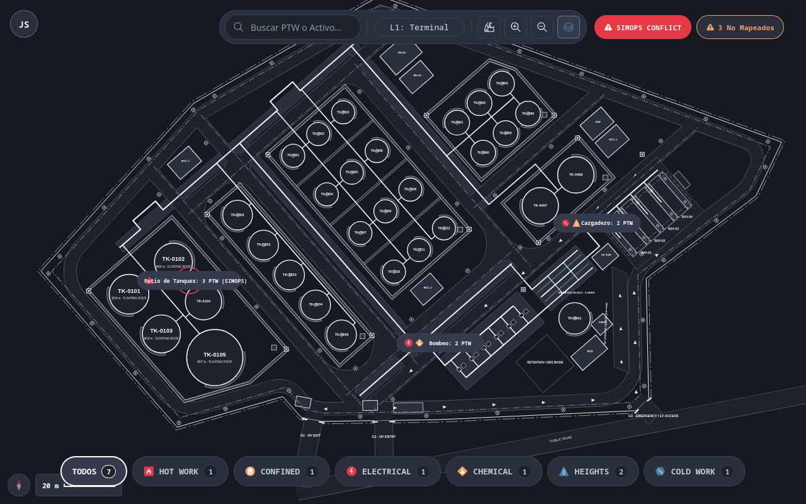

# SCR-VIS-008: General Plant Map with Work Permits Layer (SIMOPS)

## 1. Purpose and Operational Context

* **View Objective:** Macro-spatial overview (Plot Plan / Common Operational Picture) of plant Functional Locations (ANSI/ISA-101 Level 1). Enables safety inspectors and supervisors to toggle a dynamic Work Permits (PTW) safety layer, detecting Simultaneous Operations (SIMOPS) conflicts and identifying unmapped orphan permits.
* **Target Personas:** 
  * **HSEQ Inspector (Primary):** Audits safety compliance, monitors redundant hazard cues, resolves unmapped orphan permits, and analyzes SIMOPS spatial intersections.
  * **Maintenance Supervisor:** Maintains situational awareness, coordinates concurrent contractor tasks, and escalates to Level 3 equipment inspection.
* **Operational Context:** Rugged industrial field tablets in landscape and portrait orientations, and central maintenance desktop consoles.
* **Mode of Operation:** Spatial supervision, safety audit, and passive contextual navigation. The interface does not issue industrial control maneuvers or manipulate process setpoints.

---

## 2. Visual Artifact



> *Note: Production UI prototype capture illustrating the Level 1 General Plant Map with active SIMOPS work permit overlay and contextual navigation toolbar.*

---

## 3. Functional Component Inventory

> The base grid, typography, neutral palettes, and minimal tactile contact areas are inherited from [DT-UI-DS-DOC-001](../../DT-UI-DS-DOC-001.md). This table defines the present components, their semantic tokens, and the link with the domain model.

| ID | Control / Component | Visual Role / Content | Semantic Token | Architectural Role & Reference |
| :------- | :---------------------- | :------------------------------- | :-------------------------------------------------------------------------------------------------- | :----------------------------------------------------------------------------------------------------------------------------------------------------------------------- |
| `CMP-01` | L1 Plot Plan Canvas | Macro plant SVG vector canvas | Surface: `--dt-color-bg-canvas`<br>Elevation: `--dt-z-canvas` | Renders macro polygons representing Functional Locations (ISO 14224 Levels 1 to 4) and Level 6 equipment nodes. Implements semantic zoom clustering. Detailed panning and zoom rules in §5.4. |
| `CMP-02` | Viewport Toolbar | Spatial navigation toolbar | Surface: `--dt-color-surface-raised`<br>Border: `--dt-color-border-subtle`<br>Radius: `--dt-radius-full` | Floating navigation toolbar centered over viewable canvas. Hosts level badge (`L1: PLOT PLAN`), reset view (1:1), zoom (+ / −), layer selector (`[≡ Layers]`), and non-modal alert badges for SIMOPS conflicts and unmapped permits. Adaptive condensation in §5.2. Shared with [SCR-VIS-033](./SCR-VIS-033.md). |
| `CMP-03` | User Profile Indicator | Active user session control | Surface: `--dt-color-surface-raised`<br>Border: `--dt-color-border-panel`<br>Radius: `--dt-radius-full` | Circular floating button anchored at top-left margin per layout grid. Displays user initials. Enforces `--dt-touch-target-mobile`. Aligned with `CMP-11` in [SCR-VIS-033](./SCR-VIS-033.md). |
| `CMP-04` | Functional Zone Polygon | Plant zone boundaries in SVG | Border: `--dt-color-border-subtle`<br>Fill: transparent / neutral | Vector boundary representing a Functional Location. Rendered in neutral grayscale to maintain the 90/10 background rule. Hosts `CMP-09` cluster pills at centroids at macro zoom. |
| `CMP-05` | PTW Overlay Badges | Active permit safety markers | Surface: Dynamic (`--dt-color-alarm-critical` \| `--dt-color-alarm-warning` \| `--dt-color-state-info`)<br>Elevation: `--dt-z-layer-ptw` | Vector safety hotspots dynamically positioned over affected equipment units at area zoom. Applies mandatory 4-channel redundant coding (color, shape, icon, text) and spatial hazard buffers. Specification in §5.1. |
| `CMP-06` | Context Popover Card | Permit detail contextual card | Surface: `--dt-color-surface-raised`<br>Border: `--dt-color-border-subtle`<br>Elevation: `--dt-z-overlay-card` | Transient card deployed upon tapping a `CMP-05` badge. Displays permit metadata, schedule, contractor, associated LOTO reference, and `[View Details]` drill-down action. Viewport collision rules in §5.4. |
| `CMP-07` | SIMOPS Integrity Panel | Visualization Failures drawer | Surface: `--dt-color-surface-drawer`<br>Border: `--dt-color-border-panel`<br>Elevation: `--dt-z-drawer-sidebar` | Collapsible drawer (lateral panel in landscape, bottom sheet in portrait) displaying approved permits lacking spatial mapping. Hosts unmapped list and `[Resolve Inconsistency]` button. Governance rules in §5.2. |
| `CMP-08` | Filter Chips Panel | Risk category filter panel | Surface: `--dt-color-surface-raised`<br>Border: `--dt-color-border-subtle`<br>Radius: `--dt-radius-full` | Floating bar at screen bottom hosting direct-touch filter chips for active permit types. Supports touch swipe and desktop shift-wheel scrolling. Interaction rules in §5.4. |
| `CMP-09` | Zone Cluster Pill | Macro SIMOPS density aggregation | Surface: `--dt-color-surface-raised`<br>Border: `--dt-color-border-subtle`<br>Radius: `--dt-radius-full` | Rendered at Functional Location centroids at macro zoom. Consolidates tactical permits into high-salience overview pills (e.g., `Zone A: 5 PTWs [🔥1 \| 🧗2 \| 🛢️2]`). Tapping zooms into the zone. Semantic zoom rules in §5.4. |

---

## 4. Screen State Matrix

| State | Visual Modification in the Interface | Activation Condition |
| :--------------------------- | :------------------------------------------------------------------------------------------------------------------------------------------------------------------------------------------- | :----------------------------------------------------------------------------------------------------------------------- |
| **Normal (Inactive Layer)** | Canvas renders Functional Locations in neutral grayscale palette. No superimposed safety badges. | User deactivates the "Work Permits" layer in `CMP-02` or default initial state. |
| **Loading** | Dimmed activity indicator centered over canvas; skeleton shimmer on panel containers. | Initial SVG plot plan retrieval or spatial query transition. |
| **Active PTW Layer** | Renders `CMP-09` cluster pills at $Z < 1.15$, or discrete `CMP-05` badges with spatial hazard buffers at $1.15 \le Z < 2.30$. Layer button in `CMP-02` highlights with `--dt-color-state-info`. | Activation of the "Work Permits" layer switch in `CMP-02` (`FR-182`). |
| **Selected Permit (Popover Active)** | Target `CMP-05` badge highlights with informational halo (`--dt-color-state-info`). Card `CMP-06` deploys adjacent to badge. Clamps inside viewport margins and dismisses upon pan/zoom. | Tap / Click on `CMP-05` badge on the canvas (`FR-184`). |
| **SIMOPS Spatial Conflict Active** | Overlapping hazard buffers render pulsing diagonal hatch pattern. Conflicting badges display $4\text{px}$ pulsing red halo (`--dt-color-alarm-critical`). Viewport toolbar displays `[⚠️ SIMOPS CONFLICT: PTW-XXXX / PTW-YYYY]` pill. Top toast banner slides down non-modally. | Automated Spatial Integrity Engine detects Euclidean distance $D_{AB} < R_A + R_B$ between incompatible permits. |
| **Expiring Soon Warning** | Target `CMP-05` badge displays amber pulsing border; status in `CMP-06` displays "EXPIRING SOON" in `--dt-color-alarm-warning`. | System detects permit time window has $< 60\text{ min}$ remaining until `ValidTo`. |
| **Detected Orphanhood (SIMOPS Alert)** | Toolbar badge highlights in `--dt-color-alarm-critical` with unmapped count (e.g., `[⚠️ 3]`). Non-modal top toast banner (`--dt-layout-toast-max-height`) notifies operator. Explicit tap opens `CMP-07` without viewport hijacking. | Approved permits detected lacking SVG `MeshMapping` (`FR-185`, `AF-001`). |
| **Loss of Synchronization** | Priority 4 Diagnostic banner deployed at screen top with neutral stale icon (`wifi-off`) and last sync timestamp. Badges remain visible in cached state. Process alarm colors (amber/red) prohibited. | Interruption of real-time SignalR connection or heartbeat timeout (`FR-187`, `NFR-194`, `AF-002`). |

---

## 5. Interaction Rules and Data Flow

### 5.1. Spatial Resolution, Proximity Engine, and Layer Rendering
1. Upon loading the view, the system retrieves the vector layout representing the facility's Functional Locations (ISO 14224 Levels 1 to 4).
2. When the Work Permits layer is active, the system queries all `WorkPermits` in the `APPROVED` lifecycle state.
3. **Referential Resolution Path:**
   $$\text{WorkPermit} \xrightarrow{\text{EquipmentUnitId}} \text{EquipmentUnit} \xrightarrow{\text{MeshMapping}} \text{SVG Coordinates / Centroid}$$
   * If the Equipment Unit has an explicit `MeshMapping` node in the SVG, the `CMP-05` badge is centered over that equipment hotspot.
   * If the Equipment Unit is mapped to a parent Functional Location without discrete geometry, the badge is placed in the designated zone cluster header (`CMP-04`).
4. **Automated SIMOPS Proximity & Collision Detection Engine (ISO 45001 §8.1 / Endsley SA Level 3):**
   * The spatial engine computes Euclidean distances between all active permit locations:
     $$D_{AB} = \sqrt{(X_B - X_A)^2 + (Y_B - Y_A)^2}$$
   * **Dynamic Spatial Hazard Buffers (`--dt-z-layer-ptw`):**
     * **HOT_WORK:** $15\text{m}$ physical radius rendered as a semi-transparent circle (`--dt-color-alarm-critical` at $15\%$ opacity).
     * **CONFINED_SPACE:** $10\text{m}$ physical radius rendered as an amber semi-transparent circle (`--dt-color-alarm-warning` at $15\%$ opacity).
     * **Other Types:** Configurable safe operational clearance buffer ($5\text{m}$ default).
   * **Collision Trigger:** When $D_{AB} < R_A + R_B$, a SIMOPS conflict is automatically triggered:
      * Overlapping intersection zone renders a high-contrast pulsing diagonal hatch pattern.
      * Both affected `CMP-05` badges display a pulsing $4\text{px}$ conflict halo in `--dt-color-alarm-critical`.
      * `CMP-02` Toolbar activates a dedicated conflict pill: `[⚠️ SIMOPS CONFLICT: PTW-XXXX / PTW-YYYY]`. Tapping the pill centers the viewport over the conflict site and opens the conflict detail card.
5. **Mandatory 4-Channel Redundant Coding Matrix (FR-183, TR-011, WCAG 2.1 AA):**
   * To prevent single-channel color dependency and ensure pre-attentive salience, every `CMP-05` badge encodes its permit classification across four sensory channels (Color + Geometric Shape + Vector Icon + Alphanumeric Label) per [DT-UI-DS-DOC-001 §6.2](../../DT-UI-DS-DOC-001.md#62-redundant-coding-matrix-for-permits-and-loto) and [DT-DM-DOC-001 §4.28](../../../domain-models/class/DT-DM-DOC-001.md#428-workpermitpermittype):
     * **HOT_WORK:** `--dt-color-alarm-critical` | Square ($20\times 20\text{px}$) | `#icon-hot-work` | `HOT WORK`
     * **WORK_AT_HEIGHT:** `--dt-color-state-info` | Triangle ($20\times 18\text{px}$) | `#icon-heights` | `HEIGHTS`
     * **CONFINED_SPACE:** `--dt-color-alarm-warning` | Circle ($\varnothing 20\text{px}$) | `#icon-confined-space` | `CONFINED`
     * **ELECTRICAL:** `--dt-color-alarm-critical` | Octagon ($20\times 20\text{px}$) | `#icon-electrical` | `ELECTRICAL`
     * **CHEMICAL:** `--dt-color-alarm-warning` | Rhombus ($20\times 20\text{px}$) | `#icon-chemical` | `CHEMICAL`
     * **COLD_WORK:** `--dt-color-state-info` | Hexagon ($20\times 20\text{px}$) | `#icon-cold-work` | `COLD WORK`
   * Spatial hazard buffers, collision halos, and hatch patterns render with click-through transparency to guarantee continuous pan drag gestures across permit zones.
   * Each badge includes an invisible $48\times 48\text{px}$ tactile touch target (`--dt-touch-target-mobile`) for gloved operation and an expiring warning cue ($< 60\text{ min}$).

### 5.2. Integrity Panel Governance & Non-Modal Escalation (Orphan Detection — `AF-001`)
1. If an approved `WorkPermit` references an `EquipmentUnitId` that has no geometric representation or spatial metadata in the loaded layout, the permit is classified as **Orphan**.
2. **Safety Rule:** The permit is **never** drawn at an arbitrary coordinate on the map to prevent misleading spatial situational awareness.
3. **Strict Non-Modal Escalation (ISO 9241-110 §5.5 Controllability & ISO 11064-5):**
   * Detecting unmapped permits shall **never** automatically deploy or expand `CMP-07`, preventing viewport hijacking.
   * The alert counter on `CMP-02` Toolbar transitions to `--dt-color-alarm-critical` with the unread orphan count badge (e.g., `[⚠️ 3]`).
   * A single-line non-modal toast banner (height `--dt-layout-toast-max-height`, elevation `--dt-z-toast-alert`) slides down at the top viewport edge:
     `"SIMOPS Alert: 3 Permits lack spatial mapping. [View List] [Dismiss]"`
4. **Explicit Operator Deployment & Tablet Physical Constraints:**
   * Tapping `[View List]` or the toolbar badge expands `CMP-07`.
   * **Tablet Landscape:** `CMP-07` docks as a lateral panel preserving canvas visibility; layout sizing is detailed in Section 8.
   * **Tablet Portrait:** `CMP-07` renders as a **Bottom Sheet** docked at the viewport bottom; height bounds are detailed in Section 8.
   * Container toggling operates via **discrete single taps** on dedicated $48 \times 48\text{ px}$ handles (`--dt-touch-target-mobile` per [DT-UI-DS-DOC-001 §6.3](../../DT-UI-DS-DOC-001.md#63-sliding-containers-pattern-bottom-sheets-and-drawers)). Continuous drag gestures are optional and never mandatory.
5. Each orphan record presents: `Permit Identifier`, `Contractor`, `Expected TagNumber`, and the `[Resolve Inconsistency]` button (`--dt-control-height-lg`, `FR-186`), enabling the inspector to assign geometry or request spatial metadata updates.
6. **Adaptive Toolbar Badge Condensation (`CMP-02`):**
   * In tablet landscape with `CMP-07` deployed, toolbar `CMP-02` condenses the unmapped orphan badge to an icon-only `[⚠️ 3]` format to prevent toolbar crowding.
   * On desktop workstations, in tablet portrait, and whenever `CMP-07` is closed, the badge displays its full alphanumeric label `[⚠️ 3 Unmapped]`. Responsive breakpoint mapping is detailed in Section 8.

### 5.3. Real-Time Synchronization (`TR-010`)
1. The client subscribes to the SignalR hub for work permit domain events:
   * `WorkPermitApproved`: Injects a new `CMP-05` badge (or updates `CMP-09` cluster count) within $< 5\text{s}$ (`FR-187`, `NFR-192`).
   * `WorkPermitRevoked` / `WorkPermitClosed`: Removes the badge with a fluid fade transition in $< 5\text{s}$.
   * `WorkPermitExpiringSoon`: Transitions the badge to the expiring warning state.
2. **Operational Resilience (`AF-002`):** If the real-time link drops, the client transitions to the "Loss of Synchronization" diagnostic state without blocking canvas navigation, preserving the last known snapshot with explicit timestamp traceability (`NFR-194`).

### 5.4. Dual Navigation, Tactile Controllability, and Semantic Zoom Clustering
1. **Semantic Zoom Clustering (ANSI/ISA-101.01 §6.3.1 / Hollifield Ch. 8):** The viewport supports continuous pan/zoom governed by the canonical Design System tokens ([DT-UI-DS-DOC-001 §2.5](../../DT-UI-DS-DOC-001.md#25-spatial-navigation-and-semantic-zoom-tokens-ansiisa-10101-viewports)):
   * **Scale $Z < \text{--dt-zoom-scale-l1-max}$ (Level 1 Plant Overview / COP):** Discrete equipment badges are **suppressed**. Functional Locations render consolidated **Zone Cluster Pills** (`CMP-09`) at centroids (e.g., `Zone A: 5 PTWs [🔥1 \| 🧗2 \| 🛢️2]`), preserving the 90/10 grayscale rule and preventing visual clutter (`NFR-190`).
   * **Scale $\text{--dt-zoom-scale-l1-max} \le Z < \text{--dt-zoom-scale-l2-max}$ (Level 2 Process Area Layout):** Cluster pills expand into individual **Discrete Equipment Badges** (`CMP-05`) positioned over ISO 14224 Level 6 Equipment Units with dynamic spatial hazard buffers.
   * **Scale $Z \ge \text{--dt-zoom-scale-l2-max}$ (Level 3 Equipment Detail Faceplate):** Micro tactical detail disclosing nozzles, valves, local instrument numbers, and active LOTO lock numbers.
2. **Dual-Mode Canvas Pan Ergonomics:**
   * **Desktop Workstations:** Continuous canvas panning strictly requires **middle-click (mouse wheel drag)** with pointer capture. Primary left-click is exclusively reserved for selecting equipment, toggling toolbar controls, and inspecting safety badges.
   * **Touch Tablets:** Supports direct 1-finger canvas dragging with a strict **$4\text{px}$ movement threshold** to cleanly differentiate intentional pan gestures from stationary taps on equipment badges.
3. **Transient Popover Card Dismissal and Viewport Clamping (`CMP-06`):**
   * **Adaptive Viewport Clamping & Collision Flipping:** Dynamically calculates bounding box and flips leftward when colliding with the right viewport margin ($X + W > \text{Viewport}_W - \text{--dt-space-4}$); clamps vertically within safe boundaries ($[\text{--dt-layout-popover-top-clearance}, \text{Viewport}_H - H - \text{--dt-space-4}]$) respecting top toolbar clearance.
   * **Transient Light-Dismiss:** Moving the canvas via pan drag or adjusting zoom immediately dismisses `CMP-06` to maintain unobstructed visual scanning. Ending a pan gesture immediately unblocks input handling so subsequent stationary clicks or taps on equipment badges deploy `CMP-06` without gesture-lock.
4. **Horizontal Filter Chips Ergonomics (`CMP-08`):**
   * Supports direct touch swipe on field tablets.
   * Supports horizontal scrolling on desktop via mouse wheel combined with the `Shift` key (`Shift + Wheel`).
5. **Tactile Ergonomics:** On touch devices (`Industrial Tablet`), all interactive triggers (`CMP-02`, `CMP-03`, `CMP-07`, `CMP-08`, `CMP-09`) maintain a minimum contact area of $48 \times 48\text{ px}$ (`--dt-touch-target-mobile`).
6. **Hover vs. Tap Bifurcation:** Desktop pointers display a compact hover tooltip (`FR-189`). Touch devices deploy the persistent `CMP-06` card upon direct tap (`FR-184`), dismissible via tap-away, pan/zoom motion, or close ('X') button.

### 5.5. Hierarchical Escalation (L1 $\to$ L3 Transition)
1. Clicking on `'View Details'` within `CMP-06` initiates an operational drill-down, transitioning the inspector directly into the Level 3 Equipment Task Faceplate ([SCR-VIS-033](./SCR-VIS-033.md)) for the target equipment unit.
2. Direct selection of an Equipment Unit on the canvas (outside a PTW badge) seamlessly deploys the [SCR-VIS-033](./SCR-VIS-033.md) contextual drawer without changing screens.

---

## 6. Industrial and Safety Considerations

* **90/10 HPHMI Philosophy ([TR-011](../../../requirements/common/TR-011.md)):** The plant layout operates in a neutral grayscale palette (`--dt-color-bg-canvas`). Saturated color is strictly quarantined to active safety permits, orphan alerts, and process anomalies. By clustering badges at $Z < \text{--dt-zoom-scale-l1-max}$, pre-attentive salience for process alarms is strictly maintained. The use of industrial green for normal operation is strictly prohibited.
* **Redundant Coding for Accessibility (WCAG 2.1 AA):** No hazard or permit class is communicated solely through color. Every `CMP-05` badge combines **Geometric Shape + Vector Icon + Saturated Token + Mandatory Alphanumeric Text** (`HOT WORK`, `HEIGHTS`, `CONFINED`) per [DT-UI-DS-DOC-001 §6.2](../../DT-UI-DS-DOC-001.md#62-redundant-coding-matrix-for-permits-and-loto).
* **Level 3 Situation Awareness & Automated Risk Control (Endsley & ISO 45001 §8.1):** Relying on passive human visual scanning to detect SIMOPS interferences fails cognitive projection. Automated buffer calculations ($D_{AB} < R_A + R_B$) enforce systematic OH&S operational controls.
* **Alarm vs. Diagnostic Segregation (ISA-101):** Signal loss and data staleness are Priority 4 Diagnostics. They are represented with neutral slate styling and muted typography, strictly preventing the use of amber (`--dt-color-alarm-warning`) or red (`--dt-color-alarm-critical`) to avoid distracting operators during actual plant emergencies.
* **SIMOPS Situational Awareness:** The `CMP-06` popover is dimensionally constrained so that inspecting a Hot Work permit never occludes nearby Confined Space or Height Work badges, preserving peripheral hazard visibility.

---

## 7. Frontend Component Contract (Blazor / Razor)

### 7.1. Component Hierarchy & File Mapping

```text
Pages/
└── GeneralPlantMapPage.razor                 # Root View (SCR-VIS-008)
    ├── PlotPlanCanvas2D.razor                # CMP-01: Macro SVG canvas with pan/zoom
    │   ├── FunctionalZonePolygon.razor       # CMP-04: Functional Location vector polygon
    │   ├── ZoneClusterPill.razor             # CMP-09: Macro density aggregation pill (Z < 1.15)
    │   ├── PtwOverlayBadge.razor             # CMP-05: Redundant coding safety badge (Z >= 1.15)
    │   └── SimopsHazardBuffer.razor          # Dynamic spatial buffer circle & conflict hatch
    ├── ViewportToolbar.razor                 # CMP-02: Floating navigation & layer bar
    ├── UserProfileButton.razor               # CMP-03: Top-left user profile indicator
    ├── PtwContextPopover.razor               # CMP-06: Compact permit popover card
    ├── SimopsIntegrityDrawer.razor           # CMP-07: Visualization failures side drawer (--dt-layout-drawer-width)
    ├── PtwFilterChips.razor                  # CMP-08: Bottom floating risk filter chips
    └── StaleCacheBanner.razor                # Diagnostic stale cache banner (AF-002)
```

### 7.2. Physical Component Parameters & DTO Contracts (.NET 10 / C# 14)

#### 7.2.1. `GeneralPlantMapPage.razor` (Root View)
```csharp
[Parameter]
public string? FacilityCode { get; set; }

[Parameter]
public Guid? InitialPermitId { get; set; }
```

#### 7.2.2. Subcomponent Parameter Contracts

```csharp
// CMP-01: PlotPlanCanvas2D.razor
[Parameter]
public required string SvgRawContent { get; set; }

[Parameter]
public required IReadOnlyList<PtwOverlayDto> Permits { get; set; }

[Parameter]
public required IReadOnlyList<ZoneClusterPillDto> Clusters { get; set; }

[Parameter]
public required IReadOnlyList<SimopsConflictDto> Conflicts { get; set; }

[Parameter]
public double ZoomScale { get; set; } = 1.0;

[Parameter]
public EventCallback<string> OnEquipmentSelected { get; set; }

[Parameter]
public EventCallback<Guid> OnPermitBadgeClicked { get; set; }

[Parameter]
public EventCallback<string> OnZoneClusterClicked { get; set; }

// CMP-09: ZoneClusterPill.razor
[Parameter]
public required ZoneClusterPillDto Cluster { get; set; }

[Parameter]
public EventCallback<string> OnClusterClicked { get; set; }

// CMP-05: PtwOverlayBadge.razor
[Parameter]
public required PtwOverlayDto Permit { get; set; }

[Parameter]
public bool IsSelected { get; set; }

[Parameter]
public bool HasSimopsConflict { get; set; }

[Parameter]
public EventCallback<Guid> OnBadgeClicked { get; set; }

// SimopsHazardBuffer.razor
[Parameter]
public required PtwOverlayDto Permit { get; set; }

[Parameter]
public bool HasConflict { get; set; }

// CMP-06: PtwContextPopover.razor
[Parameter]
public required PtwOverlayDto Permit { get; set; }

[Parameter]
public EventCallback OnCloseRequested { get; set; }

[Parameter]
public EventCallback<string> OnViewDetailsRequested { get; set; }

// CMP-07: SimopsIntegrityDrawer.razor
[Parameter]
public required IReadOnlyList<OrphanPermitDto> OrphanPermits { get; set; }

[Parameter]
public bool IsOpen { get; set; }

[Parameter]
public EventCallback<bool> OnOpenChanged { get; set; }

[Parameter]
public EventCallback<Guid> OnResolveInconsistencyRequested { get; set; }

// CMP-08: PtwFilterChips.razor
[Parameter]
public PermitType? SelectedFilter { get; set; }

[Parameter]
public required IReadOnlyDictionary<PermitType?, int> PermitCounts { get; set; }

[Parameter]
public EventCallback<PermitType?> OnFilterChanged { get; set; }
```

#### 7.2.3. Data Transfer Objects (DTOs)

```csharp
/// <summary>
/// Controlled permit risk classification vocabulary per DT-DM-DOC-001 §4.28.
/// </summary>
public enum PermitType
{
    HOT_WORK,
    COLD_WORK,
    CONFINED_SPACE,
    ELECTRICAL,
    WORK_AT_HEIGHT,
    EXCAVATION,
    CHEMICAL
}

/// <summary>
/// Controlled permit lifecycle status vocabulary per DT-DM-DOC-001 §4.29.
/// </summary>
public enum WorkPermitStatus
{
    DRAFT,
    PENDING,
    APPROVED,
    EXPIRED,
    REVOKED,
    CLOSED
}

public record PtwOverlayDto
{
    public required Guid Id { get; init; }
    public required string PermitIdentifier { get; init; } // e.g. "PTW-1042"
    public required PermitType Type { get; init; }
    public required string Contractor { get; init; }
    public required Guid IssuerUserId { get; init; }
    public required string IssuerFullName { get; init; }
    public required Guid EquipmentUnitId { get; init; }
    public required string EquipmentTag { get; init; }
    public required double CoordinateX { get; init; }
    public required double CoordinateY { get; init; }
    public required DateTimeOffset ValidFrom { get; init; }
    public required DateTimeOffset ValidTo { get; init; }
    public required WorkPermitStatus Status { get; init; }
    public bool IsExpiringSoon { get; init; }
    public string? AssociatedLotoNumber { get; init; }
    public double BufferRadiusMeters { get; init; } = 5.0; // 15m Hot Work, 10m Confined Space
    public bool HasSimopsConflict { get; init; }
    public IReadOnlyList<Guid> ConflictingPermitIds { get; init; } = [];
}

public record ZoneClusterPillDto
{
    public required string FunctionalLocationCode { get; init; }
    public required string ZoneName { get; init; }
    public required double CentroidX { get; init; }
    public required double CentroidY { get; init; }
    public required int TotalPermitsCount { get; init; }
    public required int HotWorkCount { get; init; }
    public required int HeightsCount { get; init; }
    public required int ConfinedSpaceCount { get; init; }
    public required int OtherPermitsCount { get; init; }
}

public record SimopsConflictDto
{
    public required Guid Id { get; init; }
    public required Guid PermitAId { get; init; }
    public required Guid PermitBId { get; init; }
    public required string PermitAIdentifier { get; init; }
    public required string PermitBIdentifier { get; init; }
    public required PermitType PermitAType { get; init; }
    public required PermitType PermitBType { get; init; }
    public required double DistanceMeters { get; init; }
    public required double SafeDistanceMeters { get; init; }
    public required string ConflictDescription { get; init; }
}

public record OrphanPermitDto
{
    public required Guid Id { get; init; }
    public required string PermitIdentifier { get; init; }
    public required PermitType Type { get; init; }
    public required string Contractor { get; init; }
    public required string ExpectedEquipmentTag { get; init; }
    public required DateTimeOffset ValidTo { get; init; }
}

public record PlantPlotPlanDto
{
    public required string FacilityCode { get; init; }
    public required string FacilityName { get; init; }
    public required string SvgContent { get; init; }
    public IReadOnlyList<PlantZoneDto> Zones { get; init; } = [];
}

public record PlantZoneDto
{
    public required string FunctionalLocationCode { get; init; }
    public required string ZoneName { get; init; }
    public required int IsoHierarchyLevel { get; init; }
}
```

### 7.3. Client-Side DOM & Interop Bridge

1. **SVG Viewport Navigation Interop (`ISvgViewportInterop`):**
   * Encapsulates client-side coordinate transformations, pointer capture, middle-click panning, tactile drag thresholding ($4\text{px}$), and focal mouse-wheel matrix evaluation ([ADR-001](../../../architecture/adr/ADR-001.md)).
   * Maintains $\ge 30\text{ FPS}$ on tablets and $\ge 60\text{ FPS}$ on desktop consoles (`NFR-190`) without generating roundtrip network traffic.
2. **SIMOPS Spatial & Proximity Engine (`ISimopsSpatialEngine`):**
   * Computes Euclidean distance matrix ($D_{AB} < R_A + R_B$) and dynamic buffer geometries across active permits in client memory.
   * Manages SVG layer rendering for hazard buffers and conflict diagonal hatching with click-through transparency.
3. **Semantic Event Dispatching:**
   * Hotspot groups in the SVG declare standardized data attributes (`data-tag="P-101"`, `data-permit-id="uuid"`).
   * Direct clicks or taps on permit badges dispatch `OnPermitBadgeClicked(permitId)`. Taps on equipment geometry outside active badges dispatch `OnEquipmentSelected(tagNumber)`, invoking the [SCR-VIS-033](./SCR-VIS-033.md) Level 3 faceplate.

---

## 8. Layout and Responsive Adaptability

| Viewport / Breakpoint | Layout Organization | Ergonomic Rules |
| :--- | :--- | :--- |
| **Desktop Workstation**<br>($\ge 1920\text{px}$, `--dt-breakpoint-xl`) | Canvas `CMP-01` occupies full viewport. Floating pill toolbar `CMP-02` displays level badge and full alphanumeric orphan badge (`[⚠️ 3 Unmapped]`). Filter chips panel `CMP-08` displays uncompressed risk chips (`HOT_WORK`, `CONFINED_SPACE`, etc.) along the bottom viewport edge. Non-modal integrity drawer `CMP-07` docks as lateral right panel (sized by `--dt-layout-drawer-width-desktop`). | Mouse wheel focal zoom; middle-click canvas pan; cursor tooltips enabled on hover; popover cards `CMP-06` clamp within viewport bounds. |
| **Industrial Tablet Landscape**<br>($1280\text{px} - 1919\text{px}$, `--dt-breakpoint-lg` / $1280\times 800\text{px}$) | Canvas `CMP-01` full screen. Toolbar `CMP-02` applies adaptive badge condensation when `CMP-07` is deployed (`[⚠️ 3]`). Filter chips panel `CMP-08` enables horizontal touch swipe. Integrity drawer `CMP-07` slides over right flank (sized by `--dt-layout-drawer-width-tablet`, strictly preserving $\ge 75\%$ canvas visibility). | Touch pan threshold ($4\text{px}$); touch targets comply with $\ge 48\times 48\text{px}$ (`--dt-touch-target-mobile`); hover tooltips disabled, direct tap opens popover card. |
| **Industrial Tablet Portrait**<br>($768\text{px} - 1279\text{px}$, `--dt-breakpoint-md` / $800\times 1280\text{px}$) | Canvas `CMP-01` full screen. Toolbar `CMP-02` wraps to compact icon-only controls. Integrity drawer `CMP-07` operates as a bottom sheet with tactile drag handle (natural initial height: `--dt-layout-bottom-sheet-height-initial`). | Single-finger drag pan; pinch-to-zoom; bottom-sheet snap mechanics; floating HUD elements dock to lower corners. |

---

## 9. Traceability and Requirements Matrix

| Requirement | Addressed in Component | Verification & Implementation Mechanism |
| :--- | :--- | :--- |
| [FR-182](../../../requirements/user-stories/vis/VIS-008.md#functional-requirements-fr) | `CMP-01`, `CMP-02` | Toggling the "Work Permits" layer overlays active permits over the 2D plot plan without obscuring base context. |
| [FR-183](../../../requirements/user-stories/vis/VIS-008.md#functional-requirements-fr) | `CMP-05` | Renders redundant coding (Color + Geometric Shape) for each permit type against the neutral grayscale canvas. |
| [FR-184](../../../requirements/user-stories/vis/VIS-008.md#functional-requirements-fr) | `CMP-06` | Clicking a permit badge opens a compact popover card with type, contractor, supervisor, schedule, and drill-down action. |
| [FR-185](../../../requirements/user-stories/vis/VIS-008.md#functional-requirements-fr) | `CMP-02`, `CMP-07` | Automated integrity validation cross-references active permits against loaded SVG tags, flagging orphaned permits. |
| [FR-186](../../../requirements/user-stories/vis/VIS-008.md#functional-requirements-fr) | `CMP-07` | Collapsible lateral drawer displays visualization failures, allowing manual reassignment or resolution. |
| [FR-187](../../../requirements/user-stories/vis/VIS-008.md#functional-requirements-fr) | `CMP-01`, `CMP-05` | Near real-time SignalR synchronization adds, updates, and removes permit badges without full page reloads. |
| [FR-188](../../../requirements/user-stories/vis/VIS-008.md#functional-requirements-fr) | `CMP-02`, `CMP-08` | Horizontal filter controls allow toggling visibility by permit type, preserving filter state in user session. |
| [FR-189](../../../requirements/user-stories/vis/VIS-008.md#functional-requirements-fr) | `CMP-06` | Hovering over permit badges on desktop displays a compact tooltip with permit type, contractor, and action hint. |
| [NFR-190](../../../requirements/user-stories/vis/VIS-008.md#non-functional-requirements-nfr) | `CMP-01` | SVG rendering maintains $\ge 30\text{ FPS}$ on mobile/tablets and $\ge 60\text{ FPS}$ on desktop during pan/zoom with up to 100 icons. |
| [NFR-191](../../../requirements/user-stories/vis/VIS-008.md#non-functional-requirements-nfr) | `CMP-07` | Orphan detection integrity check completes in $< 5\text{s}$ for up to 100 active permits. |
| [NFR-192](../../../requirements/user-stories/vis/VIS-008.md#non-functional-requirements-nfr) | `CMP-05` | Permit status updates reflect on the canvas within $< 5\text{s}$ from backend event publication. |
| [NFR-193](../../../requirements/user-stories/vis/VIS-008.md#non-functional-requirements-nfr) | `CMP-05`, `CMP-06` | Visual coding complies with WCAG 2.1 AA redundant coding for color blindness with permanent visual legend. |
| [NFR-194](../../../requirements/user-stories/vis/VIS-008.md#non-functional-requirements-nfr) | `CMP-01` | Displays last known state with a clear visual diagnostic banner if permit service is offline, without blocking navigation. |
| [NFR-195](../../../requirements/user-stories/vis/VIS-008.md#non-functional-requirements-nfr) | `CMP-01` | 2D vector fallback rendering ensures full functionality on hardware lacking WebGL 3D acceleration. |
| [TR-010](../../../requirements/common/TR-010.md) | `CMP-02`, `CMP-03`, `CMP-07`, `CMP-08` | Tactile touch targets comply with $\ge 48\times 48\text{px}$ (`--dt-touch-target-mobile`) for industrial field gloved operation. |
| [TR-011](../../../requirements/common/TR-011.md) | `CMP-01`, `CMP-05` | High-Performance HMI (ANSI/ISA-101): Grayscale canvas, reserving color strictly for alarms and active permit types. |