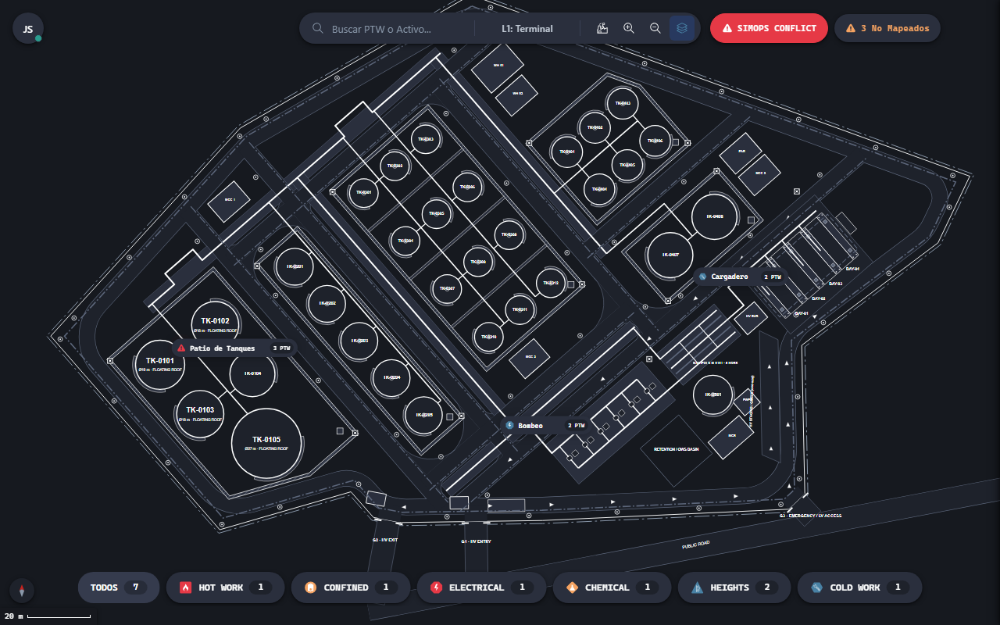

# SCR-VIS-008: General Plant Map with Work Permits Layer (SIMOPS)

## 1. Purpose and Operational Context

* **View Objective:** Macro-spatial overview (Plot Plan / Common Operational Picture) of plant Functional Locations (ANSI/ISA-101 Level 1). Enables safety inspectors and supervisors to toggle a dynamic Work Permits (PTW) safety layer, detecting Simultaneous Operations (SIMOPS) conflicts and identifying unmapped orphan permits.
* **Target Personas:** 
  * **HSEQ Inspector (Primary):** Audits safety compliance, monitors redundant hazard cues, resolves unmapped orphan permits (`CMP-07`), and analyzes SIMOPS spatial intersections.
  * **Maintenance Supervisor:** Maintains situational awareness, coordinates concurrent contractor tasks, resolves SIMOPS/orphan conflicts (`CMP-07`), and escalates to Level 3 equipment inspection.
  * **Maintenance Technician (Read & Navigation Access):** Navigates the 2D plant plot plan and inspects read-only permit overlays to locate equipment and transition to Level 3 faceplates ([SCR-VIS-033](./SCR-VIS-033.md)) or LOTO routes ([SCR-VIS-011](./SCR-VIS-011.md)), with SIMOPS/orphan resolution controls disabled.
  * **Reliability Engineer (Read & Navigation Access):** Traverses Functional Location zones and mapped equipment units on the 2D canvas to reach Level 3 diagnostics ([SCR-VIS-033](./SCR-VIS-033.md)), with SIMOPS/orphan resolution controls disabled.
* **Operational Context:** Rugged industrial field tablets in landscape and portrait orientations, and central maintenance desktop consoles.
* **Mode of Operation:** Spatial supervision, safety audit, and passive contextual navigation. The interface does not issue industrial control maneuvers or manipulate process setpoints.

---

## 2. Visual Artifact



> *Figure 2.1 — Level 1 General Plant Map (Dark Theme, Active SIMOPS Layer): Illustrates the 2D flat grayscale plot plan canvas (`CMP-01`) with active SIMOPS work permit overlay (`CMP-04`, `CMP-05`), contextual floating HUD toolbar (`CMP-02`), and non-modal alert pills.*

---

## 3. Functional Component Inventory

> The base grid, typography, neutral palettes, and minimal tactile contact areas are inherited from [DT-UI-DS-DOC-001](../../DT-UI-DS-DOC-001.md). This inventory defines the canonical components present on the screen, their design tokens, and their architectural scope. Interaction rules and geometric algorithms are specified in Section 5; responsive container adaptations are governed by Section 8.

1. **`CMP-01`: L1 Plot Plan Canvas**
   - **Visual Role:** Macro plant SVG vector canvas rendering Functional Locations (ISO 14224 Levels 1 to 5), `L-CIVL-PROP` site perimeter, `L-ELEC-HAZ` NFPA 497 hazardous envelopes (auto-enabled in SIMOPS mode), and Level 6 Equipment Units in the flat 2D neutral HPHMI spatial palette.
   - **Design Tokens:** 
	   - Surface: `--dt-color-bg-canvas` 
	   - Elevation: `--dt-z-canvas`
	   - Spatial Materials: `--dt-color-canvas-bund-floor`, `--dt-color-canvas-asphalt`, `--dt-color-canvas-concrete`, `--dt-color-canvas-equip-shell`, `--dt-color-canvas-pipe-proc`, `--dt-color-canvas-pipe-sec`
   - **Architectural Scope:** Primary spatial viewport ([DT-UI-DS-DOC-001 §5.1](../../DT-UI-DS-DOC-001.md#51-hphmi-shadow-discipline-canvas-vs-hud-chrome-separation)). Uses pure SVG `viewBox` camera kinematics, site-boundary center clamping, unified primary/middle-click desktop and single-finger tablet drag panning, and hybrid semantic zoom disclosure. Detailed in §5.4.

2. **`CMP-02`: Viewport Toolbar & HUD Navigation Cluster**
   - **Visual Role:** Frosted floating capsule toolbar hosting quick intent search (`Space` / `Ctrl + K`), fixed-width semantic zoom level badge (`L1: Terminal` / `L2: Subsystem` / `L3: Equipment`), viewport controls, binary Work Permits layer toggle, and adjacent non-modal alert pills (`SIMOPS Conflict`, `Unmapped Permits`).
   - **Design Tokens:** 
	   - Surface: `--dt-color-float-bg` 
	   - Border: `--dt-color-float-border`
	   - Elevation: `--dt-shadow-glass` 
	   - Radius: `--dt-radius-full`
	   - Level Badge Width: `--dt-layout-toolbar-badge-width`
   - **Architectural Scope:** Hosts quick search (`Search PTW or Equipment...`), fixed-width level indicator, reset view, zoom controls (+ / -), binary Work Permits layer toggle (`#icon-layers`), and dynamic alert badges per [DT-UI-DS-DOC-001 §5.2](../../DT-UI-DS-DOC-001.md#52-elevation-shadows). Adaptive condensation specified in §5.2.

3. **`CMP-03`: User Profile Indicator**
   - **Visual Role:** Circular floating button displaying active operator initials and static session presence dot.
   - **Design Tokens:** 
	   - Surface: `--dt-color-float-bg`
	   - Border: `--dt-color-float-border`
	   - Elevation: `--dt-shadow-glass`
	   - Radius: `--dt-radius-full`
	   - Touch Target: `--dt-touch-target-mobile`
	   - Session Dot: `--dt-color-state-success`
   - **Architectural Scope:** Anchored at top-left viewport margin per [DT-UI-DS-DOC-001 §5.2](../../DT-UI-DS-DOC-001.md#52-elevation-shadows). Triggers operator session and theme menu.

4. **`CMP-04`: Functional Zone Polygon**
   - **Visual Role:** Vector boundaries representing plant Functional Locations and property containment envelopes (`L-CIVL-PROP`) rendered in neutral HPHMI spatial tones with zero-grain exterior SDF fade ([DT-UI-SVG-DOC-001 §9.4](../../DT-UI-SVG-DOC-001.md#94-adaptive-multi-scale-coordinate-grid-sdf-boundary-dissolve)).
   - **Design Tokens:** 
	   - Border: `--dt-color-canvas-steel`
	   - Fill: `--dt-color-canvas-bund-floor`
   - **Architectural Scope:** Anchors spatial hazard grouping and hosts single macro zone summary pills (`CMP-09`) during Level 1 overview (`< --dt-zoom-scale-l1-max`).

5. **`CMP-05`: PTW Overlay Markers & Shape-Aware Hazard Buffers**
   - **Visual Role:** Floating vector spatial pins (`#icon-hot-work`, `#icon-electrical`, `#icon-heights`, `#icon-cold-work`, `#icon-confined-space`, `#icon-chemical`, `#icon-warning` with `--dt-shadow-marker` elevation) paired with shape-aware dynamic safety clearance buffers, multi-permit concurrency counter pills, and frosted fan-out trays.
   - **Design Tokens:** 
	   - Surface: `--dt-color-marker-surface`
	   - Frosted Tray Surface: `--dt-color-float-bg-strong`
	   - Marker Outline & Border: `--dt-color-marker-border`, `--dt-color-border-subtle`
	   - Elevation: `--dt-shadow-marker`, `--dt-shadow-glass`
	   - Dynamic Buffers: `--dt-z-layer-ptw`
	   - Marker Stacking: `--dt-z-layer-markers`
   - **Architectural Scope:** Represents active authorized permits on the map using 4-channel redundant coding per [DT-UI-DS-DOC-001 §6.2](../../DT-UI-DS-DOC-001.md#62-redundant-coding-matrix-for-permits-and-loto) and [§6.4](../../DT-UI-DS-DOC-001.md#64-iconography-and-redundant-symbology-standards). Enforces IOGP 459 / API 2015 3-state (`A` / `R` / `X`) compatibility rules, union-only conflict intersection hatching, and concurrency fan-out clustering specified in §5.1.

6. **`CMP-06`: Context Popover Card**
   - **Visual Role:** Transient frosted card displaying permit metadata, validity window, contractor, LOTO reference, SIMOPS joint countermeasures confirmation (for `R` state), and drill-down actions.
   - **Design Tokens:** 
	   - Surface: `--dt-color-float-bg-strong`
	   - Border: `--dt-color-float-border-strong`
	   - Elevation: `--dt-shadow-glass`
	   - Radius: `--dt-radius-lg`
   - **Architectural Scope:** Deployed upon tapping `CMP-05` or selecting an entry from a concurrency fan-out tray. Features a secondary action button (`[View Permit Details]`) for Level 3 drill-down and a conditional `[Inspect Isolation]` trigger (active when `Permit.WorkOrderId != null`) for Level 4 LOTO verification per [DT-UI-DS-DOC-001 §6.5.1](../../DT-UI-DS-DOC-001.md#651-morphological-differentiation-status-badges-vs-interactive-buttons) and §5.5. Viewport collision flipping and light-dismiss rules in §5.4.

7. **`CMP-07`: SIMOPS Integrity Panel**
   - **Visual Role:** Collapsible drawer displaying visualization failures and unmapped permits as flat rows separated by hairline dividers with dedicated resolution triggers (`#icon-location`).
   - **Design Tokens:** 
	   - Surface: `--dt-color-surface-drawer`
	   - Border: `--dt-color-border-panel`
	   - Elevation: `--dt-shadow-panel`
   - **Architectural Scope:** Manages orphan permit resolution (`AF-001`). Dismissed via header close action or by tapping empty canvas. Escalation rules in §5.2; responsive docking in §8.

8. **`CMP-08`: Filter Chips Panel**
   - **Visual Role:** Discrete floating touch pills at screen bottom for toggling permit visibility, with hazard-tinted active states and elevated count capsules tracking mapped spatial permits.
   - **Design Tokens:** 
	   - Surface: `--dt-color-float-bg`
	   - Border: `--dt-color-float-border`
	   - Elevation: `--dt-shadow-glass`
	   - Radius: `--dt-radius-full`
   - **Architectural Scope:** Direct-touch filter controls and permanent visual permit legend (excluding unmapped orphan permits per §5.2 and §6). Supports touch swiping and desktop `Shift + Wheel` horizontal scrolling. Interaction rules in §5.4.

9. **`CMP-09`: Programmatic L1 Zone Summary Pill**
   - **Visual Role:** High-salience single macro summary pill programmatically computed per Functional Location centroid consolidating total active permits, SIMOPS conflict alerts, and dominant hazard status (`L1: Terminal`).
   - **Design Tokens:** 
	   - Surface: `--dt-color-surface-card`
	   - Marker Border: `--dt-color-marker-border`
	   - Elevation: `--dt-shadow-marker`
	   - Radius: `--dt-radius-full`
	   - Stacking: `--dt-z-layer-markers`
   - **Architectural Scope:** Macro density aggregation (`Scale < --dt-zoom-scale-l1-max`) aggregated dynamically from relational catalog joins ([DT-UI-SVG-DOC-001 §10.2](../../DT-UI-SVG-DOC-001.md#102-pure-viewbox-camera-site-boundary-clamping-transition-rules)). Cross-fades symmetrically with discrete markers (`CMP-05`). Tapping zooms smoothly into the target functional zone. Semantic zoom mechanics in §5.4.

10. **`CMP-10`: Cartographic Compass & Metric Scale HUD**
    - **Visual Role:** Fixed bottom-left frosted spatial HUD combining a circular north-orientation compass indicator and an adaptive metric scale bar.
    - **Design Tokens:** 
	    - Surface: `--dt-color-float-bg`, `--dt-color-scale-bg`
	    - Border: `--dt-color-float-border`
	    - Elevation: `--dt-shadow-glass`
	    - Compass Footprint: `--dt-control-size-hud`
	    - Radius: `--dt-radius-full`
    - **Architectural Scope:** Decoupled HTML overlay anchored at the bottom-left margin per [DT-UI-DS-DOC-001 §2.2](../../DT-UI-DS-DOC-001.md#22-dimensions-of-controls-and-touch-areas) and [§5.2](../../DT-UI-DS-DOC-001.md#52-elevation-shadows). Computes adaptive grid and scale intervals dynamically from the SVG `CALIBRATION-VECTOR` ([DT-UI-SVG-DOC-001 §11](../../DT-UI-SVG-DOC-001.md#11-spatial-metric-calibration)) and active `viewBox` width.

---

## 4. Screen State Catalog

1. **Normal (Inactive Layer)**
   - **Activation Condition:** User deactivates the "Work Permits" layer in `CMP-02` or default initial state.
   - **Visual Modification:** Canvas renders Functional Locations in neutral grayscale palette. No superimposed safety badges.

2. **Loading**
   - **Activation Condition:** Initial SVG plot plan retrieval or spatial query transition.
   - **Visual Modification:** Dimmed activity indicator centered over canvas; skeleton shimmer on panel containers.

3. **Active PTW Layer**
   - **Activation Condition:** Activation of the "Work Permits" layer switch in `CMP-02` (`FR-182`).
   - **Visual Modification:** Auto-enables the `L-ELEC-HAZ` NFPA 497 hazardous area envelope overlay alongside permits. Renders single `CMP-09` summary pills per Functional Location at normalized `Scale < --dt-zoom-scale-l1-max`, cross-fading smoothly to discrete `CMP-05` spatial pins with flat shape-aware clearance buffers (`A` / `R` / `X`) at `Scale >= --dt-zoom-scale-l1-max`. Layer button in `CMP-02` highlights with `--dt-color-state-info`.

4. **Selected Permit or Concurrent Fan-Out Active**
   - **Activation Condition:** Tap or click on a `CMP-05` marker or a multi-permit concurrency pill (`FR-184`).
   - **Visual Modification:** If a single permit occupies the target, `CMP-05` highlights with `--dt-color-state-info` and deploys `CMP-06` adjacent to the pin. If 2 or more permits share an asset or overlapping pin footprint, tapping the concurrency pill deploys a frosted fan-out tray (`--dt-color-float-bg-strong`, `--dt-shadow-glass`) listing each permit pill before opening `CMP-06`.

5. **SIMOPS Spatial Conflict (`X` Incompatible) & Restricted Joint Co-Activity (`R`)**
   - **Activation Condition:** Automated Spatial Integrity Engine evaluates the IOGP 459 / API 2015 3-state matrix across active permits (`A` Allowed, `R` Restricted with joint countermeasures, `X` Incompatible / Hard Conflict) and detects spatial overlap or shared-asset co-activity per §5.1.
   - **Visual Modification:** Individual permit clearance zones retain flat unhatched translucent fills. Strictly inside the exact geometric intersection `A ∩ B` of an `X` incompatible pair (clipped to the overlapping region only), the canvas renders a red diagonal hatch pattern (`#icon-warning` octagon badge at centroid) framed by a continuous perimeter stroke (`--dt-color-alarm-critical`). Toolbar `CMP-02` displays `[#icon-warning SIMOPS CONFLICT]`. Restricted (`R`) pairs render an amber warning triangle indicator; confirming joint safety controls elevates `R` to Authorized (`A`).

6. **Expiring Soon Warning**
   - **Activation Condition:** System detects permit time window has $< 60\text{ min}$ remaining until `ValidTo`.
   - **Visual Modification:** Target `CMP-05` marker displays an amber warning border; status in `CMP-06` displays "EXPIRING SOON" in `--dt-color-alarm-warning`.

7. **Detected Orphanhood (SIMOPS Alert)**
   - **Activation Condition:** Approved permits detected lacking SVG `MeshMapping` (`FR-185`, `AF-001`).
   - **Visual Modification:** Toolbar badge highlights in `--dt-color-alarm-critical` with unmapped count (e.g., `[#icon-warning 3]`). Non-modal top toast banner (`--dt-layout-toast-max-height`) notifies operator. Explicit tap opens `CMP-07` without viewport hijacking.

8. **Loss of Synchronization**
   - **Activation Condition:** Interruption of real-time SignalR connection or heartbeat timeout (`FR-187`, `NFR-194`, `AF-002`).
   - **Visual Modification:** Priority 4 Diagnostic banner deployed at screen top with neutral stale icon (`#icon-wifi-off`) and last sync timestamp: `[#icon-wifi-off] CACHE MODE: Telemetry link interrupted (Last sync: HH:mm:ss COT)`. Top navigation container offsets down by `--dt-layout-banner-diagnostic-height` to prevent control occlusion. Badges remain visible in cached state. Process alarm colors (amber/red) prohibited.

---

## 5. Interaction Rules and Data Flow

### 5.1. Spatial Resolution, Proximity Engine, and Layer Rendering
1. Upon loading the view, the system retrieves the vector layout representing the facility's Functional Locations (ISO 14224 Levels 1 to 5) via `GET /api/v1/visualization/plot-plans/{facilityCode}` ([DT-ARQ-CMP-DOC-001 §6](../../../architecture/views/DT-ARQ-CMP-DOC-001.md#6-rest-api-prefix-concurrency-numeric-precision-conventions)).
2. When the Work Permits layer is active, the system queries all `WorkPermits` in the `APPROVED` lifecycle state via `GET /api/v1/safety/work-permits?status=APPROVED` and retrieves unmapped integrity anomalies via `GET /api/v1/safety/work-permits/orphans`. Spatial reassignment of an orphan permit's equipment mesh mapping (`FR-186`) dispatches `PUT /api/v1/visualization/mesh-mappings/{equipmentUnitId}` (`UpsertMeshMappingCommand`) carrying `X-Idempotency-Key: {uuidv7}` ([ADR-007](../../../architecture/adr/ADR-007.md)), and includes `If-Match: "{ConcurrencyToken}"` (optimistic concurrency control per [DT-ARQ-DB-DOC-001 §3.12](../../../architecture/DT-ARQ-DB-DOC-001.md#312-optimistic-concurrency-control-via-postgresql-xmin-system-column-inv-027-nfr-169)) only when updating an existing `MeshMapping` (`mesh_mappings`) row (omitted when creating an initial mapping for an unmapped orphan asset).
3. **Referential Resolution & Pin Anchoring Path:**
   $$\text{WorkPermit} \xrightarrow{\text{EquipmentUnitId}} \text{EquipmentUnit} \xrightarrow{\text{MeshMapping}} \text{SVG Geometry / Pin Anchor}$$
   * For large containment footprints (e.g., atmospheric storage tanks and wide process vessels), the two-tone `CMP-05` spatial pin anchors cleanly **inside** the equipment footprint without occluding roof instruments. For compact equipment units (e.g., centrifugal pumps, gate valves, compact manifolds), the pin anchors immediately **adjacent** to the symbol edge with a subtle leader tick so mechanical nozzles remain unobscured.
   * When 2 or more active permits map to the same asset or pin footprint, `CMP-05` renders a unified concurrency counter pill (`2`, `3`, ...) next to the dominant hazard marker. Activating the pill opens a frosted radial/stacked fan-out tray (`--dt-color-float-bg-strong`, `--dt-shadow-glass`) to disambiguate individual permits without overlap.
   * If an `EquipmentUnit` is mapped to a parent Functional Location without discrete geometry, the permit aggregates into the zone summary pill (`CMP-09`).
4. **Automated SIMOPS 3-State Compatibility & Shape-Aware Proximity Engine (IOGP 459 / API 2015 / ISO 45001 §8.1):**
   * **3-State Compatibility Matrix:** Every pair of active permits is evaluated against the deterministic matrix (`A` = Allowed, `R` = Restricted pending joint countermeasures confirmation, `X` = Incompatible Hard Conflict).
   * **Shape-Aware Dynamic Spatial Hazard Buffers (`--dt-z-layer-ptw`):** Rather than uniform generic circles on linear assets, buffer geometry matches the industrial hazard footprint:
     * **`HOT_WORK`:** $15\text{m}$ circular buffer around point sources or stadium-shaped corridor envelope along piping segments (`--dt-color-alarm-critical` flat translucent fill, unhatched outside intersections).
     * **`CONFINED_SPACE`:** $13\text{m}$ circular clearance envelope or polygonal containment footprint (`--dt-color-alarm-warning` flat translucent fill).
     * **`ELECTRICAL`, `WORK_AT_HEIGHT`, `EXCAVATION`, `CHEMICAL`, `COLD_WORK`:** Asset-envelope buffer or configurable operational corridor perimeter ($5\text{m}$ default).
   * **Intersection-Only Conflict Hatching & Redundant Coding:** When two permits violate minimum separation or share a bounded envelope under `X` (Incompatible), the engine computes the exact geometric intersection `A ∩ B` using SVG clipping paths/masks. Diagonal red hatching renders **exclusively inside `A ∩ B`** surrounded by a continuous `--dt-color-alarm-critical` perimeter contour and a red octagon conflict badge (`#icon-warning`) at the intersection centroid.
   * **Restricted Co-Activity (`R`) Escalation:** Pairs classified `R` display an amber warning triangle indicator; toggling verified joint safety countermeasures in `CMP-06` promotes the pair operationally to Allowed (`A`).
   * **SIMOPS Mode `L-ELEC-HAZ` Auto-Activation:** Entering SIMOPS supervision mode automatically activates the `L-ELEC-HAZ` NFPA 497 Zone 1 / Zone 2 classified electrical boundary layer alongside permit buffers so inspectors immediately detect Hot Work encroachments into hydrocarbon vapor envelopes.
5. **Mandatory 4-Channel Redundant Coding Matrix (FR-183, TR-011, WCAG 2.1 AA):**
   * To prevent single-channel color dependency and ensure pre-attentive salience, every `CMP-05` marker encodes its permit classification across four sensory channels (Color + Geometric Shape Silhouette + Vector Icon + Alphanumeric Label) governed strictly by [DT-UI-DS-DOC-001 §6.2](../../DT-UI-DS-DOC-001.md#62-redundant-coding-matrix-for-permits-and-loto), [§6.4](../../DT-UI-DS-DOC-001.md#64-iconography-and-redundant-symbology-standards), and [DT-DM-DOC-001 §4.34](../../../domain-models/class/DT-DM-DOC-001.md#434-workpermitpermittype).
   * Individual spatial hazard buffers, intersection hatch overlays, and conflict halos operate non-blocking for pointer traversal to guarantee uninterrupted canvas panning across active permit zones.
   * Markers enforce screen-space clamped sizing (`26–36 px` equivalent in screen space) and `--dt-shadow-marker` silhouette elevation (`Z = 50`, never on `<text>`), while interactive hit areas obey `--dt-touch-target-mobile` for gloved field operation.

### 5.2. Integrity Panel Governance & Non-Modal Escalation (Orphan Detection — `AF-001`)
1. If an approved `WorkPermit` references an `EquipmentUnitId` that has no geometric representation or spatial metadata in the loaded layout, the permit is classified as **Orphan**.
2. **Safety Rule:** The permit is **never** drawn at an arbitrary coordinate on the map to prevent misleading spatial situational awareness.
3. **Strict Non-Modal Escalation (ISO 9241-110 §5.5 Controllability & ISO 11064-5):**
   * Detecting unmapped permits shall **never** automatically deploy or expand `CMP-07`, preventing viewport hijacking.
   * The alert counter on `CMP-02` Toolbar displays a borderless warning pill `[#icon-warning 3 Unmapped]` with subtle warning fill and `--dt-shadow-hud` elevation.
   * A single-line non-modal toast banner (height `--dt-layout-toast-max-height`, elevation `--dt-z-toast-alert`) slides down at the top viewport edge:
     `"SIMOPS Alert: 3 Permits lack spatial mapping. [View List] [Dismiss]"`
4. **Explicit Operator Deployment & Tablet Physical Constraints:**
   * Tapping `[View List]` or the toolbar badge expands `CMP-07`.
   * **Tablet Landscape:** `CMP-07` docks as a lateral panel preserving canvas visibility; layout sizing is detailed in Section 8.
   * **Tablet Portrait:** `CMP-07` renders as a **Bottom Sheet** docked at the viewport bottom with its capsule drag handle nested directly inside the drawer header container to guarantee background tone parity; height bounds are detailed in Section 8.
   * **Canvas Light-Dismiss:** Tapping or clicking any empty region of the vector canvas (`CMP-01`) immediately dismisses `CMP-07`, enabling effortless one-touch closure without requiring explicit interaction with the close ('X') button.
   * Container toggling operates via **discrete single taps** on dedicated handles governed by `--dt-touch-target-mobile` (per [DT-UI-DS-DOC-001 §6.3](../../DT-UI-DS-DOC-001.md#63-sliding-containers-pattern-bottom-sheets-and-drawers)). Continuous drag gestures are optional and never mandatory.
5. **Flat List Ergonomics for Visualization Failures:**
   * To prevent visual crowding and eliminate nested card borders ("Russian doll" effect) inside `CMP-07` (layout dimensions in §8), orphan items are rendered directly on the drawer background surface (`--dt-color-surface-drawer`) as flat rows separated by hairline dividers (`--dt-color-border-subtle`).
   * Each orphan record presents: `Permit Identifier` with a compact 4-channel hazard capsule pill, expiration timestamp, `Expected TagNumber`, Contractor, a decoupled warning issue description on its own line, and a compact top-right icon button (`#icon-location`, `FR-186`) to trigger spatial reassignment.
6. **Adaptive Toolbar Badge Condensation (`CMP-02`):**
   * In tablet landscape with `CMP-07` deployed, toolbar `CMP-02` condenses the unmapped orphan badge to an icon-only `[#icon-warning 3]` format to prevent toolbar crowding.
   * On desktop workstations, in tablet portrait, and whenever `CMP-07` is closed, the badge displays its full alphanumeric label `[#icon-warning 3 Unmapped]`. Responsive breakpoint mapping is detailed in Section 8.

### 5.3. Real-Time Synchronization (`TR-010`)
1. The client subscribes to the canonical SignalR hubs registered in [DT-ARQ-CMP-DOC-001 §5](../../../architecture/views/DT-ARQ-CMP-DOC-001.md#5-signalr-hub-and-real-time-event-contract-registry-tr-010):
   * **`/hubs/operations` (`IOperationsClient`):** Subscribes to `PermitStatusChanged(WorkPermitStatusEvent)` — injects a new `CMP-05` badge (or updates `CMP-09` cluster count) within $< 5\text{s}$ when `Status == APPROVED` (`FR-187`, `NFR-192`), removes the badge with a fluid fade transition when `Status` transitions to `REVOKED` or `CLOSED`, and activates the expiring warning state when `IsExpiringSoon == true`.
   * **`/hubs/telemetry` (`ITelemetryClient`):** Subscribes to `EmergencyEvacuationBroadcast(EvacuationAlertDto)` to escalate affected equipment zones immediately during life-safety re-energization alerts.
2. **Operational Resilience (`AF-002`):** If the real-time link drops, the client transitions to the "Loss of Synchronization" diagnostic state without blocking canvas navigation, preserving the last known snapshot with explicit timestamp traceability (`NFR-194`).

### 5.4. Dual Navigation, Tactile Controllability, and Hybrid Semantic Zoom
1. **Hybrid Semantic Zoom & Cross-Fade Disclosure (ANSI/ISA-101.01 §6.3.1 / Hollifield Ch. 8):** Shared `viewBox` camera, site-boundary clamping, `> 4px` pan threshold, and zoom-adaptive ISO 128 lineweights follow [DT-UI-SVG-DOC-001 §9.2 & §10](../../DT-UI-SVG-DOC-001.md#10-progressive-disclosure-viewport-kinematics) and [DT-UI-DS-DOC-001 §2.5](../../DT-UI-DS-DOC-001.md#25-spatial-navigation-and-semantic-zoom-tokens-ansiisa-10101-viewports):
   * **Level 1 Terminal Overview (`Scale < --dt-zoom-scale-l1-max`):** Discrete equipment permit pins (`CMP-05`) are suppressed. Each Functional Location renders a single programmatic **Zone Summary Pill** (`CMP-09`) at its zone centroid consolidating active permits and conflict counts (`NFR-190`).
   * **Level 2 Area & SIMOPS Buffers (`--dt-zoom-scale-l1-max <= Scale < --dt-zoom-scale-l2-max`):** Zone summary pills cross-fade symmetrically with discrete **PTW Overlay Markers** (`CMP-05`), shape-aware hazard envelopes, concurrency pills, and `L-ELEC-HAZ` classified area boundaries.
   * **Level 3 Micro Equipment Detail (`Scale >= --dt-zoom-scale-l2-max`):** Discloses nozzles, root valves, screen-space clamped ANSI/ISA-5.1 instrument plates, underground fire-water ring mains outside road curbs, and active LOTO lock numbers.
2. **Programmatic Focus & Pan Disambiguation:** Programmatic fly-to centering (`Space` / `Ctrl + K` search, conflict badge focus, L1 zone pill tap) executes smooth delta-time interpolation; stationary taps/clicks ($\le 4\text{px}$) select markers without accidental pan shifts.
3. **Transient Popover Card Dismissal and Viewport Clamping (`CMP-06`):**
   * **Adaptive Viewport Clamping & Collision Flipping:** Dynamically calculates bounding box and flips leftward when colliding with the right viewport margin ($X + W > \text{Viewport}_W - \text{--dt-space-4}$); clamps vertically within safe boundaries ($[\text{--dt-layout-popover-top-clearance}, \text{Viewport}_H - H - \text{--dt-space-4}]$) respecting top toolbar clearance.
   * **Transient Light-Dismiss:** Moving the canvas via pan drag or adjusting zoom immediately dismisses `CMP-06` and open concurrency fan-out trays to maintain unobstructed visual scanning. Ending a pan gesture immediately unblocks input handling so subsequent stationary clicks or taps on markers deploy `CMP-06` without gesture-lock.
   * **Secondary Action Triggers:** Features label-only secondary action buttons (`[View Permit Details]` and, when `Permit.WorkOrderId != null`, `[Inspect Isolation]`, borderless in light theme with subtle hairline framing in dark theme, without trailing chevron, per [DT-UI-DS-DOC-001 §6.5.1](../../DT-UI-DS-DOC-001.md#651-morphological-differentiation-status-badges-vs-interactive-buttons)) to initiate Level 3 inspection and Level 4 LOTO verification (§5.5).
4. **Horizontal Filter Chips Ergonomics (`CMP-08`):**
   * Transparent horizontal container anchored at the bottom viewport margin hosting independently floating, borderless filter pills elevated with `--dt-shadow-hud`.
   * Applies hazard-specific tinted fills upon selection (`HOT_WORK`, `CONFINED_SPACE`, etc.) and `--dt-color-surface-raised` for `ALL`, with widened count capsules.
   * Supports direct touch swipe on field tablets.
   * Supports horizontal scrolling on desktop via mouse wheel combined with the `Shift` key (`Shift + Wheel`).
5. **Tactile Ergonomics:** On touch devices (`Industrial Tablet`), all interactive triggers (`CMP-02`, `CMP-03`, `CMP-07`, `CMP-08`, `CMP-09`) maintain tactile touch targets governed by `--dt-touch-target-mobile`.
6. **Hover vs. Tap Bifurcation:** Desktop pointers display a compact hover tooltip (`FR-189`). Touch devices deploy the persistent `CMP-06` card upon direct tap (`FR-184`), dismissible via tap-away, pan/zoom motion, or close ('X') button.

### 5.5. Hierarchical Escalation (L1 $\to$ L3 Transition)
1. Clicking on `[View Permit Details]` within `CMP-06` initiates an operational drill-down, transitioning the inspector directly into the Level 3 Equipment Task Faceplate ([SCR-VIS-033](./SCR-VIS-033.md)) for the target equipment unit.
2. When `Permit.WorkOrderId != null`, clicking `[Inspect Isolation]` within `CMP-06` navigates directly to the Level 4 LOTO Isolation Boundary Matrix ([SCR-VIS-011](./SCR-VIS-011.md)) with query `?workOrderId={WorkOrderId}&equipId={EquipmentUnitId}` ([DT-UI-NAV-DOC-001 §5](../../DT-UI-NAV-DOC-001.md#5-transition-matrix-and-access-control-rbac)). When `Permit.WorkOrderId == null`, `[Inspect Isolation]` is disabled/hidden.
3. Direct selection of an Equipment Unit on the canvas (outside a PTW badge) seamlessly deploys the [SCR-VIS-033](./SCR-VIS-033.md) contextual drawer without changing screens.

---

## 6. Industrial and Safety Considerations

* **Read-Only Supervisory Boundary & SIMOPS Mutation Guard (ISO 45001 §8.1):** `SCR-VIS-008` operates as a passive spatial supervision and SIMOPS audit interface that cannot issue equipment start/stop commands, alter process setpoints, or bypass LOTO interlocks ([DT-UI-NAV-DOC-001 §6.2](../../DT-UI-NAV-DOC-001.md#62-loto-lockout-and-fail-safe-guard)). Read and spatial navigation access is granted to `Maintenance Technician` and `Reliability Engineer`, while SIMOPS permit/conflict mutation and orphan `MeshMapping` resolution controls (`CMP-07`) remain restricted exclusively to `HSEQ Inspector` and `Maintenance Supervisor`.
* **Spatial Integrity Fail-Safe (`AF-001`):** Unmapped permits (`MeshMapping` status `UNMAPPED` or `SYNC_ERROR`) are strictly withheld from arbitrary canvas placement and excluded from mapped spatial filter counts (`CMP-08`) to prevent false spatial confidence during co-activity risk assessment (§5.2).
* **HPHMI & Accessibility Governance ([TR-011](../../../requirements/common/TR-011.md)):** Visual salience, 4-channel redundant permit coding, neutral HPHMI spatial palette compliance, hybrid semantic zoom decluttering, and Priority 4 diagnostic state segregation adhere strictly to [DT-UI-DS-DOC-001 §1](../../DT-UI-DS-DOC-001.md#1-scope), [§3.4](../../DT-UI-DS-DOC-001.md#34-spatial-and-physical-material-tokens-digital-twin-canvas), [§6.2](../../DT-UI-DS-DOC-001.md#62-redundant-coding-matrix-for-permits-and-loto), and the interaction mechanics in §4 and §5.

---

## 7. Frontend Component Contract (Blazor / Razor)

### 7.1. Component Hierarchy & File Mapping

```text
Pages/
└── GeneralPlantMapPage.razor                 # Root View (SCR-VIS-008)
    ├── PlotPlanCanvas2D.razor                # CMP-01: Macro SVG canvas with pan/zoom
    │   ├── FunctionalZonePolygon.razor       # CMP-04: Functional Location vector polygon
    │   ├── ZoneClusterPill.razor             # CMP-09: Programmatic L1 summary pill (Scale < l1-max)
    │   ├── PtwOverlayBadge.razor             # CMP-05: Redundant coding marker & fan-out tray (Scale >= l1-max)
    │   └── SimopsHazardBuffer.razor          # Shape-aware clearance buffer & clipped intersection hatch
    ├── ViewportToolbar.razor                 # CMP-02: Floating navigation & binary PTW layer bar
    ├── UserProfileButton.razor               # CMP-03: Top-left user profile indicator
    ├── PtwContextPopover.razor               # CMP-06: Compact permit popover card
    ├── SimopsIntegrityDrawer.razor           # CMP-07: Visualization failures side drawer (--dt-layout-drawer-width)
    ├── PtwFilterChips.razor                  # CMP-08: Bottom floating risk filter chips
    ├── CartographicHud.razor                 # CMP-10: Bottom-left compass & metric scale HUD
    └── StaleCacheBanner.razor                # Diagnostic stale cache banner (AF-002)
```

### 7.2. Physical Component Parameters & DTO Contracts (.NET 10 / C# 14)

#### 7.2.1. `GeneralPlantMapPage.razor` (Root View)
```csharp
[Parameter]
public string? FacilityCode { get; set; }

[Parameter]
public Guid? InitialPermitId { get; set; }
```

#### 7.2.2. Subcomponent Parameter Contracts

Shared Spatial HUD (`CMP-02`: `ViewportToolbar.razor` with `IsPtwLayerActive`, `SimopsConflictCount`, `OrphanPermitsCount`, `IsIntegrityDrawerOpen`, and PTW/SIMOPS callbacks; `CMP-03`: `UserProfileButton.razor`; `CMP-10`: `CartographicHud.razor`): see [DT-UI-CTR-001 §3.2](../../contracts/DT-UI-CTR-001.md#32-spatial-viewport-hud-kit).

```csharp
// CMP-01: PlotPlanCanvas2D.razor
[Parameter]
public required string SvgRawContent { get; set; }

[Parameter]
public required IReadOnlyList<PtwOverlayDto> Permits { get; set; }

[Parameter]
public required IReadOnlyList<ZoneClusterPillDto> Clusters { get; set; }

[Parameter]
public required IReadOnlyList<SimopsConflictDto> Conflicts { get; set; }

[Parameter]
public double ZoomScale { get; set; } = 1.0;

[Parameter]
public EventCallback<string> OnEquipmentSelected { get; set; }

[Parameter]
public EventCallback<Guid> OnPermitBadgeClicked { get; set; }

[Parameter]
public EventCallback<string> OnZoneClusterClicked { get; set; }

// CMP-09: ZoneClusterPill.razor
[Parameter]
public required ZoneClusterPillDto Cluster { get; set; }

[Parameter]
public EventCallback<string> OnClusterClicked { get; set; }

// CMP-05: PtwOverlayBadge.razor
[Parameter]
public required PtwOverlayDto Permit { get; set; }

[Parameter]
public bool IsSelected { get; set; }

[Parameter]
public bool HasSimopsConflict { get; set; }

[Parameter]
public EventCallback<Guid> OnBadgeClicked { get; set; }

// SimopsHazardBuffer.razor
[Parameter]
public required PtwOverlayDto Permit { get; set; }

[Parameter]
public bool HasConflict { get; set; }

// CMP-06: PtwContextPopover.razor
[Parameter]
public required PtwOverlayDto Permit { get; set; }

[Parameter]
public EventCallback OnCloseRequested { get; set; }

[Parameter]
public EventCallback<string> OnViewDetailsRequested { get; set; }

[Parameter]
public EventCallback<(Guid WorkOrderId, Guid EquipmentUnitId)> OnInspectIsolationRequested { get; set; }

// CMP-07: SimopsIntegrityDrawer.razor
[Parameter]
public required IReadOnlyList<OrphanPermitDto> OrphanPermits { get; set; }

[Parameter]
public bool IsOpen { get; set; }

/// <summary>
/// RBAC mutation guard: true strictly for HSEQ Inspector and Maintenance Supervisor;
/// false for Maintenance Technician and Reliability Engineer (read/navigation-only access).
/// </summary>
[Parameter]
public bool CanResolveSimopsOrphans { get; set; }

[Parameter]
public EventCallback<bool> OnOpenChanged { get; set; }

[Parameter]
public EventCallback<Guid> OnResolveInconsistencyRequested { get; set; }

// CMP-08: PtwFilterChips.razor
[Parameter]
public PermitType? SelectedFilter { get; set; }

[Parameter]
public int TotalMappedPermitsCount { get; set; }

[Parameter]
public required IReadOnlyDictionary<PermitType, int> PermitCounts { get; set; }

[Parameter]
public EventCallback<PermitType?> OnFilterChanged { get; set; }

// CMP-04: FunctionalZonePolygon.razor
[Parameter]
public required PlantZoneDto Zone { get; set; }

// Diagnostic Banner: StaleCacheBanner.razor (AF-002)
[Parameter]
public bool IsStale { get; set; }

[Parameter]
public DateTimeOffset? LastSyncTimestamp { get; set; }
```

#### 7.2.3. Data Transfer Objects (DTOs)

Shared Domain Enums (`PermitType`, `WorkPermitStatus`): see [DT-DM-DOC-001 §4](../../../domain-models/class/DT-DM-DOC-001.md#4-controlled-vocabulary).

```csharp
public record PtwOverlayDto
{
    public required Guid Id { get; init; }
    public required string PermitIdentifier { get; init; } // e.g. "PTW-1042"
    public required PermitType Type { get; init; }
    public required string Contractor { get; init; }
    public required Guid IssuerUserId { get; init; }
    public required string IssuerFullName { get; init; }
    public required Guid EquipmentUnitId { get; init; }
    public required string EquipmentTag { get; init; }
    public required double CoordinateX { get; init; }
    public required double CoordinateY { get; init; }
    public required DateTimeOffset ValidFrom { get; init; }
    public required DateTimeOffset ValidTo { get; init; }
    public required WorkPermitStatus Status { get; init; }
    public bool IsExpiringSoon { get; init; }
    public Guid? WorkOrderId { get; init; }
    public string? AssociatedLotoNumber { get; init; }
    public double BufferRadiusMeters { get; init; } = 5.0; // 15m HOT_WORK, 13m CONFINED_SPACE, 5m default
    public bool HasSimopsConflict { get; init; }
    public IReadOnlyList<Guid> ConflictingPermitIds { get; init; } = [];
}

public record ZoneClusterPillDto
{
    public required string FunctionalLocationCode { get; init; }
    public required string ZoneName { get; init; }
    public required double CentroidX { get; init; }
    public required double CentroidY { get; init; }
    public required int TotalPermitsCount { get; init; }
    public bool HasSimopsConflict { get; init; }
    public PermitType? DominantPermitType { get; init; }
}

public record SimopsConflictDto
{
    public required Guid Id { get; init; }
    public required Guid PermitAId { get; init; }
    public required Guid PermitBId { get; init; }
    public required string PermitAIdentifier { get; init; }
    public required string PermitBIdentifier { get; init; }
    public required PermitType PermitAType { get; init; }
    public required PermitType PermitBType { get; init; }
    public required double DistanceMeters { get; init; }
    public required double SafeDistanceMeters { get; init; }
    public required string ConflictDescription { get; init; }
}

/// <summary>
/// Note: CoordinateX, CoordinateY, CentroidX, CentroidY, and spatial buffer distances in visualization DTOs intentionally use IEEE 754 double exclusively for SVG/Canvas 2D viewport rendering geometry per DT-ARQ-CMP-DOC-001 §6; financial and physical engineering quantities remain strictly decimal.
/// </summary>
public record OrphanPermitDto
{
    public required Guid Id { get; init; }
    public required string PermitIdentifier { get; init; }
    public required PermitType Type { get; init; }
    public required string Contractor { get; init; }
    public required Guid EquipmentUnitId { get; init; }
    public required string ExpectedEquipmentTag { get; init; }
    public required string DiagnosticMessage { get; init; }
    public required DateTimeOffset ValidTo { get; init; }
    public required uint ConcurrencyToken { get; init; }
}

/// <summary>
/// Spatial mesh mapping upsert command for PUT /api/v1/visualization/mesh-mappings/{equipmentUnitId}.
/// ConcurrencyToken is nullable because initial orphan mapping creates a new MeshMapping (mesh_mappings) row without If-Match;
/// If-Match applies only when updating an existing mapping.
/// </summary>
public record UpsertMeshMappingCommand
{
    public required Guid EquipmentUnitId { get; init; }
    public required double CoordinateX { get; init; }
    public required double CoordinateY { get; init; }
    public double? CoordinateZ { get; init; }
    public string? MeshUuid { get; init; }
    public uint? ConcurrencyToken { get; init; }
}

public record PlantPlotPlanDto
{
    public required string FacilityCode { get; init; }
    public required string FacilityName { get; init; }
    public required string SvgContent { get; init; }
    public IReadOnlyList<PlantZoneDto> Zones { get; init; } = [];
}

public record PlantZoneDto
{
    public required string FunctionalLocationCode { get; init; }
    public required string ZoneName { get; init; }
    public required int IsoHierarchyLevel { get; init; }
}
```

### 7.3. Client-Side DOM & Interop Bridge

1. **SVG Viewport Navigation Interop (`ISvgViewportInterop`):**
   * Encapsulates pure `viewBox` coordinate transformations, site-boundary center clamping, pointer capture, unified primary/middle-click desktop and tablet panning ($> 4\text{px}$ drag threshold), instant focal wheel zoom, smooth delta-time fly-to transitions, and zoom-adaptive ISO 128 stroke scaling ([ADR-001](../../../architecture/adr/ADR-001.md)).
   * Maintains $\ge 30\text{ FPS}$ on tablets and $\ge 60\text{ FPS}$ on desktop consoles (`NFR-190`) without generating roundtrip network traffic.
2. **SIMOPS Spatial & Proximity Engine (`ISimopsSpatialEngine`):**
   * Evaluates the 3-state (`A` / `R` / `X`) compatibility matrix, computes shape-aware hazard buffer envelopes (circles, piping stadiums, containment footprints), and isolates diagonal red intersection hatching strictly inside exact `A ∩ B` clipped boundaries in client memory.
   * Projects screen-space clamped marker scales and non-blocking pointer traversal across buffer polygons.
3. **Semantic Event Dispatching:**
   * Hotspot groups in the SVG declare standardized data attributes (`data-tag="P-101"`, `data-permit-id="uuid"`).
   * Direct stationary clicks or taps ($\le 4\text{px}$) on permit markers dispatch `OnPermitBadgeClicked(permitId)` (or expand multi-permit concurrency trays). Taps on equipment geometry outside active markers dispatch `OnEquipmentSelected(tagNumber)`, invoking the [SCR-VIS-033](./SCR-VIS-033.md) Level 3 faceplate.

---

## 8. Layout and Responsive Adaptability

### 8.1. Desktop Workstation (`--dt-breakpoint-xl`)
* **Layout Organization:** Canvas `CMP-01` occupies full viewport.
  Floating pill toolbar `CMP-02` displays level badge (`L1: Terminal` / `L2: Subsystem`) and full alphanumeric orphan badge (`[#icon-warning 3 Unmapped]`).
  Filter chips panel `CMP-08` displays uncompressed risk chips (`HOT_WORK`, `CONFINED_SPACE`, etc.) along the bottom viewport edge, with cartographic HUD `CMP-10` anchored at the bottom-left margin.
  Non-modal integrity drawer `CMP-07` docks as a lateral right panel sized by `--dt-layout-drawer-width-desktop`.
* **Ergonomic Rules:** Instant mouse wheel focal zoom; unified primary and middle-click canvas pan above the $4\text{px}$ drag threshold; cursor tooltips enabled on hover; popover cards `CMP-06` and concurrency fan-out trays clamp within viewport bounds; tapping empty canvas dismisses `CMP-07`.

### 8.2. Industrial Tablet Landscape (`--dt-breakpoint-lg`)
* **Layout Organization:** Canvas `CMP-01` occupies full viewport.
  Toolbar `CMP-02` applies adaptive badge condensation when `CMP-07` is deployed (`[#icon-warning 3]`).
  Filter chips panel `CMP-08` enables horizontal touch swipe, with cartographic HUD `CMP-10` anchored at bottom-left.
  Integrity drawer `CMP-07` slides over the right flank sized by `--dt-layout-drawer-width-tablet`, preserving $\ge 70\%$ canvas visibility per [DT-UI-DS-DOC-001 §2.4](../../DT-UI-DS-DOC-001.md#24-structural-layout-and-dimensional-tokens).
* **Ergonomic Rules:** Touch pan dead-zone threshold (§5.4); interactive touch targets governed by `--dt-touch-target-mobile`; hover tooltips disabled, direct tap opens popover card; tapping empty canvas dismisses `CMP-07`.

### 8.3. Industrial Tablet Portrait (`--dt-breakpoint-md`)
* **Layout Organization:** Canvas `CMP-01` occupies full viewport.
  Toolbar `CMP-02` retains the inline search bar and stacks the alert strip directly below the main toolbar capsule, displaying the uncompressed orphan badge (`[#icon-warning 3 Unmapped]`) per §5.2.
  Integrity drawer `CMP-07` operates as a bottom sheet with its tactile drag handle nested inside the drawer header container (initial resting height governed by `--dt-layout-bottom-sheet-height-initial`, expanding up to `--dt-layout-bottom-sheet-height-expanded`).
* **Ergonomic Rules:** Single-finger drag pan; pinch-to-zoom; discrete tap switching on `--dt-touch-target-mobile` handle ([DT-UI-DS-DOC-001 §6.3](../../DT-UI-DS-DOC-001.md#63-sliding-containers-pattern-bottom-sheets-and-drawers)); floating HUD chrome (`CMP-10` bottom-left, `CMP-08` bottom-center) docks to bottom viewport margins; tapping empty canvas dismisses `CMP-07`.

---

## 9. Traceability and Requirements Matrix

| Requirement | Addressed in Component | Verification & Implementation Mechanism |
| :--- | :--- | :--- |
| [FR-182](../../../requirements/user-stories/vis/VIS-008.md#functional-requirements-fr) | `CMP-01`, `CMP-02` | Toggling the "Work Permits" layer overlays active permits over the 2D plot plan without obscuring base context. |
| [FR-183](../../../requirements/user-stories/vis/VIS-008.md#functional-requirements-fr) | `CMP-05` | Renders redundant coding (Color + Geometric Shape) for each permit type against the neutral grayscale canvas. |
| [FR-184](../../../requirements/user-stories/vis/VIS-008.md#functional-requirements-fr) | `CMP-06` | Clicking a permit badge opens a compact popover card with type, contractor, supervisor, schedule, `[View Permit Details]`, and conditional `[Inspect Isolation]` navigation to [SCR-VIS-011](./SCR-VIS-011.md) when `WorkOrderId != null`. |
| [FR-185](../../../requirements/user-stories/vis/VIS-008.md#functional-requirements-fr) | `CMP-02`, `CMP-07` | Automated integrity validation cross-references active permits against loaded SVG tags, flagging orphaned permits. |
| [FR-186](../../../requirements/user-stories/vis/VIS-008.md#functional-requirements-fr) | `CMP-07` | Collapsible lateral drawer displays visualization failures, allowing manual reassignment or resolution. |
| [FR-187](../../../requirements/user-stories/vis/VIS-008.md#functional-requirements-fr) | `CMP-01`, `CMP-05` | Near real-time SignalR synchronization adds, updates, and removes permit badges without full page reloads. |
| [FR-188](../../../requirements/user-stories/vis/VIS-008.md#functional-requirements-fr) | `CMP-02`, `CMP-08` | Horizontal filter controls allow toggling visibility by permit type, preserving filter state in user session. |
| [FR-189](../../../requirements/user-stories/vis/VIS-008.md#functional-requirements-fr) | `CMP-06` | Hovering over permit badges on desktop displays a compact tooltip with permit type, contractor, and action hint. |
| [NFR-190](../../../requirements/user-stories/vis/VIS-008.md#non-functional-requirements-nfr) | `CMP-01` | SVG rendering maintains $\ge 30\text{ FPS}$ on mobile/tablets and $\ge 60\text{ FPS}$ on desktop during pan/zoom with up to 100 icons. |
| [NFR-191](../../../requirements/user-stories/vis/VIS-008.md#non-functional-requirements-nfr) | `CMP-07` | Orphan detection integrity check completes in $< 5\text{s}$ for up to 100 active permits. |
| [NFR-192](../../../requirements/user-stories/vis/VIS-008.md#non-functional-requirements-nfr) | `CMP-05` | Permit status updates reflect on the canvas within $< 5\text{s}$ from backend event publication. |
| [NFR-193](../../../requirements/user-stories/vis/VIS-008.md#non-functional-requirements-nfr) | `CMP-05`, `CMP-06`, `CMP-08` | Visual coding complies with WCAG 2.1 AA 4-channel redundant coding ([DT-UI-DS-DOC-001 §6.2](../../DT-UI-DS-DOC-001.md#62-redundant-coding-matrix-for-permits-and-loto)), with `CMP-08` serving as a permanent visual legend. |
| [NFR-194](../../../requirements/user-stories/vis/VIS-008.md#non-functional-requirements-nfr) | `CMP-01` | Displays last known state with a Priority 4 diagnostic banner (`StaleCacheBanner`) if the permit stream is offline, without blocking navigation. |
| [NFR-195](../../../requirements/user-stories/vis/VIS-008.md#non-functional-requirements-nfr) | `CMP-01` | 2D vector rendering guarantees full spatial supervision on hardware lacking WebGL 3D acceleration. |
| [TR-005](../../../requirements/common/TR-005.md) | `CMP-01`, `CMP-05` | All initial REST queries and real-time permit synchronization streams execute over encrypted TLS/HTTPS and WSS transport channels. |
| [TR-006](../../../requirements/common/TR-006.md) | `CMP-02`, `CMP-06`, `CMP-07` | RBAC enforcement grants 2D canvas read and spatial navigation access to `HSEQ Inspector`, `Maintenance Supervisor`, `Maintenance Technician`, and `Reliability Engineer`, while restricting SIMOPS permit/conflict controls and orphan `MeshMapping` resolution (`CanResolveSimopsOrphans`) strictly to `HSEQ Inspector` and `Maintenance Supervisor`. |
| [TR-010](../../../requirements/common/TR-010.md) | `CMP-01`, `CMP-05`, `CMP-09` | Persistent real-time SignalR subscriptions on `/hubs/operations` (`PermitStatusChanged`) and `/hubs/telemetry` (`EmergencyEvacuationBroadcast`) update permit badges and cluster counts with $<1\text{s}$ publication latency and graceful polling fallback. |
| [TR-011](../../../requirements/common/TR-011.md) | `CMP-01`, `CMP-05`, `CMP-09`, `CMP-10` | High-Performance HMI (ANSI/ISA-101): Neutral grayscale canvas (`--dt-color-bg-canvas`), reserving saturated tokens strictly for active permits and alarms. |
| [ADR-007](../../../architecture/adr/ADR-007.md) | `CMP-07` | Idempotency contract (`X-Idempotency-Key: {uuidv7}`) paired with conditional optimistic concurrency (`If-Match` when updating an existing `MeshMapping` row; omitted on initial insert) for `UpsertMeshMappingCommand` (`PUT /api/v1/visualization/mesh-mappings/{equipmentUnitId}`). |