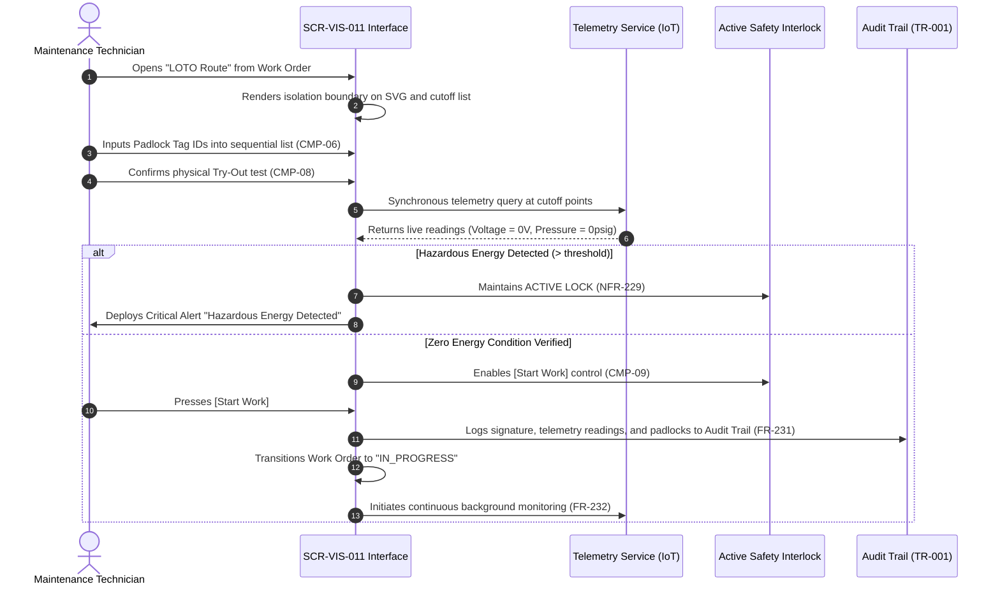

# SCR-VIS-011: LOTO Isolation Boundary Matrix and Zero Energy Verification (LOTO-TryOut)

## 1. Purpose and Operational Context

* **View Objective:** Spatial and procedural verification of hazardous energy isolation boundaries (LOTO) over the plant 2D plot plan (ANSI/ISA-101 Level 2/3). Corroborates physical field lockouts and absence-of-energy tests with real-time IoT telemetry, enforcing active software interlocking to guarantee a proven Zero Energy State prior to asset intervention (OSHA 1910.147, ISO 45001).
* **Target Personas:** 
  * **Maintenance Technician (Primary):** Executes field cutoffs, registers physical padlocks, performs Try-Out tests, and requests work authorization.
  * **HSEQ Inspector:** Audits isolation boundaries, verifies cryptographic compliance trails, and monitors SIMOPS interactions.
  * **Maintenance Supervisor:** Oversees active isolations and provides emergency supervisory overrides.
* **Operational Context:** Deployed on rugged industrial tablets (`--dt-breakpoint-lg`) and central maintenance workstations (`--dt-breakpoint-xl`).
* **Single-Canvas Workspace Invariant:** Operates strictly as a contextual operational mode within the unified application shell, not as an independent web page with browser history. Activated contextually when selecting *"LOTO Route"* from [[SCR-VIS-033]] or a Work Order panel, projecting the LOTO vector layer over the shared plot plan and opening the isolation drawer in-place.

---

## 2. Visual Artifact

![[SCR-VIS-011-loto-isolation-matrix.svg]]

---

## 3. Functional Component Inventory

> Base layout, typography, and design tokens are inherited from [[DT-UI-DS-DOC-001]] and [[DT-UI-SVG-DOC-001]]. This table defines the present components, semantic tokens, and their binding to the domain model.

| ID | Control / Component | Visual Role / Content | Semantic Token | Data Link / Behavior Rule |
| :--- | :--- | :--- | :--- | :--- |
| `CMP-01` | Canvas Viewport 2D & LOTO Layer | Spatial SVG canvas with LOTO overlay | Surface: `--dt-color-bg-canvas`<br>Elevation: `--dt-canvas` | Renders the 2D plot plan with dynamic LOTO vector overlays tracing energy paths to target equipment (`data-equip-id`). Employs **Focal Island De-emphasis** to dim non-isolated plant sectors. Supports dual-modality continuous panning. Full interaction rules in §5.2. |
| `CMP-02` | Viewport Toolbar | Contextual LOTO toolbar | Surface: `--dt-color-surface-card`<br>Radius: `--dt-radius-full` | Floating pill toolbar centered over viewport. Hosts level badge (`L3: LOTO MATRIX`, fixed $144\text{px}$ width), zoom controls (+ / − / 1:1), and safety status badge: `[⚡ HAZARDOUS ENERGY DETECTED]` or `[🔒 ZERO ENERGY CONDITION]`. Shared structure with [[SCR-VIS-008]] and [[SCR-VIS-033]]. |
| `CMP-03` | User Profile Button | Active user session indicator | Surface: `--dt-color-surface-raised`<br>Border: `--dt-color-border-panel`<br>Radius: `--dt-radius-full` | Circular floating button anchored at top-left (`left: 16px; top: 16px;`). Displays technician initials. Touch target complies with `--dt-touch-target-mobile`. |
| `CMP-04` | Isolation Cutoff Nodes | Cutoff points on SVG canvas | Border: `--dt-color-border-subtle`<br>Elevation: `--dt-z-layer-ptw` ($10$) | Vector hotspots over physical cutoff points (breakers, valves, blinds, bleeds). Applies 4-channel redundant coding (`#icon-loto-locked` vs `#icon-loto-energized`). Selection focuses corresponding items in `CMP-06` and `CMP-07`. |
| `CMP-05` | LOTO Isolation Drawer | Contextual safety panel | Surface: `--dt-color-surface-drawer`<br>Border: `--dt-color-border-panel` | Contextual container (lateral drawer in landscape, $440\text{px}$; bottom sheet in portrait). Hosts asset header, Work Order reference, SOP documentation link, PPE requirements, and subcomponents `CMP-06` through `CMP-10`. |
| `CMP-06` | Sequential Isolation Checklist | Physical lockout step-by-step list | Surface: `--dt-color-surface-base`<br>Border: `--dt-color-border-subtle` | Ordered list of physical isolation actions. Enforces sequential padlock Tag ID validation and technician sign-off (`FR-228`). Validation details in §5.2. |
| `CMP-07` | Telemetry Verification Matrix | Real-time multi-sensor readings | Surface: `--dt-color-surface-base`<br>Border: `--dt-color-border-subtle` | Real-time sensor readings for each cutoff point ($V, I, P, Q$) updated in $< 1\text{s}$ (`NFR-233`). Shows calibrated safe thresholds and binary verification status. |
| `CMP-08` | Physical Try-Out Verification Card | Absence-of-energy test card | Surface: `--dt-color-surface-base`<br>Border: `--dt-color-border-focus` | Card mandating physical absence-of-energy test (OSHA 1910.147 §(d)(6)). Hosts confirmation toggle with timestamp and digital signature. |
| `CMP-09` | Active Safety Interlock Button | Work initiation locking control | Surface: Dynamic (`--dt-color-state-success` or `--dt-color-alarm-critical`) | Primary action control `[Start Work]`. Enforces active hardware/software interlocking (`NFR-229`): hard-disabled until Zero Energy is confirmed across all verification channels. Governing Boolean rule in §5.2. |
| `CMP-10` | SIMOPS Awareness Ribbon | Concurrent permits alert strip | Surface: `--dt-color-surface-card`<br>Border: `--dt-color-border-subtle` | Informative ribbon in drawer header displaying active concurrent permits in the area without obstructing the LOTO workflow. |
| `CMP-11` | Fail-Safe Diagnostic Banner | Connection / Offline Lease status | Surface: `--dt-color-surface-raised`<br>Color: `--dt-color-text-muted` | Priority 4 diagnostic banner indicating connection health and Cryptographic Offline Lease status (`NFR-238`, `ADR-006`). Behavioral rules in §5.2. |

---

## 4. Screen State Matrix

| State | Visual Modification in the Interface | Activation Condition |
| :--- | :--- | :--- |
| **Normal / Energized (Initial)** | Energy routes render solid red (`--dt-color-alarm-critical`). Cutoff nodes show `#icon-loto-energized`. Checklist shows pending steps. `CMP-09` is hard-disabled (`disabled="disabled"`, opacity 0.45). Status badge in `CMP-02` displays `[⚡ HAZARDOUS ENERGY DETECTED]`. | Initial opening of LOTO mode for a scheduled Work Order prior to field cutoff. |
| **Field Cutoff in Progress** | Energy routes transition to amber dashed as cutoffs are registered. Checklist items show confirmed padlocks. Telemetry matrix reflects decreasing residual energy. `CMP-09` remains disabled. | Technician applies physical padlocks and enters Tag IDs sequentially in `CMP-06`. |
| **Active Energy Detected (AF-001)** | High-contrast critical alert banner deployed across drawer header. Offending cutoff node pulses with red highlight halo ($4\text{px}$). `CMP-09` remains hard-disabled. | Telemetry reports energy above safe threshold after cutoff attempt or backfeed (`AF-001`, `FR-232`). |
| **Zero Energy Verified (Pre-Start)** | All cutoff nodes show `#icon-loto-locked` (teal/green). Energy boundary lines render in neutral slate dashed. Telemetry matrix displays verified zero energy across all nodes. Try-Out card `CMP-08` becomes actionable. `CMP-09` remains disabled. | Telemetry confirms all points below threshold ($0\text{ V}$, $0\text{ psig}$) AND all checklist padlocks are validated. |
| **Ready to Execute (Unlocked)** | `CMP-09` `[Start Work]` unlocks with solid `--dt-color-state-success` background. Status badge in `CMP-02` transitions to `[🔒 ZERO ENERGY CONDITION VERIFIED]`. | Zero Energy confirmed by telemetry + Checklist 100% complete + Physical Try-Out confirmed (`FR-230`). |
| **Work Order In Progress** | Header status reflects active execution (`IN_PROGRESS`). `CMP-09` transitions to `[Complete Work & De-isolate]`. | Technician activates `[Start Work]`. Transaction logged to audit trail (`FR-231`). |
| **Re-energization Emergency (AF-003)** | Full-screen critical evacuation alert deployed (pulsing red banner, visual flash, high-priority tone). Work Order automatically set to `SUSPENDED_SAFETY_BREACH`. | Telemetry detects hazardous energy flow ($> 0$) during active execution (`FR-232`, `AF-003`). |
| **Disconnectivity / Fail-Safe (AF-002)** | Diagnostic banner `CMP-11` deployed. If lease is valid: displays offline mode badge with expiration timer. If lease is expired/missing: `CMP-09` freezes in locked state with fail-safe lockout notification. | Telemetry communication lost prior to work start (`ADR-006`, `NFR-238`). |

---

## 5. Interaction Rules and Data Flow

### 5.1. Sequential LOTO Verification Workflow (OSHA 1910.147 §(d))



### 5.2. Detailed Interaction & Validation Rules

1. **Sequential Padlock Verification Rule (`FR-228`):**
   * The checklist `CMP-06` strictly enforces sequential order: Electrical cutoff must precede mechanical valve isolation, and pipe bleed/venting must follow line isolation.
   * Padlock Tag IDs must match the alphanumeric mask standard (`PAD-[A-Z0-9]{4,8}`) or be verified via NFC/barcode scan on field tablets.
   * Step $N+1$ cannot be confirmed until Step $N$ is marked and verified.

2. **Active Safety Interlock Logic (`NFR-229`, `FR-230`):**
   * The execution button `CMP-09` is governed by a strict Boolean conjunction:
     $$\text{CanStartWork} = \text{ChecklistCompleted} \land \text{TryOutVerified} \land \text{TelemetryZeroEnergy} \land (\text{IsOnline} \lor \text{ValidOfflineLease})$$
   * Any falsy condition immediately causes `CanStartWork = false`. The button is rendered with `disabled` attribute in the DOM, impervious to client-side manipulation.

3. **Telemetry Latency and Coherence Invariants (`NFR-233`, `NFR-237`):**
   * Sensor readings are pushed via WebSocket / SignalR at $\le 1\text{s}$ refresh intervals.
   * If a sensor reading falls into an anomalous or out-of-range status (e.g., negative voltage, sensor disconnected code `0xBADF00D`), the system applies **Fail-Safe Pessimism**: it treats the state as energized and blocks work initiation.

4. **Cryptographic Audit Trail Logging (`FR-231`, `TR-001`):**
   * Upon pressing `[Start Work]`, the client packages an immutable execution record:
     $$\text{Payload} = \{\text{WO\_ID}, \text{TechnicianID}, \text{TimestampUTC}, \text{PadlockIDs}, \text{SensorReadings}, \text{TryOutHash}\}$$
   * The record is written to the append-only audit trail with SHA-256 hash chaining, guaranteeing OSHA 1910.147 regulatory compliance.

5. **Continuous In-Execution Monitoring & Auto-Suspension (`FR-232`, `AF-003`):**
   * While the Work Order is `IN_PROGRESS`, background telemetry polling continues at $2\text{s}$ intervals.
   * If $V > 0.0\text{V}$ or $P > 0.5\text{psig}$ is detected on any cutoff sensor during execution, the system immediately trips the safety protocol:
     1. Automatically sets Work Order to `SUSPENDED_SAFETY_BREACH`.
     2. Deploys an un-dismissible high-decibel evacuation alert on the technician's tablet.
     3. Dispatches high-priority Webhook / SMS alert to the Plant Safety Manager and HSEQ console.

6. **Cryptographic Offline Lease Protocol (`ADR-006`, `NFR-238`, `AF-002`):**
   * Upon loss of network telemetry, the client inspects its secure local cache for an active cryptographic lease.
   * **Active Lease Present:** Deploys `CMP-11` in informational mode (*"Offline Safety Mode Active (Lease expires: HH:mm UTC)"*). Mandates physical Try-Out re-verification (`CMP-08`) and queues the work start transaction into the encrypted offline outbox ([[TR-007]]).
   * **Expired or Absent Lease:** Enforces immediate fail-safe lock on `CMP-09`, displaying *"Danger: Telemetry communication lost. Intervention blocked by fail-safe design"*. Initiation requires connectivity restoration or dual-supervisor cryptographic override.

---

## 6. Industrial and Safety Considerations

* **OSHA 1910.147 / ISO 45001 Regulatory Alignment:** Eliminates paper-based blind spots by corroborating physical lockout verification with live sensor telemetry and mandatory Try-Out testing (§(d)(6)).
* **Fail-Safe Design Invariant (Safety over Availability):** Sensor errors, stale data, or connection drops strictly default to an energized state unless validated by an unexpired Cryptographic Offline Lease (`ADR-006`).
* **High-Performance HMI (ANSI/ISA-101 / [[TR-011]]):** Saturated red is reserved exclusively for live hazardous energy, active alarms, and interlock blocks. Non-energized boundaries use neutral slate tokens. Decorative animations or moving fluid representations are strictly prohibited (`TR-011-NFR-440`).
* **Tactile Ergonomics for Gloved Operation ([[TR-010]]):** All interactive touch targets enforce `--dt-touch-target-mobile` ($\ge 48\times 48\text{px}$) with minimum $8\text{px}$ separation to eliminate accidental field activations.

---

## 7. Frontend Component Contract (Blazor / Razor)

### 7.1. Component Hierarchy & File Mapping

```text
Pages/
└── LotoIsolationMatrixPage.razor              # Root Operational View (SCR-VIS-011)
    ├── CanvasViewport2D.razor                 # CMP-01: Shared SVG canvas with LOTO layer
    │   ├── LotoBoundaryRoute.razor            # Vector energy path and boundary polygon
    │   └── IsolationCutoffNode.razor          # CMP-04: Breaker / Valve cutoff hotspot symbols
    ├── ViewportToolbar.razor                  # CMP-02: Unified toolbar with LOTO safety badge
    ├── UserProfileButton.razor                # CMP-03: Top-left user profile indicator
    ├── LotoIsolationDrawer.razor              # CMP-05: Main contextual safety container
    │   ├── LotoHeaderInfo.razor               # Asset info, SOP link, PPE badges, SIMOPS ribbon
    │   ├── SequentialChecklist.razor          # CMP-06: Step-by-step physical padlock list
    │   ├── TelemetryVerificationMatrix.razor  # CMP-07: Live multi-sensor reading cards
    │   ├── PhysicalTryOutCard.razor           # CMP-08: Absence-of-energy verification card
    │   └── ActiveSafetyInterlockButton.razor  # CMP-09: Interlocked [Start Work] action button
    └── FailSafeDiagnosticBanner.razor         # CMP-11: Offline lease / connection warning
```

### 7.2. Physical Component Parameters & DTO Contracts (.NET 10 / C# 14)

#### 7.2.1. `LotoIsolationMatrixPage.razor` (Root View)
```csharp
public partial class LotoIsolationMatrixPage : ComponentBase
{
    [Parameter]
    public string WorkOrderId { get; set; } = string.Empty;

    [Parameter]
    public string AssetTag { get; set; } = string.Empty;

    [Inject]
    public required ILotoSafetyService LotoService { get; set; }

    [Inject]
    public required ITelemetrySubscriptionService TelemetryService { get; set; }

    // State properties
    public LotoIsolationPlanDto? LotoPlan { get; private set; }
    public IReadOnlyList<CutoffPointStatusDto> CutoffPoints { get; private set; } = [];
    public IReadOnlyList<ChecklistStepDto> ChecklistSteps { get; private set; } = [];
    public ZeroEnergyState TelemetryEnergyState { get; private set; } = ZeroEnergyState.Uncertain;
    public bool IsTryOutConfirmed { get; private set; }
    public bool CanStartWork => ChecklistSteps.All(s => s.IsVerified) 
                                && IsTryOutConfirmed 
                                && TelemetryEnergyState == ZeroEnergyState.ZeroEnergyVerified
                                && (!IsOffline || HasValidOfflineLease);
    public bool IsOffline { get; private set; }
    public bool HasValidOfflineLease { get; private set; }
}
```

#### 7.2.2. Subcomponent Parameters (`CMP-04` to `CMP-11`)
```csharp
// CMP-04: IsolationCutoffNode.razor
[Parameter]
public required CutoffPointStatusDto CutoffPoint { get; set; }

[Parameter]
public EventCallback<string> OnNodeSelected { get; set; }

// CMP-05: LotoIsolationDrawer.razor
[Parameter]
public required LotoIsolationPlanDto Plan { get; set; }

[Parameter]
public bool IsCollapsed { get; set; }

[Parameter]
public EventCallback<bool> OnCollapseToggled { get; set; }

// CMP-06: SequentialChecklist.razor
[Parameter]
public required IReadOnlyList<ChecklistStepDto> Steps { get; set; }

[Parameter]
public EventCallback<int> OnStepVerified { get; set; }

// CMP-07: TelemetryVerificationMatrix.razor
[Parameter]
public required IReadOnlyList<CutoffPointStatusDto> CutoffPoints { get; set; }

[Parameter]
public required ZeroEnergyState OverallEnergyState { get; set; }

// CMP-08: PhysicalTryOutCard.razor
[Parameter]
public bool IsConfirmed { get; set; }

[Parameter]
public EventCallback<bool> OnTryOutToggled { get; set; }

// CMP-09: ActiveSafetyInterlockButton.razor
[Parameter]
public bool CanStartWork { get; set; }

[Parameter]
public EventCallback OnStartWorkInitiated { get; set; }

// CMP-11: FailSafeDiagnosticBanner.razor
[Parameter]
public bool IsOffline { get; set; }

[Parameter]
public bool HasValidOfflineLease { get; set; }

[Parameter]
public int RemainingLeaseSeconds { get; set; }
```

#### 7.2.3. Data Transfer Objects (DTOs)
```csharp
public record LotoIsolationPlanDto
{
    public required string PlanId { get; init; }
    public required string WorkOrderId { get; init; }
    public required string TargetEquipmentTag { get; init; }
    public required string StandardOperatingProcedureUrl { get; init; }
    public IReadOnlyList<string> RequiredPpeCodes { get; init; } = [];
    public IReadOnlyList<CutoffPointStatusDto> CutoffPoints { get; init; } = [];
    public IReadOnlyList<ChecklistStepDto> ChecklistSteps { get; init; } = [];
}

public record CutoffPointStatusDto(
    string CutoffNodeId,
    string PhysicalTag,
    CutoffType Type,            // ElectricalBreaker, SuctionValve, DischargeValve, BleedValve
    double MeasuredVoltage,
    double MeasuredPressure,
    bool IsSensorZeroEnergy,
    string SensorHealthCode,
    DateTimeOffset LastReadingUtc
);

public record ChecklistStepDto(
    int SequenceOrder,
    string ActionDescription,
    string RequiredPadlockId,
    string AppliedPadlockTagId,
    bool IsVerified,
    DateTimeOffset? VerifiedAtUtc
);

public enum CutoffType
{
    ElectricalBreaker,
    SuctionValve,
    DischargeValve,
    BleedValve
}

public enum ZeroEnergyState
{
    Energized,
    Uncertain,
    ZeroEnergyVerified
}
```

### 7.3. SVG DOM Interaction Bridge
1. **Dynamic Energy Path & Route Rendering:** Interop module manipulating SVG path stroke attributes (red solid for active hazardous energy vs. slate dashed for confirmed isolated lines), updating segment classes in real time without triggering full SVG re-parsing or DOM thrashing.
2. **Cutoff Node Hotspot Binding:** Direct client-side event binding on `<g id="cutoff-{nodeId}">` SVG elements. Disambiguates canvas middle-click dragging from discrete touch taps on cutoff nodes, highlighting corresponding checklist steps in `CMP-06`.
3. **Client-Side Cryptographic Lease Interop:** Local evaluation of offline cryptographic lease timestamp and AES-GCM token validity in client storage (`sqlite-net-pcl` / IndexedDB), locking or unlocking the `[Start Work]` action button in disconnected mode without requiring server roundtrip latency.

---

## 8. Layout and Responsive Adaptability

| Viewport / Breakpoint | Layout Organization | Ergonomic Rules |
| :--- | :--- | :--- |
| **Desktop Workstation**<br>($\ge 1400\text{px}$, `--dt-breakpoint-xl`) | Canvas `CMP-01` occupies full left workspace ($1480\text{px}$); LOTO Drawer `CMP-05` docks as fixed lateral panel ($440\text{px}$, $100\text{vh}$) on right flank. | Mouse wheel focal zoom; middle-click pan; dual-column checklist and telemetry matrix. |
| **Industrial Tablet Landscape**<br>($901\text{px} - 1399\text{px}$, `--dt-breakpoint-lg`) | Canvas `CMP-01` occupies left area ($840\text{px}$); LOTO Drawer `CMP-05` occupies right panel ($440\text{px}$). Viewport toolbar `CMP-02` auto-centers over viewable canvas. | Touch pan threshold ($4\text{px}$); gloved touch targets $\ge 48\text{px}$; floating filter chips collapse gracefully. |
| **Industrial Tablet Portrait**<br>($600\text{px} - 900\text{px}$, `--dt-breakpoint-md`) | Canvas `CMP-01` occupies full width; LOTO Drawer `CMP-05` operates as **Bottom Sheet** docked at bottom, initializing at natural content height ($\sim 45\%$), expandable via drag handle to $85\text{vh}$. | Drag handle gesture support; sticky `[Start Work]` footer button always visible above viewport edge. |

---

## 9. Traceability and Requirements Matrix

| Requirement | Addressed in Component | Verification & Implementation Mechanism |
| :--- | :--- | :--- |
| **FR-225** | `CMP-01`, `CMP-05` | "LOTO Route" overlay renders energy paths over SVG plot plan upon request. |
| **FR-226** | `CMP-01` | Energy lines dynamically styled based on live IoT telemetry (red energized, slate dashed isolated). |
| **FR-227** | `CMP-04` | Cutoff points rendered with standardized industrial symbology (`#icon-loto-locked`, `#icon-loto-energized`). |
| **FR-228** | `CMP-06` | Mandatory sequential checklist with strict order and physical Padlock Tag ID validation. |
| **FR-230** | `CMP-09` | Start work control enables ONLY AFTER telemetry confirms Zero Energy across all cutoff points. |
| **FR-231** | `CMP-09` | Audit trail logging of technician ID, padlock IDs, timestamps, and sensor readings upon start. |
| **FR-232** | `CMP-01`, `CMP-09` | Continuous in-execution telemetry monitoring; auto-suspension and evacuation alarms on re-energization. |
| **NFR-229** | `CMP-09` | ACTIVE LOCK: interface disables work initiation on active energy; cannot be bypassed on client. |
| **NFR-233** | `CMP-07` | Telemetry processing and UI update latency $< 1\text{s}$ via SignalR WebSocket stream. |
| **NFR-234** | `CMP-09` | Fail-safe design: uncertain energy status assumes hazardous condition and maintains lock. |
| **NFR-235** | `CMP-05`, `CMP-09` | Transactional ACID synchronization with central database upon isolation confirmation. |
| **NFR-236** | `CMP-01` | Fluid SVG rendering $\ge 30\text{ FPS}$ on tablets, $\ge 60\text{ FPS}$ on desktop workstations. |
| **NFR-237** | `CMP-07` | Out-of-range sensor readings trigger automated pessimistic hazardous energy lock. |
| **NFR-238** | `CMP-11` | Disconnectivity fail-safe: blocks initiation unless unexpired Cryptographic Offline Lease exists (`ADR-006`). |
| **TR-001** | `CMP-09` | Immutable append-only audit trail logging with SHA-256 hash chaining. |
| **TR-010** | `CMP-06`, `CMP-09` | All tactile touch targets comply with $\ge 48\times 48\text{px}$ for gloved field use. |
| **TR-011** | `CMP-01`, `CMP-02` | ANSI/ISA-101 HPHMI: 90/10 neutral grayscale canvas, saturated color reserved for live energy. |
| **ADR-006** | `CMP-11` | Cryptographic Offline Lease protocol for disconnected zero-energy field execution. |
