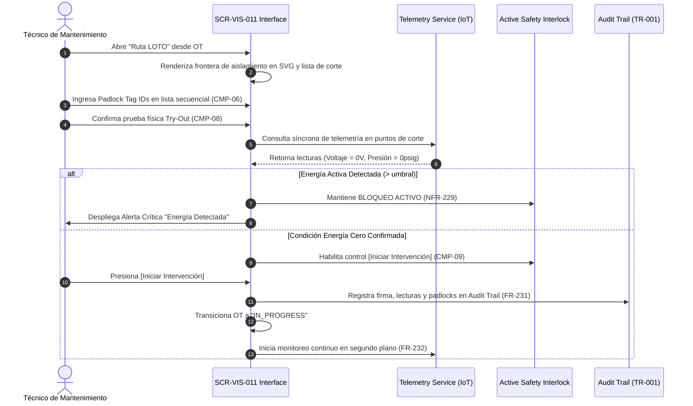

# SCR-VIS-011: LOTO Isolation Boundary Matrix and Zero Energy Verification (LOTO-TryOut)

## 1. Purpose and Operational Context

* **View Objective:** Spatial and procedural visualization of the hazardous energy isolation boundary (Lockout/Tagout - LOTO) over the plant 2D plot plan (ANSI/ISA-101 Level 2/3). It combines real-time IoT sensor telemetry verification with a mandatory sequential field checklist and active software interlocking to guarantee a proven **Zero Energy State** before allowing any physical intervention on an asset (OSHA 1910.147 / ISO 45001 §8.1).
* **Primary Target Persona:** **Maintenance Technician** (field execution on industrial tablets, gloved tactile ergonomics adhering to `--dt-touch-target-mobile` $\ge 48\times 48\text{px}$, sequential checklist completion, physical padlock registration, and physical Try-Out test verification).
* **Secondary Personas:** 
  * **HSEQ Inspector:** Safety compliance audit, verification of energy isolation boundaries, review of cryptographic audit trails, and monitoring of concurrent permit interactions (SIMOPS).
  * **Maintenance Supervisor:** Oversight of active isolations, review of field lockouts, and emergency supervisory override authorization when required.
* **Operational Context:** Deployed primarily on rugged industrial field tablets (`1280 x 800 px` landscape / `800 x 1280 px` portrait, `--dt-breakpoint-lg`) under harsh ambient plant conditions (bright daylight, explosive atmospheres, electromagnetic noise), and accessible from central maintenance consoles (`1920 x 1080 px`, `--dt-breakpoint-xl`).
* **Architectural Integration (Single-Canvas Workspace Invariant):** `SCR-VIS-011` operates as a **contextual operational mode** within the unified digital twin application shell. It does NOT represent an independent browser web page requiring history-based back/forward navigation. It is activated contextually when the operator selects *"Ruta LOTO"* from the Equipment Task Faceplate (`SCR-VIS-033`), from a Work Order detail panel, or upon dispatching a safety lockout workflow, deploying the LOTO isolation layer over the shared SVG plot plan and opening the dedicated LOTO execution drawer in-place.

---

## 2. Visual Artifact

![[SCR-VIS-011-loto-isolation-matrix.svg]]

---

## 3. Functional Component Inventory

> The base layout, typography, design tokens, and minimal tactile contact areas are inherited from [[DT-UI-DS-DOC-001]] and [[DT-UI-SVG-DOC-001]]. This table defines the present components, their semantic tokens, and their binding to the domain model.

| ID | Control / Component | Visual Role / Content | Semantic Token | Data Link / Behavior Rule |
| :--- | :--- | :--- | :--- | :--- |
| `CMP-01` | Canvas Viewport 2D & LOTO Layer | Spatial SVG canvas with LOTO overlay | Surface: `--dt-color-bg-canvas`<br>Elevation: `--dt-canvas` | Renders the plant 2D plot plan with dynamic LOTO vector overlays: traces incoming energy paths (electrical feeders, process headers) down to the target Equipment Unit (`data-equip-id`). Energy routes employ dynamic line coding: solid red (`--dt-color-alarm-critical`) when energized, dashed muted slate (`--dt-color-text-muted`) when isolated. Employs **Focal Island De-emphasis**: non-isolated plant sectors are dimmed/low-contrast to highlight the active isolation boundary. Supports middle-click drag pan (desktop) and touch pan (tablet). |
| `CMP-02` | Viewport Toolbar | Contextual LOTO toolbar | Surface: `--dt-color-surface-card`<br>Radius: `--dt-radius-full` | Floating pill toolbar centered over the viewport. Hosts level badge (`L3: LOTO MATRIX`), zoom controls (+ / −), reset view (1:1), and high-salience safety status badge: `[⚡ ENERGÍA DETECTADA]` (pulsing red) or `[🔒 CONDICIÓN ENERGÍA CERO]` (solid teal/green). Level badge maintains fixed width of $144\text{px}$ to prevent layout shifts. Shared component structure with [[SCR-VIS-008]] and [[SCR-VIS-033]]. |
| `CMP-03` | User Profile Button | Active user session indicator | Surface: `--dt-color-surface-raised`<br>Border: `--dt-color-border-panel`<br>Radius: `--dt-radius-full` | Circular floating button anchored at the top-left of the viewport (`left: 16px; top: 16px;`). Displays technician initials (e.g., "JS"). Minimum touch target $48 \times 48\text{ px}$ (`--dt-touch-target-mobile`). |
| `CMP-04` | Isolation Cutoff Nodes | Cutoff points on SVG canvas | Border: `--dt-color-border-subtle`<br>Elevation: `--dt-z-layer-ptw` ($10$) | Vector hotspots placed over physical cutoff points (Breakers in Substation/MCC, Block Valves, Blinds, Bleed/Vent Valves). Implements 4-channel redundant coding: `#icon-loto-locked` (square with lock, teal/green) when confirmed isolated vs `#icon-loto-energized` (rhombus with bolt/flame, red) when energized. Tapping a node highlights its corresponding item in `CMP-06` and `CMP-07`. |
| `CMP-05` | LOTO Isolation Drawer | Contextual safety panel | Surface: `--dt-color-surface-drawer`<br>Border: `--dt-color-border-panel` | Adaptable contextual container (full-height lateral drawer in landscape, $440\text{px}$; bottom sheet in portrait initializing at natural height $\le 45\%$ expandable to $85\text{vh}$). Hosts header with asset tag, Work Order reference, SOP documentation link, PPE requirements, and the operational subcomponents `CMP-06` through `CMP-10`. |
| `CMP-06` | Sequential Isolation Checklist | Physical lockout step-by-step list | Surface: `--dt-color-surface-base`<br>Border: `--dt-color-border-subtle` | Ordered checklist of physical isolation actions (Step 1: Open Electrical Breaker, Step 2: Close Suction Valve, Step 3: Close Discharge Valve, Step 4: Open Bleed Valve to atmospheric drain). Each step requires: (a) physical padlock Tag ID entry/validation, (b) technician sign-off checkbox ($\ge 48\text{px}$ touch target). Total confirmation is strictly disabled until all steps are confirmed sequentially (`FR-228`). |
| `CMP-07` | Telemetry Verification Matrix | Real-time multi-sensor readings | Surface: `--dt-color-surface-base`<br>Border: `--dt-color-border-subtle` | Displays live telemetry from IoT sensors at each cutoff point (Voltage $V$, Current $I$, Pressure $P$, Flow $Q$). Updates in $< 1\text{s}$ (`NFR-233`). Shows calibrated safe thresholds ($V = 0.0\text{ V}$, $P < 0.5\text{ psig}$). Displays clear binary badge: `● 0 ENERGY VERIFIED` (`--dt-color-state-success`) or `▲ HAZARDOUS ENERGY DETECTED` (`--dt-color-alarm-critical`). |
| `CMP-08` | Physical Try-Out Verification Card | Absence-of-energy test card | Surface: `--dt-color-surface-base`<br>Border: `--dt-color-border-focus` | Card mandating the physical absence-of-energy test (OSHA 1910.147 Try-Out): technician attempts local startup / verifies zero residual mechanical/electrical energy with calibrated multimeter or test gauge. Includes mandatory confirmation toggle with timestamp and technician digital signature. |
| `CMP-09` | Active Safety Interlock Button | Work initiation locking control | Surface: Dynamic (`--dt-color-state-success` or `--dt-color-alarm-critical`) | Primary action control `[Iniciar Intervención / Start Work]`. **ACTIVE LOCK MECHANISM (`NFR-229`):** Hard-disabled (`disabled="disabled"`, opacity 0.45, red warning banner) whenever: (1) telemetry reports active energy, (2) any checklist item in `CMP-06` is incomplete, (3) physical Try-Out is unconfirmed, or (4) telemetry is disconnected without an active cryptographic lease. Turns active (`--dt-color-state-success`) ONLY when Zero Energy condition is provably achieved across all channels. |
| `CMP-10` | SIMOPS Awareness Ribbon | Concurrent permits alert strip | Surface: `--dt-color-surface-card`<br>Border: `--dt-color-border-subtle` | Compact informative ribbon in drawer header indicating other active permits within the same plant sector (e.g., *"SIMOPS Note: Hot Work PTW-1042 active 45m away at TK-0101"*). Non-intrusive situational awareness to alert the technician to nearby hazards without blocking the LOTO workflow. |
| `CMP-11` | Fail-Safe Diagnostic Banner | Connection / Offline Lease status | Surface: `--dt-color-surface-raised`<br>Color: `--dt-color-text-muted` | Priority 4 diagnostic banner deployed when operating offline or when sensor telemetry heartbeat times out (`NFR-238`, `ADR-006`). If a valid Cryptographic Offline Lease exists, displays *"Modo de Seguridad Fuera de Línea Activo (Lease expira: HH:mm)"*. If lease is expired or absent, enforces a fail-safe lockout: *"Peligro: Pérdida de telemetría. Intervención bloqueada por diseño seguro"*. |

---

## 4. Screen State Matrix

| State | Visual Modification in the Interface | Activation Condition |
| :--- | :--- | :--- |
| **Normal / Energized (Initial)** | Canvas renders energy lines in solid red (`--dt-color-alarm-critical`). Cutoff nodes show `#icon-loto-energized`. Drawer checklist shows pending steps. `CMP-09` is hard-locked (`disabled`). Status badge in `CMP-02` displays `[⚡ ENERGÍA DETECTADA]`. | Initial opening of LOTO mode for a scheduled Work Order prior to field cutoff. |
| **Field Cutoff in Progress** | Lines transition to amber dashed as individual cutoffs are applied. Checklist steps reflect completed padlocks. Telemetry matrix reflects decreasing residual energy. `CMP-09` remains locked. | Technician applies physical padlocks and enters Tag IDs sequentially in `CMP-06`. |
| **Active Energy Detected (AF-001)** | High-contrast critical alert banner deployed across top: *"PELIGRO: Energía activa detectada por encima del umbral seguro ($240\text{ V}$ / $12\text{ psig}$)"*. Offending cutoff node pulses in red halo ($4\text{px}$). `CMP-09` is immediately locked. | Telemetry reports energy above threshold after cutoff attempt or due to unexpected backfeed (`AF-001`, `FR-232`). |
| **Zero Energy Verified (Pre-Start)** | All cutoff nodes display `#icon-loto-locked` in teal/green. Energy boundary lines render in neutral slate dashed. Telemetry matrix displays `● 0 ENERGY VERIFIED` across all points. Try-Out card `CMP-08` is ready for technician confirmation. | Telemetry confirms all points below threshold ($0\text{ V}$, $0\text{ psig}$) AND all checklist padlocks are validated. |
| **Ready to Execute (Unlocked)** | `CMP-09` `[Iniciar Intervención]` unlocks with prominent teal/green background (`--dt-color-state-success`). Status badge in `CMP-02` reflects `[🔒 CONDICIÓN ENERGÍA CERO GARANTIZADA]`. | Zero Energy confirmed by telemetry + Checklist 100% complete + Physical Try-Out confirmed by technician (`FR-230`). |
| **Work Order In Progress** | Status banner displays *"EN EJECUCIÓN (LOTO ACTIVO)"*. Continuous background monitoring active. `CMP-09` transitions to `[Finalizar Trabajo y Desaislar]`. | Technician activates `[Iniciar Intervención]`. Transaction logged to audit trail (`FR-231`). |
| **Re-energization Emergency (AF-003)** | Immediate maximum evacuation alert deployed (pulsing red banner, high-priority audible tone simulation, visual flash). Work Order is automatically suspended. Emergency notification dispatched to HSEQ console. | Background telemetry detects energy flow ($> 0$) while Work Order is in progress (`FR-232`, `AF-003`). |
| **Disconnectivity / Fail-Safe (AF-002)** | If unexpired Cryptographic Offline Lease exists (`ADR-006`): displays banner `CMP-11`, enables local manual re-verification flow. If lease is expired/missing: deploys fail-safe lock (`NFR-238`), freezing `CMP-09` until connection restored or dual supervisor cryptographic override provided. | Network connection lost with IoT telemetry service or central server prior to work start. |

---

## 5. Interaction Rules and Data Flow

### 5.1. Sequential LOTO Verification Workflow (OSHA 1910.147 §(d))



### 5.2. Detailed Interaction & Validation Rules

1. **Sequential Padlock Verification Rule (`FR-228`):**
   * The checklist `CMP-06` strictly enforces sequential order: Electrical cutoff must precede mechanical valve isolation, and pipe bleed/venting must follow line isolation.
   * Padlock Tag IDs must match the alphanumeric mask standard (`PAD-[A-Z0-9]{4,8}`) or be verified via NFC/barcode scan on field tablets.
   * Step $N+1$ cannot be confirmed until Step $N$ is marked and verified.

2. **Active Safety Interlock Logic (`NFR-229`, `FR-230`):**
   * The execution button `CMP-09` is governed by a strict Boolean conjunction:
     $$\text{CanStartWork} = \text{ChecklistCompleted} \land \text{TryOutVerified} \land \text{TelemetryZeroEnergy} \land (\text{IsOnline} \lor \text{ValidOfflineLease})$$
   * Any falsy condition immediately causes `CanStartWork = false`. The button is rendered with `disabled` attribute in the DOM, impervious to client-side manipulation.

3. **Telemetry Latency and Coherence Invariants (`NFR-233`, `NFR-237`):**
   * Sensor readings are pushed via WebSocket / SignalR at $\le 1\text{s}$ refresh intervals.
   * If a sensor reading falls into an anomalous or out-of-range status (e.g., negative voltage, sensor disconnected code `0xBADF00D`), the system applies **Fail-Safe Pessimism**: it treats the state as energized and blocks work initiation.

4. **Cryptographic Audit Trail Logging (`FR-231`, `TR-001`):**
   * Upon pressing `[Iniciar Intervención]`, the client packages an immutable execution record:
     $$\text{Payload} = \{\text{WO\_ID}, \text{TechnicianID}, \text{TimestampUTC}, \text{PadlockIDs}, \text{SensorReadings}, \text{TryOutHash}\}$$
   * The record is written to the append-only audit trail with SHA-256 hash chaining, guaranteeing OSHA 1910.147 regulatory compliance.

5. **Continuous In-Execution Monitoring & Auto-Suspension (`FR-232`, `AF-003`):**
   * While the Work Order is `IN_PROGRESS`, background telemetry polling continues at $2\text{s}$ intervals.
   * If $V > 0.0\text{V}$ or $P > 0.5\text{psig}$ is detected on any cutoff sensor during execution, the system immediately trips the safety protocol:
     1. Automatically sets Work Order to `SUSPENDED_SAFETY_BREACH`.
     2. Deploys an un-dismissible high-decibel evacuation alert on the technician's tablet.
     3. Dispatches high-priority Webhook / SMS alert to the Plant Safety Manager and HSEQ console.

---

## 6. Industrial and Safety Considerations

* **OSHA 1910.147 / ISO 45001 Compliance:** The interface digitizes the "Control of Hazardous Energy" standard, eliminating paper-based blind spots by corroborating human checklist compliance against live physical sensor readings.
* **Fail-Safe Design Invariant (Safety over Availability):** If network connectivity, sensor communication, or data integrity fails, the system strictly assumes a hazardous live-energy state. Work is never enabled on assumption or stale cache unless backed by an explicit unexpired Cryptographic Offline Lease (`ADR-006`).
* **High-Performance HMI (HPHMI / ANSI/ISA-101 / [[TR-011]]):**
  * Saturated red is strictly reserved for live hazardous energy, active conflict alerts, or safety interlock blocks.
  * Isolated / Zero Energy lines and verified padlocks use muted teal/slate tokens, maintaining pre-attentive salience for real dangers.
  * Decorative flow animations or moving fluids are strictly prohibited per `TR-011-NFR-440`.
* **Tactile Ergonomics for Gloved Operation ([[TR-010]]):** All interactive elements in `CMP-05`, `CMP-06`, `CMP-08`, and `CMP-09` enforce minimum tactile contact areas of $48\times 48\text{px}$ (`--dt-touch-target-mobile`), with $8\text{px}$ separation to eliminate accidental touch triggers in field environments.

---

## 7. Frontend Component Contract (Blazor / Razor)

### 7.1. Component Hierarchy & File Mapping

```text
Pages/
└── LotoIsolationMatrixPage.razor              # Root Operational View (SCR-VIS-011)
    ├── CanvasViewport2D.razor                 # CMP-01: Shared SVG canvas with LOTO layer
    │   ├── LotoBoundaryRoute.razor            # Vector energy path and boundary polygon
    │   └── IsolationCutoffNode.razor          # CMP-04: Breaker / Valve cutoff hotspot symbols
    ├── ViewportToolbar.razor                  # CMP-02: Unified toolbar with LOTO safety badge
    ├── UserProfileButton.razor                # CMP-03: Top-left user profile indicator
    ├── LotoIsolationDrawer.razor              # CMP-05: Main contextual safety container
    │   ├── LotoHeaderInfo.razor               # Asset info, SOP link, PPE badges, SIMOPS ribbon
    │   ├── SequentialChecklist.razor          # CMP-06: Step-by-step physical padlock list
    │   ├── TelemetryVerificationMatrix.razor  # CMP-07: Live multi-sensor reading cards
    │   ├── PhysicalTryOutCard.razor           # CMP-08: Absence-of-energy verification card
    │   └── ActiveSafetyInterlockButton.razor  # CMP-09: Interlocked [Start Work] action button
    └── FailSafeDiagnosticBanner.razor         # CMP-11: Offline lease / connection warning
```

### 7.2. Physical Component Parameters & DTO Contracts (.NET 10 / C# 14)

```csharp
namespace DTeam.DigitalTwin.Pages;

public partial class LotoIsolationMatrixPage : ComponentBase
{
    [Parameter]
    public string WorkOrderId { get; set; } = string.Empty;

    [Parameter]
    public string AssetTag { get; set; } = string.Empty;

    [Inject]
    public required ILotoSafetyService LotoService { get; set; }

    [Inject]
    public required ITelemetrySubscriptionService TelemetryService { get; set; }

    // State properties
    public LotoIsolationPlanDto? LotoPlan { get; private set; }
    public IReadOnlyList<CutoffPointStatusDto> CutoffPoints { get; private set; } = [];
    public IReadOnlyList<ChecklistStepDto> ChecklistSteps { get; private set; } = [];
    public ZeroEnergyState TelemetryEnergyState { get; private set; } = ZeroEnergyState.Uncertain;
    public bool IsTryOutConfirmed { get; private set; }
    public bool CanStartWork => ChecklistSteps.All(s => s.IsVerified) 
                                && IsTryOutConfirmed 
                                && TelemetryEnergyState == ZeroEnergyState.ZeroEnergyVerified
                                && (!IsOffline || HasValidOfflineLease);
    public bool IsOffline { get; private set; }
    public bool HasValidOfflineLease { get; private set; }
}

// CMP-07: TelemetryVerificationMatrix.razor DTO
public record CutoffPointStatusDto(
    string CutoffNodeId,
    string PhysicalTag,
    CutoffType Type,            // ElectricalBreaker, SuctionValve, DischargeValve, BleedValve
    double MeasuredVoltage,
    double MeasuredPressure,
    bool IsSensorZeroEnergy,
    string SensorHealthCode,
    DateTimeOffset LastReadingUtc
);

// CMP-06: SequentialChecklist.razor DTO
public record ChecklistStepDto(
    int SequenceOrder,
    string ActionDescription,
    string RequiredPadlockId,
    string AppliedPadlockTagId,
    bool IsVerified,
    DateTimeOffset? VerifiedAtUtc
);
```

---

## 8. Layout and Responsive Adaptability

| Viewport / Breakpoint | Layout Organization | Ergonomic Rules |
| :--- | :--- | :--- |
| **Desktop Workstation**<br>($\ge 1400\text{px}$, `--dt-breakpoint-xl`) | Canvas `CMP-01` occupies full left workspace ($1480\text{px}$); LOTO Drawer `CMP-05` docks as fixed lateral panel ($440\text{px}$, $100\text{vh}$) on right flank. | Mouse wheel focal zoom; middle-click pan; dual-column checklist and telemetry matrix. |
| **Industrial Tablet Landscape**<br>($901\text{px} - 1399\text{px}$, `--dt-breakpoint-lg`) | Canvas `CMP-01` occupies left area ($840\text{px}$); LOTO Drawer `CMP-05` occupies right panel ($440\text{px}$). Viewport toolbar `CMP-02` auto-centers over viewable canvas. | Touch pan threshold ($4\text{px}$); gloved touch targets $\ge 48\text{px}$; floating filter chips collapse gracefully. |
| **Industrial Tablet Portrait**<br>($600\text{px} - 900\text{px}$, `--dt-breakpoint-md`) | Canvas `CMP-01` occupies full width; LOTO Drawer `CMP-05` operates as **Bottom Sheet** docked at bottom, initializing at natural content height ($\sim 45\%$), expandable via drag handle to $85\text{vh}$. | Drag handle gesture support; sticky `[Iniciar Intervención]` footer button always visible above viewport edge. |

---

## 9. Traceability and Requirements Matrix

| Requirement | Addressed in Component | Verification & Implementation Mechanism |
| :--- | :--- | :--- |
| **FR-225** | `CMP-01`, `CMP-05` | "Ruta LOTO" overlay renders energy paths over SVG plot plan upon request. |
| **FR-226** | `CMP-01` | Energy lines dynamically styled based on live IoT telemetry (red energized, slate dashed isolated). |
| **FR-227** | `CMP-04` | Cutoff points rendered with standardized industrial symbology (`#icon-loto-locked`, `#icon-loto-energized`). |
| **FR-228** | `CMP-06` | Mandatory sequential checklist with strict order and physical Padlock Tag ID validation. |
| **FR-230** | `CMP-09` | Start work control enables ONLY AFTER telemetry confirms Zero Energy across all cutoff points. |
| **FR-231** | `CMP-09` | Audit trail logging of technician ID, padlock IDs, timestamps, and sensor readings upon start. |
| **FR-232** | `CMP-01`, `CMP-09` | Continuous in-execution telemetry monitoring; auto-suspension and evacuation alarms on re-energization. |
| **NFR-229** | `CMP-09` | ACTIVE LOCK: interface disables work initiation on active energy; cannot be bypassed on client. |
| **NFR-233** | `CMP-07` | Telemetry processing and UI update latency $< 1\text{s}$ via SignalR WebSocket stream. |
| **NFR-234** | `CMP-09` | Fail-safe design: uncertain energy status assumes hazardous condition and maintains lock. |
| **NFR-235** | `CMP-05`, `CMP-09` | Transactional ACID synchronization with central database upon isolation confirmation. |
| **NFR-236** | `CMP-01` | Fluid SVG rendering $\ge 30\text{ FPS}$ on tablets, $\ge 60\text{ FPS}$ on desktop workstations. |
| **NFR-237** | `CMP-07` | Out-of-range sensor readings trigger automated pessimistic hazardous energy lock. |
| **NFR-238** | `CMP-11` | Disconnectivity fail-safe: blocks initiation unless unexpired Cryptographic Offline Lease exists (`ADR-006`). |
| **TR-001** | `CMP-09` | Immutable append-only audit trail logging with SHA-256 hash chaining. |
| **TR-010** | `CMP-06`, `CMP-09` | All tactile touch targets comply with $\ge 48\times 48\text{px}$ for gloved field use. |
| **TR-011** | `CMP-01`, `CMP-02` | ANSI/ISA-101 HPHMI: 90/10 neutral grayscale canvas, saturated color reserved for live energy. |
| **ADR-006** | `CMP-11` | Cryptographic Offline Lease protocol for disconnected zero-energy field execution. |
