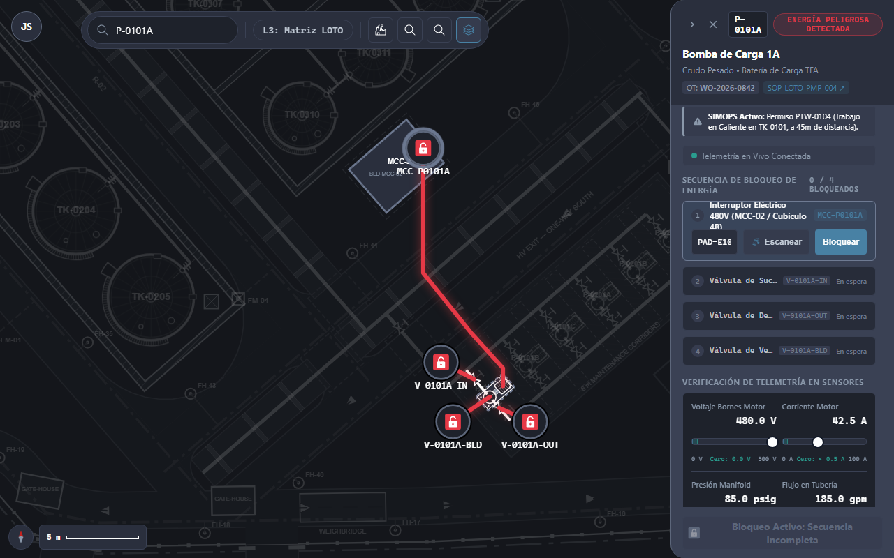
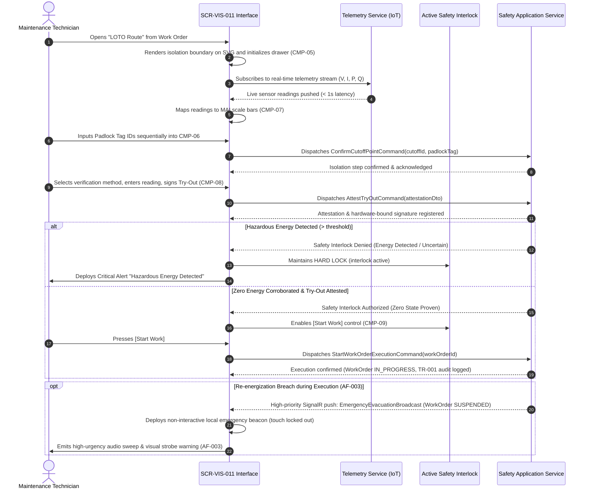

# SCR-VIS-011: LOTO Isolation Boundary Matrix and Zero Energy Verification (LOTO-TryOut)

## 1. Purpose and Operational Context

* **View Objective:** Spatial and procedural verification of hazardous energy isolation boundaries (LOTO) over the plant 2D plot plan (ANSI/ISA-101 Level 4 Task Execution with Level 2/3 spatial context). Corroborates physical field lockouts and absence-of-energy tests with real-time IoT telemetry, enforcing active software interlocking to guarantee a proven Zero Energy State prior to Equipment Unit intervention (OSHA 1910.147, ISO 45001).
* **Primary Target Persona:** Maintenance Technician executing field cutoffs, registering physical padlocks, performing Try-Out tests, and requesting work authorization.
* **Secondary Personas:**
  * **HSEQ Inspector:** Audits isolation boundaries, verifies cryptographic compliance trails, and monitors SIMOPS interactions.
  * **Maintenance Supervisor:** Oversees active isolations and provides emergency supervisory overrides.
* **Operational Context:** Deployed on rugged industrial tablets in the field and central maintenance workstations.
* **Mode of Operation:** Hybrid Safety Interlock & Supervisory Inspection mode. Real-time telemetry monitoring and field safety interlock authorization. Direct DCS/SCADA process control manipulation is strictly excluded; field mechanics rely on physical manual cutoff points, padlocks, and local Try-Out tests.
* **Single-Canvas Workspace Invariant:** Operates strictly as a contextual operational mode within the unified application shell, not as an independent web page with browser history. Activated contextually when selecting *"LOTO Route"* from [SCR-VIS-033](./SCR-VIS-033.md) or a Work Order panel, projecting the LOTO vector layer over the shared plot plan and opening the isolation drawer in-place.

---

## 2. Visual Artifact



> *Note: Production UI prototype capture illustrating the 2D plot plan with LOTO vector overlay, isolation cutoff nodes, and the lateral contextual isolation drawer.*

---

## 3. Functional Component Inventory

> The base grid, typography, neutral palettes, and minimal tactile contact areas are inherited from [DT-UI-DS-DOC-001](../../DT-UI-DS-DOC-001.md) and [DT-UI-SVG-DOC-001](../../DT-UI-SVG-DOC-001.md). This inventory defines the canonical components present on the screen, their design tokens, and their architectural scope. Interaction rules and geometric algorithms are specified in Section 5; responsive container adaptations are governed by Section 8.

1. **`CMP-01`: Canvas Viewport 2D & LOTO Layer**
   - **Visual Role:** Interactive 2D vector plot plan canvas rendering dynamic LOTO energy paths and isolation boundaries over the target Equipment Unit (`data-equip-id`), applying Focal Island De-emphasis to dim non-isolated plant sectors.
   - **Design Tokens:**
     - Surface: `--dt-color-bg-canvas`
     - Elevation: `--dt-z-canvas` (Base Canvas) / `--dt-z-layer-loto` (LOTO Route Overlay)
     - Energized Route: `--dt-color-alarm-critical`
     - Isolated Route: `--dt-color-border-subtle`
   - **Architectural Scope:** Strictly flat $Z = 0$ base vector layer ([DT-UI-DS-DOC-001 §5.1](../../DT-UI-DS-DOC-001.md#51-hphmi-shadow-discipline-canvas-vs-hud-chrome-separation)) with superimposed LOTO vector paths. Spatial kinematics, focal zoom, and clamping specified in §5.1 and §5.2.

2. **`CMP-02`: Viewport Toolbar**
   - **Visual Role:** Centered floating capsule toolbar integrating inline equipment tag search, fixed-width hierarchical level indicator (`L3: LOTO Matrix`), view reset (`1:1`), zoom controls (`+` / `−`), and LOTO focal de-emphasis layer toggle (`[#icon-layers]`).
   - **Design Tokens:**
     - Surface: `--dt-color-surface-card`
     - Elevation: `--dt-shadow-hud`
     - Radius: `--dt-radius-full`
     - Stacking: `--dt-z-overlay-card`
     - Level Badge Width: `--dt-layout-toolbar-badge-width`
   - **Architectural Scope:** Floating borderless HUD chrome per [DT-UI-DS-DOC-001 §5.2](../../DT-UI-DS-DOC-001.md#52-elevation-shadows), dynamically centering over the unoccluded canvas workspace when `CMP-05` is deployed. Detailed in §5.2 and §8.

3. **`CMP-03`: User Profile Button**
   - **Visual Role:** Circular floating operator session button anchored at the top-left viewport margin displaying active technician initials and a static session presence dot.
   - **Design Tokens:**
     - Surface: `--dt-color-surface-card`
     - Elevation: `--dt-shadow-hud`
     - Radius: `--dt-radius-full`
     - Stacking: `--dt-z-overlay-card`
     - Touch Target: `--dt-touch-target-mobile`
     - Session Dot: `--dt-color-state-success`
   - **Architectural Scope:** Anchored at top-left viewport margin per [DT-UI-DS-DOC-001 §5.2](../../DT-UI-DS-DOC-001.md#52-elevation-shadows). Triggers operator session and theme menu.

4. **`CMP-04`: Isolation Cutoff Nodes**
   - **Visual Role:** Addressable vector hotspots positioned over physical energy cutoff points (MCC breakers, block valves, spectacle blinds, atmospheric bleeds) with 4-channel redundant coding (`#icon-loto-locked` vs. `#icon-loto-energized`).
   - **Design Tokens:**
     - Surface: `--dt-color-surface-card`
     - Border: `--dt-color-border-subtle` / `--dt-color-border-focus` (Selected)
     - Energized State: `--dt-color-alarm-critical`
     - Isolated State: `--dt-color-state-success`
     - Elevation: `--dt-z-layer-loto`
     - Touch Target: `--dt-touch-target-mobile`
   - **Architectural Scope:** Bound via `data-cutoff-id` and `data-equip-id` ([DT-UI-SVG-DOC-001 §7](../../DT-UI-SVG-DOC-001.md#7-lockout-tagout-loto-isolation-point-contract)). Touch disambiguation in §5.2; bidirectional checklist synchronization in §5.3.

5. **`CMP-05`: LOTO Isolation Drawer**
   - **Visual Role:** Adaptable contextual safety panel (docked lateral drawer in landscape/desktop; sliding bottom sheet in portrait) hosting the minimize (`>`) and close (`×`) controls, Equipment Unit tag badge, dynamic safety status pill, Work Order badge, SOP link, and subcomponents `CMP-06` through `CMP-11`.
   - **Design Tokens:**
     - Surface: `--dt-color-surface-drawer` (container) / `--dt-color-surface-card` (elevated slots)
     - Border: `--dt-color-border-panel`
     - Elevation: `--dt-shadow-panel`
     - Stacking: `--dt-z-drawer-sidebar`
     - Bottom Sheet Radius: `--dt-radius-2xl`
     - Status Pill: `--dt-color-alarm-critical` (Energized) / `--dt-color-state-success` (Zero Energy Verified)
   - **Architectural Scope:** Overlaid container with permanent scrollbar gutter reservation. Lifecycle, minimize peek tab (`--dt-layout-bottom-sheet-peek-height`), snap physics, and layout rules in §5.2 and §8.

6. **`CMP-06`: Sequential Isolation Checklist**
   - **Visual Role:** Ordered step-by-step physical lockout list enforcing sequential Padlock Tag ID input, optical barcode/NFC scan trigger, and step confirmation (`[Lock]`).
   - **Design Tokens:**
     - Surface: `--dt-color-surface-base` / `--dt-color-surface-card` (Active Step)
     - Border: `--dt-color-border-subtle` / `--dt-color-border-focus` (Active Step)
     - Confirmed State: `--dt-color-state-success`
     - Primary Step Action: `--dt-color-state-info`
     - Radius: `--dt-radius-lg`
   - **Architectural Scope:** Enforces thermodynamic isolation sequencing (`FR-228`). Validation rules in §5.3.

7. **`CMP-07`: Telemetry Verification Matrix**
   - **Visual Role:** Real-time multi-sensor Moving Analog Indicators (MAI) contextualizing continuous boundary variables ($V, I, P, Q$) against calibrated scale bars and zero-energy trip limits ([DT-UI-DS-DOC-001 §6.1](../../DT-UI-DS-DOC-001.md#61-moving-analog-indicator-mai-specification)).
   - **Design Tokens:**
     - Track & Zone: `--dt-color-mai-track`, `--dt-color-mai-normal-zone`
     - Pointer & Interlock: `--dt-color-mai-pointer`, `--dt-color-mai-interlock`
     - Breach Alert: `--dt-color-alarm-critical`
     - Stale Zone: `--dt-color-mai-stale-zone`
   - **Architectural Scope:** Evaluates negative interlock sensor thresholds in $< 1\text{s}$ (`NFR-233`). Mathematical mapping and threshold rules in §5.3.

8. **`CMP-08`: Physical Try-Out Verification Card**
   - **Visual Role:** Mandatory absence-of-energy attestation card (OSHA 1910.147 §(d)(6)) hosting the physical verification method selector, observed reading input, and technician cryptographic sign-off trigger.
   - **Design Tokens:**
     - Surface: `--dt-color-surface-base`
     - Border: `--dt-color-border-subtle` / `--dt-color-border-focus` (Actionable)
     - Radius: `--dt-radius-lg`
   - **Architectural Scope:** Captures `TryOutAttestationDto` and instantaneous `TelemetrySnapshot` for immutable SHA-256 audit persistence (`TR-001`). Detailed in §5.3 and §7.2.

9. **`CMP-09`: Active Safety Interlock Button**
   - **Visual Role:** Pinned footer primary execution control (`[Active Lock: Sequence Incomplete]` when locked; `[Start Work]` when unlocked).
   - **Design Tokens:**
     - Locked Surface: `--dt-color-surface-raised`, `--dt-color-state-disabled`
     - Unlocked Surface: `--dt-color-state-success`
     - Breach Surface: `--dt-color-alarm-critical`
     - Height: `--dt-control-height-xl`
     - Radius: `--dt-radius-md`
   - **Architectural Scope:** Enforces active hardware/software negative interlocking (`NFR-229`). Governing Boolean conjunction in §5.3.

10. **`CMP-10`: SIMOPS Awareness Ribbon**
    - **Visual Role:** Compact non-modal alert strip inside `CMP-05` displaying active concurrent Work Permits within the proximity zone.
    - **Design Tokens:**
      - Surface: `--dt-color-surface-card`
      - Border: `--dt-color-border-subtle`
      - Icon Accent: `--dt-color-alarm-warning`
      - Radius: `--dt-radius-md`
    - **Architectural Scope:** Provides peripheral co-activity awareness without obstructing the sequential LOTO workflow. Detailed in §5.3.

11. **`CMP-11`: Fail-Safe Diagnostic Banner**
    - **Visual Role:** Diagnostic status strip inside `CMP-05` indicating live telemetry stream health (`Live Telemetry Connected`) or Priority 4 disconnected status and Cryptographic Offline Lease countdown (`AF-002`).
    - **Design Tokens:**
      - Surface: `--dt-color-surface-card`
      - Border: `--dt-color-border-subtle`
      - Connected Dot: `--dt-color-state-success`
      - Disconnected Text: `--dt-color-text-muted`
      - Height: `--dt-layout-banner-diagnostic-height`
    - **Architectural Scope:** Segregates network/lease diagnostics from process alarms ([ADR-006](../../../architecture/adr/ADR-006.md)). Detailed in §5.3.

12. **`CMP-12`: Evacuation Beacon Overlay**
    - **Visual Role:** Full-screen non-interactive passive emergency evacuation beacon deployed autonomously upon unexpected re-energization during active work (`AF-003`).
    - **Design Tokens:**
      - Surface: `--dt-color-alarm-critical` / `--dt-color-bg-canvas` (Diagonal hazard strobe)
      - Text: `--dt-color-alarm-text-critical`
      - Stacking: `--dt-z-modal-fail-safe`
    - **Architectural Scope:** Completely locks out touchscreen and pointer input per ISO 11064-5 and triggers an acoustic sweep (`IEvacuationAudioInterop`). Detailed in §5.3.

13. **`CMP-13`: Cartographic Compass & Metric Scale HUD**
    - **Visual Role:** Fixed bottom-left spatial HUD combining a circular north-orientation compass indicator (`--dt-control-size-hud`) and a dynamic metric scale bar (e.g., `5 m`).
    - **Design Tokens:**
      - Surface: `--dt-color-surface-card`
      - Elevation: `--dt-shadow-hud`
      - Compass Footprint: `--dt-control-size-hud`
      - Radius: `--dt-radius-full` (Compass)
    - **Architectural Scope:** Decoupled HTML overlay anchored at the bottom-left margin per [DT-UI-DS-DOC-001 §2.2](../../DT-UI-DS-DOC-001.md#22-dimensions-of-controls-and-touch-areas) and [§5.2](../../DT-UI-DS-DOC-001.md#52-elevation-shadows), calibrated via SVG `CALIBRATION-VECTOR` ([DT-UI-SVG-DOC-001 §11](../../DT-UI-SVG-DOC-001.md#11-spatial-metric-calibration)).

---

## 4. Screen State Catalog

1. **Normal / Energized (Default Baseline)**
   - **Activation Condition:** Initial opening of LOTO mode for a scheduled Work Order prior to field cutoff.
   - **Visual Modification:** Energy routes render solid red (`--dt-color-alarm-critical`). Cutoff nodes display `#icon-loto-energized`. Sequential checklist `CMP-06` shows `0 / N LOCKED` with Step 1 active. Primary action control `CMP-09` is hard-disabled (`[#icon-loto-locked] Active Lock: Sequence Incomplete`). Status pill in `CMP-05` header displays `[HAZARDOUS ENERGY DETECTED]` in `--dt-color-alarm-critical`.

2. **Loading**
   - **Activation Condition:** Initial view load, asynchronous SVG layer parsing, or SignalR duplex WebSocket connection handshake in progress.
   - **Visual Modification:** Canvas vector overlays and drawer content display animated skeleton shimmer (`--dt-color-surface-raised`). Telemetry MAIs render neutral placeholder tracks without pointers. Action controls remain disabled.

3. **Selected Cutoff Node**
   - **Activation Condition:** Technician taps or clicks a cutoff node (`CMP-04`) on the canvas or selects a step in `CMP-06`.
   - **Visual Modification:** Selected cutoff node in `CMP-04` renders a high-contrast focus ring (`--dt-color-border-focus`). Corresponding checklist item in `CMP-06` and MAI card in `CMP-07` smoothly scroll into view with elevated background (`--dt-color-surface-raised`).

4. **Field Cutoff in Progress**
   - **Activation Condition:** Technician applies physical padlocks and enters Tag IDs sequentially in `CMP-06`.
   - **Visual Modification:** Confirmed energy branches transition to amber dashed (`--dt-color-alarm-warning`). Confirmed checklist steps display `#icon-loto-locked` in Teal (`--dt-color-state-success`). Telemetry MAIs show pointers moving toward the zero-energy zone. `CMP-09` remains hard-disabled.

5. **Active Energy Detected (`AF-001`)**
   - **Activation Condition:** Telemetry reports energy above safe threshold ($V > 0.0\text{ V}$ or $P > 0.5\text{ psig}$) after cutoff attempt or backfeed (`AF-001`, `FR-232`).
   - **Visual Modification:** Critical alert banner deploys across `CMP-05` header (`--dt-color-alarm-critical`). Offending cutoff node pulses with an animated critical halo (`--dt-color-alarm-critical`). Interlock marker on MAI scale bar highlights critical red (`--dt-color-mai-interlock`). `CMP-09` remains hard-disabled.

6. **Zero Energy Verified (Pre-Start)**
   - **Activation Condition:** Telemetry confirms all points within safe zero thresholds ($0.0\text{ V}$, $\le 0.5\text{ psig}$) AND all checklist padlocks in `CMP-06` are validated.
   - **Visual Modification:** All cutoff nodes display `#icon-loto-locked` in Teal (`--dt-color-state-success`). Energy boundary lines render in neutral slate dashed (`--dt-color-border-subtle`). MAI pointers rest inside the safe zero-energy zone. Status pill in `CMP-05` header displays `[#icon-loto-locked TELEMETRY ZERO STATE · TRY-OUT REQUIRED]`. Try-Out card `CMP-08` becomes actionable (`--dt-color-border-focus`). `CMP-09` remains disabled until Try-Out signature submission.

7. **Ready to Execute (Unlocked)**
   - **Activation Condition:** Zero Energy corroborated by telemetry + Checklist 100% complete + Physical Try-Out attested and cryptographically signed (`FR-230`).
   - **Visual Modification:** Primary action control `CMP-09` (`[Start Work]`) unlocks with solid Teal fill (`--dt-color-state-success`). Status pill in `CMP-05` header transitions to `[#icon-loto-locked ZERO ENERGY VERIFIED · READY TO START]`.

8. **Work Order In Progress**
   - **Activation Condition:** Technician activates `[Start Work]` (`CMP-09`).
   - **Visual Modification:** `CMP-05` header status reflects active execution (`IN_PROGRESS`). Primary action button `CMP-09` transitions to `[Complete Work & De-isolate]` (`--dt-color-surface-raised`). Boundary route remains locked in slate dashed.

9. **Re-energization Emergency (`AF-003`)**
   - **Activation Condition:** Continuous telemetry monitoring detects hazardous energy flow ($V > 0.0\text{ V}$ or $P > 0.5\text{ psig}$) during active execution and broadcasts an emergency alert (`FR-232`, `AF-003`).
   - **Visual Modification:** Full-screen non-interactive passive evacuation overlay deployed via `CMP-12` (`--dt-z-modal-fail-safe`). Touchscreen input is completely locked out (zero dismiss controls per ISO 11064-5). Display flashes high-contrast diagonal hazard stripes (`--dt-color-alarm-critical` at $2\text{Hz}$) with imperative banner: `"[#icon-loto-energized] DANGER: HAZARDOUS ENERGY BREACH — EVACUATE AREA IMMEDIATELY"`, accompanied by a pulsed acoustic sweep (`IEvacuationAudioInterop`).

10. **Disconnectivity / Fail-Safe (`AF-002`)**
    - **Activation Condition:** Telemetry communication lost prior to work start ([ADR-006](../../../architecture/adr/ADR-006.md), `NFR-238`).
    - **Visual Modification:** Diagnostic banner `CMP-11` transitions to Priority 4 disconnected mode (`--dt-color-surface-card`, `--dt-color-text-muted`, `#icon-wifi-off`). If a valid Cryptographic Offline Lease exists, displays remaining lease countdown; if expired or absent, `CMP-09` locks in fail-safe state blocking initiation.

11. **Unmapped Cutoff Node (Geometry Unresolved)**
    - **Activation Condition:** Cutoff point defined in the work order isolation plan lacks valid coordinate mapping in `MeshMapping` (`UNMAPPED` or `SYNC_ERROR`).
    - **Visual Modification:** Drawer step in `CMP-06` displays a neutral diagnostic pill `[Coordinates Pending CAD Ingestion]` (`--dt-color-text-muted`) and disables spatial pan-to-node for that cutoff point without rendering arbitrary $(0, 0)$ canvas markers.

---

## 5. Interaction Rules and Data Flow

### 5.1. Initial Load & Lifecycle



1. **Initial View State & Unselected Baseline:**
   * Upon activation from a Work Order or [SCR-VIS-033](./SCR-VIS-033.md), the canvas view centers the target Equipment Unit (`data-equip-id`) at baseline zoom factor $s = 1.0$.
   * Non-isolated plant equipment elements have opacity attenuated to $0.25$ under Focal Island De-emphasis, preserving high-contrast visual focus exclusively on active cutoff nodes and isolated equipment.
   * LOTO vector overlay path is rendered in solid red (`--dt-color-alarm-critical`), indicating active hazardous energy.
   * Drawer `CMP-05` initializes in baseline state with checklist step 1 highlighted and Try-Out card disabled.

2. **Data Subscriptions & Cache Initialization:**
   * Establishes real-time duplex WebSocket stream via SignalR (`/hubs/telemetry`) subscribing to sensor topics mapped to the plan's cutoff points.
   * Queries local secure storage (`ISecureStorage` / `IOfflineStorage`) for an active `CryptographicOfflineLeaseDto` issued to the device (`TR-006`).

### 5.2. Spatial Navigation & Tactile Mechanics

1. **Desktop vs. Tablet Interaction Modality:**
   * **Desktop Workstation:** Continuous canvas panning is activated exclusively via middle-mouse button drag with an active grabbing cursor. Mouse scroll wheel performs continuous focal zooming around pointer coordinate $(cx, cy)$.
   * **Industrial Tablet:** Single-finger touch pan requires exceeding a tactile drag threshold of $4\text{px}$ ($\Delta d = \sqrt{\Delta x^2 + \Delta y^2} > 4\text{px}$). Gestures with $\Delta d \le 4\text{px}$ are treated as discrete taps, ensuring reliable selection of cutoff hotspot nodes (`CMP-04`) without unwanted canvas displacement.

2. **Viewport Coordinate Transformations & Zoom Mathematics:**
   * The canvas zoom factor is bounded by $s \in [0.5, 4.0]$.
   * When zooming toward focal point $(cx, cy)$ in client viewport coordinates, the new SVG `viewBox` origin is computed to preserve focal center:
     $$\text{viewBox}_{\text{new}}.x = cx - \frac{cx - \text{viewBox}_{\text{old}}.x}{s_{\text{ratio}}}$$
     $$\text{viewBox}_{\text{new}}.y = cy - \frac{cy - \text{viewBox}_{\text{old}}.y}{s_{\text{ratio}}}$$
     where $s_{\text{ratio}} = \frac{s_{\text{new}}}{s_{\text{old}}}$, $s_{\text{new}} = \text{clamp}(s_{\text{old}} \cdot (1 + \Delta z), 0.5, 4.0)$.

3. **Bounding Box Clamping Invariants:**
   * Canvas translation is strictly clamped within the calibrated operational bounds of the plant area, preventing the SVG geometry from panning into void:
     $$X_{\text{min}} \le \text{viewBox}.x \le X_{\text{max}} - \text{viewBox}.w$$
     $$Y_{\text{min}} \le \text{viewBox}.y \le Y_{\text{max}} - \text{viewBox}.h$$
   * Operational bounding limits are dynamically derived from the calibrated SVG metadata (`viewBox` extents).

4. **Layout Shift Invariants & Dimension Enforcements:**
   * Toolbar `CMP-02`: Level indicator badge enforces a rigid fixed width (`--dt-layout-toolbar-badge-width`), preventing horizontal control jitter across zoom transitions.
   * Drawer `CMP-05`: Sized by normative layout token `--dt-layout-drawer-width` with permanent scrollbar gutter reservation, strictly preserving canvas visibility. Breakpoint mappings are detailed in Section 8.

5. **Bottom Sheet Snap Physics & Discrete Switching (`CMP-05`):**
   * In portrait tablet orientation, `CMP-05` operates as an ergonomic bottom sheet transitioning between natural collapsed height and expanded height (exact viewport percentages detailed in Section 8).
   * **Gesture Snap Physics:** Dragging past velocity threshold $> 0.5\text{px/ms}$ or displacement $> 25\%$ distance snaps to destination state via spring animation.
   * **Discrete Switching Invariant (ISO 9241-110 Clause 5.5 / [DT-UI-DS-DOC-001 §6.3](../../DT-UI-DS-DOC-001.md#63-sliding-containers-pattern-bottom-sheets-and-drawers)):** To guarantee usability under adverse field conditions (e.g., rain droplets, gloved operation), container deployment is NEVER conditioned exclusively to drag gestures. A single discrete tap on the touch drag handle immediately toggles sheet elevation between natural collapsed height and expanded height via standard cubic-bezier sheet transition.

6. **Overlay Drawer Lifecycle (Minimize vs. Deselect / Close Contract):**
   * Per [DT-UI-DS-DOC-001 §2.4](../../DT-UI-DS-DOC-001.md#24-structural-layout-and-dimensional-tokens) and [DT-UI-NAV-DOC-001](../../DT-UI-NAV-DOC-001.md):
     * **Minimization (Chevron Trigger `>` / Tactical Pull-Down):** Retracts `CMP-05` to the viewport edge while preserving an exposed peek tab (`--dt-layout-bottom-sheet-peek-height`) for immediate re-expansion during spatial route tracing. The active equipment selection halo, checklist cursor, and real-time SignalR telemetry subscriptions are retained in memory.
     * **Explicit Dismissal / Exit (Close `×` Button):** Closes `CMP-05`, suppresses the peek trigger, and clears cutoff focus on the SVG canvas, returning the viewport to the supervisory baseline.

### 5.3. Domain Workflows, Interlocks, and Telemetry

1. **Sequential Padlock Verification Rule (`FR-228`):**
   * Checklist `CMP-06` enforces strict thermodynamic and procedural sequencing:
     $$\text{Electrical Cutoff} \longrightarrow \text{Mechanical Upstream Isolation} \longrightarrow \text{Mechanical Downstream Isolation} \longrightarrow \text{Bleed / Venting}$$
   * Physical Padlock Tag IDs must conform to configured facility nomenclature (e.g., regex mask `^PAD-[A-Z0-9]{4,8}$`) or be captured directly via NFC / 2D barcode scan.
   * Step $N+1$ cannot be confirmed until Step $N$ is marked and verified. Upon step verification, the client dispatches `ConfirmCutoffPointCommand` encapsulating `CutoffNodeId`, `PadlockTagId`, and UTC timestamp to the application service.

2. **Moving Analog Indicator (MAI) Zero-Energy Verification (`CMP-07`):**
   * Continuous telemetry variables ($V, I, P, Q$) are rendered using Moving Analog Indicators (MAI) per [DT-UI-DS-DOC-001 §6.1](../../DT-UI-DS-DOC-001.md#61-moving-analog-indicator-mai-specification) and ISA-101.
   * Pointer position on the normalized scale track ($[0\%, 100\%]$) is evaluated as:
     $$\text{PointerPos} = \text{clamp}\left(\frac{\text{MeasuredValue} - \text{ScaleMin}}{\text{ScaleMax} - \text{ScaleMin}}, 0.0, 1.0\right) \times 100\%$$
   * **Safe Normal Zone (`--dt-color-mai-normal-zone`):** Spans the verified zero energy range ($[0.0, 0.0]\text{V}$ for electrical voltage; $[0.0, 0.5]\text{A}$ for electrical current; $[0.0, 0.5]\text{psig}$ for pressure; $[0.0, 1.0]\text{gpm}$ for flow).
   * **Trip Interlock Marker (`--dt-color-mai-interlock`):** Fixed tick at the maximum permissible safe threshold ($0.0\text{V}$, $0.5\text{A}$, $0.5\text{psig}$, $1.0\text{gpm}$). If `MeasuredValue > TripThreshold`, the interlock tick and Method 3 `[■ 1]` breach marker highlight in `--dt-color-alarm-critical` and trip the software interlock.

3. **Physical Try-Out Verification & Cryptographic Persistence (`CMP-08`, `FR-230`, `TR-001`):**
   * Mandates physical absence-of-energy test (OSHA 1910.147 §(d)(6)). The technician must physically execute and record the test in `CMP-08`.
   * **Verification Input Controls:**
     * **Method Selector:** Bound to the `TryOutMethod` enum (§7.2.3), capturing direct electrical dead-test (`MULTIMETER_PROBE`), atmospheric vent opening (`ATMOSPHERIC_VENT_BLEED`), or local start attempt (`LOCAL_PUSHBUTTON_ATTEMPT`).
     * **Observed Value / State Field:** Recorded field metric (e.g., `0.00 V`, `0.0 psig`, or `Zero Motion Confirmed`).
     * **Technician Attestation Signature:** Mandatory field technician cryptographic sign-off.
   * Upon attestation submission, the client captures:
     * Cryptographic attestation token: Digital signature generated via the device's hardware-bound security module (`TR-006`, `ADR-006`), binding technician identity, timestamp, and verification payload without exposing raw private keys in client memory.
     * Telemetry verification snapshot: Structured payload capturing instantaneous sensor values across all cutoff points at attestation time.
   * Encapsulated into `AttestTryOutCommand` containing `TryOutMethod`, `ObservedValue`, `TechnicianSignatureHash`, and `TelemetrySnapshot`. The application service processes the command, updating isolation state and appending an immutable audit record with SHA-256 hash chaining (`TR-001`).

4. **Active Safety Interlock Logic (`NFR-229`, `FR-230`):**
   * Work initiation button `CMP-09` `[Start Work]` reflects the server-authoritative safety gate. The backend application service permits work execution strictly when the following Boolean invariant evaluates to true:
     $$\text{CanStartWork} = \text{ChecklistCompleted} \land \text{TryOutAttested} \land \text{TelemetryNotEnergized} \land (\text{IsOnline} \lor \text{ValidOfflineLease})$$
   * **Normative Asymmetry (Negative Interlock Primacy):** IoT telemetry operates strictly as a **negative interlock**, never as a positive authorization enabler. The presence of detected energy ($V > 0.0\text{V}$ or $P > 0.5\text{psig}$) or telemetry uncertainty/sensor fault immediately and unconditionally forces $\text{CanStartWork} = \text{false}$. Conversely, telemetry showing zero energy is insufficient on its own to enable work: affirmative authorization is gated strictly by 100% physical checklist completion and verified manual Try-Out attestation.
   * **Client Presentation Contract:** The UI reflects this rule via an optimistic state calculation (`CanStartWork`) that sets the disabled state (`--dt-color-state-disabled`) on `CMP-09`. However, client DOM manipulation cannot bypass the interlock: activating `[Start Work]` dispatches `StartWorkOrderExecutionCommand`, which is authoritatively validated by the backend domain aggregate before the Work Order transitions to `IN_PROGRESS`.
   * In offline disconnected operations with a valid lease (`ADR-006`), live telemetry evaluation is bypassed in favor of mandatory physical Try-Out attestation verified against the hardware keystore.

5. **Continuous In-Execution Monitoring & Emergency Broadcast Handling (`FR-232`, `AF-003`):**
   * While the Work Order is `IN_PROGRESS`, backend surveillance monitors isolation cutoff telemetry.
   * Upon intercepting the high-priority `EmergencyEvacuationBroadcast` SignalR push alert (dispatched by the backend when hazardous energy flow $V > 0.0\text{V}$ or $P > 0.5\text{psig}$ is detected, autonomously suspending the Work Order per `AF-003`), the client interface executes the emergency protocol:
     1. **Local Supplementary Warning Overlay (`CMP-12`):** Immediately deploys the non-interactive passive evacuation overlay. All touchscreen and pointer interactions are locked out (zero confirmation buttons or dismiss controls) to eliminate cognitive friction, panic freezing, or dangerous attempts to interact with the device under acute life-threatening stress (ISO 11064-5).
     2. **Multimodal Strobe & Warning Sweep:** The tablet screen strobes high-contrast diagonal safety hazard stripes (alternating `--dt-color-alarm-critical` and `--dt-color-bg-canvas` at $2\text{Hz}$) displaying large-format typography: `"[#icon-loto-energized] DANGER: HAZARDOUS ENERGY BREACH — EVACUATE AREA IMMEDIATELY"`. Concurrently, client interop triggers an autonomous pulsed audio frequency sweep ($800\text{Hz} - 1200\text{Hz}$) at maximum device volume as a local supplemental cue alongside plant evacuation sirens.

6. **Cryptographic Offline Lease Protocol (`ADR-006`, `NFR-238`, `AF-002`, `TR-006`, `TR-007`):**
   * Upon network telemetry disconnection, the client inspects its secure local cache for an active cryptographic lease issued to an authorized hardware device (`TR-006`).
   * **Active Lease Present:** Deploys `CMP-11` in informational mode (*"Offline Safety Mode Active (Lease expires: HH:mm UTC)"*). Mandates physical Try-Out re-verification (`CMP-08`) and queues the work start transaction into the encrypted offline outbox (`TR-007`).
   * **Expired or Absent Lease:** Enforces immediate fail-safe lock on `CMP-09`, displaying *"Danger: Telemetry communication lost. Intervention blocked by fail-safe design"*. Initiation requires connectivity restoration or dual-supervisor cryptographic override.

---

## 6. Industrial and Safety Considerations

* **Try-Out Primacy & Negative Interlock Asymmetry (OSHA 1910.147 §(d)(6) / ISO 45001 §8.1):** Physical lockout and manual Try-Out attestation constitute the mandatory legal authorization for equipment intervention. Real-time IoT telemetry acts strictly as a subordinate **negative interlock** (fail-safe veto) that blocks execution upon detecting residual energy or sensor uncertainty (`NFR-229`, `NFR-234`), preventing cognitive over-reliance on instrumentation (§5.3).
* **Passive Emergency Ergonomics & SIS Boundary (ISO 11064-5 / IEC 61508):** Under unscheduled re-energization during active execution (`AF-003`), `CMP-12` converts the tablet into a non-interactive passive evacuation beacon (zero dismiss buttons) to eliminate panic-induced cognitive latency. Because commercial mobile runtimes are not SIL-certified Safety Instrumented Systems (SIS), `CMP-12` serves strictly as a supplementary local warning alongside certified plant evacuation sirens.
* **Fail-Safe Disconnectivity & HPHMI Governance ([TR-011](../../../requirements/common/TR-011.md)):** Telemetry dropouts default to a hazardous locked state unless authorized by an unexpired hardware-bound Cryptographic Offline Lease ([ADR-006](../../../architecture/adr/ADR-006.md)). Visual coding, MAI zero-energy tracks, Teal documentary confirmation (`--dt-color-state-success`), and gloved tactile ergonomics (`--dt-touch-target-mobile`) adhere strictly to [DT-UI-DS-DOC-001 §1](../../DT-UI-DS-DOC-001.md#1-scope), [§6.1](../../DT-UI-DS-DOC-001.md#61-moving-analog-indicator-mai-specification), [§6.2](../../DT-UI-DS-DOC-001.md#62-redundant-coding-matrix-for-permits-and-loto), and [§6.3](../../DT-UI-DS-DOC-001.md#63-sliding-containers-pattern-bottom-sheets-and-drawers).

---

## 7. Frontend Component Contract (Blazor / Razor)

### 7.1. Component Hierarchy & File Mapping

```text
Pages/
└── LotoIsolationMatrixPage.razor              # Root Operational View (SCR-VIS-011)
    ├── CanvasViewport2D.razor                 # CMP-01: Shared SVG canvas with LOTO layer
    │   ├── LotoBoundaryRoute.razor            # Vector energy path and boundary polygon
    │   └── IsolationCutoffNode.razor          # CMP-04: Breaker / Valve cutoff hotspot symbols
    ├── ViewportToolbar.razor                  # CMP-02: Floating navigation & focal de-emphasis bar
    ├── UserProfileButton.razor                # CMP-03: Top-left user profile indicator
    ├── CartographicHud.razor                  # CMP-13: Bottom-left compass & metric scale HUD
    ├── LotoIsolationDrawer.razor              # CMP-05: Main contextual safety container
    │   ├── LotoHeaderInfo.razor               # Equipment Unit info, status pill & SOP link
    │   ├── SimopsAwarenessRibbon.razor        # CMP-10: Concurrent proximity permits alert strip
    │   ├── FailSafeDiagnosticBanner.razor     # CMP-11: Telemetry connection & Offline Lease banner
    │   ├── SequentialChecklist.razor          # CMP-06: Step-by-step physical padlock list
    │   ├── TelemetryVerificationMatrix.razor  # CMP-07: Live multi-sensor MAI scale bar cards
    │   ├── PhysicalTryOutCard.razor           # CMP-08: Absence-of-energy verification card
    │   └── ActiveSafetyInterlockButton.razor  # CMP-09: Interlocked [Start Work] action button
    └── EvacuationBeaconOverlay.razor          # CMP-12: Non-interactive passive emergency evacuation beacon
```

### 7.2. Physical Component Parameters & DTO Contracts (.NET 10 / C# 14)

#### 7.2.1. `LotoIsolationMatrixPage.razor` (Root View)
```csharp
[Parameter]
public Guid? WorkOrderId { get; set; }

[Parameter]
public string? WorkOrderNumber { get; set; }

[Parameter]
public string? EquipmentUnitTag { get; set; }
```

#### 7.2.2. Subcomponent Parameter Contracts (`CMP-01` to `CMP-13`)
```csharp
// CMP-01: CanvasViewport2D.razor
[Parameter]
public required string SvgContent { get; set; }

[Parameter]
public required string TargetEquipmentTag { get; set; }

[Parameter]
public required IReadOnlyList<CutoffPointStatusDto> CutoffPoints { get; set; }

[Parameter]
public string? SelectedCutoffNodeId { get; set; }

[Parameter]
public double ZoomScale { get; set; } = 1.0;

[Parameter]
public bool IsFocalDeemphasisActive { get; set; } = true;

[Parameter]
public EventCallback<string> OnCutoffNodeSelected { get; set; }

// LotoBoundaryRoute.razor
[Parameter]
public required string TargetEquipmentTag { get; set; }

[Parameter]
public required ZeroEnergyState OverallEnergyState { get; set; }

[Parameter]
public required IReadOnlyList<CutoffPointStatusDto> CutoffPoints { get; set; }

// CMP-04: IsolationCutoffNode.razor
[Parameter]
public required CutoffPointStatusDto CutoffPoint { get; set; }

[Parameter]
public bool IsSelected { get; set; }

[Parameter]
public EventCallback<string> OnNodeSelected { get; set; }

// CMP-02: ViewportToolbar.razor
[Parameter]
public string? SearchQuery { get; set; }

[Parameter]
public EventCallback<string?> OnSearchQueryChanged { get; set; }

[Parameter]
public double ZoomScale { get; set; } = 1.0;

[Parameter]
public bool IsLayersActive { get; set; } = true;

[Parameter]
public EventCallback OnResetViewRequested { get; set; }

[Parameter]
public EventCallback OnZoomInRequested { get; set; }

[Parameter]
public EventCallback OnZoomOutRequested { get; set; }

[Parameter]
public EventCallback<bool> OnLayersToggled { get; set; }

// CMP-03: UserProfileButton.razor
[Parameter]
public required string UserInitials { get; set; }

[Parameter]
public EventCallback OnProfileMenuRequested { get; set; }

// CMP-13: CartographicHud.razor
[Parameter]
public double ZoomScale { get; set; } = 1.0;

[Parameter]
public double ScaleRatioMetersPerUnit { get; set; } = 0.2;

// CMP-05: LotoIsolationDrawer.razor
[Parameter]
public required LotoIsolationPlanDto Plan { get; set; }

[Parameter]
public required ZeroEnergyState OverallEnergyState { get; set; }

[Parameter]
public bool IsMinimized { get; set; }

[Parameter]
public EventCallback<bool> OnMinimizeToggled { get; set; }

[Parameter]
public EventCallback OnCloseRequested { get; set; }

// LotoHeaderInfo.razor
[Parameter]
public required LotoIsolationPlanDto Plan { get; set; }

[Parameter]
public required ZeroEnergyState OverallEnergyState { get; set; }

[Parameter]
public EventCallback OnMinimizeClicked { get; set; }

[Parameter]
public EventCallback OnCloseClicked { get; set; }

// CMP-10: SimopsAwarenessRibbon.razor
[Parameter]
public required IReadOnlyList<SimopsPermitSummaryDto> ActiveSimopsPermits { get; set; }

// CMP-11: FailSafeDiagnosticBanner.razor
[Parameter]
public bool IsOffline { get; set; }

[Parameter]
public bool HasValidOfflineLease { get; set; }

[Parameter]
public int RemainingLeaseSeconds { get; set; }

// CMP-06: SequentialChecklist.razor
[Parameter]
public required IReadOnlyList<ChecklistStepDto> Steps { get; set; }

[Parameter]
public EventCallback<ConfirmCutoffStepRequestDto> OnStepVerified { get; set; }

// CMP-07: TelemetryVerificationMatrix.razor (MAI Display)
[Parameter]
public required IReadOnlyList<CutoffPointStatusDto> CutoffPoints { get; set; }

[Parameter]
public required ZeroEnergyState OverallEnergyState { get; set; }

// CMP-08: PhysicalTryOutCard.razor
[Parameter]
public bool IsActionable { get; set; }

[Parameter]
public bool IsAttested { get; set; }

[Parameter]
public TryOutMethod SelectedMethod { get; set; } = TryOutMethod.MULTIMETER_PROBE;

[Parameter]
public string ObservedValue { get; set; } = string.Empty;

[Parameter]
public EventCallback<TryOutAttestationDto> OnTryOutAttested { get; set; }

// CMP-09: ActiveSafetyInterlockButton.razor
[Parameter]
public bool CanStartWork { get; set; }

[Parameter]
public WorkOrderStatus CurrentWorkOrderStatus { get; set; } = WorkOrderStatus.SCHEDULED;

[Parameter]
public EventCallback OnStartWorkInitiated { get; set; }

// CMP-12: EvacuationBeaconOverlay.razor
[Parameter]
public bool IsActive { get; set; }

[Parameter]
public string OffendingNodeTag { get; set; } = string.Empty;

[Parameter]
public decimal DetectedEnergyValue { get; set; }

[Parameter]
public string EngineeringUnit { get; set; } = string.Empty;
```

#### 7.2.3. Data Transfer Objects (DTOs)
```csharp
public record LotoIsolationPlanDto
{
    public required Guid PlanId { get; init; }
    public required Guid WorkOrderId { get; init; }
    public required string WorkOrderNumber { get; init; }
    public required WorkOrderStatus WorkOrderStatus { get; init; }
    public required Guid EquipmentUnitId { get; init; }
    public required string TargetEquipmentTag { get; init; }
    public required string TargetEquipmentDescription { get; init; }
    public required string FunctionalLocationName { get; init; }
    public required WorkPermitStatus LinkedPermitStatus { get; init; }
    public required string StandardOperatingProcedureCode { get; init; }
    public required string StandardOperatingProcedureUrl { get; init; }
    public IReadOnlyList<string> RequiredPpeCodes { get; init; } = [];
    public IReadOnlyList<CutoffPointStatusDto> CutoffPoints { get; init; } = [];
    public IReadOnlyList<ChecklistStepDto> ChecklistSteps { get; init; } = [];
    public IReadOnlyList<SimopsPermitSummaryDto> ActiveSimopsPermits { get; init; } = [];
}

public record CutoffPointStatusDto
{
    public required Guid IsolationPointId { get; init; }
    public required string CutoffNodeId { get; init; }
    public required string PhysicalTag { get; init; }
    public required IsolationType Type { get; init; }
    public required IsolationStatus IsolationStatus { get; init; }
    public required string VariableName { get; init; }
    public required TelemetrySignalType SignalType { get; init; }
    public required decimal MeasuredValue { get; init; }
    public required string EngineeringUnit { get; init; }
    public required decimal ScaleMin { get; init; }
    public required decimal ScaleMax { get; init; }
    public required decimal SafeZeroThreshold { get; init; }
    public required decimal TripThreshold { get; init; }
    public bool IsSensorZeroEnergy { get; init; }
    public bool IsLocationMapped { get; init; } = true;
    public required string SensorHealthCode { get; init; }
    public required DateTimeOffset LastReadingUtc { get; init; }
}

public record ChecklistStepDto
{
    public required int SequenceOrder { get; init; }
    public required Guid IsolationPointId { get; init; }
    public required string CutoffNodeId { get; init; }
    public required string ActionDescription { get; init; }
    public required string ExpectedPadlockTagId { get; init; }
    public string? AppliedPadlockTagId { get; init; }
    public bool IsVerified { get; init; }
    public DateTimeOffset? VerifiedAtUtc { get; init; }
}

public record ConfirmCutoffStepRequestDto
{
    public required int SequenceOrder { get; init; }
    public required Guid IsolationPointId { get; init; }
    public required string AppliedPadlockTagId { get; init; }
}

public record SimopsPermitSummaryDto
{
    public required string PermitIdentifier { get; init; }
    public required PermitType PermitType { get; init; }
    public required string TargetEquipmentTag { get; init; }
    public required decimal DistanceMeters { get; init; }
}

public record TryOutAttestationDto
{
    public required TryOutMethod Method { get; init; }
    public required string ObservedPhysicalReading { get; init; }
    public required string TechnicianSignatureHash { get; init; }
    public required IReadOnlyDictionary<string, decimal> TelemetrySnapshot { get; init; }
    public required DateTimeOffset AttestedAtUtc { get; init; }
}

/// <summary>
/// Controlled physical energy isolation vocabulary per DT-DM-DOC-001 §4.28.
/// </summary>
public enum IsolationType
{
    ELECTRICAL,
    MECHANICAL,
    PNEUMATIC,
    HYDRAULIC,
    CHEMICAL,
    THERMAL,
    GRAVITATIONAL
}

/// <summary>
/// Controlled work order isolation lifecycle vocabulary per DT-DM-DOC-001 §4.32.
/// </summary>
public enum IsolationStatus
{
    PENDING_ISOLATION,
    ISOLATED,
    VERIFIED_ZERO_ENERGY,
    LEASED_OFFLINE,
    RELEASED
}

/// <summary>
/// Consolidated negative-interlock energy state evaluation.
/// </summary>
public enum ZeroEnergyState
{
    ENERGIZED,
    UNCERTAIN,
    ZERO_ENERGY_VERIFIED
}

/// <summary>
/// Controlled physical Try-Out verification method vocabulary per DT-DM-DOC-001 §4.33.
/// </summary>
public enum TryOutMethod
{
    MULTIMETER_PROBE,
    ATMOSPHERIC_VENT_BLEED,
    LOCAL_PUSHBUTTON_ATTEMPT
}

/// <summary>
/// Controlled sensor signal classification vocabulary per DT-DM-DOC-001 §4.30.
/// </summary>
public enum TelemetrySignalType
{
    TEMPERATURE,
    PRESSURE,
    VIBRATION,
    FLOW_RATE,
    VOLTAGE,
    CURRENT,
    RPM,
    OPERATING_HOURS,
    CYCLES
}

/// <summary>
/// Controlled permit risk classification vocabulary per DT-DM-DOC-001 §4.34.
/// </summary>
public enum PermitType
{
    HOT_WORK,
    COLD_WORK,
    CONFINED_SPACE,
    ELECTRICAL,
    WORK_AT_HEIGHT,
    EXCAVATION,
    CHEMICAL
}

/// <summary>
/// Controlled permit lifecycle status vocabulary per DT-DM-DOC-001 §4.35.
/// </summary>
public enum WorkPermitStatus
{
    DRAFT,
    PENDING,
    APPROVED,
    EXPIRED,
    REVOKED,
    CLOSED
}

/// <summary>
/// Controlled work order execution status vocabulary per DT-DM-DOC-001 §4.21.
/// </summary>
public enum WorkOrderStatus
{
    PLANNING,
    WAITING_PARTS,
    SCHEDULED,
    IN_PROGRESS,
    SUSPENDED,
    COMPLETE,
    CLOSED
}
```

### 7.3. Client-Side DOM & Interop Bridge

1. **SVG Viewport & LOTO Route Interop (`ILotoCanvasInterop`):**
   * Manipulates SVG path stroke attributes (red solid for active hazardous energy vs. slate dashed for confirmed isolated lines) in real time without triggering full SVG re-parsing or DOM thrashing.
   * Tracks PointerEvents for continuous panning and zooming, enforces the $4\text{px}$ tactile threshold filter, calculates focal zoom matrix transforms, and binds discrete tap toggling to the bottom sheet handle.
2. **Cutoff Node Hotspot Binding:**
   * Standardized SVG data attribute binding (`data-cutoff-id`, `data-equip-id`). Disambiguates canvas middle-click dragging from discrete touch taps on cutoff nodes, dispatching node selection to highlight corresponding checklist steps in `CMP-06` and MAI cards in `CMP-07`.
3. **Encrypted Offline Storage & Lease Interop (`IOfflineStorage`):**
   * Interfaces with client-side encrypted local storage (`TR-002`, `TR-006`, `TR-007`) for offline cryptographic lease evaluation (`ADR-006`) and immediate transactional outbox queuing of verification commands during network disconnections.
4. **Emergency Evacuation Interop (`IEvacuationAudioInterop`):**
   * Encapsulates client-side acoustic sweep generation ($800\text{Hz} - 1200\text{Hz}$ at $2\text{Hz}$ modulation) calibrated to $\approx 85\text{ dBA}$ alongside full viewport pointer and keyboard event trapping, guaranteeing complete non-interactive passivity during life-safety evacuation (`CMP-12`, `AF-003`).

---

## 8. Layout and Responsive Adaptability

### 8.1. Desktop Workstation (`--dt-breakpoint-xl`)
* **Layout Organization:** Canvas `CMP-01` occupies the full viewport (`--dt-z-canvas`) with user profile indicator `CMP-03` anchored at top-left and cartographic HUD `CMP-13` anchored at bottom-left. LOTO Drawer `CMP-05` docks as a full-height lateral panel sized by `--dt-layout-drawer-width-desktop` (`--dt-z-drawer-sidebar`, `--dt-shadow-panel`) on the right flank. Viewport toolbar `CMP-02` centers over the unoccluded canvas workspace.
* **Ergonomic Rules:** Mouse wheel focal zoom around pointer $(cx, cy)$; continuous middle-click pan; 2x2 grid presentation for the telemetry verification matrix (`CMP-07`).

### 8.2. Industrial Tablet Landscape (`--dt-breakpoint-lg`)
* **Layout Organization:** Canvas `CMP-01` occupies the left workspace; LOTO Drawer `CMP-05` docks as a right-hand lateral panel sized by `--dt-layout-drawer-width-tablet`, strictly preserving $\ge 70\%$ canvas visibility per [DT-UI-DS-DOC-001 §2.4](../../DT-UI-DS-DOC-001.md#24-structural-layout-and-dimensional-tokens). Viewport toolbar `CMP-02` auto-centers over the viewable canvas area, with `CMP-13` anchored at bottom-left.
* **Ergonomic Rules:** Touch pan dead-zone threshold (§5.2); gloved touch targets governed by `--dt-touch-target-mobile`; drawer minimizes via chevron trigger (`>`) to an edge peek tab (`--dt-layout-bottom-sheet-peek-height`).

### 8.3. Industrial Tablet Portrait (`--dt-breakpoint-md`)
* **Layout Organization:** Canvas `CMP-01` occupies full viewport width; LOTO Drawer `CMP-05` operates as an adaptive **Bottom Sheet** (`--dt-radius-2xl` upper curvature) docked at the bottom edge, initializing at natural content height (`--dt-layout-bottom-sheet-height-initial`) with the capsule drag handle nested inside the drawer header, expandable up to `--dt-layout-bottom-sheet-height-expanded`.
* **Ergonomic Rules:** Drag handle gesture support with snap hysteresis (§5.2); mandatory discrete single-tap toggling between resting, expanded, and peek (`--dt-layout-bottom-sheet-peek-height`) states ([DT-UI-DS-DOC-001 §6.3](../../DT-UI-DS-DOC-001.md#63-sliding-containers-pattern-bottom-sheets-and-drawers)); sticky `CMP-09` interlock action bar (`--dt-layout-footer-height`) remains pinned at the bottom of `CMP-05`.

---

## 9. Traceability and Requirements Matrix

| Requirement | Addressed in Component | Verification & Implementation Mechanism |
| :--- | :--- | :--- |
| [FR-225](../../../requirements/user-stories/vis/VIS-011.md#functional-requirements-fr) | `CMP-01`, `CMP-05` | "LOTO Route" overlay renders energy paths over SVG plot plan upon request. |
| [FR-226](../../../requirements/user-stories/vis/VIS-011.md#functional-requirements-fr) | `CMP-01` | Energy lines dynamically styled based on live IoT telemetry (red energized, slate dashed isolated). |
| [FR-227](../../../requirements/user-stories/vis/VIS-011.md#functional-requirements-fr) | `CMP-04` | Cutoff points rendered with standardized industrial symbology (`#icon-loto-locked`, `#icon-loto-energized`). |
| [FR-228](../../../requirements/user-stories/vis/VIS-011.md#functional-requirements-fr) | `CMP-06` | Mandatory sequential checklist with strict order and physical Padlock Tag ID validation. |
| [FR-230](../../../requirements/user-stories/vis/VIS-011.md#functional-requirements-fr) | `CMP-08`, `CMP-09` | Start work control enables ONLY AFTER physical checklist completion, rich Try-Out attestation with signature hash, and corroborative telemetry zero state. |
| [FR-231](../../../requirements/user-stories/vis/VIS-011.md#functional-requirements-fr) | `CMP-08`, `CMP-09` | Audit trail logging of technician signature hash, padlock IDs, timestamps, and sensor telemetry snapshot upon start. |
| [FR-232](../../../requirements/user-stories/vis/VIS-011.md#functional-requirements-fr) | `CMP-01`, `CMP-09`, `CMP-12` | Continuous in-execution telemetry monitoring; automated server-side Work Order suspension to `SUSPENDED` and deployment of non-interactive passive evacuation beacon on re-energization breach. |
| [NFR-229](../../../requirements/user-stories/vis/VIS-011.md#non-functional-requirements-nfr) | `CMP-09` | ACTIVE LOCK: interface disables work initiation on active energy; cannot be bypassed on client. |
| [NFR-233](../../../requirements/user-stories/vis/VIS-011.md#non-functional-requirements-nfr) | `CMP-07` | Telemetry processing and UI update latency $< 1\text{s}$ via SignalR WebSocket stream. |
| [NFR-234](../../../requirements/user-stories/vis/VIS-011.md#non-functional-requirements-nfr) | `CMP-09` | Fail-safe design: uncertain energy status assumes hazardous condition and maintains lock. |
| [NFR-235](../../../requirements/user-stories/vis/VIS-011.md#non-functional-requirements-nfr) | `CMP-05`, `CMP-09` | Transactional synchronization via `ConfirmCutoffPointCommand` upon isolation confirmation. |
| [NFR-236](../../../requirements/user-stories/vis/VIS-011.md#non-functional-requirements-nfr) | `CMP-01` | Fluid SVG rendering $\ge 30\text{ FPS}$ on tablets, $\ge 60\text{ FPS}$ on desktop workstations. |
| [NFR-237](../../../requirements/user-stories/vis/VIS-011.md#non-functional-requirements-nfr) | `CMP-07` | Out-of-range sensor readings trigger automated pessimistic hazardous energy lock. |
| [NFR-238](../../../requirements/user-stories/vis/VIS-011.md#non-functional-requirements-nfr) | `CMP-11` | Disconnectivity fail-safe: blocks initiation unless unexpired Cryptographic Offline Lease exists ([ADR-006](../../../architecture/adr/ADR-006.md)). |
| [TR-001](../../../requirements/common/TR-001.md) | `CMP-08`, `CMP-09` | Immutable append-only audit trail logging of padlock tags, Try-Out signature hash, and sensor snapshot with SHA-256 hash chaining. |
| [TR-002](../../../requirements/common/TR-002.md) | `CMP-08`, `CMP-11` | Encrypts cached LOTO isolation plans, Cryptographic Offline Leases, and queued Try-Out attestations at rest in local device storage (`IOfflineStorage`). |
| [TR-005](../../../requirements/common/TR-005.md) | `CMP-01`, `CMP-07`, `CMP-12` | Enforces TLS/HTTPS and WSS encryption across all isolation command dispatches and real-time SignalR telemetry/evacuation streams. |
| [TR-006](../../../requirements/common/TR-006.md) | `CMP-08`, `CMP-09`, `CMP-11` | Enforces RBAC role authorization and hardware-keystore verification for Try-Out signing and offline safety lease validation. |
| [TR-007](../../../requirements/common/TR-007.md) | `CMP-05`, `CMP-06`, `CMP-08`, `CMP-11` | Offline Sync Outbox persists sequential padlock confirmations and signed Try-Out commands using UUIDv7 idempotency keys during field disconnections. |
| [TR-010](../../../requirements/common/TR-010.md) | `CMP-01`, `CMP-07`, `CMP-12` | Persistent real-time telemetry and emergency evacuation broadcast stream with $< 1\text{s}$ latency and automatic disconnect fail-safe detection. |
| [TR-011](../../../requirements/common/TR-011.md) | `CMP-01`, `CMP-04`, `CMP-07`, `CMP-13` | ANSI/ISA-101 HPHMI: 90/10 grayscale baseline with focal island de-emphasis, MAI zero-energy scales, Teal confirmation tokens, and `--dt-touch-target-mobile` gloved ergonomics. |
| [ADR-006](../../../architecture/adr/ADR-006.md) | `CMP-08`, `CMP-09`, `CMP-11` | Cryptographic Offline Lease protocol governing bounded disconnected zero-energy field verification. |
