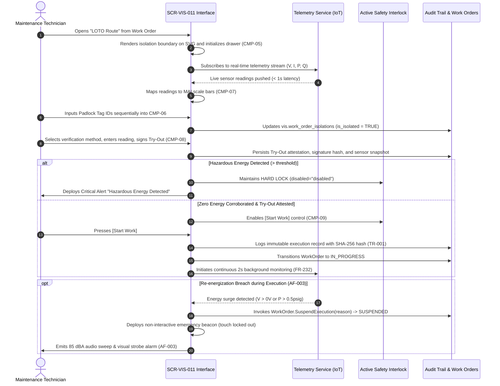

# SCR-VIS-011: LOTO Isolation Boundary Matrix and Zero Energy Verification (LOTO-TryOut)

## 1. Purpose and Operational Context

* **View Objective:** Spatial and procedural verification of hazardous energy isolation boundaries (LOTO) over the plant 2D plot plan (ANSI/ISA-101 Level 2/3). Corroborates physical field lockouts and absence-of-energy tests with real-time IoT telemetry, enforcing active software interlocking to guarantee a proven Zero Energy State prior to Equipment Unit intervention (OSHA 1910.147, ISO 45001).
* **Primary Target Persona:** Maintenance Technician executing field cutoffs, registering physical padlocks, performing Try-Out tests, and requesting work authorization.
* **Secondary Personas:**
  * **HSEQ Inspector:** Audits isolation boundaries, verifies cryptographic compliance trails, and monitors SIMOPS interactions.
  * **Maintenance Supervisor:** Oversees active isolations and provides emergency supervisory overrides.
* **Operational Context:** Deployed on rugged industrial tablets (`--dt-breakpoint-lg`, `--dt-breakpoint-md`) in the field and central maintenance workstations (`--dt-breakpoint-xl`).
* **Mode of Operation:** Hybrid Safety Interlock & Supervisory Inspection mode. Real-time telemetry monitoring and field safety interlock authorization. Direct DCS/SCADA process control manipulation is strictly excluded; field mechanics rely on physical manual cutoff points, padlocks, and local Try-Out tests.
* **Single-Canvas Workspace Invariant:** Operates strictly as a contextual operational mode within the unified application shell, not as an independent web page with browser history. Activated contextually when selecting *"LOTO Route"* from [[SCR-VIS-033]] or a Work Order panel, projecting the LOTO vector layer over the shared plot plan and opening the isolation drawer in-place.

---

## 2. Visual Artifact

![[SCR-VIS-011-loto-isolation-matrix.svg]]

> *Note: Vector wireframe illustrating the 2D plot plan with LOTO vector overlay, isolation cutoff nodes, and the lateral/bottom contextual isolation drawer.*

---

## 3. Functional Component Inventory

> The base layout, typography, and design tokens are inherited from [[DT-UI-DS-DOC-001]] and [[DT-UI-SVG-DOC-001]]. This table defines the present components, semantic tokens, and their architectural roles. Detailed interaction rules, layout constraints, and geometric algorithms are strictly specified in Section 5.

| ID | Control / Component | Visual Role / Content | Semantic Token | Architectural Role & Reference |
| :--- | :--- | :--- | :--- | :--- |
| `CMP-01` | Canvas Viewport 2D & LOTO Layer | Spatial SVG canvas with LOTO overlay | Surface: `--dt-color-bg-canvas`<br>Elevation: `--dt-z-canvas` | Renders the 2D plot plan with dynamic LOTO vector overlays tracing energy paths to target Equipment Unit (`data-equip-id`). Employs Focal Island De-emphasis to dim non-isolated plant sectors. Spatial kinematics, focal zoom, and clamping specified in §5.1 and §5.2. |
| `CMP-02` | Viewport Toolbar | Contextual LOTO toolbar | Surface: `--dt-color-surface-card`<br>Radius: `--dt-radius-full` | Floating pill toolbar centered over viewport. Hosts level badge (`L3: LOTO MATRIX`, fixed $144\text{px}$ width), zoom controls (+ / − / 1:1), and safety status badge (`[⚡ HAZARDOUS ENERGY DETECTED]` or `[🔒 TELEMETRY CORROBORATES ZERO STATE (PHYSICAL TRY-OUT REQUIRED)]`). Shared structure with [[SCR-VIS-008]] and [[SCR-VIS-033]]. Details in §5.2. |
| `CMP-03` | User Profile Button | Active user session indicator | Surface: `--dt-color-surface-raised`<br>Border: `--dt-color-border-panel`<br>Radius: `--dt-radius-full` | Circular floating button anchored at top-left (`left: 16px; top: 16px;`). Displays technician initials. Touch target complies with `--dt-touch-target-mobile`. Detailed in §5.2. |
| `CMP-04` | Isolation Cutoff Nodes | Cutoff points on SVG canvas | Border: `--dt-color-border-subtle`<br>Elevation: `--dt-z-layer-loto` ($20$) | Vector hotspots over physical cutoff points (breakers, valves, blinds, bleeds). Applies 4-channel redundant coding (`#icon-loto-locked` vs `#icon-loto-energized`). Touch disambiguation in §5.2; cross-selection behavior in §5.3. |
| `CMP-05` | LOTO Isolation Drawer | Contextual safety panel | Surface: `--dt-color-surface-drawer`<br>Border: `--dt-color-border-panel` | Contextual container (lateral drawer in landscape/desktop, $440\text{px}$; bottom sheet in portrait). Hosts Equipment Unit header, Work Order reference, SOP documentation link, PPE requirements, and subcomponents `CMP-06` through `CMP-10`. Snap physics and discrete toggling in §5.2. |
| `CMP-06` | Sequential Isolation Checklist | Physical lockout step-by-step list | Surface: `--dt-color-surface-base`<br>Border: `--dt-color-border-subtle` | Ordered list of physical isolation actions. Enforces sequential padlock Tag ID validation and technician sign-off (`FR-228`). Validation rules in §5.3. |
| `CMP-07` | Telemetry Verification Matrix | Real-time multi-sensor MAI scale bars | Surface: `--dt-color-surface-base`<br>Border: `--dt-color-border-subtle`<br>Track: `--dt-color-mai-track`<br>Zone: `--dt-color-mai-normal-zone`<br>Pointer: `--dt-color-mai-pointer`<br>Interlock: `--dt-color-mai-interlock` | Moving Analog Indicators (MAI) contextualizing continuous process variables ($V, I, P, Q$) against calibrated scale bars with zero-energy trip thresholds ($0\text{V}$, $0\text{psig}$). Header explicitly establishes: *Secondary Telemetry (Advisory / Corroborative Only) — Physical Try-Out Required per OSHA 1910.147 §(d)(6)*. Sensor update latency $< 1\text{s}$ (`NFR-233`). Mathematical mapping and threshold rules in §5.3. |
| `CMP-08` | Physical Try-Out Verification Card | Absence-of-energy test card | Surface: `--dt-color-surface-base`<br>Border: `--dt-color-border-focus` | Card mandating physical absence-of-energy test (OSHA 1910.147 §(d)(6)). Hosts verification method selector (`MultimeterProbe`, `AtmosphericVentBleed`, `LocalPushbuttonAttempt`), observed physical reading input (`0.00 V`, `0.0 psig`, `Zero Motion Confirmed`), technician digital signature hash (`signature_hash`), and telemetry snapshot persistence. Workflow in §5.3. |
| `CMP-09` | Active Safety Interlock Button | Work initiation locking control | Surface: Dynamic (`--dt-color-state-success` or `--dt-color-alarm-critical`) | Primary action control `[Start Work]`. Enforces active hardware/software interlocking (`NFR-229`): hard-disabled until Zero Energy Boolean conjunction is fully satisfied. Governing Boolean formula in §5.3. |
| `CMP-10` | SIMOPS Awareness Ribbon | Concurrent permits alert strip | Surface: `--dt-color-surface-card`<br>Border: `--dt-color-border-subtle` | Informative ribbon in drawer header displaying active concurrent permits in the area without obstructing the LOTO workflow. Specification in §5.3. |
| `CMP-11` | Fail-Safe Diagnostic Banner | Connection / Offline Lease status | Surface: `--dt-color-surface-raised`<br>Color: `--dt-color-text-muted` | Priority 4 diagnostic banner indicating connection health and Cryptographic Offline Lease status (`NFR-238`, `ADR-006`). Protocol rules in §5.3. |

---

## 4. Screen State Matrix

| State | Visual Modification in the Interface | Activation Condition |
| :--- | :--- | :--- |
| **Normal / Energized (Default Baseline)** | Energy routes render solid red (`--dt-color-alarm-critical`). Cutoff nodes show `#icon-loto-energized`. Checklist shows pending steps. `CMP-09` is hard-disabled (`disabled`, opacity 0.45). Status badge in `CMP-02` displays `[⚡ HAZARDOUS ENERGY DETECTED]`. | Initial opening of LOTO mode for a scheduled Work Order prior to field cutoff. |
| **Loading** | Canvas vector overlays and drawer content display animated skeleton shimmer (`--dt-color-surface-raised`). Telemetry MAIs render neutral placeholder tracks without pointers. Action controls disabled. | Initial view load, asynchronous SVG layer parsing, or SignalR/WebSocket connection handshake in progress. |
| **Selected** | Selected cutoff node in `CMP-04` renders high-contrast focus ring (`--dt-color-border-focus`, $2\text{px}$). Corresponding checklist item in `CMP-06` and MAI card in `CMP-07` smoothly scroll into view with elevated background (`--dt-color-surface-raised`). | Technician taps/clicks a cutoff node on the canvas or selects an item in the checklist. |
| **Field Cutoff in Progress** | Energy routes transition to amber dashed as cutoffs are registered. Checklist items show confirmed padlocks with Teal checkmarks (`--dt-color-state-success`). Telemetry MAIs show pointers moving toward zero-energy zone. `CMP-09` remains hard-disabled. | Technician applies physical padlocks and enters Tag IDs sequentially in `CMP-06`. |
| **Active Energy Detected (AF-001)** | High-contrast critical alert banner deployed across drawer header (`--dt-color-alarm-critical`). Offending cutoff node pulses with red highlight halo ($4\text{px}$ blur, $1.5\text{Hz}$). Interlock marker on MAI scale bar highlights critical red (`--dt-color-mai-interlock`). `CMP-09` remains hard-disabled. | Telemetry reports energy above safe threshold ($V > 0\text{V}$ or $P > 0.5\text{psig}$) after cutoff attempt or backfeed (`AF-001`, `FR-232`). |
| **Zero Energy Verified (Pre-Start)** | All cutoff nodes show `#icon-loto-locked` in Teal (`--dt-color-state-success`). Energy boundary lines render in neutral slate dashed (`--dt-color-border-subtle`). MAI pointers rest in normal zero-energy zone ($0\text{V}$, $0\text{psig}$). Status badge in `CMP-02` displays `[🔒 TELEMETRY CORROBORATES ZERO STATE (PHYSICAL TRY-OUT REQUIRED)]`. Try-Out card `CMP-08` becomes actionable with focus border (`--dt-color-border-focus`). `CMP-09` remains disabled. | Telemetry confirms all points below threshold ($0\text{V}$, $0\text{psig}$) AND all checklist padlocks are validated. |
| **Ready to Execute (Unlocked)** | `CMP-09` `[Start Work]` unlocks with solid Teal background (`--dt-color-state-success`) and active elevation. Status badge in `CMP-02` transitions to `[🔒 ZERO ENERGY VERIFIED (READY TO START)]`. | Zero Energy corroborated by telemetry + Checklist 100% complete + Physical Try-Out attested and cryptographically signed (`FR-230`). |
| **Work Order In Progress** | Header status badge reflects active execution (`IN_PROGRESS`). Primary button `CMP-09` transitions to `[Complete Work & De-isolate]` (`--dt-color-surface-raised`). Boundary route stays locked in slate dashed. | Technician activates `[Start Work]`. |
| **Re-energization Emergency (AF-003)** | Full-screen non-interactive passive evacuation beacon deployed (`EvacuationBeaconOverlay.razor`). Touchscreen input completely locked out (zero buttons/dismissals to eliminate cognitive friction under acute threat per ISO 11064-5). Display flashes high-contrast diagonal red/black hazard stripes (`--dt-color-alarm-critical` at $2\text{Hz}$) with large-format imperative message: "⚡ DANGER: HAZARDOUS ENERGY BREACH — EVACUATE AREA IMMEDIATELY". Emits pulsed audio sweep alarm ($85\text{ dBA}$) via Web Audio API. Status badge changes to `[⚡ CRITICAL EVACUATION]`. Offending node and energy path flash critical red. | Telemetry detects hazardous energy flow ($V > 0\text{V}$ or $P > 0.5\text{psig}$) during active execution (`FR-232`, `AF-003`). |
| **Disconnectivity / Fail-Safe (AF-002)** | Diagnostic banner `CMP-11` deployed at top of drawer (`--dt-color-surface-raised`, `--dt-color-text-muted`). If lease is valid: displays offline mode badge with countdown expiration timer. If lease is expired/missing: `CMP-09` renders locked glyph with fail-safe lockout notification. | Telemetry communication lost prior to work start (`ADR-006`, `NFR-238`). |
| **Unmapped / Offline (Geometry Unresolved)** | Cutoff node on canvas displays neutral unmapped diagnostic pin glyph (`--dt-color-text-muted`). Drawer item shows informational fallback pill `[Coordinates Pending CAD Ingestion]`. Spatial pan-to-node disabled for unmapped point. | Cutoff point defined in work order isolation plan lacks valid coordinate mapping in `vis.mesh_mappings`. |

---

## 5. Interaction Rules and Data Flow

### 5.1. Initial Load & Lifecycle



1. **Initial View State & Unselected Baseline:**
   * Upon activation from a Work Order or [[SCR-VIS-033]], the canvas view centers the target Equipment Unit (`data-equip-id`) at baseline zoom factor $s = 1.0$.
   * Non-isolated plant equipment elements have opacity reduced to $0.25$ via the `.de-emphasized-zone` CSS class (Focal Island De-emphasis).
   * LOTO vector overlay path is rendered in solid red (`--dt-color-alarm-critical`) with width $3\text{px}$, indicating active hazardous energy.
   * Drawer `CMP-05` initializes in baseline state with checklist step 1 highlighted and Try-Out card disabled.

2. **Data Subscriptions & Cache Initialization:**
   * Establishes real-time duplex WebSocket stream via SignalR (`/hubs/telemetry`) subscribing to sensor topics corresponding to `CutoffPoints.Select(c => c.SensorTopic)`.
   * Queries local secure storage (`sqlite-net-pcl` on tablets, IndexedDB in desktop browsers) for an active `CryptographicOfflineLeaseDto` issued to the device (`TR-006`).

### 5.2. Spatial Navigation & Tactile Mechanics

1. **Desktop vs. Tablet Interaction Modality:**
   * **Desktop Workstation:** Continuous canvas panning is activated exclusively via middle-mouse button drag (`e.button === 1`), setting cursor to `grabbing`. Mouse scroll wheel performs continuous focal zooming around pointer coordinate $(cx, cy)$.
   * **Industrial Tablet:** Single-finger touch pan requires exceeding a tactile drag threshold of $4\text{px}$ ($\Delta d = \sqrt{\Delta x^2 + \Delta y^2} > 4\text{px}$). Gestures with $\Delta d \le 4\text{px}$ are treated as discrete taps, ensuring reliable selection of cutoff hotspot nodes (`CMP-04`) without unwanted canvas displacement.

2. **Viewport Coordinate Transformations & Zoom Mathematics:**
   * The canvas zoom factor is bounded by $s \in [0.5, 4.0]$.
   * When zooming toward focal point $(cx, cy)$ in client viewport coordinates, the new SVG `viewBox` origin is computed to preserve focal center:
     $$\text{viewBox}_{\text{new}}.x = cx - \frac{cx - \text{viewBox}_{\text{old}}.x}{s_{\text{ratio}}}$$
     $$\text{viewBox}_{\text{new}}.y = cy - \frac{cy - \text{viewBox}_{\text{old}}.y}{s_{\text{ratio}}}$$
     where $s_{\text{ratio}} = \frac{s_{\text{new}}}{s_{\text{old}}}$, $s_{\text{new}} = \text{clamp}(s_{\text{old}} \cdot (1 + \Delta z), 0.5, 4.0)$.

3. **Bounding Box Clamping Invariants:**
   * Canvas translation is strictly clamped within the calibrated operational bounds of the plant area, preventing the SVG geometry from panning into void:
     $$X_{\text{min}} \le \text{viewBox}.x \le X_{\text{max}} - \text{viewBox}.w$$
     $$Y_{\text{min}} \le \text{viewBox}.y \le Y_{\text{max}} - \text{viewBox}.h$$
   * For the standard process unit model, the operational bounding limits are $X \in [280, 1670]\text{px}$ and $Y \in [225, 1330]\text{px}$.

4. **Layout Shift Invariants & Dimension Enforcements:**
   * Toolbar `CMP-02`: Safety status badge is assigned a container width of $260\text{px}$ (`min-width: 260px; max-width: 280px; text-align: center; text-overflow: ellipsis; white-space: nowrap; overflow: hidden;`), preventing horizontal toolbar jitter when toggling between `[⚡ HAZARDOUS ENERGY DETECTED]`, `[🔒 TELEMETRY CORROBORATES ZERO STATE (PHYSICAL TRY-OUT REQUIRED)]`, and `[🔒 ZERO ENERGY VERIFIED (READY TO START)]`.
   * Drawer `CMP-05`: Fixed width of $440\text{px}$ in desktop and landscape tablet orientations, preserving canvas viewport aspect ratio.

5. **Bottom Sheet Snap Physics & Discrete Switching (`CMP-05`):**
   * In portrait tablet orientation (`--dt-breakpoint-md`), `CMP-05` operates as an ergonomic bottom sheet.
   * **Resting Snapping States:**
     * Collapsed / Natural Height: $y_{\text{natural}} = 45\text{vh}$ ($45\%$ of viewport height, exposing checklist and MAIs while keeping the target cutoff node visible on canvas).
     * Expanded Height: $y_{\text{expanded}} = 85\text{vh}$ ($85\%$ of viewport height, maximizing scrollable checklist and telemetry matrix).
   * **Gesture Snap Physics:** Dragging past velocity threshold $> 0.5\text{px/ms}$ or displacement $> 25\%$ distance snaps to destination state via spring animation.
   * **Discrete Switching Invariant (ISO 9241-110 Clause 5.5 / `DT-UI-DS-DOC-001 §6.3`):** To guarantee usability under adverse field conditions (e.g., rain droplets, gloved operation), container deployment is NEVER conditioned exclusively to drag gestures. A single discrete tap on the touch drag handle immediately toggles sheet elevation between $45\text{vh}$ and $85\text{vh}$ via CSS transition `transform 250ms cubic-bezier(0.4, 0.0, 0.2, 1)`.

6. **Overlay Drawer Lifecycle (Minimize vs. Deselect / Close Contract):**
   * Inheriting the canonical lifecycle contract defined in [[SCR-VIS-033#5.2. Spatial Navigation and Mobile Ergonomics|SCR-VIS-033 §5.2.7]] and [[DT-UI-NAV-DOC-001]]:
     * **Minimization (Chevron Trigger / Tactical Pull-Down):** Retracts `CMP-05` to the edge boundary while preserving an exposed protruding peek tab ($36\text{px}$) that facilitates immediate re-expansion. The active equipment selection halo, active checklist cursor, and real-time SignalR telemetry subscriptions are strictly retained in memory.
     * **Explicit Dismissal / Deselection (Close 'X' Button):** Fully closes and dismisses `CMP-05` (`.drawer-panel.collapsed.closed`), completely suppressing the floating peek trigger (`display: none !important`). Clears equipment selection halo and cutoff hotspot focus (`.selected`) on the SVG canvas, returning the viewport to the neutral macro supervisory baseline.

### 5.3. Domain Workflows, Interlocks, and Telemetry

1. **Sequential Padlock Verification Rule (`FR-228`):**
   * Checklist `CMP-06` enforces strict thermodynamic and procedural sequencing:
     $$\text{Electrical Cutoff} \longrightarrow \text{Mechanical Upstream Isolation} \longrightarrow \text{Mechanical Downstream Isolation} \longrightarrow \text{Bleed / Venting}$$
   * Physical Padlock Tag IDs must conform to regex mask `^PAD-[A-Z0-9]{4,8}$` or be captured via NFC / barcode scan.
   * Step $N+1$ cannot be confirmed until Step $N$ is marked and verified. Upon step verification, the system writes `is_isolated = TRUE`, `isolated_at = NOW()`, and `padlock_tag_id` to `vis.work_order_isolations`.

2. **Moving Analog Indicator (MAI) Zero-Energy Verification (`CMP-07`):**
   * Continuous telemetry variables ($V, I, P, Q$) are rendered using Moving Analog Indicators (MAI) per `DT-UI-DS-DOC-001 §6.1` and ISA-101.
   * Pointer position on the normalized scale track ($[0\%, 100\%]$) is evaluated as:
     $$\text{PointerPos} = \text{clamp}\left(\frac{\text{MeasuredValue} - \text{ScaleMin}}{\text{ScaleMax} - \text{ScaleMin}}, 0.0, 1.0\right) \times 100\%$$
   * **Safe Normal Zone (`--dt-color-mai-normal-zone`):** Spans the verified zero energy range ($[0.0, 0.0]\text{V}$ for electrical; $[0.0, 0.5]\text{psig}$ for pressure).
   * **Trip Interlock Marker (`--dt-color-mai-interlock`):** Fixed tick at the maximum permissible safe threshold ($0.0\text{V}$, $0.5\text{psig}$). If `MeasuredValue > TripThreshold`, the interlock tick illuminates in `--dt-color-alarm-critical` and trips the software interlock.

3. **Physical Try-Out Verification & Cryptographic Persistence (`CMP-08`, `FR-230`, `TR-001`):**
   * Mandates physical absence-of-energy test (OSHA 1910.147 §(d)(6)). The technician must physically execute and record the test in `CMP-08`.
   * **Verification Input Controls:**
     * **Method Selector (`PhysicalVerificationMethod`):**
       * `MultimeterProbe`: Direct electrical dead-test using a calibrated multimeter.
       * `AtmosphericVentBleed`: Opening atmospheric bleed valve / pressure vent.
       * `LocalPushbuttonAttempt`: Local machine start pushbutton attempt (verifying zero mechanical rotation/motion).
     * **Observed Value / State Field:** Recorded field metric (e.g., `0.00 V`, `0.0 psig`, or `Zero Motion Confirmed`).
     * **Technician Attestation Signature:** Mandatory field technician cryptographic sign-off.
   * Upon attestation submission, the client captures:
     * Digital signature hash: SHA-256 HMAC generated from technician ID, timestamp, and local authentication token (`adm.audit_logs`).
     * Telemetry verification snapshot: JSONB payload capturing instantaneous sensor values across all cutoff points at attestation time.
   * Persisted directly to `vis.work_order_isolations` (`try_out_confirmed = TRUE`, `try_out_at = NOW()`, `signature_hash = ...`, `telemetry_snapshot = ...`). Transaction is mirrored to `adm.audit_logs` with SHA-256 hash chaining (`TR-001`).

4. **Active Safety Interlock Logic (`NFR-229`, `FR-230`):**
   * Work initiation button `CMP-09` `[Start Work]` is governed by asymmetric Boolean interlock logic:
     $$\text{CanStartWork} = \text{ChecklistCompleted} \land \text{TryOutAttested} \land \text{TelemetryNotEnergized} \land (\text{IsOnline} \lor \text{ValidOfflineLease})$$
   * **Normative Asymmetry (Negative Interlock Primacy):** IoT telemetry operates strictly as a **negative interlock**, never as a positive authorization enabler. The presence of detected energy ($V > 0.0\text{V}$ or $P > 0.5\text{psig}$) or telemetry uncertainty/sensor fault immediately and unconditionally forces $\text{CanStartWork} = \text{false}$. Conversely, telemetry showing zero energy is insufficient on its own to enable work: affirmative authorization is gated strictly by 100% physical checklist completion and verified manual Try-Out attestation.
   * In offline disconnected operations with a valid lease (`ADR-006`), live telemetry evaluation is bypassed in favor of mandatory physical Try-Out attestation. Any falsy condition renders the button with the `disabled` DOM attribute and opacity $0.45$, impervious to client-side DOM tampering.

5. **Continuous In-Execution Monitoring & Auto-Suspension (`FR-232`, `AF-003`):**
   * While the Work Order is `IN_PROGRESS`, background telemetry polling continues at $2\text{s}$ intervals.
   * If hazardous energy flow ($V > 0.0\text{V}$ or $P > 0.5\text{psig}$) is detected on any cutoff sensor during execution, the system immediately trips the emergency safety protocol:
     1. Invokes domain method `WorkOrder.SuspendExecution("Re-energization safety breach detected")`, transitioning `mtto.work_orders.current_status` to `SUSPENDED` (conforming to `ck_work_orders_current_status` in `DT-ERD-DOC-001`).
     2. Deploys a **non-interactive passive evacuation beacon overlay** (`EvacuationBeaconOverlay.razor`). All touchscreen/mouse interactions are completely locked out (zero confirmation buttons or dismiss controls) to eliminate cognitive friction, panic freezing, or dangerous attempts to acknowledge/interact with the tablet under acute life-threatening stress (ISO 11064-5).
     3. The tablet screen strobes high-contrast diagonal safety hazard stripes (alternating `--dt-color-alarm-critical` and `#000000` at $2\text{Hz}$) displaying large-format typography: `⚡ DANGER: HAZARDOUS ENERGY BREACH — EVACUATE AREA IMMEDIATELY`.
     4. Triggers an autonomous pulsed audio frequency sweep ($800\text{Hz} - 1200\text{Hz}$ at peak device volume, calibrated to $\approx 85\text{ dBA}$) via the HTML5 Web Audio API.
     5. Dispatches an immediate high-priority SignalR push alert and Webhook to the central HSEQ / DCS supervisory console.

6. **Cryptographic Offline Lease Protocol (`ADR-006`, `NFR-238`, `AF-002`, `TR-006`, `TR-007`):**
   * Upon network telemetry disconnection, the client inspects its secure local cache for an active cryptographic lease issued to an authorized hardware device (`TR-006`).
   * **Active Lease Present:** Deploys `CMP-11` in informational mode (*"Offline Safety Mode Active (Lease expires: HH:mm UTC)"*). Mandates physical Try-Out re-verification (`CMP-08`) and queues the work start transaction into the encrypted offline outbox (`TR-007`).
   * **Expired or Absent Lease:** Enforces immediate fail-safe lock on `CMP-09`, displaying *"Danger: Telemetry communication lost. Intervention blocked by fail-safe design"*. Initiation requires connectivity restoration or dual-supervisor cryptographic override.

---

## 6. Industrial and Safety Considerations

* **OSHA 1910.147 / ISO 45001 Regulatory Alignment:** Eliminates paper-based blind spots by corroborating physical lockout verification with live sensor telemetry and mandatory Try-Out testing (§(d)(6)).
* **Try-Out Primacy over Advisory Telemetry:** Mandates physical confirmation as the affirmative legal requirement under OSHA 1910.147. Sensor telemetry is subordinate, acting exclusively as a fail-safe veto (negative interlock), guarding against cognitive over-reliance on instrumentation.
* **Passive Emergency Ergonomics (ISO 11064-5 / Hollifield):** Under catastrophic re-energization events during active field work, human cognitive bandwidth collapses due to acute panic. Requiring modal dialog acknowledgement or touch confirmation introduces fatal latency. The system locks out interaction entirely, converting the industrial tablet into an unambiguous passive beacon whose sole affordance is immediate evacuation.
* **Fail-Safe Design Invariant (Safety over Availability):** Sensor errors, stale data, or connection drops strictly default to an energized state unless validated by an unexpired Cryptographic Offline Lease (`ADR-006`).
* **High-Performance HMI (ANSI/ISA-101 / [[TR-011]]):** Saturated red is reserved exclusively for live hazardous energy, active alarms, and interlock blocks. Non-energized boundaries use neutral slate tokens. Industrial green is strictly banned; Teal (`--dt-color-state-success`) is used to denote confirmed zero-energy states. Moving analog indicators contextualize all continuous telemetry.
* **Tactile Ergonomics for Gloved Operation ([[TR-010]]):** All interactive touch targets enforce `--dt-touch-target-mobile` ($\ge 48\times 48\text{px}$) with minimum $8\text{px}$ separation to eliminate accidental field activations. Bottom sheet drawer provides discrete tap switching to accommodate wet or gloved touch interactions.

---

## 7. Frontend Component Contract (Blazor / Razor)

### 7.1. Component Hierarchy & File Mapping

```text
Pages/
└── LotoIsolationMatrixPage.razor              # Root Operational View (SCR-VIS-011)
    ├── CanvasViewport2D.razor                 # CMP-01: Shared SVG canvas with LOTO layer
    │   ├── LotoBoundaryRoute.razor            # Vector energy path and boundary polygon
    │   └── IsolationCutoffNode.razor          # CMP-04: Breaker / Valve cutoff hotspot symbols
    ├── ViewportToolbar.razor                  # CMP-02: Unified toolbar with LOTO safety badge
    ├── UserProfileButton.razor                # CMP-03: Top-left user profile indicator
    ├── LotoIsolationDrawer.razor              # CMP-05: Main contextual safety container
    │   ├── LotoHeaderInfo.razor               # Equipment Unit info, SOP link, PPE badges, SIMOPS ribbon
    │   ├── SequentialChecklist.razor          # CMP-06: Step-by-step physical padlock list
    │   ├── TelemetryVerificationMatrix.razor  # CMP-07: Live multi-sensor MAI scale bar cards
    │   ├── PhysicalTryOutCard.razor           # CMP-08: Absence-of-energy verification card
    │   └── ActiveSafetyInterlockButton.razor  # CMP-09: Interlocked [Start Work] action button
    ├── FailSafeDiagnosticBanner.razor         # CMP-11: Offline lease / connection warning
    └── EvacuationBeaconOverlay.razor          # AF-003: Non-interactive passive emergency evacuation beacon
```

### 7.2. Physical Component Parameters & DTO Contracts (.NET 10 / C# 14)

#### 7.2.1. `LotoIsolationMatrixPage.razor` (Root View)
```csharp
public partial class LotoIsolationMatrixPage : ComponentBase
{
    [Parameter]
    public string WorkOrderId { get; set; } = string.Empty;

    [Parameter]
    public string EquipmentUnitTag { get; set; } = string.Empty;

    [Inject]
    public required ILotoSafetyService LotoService { get; set; }

    [Inject]
    public required ITelemetrySubscriptionService TelemetryService { get; set; }

    // State properties
    public LotoIsolationPlanDto? LotoPlan { get; private set; }
    public IReadOnlyList<CutoffPointStatusDto> CutoffPoints { get; private set; } = [];
    public IReadOnlyList<ChecklistStepDto> ChecklistSteps { get; private set; } = [];
    public ZeroEnergyState TelemetryEnergyState { get; private set; } = ZeroEnergyState.Uncertain;
    public bool IsTryOutAttested { get; private set; }
    public TryOutAttestationDto? TryOutAttestation { get; private set; }
    public bool IsEmergencyEvacuationActive { get; private set; }

    // Asymmetric Interlock: Telemetry is strictly a negative veto; Try-Out & Checklist are affirmative enablers
    public bool IsTelemetryNotEnergized => TelemetryEnergyState != ZeroEnergyState.Energized 
                                           && TelemetryEnergyState != ZeroEnergyState.Uncertain;

    public bool CanStartWork => ChecklistSteps.Count > 0 
                                && ChecklistSteps.All(s => s.IsVerified) 
                                && IsTryOutAttested 
                                && (IsOffline ? HasValidOfflineLease : IsTelemetryNotEnergized);

    public bool IsOffline { get; private set; }
    public bool HasValidOfflineLease { get; private set; }
}
```

#### 7.2.2. Subcomponent Parameters (`CMP-04` to `CMP-11`, `AF-003`)
```csharp
// CMP-04: IsolationCutoffNode.razor
[Parameter]
public required CutoffPointStatusDto CutoffPoint { get; set; }

[Parameter]
public EventCallback<string> OnNodeSelected { get; set; }

// CMP-05: LotoIsolationDrawer.razor
[Parameter]
public required LotoIsolationPlanDto Plan { get; set; }

[Parameter]
public bool IsCollapsed { get; set; }

[Parameter]
public EventCallback<bool> OnCollapseToggled { get; set; }

// CMP-06: SequentialChecklist.razor
[Parameter]
public required IReadOnlyList<ChecklistStepDto> Steps { get; set; }

[Parameter]
public EventCallback<int> OnStepVerified { get; set; }

// CMP-07: TelemetryVerificationMatrix.razor (MAI Display)
[Parameter]
public required IReadOnlyList<CutoffPointStatusDto> CutoffPoints { get; set; }

[Parameter]
public required ZeroEnergyState OverallEnergyState { get; set; }

// CMP-08: PhysicalTryOutCard.razor
[Parameter]
public bool IsAttested { get; set; }

[Parameter]
public PhysicalVerificationMethod SelectedMethod { get; set; } = PhysicalVerificationMethod.MultimeterProbe;

[Parameter]
public string ObservedValue { get; set; } = string.Empty;

[Parameter]
public EventCallback<TryOutAttestationDto> OnTryOutAttested { get; set; }

// CMP-09: ActiveSafetyInterlockButton.razor
[Parameter]
public bool CanStartWork { get; set; }

[Parameter]
public EventCallback OnStartWorkInitiated { get; set; }

// CMP-11: FailSafeDiagnosticBanner.razor
[Parameter]
public bool IsOffline { get; set; }

[Parameter]
public bool HasValidOfflineLease { get; set; }

[Parameter]
public int RemainingLeaseSeconds { get; set; }

// AF-003: EvacuationBeaconOverlay.razor
[Parameter]
public bool IsActive { get; set; }

[Parameter]
public string OffendingNodeTag { get; set; } = string.Empty;

[Parameter]
public double DetectedEnergyValue { get; set; }
```

#### 7.2.3. Data Transfer Objects (DTOs)
```csharp
public record LotoIsolationPlanDto
{
    public required string PlanId { get; init; }
    public required string WorkOrderId { get; init; }
    public required string TargetEquipmentTag { get; init; }
    public required string StandardOperatingProcedureUrl { get; init; }
    public IReadOnlyList<string> RequiredPpeCodes { get; init; } = [];
    public IReadOnlyList<CutoffPointStatusDto> CutoffPoints { get; init; } = [];
    public IReadOnlyList<ChecklistStepDto> ChecklistSteps { get; init; } = [];
    public IReadOnlyList<SimopsPermitSummaryDto> ActiveSimopsPermits { get; init; } = [];
}

public record CutoffPointStatusDto(
    string CutoffNodeId,
    string PhysicalTag,
    IsolationType Type,
    double MeasuredVoltage,
    double MeasuredPressure,
    double ScaleMin,
    double ScaleMax,
    double NormalMax,
    double TripThreshold,
    bool IsSensorZeroEnergy,
    string SensorHealthCode,
    DateTimeOffset LastReadingUtc
);

public record ChecklistStepDto(
    int SequenceOrder,
    string ActionDescription,
    string RequiredPadlockId,
    string AppliedPadlockTagId,
    bool IsVerified,
    DateTimeOffset? VerifiedAtUtc
);

public record SimopsPermitSummaryDto(
    string PermitId,
    string WorkOrderTitle,
    string SeverityLevel,
    string ProximityZone
);

public enum IsolationType
{
    ELECTRICAL,
    MECHANICAL,
    PNEUMATIC,
    HYDRAULIC,
    CHEMICAL,
    THERMAL,
    GRAVITATIONAL
}

public enum ZeroEnergyState
{
    Energized,
    Uncertain,
    ZeroEnergyVerified
}

public record TryOutAttestationDto(
    PhysicalVerificationMethod Method,
    string ObservedPhysicalReading,
    string TechnicianSignatureHash,
    DateTimeOffset AttestedAtUtc
);

public enum PhysicalVerificationMethod
{
    MultimeterProbe,
    AtmosphericVentBleed,
    LocalPushbuttonAttempt
}
```

### 7.3. Client-Side DOM & Interop Bridge
1. **Dynamic Energy Path & Route Rendering:** Interop module manipulating SVG path stroke attributes (red solid for active hazardous energy vs. slate dashed for confirmed isolated lines), updating segment classes in real time without triggering full SVG re-parsing or DOM thrashing.
2. **Cutoff Node Hotspot Binding:** Direct client-side event binding on `<g id="cutoff-{nodeId}">` SVG elements. Disambiguates canvas middle-click dragging from discrete touch taps on cutoff nodes, highlighting corresponding checklist steps in `CMP-06` and MAI cards in `CMP-07`.
3. **JavaScript Interop for Canvas Gestures & Tactile Mechanics (`lotoCanvasInterop.js`):** Client-side gesture engine tracking PointerEvents for continuous panning and zooming. Applies the $4\text{px}$ threshold filter before initiating pan, calculates focal zoom matrix transforms, enforces viewport bounding box clamping ($X \in [280, 1670]$, $Y \in [225, 1330]$), and binds discrete tap toggling to the bottom sheet handle.
4. **Client-Side Cryptographic Lease & Offline Outbox Interop (`ADR-006`, `TR-007`):** Local evaluation of offline cryptographic lease timestamp and AES-GCM token validity in client storage (`sqlite-net-pcl` / IndexedDB), locking or unlocking the `[Start Work]` action button in disconnected mode and queueing verified records to the transactional offline sync outbox without requiring server roundtrip latency.
5. **Non-Interactive Evacuation Strobe & Audio Sweep Engine (`AF-003`, `EvacuationBeaconOverlay.razor`):** Client-side audio synthesizer leveraging Web Audio API `AudioContext` (`OscillatorNode` linear frequency sweep from $800\text{Hz}$ to $1200\text{Hz}$ at $2\text{Hz}$ modulation frequency). Traps all DOM pointer and keyboard events (`pointerdown`, `keydown`, `touchstart` with `e.stopImmediatePropagation()` and `e.preventDefault()`), ensuring complete non-interactive passivity to enforce immediate field retreat without UI cognitive engagement.

---

## 8. Layout and Responsive Adaptability

| Viewport / Breakpoint | Layout Organization | Ergonomic Rules |
| :--- | :--- | :--- |
| **Desktop Workstation**<br>($\ge 1400\text{px}$, `--dt-breakpoint-xl`) | Canvas `CMP-01` occupies full left workspace ($1480\text{px}$); LOTO Drawer `CMP-05` docks as fixed lateral panel ($440\text{px}$, $100\text{vh}$) on right flank. | Mouse wheel focal zoom; middle-click pan; dual-column checklist and telemetry matrix. |
| **Industrial Tablet Landscape**<br>($901\text{px} - 1399\text{px}$, `--dt-breakpoint-lg`) | Canvas `CMP-01` occupies left area ($840\text{px}$); LOTO Drawer `CMP-05` occupies right panel ($440\text{px}$). Viewport toolbar `CMP-02` auto-centers over viewable canvas. | Touch pan threshold ($4\text{px}$); gloved touch targets $\ge 48\text{px}$; floating filter chips collapse gracefully. |
| **Industrial Tablet Portrait**<br>($600\text{px} - 900\text{px}$, `--dt-breakpoint-md`) | Canvas `CMP-01` occupies full width; LOTO Drawer `CMP-05` operates as **Bottom Sheet** docked at bottom, initializing at natural content height ($45\text{vh}$), expandable via drag handle to $85\text{vh}$. | Drag handle gesture support with hysteresis; mandatory discrete tap toggling between $45\text{vh}$ and $85\text{vh}$; sticky `[Start Work]` footer button always visible above viewport edge. |

---

## 9. Traceability and Requirements Matrix

| Requirement | Addressed in Component | Verification & Implementation Mechanism |
| :--- | :--- | :--- |
| **FR-225** | `CMP-01`, `CMP-05` | "LOTO Route" overlay renders energy paths over SVG plot plan upon request. |
| **FR-226** | `CMP-01` | Energy lines dynamically styled based on live IoT telemetry (red energized, slate dashed isolated). |
| **FR-227** | `CMP-04` | Cutoff points rendered with standardized industrial symbology (`#icon-loto-locked`, `#icon-loto-energized`). |
| **FR-228** | `CMP-06` | Mandatory sequential checklist with strict order and physical Padlock Tag ID validation. |
| **FR-230** | `CMP-08`, `CMP-09` | Start work control enables ONLY AFTER physical checklist completion, rich Try-Out attestation with signature hash, and corroborative telemetry zero state. |
| **FR-231** | `CMP-08`, `CMP-09` | Audit trail logging of technician signature hash, padlock IDs, timestamps, and sensor telemetry snapshot upon start. |
| **FR-232** | `CMP-01`, `CMP-09`, `EvacuationBeaconOverlay.razor` | Continuous in-execution telemetry monitoring; auto-suspension via `WorkOrder.SuspendExecution` (setting status to `SUSPENDED`) and non-interactive passive evacuation beacon on re-energization. |
| **NFR-229** | `CMP-09` | ACTIVE LOCK: interface disables work initiation on active energy; cannot be bypassed on client. |
| **NFR-233** | `CMP-07` | Telemetry processing and UI update latency $< 1\text{s}$ via SignalR WebSocket stream. |
| **NFR-234** | `CMP-09` | Fail-safe design: uncertain energy status assumes hazardous condition and maintains lock. |
| **NFR-235** | `CMP-05`, `CMP-09` | Transactional synchronization with central database (`vis.work_order_isolations`) upon isolation confirmation. |
| **NFR-236** | `CMP-01` | Fluid SVG rendering $\ge 30\text{ FPS}$ on tablets, $\ge 60\text{ FPS}$ on desktop workstations. |
| **NFR-237** | `CMP-07` | Out-of-range sensor readings trigger automated pessimistic hazardous energy lock. |
| **NFR-238** | `CMP-11` | Disconnectivity fail-safe: blocks initiation unless unexpired Cryptographic Offline Lease exists (`ADR-006`). |
| **TR-001** | `CMP-08`, `CMP-09` | Immutable append-only audit trail logging with SHA-256 hash chaining. |
| **TR-006** | `CMP-11` | Device authorization and hardware keystore verification for offline field execution. |
| **TR-007** | `CMP-05`, `CMP-11` | Offline Sync Outbox: Encrypted transactional queue persisting field LOTO verification records during network disconnection. |
| **TR-010** | `CMP-06`, `CMP-09` | All tactile touch targets comply with $\ge 48\times 48\text{px}$ with $\ge 8\text{px}$ separation for gloved field use. |
| **TR-011** | `CMP-01`, `CMP-02`, `CMP-07` | ANSI/ISA-101 HPHMI: 90/10 neutral grayscale canvas, saturated color reserved for live energy, MAI scale bars. |
| **ADR-006** | `CMP-11` | Cryptographic Offline Lease protocol for disconnected zero-energy field execution. |
