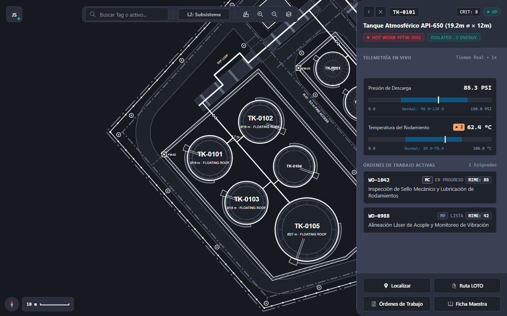
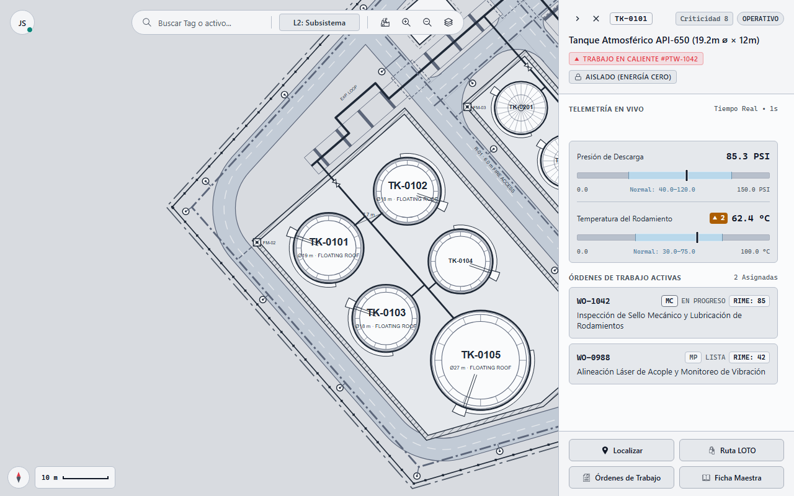
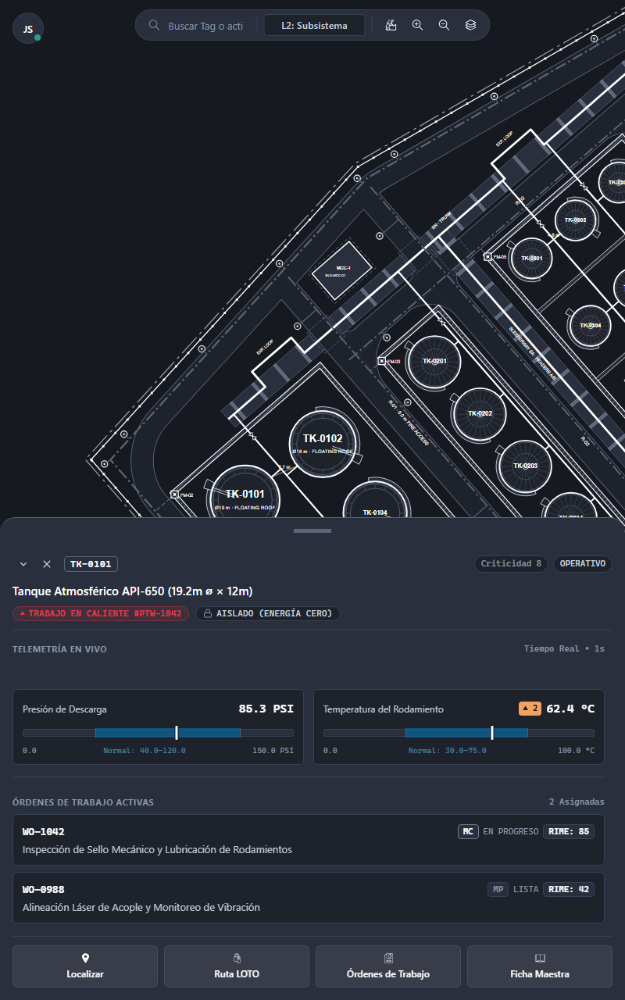
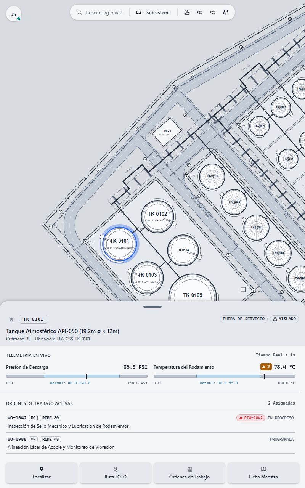
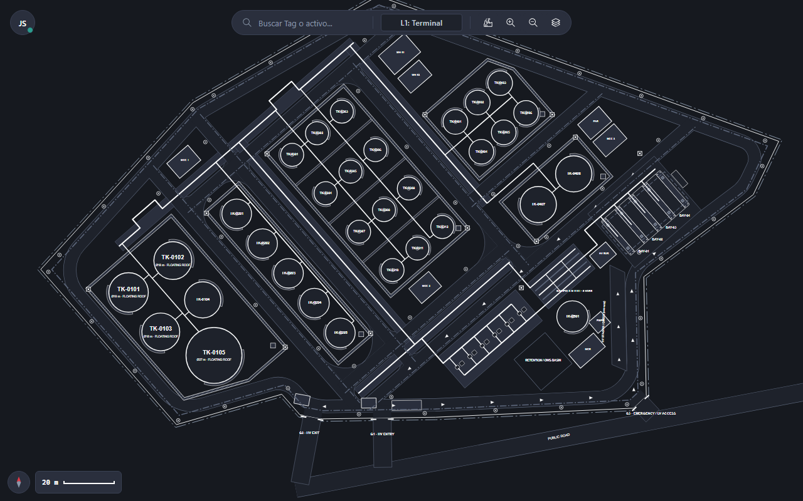
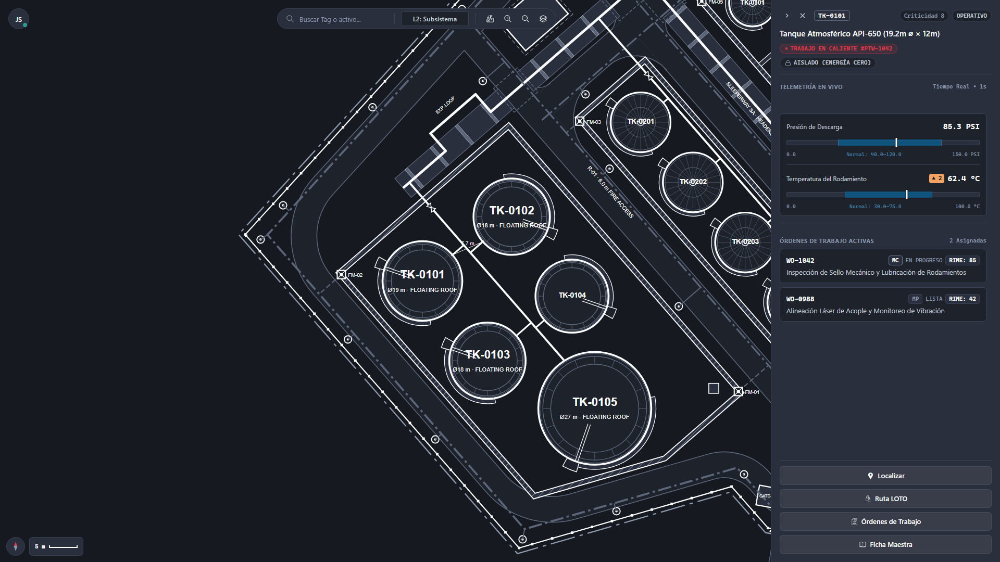

# SCR-VIS-033: Asset Inspection on the 2D Base Map

## 1. Purpose and Operational Context
* **View Objective:** Interactive spatial visualization of plant Functional Locations (ISO 14224 Levels 1 to 5) and Equipment Units (Level 6) on a 2D vector layout (ANSI/ISA-101 Level 2), enabling equipment localization, real-time operating condition assessment, and deployment of the Level 3 Equipment Task Faceplate.
* **Target Personas:**
  * **Maintenance Technician (Primary):** Locates plant equipment in the field, inspects real-time condition telemetry, verifies LOTO isolation status, and launches active maintenance or safety verification routes (dictates field ergonomics and touch targets).
  * **Maintenance Supervisor, HSEQ Inspector, and Reliability Engineer (Secondary):** Perform supervisory condition monitoring, review safety context boundaries, and initiate contextual inspection drill-downs.
* **Operational Context:** Deployed on desktop web consoles (Light Theme) and industrial field tablets in landscape and portrait orientations (Dark Theme).
* **Mode of Operation:** Supervision, visual diagnosis, and passive contextual navigation with gated operational handoffs ([SCR-VIS-011](./SCR-VIS-011.md), [SCR-MTTO-002](../mtto/SCR-MTTO-002.md), [SCR-MTTO-026](../mtto/SCR-MTTO-026.md), [SCR-INV-005](../inv/SCR-INV-005.md)). The interface does not issue remote SCADA/DCS control maneuvers, alter process setpoints, or bypass LOTO safety interlocks.

---

## 2. Visual Artifact

### 2.1. Industrial Tablet Landscape (Dark Theme — Baseline)


> *Note: Production UI prototype capture illustrating the Level 3 contextual equipment faceplate at 1280×800 in Dark Theme. Exhibits the lateral contextual drawer (`CMP-05`) docked on the right flank with Moving Analog Indicators (`CMP-07`), active work order list (`CMP-10`), safety pills (`CMP-08`), and 2x2 tactical action buttons (`CMP-09`).*

### 2.2. Industrial Tablet Landscape (Light Theme)


> *Note: Production UI prototype capture illustrating the Level 3 contextual equipment faceplate at 1280×800 in Light Theme.*

### 2.3. Industrial Tablet Portrait (Bottom Sheet Modality — Dark Theme)


> *Note: Production UI prototype capture at 800×1280 in Tablet Portrait orientation (Dark Theme). Illustrates `CMP-05` operating as an adaptive Bottom Sheet with capsule drag handle nested in the header (`CMP-06`), unified side-by-side MAI telemetry row, and 4-column elevated action button dock (`CMP-09`) over a transparent footer dock.*

### 2.4. Industrial Tablet Portrait (Bottom Sheet Modality — Light Theme)


> *Note: Production UI prototype capture at 800×1280 in Tablet Portrait orientation (Light Theme).*

### 2.5. Macro Supervisory View (Closed Context Drawer)


> *Note: Production UI prototype capture at 1280×800 illustrating the macro supervisory state. `CMP-05` resides in its closed state without visual intrusion over the cartographic canvas.*

### 2.6. Desktop Workstation (Full HD 1080p)


> *Note: Production UI prototype capture at 1920×1080 on Desktop Workstation with full-bleed canvas and fixed lateral faceplate.*

---

## 3. Functional Component Inventory

> The base grid, typography, neutral palettes, and minimal tactile contact areas are inherited from [DT-UI-DS-DOC-001](../../DT-UI-DS-DOC-001.md) and [DT-UI-SVG-DOC-001](../../DT-UI-SVG-DOC-001.md). This inventory defines the canonical components present on the screen, their design tokens, and their architectural scope. Interaction rules and geometric algorithms are specified in Section 5; responsive container adaptations are governed by Section 8.

1. **`CMP-01`: Canvas Viewport 2D**
   - **Visual Role:** Interactive 2D vector plot plan canvas rendering ISO 14224 Levels 1 to 5 Functional Locations and Level 6 Equipment Units in a flat neutral grayscale HPHMI palette.
   - **Design Tokens:**
     - Surface: `--dt-color-bg-canvas`
     - Elevation: `--dt-z-canvas`
     - Spatial Materials: `--dt-color-canvas-*` ([DT-UI-DS-DOC-001 §3.4](../../DT-UI-DS-DOC-001.md#34-spatial-and-physical-material-tokens-digital-twin-canvas))
   - **Architectural Scope:** Strictly flat $Z = 0$ process graphics layer ([DT-UI-DS-DOC-001 §5.1](../../DT-UI-DS-DOC-001.md#51-hphmi-shadow-discipline-canvas-vs-hud-chrome-separation)). Supports desktop middle-click panning, tablet single-finger drag panning, coordinate-preserving focal zoom, and smooth tactical centering (`locateAssetOnMap`). Detailed in §5.2.

2. **`CMP-02`: Viewport Toolbar**
   - **Visual Role:** Centered floating capsule toolbar integrating `CMP-03` inline search, fixed-width semantic zoom level indicator (`L1: Terminal` / `L2: Subsystem` / `L3: Equipment`), view reset (`1:1`), zoom controls (`+` / `−`), and layer toggle (`[#icon-layers]`).
   - **Design Tokens:**
     - Surface: `--dt-color-surface-card`
     - Elevation: `--dt-shadow-hud`
     - Radius: `--dt-radius-full`
     - Stacking: `--dt-z-overlay-card`
     - Level Badge Width: `--dt-layout-toolbar-badge-width`
     - Divider: `--dt-color-border-subtle`
   - **Architectural Scope:** Elevated floating borderless HUD chrome ([DT-UI-DS-DOC-001 §5.2](../../DT-UI-DS-DOC-001.md#52-elevation-shadows)) dynamically centering over unoccluded canvas width when `CMP-05` is deployed. Detailed in §5.2 and §8.

3. **`CMP-03`: Command Palette Trigger**
   - **Visual Role:** Seamless borderless tag search input (`Ctrl + K` / `/`) embedded inside the left segment of `CMP-02` for fuzzy equipment tag lookup.
   - **Design Tokens:**
     - Surface: transparent (nested within `CMP-02` capsule)
     - Text: `--dt-color-text-primary`, `--dt-color-text-muted`
     - Border Focus: `--dt-color-border-focus`
     - Radius: `--dt-radius-full`
   - **Architectural Scope:** Enables direct keyboard/touch tag lookup, triggering tactical canvas centering and `CMP-05` deployment (or entering `Pending Mapping` fallback per `AF-001`). Detailed in §5.2 and §7.2.2.

4. **`CMP-04`: Equipment Hotspot**
   - **Visual Role:** Addressable ISO 14224 Level 6 SVG equipment symbol linked by `data-tag` and `data-equip-id` ([DT-UI-SVG-DOC-001 §6](../../DT-UI-SVG-DOC-001.md#6-eam-telemetry-binding--identity-schema-iso-14224)).
   - **Design Tokens:**
     - Base Shell: `--dt-color-canvas-equip-shell`
     - Border: `--dt-color-border-subtle`
     - Selected Halo: `--dt-color-state-info`
     - Critical Alarm: `--dt-color-alarm-critical`
   - **Architectural Scope:** Renders neutral outlines in normal steady-state, informational selection halo upon tap/click, and critical alarm border with redundant square symbol upon safety limit breaches or `DOWN` outage (`AF-004`). Touch disambiguation in §5.2.

5. **`CMP-05`: Context Container**
   - **Visual Role:** Adaptable Level 3 Equipment Task Faceplate deploying as a docked full-height lateral drawer on desktop/landscape or an adaptive bottom sheet on portrait/mobile, hosting `CMP-06` through `CMP-10` inside a scrollable body with stable scrollbar gutter reservation.
   - **Design Tokens:**
     - Surface: `--dt-color-surface-card`
     - Header Surface: `--dt-color-surface-base`
     - Elevation: `--dt-shadow-panel`
     - Stacking: `--dt-z-drawer-sidebar`
     - Bottom Sheet Radius: `--dt-radius-2xl`
   - **Architectural Scope:** Operates as an absolute overlay without re-rendering or resizing `CMP-01`, supporting the canvas light-dismiss selection lifecycle. Gesture mechanics and responsive sizing in §5.2 and §8.

6. **`CMP-06`: Asset Header Block**
   - **Visual Role:** Two-tier header container presenting the close button (`×`), monospace functional `TagNumber` badge, right-aligned safety/status pills (`CMP-08`), equipment technical description, and secondary metadata (`CriticalityIndex`, `FunctionalLocationCode`). In Tablet Portrait, embeds the capsule drag handle as its first child.
   - **Design Tokens:**
     - Surface: `--dt-color-surface-base`
     - Typography: `--dt-font-h2`, `--dt-font-caption`, `--dt-font-mono-data`
     - Text: `--dt-color-text-primary`, `--dt-color-text-muted`
     - Tag Border: `--dt-color-border-panel`
     - Handle / Top Radius: `--dt-radius-full` (handle), `--dt-radius-2xl` (portrait header)
   - **Architectural Scope:** Eliminates border seams above the portrait bottom sheet drag handle and anchors dismiss/re-open ergonomics. Detailed in §5.2 and §7.2.3.

7. **`CMP-07`: Live Telemetry Block**
   - **Visual Role:** Calibrated Moving Analog Indicators (MAI) displaying live SCADA/SIS variables within normal operating zones and interlock trip limits ([DT-UI-DS-DOC-001 §6.1](../../DT-UI-DS-DOC-001.md#61-moving-analog-indicator-mai-specification)), paired with a header real-time status / stale-telemetry diagnostic slot.
   - **Design Tokens:**
     - MAI Core: `--dt-color-mai-track`, `--dt-color-mai-track-border`, `--dt-color-mai-normal-zone`, `--dt-color-mai-normal-zone-border`, `--dt-color-mai-pointer`, `--dt-color-mai-pointer-border`, `--dt-color-mai-interlock`
     - Alarm Markers (Hollifield Method 3): `--dt-color-alarm-critical`, `--dt-color-alarm-warning`
     - Stale Diagnostic (Priority 4): `--dt-color-mai-stale-zone`, `--dt-color-mai-stale-zone-border`, `--dt-color-text-muted`, `--dt-layout-banner-diagnostic-height`
   - **Architectural Scope:** Updates dynamically via SignalR streams while enforcing invariant neutral pointer colors and Priority 4 slate degradation during telemetry loss (`AF-002`). Detailed in §5.3.

8. **`CMP-08`: Safety Context Summary**
   - **Visual Role:** Contextual safety indicators surfacing verified LOTO lockout status and operational outage badges (`[ISOLATED]`, `[DOWN]`) in the `CMP-06` header slot, plus compact 4-channel redundant Work Permit pills (`PTW-*`) attached to affected rows in `CMP-10`.
   - **Design Tokens:**
     - LOTO Isolated (Safe Neutral): `--dt-color-surface-base`, `--dt-color-border-subtle`, `--dt-color-text-body`
     - Permit Redundant Coding: `--dt-color-alarm-critical`, `--dt-color-alarm-warning`, `--dt-color-state-info` ([DT-UI-DS-DOC-001 §6.2](../../DT-UI-DS-DOC-001.md#62-redundant-coding-matrix-for-permits-and-loto))
     - Radius: `--dt-radius-full`
   - **Architectural Scope:** Strictly suppresses status pills during normal steady-state running operation per 90/10 HPHMI and Anti-Badge-Inflation rules ([DT-UI-DS-DOC-001 §6.5](../../DT-UI-DS-DOC-001.md#65-status-badge--counter-discipline-anti-badge-inflation-principle)).

9. **`CMP-09`: Quick Action Buttons**
   - **Visual Role:** Four tactical navigation and spatial localization buttons (`[Locate]`, `[LOTO Route]`, `[Work Orders]`, `[Master Sheet]`) organized as a 2x2 grid below a hairline divider in landscape/desktop, and a 4-column elevated icon-above-label row over a transparent footer dock in portrait.
   - **Design Tokens:**
     - Surface: `--dt-color-surface-btn-secondary`
     - Border & Divider: `--dt-color-border-hairline`, `--dt-color-border-subtle`
     - Radius: `--dt-radius-md`
     - Disabled State (`AF-001`): `--dt-color-state-disabled`
     - Portrait Elevation: `--dt-shadow-hud`
     - Touch Target: `--dt-touch-target-mobile`
   - **Architectural Scope:** Initiates map centering or cross-screen drill-down routes per §5.4 and [DT-UI-NAV-DOC-001 §5](../../DT-UI-NAV-DOC-001.md#5-transition-matrix-and-access-control-rbac).

10. **`CMP-10`: Actionable Work Orders**
    - **Visual Role:** Frameless, hairline-divided list of active CMMS maintenance work orders displaying `OrderNumber`, `OrderType` badge (`CM`/`PM`/etc.), linked `PTW` pill when present, lifecycle `Status`, `RimePriorityScore`, and task description.
    - **Design Tokens:**
      - Surface: transparent (directly on `CMP-05` drawer surface)
      - Dividers & Outlines: `--dt-color-border-subtle`, `--dt-color-border-focus`
      - Typography: `--dt-font-mono-data`, `--dt-font-body-md`
      - Type Badge Radius: `--dt-radius-sm`
    - **Architectural Scope:** Eliminates nested card borders while making each work order row an interactive execution trigger gated by LOTO zero-energy validation (`AF-005`). Detailed in §5.4.

11. **`CMP-11`: User Profile Indicator**
    - **Visual Role:** Circular floating operator session button anchored at the top-left viewport margin displaying active user initials and a static presence dot.
    - **Design Tokens:**
      - Surface: `--dt-color-surface-card`
      - Elevation: `--dt-shadow-hud`
      - Radius: `--dt-radius-full`
      - Stacking: `--dt-z-overlay-card`
      - Touch Target: `--dt-touch-target-mobile`
      - Session Dot: `--dt-color-state-success`
    - **Architectural Scope:** Anchored at top-left viewport margin per [DT-UI-DS-DOC-001 §5.2](../../DT-UI-DS-DOC-001.md#52-elevation-shadows). Opens operator session and display theme settings.

12. **`CMP-12`: Cartographic Compass & Metric Scale HUD**
    - **Visual Role:** Decoupled bottom-left spatial HUD combining a circular north-orientation compass indicator (`--dt-control-size-hud`) and an adaptive metric scale bar (e.g., `10 m`).
    - **Design Tokens:**
      - Surface: `--dt-color-surface-card`
      - Elevation: `--dt-shadow-hud`
      - Compass Footprint: `--dt-control-size-hud`
      - Radius: `--dt-radius-full` (Compass), `--dt-radius-sm` (Scale pill)
      - North Needle Accent: `--dt-color-alarm-critical`
      - Scale Typography: `--dt-font-mono-data`
    - **Architectural Scope:** Floating HTML overlay anchored at the bottom-left viewport margin per [DT-UI-DS-DOC-001 §2.2](../../DT-UI-DS-DOC-001.md#22-dimensions-of-controls-and-touch-areas) and [§5.2](../../DT-UI-DS-DOC-001.md#52-elevation-shadows). Dynamically computes metric scale denominators from SVG `CALIBRATION-VECTOR` ([DT-UI-SVG-DOC-001 §11](../../DT-UI-SVG-DOC-001.md#11-spatial-metric-calibration)) and current zoom scale.

---

## 4. Screen State Catalog

1. **Normal (Default / Macro Supervisory)**
   - **Activation Condition:** Initial view load, explicit macro reset (`Reset View`), or dismissed faceplate without active equipment alarms or selection.
   - **Visual Modification:** Canvas `CMP-01` renders Functional Locations and Equipment Units in neutral grayscale (`--dt-color-bg-canvas`) centered at macro Level 1 overview (`L1: Terminal`), no equipment hotspot is highlighted, and `CMP-05` resides fully closed off-screen with zero protruding triggers.

2. **Loading**
   - **Activation Condition:** Initial Functional Location transition, asynchronous SVG schematic parsing, or SignalR channel handshake (`NFR-603`).
   - **Visual Modification:** Dimmed activity indicator centered over `CMP-01`; animated skeleton shimmer (`--dt-color-surface-raised`) across `CMP-05` body slots while tactical controls remain disabled.

3. **Selected Asset (Level 3 Faceplate Active)**
   - **Activation Condition:** Stationary tap or click on mapped `CMP-04` hotspot, tag lookup via `CMP-03`, or re-selection of an already highlighted equipment node (`FR-600`).
   - **Visual Modification:** Target `CMP-04` highlights with an informational selection halo (`--dt-color-state-info`). `CMP-05` slides smoothly into view displaying `CMP-06` metadata, `CMP-07` MAI bars, conditional `CMP-08` isolation/PTW pills (hidden during normal steady-state), `CMP-10` active work orders, and `CMP-09` tactical action triggers.

4. **Critical Asset Alarm (`AF-004`)**
   - **Activation Condition:** Physical telemetry breaches safety/trip limits or `EquipmentUnit` enters `DOWN` operational status ([UC-VIS-033](../../../domain-models/use-cases/vis/UC-VIS-033.md) `AF-004`, `FR-602`).
   - **Visual Modification:** `CMP-04` acquires a critical alarm border and square symbol in `--dt-color-alarm-critical`. In `CMP-07`, MAI renders a Priority 1 critical square badge (`--dt-color-alarm-critical`) or Priority 2 warning triangle badge (`--dt-color-alarm-warning`) adjacent to the breached scale limit while maintaining neutral pointer geometry per Hollifield Method 3.

5. **Telemetry Loss (Priority 4 Diagnostic — `AF-002`)**
   - **Activation Condition:** Interruption of real-time SignalR connection with the SCADA source, heartbeat timeout, or "Bad" packet quality ([UC-VIS-033](../../../domain-models/use-cases/vis/UC-VIS-033.md) `AF-002`, `TR-010`).
   - **Visual Modification:** `CMP-07` applies Priority 4 Diagnostic styling: frozen numeric values in muted italic typography (`--dt-color-text-muted`), dimmed pointer and border (`--dt-color-mai-stale-zone-border`), deactivated slate normal operating zone (`--dt-color-mai-stale-zone`), hidden alarm badges with preserved slot bounds, and a stale diagnostic banner (`--dt-layout-banner-diagnostic-height`, `#icon-wifi-off`) displaying the last confirmed UTC timestamp. Process alarm colors (`--dt-color-alarm-warning`, `--dt-color-alarm-critical`) are strictly prohibited.

6. **Pending Mapping (Unmapped Asset — `AF-001`)**
   - **Activation Condition:** Query of a master catalog `EquipmentUnit` via search (`CMP-03`) or navigation that lacks linked vector geometry in the loaded SVG (`MeshMappingStatus` is `UNMAPPED` or `SYNC_ERROR`, [UC-VIS-033](../../../domain-models/use-cases/vis/UC-VIS-033.md) `AF-001`).
   - **Visual Modification:** `CMP-05` deploys tabular technical metadata and active work orders without rendering any fallback marker at $(0, 0)$, disables `[Locate]` in `CMP-09` (`--dt-color-state-disabled`), and displays a neutral diagnostic badge indicating pending SVG spatial mapping.

7. **Offline Mode (Cached Schematic — `AF-003`)**
   - **Activation Condition:** Complete wireless connectivity loss on an industrial mobile client ([UC-VIS-033](../../../domain-models/use-cases/vis/UC-VIS-033.md) `AF-003`, [DT-UI-NAV-DOC-001 §6.1](../../DT-UI-NAV-DOC-001.md#61-offline-operation-guard)).
   - **Visual Modification:** Persistent upper offline banner (`--dt-layout-banner-diagnostic-height`, `--dt-color-alarm-warning`, `#icon-wifi-off`): `[#icon-wifi-off] OFFLINE MODE · CACHED SCHEMATIC` offsets top HUD chrome without occluding controls. Plot plan navigation operates against encrypted local storage (`IOfflineStorage`), live telemetry freezes in Priority 4 diagnostic mode, and field workflow routing verifies cryptographic offline leases ([ADR-006](../../../architecture/adr/ADR-006.md)).

8. **LOTO Safety Interlock Blocked (`AF-005`)**
   - **Activation Condition:** Operator activates a Work Order row in `CMP-10` to begin execution when the linked `WorkPermit` is not `APPROVED` or associated `WorkOrderIsolation` points lack verified zero-energy attestation ([UC-VIS-033](../../../domain-models/use-cases/vis/UC-VIS-033.md) `AF-005`, [DT-UI-NAV-DOC-001 §6.2](../../DT-UI-NAV-DOC-001.md#62-loto-lockout-and-fail-safe-guard)).
   - **Visual Modification:** Execution routing halts immediately and deploys a non-dismissible fail-safe safety modal (`--dt-z-modal-fail-safe`, `--dt-color-alarm-critical`) blocking work initiation and directing the operator to LOTO Route Verification ([SCR-VIS-011](./SCR-VIS-011.md)).

---

## 5. Interaction Rules and Data Flow

### 5.1. Initial Load
1. The client retrieves the vector schematic corresponding to the target Functional Location and renders `CMP-01` using neutral grayscale material tokens.
2. Interactive SVG equipment groups (`CMP-04`) are bidirectionally bound via `data-tag` and `data-equip-id` attributes to registered Level 6 `EquipmentUnit` records (`FR-599`).
3. The viewport initializes centered on Level 1 macro overview (`L1: Terminal`) with pan limits clamped to calibrated SVG operational boundaries; no equipment hotspot is pre-selected unless an `InitialEquipmentTag` deep-link parameter is provided, and `CMP-05` starts closed off-screen without obstructing `CMP-12`.

### 5.2. Spatial Navigation and Mobile Ergonomics
1. **Dual-Modality Continuous Panning:**
   - **Desktop Workstation Modality:** Canvas dragging/panning is bound strictly to middle-click (mouse wheel press and drag) with active pointer capture. Primary left-click is reserved exclusively for selecting `CMP-04` equipment nodes and interacting with HUD controls, preventing accidental viewport displacements during tactical selection.
   - **Industrial Tablet Tactile Modality:** Single-finger touch dragging across `CMP-01`. Enforces a mandatory $4\text{px}$ movement threshold before transitioning into an active pan state, cleanly disambiguating intentional dragging from stationary tap selections. Ephemeral popovers dismiss immediately upon initiating a canvas drag or zoom.
2. **Coordinate-Preserving Focal Zoom:**
   - Mouse wheel zooming (`wheel`) computes scale adjustments anchored around exact cursor coordinates $(cx, cy)$ on the canvas so the inspected feature remains stationary under the pointer. Viewport zoom controls (`+` / `−`) inside `CMP-02` scale relative to the unoccluded canvas center.
   - Crossing semantic zoom thresholds (`--dt-zoom-scale-l1-max` and `--dt-zoom-scale-l2-max`) updates progressive disclosure visibility layers seamlessly without abrupt popping ([DT-UI-SVG-DOC-001 §10](../../DT-UI-SVG-DOC-001.md#10-progressive-disclosure--viewport-kinematics)).
3. **Smooth Equipment Centering (`locateAssetOnMap`):**
   - Selecting an equipment tag via `CMP-03` or pressing `[Locate]` in `CMP-09` animates pan and zoom to `--dt-zoom-scale-tactical` ([DT-UI-DS-DOC-001 §2.5](../../DT-UI-DS-DOC-001.md#25-spatial-navigation-and-semantic-zoom-tokens-ansiisa-10101-viewports)), centering the asset centroid $(X, Y)$ within the unoccluded canvas area. In desktop and landscape orientations with `CMP-05` deployed, the target shifts leftward by $50\%$ of the active drawer width to avoid occlusion and highlights `CMP-04` with `--dt-color-state-info`.
4. **Decoupled Viewport & Zero Layout Shift:**
   - `CMP-01` operates as a full-viewport background layer. Opening, resizing, or dismissing `CMP-05` executes as an overlaid container that never resizes or re-renders the underlying SVG plot plan, preventing DOM thrashing and layout shift.
   - The scrollable body inside `CMP-05` preserves permanent lateral scrollbar gutter reservation so vertical scrollbar activation during height adjustments never shifts internal telemetry rows or buttons horizontally.
5. **Tactile Controllability & Surface Hierarchy:** All interactive triggers across `CMP-02`, `CMP-05`, `CMP-09`, `CMP-10`, and `CMP-11` enforce minimum touch target ergonomics governed by `--dt-touch-target-mobile`, while floating HUD chrome projects `--dt-shadow-hud` and docked drawers project `--dt-shadow-panel`.
6. **Responsive Breakpoint Delegation:** Container dimensions, drawer widths (`--dt-layout-drawer-width-desktop` / `--dt-layout-drawer-width-tablet`), and responsive orientation switches follow Section 8, [DT-UI-DS-DOC-001 §6.3](../../DT-UI-DS-DOC-001.md#63-sliding-containers-pattern-bottom-sheets-and-drawers), and [DT-UI-NAV-DOC-001](../../DT-UI-NAV-DOC-001.md).
7. **Spatial Selection & Drawer Dismiss Lifecycle (Google Maps Model):**
   - Clicking the dismiss button (`×`) in `CMP-06` or clicking/tapping empty canvas smoothly translates `CMP-05` off-screen while preserving the active selection halo on `CMP-04`.
   - Re-clicking the selected `CMP-04` hotspot on the canvas or searching its tag in `CMP-03` immediately re-opens `CMP-05`. Protruding side peek tabs are prohibited to preserve unobstructed cartography.
8. **Bottom Sheet Tactile Gestures & Snap Mechanics (Portrait / Mobile):**
   - **Initial Natural Content Height:** `CMP-05` opens hugging its natural content height bounded by `--dt-layout-bottom-sheet-height-initial`, leaving the majority of the viewport visible for spatial verification.
   - **Capsule Drag Handle & Unified Header:** The pill handle (`--dt-radius-full`) renders as the first child inside `CMP-06` (`--dt-color-surface-base`, `--dt-radius-2xl` upper curvature), eliminating seams between handle zone and header metadata.
   - **Elevated Tactical Footer:** In portrait orientation, `CMP-09` arranges four icon-above-label buttons across a 4-column row inside a transparent, divider-free footer dock with `--dt-shadow-hud` elevation per button.
   - **Continuous Height Dragging:** Dragging upward via the capsule handle allows continuous height adjustment up to `--dt-layout-bottom-sheet-height-expanded`, retaining custom height upon release for simultaneous MAI and work order review.
   - **Hysteresis & Snap-Back Threshold:** Minor downward drags ($< 100\text{px}$ delta above minimum collapse threshold) rubber-band smoothly back to natural height to guard against unintentional glove contact.
   - **Smooth Dismiss Transition:** Pulling downward past the collapse threshold ($> 100\text{px}$ downward drag or resulting height $< 260\text{px}$) translates `CMP-05` fully off-screen with zero peek bars while keeping the selection halo on `CMP-04`.
   - **Discrete Tap Dismiss:** A single tap on the capsule drag handle immediately dismisses the bottom sheet off-screen without requiring fine motor drag skill ([DT-UI-DS-DOC-001 §6.3](../../DT-UI-DS-DOC-001.md#63-sliding-containers-pattern-bottom-sheets-and-drawers)). Tapping the highlighted `CMP-04` node on `CMP-01` re-opens `CMP-05`.
9. **Cartographic HUD Dynamic Synchronization (`CMP-12`):**
   - Fixed at the bottom-left viewport margin (`--dt-z-overlay-card`), rendering circular Plant North compass (`--dt-control-size-hud`, `--dt-radius-full`) above an adaptive metric scale bar.
   - Dynamically computes real-world meters per screen pixel against SVG `CALIBRATION-VECTOR` ([DT-UI-SVG-DOC-001 §11](../../DT-UI-SVG-DOC-001.md#11-spatial-metric-calibration)), rounding smoothly to intuitive metric intervals ($2\text{m}, 5\text{m}, 10\text{m}, 20\text{m}, 25\text{m}, 50\text{m}, 100\text{m}$) during continuous pan/zoom.
10. **Toolbar Level Badge Fixed Width Invariant (`CMP-02`):**
    - The hierarchical level indicator inside `CMP-02` enforces a strict fixed width of `--dt-layout-toolbar-badge-width` so transitions across `L1: Terminal`, `L2: Subsystem`, and `L3: Equipment` never cause horizontal button jitter.

### 5.3. Inspection and Telemetry
1. Selecting a mapped asset opens `CMP-05` and subscribes to the Equipment Unit's real-time SignalR telemetry hub (`TR-010`).
2. `CMP-05` renders strictly Level 3 operational data: Header & Identity (`CMP-06`), Moving Analog Indicators (`CMP-07`), Safety Context Pills (`CMP-08`), Actionable Work Orders (`CMP-10`), and Tactical Triggers (`CMP-09`).
3. **SignalR Subscription & Debounce Governance:** Rapid hotspot switching cancels pending stale stream requests and applies global subscription debouncing to prevent channel collisions ([DT-ARQ-CMP-DOC-001](../../../architecture/views/DT-ARQ-CMP-DOC-001.md)), refreshing MAI bars in $< 1\text{s}$ from server ingestion (`NFR-604`).
4. **Diagnostic Connection Resilience (`AF-002`):** Upon heartbeat timeout or "Bad" SCADA packet quality ([DT-ARQ-DEP-DOC-001](../../../architecture/views/DT-ARQ-DEP-DOC-001.md)), `CMP-07` immediately transitions to `Telemetry Loss` using Priority 4 Diagnostic styling:
   - Displays the diagnostic status banner in the fixed `--dt-layout-banner-diagnostic-height` slot: *"Stale data. Connection interrupted at HH:mm:ss UTC"* (runtime localized per [ADR-009](../../../architecture/adr/ADR-009.md)) with `#icon-wifi-off`, avoiding vertical reflow.
   - Transmutes the MAI normal operating zone to slate (`--dt-color-mai-stale-zone` / `--dt-color-mai-stale-zone-border`) without triggering amber/red alarm cues.
   - Attenuates frozen live numbers to muted italic (`--dt-color-text-muted`) and hides alarm severity badges while preserving allocated horizontal space (`CLS = 0`).
5. **Conditional Safety Context Discipline (`CMP-08`):** Header pills in `CMP-06` surface `DOWN` operational status and neutral LOTO `[ISOLATED]` indicators solely when active isolation or unavailability exists; normal steady-state running units suppress redundant status pills. Linked approved Work Permits display inline inside corresponding `CMP-10` work order rows using 4-channel redundant coding.

### 5.4. Tactical Drill-Down Handoffs and Safety Guards
1. **`[Locate]` (`CMP-09`):** Invokes `locateAssetOnMap(TagNumber)` (§5.2) when `MappingStatus == MAPPED`. Disabled via negative interlock (`--dt-color-state-disabled`) when spatial mapping is pending (`AF-001`).
2. **`[LOTO Route]` (`CMP-09`):** Transitions the shared viewport workspace to LOTO Isolation Verification ([SCR-VIS-011](./SCR-VIS-011.md)) scoped to the selected `EquipmentUnit` and active work order isolation points.
3. **`[Work Orders]` (`CMP-09`) vs. Direct Row Activation (`CMP-10`):**
   - Pressing `[Work Orders]` in `CMP-09` navigates to RIME Backlog Prioritization ([SCR-MTTO-026](../mtto/SCR-MTTO-026.md)) filtered by `EquipmentId`.
   - Clicking an active Work Order row in `CMP-10` executes the LOTO Safety Interlock check ([DT-UI-NAV-DOC-001 §6.2](../../DT-UI-NAV-DOC-001.md#62-loto-lockout-and-fail-safe-guard)): execution transitions to Mobile Work Order Execution ([SCR-MTTO-002](../mtto/SCR-MTTO-002.md)) ONLY if the linked `WorkPermit` status is `APPROVED` and LOTO isolation points report `VERIFIED_ZERO_ENERGY` (or valid `LEASED_OFFLINE` offline cryptographic lease under [ADR-006](../../../architecture/adr/ADR-006.md)); otherwise the non-dismissible fail-safe modal activates (`AF-005`).
4. **`[Master Sheet]` (`CMP-09`):** Routes to Level 3 Equipment Master Data Card ([SCR-INV-005](../inv/SCR-INV-005.md)) displaying immutable catalog specifications, nameplate fields, and maintenance boundaries.

---

## 6. Industrial and Safety Considerations

* **Read-Only Supervisory Boundary (ISO 45001 §8.1):** `SCR-VIS-033` provides passive spatial inspection and diagnostic telemetry awareness. It cannot issue plant start/stop commands, alter control loops, or bypass LOTO safety interlocks ([DT-UI-NAV-DOC-001 §6.2](../../DT-UI-NAV-DOC-001.md#62-loto-lockout-and-fail-safe-guard)).
* **Spatial Integrity Fail-Safe (`AF-001`):** Equipment records in `UNMAPPED` or `SYNC_ERROR` states are strictly barred from arbitrary fallback coordinate placement (such as $(0, 0)$) and disable `[Locate]` triggers to avoid false spatial confidence (§4, §5.4).
* **Cartographic Telemetry Offloading (L2 vs. L3 Separation):** The 2D vector canvas retains only equipment geometry and ISA tag callouts ([DT-UI-SVG-DOC-001 §8](../../DT-UI-SVG-DOC-001.md#8-instrumentation--control-loops-ansiisa-51-2009)), offloading continuous numerical readings and alarm bands to `CMP-07` MAI bars to prevent plot plan clutter on high-density equipment skids.
* **HPHMI & Priority 4 Diagnostic Governance ([TR-011](../../../requirements/common/TR-011.md)):** Neutral 90/10 grayscale baseline, elimination of green for normal running equipment, Hollifield Method 3 MAI alarm boundaries, and mandatory slate Priority 4 differentiation for stale/disconnected timestamps adhere strictly to [DT-UI-DS-DOC-001 §1](../../DT-UI-DS-DOC-001.md#1-scope), [§6.1](../../DT-UI-DS-DOC-001.md#61-moving-analog-indicator-mai-specification), and [§6.2](../../DT-UI-DS-DOC-001.md#62-redundant-coding-matrix-for-permits-and-loto).

---

## 7. Frontend Component Contract (Blazor / Razor)

### 7.1. Component Hierarchy & File Mapping

```text
Pages/
└── AssetInspectionPage.razor                 # Root View (SCR-VIS-033)
    ├── CanvasViewport2D.razor                # CMP-01: 2D SVG canvas with pan/zoom
    │   └── EquipmentHotspot.razor            # CMP-04: Interactive ISO 14224 L6 SVG hotspot
    ├── ViewportToolbar.razor                 # CMP-02: Floating navigation capsule toolbar
    │   └── CommandPaletteTrigger.razor       # CMP-03: Embedded fuzzy tag search input
    ├── UserProfileButton.razor               # CMP-11: Top-left user session indicator
    ├── CartographicHud.razor                 # CMP-12: Bottom-left compass & metric scale HUD
    ├── AssetTaskFaceplate.razor              # CMP-05: Level 3 contextual drawer / bottom sheet
    │   ├── AssetHeaderBlock.razor            # CMP-06: Tag, title, metadata & close control
    │   │   └── SafetyContextSummary.razor    # CMP-08: LOTO isolation & outage pills
    │   ├── MovingAnalogIndicator.razor       # CMP-07: Real-time MAI scale bars
    │   ├── DiagnosticStatusBanner.razor      # Stale telemetry & offline cache strip (AF-002/AF-003)
    │   ├── ActiveWorkOrdersList.razor        # CMP-10: Actionable flat work order rows
    │   └── QuickActionButtons.razor          # CMP-09: 2x2 / 4-column tactical action dock
    └── LotoSafetyInterlockModal.razor        # Non-dismissible LOTO execution guard modal (AF-005)
```

### 7.2. Physical Component Parameters & DTO Contracts (.NET 10 / C# 14)

#### 7.2.1. `AssetInspectionPage.razor` (Root View)
```csharp
[Parameter]
public string? FunctionalLocationCode { get; set; }

[Parameter]
public string? InitialEquipmentTag { get; set; }
```

#### 7.2.2. Subcomponent Parameter Contracts (`CMP-01` to `CMP-12`)
```csharp
// CMP-01: CanvasViewport2D.razor
[Parameter]
public required string FunctionalLocationCode { get; set; }

[Parameter]
public required string SvgContent { get; set; }

[Parameter]
public IReadOnlyList<EquipmentHotspotDto> Hotspots { get; set; } = [];

[Parameter]
public string? SelectedEquipmentTag { get; set; }

[Parameter]
public double ZoomScale { get; set; } = 1.0;

[Parameter]
public EventCallback<string> OnEquipmentSelected { get; set; }

[Parameter]
public EventCallback OnEmptyCanvasClicked { get; set; }

// CMP-04: EquipmentHotspot.razor
[Parameter]
public required EquipmentHotspotDto Hotspot { get; set; }

[Parameter]
public bool IsSelected { get; set; }

[Parameter]
public EventCallback<string> OnHotspotSelected { get; set; }

// CMP-02: ViewportToolbar.razor
[Parameter]
public string CurrentLevel { get; set; } = "L1: Terminal";

[Parameter]
public double ZoomScale { get; set; } = 1.0;

[Parameter]
public bool IsLayersActive { get; set; }

[Parameter]
public EventCallback OnResetViewRequested { get; set; }

[Parameter]
public EventCallback OnZoomInRequested { get; set; }

[Parameter]
public EventCallback OnZoomOutRequested { get; set; }

[Parameter]
public EventCallback OnToggleLayersRequested { get; set; }

// CMP-03: CommandPaletteTrigger.razor
[Parameter]
public string? SearchQuery { get; set; }

[Parameter]
public EventCallback<string?> OnSearchQueryChanged { get; set; }

[Parameter]
public EventCallback OnOpenPalette { get; set; }

[Parameter]
public EventCallback<string> OnTagSearchSubmitted { get; set; }

// CMP-11: UserProfileButton.razor
[Parameter]
public required string UserInitials { get; set; }

[Parameter]
public required string UserName { get; set; }

[Parameter]
public EventCallback OnProfileMenuRequested { get; set; }

// CMP-12: CartographicHud.razor
[Parameter]
public double ZoomScale { get; set; } = 1.0;

[Parameter]
public double ScaleRatioMetersPerUnit { get; set; } = 0.2;

// CMP-05: AssetTaskFaceplate.razor
[Parameter]
public required EquipmentFaceplateDto FaceplateData { get; set; }

[Parameter]
public bool IsOpen { get; set; }

[Parameter]
public bool IsTelemetryStale { get; set; }

[Parameter]
public DateTimeOffset? TelemetryLastSyncAt { get; set; }

[Parameter]
public bool IsOfflineMode { get; set; }

[Parameter]
public EventCallback<bool> OnOpenChanged { get; set; }

[Parameter]
public EventCallback<string> OnQuickActionTriggered { get; set; }

[Parameter]
public EventCallback<ActiveWorkOrderSummaryDto> OnWorkOrderSelected { get; set; }

// CMP-06: AssetHeaderBlock.razor
[Parameter]
public required EquipmentHeaderDto Header { get; set; }

[Parameter]
public required SafetyContextSummaryDto SafetyContext { get; set; }

[Parameter]
public EventCallback OnCloseRequested { get; set; }

// CMP-08: SafetyContextSummary.razor
[Parameter]
public required SafetyContextSummaryDto SafetyContext { get; set; }

[Parameter]
public required OperationalStatus OperationalStatus { get; set; }

// CMP-07: MovingAnalogIndicator.razor
[Parameter]
public required MovingAnalogIndicatorDto Telemetry { get; set; }

// Diagnostic Banner: DiagnosticStatusBanner.razor (AF-002 / AF-003)
[Parameter]
public bool IsTelemetryStale { get; set; }

[Parameter]
public bool IsOfflineMode { get; set; }

[Parameter]
public DateTimeOffset? LastSyncTimestamp { get; set; }

// CMP-10: ActiveWorkOrdersList.razor
[Parameter]
public IReadOnlyList<ActiveWorkOrderSummaryDto> WorkOrders { get; set; } = [];

[Parameter]
public EventCallback<ActiveWorkOrderSummaryDto> OnWorkOrderClicked { get; set; }

// CMP-09: QuickActionButtons.razor
[Parameter]
public required string TagNumber { get; set; }

[Parameter]
public bool IsLocationMapped { get; set; } = true;

[Parameter]
public EventCallback<string> OnActionTriggered { get; set; }

// Fail-Safe Safety Modal: LotoSafetyInterlockModal.razor (AF-005)
[Parameter]
public bool IsVisible { get; set; }

[Parameter]
public Guid? BlockedWorkOrderId { get; set; }

[Parameter]
public string? BlockReason { get; set; }

[Parameter]
public EventCallback OnProceedToLotoVerification { get; set; }
```

#### 7.2.3. Data Transfer Objects (DTOs)
```csharp
public record EquipmentHotspotDto
{
    public required Guid EquipmentId { get; init; }
    public required string TagNumber { get; init; }
    public required string FunctionalLocationCode { get; init; }
    public required OperationalStatus OperationalStatus { get; init; }
    public bool HasActiveAlarm { get; init; }
    public bool IsCriticalAlarm { get; init; }
}

public record EquipmentFaceplateDto
{
    public required EquipmentHeaderDto Header { get; init; }
    public IReadOnlyList<MovingAnalogIndicatorDto> Telemetry { get; init; } = [];
    public required SafetyContextSummaryDto SafetyContext { get; init; }
    public IReadOnlyList<ActiveWorkOrderSummaryDto> ActiveWorkOrders { get; init; } = [];
}

public record EquipmentHeaderDto
{
    public required Guid EquipmentId { get; init; }
    public required string TagNumber { get; init; }
    public required string FunctionalLocationCode { get; init; }
    public required string SerialNumber { get; init; }
    public required string EquipmentClass { get; init; }
    public required string Description { get; init; }
    public required int CriticalityIndex { get; init; } // 1..10 per FunctionalLocation criticality index (DT-DM-DOC-001 §4.5)
    public required OperationalStatus OperationalStatus { get; init; }
    public required MeshMappingStatus MappingStatus { get; init; }
}

public record MovingAnalogIndicatorDto
{
    public required string VariableCode { get; init; }
    public required string VariableName { get; init; }
    public required double CurrentValue { get; init; }
    public required string EngineeringUnit { get; init; }
    public required double ScaleMin { get; init; }
    public required double ScaleMax { get; init; }
    public required double NormalMin { get; init; }
    public required double NormalMax { get; init; }
    public double? TripLow { get; init; }
    public double? TripHigh { get; init; }
    public bool IsStale { get; init; }
    public required DateTimeOffset Timestamp { get; init; }
}

public record SafetyContextSummaryDto
{
    public string? ActivePtwNumber { get; init; }
    public PermitType? PermitType { get; init; }
    public WorkPermitStatus? PermitStatus { get; init; }
    public IsolationStatus? LotoIsolationStatus { get; init; }
    public string? LotoCertificateNumber { get; init; }
    public bool HasActiveEnergyDetected { get; init; }
}

public record ActiveWorkOrderSummaryDto
{
    public required Guid WorkOrderId { get; init; }
    public required string OrderNumber { get; init; }
    public required string Description { get; init; }
    public required WorkOrderType OrderType { get; init; }
    public required WorkOrderStatus Status { get; init; }
    public required int RimePriorityScore { get; init; }
    public string? LinkedPtwNumber { get; init; }
    public PermitType? LinkedPermitType { get; init; }
    public WorkPermitStatus? LinkedPermitStatus { get; init; }
    public bool IsLotoZeroEnergyVerified { get; init; }
    public bool HasValidOfflineLease { get; init; }
}

/// <summary>
/// Controlled equipment operational availability vocabulary per DT-DM-DOC-001 §4.4.
/// </summary>
public enum OperationalStatus
{
    UP,
    STANDBY,
    DOWN
}

/// <summary>
/// Controlled LOTO isolation status vocabulary per DT-DM-DOC-001 §4.32.
/// </summary>
public enum IsolationStatus
{
    PENDING_ISOLATION,
    ISOLATED,
    VERIFIED_ZERO_ENERGY,
    LEASED_OFFLINE,
    RELEASED
}

/// <summary>
/// Controlled spatial mesh linkage status vocabulary per DT-DM-DOC-001 §4.29.
/// </summary>
public enum MeshMappingStatus
{
    MAPPED,
    UNMAPPED,
    SYNC_ERROR
}

/// <summary>
/// Controlled permit risk classification vocabulary per DT-DM-DOC-001 §4.34.
/// </summary>
public enum PermitType
{
    HOT_WORK,
    COLD_WORK,
    CONFINED_SPACE,
    ELECTRICAL,
    WORK_AT_HEIGHT,
    EXCAVATION,
    CHEMICAL
}

/// <summary>
/// Controlled permit lifecycle status vocabulary per DT-DM-DOC-001 §4.35.
/// </summary>
public enum WorkPermitStatus
{
    DRAFT,
    PENDING,
    APPROVED,
    EXPIRED,
    REVOKED,
    CLOSED
}

/// <summary>
/// Controlled work order maintenance methodology vocabulary per DT-DM-DOC-001 §4.22.
/// </summary>
public enum WorkOrderType
{
    CORRECTIVE,
    PREVENTIVE,
    PREDICTIVE,
    IMPROVEMENT
}

/// <summary>
/// Controlled work order execution status vocabulary per DT-DM-DOC-001 §4.21.
/// </summary>
public enum WorkOrderStatus
{
    PLANNING,
    WAITING_PARTS,
    SCHEDULED,
    IN_PROGRESS,
    SUSPENDED,
    COMPLETE,
    CLOSED
}
```

### 7.3. Client-Side DOM & Interop Bridge

1. **SVG Viewport Navigation Interop (`ISvgViewportInterop`):**
   * Encapsulates client-side coordinate transformations, pointer capture, middle-click panning, tactile drag thresholding ($4\text{px}$), and focal mouse-wheel matrix evaluation ([ADR-001](../../../architecture/adr/ADR-001.md)).
   * Executes smooth animated centering (`locateAssetOnMap`) to target equipment centroids $(X, Y)$ with lateral drawer offset compensation, eliminating SignalR roundtrip latency and avoiding network saturation.
2. **Context Drawer Touch Gesture Interop (`IDrawerGestureInterop`):**
   * Manages pointer capture on the upper tactile drag handle, continuous height dragging (between `--dt-layout-bottom-sheet-height-initial` and `--dt-layout-bottom-sheet-height-expanded`), hysteresis snap thresholds, and discrete single-tap dismiss.
3. **Semantic Selection:**
   * Hotspots in the SVG declare standardized data attributes (`data-equip-id`, `data-tag`, `data-func-loc`) matching ISO 14224 Level 6 Equipment Unit metadata ([DT-UI-SVG-DOC-001 §6](../../DT-UI-SVG-DOC-001.md#6-eam-telemetry-binding--identity-schema-iso-14224)).
   * Stationary taps/clicks on an SVG node dispatch `OnEquipmentSelected(tagNumber)`; drags exceeding the $4\text{px}$ tactile threshold suppress accidental asset selection, and clicks on empty canvas trigger `OnEmptyCanvasClicked` to close `CMP-05` cleanly.

---

## 8. Layout and Responsive Adaptability

### 8.1. Desktop Workstation (`--dt-breakpoint-xl`)
* **Layout Organization:** Canvas `CMP-01` occupies full viewport (`--dt-z-canvas`). Floating pill toolbar `CMP-02` displays inline search `CMP-03`, fixed-width level badge (`--dt-layout-toolbar-badge-width`), and viewer controls (`--dt-z-overlay-card`). User profile button `CMP-11` anchors at top-left, and cartographic HUD `CMP-12` anchors at bottom-left. Context container `CMP-05` docks as a full-height lateral drawer on the right flank sized by `--dt-layout-drawer-width-desktop` (`--dt-z-drawer-sidebar`, `--dt-shadow-panel`), hosting `CMP-09` in a 2x2 action grid below a hairline footer divider.
* **Ergonomic Rules:** Mouse wheel focal zoom around cursor $(cx, cy)$; middle-click canvas panning; `locateAssetOnMap` shifts centering leftward by $50\%$ of active drawer width when `CMP-05` is deployed (§5.2); clicking `'×'` or empty canvas dismisses `CMP-05` while preserving the hotspot halo.

### 8.2. Industrial Tablet Landscape (`--dt-breakpoint-lg`)
* **Layout Organization:** Canvas `CMP-01` occupies left workspace; `CMP-05` docks as a right-hand lateral panel sized by `--dt-layout-drawer-width-tablet` (`--dt-z-drawer-sidebar`, `--dt-shadow-panel`), strictly preserving $\ge 70\%$ canvas visibility per [DT-UI-DS-DOC-001 §2.4](../../DT-UI-DS-DOC-001.md#24-structural-layout-and-dimensional-tokens). Toolbar `CMP-02` dynamically centers over the remaining unoccluded canvas width and compacts the inline search input when `CMP-05` is open. `CMP-09` arranges in a 2x2 action grid.
* **Ergonomic Rules:** Touch pan dead-zone threshold ($4\text{px}$); all interactive touch targets comply with `--dt-touch-target-mobile`; `locateAssetOnMap` offsets centering leftward by $50\%$ of active drawer width (§5.2); canvas tap light-dismisses `CMP-05` while preserving hotspot highlight.

### 8.3. Industrial Tablet Portrait (`--dt-breakpoint-md`)
* **Layout Organization:** Canvas `CMP-01` occupies full viewport with `CMP-12` HUD anchored at bottom-left and `CMP-11` anchored at top-left. Toolbar `CMP-02` docks near top center retaining inline search (`CMP-03`) and level badge. Context container `CMP-05` operates as an adaptive **Bottom Sheet** (`--dt-z-drawer-sidebar`, `--dt-radius-2xl` top curvature), initializing at natural content height (`--dt-layout-bottom-sheet-height-initial`) with the capsule drag handle nested inside `CMP-06`, side-by-side 2-column MAI rows (`CMP-07`), and a 4-column elevated `CMP-09` action dock (`--dt-shadow-hud`) over a transparent footer.
* **Ergonomic Rules:** Gesture physics, continuous upward drag ceiling (`--dt-layout-bottom-sheet-height-expanded`), snap hysteresis, and discrete single-tap handle dismiss follow §5.2 and [DT-UI-DS-DOC-001 §6.3](../../DT-UI-DS-DOC-001.md#63-sliding-containers-pattern-bottom-sheets-and-drawers); all touch targets comply with `--dt-touch-target-mobile`; tapping empty canvas dismisses `CMP-05`.

---

## 9. Traceability and Requirements Matrix

| Requirement | Addressed in Component | Verification & Implementation Mechanism |
| :--- | :--- | :--- |
| [FR-598](../../../requirements/user-stories/vis/VIS-033.md#functional-requirements-fr) | `CMP-01`, `CMP-02`, `CMP-12` | Renders 2D vector schematics ensuring interactive compatibility (panning, focal zooming, and calibrated scale HUD) across mobile tablets and desktop workstations. |
| [FR-599](../../../requirements/user-stories/vis/VIS-033.md#functional-requirements-fr) | `CMP-01`, `CMP-04`, `CMP-06` | Bidirectionally links SVG graphic nodes (`data-tag`, `data-equip-id`) with physical Equipment Unit records in the master catalog and enforces `AF-001` unmapped guards. |
| [FR-600](../../../requirements/user-stories/vis/VIS-033.md#functional-requirements-fr) | `CMP-05`, `CMP-06`, `CMP-08`, `CMP-10` | Selecting a mapped geometry deploys the Level 3 faceplate displaying functional Tag, Operational Status, Criticality, LOTO/PTW safety context, and active Work Orders. |
| [FR-601](../../../requirements/user-stories/vis/VIS-033.md#functional-requirements-fr) | `CMP-07` | Live Telemetry Block presents real-time Moving Analog Indicators (MAI) updated dynamically via SignalR streams with Priority 4 stale diagnostics (`AF-002`). |
| [FR-602](../../../requirements/user-stories/vis/VIS-033.md#functional-requirements-fr) | `CMP-01`, `CMP-04`, `CMP-07`, `CMP-08` | Implements ANSI/ISA-101 HPHMI: neutral grayscale canvas baseline, reserving saturated tokens strictly for alarms and redundant safety coding. |
| [NFR-603](../../../requirements/user-stories/vis/VIS-033.md#non-functional-requirements-nfr) | `CMP-01` | Initial load of 2D vector schematic and equipment hotspot linking completes in $< 2\text{s}$ over standard industrial network conditions. |
| [NFR-604](../../../requirements/user-stories/vis/VIS-033.md#non-functional-requirements-nfr) | `CMP-07` | Telemetry readings update and reflect in MAI bars in $< 1\text{s}$ from server ingestion ([TR-010](../../../requirements/common/TR-010.md)). |
| [NFR-605](../../../requirements/user-stories/vis/VIS-033.md#non-functional-requirements-nfr) | `CMP-01`, `CMP-05` | Vector rendering maintains $\ge 30\text{ FPS}$ on industrial tablets ($\ge 60\text{ FPS}$ on desktop) with tactile touch ergonomics (`--dt-touch-target-mobile`). |
| [TR-005](../../../requirements/common/TR-005.md) | `CMP-01`, `CMP-05`, `CMP-07` | All initial REST catalog queries and real-time SCADA SignalR streams execute over encrypted TLS/HTTPS and WSS transport channels. |
| [TR-006](../../../requirements/common/TR-006.md) | `CMP-02`, `CMP-09`, `CMP-10`, `CMP-11` | RBAC enforcement restricts LOTO verification navigation, Work Order execution dispatch, and master catalog actions per authorized operational role ([DT-UI-NAV-DOC-001 §5](../../DT-UI-NAV-DOC-001.md#5-transition-matrix-and-access-control-rbac)). |
| [TR-008](../../../requirements/common/TR-008.md) | `CMP-01`, `CMP-04`, `CMP-06` | Enforces ISO 14224 hierarchical integrity across Functional Location (`Levels 1 to 5`) and Equipment Unit (`Level 6`) tags and `CriticalityIndex` inheritance. |
| [TR-010](../../../requirements/common/TR-010.md) | `CMP-05`, `CMP-07`, `CMP-10` | Persistent debounced SignalR subscription streams telemetry and work order state updates in $< 1\text{s}$ with automatic stale-cache Priority 4 fallback on disconnect. |
| [TR-011](../../../requirements/common/TR-011.md) | `CMP-01`, `CMP-04`, `CMP-07`, `CMP-08`, `CMP-12` | High-Performance HMI philosophy: eliminates green for normal equipment state and segregates telemetry loss into slate Priority 4 diagnostic indicators. |
